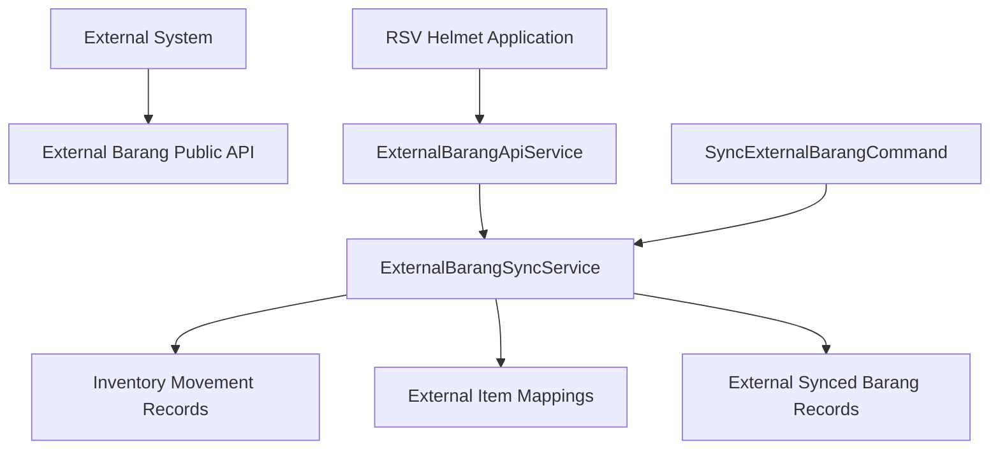
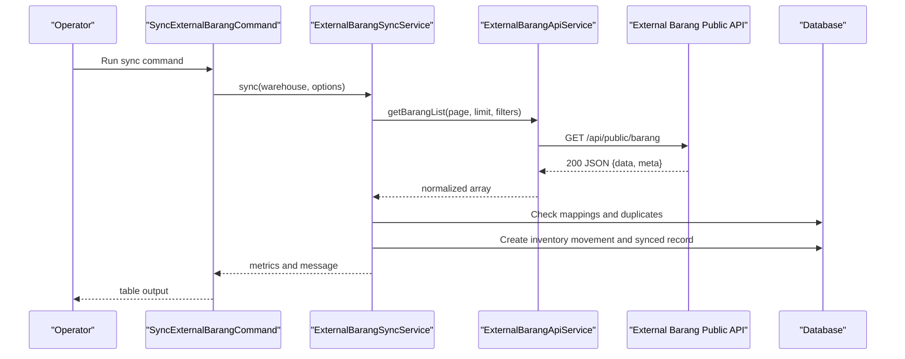
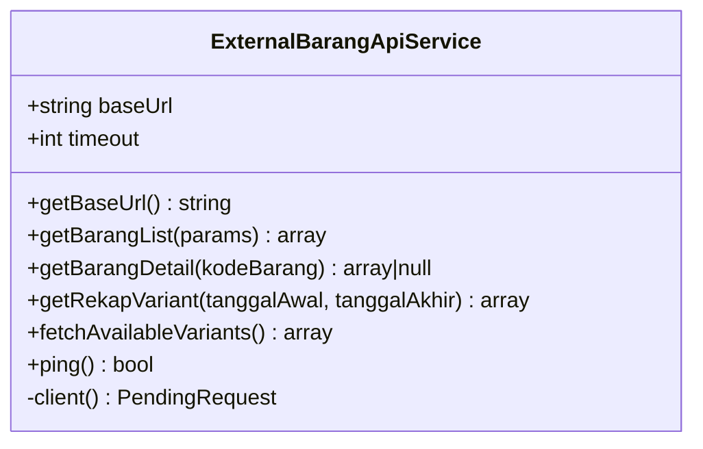
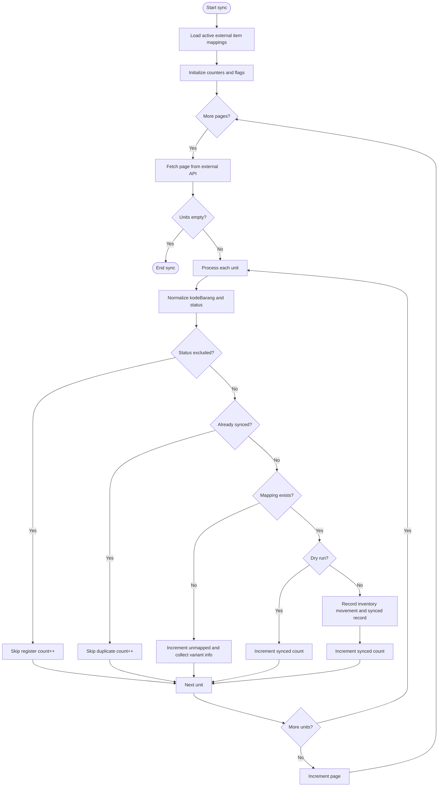
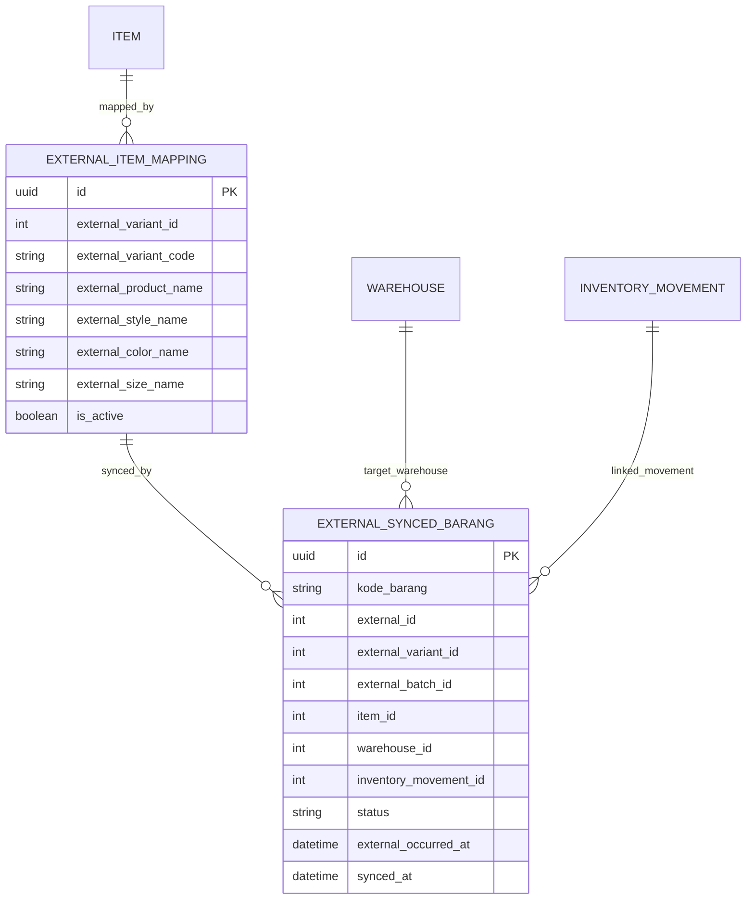
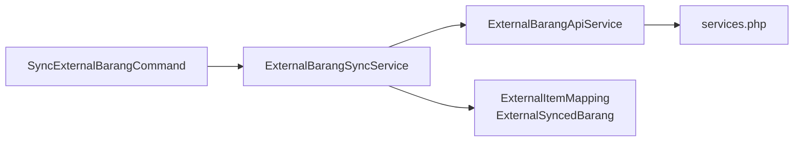

# API Reference

<cite>
**Referenced Files in This Document**
- [ExternalBarangApiService.php](file://app/Services/ExternalBarangApiService.php)
- [ExternalBarangSyncService.php](file://app/Services/ExternalBarangSyncService.php)
- [SyncExternalBarangCommand.php](file://app/Console/Commands/SyncExternalBarangCommand.php)
- [web.php](file://routes/web.php)
- [console.php](file://routes/console.php)
- [services.php](file://config/services.php)
- [ExternalItemMapping.php](file://app/Models/ExternalItemMapping.php)
- [ExternalSyncedBarang.php](file://app/Models/ExternalSyncedBarang.php)
- [ExternalBarangApiServiceTest.php](file://tests/Feature/ExternalBarangApiServiceTest.php)
</cite>

## Table of Contents
1. [Introduction](#introduction)
2. [Project Structure](#project-structure)
3. [Core Components](#core-components)
4. [Architecture Overview](#architecture-overview)
5. [Detailed Component Analysis](#detailed-component-analysis)
6. [Dependency Analysis](#dependency-analysis)
7. [Performance Considerations](#performance-considerations)
8. [Troubleshooting Guide](#troubleshooting-guide)
9. [Conclusion](#conclusion)

## Introduction
This document describes RSV Helmet’s external integration surface for the external barang system. It covers:
- The external public REST endpoints consumed by RSV Helmet.
- Request and response schemas used by the external barang API.
- Authentication and security considerations.
- The external barang API client implementation, including error handling and retry guidance.
- Console commands for background synchronization and scheduled tasks.
- Rate limiting, monitoring, and troubleshooting guidance.

RSV Helmet does not expose its own public REST API for external systems; instead, it consumes a public external barang API and synchronizes finished goods into internal inventory.

## Project Structure
The external integration is implemented primarily through:
- An HTTP client service that calls the external barang API.
- A synchronization service that transforms external data into internal stock movements.
- A console command that orchestrates the sync process.
- Configuration for base URL, timeout, excluded statuses, and default warehouse.
- Models for mapping external variants to internal items and tracking synced units.

**Diagram sources**
- [ExternalBarangApiService.php:10-186](file://app/Services/ExternalBarangApiService.php#L10-L186)
- [ExternalBarangSyncService.php:14-242](file://app/Services/ExternalBarangSyncService.php#L14-L242)
- [SyncExternalBarangCommand.php:9-89](file://app/Console/Commands/SyncExternalBarangCommand.php#L9-L89)

**Section sources**
- [ExternalBarangApiService.php:10-186](file://app/Services/ExternalBarangApiService.php#L10-L186)
- [ExternalBarangSyncService.php:14-242](file://app/Services/ExternalBarangSyncService.php#L14-L242)
- [SyncExternalBarangCommand.php:9-89](file://app/Console/Commands/SyncExternalBarangCommand.php#L9-L89)
- [services.php:38-43](file://config/services.php#L38-L43)

## Core Components
- ExternalBarangApiService: Encapsulates HTTP requests to the external barang API, handles timeouts, JSON parsing, and logging.
- ExternalBarangSyncService: Orchestrates pagination, filtering, idempotency checks, variant mapping, and creation of inventory movements.
- SyncExternalBarangCommand: Provides CLI options for running the sync with dry-run, limit, page iteration, status filters, and target warehouse selection.
- Configuration: Defines external API base URL, timeout, excluded statuses, and default warehouse ID.
- Models: Track mappings between external variants and internal items, and record each synced unit.

**Section sources**
- [ExternalBarangApiService.php:10-186](file://app/Services/ExternalBarangApiService.php#L10-L186)
- [ExternalBarangSyncService.php:14-242](file://app/Services/ExternalBarangSyncService.php#L14-L242)
- [SyncExternalBarangCommand.php:9-89](file://app/Console/Commands/SyncExternalBarangCommand.php#L9-L89)
- [services.php:38-43](file://config/services.php#L38-L43)
- [ExternalItemMapping.php:13-47](file://app/Models/ExternalItemMapping.php#L13-L47)
- [ExternalSyncedBarang.php:11-60](file://app/Models/ExternalSyncedBarang.php#L11-L60)

## Architecture Overview
The external integration follows a consumer pattern:
- RSV Helmet calls the external barang public API to list units, fetch details, and retrieve aggregated variant recap data.
- The sync service paginates results, applies business rules (excluded statuses, duplicates, unmapped variants), and records successful units as inventory movements.
- Console commands provide operational control over the sync process.

**Diagram sources**
- [SyncExternalBarangCommand.php:33-87](file://app/Console/Commands/SyncExternalBarangCommand.php#L33-L87)
- [ExternalBarangSyncService.php:40-221](file://app/Services/ExternalBarangSyncService.php#L40-L221)
- [ExternalBarangApiService.php:33-55](file://app/Services/ExternalBarangApiService.php#L33-L55)

## Detailed Component Analysis

### External Barang Public API Endpoints
RSV Helmet consumes these public endpoints:

- List units
  - Method: GET
  - Path: `/api/public/barang`
  - Query parameters:
    - `page`: integer, starting at 1
    - `limit`: integer, maximum 100
    - `variantId`: integer, optional filter
    - `status`: string, optional filter
  - Success response schema:
    - `data`: array of unit objects
    - `meta`: object containing pagination metadata such as `totalPages`
  - Error behavior:
    - Non-success responses are logged and converted to empty arrays for safe consumption.

- Detail unit by code
  - Method: GET
  - Path: `/api/public/barang/{kodeBarang}`
  - Path parameter:
    - `kodeBarang`: string, URL-encoded
  - Success response schema:
    - Single unit object or null if not found
  - Error behavior:
    - Non-success responses return null and log errors.

- Variant recap aggregation
  - Method: GET
  - Path: `/api/public/barang/rekap-variant`
  - Query parameters:
    - `tanggalAwal`: optional date string
    - `tanggalAkhir`: optional date string
  - Success response schema:
    - `data`: array of aggregated variant entries
    - `statuses`: array of status strings
    - `total`: integer total count
  - Error behavior:
    - Non-success responses return empty structures and log errors.

- Health check
  - Method: GET
  - Path: `/api/public/barang`
  - Purpose: verify reachability with a minimal request
  - Behavior: returns boolean based on success status

**Section sources**
- [ExternalBarangApiService.php:33-108](file://app/Services/ExternalBarangApiService.php#L33-L108)
- [ExternalBarangApiService.php:170-179](file://app/Services/ExternalBarangApiService.php#L170-L179)
- [ExternalBarangApiServiceTest.php:75-105](file://tests/Feature/ExternalBarangApiServiceTest.php#L75-L105)

### Authentication Methods
- The current client configuration does not include authentication headers or tokens.
- Requests use a plain HTTP client with base URL and timeout configured via environment variables.
- If the external API requires authentication, add token-based headers to the shared client builder.

Security recommendations:
- Use HTTPS for all external API calls.
- Store credentials in environment variables and never hardcode them.
- Add explicit authentication headers in the client macro or base client setup.
- Validate and sanitize query parameters before sending them to the external API.

**Section sources**
- [ExternalBarangApiService.php:16-20](file://app/Services/ExternalBarangApiService.php#L16-L20)
- [ExternalBarangApiService.php:181-186](file://app/Services/ExternalBarangApiService.php#L181-L186)
- [services.php:38-43](file://config/services.php#L38-L43)

### External Barang API Client Implementation
Responsibilities:
- Build HTTP requests with base URL and timeout.
- Accept JSON responses.
- Handle non-successful responses gracefully.
- Log warnings and errors with contextual information.
- Provide a health check method.

Error handling patterns:
- Network exceptions are caught and logged; methods return safe fallback values.
- Non-success HTTP responses are logged with status and body where applicable.
- Null-safe accessors prevent crashes when fields are missing.

Retry logic:
- The current implementation does not implement automatic retries.
- For idempotent GET requests, consider adding retry logic for transient failures and rate-limit responses.
- Avoid retries for state-changing operations unless the remote API supports idempotency keys.

Data transformation:
- The client returns raw JSON arrays; higher-level services transform these into domain models and database records.
- Variant extraction normalizes nested product/style/color/size structures.

**Diagram sources**
- [ExternalBarangApiService.php:10-186](file://app/Services/ExternalBarangApiService.php#L10-L186)

**Section sources**
- [ExternalBarangApiService.php:33-186](file://app/Services/ExternalBarangApiService.php#L33-L186)

### Synchronization Service
Responsibilities:
- Paginate external unit lists.
- Apply business rules:
  - Exclude specified statuses (default includes REGISTER).
  - Skip already-synced units using idempotency checks.
  - Skip unmapped variants and collect them for reporting.
- Transform external data into internal inventory movements.
- Record synced units with reference to mappings and movements.

Processing flow:

**Diagram sources**
- [ExternalBarangSyncService.php:40-221](file://app/Services/ExternalBarangSyncService.php#L40-L221)

Key behaviors:
- Pagination respects `all_pages`, `limit`, and `page`.
- Filters support `status` and `variantId`.
- Date resolution prefers finish-good timestamps, falling back to current time.
- Database transactions ensure atomicity per unit.

**Section sources**
- [ExternalBarangSyncService.php:40-242](file://app/Services/ExternalBarangSyncService.php#L40-L242)

### Console Commands
Command name: `sync:external-barang`

Options:
- `--warehouse=ID`: Target warehouse ID; defaults to configured default or first active warehouse.
- `--limit=N`: Number of records per request, capped at 100.
- `--all-pages`: Iterate through all paginated results.
- `--status=VALUE`: Filter by external status.
- `--dry-run`: Simulate processing without creating stock movements.

Output:
- Summary table with processed counts, skipped counts, and unmapped variants.
- Warning list for unmapped external variants requiring mapping configuration.

Usage examples:
- Basic sync to default warehouse:
  - `php artisan sync:external-barang`
- Sync with custom limit and all pages:
  - `php artisan sync:external-barang --limit=50 --all-pages`
- Dry-run simulation:
  - `php artisan sync:external-barang --dry-run`
- Filter by status:
  - `php artisan sync:external-barang --status=FINISHGOOD`

Scheduled tasks:
- Register the command in the Laravel scheduler to run periodically.
- Example scheduling approach:
  - Schedule daily execution during off-peak hours.
  - Use queue worker for long-running jobs if needed.

**Section sources**
- [SyncExternalBarangCommand.php:16-87](file://app/Console/Commands/SyncExternalBarangCommand.php#L16-L87)
- [console.php:6-8](file://routes/console.php#L6-L8)

### Data Models and Relationships
- ExternalItemMapping maps external variant identifiers to internal items.
- ExternalSyncedBarang tracks each synced unit, linking to mappings, warehouses, and inventory movements.

**Diagram sources**
- [ExternalItemMapping.php:13-47](file://app/Models/ExternalItemMapping.php#L13-L47)
- [ExternalSyncedBarang.php:11-60](file://app/Models/ExternalSyncedBarang.php#L11-L60)

**Section sources**
- [ExternalItemMapping.php:13-47](file://app/Models/ExternalItemMapping.php#L13-L47)
- [ExternalSyncedBarang.php:11-60](file://app/Models/ExternalSyncedBarang.php#L11-L60)

## Dependency Analysis
Component relationships:
- SyncExternalBarangCommand depends on ExternalBarangSyncService.
- ExternalBarangSyncService depends on ExternalBarangApiService and StockMovementService.
- ExternalBarangApiService depends on Laravel HTTP client and configuration.
- Sync service depends on Eloquent models for mappings and synced records.

**Diagram sources**
- [SyncExternalBarangCommand.php:9-89](file://app/Console/Commands/SyncExternalBarangCommand.php#L9-L89)
- [ExternalBarangSyncService.php:14-242](file://app/Services/ExternalBarangSyncService.php#L14-L242)
- [ExternalBarangApiService.php:10-186](file://app/Services/ExternalBarangApiService.php#L10-L186)
- [services.php:38-43](file://config/services.php#L38-L43)

**Section sources**
- [SyncExternalBarangCommand.php:9-89](file://app/Console/Commands/SyncExternalBarangCommand.php#L9-L89)
- [ExternalBarangSyncService.php:14-242](file://app/Services/ExternalBarangSyncService.php#L14-L242)
- [ExternalBarangApiService.php:10-186](file://app/Services/ExternalBarangApiService.php#L10-L186)
- [services.php:38-43](file://config/services.php#L38-L43)

## Performance Considerations
- Pagination: Use reasonable limits (default 100) and iterate pages only when necessary.
- Timeout: Configure appropriate timeouts to avoid hanging requests.
- Idempotency: Prevent duplicate processing by checking synced records.
- Transaction scope: Keep database transactions small and focused per unit.
- Caching: Consider caching mappings and variant lists if external API rate limits are tight.
- Retry strategy: Implement retries for transient network errors and 429 responses for idempotent GET requests.

[No sources needed since this section provides general guidance]

## Troubleshooting Guide
Common issues and resolutions:
- External API unreachable:
  - Verify base URL and network connectivity.
  - Use the ping method to test reachability.
  - Check logs for connection errors.
- Non-success HTTP responses:
  - Inspect warning logs for status codes and response bodies.
  - Validate external API availability and authentication.
- No units processed:
  - Confirm filters (`status`, `variantId`) are correct.
  - Ensure mappings exist for external variants.
  - Check excluded statuses configuration.
- Unmapped variants:
  - Review the command output for unmapped variant details.
  - Create mappings in the admin interface or via data seeding.
- Duplicate processing:
  - Existing synced records will be skipped; clear or adjust sync scope if needed.
- Date resolution failures:
  - Ensure external dates are parseable; fallback uses current time.

Monitoring approaches:
- Centralize logs for external API calls and sync outcomes.
- Track metrics such as total processed, synced, skipped, and unmapped counts.
- Alert on repeated connection failures or high unmapped variant rates.

Rate limiting:
- Respect external API limits by adjusting limits and page iteration.
- Add exponential backoff and retry logic for 429 responses.
- Monitor request frequency and throttle internal consumers if needed.

Security considerations:
- Enforce HTTPS for external API communication.
- Store credentials securely in environment variables.
- Add authentication headers to the client when required.
- Validate and sanitize inputs before making external requests.

**Section sources**
- [ExternalBarangApiService.php:33-108](file://app/Services/ExternalBarangApiService.php#L33-L108)
- [ExternalBarangSyncService.php:101-194](file://app/Services/ExternalBarangSyncService.php#L101-L194)
- [SyncExternalBarangCommand.php:61-83](file://app/Console/Commands/SyncExternalBarangCommand.php#L61-L83)

## Conclusion
RSV Helmet integrates with the external barang system by consuming public REST endpoints, transforming external data into internal inventory movements, and providing operational control through console commands. The current implementation emphasizes graceful degradation, idempotency, and clear logging. To strengthen production readiness, add authentication, retry logic for transient failures, and comprehensive monitoring and alerting around external API health and sync metrics.

[No sources needed since this section summarizes without analyzing specific files]