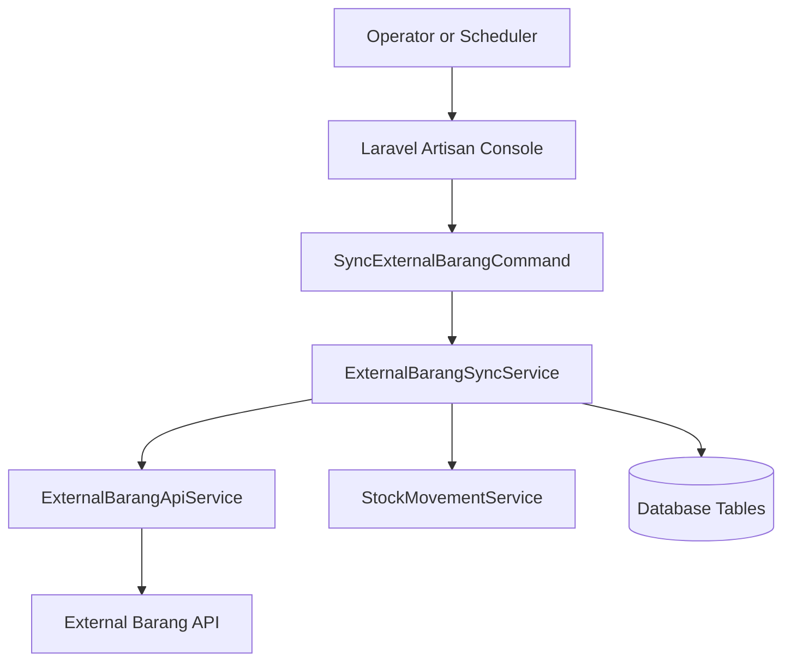
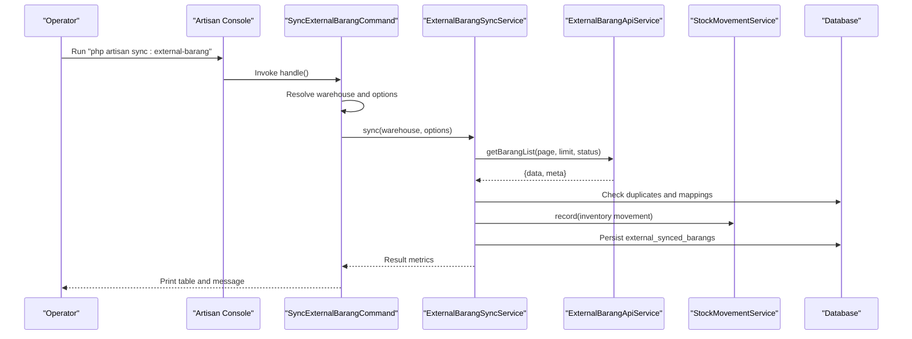
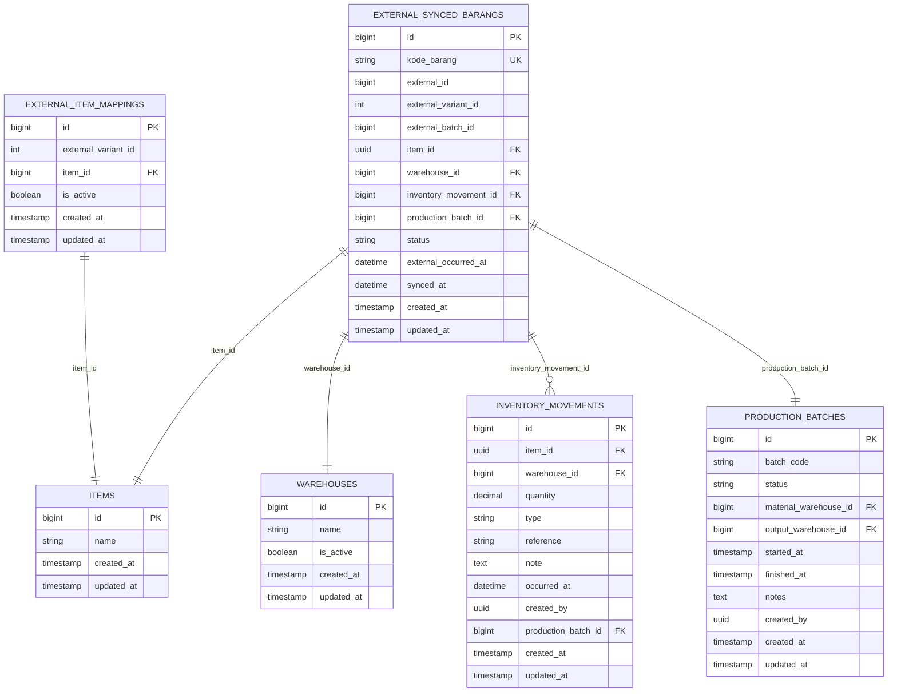
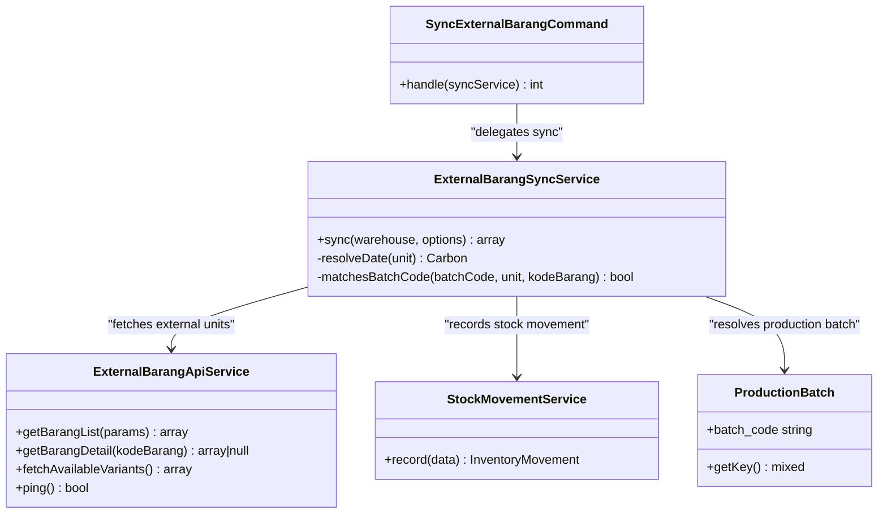

# Console Commands

<cite>
**Referenced Files in This Document**   
- [SyncExternalBarangCommand.php](file://app/Console/Commands/SyncExternalBarangCommand.php)
- [ExternalBarangSyncService.php](file://app/Services/ExternalBarangSyncService.php)
- [ExternalBarangApiService.php](file://app/Services/ExternalBarangApiService.php)
- [ProductionBatch.php](file://app/Models/ProductionBatch.php)
- [services.php](file://config/services.php)
- [console.php](file://routes/console.php)
- [0001_01_01_000002_create_jobs_table.php](file://database/migrations/0001_01_01_000002_create_jobs_table.php)
- [queue.php](file://config/queue.php)
- [scheduling.md](file://.claude/skills/laravel-best-practices/rules/scheduling.md)
- [error-handling.md](file://.claude/skills/laravel-best-practices/rules/error-handling.md)
- [ExternalBarangSyncServiceTest.php](file://tests/Feature/ExternalBarangSyncServiceTest.php)
- [ExternalBarangApiServiceTest.php](file://tests/Feature/ExternalBarangApiServiceTest.php)
</cite>

## Update Summary
**Changes Made**   
- Updated SyncExternalBarangCommand section to document new --batch and --kode-batch options
- Enhanced command options reference with granular batch control capabilities
- Added examples for production batch synchronization workflows
- Updated usage patterns to include batch-specific operations
- Enhanced troubleshooting guide with batch-related scenarios

## Table of Contents
1. [Introduction](#introduction)
2. [Project Structure](#project-structure)
3. [Core Components](#core-components)
4. [Architecture Overview](#architecture-overview)
5. [Detailed Component Analysis](#detailed-component-analysis)
6. [Dependency Analysis](#dependency-analysis)
7. [Performance Considerations](#performance-considerations)
8. [Troubleshooting Guide](#troubleshooting-guide)
9. [Conclusion](#conclusion)
10. [Appendices](#appendices)

## Introduction
This document explains the Laravel console commands available in RSV Helmet, with a focused deep dive on `sync:external-barang`. It covers command options, execution parameters, output formatting, scheduling guidance, monitoring, return codes, logging and error handling, troubleshooting tips, performance strategies, and how to extend the command system with new custom commands.

The primary command synchronizes external finished-goods unit data from an external public API into RSV Helmet's warehouse inventory. The command is thin: it resolves target warehouse configuration, delegates synchronization logic to a service, and formats results for the operator. **Updated**: The command now supports granular control over external data synchronization through production batch targeting and external batch code filtering.

## Project Structure
The console command lives under the standard Laravel console commands directory. Synchronization logic is split into dedicated services so that the command remains simple and testable. Configuration for the external barang API is centralized in the application services configuration.

**Diagram sources**
- [SyncExternalBarangCommand.php:16-28](file://app/Console/Commands/SyncExternalBarangCommand.php#L16-L28)
- [ExternalBarangSyncService.php:16-40](file://app/Services/ExternalBarangSyncService.php#L16-L40)
- [ExternalBarangApiService.php:16-20](file://app/Services/ExternalBarangApiService.php#L16-L20)

**Section sources**
- [SyncExternalBarangCommand.php:1-28](file://app/Console/Commands/SyncExternalBarangCommand.php#L1-L28)
- [services.php:38-43](file://config/services.php#L38-L43)

## Core Components
- **SyncExternalBarangCommand**: Defines the `sync:external-barang` command, its signature, description, options, and console output.
- **ExternalBarangSyncService**: Implements the synchronization workflow, including pagination, status filtering, idempotency checks, mapping validation, stock movement recording, and result aggregation.
- **ExternalBarangApiService**: Handles HTTP communication with the external barang API, including request building, timeout configuration, error logging, and basic connectivity checks.
- **Configuration**: External API base URL, timeout, excluded statuses, and default warehouse ID are configured through the services configuration file.

Key responsibilities:
- Command layer: input parsing, user feedback, return code control.
- Service layer: business rules, database transactions, metrics collection.
- API layer: network requests, response normalization, error logging.

**Section sources**
- [SyncExternalBarangCommand.php:16-87](file://app/Console/Commands/SyncExternalBarangCommand.php#L16-L87)
- [ExternalBarangSyncService.php:21-221](file://app/Services/ExternalBarangSyncService.php#L21-L221)
- [ExternalBarangApiService.php:16-55](file://app/Services/ExternalBarangApiService.php#L16-L55)
- [services.php:38-43](file://config/services.php#L38-L43)

## Architecture Overview
The command orchestrates synchronization by delegating work to services. The sync service paginates external units, filters them by status, skips already synced items, validates variant mappings, records inventory movements, and persists synchronization history.

**Diagram sources**
- [SyncExternalBarangCommand.php:33-87](file://app/Console/Commands/SyncExternalBarangCommand.php#L33-L87)
- [ExternalBarangSyncService.php:40-221](file://app/Services/ExternalBarangSyncService.php#L40-L221)
- [ExternalBarangApiService.php:33-55](file://app/Services/ExternalBarangApiService.php#L33-L55)

## Detailed Component Analysis

### SyncExternalBarangCommand
The command defines:
- Command name: `sync:external-barang`
- Options:
  - `--warehouse`: Target warehouse ID; if omitted, falls back to configuration or selects the first active warehouse.
  - `--batch`: Production batch ID for linking synchronized units to a specific production run.
  - `--kode-batch`: Filter external units by external batch code (e.g., BC001).
  - `--limit`: Records per request, capped at 100.
  - `--all-pages`: Pull all pages from the external API pagination.
  - `--status`: Filter external units by a specific status.
  - `--dry-run`: Simulate processing without creating stock movements.

**Updated**: New batch control options provide granular control over external data synchronization.

Execution flow:
1. Resolve warehouse ID from option or configuration.
2. Load active warehouse; fail fast if none found.
3. Validate production batch ID if provided (--batch option).
4. Build sync options from command flags including batch filtering.
5. Call the sync service and collect metrics.
6. Output a formatted table with processed counts and unmapped variants.
7. Return success or failure code.

Return codes:
- Success: returns the standard success constant when the command completes normally.
- Failure: returns the standard failure constant when no active warehouse is found or invalid production batch is specified.

Output formatting:
- Uses console tables to display metrics such as total processed, synced count, skipped register count, skipped duplicate count, and unmapped count.
- Optionally prints a second table listing unmapped external variants.

Example usage patterns:
- Manual run with explicit warehouse:
  - `php artisan sync:external-barang --warehouse=1`
- Production batch synchronization:
  - `php artisan sync:external-barang --warehouse=1 --batch=123`
- External batch code filtering:
  - `php artisan sync:external-barang --warehouse=1 --kode-batch=BC001`
- Combined batch controls:
  - `php artisan sync:external-barang --warehouse=1 --batch=123 --kode-batch=BC001`
- Dry-run simulation:
  - `php artisan sync:external-barang --dry-run`
- Full-page pull with status filter:
  - `php artisan sync:external-barang --all-pages --status=FINISHGOOD`

Monitoring manual execution:
- Inspect console output tables and messages.
- Check the `external_synced_barangs` table for newly recorded entries.
- Review application logs for errors during stock movement recording.

**Section sources**
- [SyncExternalBarangCommand.php:16-87](file://app/Console/Commands/SyncExternalBarangCommand.php#L16-L87)
- [ExternalBarangSyncServiceTest.php:230-255](file://tests/Feature/ExternalBarangSyncServiceTest.php#L230-L255)

### ExternalBarangSyncService
Responsibilities:
- Normalize options (limit, page, all_pages, dry_run, status).
- Load active external item mappings keyed by external variant ID.
- Paginate external units via the API service.
- Skip units with excluded statuses (default includes REGISTER).
- Enforce idempotency by checking existing synced records.
- Validate variant mappings; collect unmapped variants for reporting.
- Record inventory movements inside a database transaction.
- Persist synchronization history in `external_synced_barangs`.
- Aggregate metrics and return a structured result array.

**Updated**: Enhanced with batch filtering capabilities through `matchesBatchCode()` method and support for production batch linking.

Complexity considerations:
- Pagination loop runs until either no more data or all pages are consumed.
- Per-unit checks include database existence queries and mapping lookups.
- Transactional stock recording ensures consistency between movement and sync history.
- Batch code matching supports multiple field variations from external API responses.

Error handling:
- Individual unit failures during stock recording are caught and logged without aborting the entire batch.
- API failures return empty data structures and log warnings/errors.
- Invalid production batch IDs are validated early in the command execution.

Metrics returned:
- success, warehouse_id, warehouse_name, synced_count, skipped_register_count, skipped_duplicate_count, unmapped_count, unmapped_variants, total_processed, dry_run, message.

**Section sources**
- [ExternalBarangSyncService.php:21-221](file://app/Services/ExternalBarangSyncService.php#L21-L221)
- [ExternalBarangSyncService.php:709-733](file://app/Services/ExternalBarangSyncService.php#L709-L733)
- [ExternalBarangSyncServiceTest.php:85-156](file://tests/Feature/ExternalBarangSyncServiceTest.php#L85-L156)
- [ExternalBarangSyncServiceTest.php:158-228](file://tests/Feature/ExternalBarangSyncServiceTest.php#L158-L228)

### ExternalBarangApiService
Responsibilities:
- Build HTTP client with base URL and timeout from configuration.
- Fetch unit list with query parameters (page, limit, variantId, status).
- Fetch single unit detail by kodeBarang.
- Fetch aggregated variant recap endpoint.
- Extract unique available variants for mapping assistance.
- Provide ping method to check external API reachability.

Error handling:
- Network exceptions and non-successful responses are logged and normalized to safe defaults.
- Timeout and accept headers are applied consistently.

Configuration:
- Base URL and timeout come from `services.external_barang.base_url` and `services.external_barang.timeout`.

**Section sources**
- [ExternalBarangApiService.php:16-55](file://app/Services/ExternalBarangApiService.php#L16-L55)
- [ExternalBarangApiService.php:57-109](file://app/Services/ExternalBarangApiService.php#L57-L109)
- [ExternalBarangApiService.php:124-186](file://app/Services/ExternalBarangApiService.php#L124-L186)
- [services.php:38-43](file://config/services.php#L38-L43)

### Data Model Relationships
The synchronization process interacts with several models and tables:
- `ExternalSyncedBarang` tracks each successfully synchronized external unit.
- `InventoryMovement` records stock changes.
- `Warehouse` identifies the destination storage location.
- `ExternalItemMapping` maps external variants to internal items.
- `ProductionBatch` links synchronized units to specific production runs.

**Diagram sources**
- [0001_01_01_000002_create_jobs_table.php:14-47](file://database/migrations/0001_01_01_000002_create_jobs_table.php#L14-L47)
- [2026_11_23_000002_create_external_synced_barangs_table.php:14-37](file://database/migrations/2026_11_23_000002_create_external_synced_barangs_table.php#L14-L37)
- [ProductionBatch.php:12-21](file://app/Models/ProductionBatch.php#L12-L21)

## Dependency Analysis
The command depends on services rather than directly on HTTP clients or complex business logic. This keeps coupling low and cohesion high.

**Diagram sources**
- [SyncExternalBarangCommand.php:33-87](file://app/Console/Commands/SyncExternalBarangCommand.php#L33-L87)
- [ExternalBarangSyncService.php:16-40](file://app/Services/ExternalBarangSyncService.php#L16-L40)
- [ExternalBarangApiService.php:33-55](file://app/Services/ExternalBarangApiService.php#L33-L55)
- [ProductionBatch.php:12-21](file://app/Models/ProductionBatch.php#L12-L21)

**Section sources**
- [SyncExternalBarangCommand.php:16-87](file://app/Console/Commands/SyncExternalBarangCommand.php#L16-L87)
- [ExternalBarangSyncService.php:16-40](file://app/Services/ExternalBarangSyncService.php#L16-L40)
- [ExternalBarangApiService.php:16-55](file://app/Services/ExternalBarangApiService.php#L16-L55)

## Performance Considerations
- Use `--limit` to cap API requests per page. The service enforces a maximum of 100 records per request.
- Use `--all-pages` only when necessary; pulling all pages increases API calls and processing time.
- Prefer `--status` filtering to reduce payload size when you only need specific unit states.
- **Updated**: Use `--kode-batch` filtering to process only relevant external batches, reducing unnecessary API calls and processing overhead.
- **Updated**: Link synchronized units to production batches using `--batch` for better tracking and reporting without impacting performance.
- Avoid running multiple long-running sync tasks concurrently unless you have proper locking and queue isolation.
- Monitor database indexes on `external_synced_barangs.kode_barang`, `external_variant_id`, `synced_at`, and `production_batch_id` to ensure efficient duplicate checks and reporting.
- For scheduled background execution, consider using Laravel scheduler best practices such as `withoutOverlapping()` and `runInBackground()` where appropriate.

## Troubleshooting Guide

Common issues and resolutions:
- No active warehouse found:
  - Ensure at least one active warehouse exists or pass `--warehouse=<id>`.
  - Check configuration fallback `services.external_barang.default_warehouse_id`.
- **Updated**: Invalid production batch ID:
  - Verify the production batch ID exists using `--batch=<id>` and ensure the batch is valid.
  - Check that the production batch has not been deleted or modified.
- **Updated**: External batch code filtering returns no results:
  - Verify the external batch code format matches expected patterns (e.g., BC001).
  - Check that the external API returns batch information in supported fields.
- External API unreachable:
  - Verify `EXTERNAL_BARANG_API_URL` and timeout settings.
  - Use the API service ping capability conceptually to validate connectivity before running full sync.
- Units not syncing:
  - Check excluded statuses; REGISTER is excluded by default.
  - Confirm external variant mappings exist and are active.
  - Inspect unmapped variants reported by the command.
- Duplicate units skipped:
  - Idempotency prevents re-syncing the same `kode_barang`; verify whether the unit was already recorded.
- Database transaction failures:
  - Individual unit failures are logged; review application logs for details and retry after resolving constraints.

Logging and error handling:
- API errors and non-successful responses are logged with context.
- Stock movement recording errors are caught and logged per unit, allowing the rest of the batch to continue.
- **Updated**: Batch code matching errors are handled gracefully, supporting multiple field variations from external API responses.
- Follow project error handling guidelines for consistent reporting and rendering policies.

Monitoring command execution:
- Inspect console output tables and final message.
- Query `external_synced_barangs` for recent sync records.
- Review application logs for warnings and errors related to API calls and stock recording.
- **Updated**: Check production batch relationships to verify units are properly linked to production runs.
- If scheduling automated runs, monitor scheduler logs and job queues.

**Section sources**
- [SyncExternalBarangCommand.php:35-45](file://app/Console/Commands/SyncExternalBarangCommand.php#L35-L45)
- [SyncExternalBarangCommand.php:50-57](file://app/Console/Commands/SyncExternalBarangCommand.php#L50-L57)
- [ExternalBarangSyncService.php:189-194](file://app/Services/ExternalBarangSyncService.php#L189-L194)
- [ExternalBarangSyncService.php:709-733](file://app/Services/ExternalBarangSyncService.php#L709-L733)
- [ExternalBarangApiService.php:42-54](file://app/Services/ExternalBarangApiService.php#L42-L54)
- [error-handling.md:1-45](file://.claude/skills/laravel-best-practices/rules/error-handling.md#L1-L45)

## Conclusion
RSV Helmet's console command surface currently centers on `sync:external-barang`, which provides a robust, configurable, and observable way to synchronize external finished-goods units into warehouse inventory. **Updated**: The command now offers enhanced control over external data synchronization through production batch targeting and external batch code filtering. The command delegates business logic to services, ensuring clean separation of concerns, testability, and maintainability. Operators can run the command manually with fine-grained options, schedule it for automation, and monitor outcomes through console output, database records, and application logs. Extending the command system follows standard Laravel conventions and benefits from the existing service architecture.

## Appendices

### Command Options Reference
- `--warehouse=<id>`: Target warehouse ID for stock addition. Falls back to configuration or first active warehouse.
- `--batch=<id>`: Production batch ID for linking synchronized units to a specific production run.
- `--kode-batch=<code>`: Filter external units by external batch code (e.g., BC001). Supports flexible matching across multiple API response fields.
- `--limit=<n>`: Records per request, capped at 100.
- `--all-pages`: Pull all pages from external API pagination.
- `--status=<value>`: Filter external units by a specific status.
- `--dry-run`: Simulate processing without creating stock movements.

**Section sources**
- [SyncExternalBarangCommand.php:16-21](file://app/Console/Commands/SyncExternalBarangCommand.php#L16-L21)
- [ExternalBarangSyncService.php:40-59](file://app/Services/ExternalBarangSyncService.php#L40-L59)
- [ExternalBarangSyncService.php:709-733](file://app/Services/ExternalBarangSyncService.php#L709-L733)

### Usage Examples

Manual execution:
- Basic sync to default warehouse:
  - `php artisan sync:external-barang`
- Explicit warehouse:
  - `php artisan sync:external-barang --warehouse=1`
- **Updated**: Production batch synchronization:
  - `php artisan sync:external-barang --warehouse=1 --batch=123`
- **Updated**: External batch code filtering:
  - `php artisan sync:external-barang --warehouse=1 --kode-batch=BC001`
- **Updated**: Combined batch controls:
  - `php artisan sync:external-barang --warehouse=1 --batch=123 --kode-batch=BC001`
- Dry-run simulation:
  - `php artisan sync:external-barang --dry-run`
- Full-page pull with status filter:
  - `php artisan sync:external-barang --all-pages --status=FINISHGOOD`

Automated scheduling:
- Add a scheduled task in your application's scheduler configuration to run the command periodically.
- Apply best practices such as `withoutOverlapping()` and `runInBackground()` where appropriate.
- Ensure the scheduler process is running and cron is configured to invoke the Laravel scheduler every minute.

Monitoring:
- Observe console output tables and messages.
- Check `external_synced_barangs` for recent entries.
- Review application logs for API and database errors.
- **Updated**: Verify production batch relationships for synchronized units.
- If using queues, inspect job batches and failed jobs.

**Section sources**
- [ExternalBarangSyncServiceTest.php:230-255](file://tests/Feature/ExternalBarangSyncServiceTest.php#L230-L255)
- [scheduling.md:1-62](file://.claude/skills/laravel-best-practices/rules/scheduling.md#L1-L62)

### Extending the Command System
To add a new custom command:
- Create a new class under `app/Console/Commands` extending Laravel's `Command`.
- Define `$signature` and `$description`.
- Implement `handle()` with dependency injection for services.
- Use console helpers like `info`, `warn`, `error`, and `table` for user feedback.
- Return appropriate exit codes (`SUCCESS`, `FAILURE`).
- Register the command automatically via Laravel's command discovery or explicitly in the console route file if needed.

Best practices:
- Keep commands thin; delegate business logic to services.
- Use configuration for environment-specific values.
- Log important state and errors with contextual information.
- Write tests using `artisan()` assertions to validate command behavior.

**Section sources**
- [console.php:1-9](file://routes/console.php#L1-L9)
- [SyncExternalBarangCommand.php:16-87](file://app/Console/Commands/SyncExternalBarangCommand.php#L16-L87)

### Cron Job Setup Guidance
- Ensure the system cron invokes the Laravel scheduler every minute.
- Configure the scheduler to run the desired command at the required frequency.
- Use scheduler options to prevent overlap and run long tasks in the background.
- Restrict tasks to specific environments when necessary.

**Section sources**
- [scheduling.md:1-62](file://.claude/skills/laravel-best-practices/rules/scheduling.md#L1-L62)

### Queue and Job Infrastructure
The application includes infrastructure for queued jobs and batching:
- Jobs table schema supports queue processing.
- Failed jobs table supports failure tracking.
- Queue configuration supports multiple drivers and failed job storage.

Use queues for long-running or decoupled tasks triggered by commands or scheduled jobs.

**Section sources**
- [0001_01_01_000002_create_jobs_table.php:14-59](file://database/migrations/0001_01_01_000002_create_jobs_table.php#L14-L59)
- [queue.php:67-129](file://config/queue.php#L67-L129)