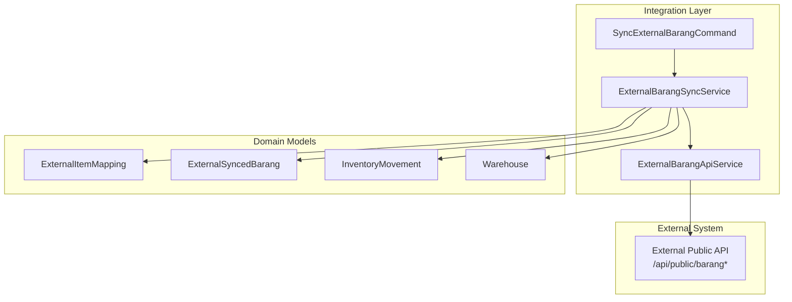
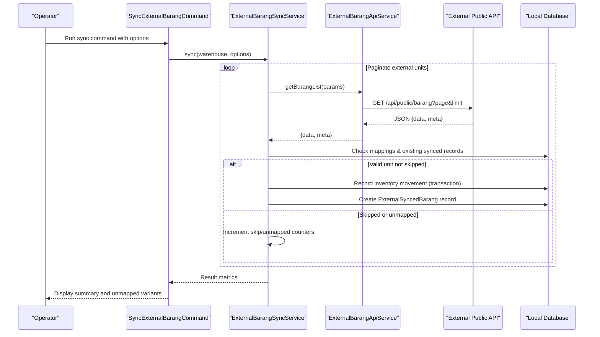
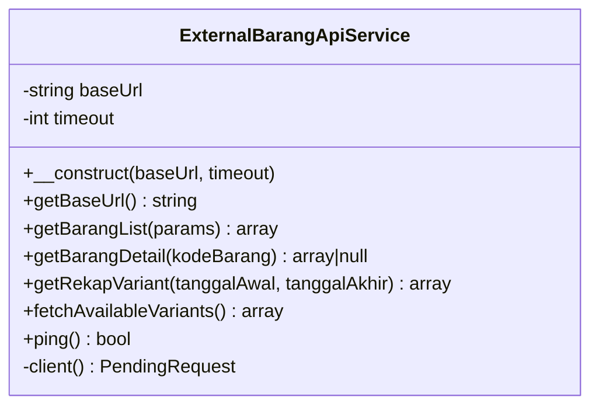
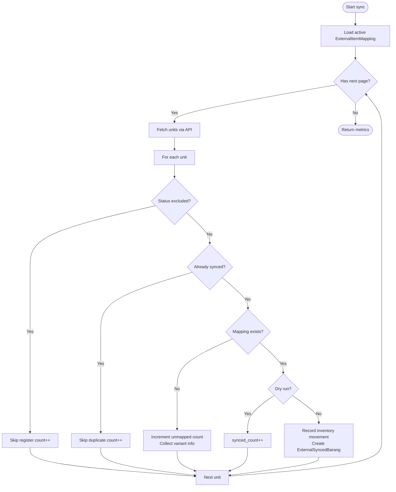
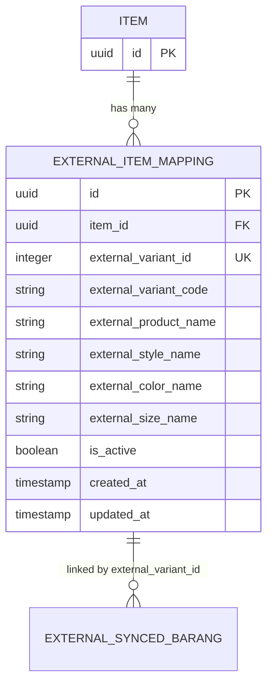
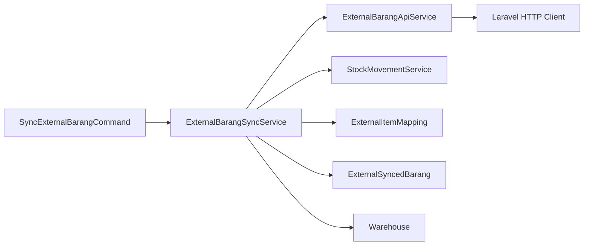

# External API Integration

<cite>
**Referenced Files in This Document**
- [ExternalBarangApiService.php](file://app/Services/ExternalBarangApiService.php)
- [ExternalBarangSyncService.php](file://app/Services/ExternalBarangSyncService.php)
- [ExternalItemMapping.php](file://app/Models/ExternalItemMapping.php)
- [ExternalSyncedBarang.php](file://app/Models/ExternalSyncedBarang.php)
- [2026_11_23_000001_create_external_item_mappings_table.php](file://database/migrations/2026_11_23_000001_create_external_item_mappings_table.php)
- [2026_11_23_000002_create_external_synced_barangs_table.php](file://database/migrations/2026_11_23_000002_create_external_synced_barangs_table.php)
- [SyncExternalBarangCommand.php](file://app/Console/Commands/SyncExternalBarangCommand.php)
- [ExternalBarangApiServiceTest.php](file://tests/Feature/ExternalBarangApiServiceTest.php)
</cite>

## Table of Contents
1. [Introduction](#introduction)
2. [Project Structure](#project-structure)
3. [Core Components](#core-components)
4. [Architecture Overview](#architecture-overview)
5. [Detailed Component Analysis](#detailed-component-analysis)
6. [Dependency Analysis](#dependency-analysis)
7. [Performance Considerations](#performance-considerations)
8. [Troubleshooting Guide](#troubleshooting-guide)
9. [Conclusion](#conclusion)

## Introduction
This document describes the external barang system integration used to synchronize finished goods from an external public API into the local inventory system. It focuses on:
- The HTTP client service for external API communication, including authentication configuration, request/response handling, and error management.
- The synchronization service that processes paginated external unit data, applies business rules, maps variants to internal items, updates stock movements, and tracks synchronized records.
- The data models for item mapping and synced records.
- Operational guidance for rate limiting, retries, logging, and common troubleshooting scenarios.

The integration is primarily driven by a console command that invokes the sync service with configurable options such as warehouse target, pagination limits, status filters, and dry-run mode.

## Project Structure
The external barang integration spans services, models, migrations, a console command, and feature tests:
- Services:
  - ExternalBarangApiService: HTTP client wrapper around the external public API.
  - ExternalBarangSyncService: Orchestration layer for syncing external units into local inventory.
- Models:
  - ExternalItemMapping: Maps external variant identifiers to internal items.
  - ExternalSyncedBarang: Tracks each successfully synchronized external unit.
- Migrations:
  - external_item_mappings table: Stores variant-to-item mappings.
  - external_synced_barangs table: Stores synchronized unit records.
- Console Command:
  - SyncExternalBarangCommand: Entry point for running sync jobs via Artisan.
- Tests:
  - Feature tests validating API responses and behavior.



**Diagram sources**
- [SyncExternalBarangCommand.php:33-59](file://app/Console/Commands/SyncExternalBarangCommand.php#L33-L59)
- [ExternalBarangSyncService.php:40-221](file://app/Services/ExternalBarangSyncService.php#L40-L221)
- [ExternalBarangApiService.php:33-185](file://app/Services/ExternalBarangApiService.php#L33-L185)

**Section sources**
- [SyncExternalBarangCommand.php:1-90](file://app/Console/Commands/SyncExternalBarangCommand.php#L1-L90)
- [ExternalBarangSyncService.php:1-242](file://app/Services/ExternalBarangSyncService.php#L1-L242)
- [ExternalBarangApiService.php:1-188](file://app/Services/ExternalBarangApiService.php#L1-L188)

## Core Components
- ExternalBarangApiService:
  - Provides methods to fetch the barang list, get a single barang detail, retrieve aggregated variant recap, extract available variants, and ping the external API.
  - Uses Laravel HTTP client with base URL and timeout configured via application config.
  - Handles non-successful responses gracefully by returning safe defaults and logging warnings/errors.
- ExternalBarangSyncService:
  - Orchestrates paginated fetching of external units, applies exclusion rules (e.g., REGISTER), idempotency checks, variant mapping validation, and stock movement recording.
  - Persists synchronization metadata through ExternalSyncedBarang and uses transactions to ensure consistency.
  - Supports dry-run mode and returns detailed metrics.
- ExternalItemMapping:
  - Represents the mapping between external variant identifiers and internal items.
  - Includes fields for external variant code, product/style/color/size names, and active flag.
- ExternalSyncedBarang:
  - Records each synchronized external unit with references to internal item, warehouse, and inventory movement.
  - Captures external identifiers, timestamps, and status.

**Section sources**
- [ExternalBarangApiService.php:10-186](file://app/Services/ExternalBarangApiService.php#L10-L186)
- [ExternalBarangSyncService.php:14-241](file://app/Services/ExternalBarangSyncService.php#L14-L241)
- [ExternalItemMapping.php:13-47](file://app/Models/ExternalItemMapping.php#L13-L47)
- [ExternalSyncedBarang.php:11-60](file://app/Models/ExternalSyncedBarang.php#L11-L60)

## Architecture Overview
The integration follows a layered approach:
- Command layer triggers sync operations with user-provided or default parameters.
- Sync service coordinates data retrieval, filtering, mapping, and persistence.
- API service abstracts HTTP interactions with the external system.
- Models represent domain entities and relationships.



**Diagram sources**
- [SyncExternalBarangCommand.php:33-87](file://app/Console/Commands/SyncExternalBarangCommand.php#L33-L87)
- [ExternalBarangSyncService.php:40-221](file://app/Services/ExternalBarangSyncService.php#L40-L221)
- [ExternalBarangApiService.php:33-55](file://app/Services/ExternalBarangApiService.php#L33-L55)

## Detailed Component Analysis

### ExternalBarangApiService
Responsibilities:
- Configure base URL and timeout from application configuration.
- Provide methods:
  - getBarangList: Fetches paginated barang list with optional filters.
  - getBarangDetail: Retrieves a single barang by kodeBarang.
  - getRekapVariant: Returns aggregated variant data over a date range.
  - fetchAvailableVariants: Extracts unique variants from recap or list endpoints.
  - ping: Health check against the external API.
- Error handling:
  - Non-successful responses are logged and return safe empty structures.
  - Exceptions during network calls are caught and logged; methods return safe defaults.

Key implementation details:
- Base URL and timeout are read from config('services.external_barang.*').
- HTTP client is created with acceptJson and configured timeout.
- Response bodies are parsed as JSON when successful.



**Diagram sources**
- [ExternalBarangApiService.php:10-186](file://app/Services/ExternalBarangApiService.php#L10-L186)

Common operations and examples:
- Fetching item catalogs:
  - Use getBarangList with page and limit parameters to retrieve paginated results.
  - Example test demonstrates expected response shape with data and meta arrays.
- Getting a single item:
  - Use getBarangDetail with kodeBarang; returns null if not found or on error.
- Aggregated variant recap:
  - Use getRekapVariant with optional date range; returns data, statuses, and total.
- Extracting available variants:
  - Use fetchAvailableVariants to build a normalized list of unique variants for mapping.
- Health check:
  - Use ping to verify external API reachability.

**Section sources**
- [ExternalBarangApiService.php:16-20](file://app/Services/ExternalBarangApiService.php#L16-L20)
- [ExternalBarangApiService.php:33-55](file://app/Services/ExternalBarangApiService.php#L33-L55)
- [ExternalBarangApiService.php:62-80](file://app/Services/ExternalBarangApiService.php#L62-L80)
- [ExternalBarangApiService.php:87-108](file://app/Services/ExternalBarangApiService.php#L87-L108)
- [ExternalBarangApiService.php:124-165](file://app/Services/ExternalBarangApiService.php#L124-L165)
- [ExternalBarangApiService.php:170-185](file://app/Services/ExternalBarangApiService.php#L170-L185)
- [ExternalBarangApiServiceTest.php:11-49](file://tests/Feature/ExternalBarangApiServiceTest.php#L11-L49)
- [ExternalBarangApiServiceTest.php:51-73](file://tests/Feature/ExternalBarangApiServiceTest.php#L51-L73)
- [ExternalBarangApiServiceTest.php:75-105](file://tests/Feature/ExternalBarangApiServiceTest.php#L75-L105)
- [ExternalBarangApiServiceTest.php:107-139](file://tests/Feature/ExternalBarangApiServiceTest.php#L107-L139)
- [ExternalBarangApiServiceTest.php:141-149](file://tests/Feature/ExternalBarangApiServiceTest.php#L141-L149)

### ExternalBarangSyncService
Responsibilities:
- Accept a Warehouse instance and options to control sync behavior.
- Load active ExternalItemMapping records keyed by external_variant_id.
- Iterate through paginated external units:
  - Skip units with excluded statuses (default includes REGISTER).
  - Skip duplicates based on kode_barang already present in ExternalSyncedBarang.
  - Validate variant mapping; collect unmapped variants for reporting.
  - In dry-run mode, increment counters without persisting changes.
  - Otherwise, record an inventory movement and create an ExternalSyncedBarang record within a database transaction.
- Return comprehensive metrics including counts, unmapped variants, and messages.

Data synchronization process:
- Master data sync:
  - Relies on ExternalItemMapping to map external variants to internal items before processing units.
- Stock updates:
  - Uses StockMovementService to record production-in movements per unit.
- Conflict resolution:
  - Idempotency enforced by checking existing ExternalSyncedBarang entries by kode_barang.
  - Excluded statuses prevent premature stock updates for units not yet finished good.



**Diagram sources**
- [ExternalBarangSyncService.php:40-221](file://app/Services/ExternalBarangSyncService.php#L40-L221)

Configuration and options:
- excluded_statuses: Defaults to ["REGISTER"]; can be overridden via options or config.
- limit: Max 100 per request; controlled by options.
- all_pages: If true, iterates through all pages returned by the API.
- dry_run: Simulates sync without writing to the database.
- status filter: Optional filter passed to the API.
- variant_id filter: Optional filter passed to the API.

Date resolution:
- Resolves occurred_at from finishGoodAt, tanggal, or createdAt; falls back to current time if parsing fails.

**Section sources**
- [ExternalBarangSyncService.php:16-19](file://app/Services/ExternalBarangSyncService.php#L16-L19)
- [ExternalBarangSyncService.php:40-59](file://app/Services/ExternalBarangSyncService.php#L40-L59)
- [ExternalBarangSyncService.php:70-98](file://app/Services/ExternalBarangSyncService.php#L70-L98)
- [ExternalBarangSyncService.php:93-147](file://app/Services/ExternalBarangSyncService.php#L93-L147)
- [ExternalBarangSyncService.php:149-194](file://app/Services/ExternalBarangSyncService.php#L149-L194)
- [ExternalBarangSyncService.php:200-221](file://app/Services/ExternalBarangSyncService.php#L200-L221)
- [ExternalBarangSyncService.php:227-240](file://app/Services/ExternalBarangSyncService.php#L227-L240)

### ExternalItemMapping Model
Purpose:
- Map external variant identifiers to internal items.
- Store auxiliary external metadata (code, product/style/color/size names).
- Control activation via is_active flag.

Relationships:
- Belongs to Item.
- Has many ExternalSyncedBarang records linked by external_variant_id.

Database schema highlights:
- Unique constraint on external_variant_id.
- Index on external_variant_code for lookup performance.
- Boolean is_active with default true.



**Diagram sources**
- [2026_11_23_000001_create_external_item_mappings_table.php:14-27](file://database/migrations/2026_11_23_000001_create_external_item_mappings_table.php#L14-L27)
- [ExternalItemMapping.php:39-47](file://app/Models/ExternalItemMapping.php#L39-L47)

**Section sources**
- [ExternalItemMapping.php:13-47](file://app/Models/ExternalItemMapping.php#L13-L47)
- [2026_11_23_000001_create_external_item_mappings_table.php:12-27](file://database/migrations/2026_11_23_000001_create_external_item_mappings_table.php#L12-L27)

### ExternalSyncedBarang Model
Purpose:
- Track each synchronized external unit with references to internal item, warehouse, and inventory movement.
- Preserve external identifiers and timestamps for auditability.

Relationships:
- Belongs to Item.
- Belongs to Warehouse.
- Belongs to InventoryMovement.
- Belongs to ExternalItemMapping via external_variant_id.

Database schema highlights:
- Unique constraint on kode_barang.
- Indexes on item_id+warehouse_id and synced_at for efficient queries.
- Nullable inventory_movement_id to allow partial sync states.

```mermaid
erDiagram
EXTERNAL_SYNCED_BARANG {
id PK
string kode_barang UK
bigint external_id
integer external_variant_id
bigint external_batch_id
uuid item_id FK
int warehouse_id FK
int inventory_movement_id FK
string status
datetime external_occurred_at
datetime synced_at
timestamp created_at
timestamp updated_at
}
ITEM {
uuid id PK
}
WAREHOUSE {
id PK
}
INVENTORY_MOVEMENT {
id PK
}
EXTERNAL_ITEM_MAPPING {
integer external_variant_id UK
}
EXTERNAL_SYNCED_BARANG }o--|| ITEM : "item_id"
EXTERNAL_SYNCED_BARANG }o--|| WAREHOUSE : "warehouse_id"
EXTERNAL_SYNCED_BARANG }o--|| INVENTORY_MOVEMENT : "inventory_movement_id"
EXTERNAL_SYNCED_BARANG }o--|| EXTERNAL_ITEM_MAPPING : "external_variant_id"
```

**Diagram sources**
- [2026_11_23_000002_create_external_synced_barangs_table.php:14-37](file://database/migrations/2026_11_23_000002_create_external_synced_barangs_table.php#L14-L37)
- [ExternalSyncedBarang.php:42-60](file://app/Models/ExternalSyncedBarang.php#L42-L60)

**Section sources**
- [ExternalSyncedBarang.php:11-60](file://app/Models/ExternalSyncedBarang.php#L11-L60)
- [2026_11_23_000002_create_external_synced_barangs_table.php:12-37](file://database/migrations/2026_11_23_000002_create_external_synced_barangs_table.php#L12-L37)

### Console Command: SyncExternalBarangCommand
Responsibilities:
- Parse CLI options for warehouse, limit, all-pages, status, and dry-run.
- Resolve an active warehouse; fail fast if none found.
- Invoke ExternalBarangSyncService with options and display metrics.
- Report unmapped variants for operator action.

Usage patterns:
- Basic sync to default active warehouse.
- Target specific warehouse via --warehouse=ID.
- Limit page size via --limit=N (max 100).
- Iterate all pages via --all-pages.
- Filter by status via --status=VALUE.
- Simulate without side effects via --dry-run.

**Section sources**
- [SyncExternalBarangCommand.php:16-21](file://app/Console/Commands/SyncExternalBarangCommand.php#L16-L21)
- [SyncExternalBarangCommand.php:33-59](file://app/Console/Commands/SyncExternalBarangCommand.php#L33-L59)
- [SyncExternalBarangCommand.php:61-87](file://app/Console/Commands/SyncExternalBarangCommand.php#L61-L87)

## Dependency Analysis
Component relationships:
- SyncExternalBarangCommand depends on ExternalBarangSyncService.
- ExternalBarangSyncService depends on:
  - ExternalBarangApiService for external data retrieval.
  - StockMovementService for recording inventory movements.
  - ExternalItemMapping and ExternalSyncedBarang models for mapping and tracking.
  - Warehouse model for target location.
- ExternalBarangApiService depends on Laravel HTTP client and application configuration.



**Diagram sources**
- [SyncExternalBarangCommand.php:33-59](file://app/Console/Commands/SyncExternalBarangCommand.php#L33-L59)
- [ExternalBarangSyncService.php:16-19](file://app/Services/ExternalBarangSyncService.php#L16-L19)
- [ExternalBarangApiService.php:181-186](file://app/Services/ExternalBarangApiService.php#L181-L186)

**Section sources**
- [SyncExternalBarangCommand.php:1-90](file://app/Console/Commands/SyncExternalBarangCommand.php#L1-L90)
- [ExternalBarangSyncService.php:1-242](file://app/Services/ExternalBarangSyncService.php#L1-L242)
- [ExternalBarangApiService.php:1-188](file://app/Services/ExternalBarangApiService.php#L1-L188)

## Performance Considerations
- Pagination:
  - ExternalBarangSyncService enforces a maximum limit of 100 per request to avoid large payloads.
  - Use all_pages option cautiously; it may increase API calls and processing time.
- Mapping preloading:
  - Active mappings are loaded once and keyed by external_variant_id to reduce repeated lookups.
- Transactional writes:
  - Each unit’s movement and synced record are wrapped in a transaction to maintain consistency.
- Logging:
  - API errors and sync failures are logged for observability; review logs for troubleshooting.
- Rate limiting and retries:
  - No built-in retry or rate-limiting logic is present in ExternalBarangApiService.
  - Consider adding exponential backoff and retry policies at the HTTP client level if the external API imposes rate limits.
- Caching:
  - Consider caching the available variants list if frequently accessed to reduce API calls.

[No sources needed since this section provides general guidance]

## Troubleshooting Guide
Common issues and resolutions:
- External API unreachable:
  - Symptom: ping() returns false; getBarangList returns empty data with warning logs.
  - Action: Verify base_url configuration and network connectivity; check firewall and DNS settings.
- Authentication failures:
  - Symptom: Non-2xx responses from external API; getBarangDetail returns null.
  - Action: Ensure required headers or tokens are configured in the HTTP client; consult external API documentation for auth requirements.
- Status filtering:
  - Symptom: Units with REGISTER status are skipped.
  - Action: Adjust excluded_statuses in options or config if appropriate; confirm business rule alignment.
- Missing variant mappings:
  - Symptom: High unmapped_count; unmapped_variants reported by command.
  - Action: Create ExternalItemMapping records for missing external_variant_id values; ensure is_active is true.
- Duplicate sync attempts:
  - Symptom: High skipped_duplicate_count.
  - Action: Confirm external source uniqueness; investigate why duplicate kode_barang values appear.
- Date parsing issues:
  - Symptom: Occurred_at falls back to current time.
  - Action: Inspect external payload for finishGoodAt/tanggal/createdAt formats; normalize upstream data if necessary.
- Performance bottlenecks:
  - Symptom: Long-running sync jobs.
  - Action: Reduce limit, disable all_pages, filter by status or variant_id, and schedule off-peak runs.

Operational tips:
- Use dry-run mode to validate expected outcomes without modifying inventory.
- Review logs for error messages from ExternalBarangApiService and ExternalBarangSyncService.
- Monitor unmapped variants and proactively maintain mappings.

**Section sources**
- [ExternalBarangApiService.php:33-55](file://app/Services/ExternalBarangApiService.php#L33-L55)
- [ExternalBarangApiService.php:62-80](file://app/Services/ExternalBarangApiService.php#L62-L80)
- [ExternalBarangSyncService.php:40-59](file://app/Services/ExternalBarangSyncService.php#L40-L59)
- [ExternalBarangSyncService.php:93-147](file://app/Services/ExternalBarangSyncService.php#L93-L147)
- [ExternalBarangSyncService.php:189-194](file://app/Services/ExternalBarangSyncService.php#L189-L194)
- [ExternalBarangSyncService.php:227-240](file://app/Services/ExternalBarangSyncService.php#L227-L240)

## Conclusion
The external barang integration provides a robust mechanism to synchronize finished goods from an external API into the local inventory system. ExternalBarangApiService encapsulates HTTP interactions with graceful error handling, while ExternalBarangSyncService orchestrates data processing, mapping, and persistence with strong idempotency and transaction safety. ExternalItemMapping and ExternalSyncedBarang models support clear traceability and operational visibility. Operators can use the console command to run targeted syncs, monitor metrics, and address unmapped variants. Future enhancements should include rate limiting, retries, and caching to improve resilience and performance under load.

[No sources needed since this section summarizes without analyzing specific files]