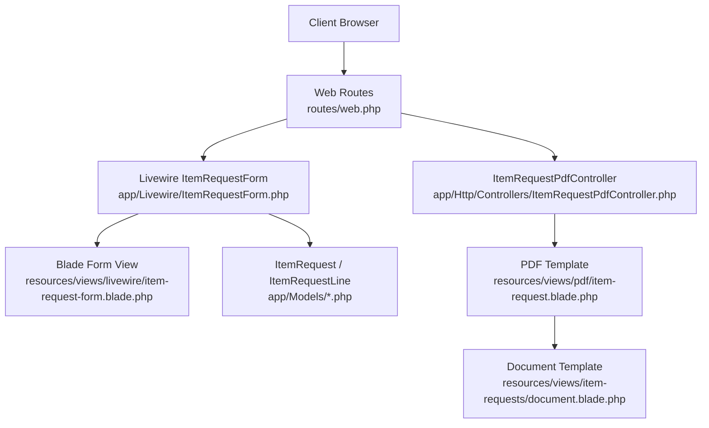
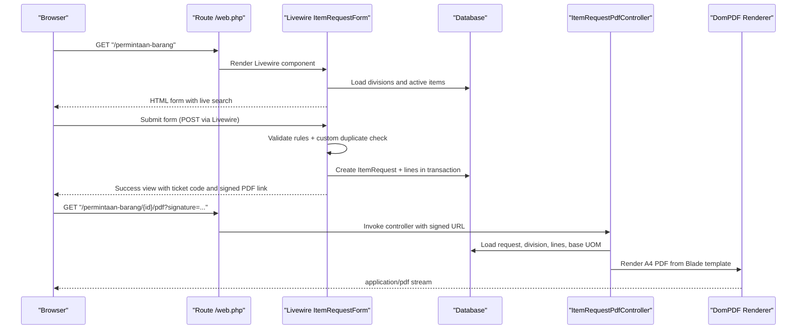
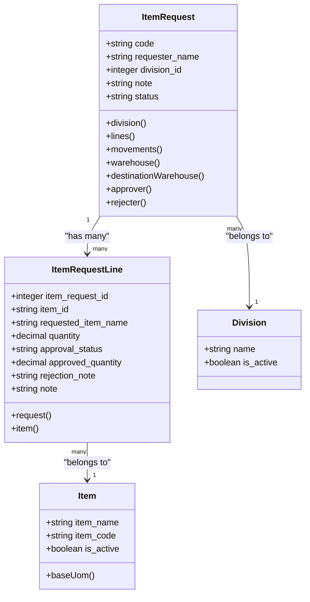
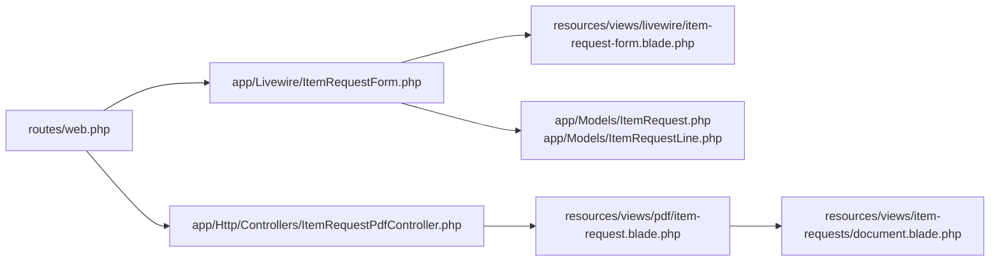

# Web Endpoints

<cite>
**Referenced Files in This Document**   
- [routes/web.php](file://routes/web.php)
- [app/Livewire/ItemRequestForm.php](file://app/Livewire/ItemRequestForm.php)
- [resources/views/livewire/item-request-form.blade.php](file://resources/views/livewire/item-request-form.blade.php)
- [app/Http/Controllers/ItemRequestPdfController.php](file://app/Http/Controllers/ItemRequestPdfController.php)
- [resources/views/pdf/item-request.blade.php](file://resources/views/pdf/item-request.blade.php)
- [resources/views/item-requests/document.blade.php](file://resources/views/item-requests/document.blade.php)
- [app/Models/ItemRequest.php](file://app/Models/ItemRequest.php)
- [app/Models/ItemRequestLine.php](file://app/Models/ItemRequestLine.php)
- [tests/Feature/ItemRequestFormTest.php](file://tests/Feature/ItemRequestFormTest.php)
- [tests/Feature/ItemRequestPdfTest.php](file://tests/Feature/ItemRequestPdfTest.php)
</cite>

## Table of Contents
1. [Introduction](#introduction)
2. [Project Structure](#project-structure)
3. [Core Components](#core-components)
4. [Architecture Overview](#architecture-overview)
5. [Detailed Component Analysis](#detailed-component-analysis)
6. [Dependency Analysis](#dependency-analysis)
7. [Performance Considerations](#performance-considerations)
8. [Troubleshooting Guide](#troubleshooting-guide)
9. [Conclusion](#conclusion)

## Introduction
This document describes the public web endpoints exposed by RSV Helmet for item requests and PDF generation. It focuses on:
- The public item request form endpoint at `/permintaan-barang`.
- The signed PDF download endpoint at `/permintaan-barang/{itemRequest}/pdf`.

The documentation covers Livewire component interaction, form validation, submission handling, signed URL security, template rendering, request/response behavior, authentication requirements, middleware configuration, error responses, status codes, and integration examples.

## Project Structure
The relevant implementation is split across routing, a Livewire component, Blade views, a controller, models, and feature tests.

**Diagram sources**
- [routes/web.php:11-17](file://routes/web.php#L11-L17)
- [app/Livewire/ItemRequestForm.php:20-22](file://app/Livewire/ItemRequestForm.php#L20-L22)
- [app/Http/Controllers/ItemRequestPdfController.php:9-18](file://app/Http/Controllers/ItemRequestPdfController.php#L9-L18)
- [resources/views/pdf/item-request.blade.php:18-18](file://resources/views/pdf/item-request.blade.php#L18-L18)

**Section sources**
- [routes/web.php:1-18](file://routes/web.php#L1-L18)

## Core Components
- Public form route: GET `/permintaan-barang` renders the Livewire `ItemRequestForm` component with rate limiting.
- Signed PDF route: GET `/permintaan-barang/{itemRequest}/pdf` returns a streamed PDF after validating a signed URL.
- Livewire component: Handles form state, validation, duplicate prevention, persistence, success state, and temporary signed PDF URL generation.
- PDF controller: Loads related data and streams a PDF using a Blade template.
- Models: Define request structure, code generation, relationships, and approval-related fields used elsewhere in the application.

**Section sources**
- [routes/web.php:11-17](file://routes/web.php#L11-L17)
- [app/Livewire/ItemRequestForm.php:20-22](file://app/Livewire/ItemRequestForm.php#L20-L22)
- [app/Http/Controllers/ItemRequestPdfController.php:11-18](file://app/Http/Controllers/ItemRequestPdfController.php#L11-L18)
- [app/Models/ItemRequest.php:52-59](file://app/Models/ItemRequest.php#L52-L59)

## Architecture Overview
The two endpoints share the same domain but have different responsibilities:
- The form endpoint is public, rate-limited, and uses Livewire to render an interactive form without requiring authentication.
- The PDF endpoint requires a signed URL and streams a generated PDF document.

**Diagram sources**
- [routes/web.php:11-17](file://routes/web.php#L11-L17)
- [app/Livewire/ItemRequestForm.php:95-152](file://app/Livewire/ItemRequestForm.php#L95-L152)
- [app/Http/Controllers/ItemRequestPdfController.php:11-18](file://app/Http/Controllers/ItemRequestPdfController.php#L11-L18)

## Detailed Component Analysis

### Endpoint: GET `/permintaan-barang`
- Purpose: Render the public item request form.
- Middleware:
  - Rate limiting: `throttle:10,1` limits requests to 10 per minute.
  - No explicit authentication middleware; the route is publicly accessible.
- Response:
  - HTTP 200 OK with HTML containing the Livewire form.
  - On successful submission, the page shows a confirmation with the ticket code and actions to download or share the PDF.

#### Livewire Component Interaction
- State properties include requester name, division ID, optional note, dynamic line items, website honeypot field, and submission state.
- Methods:
  - `addLine`: Adds a new line item.
  - `removeLine`: Removes a line and ensures at least one line exists.
  - `selectItem(index, itemId)`: Selects a catalog item and clears manual query.
  - `clearSelectedItem(index)`: Clears a selected item.
  - `submit()`: Validates input, prevents duplicates, persists the request and lines, then sets success state.
  - `createAnother()`: Resets the form for a new request.
  - `render()`: Loads divisions, active items, search results, submitted request preview, and generates a temporary signed PDF URL.

#### Form Validation Rules
- Requester name: required string, max 100 characters.
- Division ID: required integer, must exist in active divisions.
- Note: optional string, max 1000 characters.
- Lines: required array with at least one entry.
- Each line:
  - `item_id`: optional string, must be an active item if provided.
  - `item_query`: optional string, max 255 characters.
  - `quantity`: required numeric, greater than zero.
  - `note`: optional string, max 255 characters.
- Custom validation:
  - Each line must either select a catalog item or provide a manual item name.
  - Duplicate items are rejected, including duplicates between catalog IDs and normalized manual names.

#### Submission Handling
- Uses database transactions to create the parent request and all lines atomically.
- Generates a human-readable request code based on creation timestamp and auto-incremented sequence.
- After success, the component exposes:
  - Ticket code for display and copying.
  - Temporary signed PDF URL valid for seven days.
  - Shareable message text suitable for messaging apps.

#### Request/Response Schema
- Request (Livewire POST):
  - Fields: `requester_name`, `division_id`, `note`, `lines[]` with `item_id`, `item_query`, `quantity`, `note`.
  - Honeypot: `website` should remain empty.
- Response (HTML):
  - Success state includes ticket code, preview of the request, and links/buttons for PDF download and sharing.

#### Security Considerations
- CSRF protection: Laravel’s default CSRF protection applies to forms; the Blade form uses standard Livewire submission which integrates with CSRF tokens.
- Rate limiting: Applied at the route level to mitigate abuse.
- Input validation: Server-side rules enforce required fields, types, lengths, existence checks, and business constraints.
- Access control: No authentication required; intended for public use.

#### Error Responses and Status Codes
- Validation errors: Livewire returns inline field-level errors; no separate JSON API is defined here.
- HTTP status:
  - Successful render: 200 OK.
  - Rate limit exceeded: Typically 429 Too Many Requests (handled by Laravel throttle middleware).
  - General server errors: 500 Internal Server Error.

**Section sources**
- [routes/web.php:11-13](file://routes/web.php#L11-L13)
- [app/Livewire/ItemRequestForm.php:24-44](file://app/Livewire/ItemRequestForm.php#L24-L44)
- [app/Livewire/ItemRequestForm.php:51-93](file://app/Livewire/ItemRequestForm.php#L51-L93)
- [app/Livewire/ItemRequestForm.php:95-152](file://app/Livewire/ItemRequestForm.php#L95-L152)
- [app/Livewire/ItemRequestForm.php:174-208](file://app/Livewire/ItemRequestForm.php#L174-L208)
- [app/Livewire/ItemRequestForm.php:210-262](file://app/Livewire/ItemRequestForm.php#L210-L262)
- [resources/views/livewire/item-request-form.blade.php:179-582](file://resources/views/livewire/item-request-form.blade.php#L179-L582)
- [tests/Feature/ItemRequestFormTest.php:22-31](file://tests/Feature/ItemRequestFormTest.php#L22-L31)
- [tests/Feature/ItemRequestFormTest.php:33-78](file://tests/Feature/ItemRequestFormTest.php#L33-L78)
- [tests/Feature/ItemRequestFormTest.php:80-155](file://tests/Feature/ItemRequestFormTest.php#L80-L155)
- [tests/Feature/ItemRequestFormTest.php:157-222](file://tests/Feature/ItemRequestFormTest.php#L157-L222)

### Endpoint: GET `/permintaan-barang/{itemRequest}/pdf`
- Purpose: Stream a downloadable PDF for a specific item request.
- Middleware:
  - `signed`: Requires a valid signed URL; unsigned access is forbidden.
- Route model binding: `{itemRequest}` resolves to an `ItemRequest` Eloquent model instance.
- Response:
  - HTTP 200 OK with `Content-Type: application/pdf`.
  - Content-Disposition triggers a file download named `Permintaan-{code}.pdf`.

#### Signed URL Security
- URLs are generated with a time-bound signature (seven days validity in the form component).
- Unsigned requests receive a forbidden response.
- Tests assert that signed URLs return PDF content and unsigned routes return forbidden.

#### PDF Template Rendering
- Controller loads missing relationships: division, lines, and each line’s mapped item plus its base unit of measure.
- Uses DomPDF to render the Blade template `pdf.item-request`.
- The PDF template includes a shared document template that formats header, metadata, item table, reason section, and signatures.

#### Download Functionality
- The controller streams the PDF directly to the client.
- The form view provides a direct download link using the signed URL.
- The view also supports sharing via a browser-based flow that prepares and shares the PDF through external APIs when available.

#### Request/Response Schema
- Request:
  - Path parameter: `itemRequest` (Eloquent model identifier).
  - Query parameter: `signature` (generated by Laravel’s signed route helper).
- Response:
  - Binary PDF stream with appropriate headers.

#### Error Responses and Status Codes
- Missing or invalid signature: 403 Forbidden.
- Not found request: Standard Laravel model not found behavior (typically 404).
- Successful PDF generation: 200 OK with PDF content.

**Section sources**
- [routes/web.php:15-17](file://routes/web.php#L15-L17)
- [app/Http/Controllers/ItemRequestPdfController.php:11-18](file://app/Http/Controllers/ItemRequestPdfController.php#L11-L18)
- [resources/views/pdf/item-request.blade.php:1-21](file://resources/views/pdf/item-request.blade.php#L1-L21)
- [resources/views/item-requests/document.blade.php:282-398](file://resources/views/item-requests/document.blade.php#L282-L398)
- [tests/Feature/ItemRequestPdfTest.php:17-43](file://tests/Feature/ItemRequestPdfTest.php#L17-L43)
- [tests/Feature/ItemRequestPdfTest.php:45-108](file://tests/Feature/ItemRequestPdfTest.php#L45-L108)

### Data Model Relationships

**Diagram sources**
- [app/Models/ItemRequest.php:75-88](file://app/Models/ItemRequest.php#L75-L88)
- [app/Models/ItemRequestLine.php:55-63](file://app/Models/ItemRequestLine.php#L55-L63)

**Section sources**
- [app/Models/ItemRequest.php:12-25](file://app/Models/ItemRequest.php#L12-L25)
- [app/Models/ItemRequestLine.php:11-20](file://app/Models/ItemRequestLine.php#L11-L20)

## Dependency Analysis

**Diagram sources**
- [routes/web.php:11-17](file://routes/web.php#L11-L17)
- [app/Livewire/ItemRequestForm.php:210-262](file://app/Livewire/ItemRequestForm.php#L210-L262)
- [app/Http/Controllers/ItemRequestPdfController.php:11-18](file://app/Http/Controllers/ItemRequestPdfController.php#L11-L18)
- [resources/views/pdf/item-request.blade.php:18-18](file://resources/views/pdf/item-request.blade.php#L18-L18)

**Section sources**
- [routes/web.php:11-17](file://routes/web.php#L11-L17)
- [app/Livewire/ItemRequestForm.php:210-262](file://app/Livewire/ItemRequestForm.php#L210-L262)
- [app/Http/Controllers/ItemRequestPdfController.php:11-18](file://app/Http/Controllers/ItemRequestPdfController.php#L11-L18)

## Performance Considerations
- Livewire form:
  - Active item queries are limited and ordered by name to reduce payload size.
  - Search results are capped at ten entries to prevent large dropdowns.
  - Debounced live input reduces unnecessary re-renders during typing.
- Database:
  - Form submission uses a transaction to ensure atomicity of request and lines creation.
- PDF generation:
  - Uses eager loading of missing relationships to avoid N+1 queries.
  - DomPDF renders A4 pages; long lists may span multiple pages, which is validated by tests.

[No sources needed since this section provides general guidance]

## Troubleshooting Guide
- Form does not submit:
  - Check validation errors displayed by Livewire.
  - Ensure at least one line has either a selected catalog item or a manual item name.
  - Verify quantities are positive numbers.
- Duplicate item errors:
  - Prevent selecting the same catalog item twice.
  - Prevent duplicate manual item names regardless of case.
- Division selection errors:
  - Only active divisions are valid.
- PDF download fails:
  - Ensure the URL is signed and not expired.
  - Unsigned requests will be forbidden.
- PDF content issues:
  - Confirm the request has loaded division and lines with mapped items and base units.
  - Long requests may require additional pages; verify template pagination behavior.

**Section sources**
- [app/Livewire/ItemRequestForm.php:95-152](file://app/Livewire/ItemRequestForm.php#L95-L152)
- [app/Livewire/ItemRequestForm.php:174-208](file://app/Livewire/ItemRequestForm.php#L174-L208)
- [tests/Feature/ItemRequestFormTest.php:80-155](file://tests/Feature/ItemRequestFormTest.php#L80-L155)
- [tests/Feature/ItemRequestPdfTest.php:17-43](file://tests/Feature/ItemRequestPdfTest.php#L17-L43)

## Conclusion
RSV Helmet exposes two primary public endpoints:
- A rate-limited, unauthenticated form endpoint for submitting item requests with robust validation and duplicate prevention.
- A signed-URL-protected PDF endpoint for downloading formatted documents.

Integration should rely on the Livewire form for submissions and generate signed URLs for PDF access. Security relies on CSRF protection, rate limiting, server-side validation, and signed URL verification. Error handling is primarily handled through Livewire validation feedback and standard HTTP status codes for routing and signing failures.

[No sources needed since this section summarizes without analyzing specific files]