# Application Architecture

<cite>
**Referenced Files in This Document**
- [README.md](file://README.md)
- [AdminPanelProvider.php](file://app/Providers/Filament/AdminPanelProvider.php)
- [AppServiceProvider.php](file://app/Providers/AppServiceProvider.php)
- [ItemResource.php](file://app/Filament/Resources/Items/ItemResource.php)
- [ItemRequestForm.php](file://app/Livewire/ItemRequestForm.php)
- [web.php](file://routes/web.php)
- [BatchProgressService.php](file://app/Services/BatchProgressService.php)
- [StockMovementService.php](file://app/Services/StockMovementService.php)
- [ItemRequestService.php](file://app/Services/ItemRequestService.php)
- [ExternalBarangApiService.php](file://app/Services/ExternalBarangApiService.php)
- [InventoryMovement.php](file://app/Models/InventoryMovement.php)
- [ProductionBatch.php](file://app/Models/ProductionBatch.php)
- [services.php](file://config/services.php)
</cite>

## Table of Contents
1. [Introduction](#introduction)
2. [Project Structure](#project-structure)
3. [Core Components](#core-components)
4. [Architecture Overview](#architecture-overview)
5. [Detailed Component Analysis](#detailed-component-analysis)
6. [Dependency Analysis](#dependency-analysis)
7. [Performance Considerations](#performance-considerations)
8. [Troubleshooting Guide](#troubleshooting-guide)
9. [Conclusion](#conclusion)

## Introduction
RSV Helmet is a Laravel 13 application that provides an inventory and production management system with a Filament admin panel and public-facing Livewire forms. The application follows a layered architecture:

- Presentation layer: Filament resources, pages, widgets, and Livewire components render the user interface.
- Business logic layer: Dedicated service classes encapsulate complex operations such as stock movements, item request approvals, batch progress calculations, and external API integration.
- Data access layer: Eloquent models represent domain entities and relationships, while migrations define the database schema.

The design emphasizes separation of concerns, testability, and clear boundaries between presentation, business logic, and data persistence. External integrations are isolated behind service classes to keep the rest of the application resilient to network failures and configuration changes.

## Project Structure
The repository organizes code by feature and responsibility:

- `app/Filament` contains admin UI definitions, including resources, pages, widgets, imports, exports, and custom form components.
- `app/Livewire` contains interactive public components.
- `app/Services` contains business logic services.
- `app/Models` contains domain entities and relationships.
- `app/Providers` registers panels, navigation groups, and global behavior.
- `routes/web.php` defines public routes for Livewire and PDF generation.
- `config/services.php` centralizes third-party service configuration.
- `database/migrations` defines the relational schema.
- `resources/views` holds Blade templates for Filament partials, Livewire components, and PDF documents.

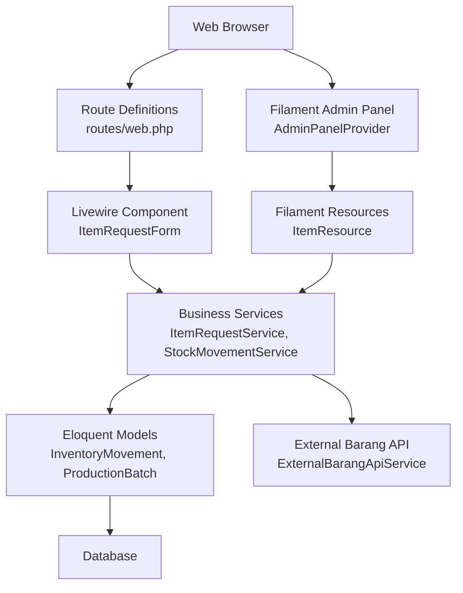

**Diagram sources**
- [web.php:7-17](file://routes/web.php#L7-L17)
- [AdminPanelProvider.php:31-88](file://app/Providers/Filament/AdminPanelProvider.php#L31-L88)
- [ItemResource.php:37-297](file://app/Filament/Resources/Items/ItemResource.php#L37-L297)
- [ItemRequestForm.php:20-305](file://app/Livewire/ItemRequestForm.php#L20-L305)
- [ItemRequestService.php:14-258](file://app/Services/ItemRequestService.php#L14-L258)
- [StockMovementService.php:16-398](file://app/Services/StockMovementService.php#L16-L398)
- [InventoryMovement.php:28-191](file://app/Models/InventoryMovement.php#L28-L191)
- [ProductionBatch.php:22-117](file://app/Models/ProductionBatch.php#L22-L117)
- [ExternalBarangApiService.php:10-188](file://app/Services/ExternalBarangApiService.php#L10-L188)

**Section sources**
- [README.md:1-115](file://README.md#L1-L115)
- [AdminPanelProvider.php:31-88](file://app/Providers/Filament/AdminPanelProvider.php#L31-L88)
- [web.php:7-17](file://routes/web.php#L7-L17)

## Core Components
The core components are organized into three layers:

- Presentation layer
  - Filament admin panel provider configures authentication middleware, navigation groups, discovered resources/pages/widgets, and render hooks.
  - Item resource defines forms, tables, filters, actions, relation managers, and infinite scrolling for item master data.
  - Livewire item request form handles public submission, validation, line management, and PDF link generation.

- Business logic layer
  - Batch progress service computes running batches, status counts, recent completed batches, and progress percentages using Eloquent aggregations.
  - Stock movement service records inventory transactions, production output with automatic material consumption, transfers, bulk transfers, deletions, and balance updates with locking and validation.
  - Item request service approves or rejects requests, enforces warehouse rules, validates per-line decisions, triggers stock transfers through the stock movement service, and persists approval state.
  - External barang API service wraps HTTP calls to an external API, normalizes responses, logs errors, and exposes variant discovery and health checks.

- Data access layer
  - Inventory movement model defines transaction types, incoming/outgoing classification, signed quantity, and relationships to items, warehouses, production batches, stock opnames, item requests, parent movements, and creators.
  - Production batch model defines lifecycle statuses, relationships to items, materials, movements, and warehouses, and calculates actual output from movements or items.

**Section sources**
- [AdminPanelProvider.php:31-88](file://app/Providers/Filament/AdminPanelProvider.php#L31-L88)
- [ItemResource.php:37-297](file://app/Filament/Resources/Items/ItemResource.php#L37-L297)
- [ItemRequestForm.php:20-305](file://app/Livewire/ItemRequestForm.php#L20-L305)
- [BatchProgressService.php:9-152](file://app/Services/BatchProgressService.php#L9-L152)
- [StockMovementService.php:16-398](file://app/Services/StockMovementService.php#L16-L398)
- [ItemRequestService.php:14-258](file://app/Services/ItemRequestService.php#L14-L258)
- [ExternalBarangApiService.php:10-188](file://app/Services/ExternalBarangApiService.php#L10-L188)
- [InventoryMovement.php:28-191](file://app/Models/InventoryMovement.php#L28-L191)
- [ProductionBatch.php:22-117](file://app/Models/ProductionBatch.php#L22-L117)

## Architecture Overview
The application uses a layered architecture with clear boundaries:

- Presentation layer (Filament and Livewire) receives user input, performs lightweight validation, and delegates complex operations to services.
- Service layer orchestrates domain workflows, enforces business rules, coordinates multiple models, and interacts with external APIs.
- Model layer encapsulates entity state, relationships, and simple derived attributes.
- Configuration centralizes external service endpoints and timeouts.

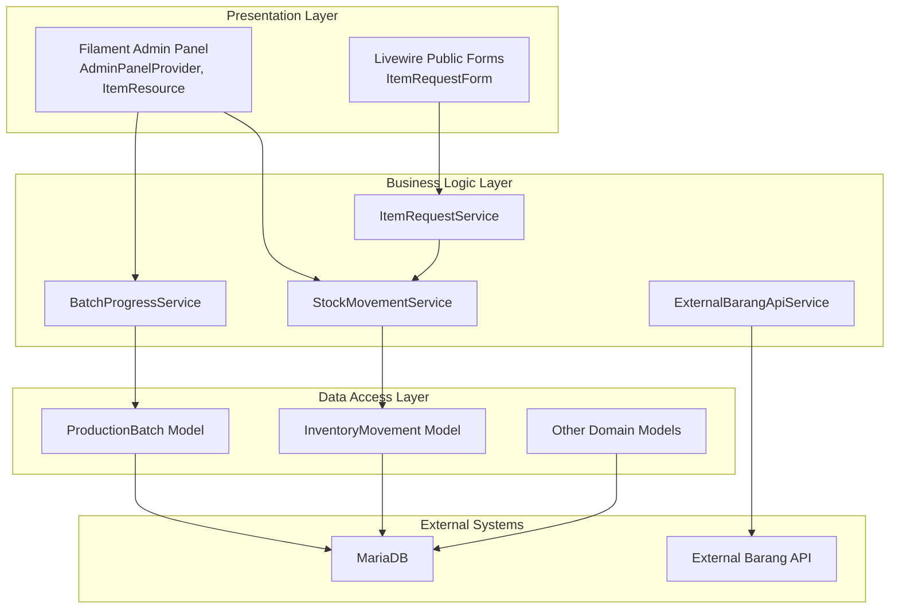

**Diagram sources**
- [AdminPanelProvider.php:31-88](file://app/Providers/Filament/AdminPanelProvider.php#L31-L88)
- [ItemResource.php:37-297](file://app/Filament/Resources/Items/ItemResource.php#L37-L297)
- [ItemRequestForm.php:20-305](file://app/Livewire/ItemRequestForm.php#L20-L305)
- [BatchProgressService.php:9-152](file://app/Services/BatchProgressService.php#L9-L152)
- [StockMovementService.php:16-398](file://app/Services/StockMovementService.php#L16-L398)
- [ItemRequestService.php:14-258](file://app/Services/ItemRequestService.php#L14-L258)
- [ExternalBarangApiService.php:10-188](file://app/Services/ExternalBarangApiService.php#L10-L188)
- [InventoryMovement.php:28-191](file://app/Models/InventoryMovement.php#L28-L191)
- [ProductionBatch.php:22-117](file://app/Models/ProductionBatch.php#L22-L117)
- [services.php:38-43](file://config/services.php#L38-L43)

## Detailed Component Analysis

### Filament Admin Panel Provider
The admin panel provider wires up authentication, navigation groups, discovered resources/pages/widgets, render hooks, and middleware. It sets the panel path, colors, SPA mode, and read-only relation manager defaults.

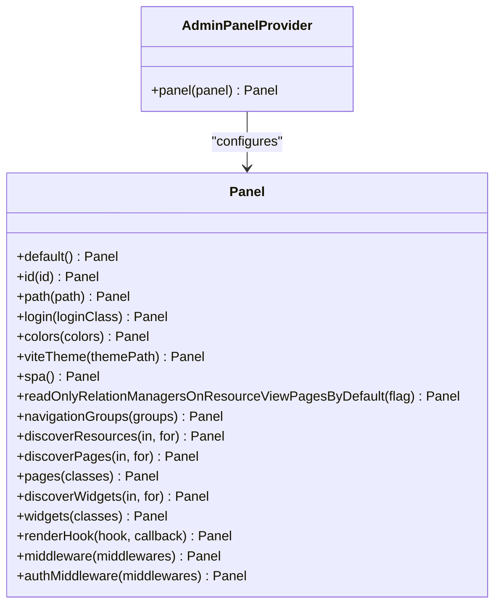

**Diagram sources**
- [AdminPanelProvider.php:31-88](file://app/Providers/Filament/AdminPanelProvider.php#L31-L88)

**Section sources**
- [AdminPanelProvider.php:31-88](file://app/Providers/Filament/AdminPanelProvider.php#L31-L88)

### Item Resource
The item resource defines the master data UI for items, including form fields, table columns, filters, record actions, bulk actions, relation managers, and infinite scrolling. It binds directly to the Item model and integrates with Filament’s export and delete actions.

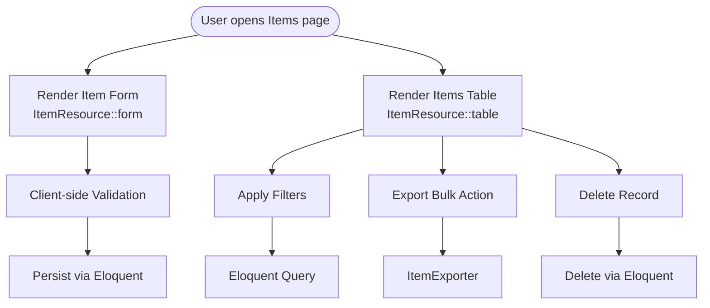

**Diagram sources**
- [ItemResource.php:55-194](file://app/Filament/Resources/Items/ItemResource.php#L55-L194)
- [ItemResource.php:197-279](file://app/Filament/Resources/Items/ItemResource.php#L197-L279)

**Section sources**
- [ItemResource.php:37-297](file://app/Filament/Resources/Items/ItemResource.php#L37-L297)

### Livewire Item Request Form
The Livewire component manages a multi-line item request form, validates inputs, creates an item request and lines, and renders search results and PDF links. It uses route throttling and signed URLs for secure PDF access.

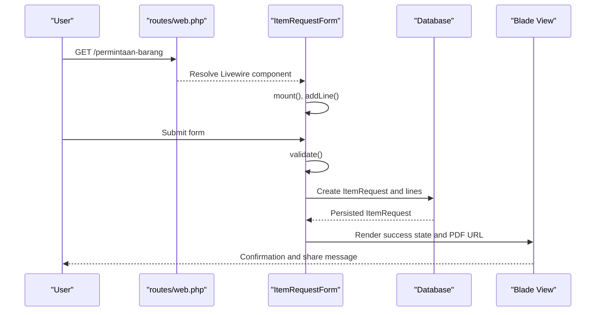

**Diagram sources**
- [web.php:11-17](file://routes/web.php#L11-L17)
- [ItemRequestForm.php:46-152](file://app/Livewire/ItemRequestForm.php#L46-L152)
- [ItemRequestForm.php:210-262](file://app/Livewire/ItemRequestForm.php#L210-L262)

**Section sources**
- [ItemRequestForm.php:20-305](file://app/Livewire/ItemRequestForm.php#L20-L305)
- [web.php:7-17](file://routes/web.php#L7-L17)

### Batch Progress Service
The batch progress service aggregates production metrics, computes progress percentages, and formats batch summaries. It relies on Eloquent relationships and aggregate functions to minimize N+1 queries.

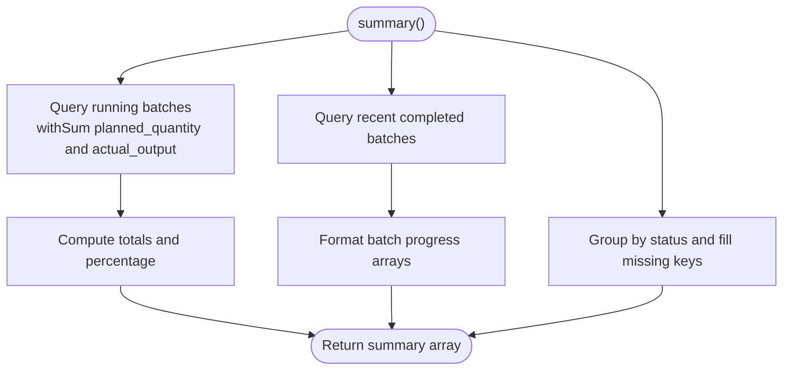

**Diagram sources**
- [BatchProgressService.php:20-44](file://app/Services/BatchProgressService.php#L20-L44)
- [BatchProgressService.php:89-108](file://app/Services/BatchProgressService.php#L89-L108)
- [BatchProgressService.php:110-117](file://app/Services/BatchProgressService.php#L110-L117)
- [BatchProgressService.php:122-131](file://app/Services/BatchProgressService.php#L122-L131)
- [BatchProgressService.php:140-150](file://app/Services/BatchProgressService.php#L140-L150)

**Section sources**
- [BatchProgressService.php:9-152](file://app/Services/BatchProgressService.php#L9-L152)

### Stock Movement Service
The stock movement service is the core of inventory operations. It records single movements, production outputs with automatic material consumption, transfers, bulk transfers, and deletions. It ensures positive quantities, validates warehouse constraints, prevents negative balances, and uses database transactions and row-level locking for consistency.

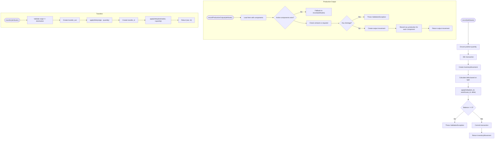

**Diagram sources**
- [StockMovementService.php:23-60](file://app/Services/StockMovementService.php#L23-L60)
- [StockMovementService.php:68-139](file://app/Services/StockMovementService.php#L68-L139)
- [StockMovementService.php:147-201](file://app/Services/StockMovementService.php#L147-L201)
- [StockMovementService.php:209-290](file://app/Services/StockMovementService.php#L209-L290)
- [StockMovementService.php:296-344](file://app/Services/StockMovementService.php#L296-L344)
- [StockMovementService.php:346-397](file://app/Services/StockMovementService.php#L346-L397)

**Section sources**
- [StockMovementService.php:16-398](file://app/Services/StockMovementService.php#L16-L398)

### Item Request Service
The item request service orchestrates approval workflows. It locks the request and its lines, validates warehouse settings, enforces per-line decisions, triggers stock transfers via the stock movement service, and updates approval states and overall request status.

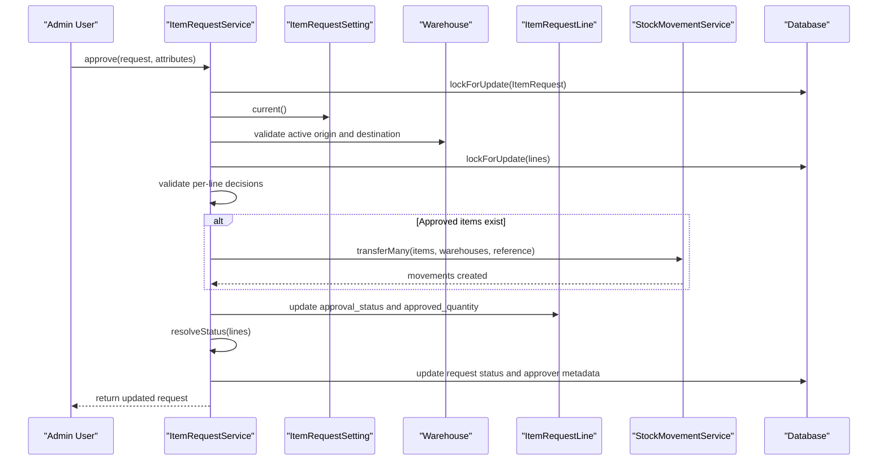

**Diagram sources**
- [ItemRequestService.php:22-186](file://app/Services/ItemRequestService.php#L22-L186)
- [ItemRequestService.php:227-239](file://app/Services/ItemRequestService.php#L227-L239)

**Section sources**
- [ItemRequestService.php:14-258](file://app/Services/ItemRequestService.php#L14-L258)

### External Barang API Service
The external barang API service abstracts HTTP interactions with an external API. It reads base URL and timeout from configuration, normalizes responses, logs errors, and provides methods for listing barang, fetching details, retrieving aggregated variant recap, discovering unique variants, and pinging the API.

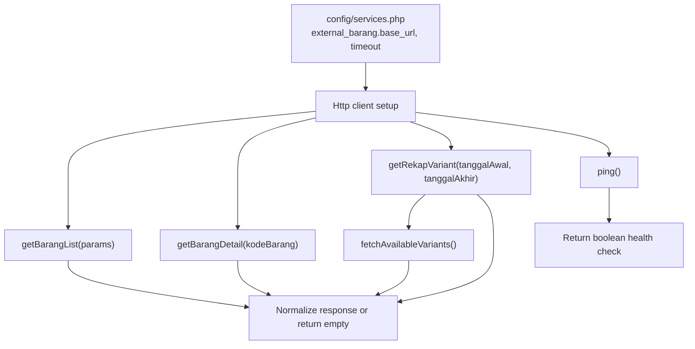

**Diagram sources**
- [ExternalBarangApiService.php:16-20](file://app/Services/ExternalBarangApiService.php#L16-L20)
- [ExternalBarangApiService.php:33-55](file://app/Services/ExternalBarangApiService.php#L33-L55)
- [ExternalBarangApiService.php:62-80](file://app/Services/ExternalBarangApiService.php#L62-L80)
- [ExternalBarangApiService.php:87-109](file://app/Services/ExternalBarangApiService.php#L87-L109)
- [ExternalBarangApiService.php:124-165](file://app/Services/ExternalBarangApiService.php#L124-L165)
- [ExternalBarangApiService.php:170-186](file://app/Services/ExternalBarangApiService.php#L170-L186)
- [services.php:38-43](file://config/services.php#L38-L43)

**Section sources**
- [ExternalBarangApiService.php:10-188](file://app/Services/ExternalBarangApiService.php#L10-L188)
- [services.php:38-43](file://config/services.php#L38-L43)

### Models and Relationships
The inventory movement model defines transaction types, incoming/outgoing classification, signed quantity, and relationships to related entities. The production batch model defines lifecycle statuses, relationships to items, materials, movements, and warehouses, and calculates actual output from movements or items.

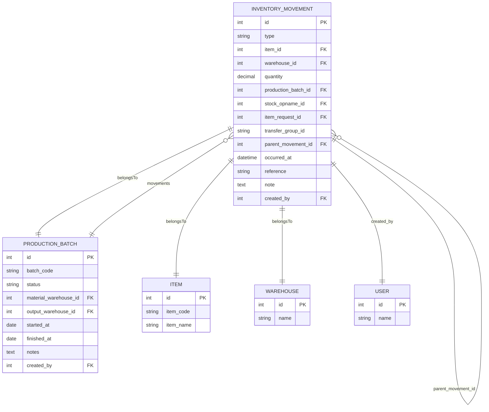

**Diagram sources**
- [InventoryMovement.php:28-191](file://app/Models/InventoryMovement.php#L28-L191)
- [ProductionBatch.php:22-117](file://app/Models/ProductionBatch.php#L22-L117)

**Section sources**
- [InventoryMovement.php:28-191](file://app/Models/InventoryMovement.php#L28-L191)
- [ProductionBatch.php:22-117](file://app/Models/ProductionBatch.php#L22-L117)

## Dependency Analysis
The application exhibits clear dependency direction:

- Presentation depends on services for business operations.
- Services depend on models for data access and on external API services for integrations.
- Models depend only on framework abstractions and relationships.
- Configuration centralizes external service parameters.

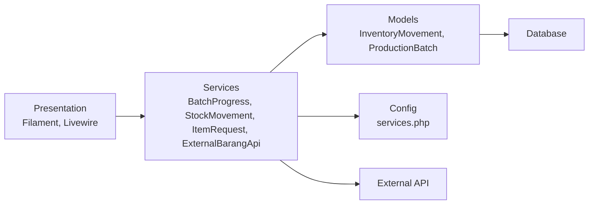

**Diagram sources**
- [AdminPanelProvider.php:31-88](file://app/Providers/Filament/AdminPanelProvider.php#L31-L88)
- [ItemResource.php:37-297](file://app/Filament/Resources/Items/ItemResource.php#L37-L297)
- [ItemRequestForm.php:20-305](file://app/Livewire/ItemRequestForm.php#L20-L305)
- [BatchProgressService.php:9-152](file://app/Services/BatchProgressService.php#L9-L152)
- [StockMovementService.php:16-398](file://app/Services/StockMovementService.php#L16-L398)
- [ItemRequestService.php:14-258](file://app/Services/ItemRequestService.php#L14-L258)
- [ExternalBarangApiService.php:10-188](file://app/Services/ExternalBarangApiService.php#L10-L188)
- [InventoryMovement.php:28-191](file://app/Models/InventoryMovement.php#L28-L191)
- [ProductionBatch.php:22-117](file://app/Models/ProductionBatch.php#L22-L117)
- [services.php:38-43](file://config/services.php#L38-L43)

**Section sources**
- [AdminPanelProvider.php:31-88](file://app/Providers/Filament/AdminPanelProvider.php#L31-L88)
- [ItemResource.php:37-297](file://app/Filament/Resources/Items/ItemResource.php#L37-L297)
- [ItemRequestForm.php:20-305](file://app/Livewire/ItemRequestForm.php#L20-L305)
- [BatchProgressService.php:9-152](file://app/Services/BatchProgressService.php#L9-L152)
- [StockMovementService.php:16-398](file://app/Services/StockMovementService.php#L16-L398)
- [ItemRequestService.php:14-258](file://app/Services/ItemRequestService.php#L14-L258)
- [ExternalBarangApiService.php:10-188](file://app/Services/ExternalBarangApiService.php#L10-L188)
- [InventoryMovement.php:28-191](file://app/Models/InventoryMovement.php#L28-L191)
- [ProductionBatch.php:22-117](file://app/Models/ProductionBatch.php#L22-L117)
- [services.php:38-43](file://config/services.php#L38-L43)

## Performance Considerations
- Use eager loading and aggregate queries in services to avoid N+1 problems when computing batch progress and inventory metrics.
- Prefer database transactions and row-level locking (`lockForUpdate`) for critical inventory operations to ensure consistency under concurrent access.
- Limit list sizes and use pagination or infinite scrolling in Filament resources to reduce payload size.
- Cache expensive computations if they are frequently accessed and not highly volatile; consider Laravel’s cache facade where appropriate.
- Configure external API timeouts and handle failures gracefully to prevent slow responses from blocking user interactions.

[No sources needed since this section provides general guidance]

## Troubleshooting Guide
Common issues and their likely causes:

- Negative stock balance during adjustments or deletions
  - Cause: Attempting to reverse an incoming movement when the current balance is insufficient.
  - Resolution: Ensure reversals are allowed only when sufficient stock exists; review deletion flows and error messages.

- Insufficient material stock for production output
  - Cause: Active components require more material than available in the material warehouse.
  - Resolution: Restock materials or adjust production quantities before recording output.

- Invalid warehouse selection for item request approval
  - Cause: Origin and destination warehouses are not both active or are identical.
  - Resolution: Configure valid active warehouses in settings before approving requests.

- External API connectivity failures
  - Cause: Network errors or non-successful HTTP responses.
  - Resolution: Check configured base URL and timeout; inspect logs for error details; verify external service availability.

**Section sources**
- [StockMovementService.php:321-344](file://app/Services/StockMovementService.php#L321-L344)
- [StockMovementService.php:358-387](file://app/Services/StockMovementService.php#L358-L387)
- [ItemRequestService.php:35-56](file://app/Services/ItemRequestService.php#L35-L56)
- [ExternalBarangApiService.php:33-55](file://app/Services/ExternalBarangApiService.php#L33-L55)
- [ExternalBarangApiService.php:62-80](file://app/Services/ExternalBarangApiService.php#L62-L80)
- [ExternalBarangApiService.php:87-109](file://app/Services/ExternalBarangApiService.php#L87-L109)

## Conclusion
RSV Helmet implements a clean layered architecture with strong separation between presentation, business logic, and data access. Filament and Livewire provide intuitive interfaces, while dedicated services encapsulate complex workflows such as inventory management, production tracking, and external API integration. Models define clear domain boundaries and relationships. Cross-cutting concerns like authentication are handled by the Filament panel provider, while logging and error handling are embedded in services. This structure supports maintainability, testability, and scalability for inventory and production operations.

[No sources needed since this section summarizes without analyzing specific files]