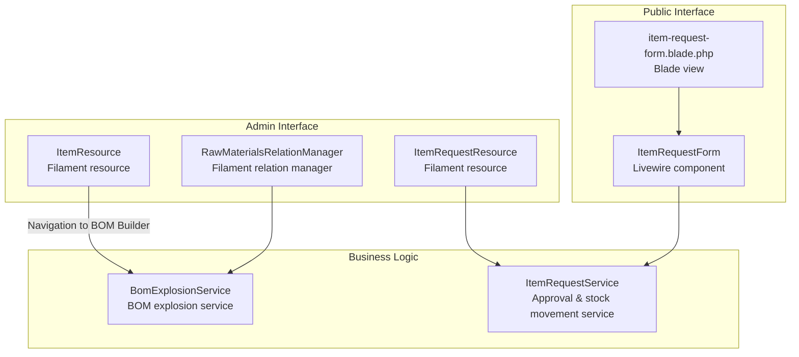
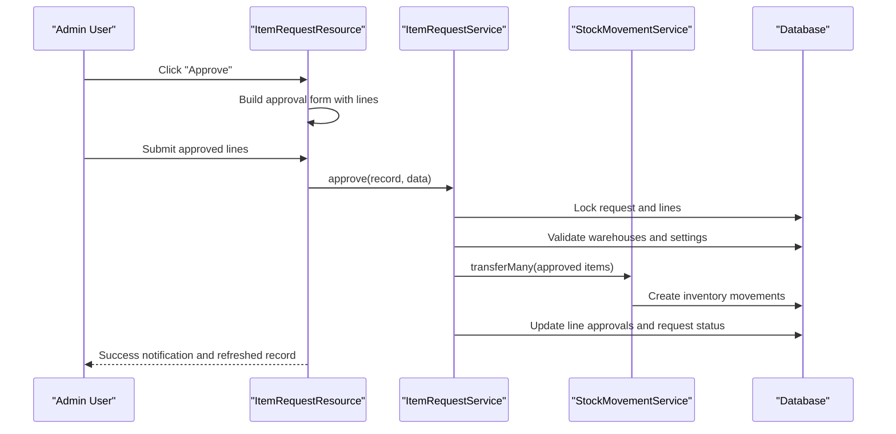
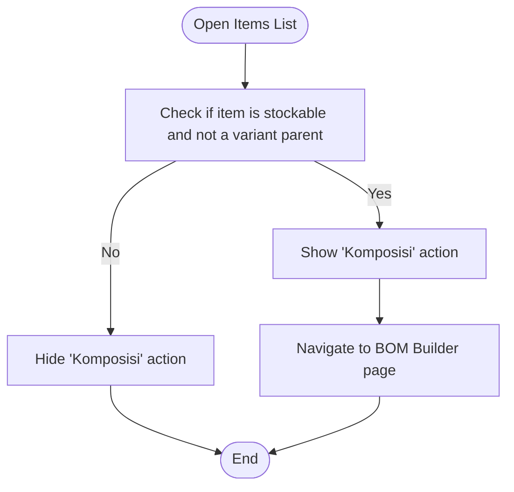
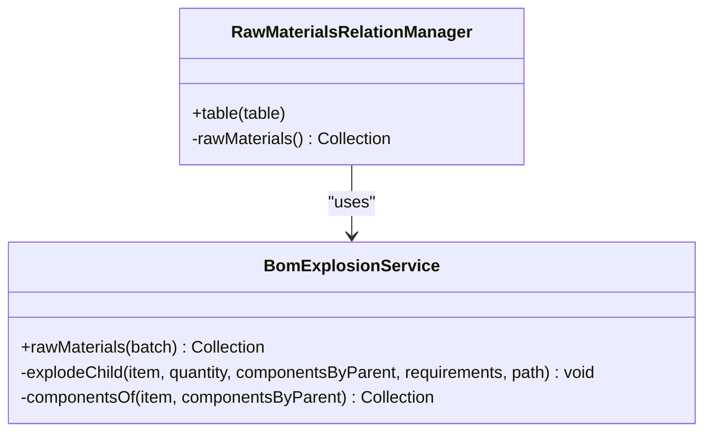
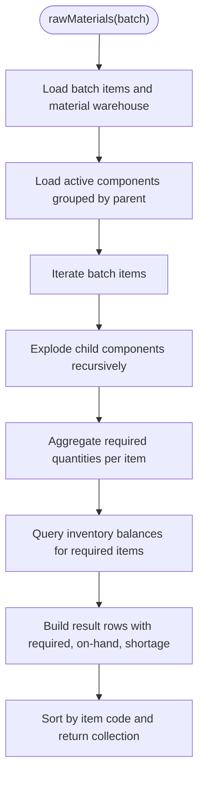
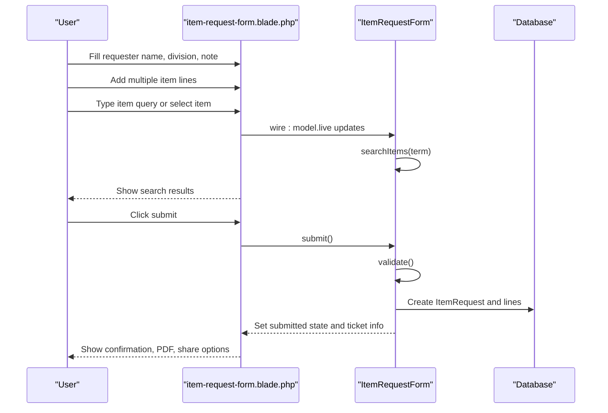
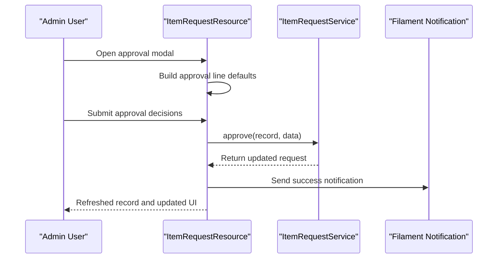
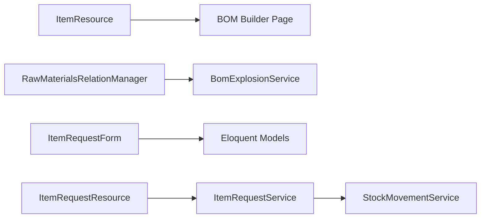

# Component Interactions and Relationships

<cite>
**Referenced Files in This Document**   
- [ItemResource.php](file://app/Filament/Resources/Items/ItemResource.php)
- [BomExplosionService.php](file://app/Services/BomExplosionService.php)
- [RawMaterialsRelationManager.php](file://app/Filament/Resources/ProductionBatches/RelationManagers/RawMaterialsRelationManager.php)
- [ItemRequestForm.php](file://app/Livewire/ItemRequestForm.php)
- [item-request-form.blade.php](file://resources/views/livewire/item-request-form.blade.php)
- [ItemRequestResource.php](file://app/Filament/Resources/ItemRequests/ItemRequestResource.php)
- [ItemRequestService.php](file://app/Services/ItemRequestService.php)
</cite>

## Table of Contents
1. [Introduction](#introduction)
2. [Project Structure](#project-structure)
3. [Core Components](#core-components)
4. [Architecture Overview](#architecture-overview)
5. [Detailed Component Analysis](#detailed-component-analysis)
6. [Dependency Analysis](#dependency-analysis)
7. [Performance Considerations](#performance-considerations)
8. [Troubleshooting Guide](#troubleshooting-guide)
9. [Conclusion](#conclusion)

## Introduction
This document explains how RSV Helmet coordinates its user interface, Filament resources, Livewire components, and backend services. It focuses on:
- How Filament resources present data and trigger business operations.
- How Livewire forms collect user input and persist domain entities.
- How services encapsulate business logic such as bill-of-materials explosion and item request approval.
- Communication patterns between UI components and business layers.
- Event-driven interactions, state management, and data synchronization across the frontend and backend.
- Error handling and validation flows across component boundaries.

## Project Structure
The relevant parts of the application are organized into:
- Filament resources for admin interfaces.
- Livewire components for public-facing forms.
- Services for reusable business logic.
- Blade views that render Livewire components.

**Diagram sources**
- [ItemResource.php:261-278](file://app/Filament/Resources/Items/ItemResource.php#L261-L278)
- [RawMaterialsRelationManager.php:23-80](file://app/Filament/Resources/ProductionBatches/RelationManagers/RawMaterialsRelationManager.php#L23-L80)
- [ItemRequestForm.php:95-152](file://app/Livewire/ItemRequestForm.php#L95-L152)
- [ItemRequestResource.php:222-388](file://app/Filament/Resources/ItemRequests/ItemRequestResource.php#L222-L388)
- [BomExplosionService.php:22-107](file://app/Services/BomExplosionService.php#L22-L107)
- [ItemRequestService.php:22-185](file://app/Services/ItemRequestService.php#L22-L185)

**Section sources**
- [ItemResource.php:37-299](file://app/Filament/Resources/Items/ItemResource.php#L37-L299)
- [RawMaterialsRelationManager.php:15-83](file://app/Filament/Resources/ProductionBatches/RelationManagers/RawMaterialsRelationManager.php#L15-L83)
- [ItemRequestForm.php:22-305](file://app/Livewire/ItemRequestForm.php#L22-L305)
- [item-request-form.blade.php:1-584](file://resources/views/livewire/item-request-form.blade.php#L1-L584)
- [ItemRequestResource.php:39-479](file://app/Filament/Resources/ItemRequests/ItemRequestResource.php#L39-L479)
- [ItemRequestService.php:14-258](file://app/Services/ItemRequestService.php#L14-L258)
- [BomExplosionService.php:11-158](file://app/Services/BomExplosionService.php#L11-L158)

## Core Components
- **ItemResource**: Defines the item master form, table, filters, actions, and relation managers. It also exposes a composition action that navigates to the BOM builder page.
- **RawMaterialsRelationManager**: Displays raw material requirements for a production batch by delegating to `BomExplosionService`.
- **BomExplosionService**: Recursively explodes item compositions into raw materials, aggregates required quantities, and compares them with inventory balances.
- **ItemRequestForm**: A Livewire component that renders a public item request form, validates input, creates an item request and lines, and shows confirmation details.
- **item-request-form.blade.php**: The Blade template bound to `ItemRequestForm`, including live search, line management, submission, and post-submission PDF sharing.
- **ItemRequestResource**: Admin resource for viewing and approving or rejecting item requests. It uses a modal repeater to approve items per line and delegates decisions to `ItemRequestService`.
- **ItemRequestService**: Encapsulates approval workflows, rejection logic, warehouse configuration validation, and integration with stock movement operations.

**Section sources**
- [ItemResource.php:55-299](file://app/Filament/Resources/Items/ItemResource.php#L55-L299)
- [RawMaterialsRelationManager.php:15-83](file://app/Filament/Resources/ProductionBatches/RelationManagers/RawMaterialsRelationManager.php#L15-L83)
- [BomExplosionService.php:11-158](file://app/Services/BomExplosionService.php#L11-L158)
- [ItemRequestForm.php:22-305](file://app/Livewire/ItemRequestForm.php#L22-L305)
- [item-request-form.blade.php:1-584](file://resources/views/livewire/item-request-form.blade.php#L1-L584)
- [ItemRequestResource.php:39-479](file://app/Filament/Resources/ItemRequests/ItemRequestResource.php#L39-L479)
- [ItemRequestService.php:14-258](file://app/Services/ItemRequestService.php#L14-L258)

## Architecture Overview
RSV Helmet follows a layered architecture:
- **Presentation layer**: Filament resources and Livewire components provide interactive UIs.
- **Domain layer**: Services implement business rules for BOM explosion and item request approvals.
- **Data layer**: Eloquent models and database tables store items, batches, requests, and movements.

**Diagram sources**
- [ItemRequestResource.php:222-343](file://app/Filament/Resources/ItemRequests/ItemRequestResource.php#L222-L343)
- [ItemRequestService.php:22-185](file://app/Services/ItemRequestService.php#L22-L185)

## Detailed Component Analysis

### ItemResource and BOM Navigation
`ItemResource` defines the item master interface. It includes:
- Form sections for identity, variants, dimensions, pricing, and behavior.
- Table columns, filters, and infinite scrolling.
- A composition action that links to the BOM builder page when the item is stockable and not a variant parent.

**Diagram sources**
- [ItemResource.php:261-278](file://app/Filament/Resources/Items/ItemResource.php#L261-L278)

**Section sources**
- [ItemResource.php:55-299](file://app/Filament/Resources/Items/ItemResource.php#L55-L299)

### RawMaterialsRelationManager and BomExplosionService
`RawMaterialsRelationManager` displays computed raw material requirements for a production batch. It calls `BomExplosionService::rawMaterials()` and maps the result back onto model instances for display.

**Diagram sources**
- [RawMaterialsRelationManager.php:23-80](file://app/Filament/Resources/ProductionBatches/RelationManagers/RawMaterialsRelationManager.php#L23-L80)
- [BomExplosionService.php:22-158](file://app/Services/BomExplosionService.php#L22-L158)

#### BOM Explosion Algorithm Flow

**Diagram sources**
- [BomExplosionService.php:22-107](file://app/Services/BomExplosionService.php#L22-L107)

**Section sources**
- [RawMaterialsRelationManager.php:15-83](file://app/Filament/Resources/ProductionBatches/RelationManagers/RawMaterialsRelationManager.php#L15-L83)
- [BomExplosionService.php:11-158](file://app/Services/BomExplosionService.php#L11-L158)

### Livewire Item Request Form
`ItemRequestForm` manages a multi-line item request form. Key behaviors include:
- Adding and removing lines.
- Selecting items from a catalog or entering manual names.
- Live search for items.
- Validation rules and custom duplicate checks.
- Persisting the request and lines inside a database transaction.
- Rendering a success state with ticket number, preview, PDF download, and optional WhatsApp sharing.

**Diagram sources**
- [item-request-form.blade.php:179-584](file://resources/views/livewire/item-request-form.blade.php#L179-L584)
- [ItemRequestForm.php:46-152](file://app/Livewire/ItemRequestForm.php#L46-L152)
- [ItemRequestForm.php:174-208](file://app/Livewire/ItemRequestForm.php#L174-L208)
- [ItemRequestForm.php:210-262](file://app/Livewire/ItemRequestForm.php#L210-L262)
- [ItemRequestForm.php:264-303](file://app/Livewire/ItemRequestForm.php#L264-L303)

**Section sources**
- [ItemRequestForm.php:22-305](file://app/Livewire/ItemRequestForm.php#L22-L305)
- [item-request-form.blade.php:1-584](file://resources/views/livewire/item-request-form.blade.php#L1-L584)

### ItemRequestResource Approval Workflow
`ItemRequestResource` provides:
- Read-only form fields showing request metadata and approval history.
- An approval action with a repeater for per-line decisions.
- A rejection action requiring a reason.
- Notifications and record refresh after successful operations.
- Delegation to `ItemRequestService` for business rules and side effects.

**Diagram sources**
- [ItemRequestResource.php:222-343](file://app/Filament/Resources/ItemRequests/ItemRequestResource.php#L222-L343)
- [ItemRequestService.php:22-185](file://app/Services/ItemRequestService.php#L22-L185)

**Section sources**
- [ItemRequestResource.php:39-479](file://app/Filament/Resources/ItemRequests/ItemRequestResource.php#L39-L479)
- [ItemRequestService.php:14-258](file://app/Services/ItemRequestService.php#L14-L258)

## Dependency Analysis
The main dependency relationships are:
- `ItemResource` depends on Filament components and navigation pages; it does not directly call services but exposes actions that navigate to related features.
- `RawMaterialsRelationManager` depends on `BomExplosionService` to compute raw material requirements.
- `ItemRequestForm` depends on Eloquent models and performs direct persistence; it does not use `ItemRequestService` for creation.
- `ItemRequestResource` depends on `ItemRequestService` for approval and rejection workflows.
- `ItemRequestService` depends on `StockMovementService` (resolved via container) to perform stock transfers when items are approved.

**Diagram sources**
- [ItemResource.php:261-278](file://app/Filament/Resources/Items/ItemResource.php#L261-L278)
- [RawMaterialsRelationManager.php:62-80](file://app/Filament/Resources/ProductionBatches/RelationManagers/RawMaterialsRelationManager.php#L62-L80)
- [ItemRequestForm.php:127-152](file://app/Livewire/ItemRequestForm.php#L127-L152)
- [ItemRequestResource.php:308-343](file://app/Filament/Resources/ItemRequests/ItemRequestResource.php#L308-L343)
- [ItemRequestService.php:138-149](file://app/Services/ItemRequestService.php#L138-L149)

**Section sources**
- [ItemResource.php:37-299](file://app/Filament/Resources/Items/ItemResource.php#L37-L299)
- [RawMaterialsRelationManager.php:15-83](file://app/Filament/Resources/ProductionBatches/RelationManagers/RawMaterialsRelationManager.php#L15-L83)
- [ItemRequestForm.php:22-305](file://app/Livewire/ItemRequestForm.php#L22-L305)
- [ItemRequestResource.php:39-479](file://app/Filament/Resources/ItemRequests/ItemRequestResource.php#L39-L479)
- [ItemRequestService.php:14-258](file://app/Services/ItemRequestService.php#L14-L258)

## Performance Considerations
- **BOM explosion**: Uses eager loading of missing relations and groups components by parent to avoid repeated queries. Inventory balances are queried once for all required items and grouped by item ID.
- **Livewire search**: Debounced live search limits results to 10 entries and escapes special characters to prevent inefficient wildcard queries.
- **Infinite lists**: Both item list and item request list use infinite pagination to reduce payload size.
- **Transactions**: Both Livewire submission and service approval/rejection use database transactions to ensure consistency.

[No sources needed since this section provides general guidance]

## Troubleshooting Guide
Common issues and their handling:
- **Validation errors in Livewire form**: Field-level errors are displayed next to inputs; custom duplicate checks add per-line messages.
- **Approval workflow errors**: `ItemRequestService` throws validation exceptions for invalid warehouse settings, mismatched warehouses, missing decisions, or invalid quantities. `ItemRequestResource` catches these and shows persistent danger notifications.
- **Missing BOM structure**: Raw materials relation manager shows empty states and descriptions guiding users to define item compositions.

**Section sources**
- [ItemRequestForm.php:95-152](file://app/Livewire/ItemRequestForm.php#L95-L152)
- [ItemRequestForm.php:174-208](file://app/Livewire/ItemRequestForm.php#L174-L208)
- [ItemRequestResource.php:308-343](file://app/Filament/Resources/ItemRequests/ItemRequestResource.php#L308-L343)
- [ItemRequestResource.php:362-388](file://app/Filament/Resources/ItemRequests/ItemRequestResource.php#L362-L388)
- [ItemRequestService.php:35-56](file://app/Services/ItemRequestService.php#L35-L56)
- [ItemRequestService.php:70-136](file://app/Services/ItemRequestService.php#L70-L136)
- [RawMaterialsRelationManager.php:23-57](file://app/Filament/Resources/ProductionBatches/RelationManagers/RawMaterialsRelationManager.php#L23-L57)

## Conclusion
RSV Helmet integrates Filament resources, Livewire components, and services to deliver robust inventory and production workflows:
- `ItemResource` provides item master management and navigation to BOM tools.
- `RawMaterialsRelationManager` visualizes computed raw material needs using `BomExplosionService`.
- `ItemRequestForm` captures user intent through a dynamic form and persists requests efficiently.
- `ItemRequestResource` orchestrates approval workflows with clear validation and user feedback.
- `ItemRequestService` centralizes business rules, ensuring consistent state transitions and safe stock movements.

This separation of concerns improves maintainability, testability, and clarity of component interactions across the system.