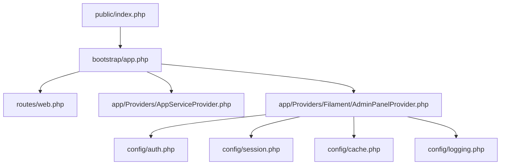
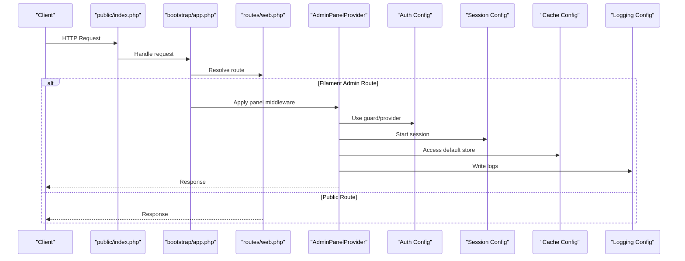
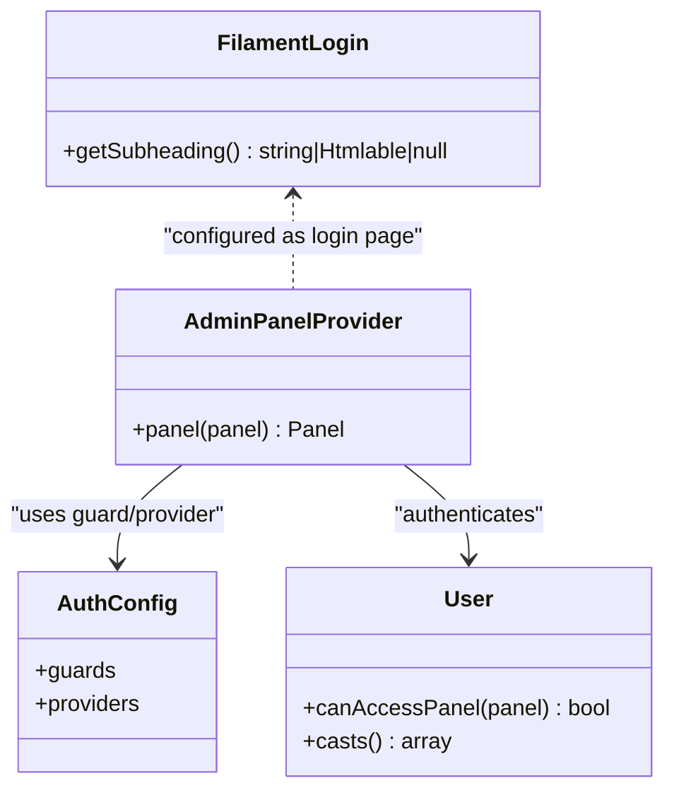
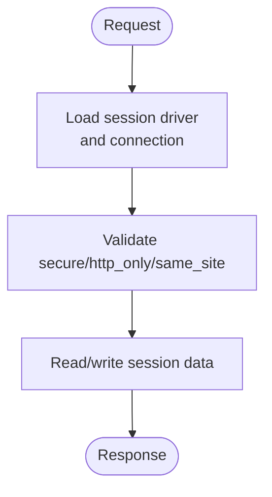
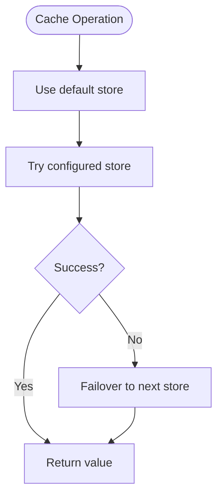
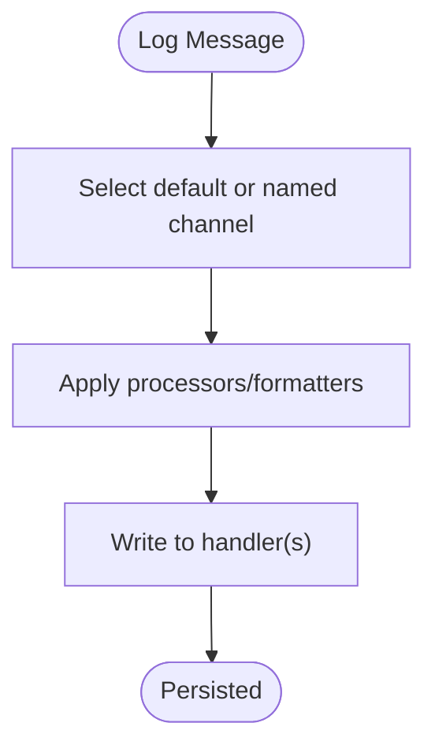
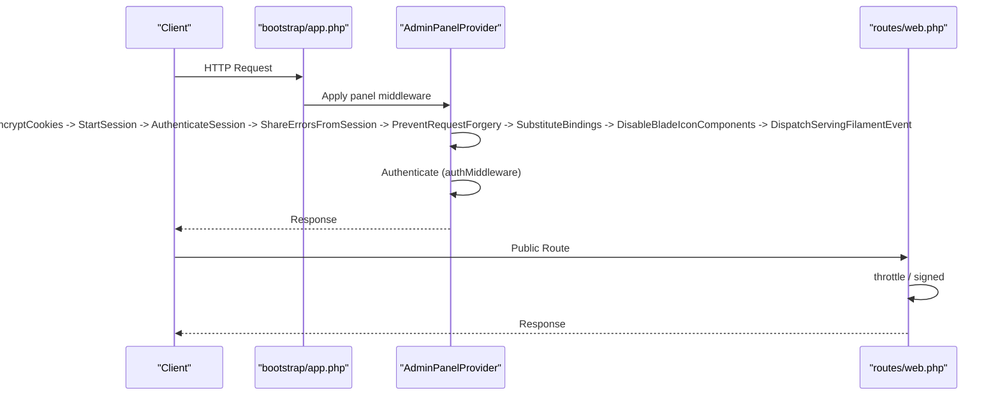
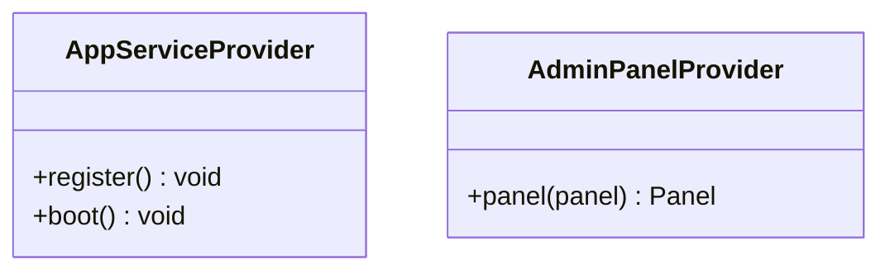
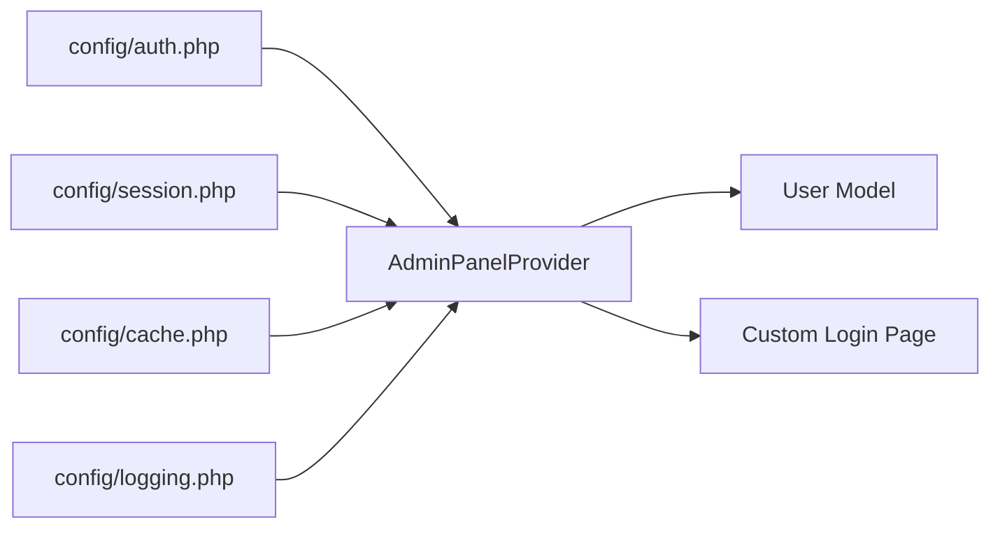

# Cross-Cutting Concerns Implementation

<cite>
**Referenced Files in This Document**
- [config/auth.php](file://config/auth.php)
- [config/session.php](file://config/session.php)
- [config/cache.php](file://config/cache.php)
- [config/logging.php](file://config/logging.php)
- [app/Providers/Filament/AdminPanelProvider.php](file://app/Providers/Filament/AdminPanelProvider.php)
- [app/Providers/AppServiceProvider.php](file://app/Providers/AppServiceProvider.php)
- [app/Models/User.php](file://app/Models/User.php)
- [app/Filament/Auth/Login.php](file://app/Filament/Auth/Login.php)
- [bootstrap/app.php](file://bootstrap/app.php)
- [routes/web.php](file://routes/web.php)
- [public/index.php](file://public/index.php)
</cite>

## Table of Contents
1. [Introduction](#introduction)
2. [Project Structure](#project-structure)
3. [Core Components](#core-components)
4. [Architecture Overview](#architecture-overview)
5. [Detailed Component Analysis](#detailed-component-analysis)
6. [Dependency Analysis](#dependency-analysis)
7. [Performance Considerations](#performance-considerations)
8. [Troubleshooting Guide](#troubleshooting-guide)
9. [Conclusion](#conclusion)

## Introduction
This document explains how cross-cutting concerns are implemented in RSV Helmet, focusing on authentication, authorization, session management, caching, logging, and middleware. It covers Filament panel configuration, Laravel’s global application bootstrap, and the consistent application of security and operational concerns across the system. The goal is to provide a clear, code-mapped view of where these concerns live, how they interact, and how to extend them safely.

## Project Structure
Cross-cutting concerns in this project are primarily configured through:
- Framework configuration files for authentication, sessions, cache, and logging
- A Filament Admin Panel provider that wires middleware and authentication for the admin area
- A minimal global application bootstrap that registers routes and exception handling
- Public entry point bootstrapping the framework

**Diagram sources**
- [public/index.php:1-20](file://public/index.php#L1-L20)
- [bootstrap/app.php:8-21](file://bootstrap/app.php#L8-L21)
- [routes/web.php:1-18](file://routes/web.php#L1-L18)
- [app/Providers/AppServiceProvider.php:1-25](file://app/Providers/AppServiceProvider.php#L1-L25)
- [app/Providers/Filament/AdminPanelProvider.php:1-91](file://app/Providers/Filament/AdminPanelProvider.php#L1-L91)
- [config/auth.php:1-118](file://config/auth.php#L1-L118)
- [config/session.php:1-234](file://config/session.php#L1-L234)
- [config/cache.php:1-137](file://config/cache.php#L1-L137)
- [config/logging.php:1-141](file://config/logging.php#L1-L141)

**Section sources**
- [public/index.php:1-20](file://public/index.php#L1-L20)
- [bootstrap/app.php:8-21](file://bootstrap/app.php#L8-L21)
- [routes/web.php:1-18](file://routes/web.php#L1-L18)
- [app/Providers/AppServiceProvider.php:1-25](file://app/Providers/AppServiceProvider.php#L1-L25)
- [app/Providers/Filament/AdminPanelProvider.php:1-91](file://app/Providers/Filament/AdminPanelProvider.php#L1-L91)

## Core Components
- Authentication and Authorization
  - Guard and user provider are defined in the authentication configuration.
  - Filament uses its own Authenticate middleware for panel access control.
  - The User model implements Filament’s panel access contract.
  - A custom Filament login page adjusts UI text.
- Session Management
  - Default driver is database-backed with JSON serialization.
  - Cookie attributes (secure, http_only, same_site) are configured for security.
- Caching
  - Default store is database-backed with a failover store defined.
  - Key prefixing is enabled to avoid collisions.
- Logging
  - Default channel is a stack composed from environment variables.
  - Multiple channels (single, daily, slack, stderr, syslog, etc.) are available.
- Middleware
  - Global middleware pipeline is registered in the application bootstrap.
  - Filament panel defines its own middleware stack and auth middleware.
  - Route-level middleware includes rate limiting and signed URLs.

**Section sources**
- [config/auth.php:18-74](file://config/auth.php#L18-L74)
- [app/Providers/Filament/AdminPanelProvider.php:75-88](file://app/Providers/Filament/AdminPanelProvider.php#L75-L88)
- [app/Models/User.php:17-25](file://app/Models/User.php#L17-L25)
- [app/Filament/Auth/Login.php:8-18](file://app/Filament/Auth/Login.php#L8-L18)
- [config/session.php:21-231](file://config/session.php#L21-L231)
- [config/cache.php:18-121](file://config/cache.php#L18-L121)
- [config/logging.php:21-138](file://config/logging.php#L21-L138)
- [bootstrap/app.php:14-21](file://bootstrap/app.php#L14-L21)
- [routes/web.php:11-17](file://routes/web.php#L11-L17)

## Architecture Overview
The request lifecycle flows through the public entry point into the application bootstrap, which configures routing and middleware. For Filament requests, the Admin Panel Provider applies a dedicated middleware stack and enforces authentication via Filament’s Authenticate middleware. Configuration files centralize cross-cutting behavior for auth, sessions, cache, and logging.

**Diagram sources**
- [public/index.php:16-20](file://public/index.php#L16-L20)
- [bootstrap/app.php:8-21](file://bootstrap/app.php#L8-L21)
- [routes/web.php:7-17](file://routes/web.php#L7-L17)
- [app/Providers/Filament/AdminPanelProvider.php:31-88](file://app/Providers/Filament/AdminPanelProvider.php#L31-L88)
- [config/auth.php:18-74](file://config/auth.php#L18-L74)
- [config/session.php:21-231](file://config/session.php#L21-L231)
- [config/cache.php:18-121](file://config/cache.php#L18-L121)
- [config/logging.php:21-138](file://config/logging.php#L21-L138)

## Detailed Component Analysis

### Authentication and Authorization
- Guard and Provider
  - The web guard uses the session driver and the users provider backed by Eloquent.
  - The user model class is configurable via environment variable.
- Filament Integration
  - The Admin Panel Provider sets Authenticate as the panel’s auth middleware.
  - The User model implements FilamentUser and allows all users to access the panel by default.
- Custom Login Page
  - The custom login page overrides the subheading to display localized guidance.

**Diagram sources**
- [app/Models/User.php:17-39](file://app/Models/User.php#L17-L39)
- [app/Providers/Filament/AdminPanelProvider.php:31-88](file://app/Providers/Filament/AdminPanelProvider.php#L31-L88)
- [config/auth.php:18-74](file://config/auth.php#L18-L74)
- [app/Filament/Auth/Login.php:8-18](file://app/Filament/Auth/Login.php#L8-L18)

**Section sources**
- [config/auth.php:18-74](file://config/auth.php#L18-L74)
- [app/Providers/Filament/AdminPanelProvider.php:31-88](file://app/Providers/Filament/AdminPanelProvider.php#L31-L88)
- [app/Models/User.php:17-39](file://app/Models/User.php#L17-L39)
- [app/Filament/Auth/Login.php:8-18](file://app/Filament/Auth/Login.php#L8-L18)

### Session Management
- Driver and Lifetime
  - Database driver is used by default; lifetime is controlled via environment variable.
- Security Attributes
  - Secure, http_only, and same_site cookie settings are configured to mitigate CSRF and XSS risks.
- Serialization
  - JSON serialization is enforced to reduce gadget chain attack surface.

**Diagram sources**
- [config/session.php:21-231](file://config/session.php#L21-L231)

**Section sources**
- [config/session.php:21-231](file://config/session.php#L21-L231)

### Caching Strategy
- Default Store and Failover
  - Default store is database-backed; a failover store falls back to array when needed.
- Key Prefixing
  - Cache keys are prefixed using the application name to prevent collisions.
- Serializable Classes
  - Disabling unserialization of classes reduces risk if APP_KEY is compromised.

**Diagram sources**
- [config/cache.php:18-121](file://config/cache.php#L18-L121)

**Section sources**
- [config/cache.php:18-121](file://config/cache.php#L18-L121)

### Logging Strategy
- Channels and Stack
  - Default channel is a stack composed from environment variables.
  - Multiple channels support file rotation, Slack, stderr, syslog, and more.
- Deprecations
  - Deprecation logging can be directed to a separate channel with optional traces.

**Diagram sources**
- [config/logging.php:21-138](file://config/logging.php#L21-L138)

**Section sources**
- [config/logging.php:21-138](file://config/logging.php#L21-L138)

### Middleware Pipeline
- Global Middleware
  - The application bootstrap registers the global middleware pipeline.
- Filament Panel Middleware
  - The Admin Panel Provider applies encryption, session start, CSRF protection, binding substitution, and Filament-specific middleware.
- Route-Level Middleware
  - Public routes use throttle and signed URL middleware for rate limiting and secure sharing.

**Diagram sources**
- [bootstrap/app.php:14-21](file://bootstrap/app.php#L14-L21)
- [app/Providers/Filament/AdminPanelProvider.php:75-88](file://app/Providers/Filament/AdminPanelProvider.php#L75-L88)
- [routes/web.php:11-17](file://routes/web.php#L11-L17)

**Section sources**
- [bootstrap/app.php:14-21](file://bootstrap/app.php#L14-L21)
- [app/Providers/Filament/AdminPanelProvider.php:75-88](file://app/Providers/Filament/AdminPanelProvider.php#L75-L88)
- [routes/web.php:11-17](file://routes/web.php#L11-L17)

### Service Providers and Global Configuration
- AppServiceProvider
  - Present but currently empty; suitable place for future global bindings or boot logic.
- AdminPanelProvider
  - Centralizes Filament panel configuration, including navigation groups, widgets, render hooks, middleware, and authentication.

**Diagram sources**
- [app/Providers/AppServiceProvider.php:1-25](file://app/Providers/AppServiceProvider.php#L1-L25)
- [app/Providers/Filament/AdminPanelProvider.php:1-91](file://app/Providers/Filament/AdminPanelProvider.php#L1-L91)

**Section sources**
- [app/Providers/AppServiceProvider.php:1-25](file://app/Providers/AppServiceProvider.php#L1-L25)
- [app/Providers/Filament/AdminPanelProvider.php:1-91](file://app/Providers/Filament/AdminPanelProvider.php#L1-L91)

## Dependency Analysis
The following diagram shows how core configuration and providers depend on each other to implement cross-cutting concerns.

**Diagram sources**
- [config/auth.php:18-74](file://config/auth.php#L18-L74)
- [config/session.php:21-231](file://config/session.php#L21-L231)
- [config/cache.php:18-121](file://config/cache.php#L18-L121)
- [config/logging.php:21-138](file://config/logging.php#L21-L138)
- [app/Providers/Filament/AdminPanelProvider.php:31-88](file://app/Providers/Filament/AdminPanelProvider.php#L31-L88)
- [app/Models/User.php:17-25](file://app/Models/User.php#L17-L25)
- [app/Filament/Auth/Login.php:8-18](file://app/Filament/Auth/Login.php#L8-L18)

**Section sources**
- [config/auth.php:18-74](file://config/auth.php#L18-L74)
- [config/session.php:21-231](file://config/session.php#L21-L231)
- [config/cache.php:18-121](file://config/cache.php#L18-L121)
- [config/logging.php:21-138](file://config/logging.php#L21-L138)
- [app/Providers/Filament/AdminPanelProvider.php:31-88](file://app/Providers/Filament/AdminPanelProvider.php#L31-L88)
- [app/Models/User.php:17-25](file://app/Models/User.php#L17-L25)
- [app/Filament/Auth/Login.php:8-18](file://app/Filament/Auth/Login.php#L8-L18)

## Performance Considerations
- Authentication and Sessions
  - Keep session lifetime reasonable and prefer database-backed sessions for scalability.
  - Ensure secure cookie settings are enabled in production to reduce overhead from insecure cookies.
- Caching
  - Prefer the default database store for simplicity; consider Redis or Memcached for high-throughput environments.
  - Use key prefixes to avoid collisions and enable failover stores for resilience.
- Logging
  - Avoid excessive debug logging in production; rotate logs daily and limit retention.
  - Use stderr or centralized log collectors in containerized environments.
- Middleware
  - Place expensive checks in specialized middleware and apply only where necessary.
  - Use route-level throttling sparingly to balance security and performance.

[No sources needed since this section provides general guidance]

## Troubleshooting Guide
- Authentication Issues
  - Verify the guard and provider configuration match the intended user model.
  - Confirm Filament’s Authenticate middleware is applied to the admin panel.
- Session Problems
  - Check the session driver and database table existence.
  - Validate cookie attributes (secure, http_only, same_site) against deployment constraints.
- Cache Failures
  - Inspect the default store and failover configuration.
  - Ensure cache tables or external services are reachable and properly configured.
- Logging Gaps
  - Confirm the default channel and stack composition.
  - Validate file permissions for log storage paths.

**Section sources**
- [config/auth.php:18-74](file://config/auth.php#L18-L74)
- [app/Providers/Filament/AdminPanelProvider.php:75-88](file://app/Providers/Filament/AdminPanelProvider.php#L75-L88)
- [config/session.php:21-231](file://config/session.php#L21-L231)
- [config/cache.php:18-121](file://config/cache.php#L18-L121)
- [config/logging.php:21-138](file://config/logging.php#L21-L138)

## Conclusion
RSV Helmet centralizes cross-cutting concerns through well-defined configuration files and a focused Filament Admin Panel Provider. Authentication and authorization are consistently enforced via guards, providers, and panel middleware. Sessions, caching, and logging are configured for security and reliability. The global bootstrap remains minimal, allowing clear extension points for additional middleware, providers, and policies as the application evolves.

[No sources needed since this section summarizes without analyzing specific files]