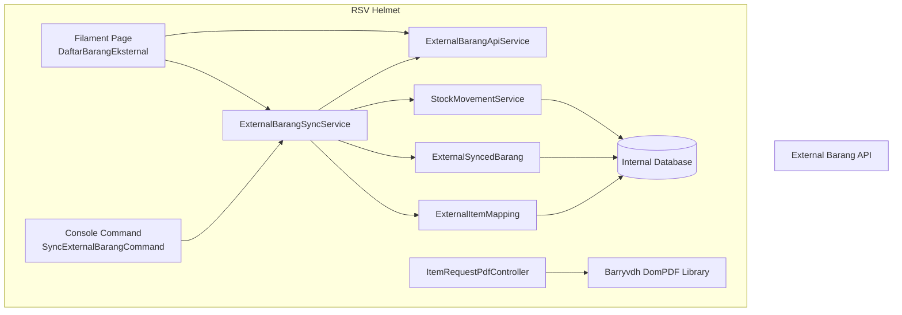
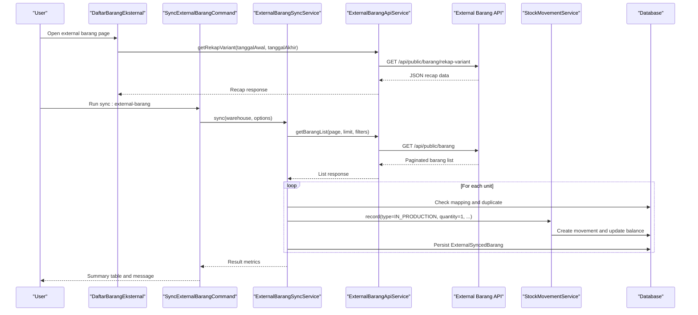
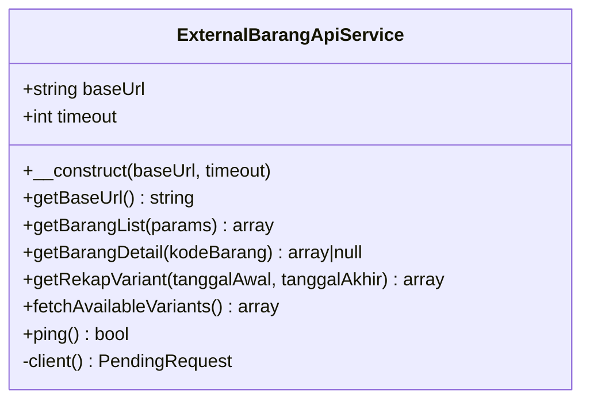
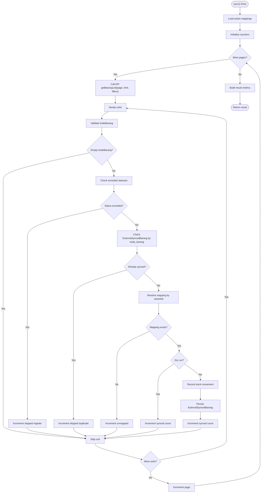
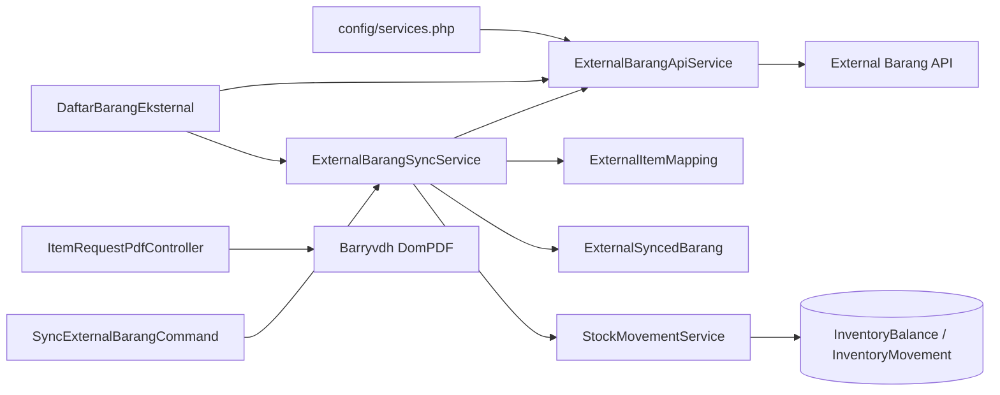

# Integration Boundaries and External Systems

<cite>
**Referenced Files in This Document**
- [ExternalBarangApiService.php](file://app/Services/ExternalBarangApiService.php)
- [ExternalBarangSyncService.php](file://app/Services/ExternalBarangSyncService.php)
- [SyncExternalBarangCommand.php](file://app/Console/Commands/SyncExternalBarangCommand.php)
- [ExternalItemMapping.php](file://app/Models/ExternalItemMapping.php)
- [ExternalSyncedBarang.php](file://app/Models/ExternalSyncedBarang.php)
- [DaftarBarangEksternal.php](file://app/Filament/Pages/DaftarBarangEksternal.php)
- [StockMovementService.php](file://app/Services/StockMovementService.php)
- [services.php](file://config/services.php)
- [web.php](file://routes/web.php)
- [ItemRequestPdfController.php](file://app/Http/Controllers/ItemRequestPdfController.php)
</cite>

## Table of Contents
1. [Introduction](#introduction)
2. [Project Structure](#project-structure)
3. [Core Components](#core-components)
4. [Architecture Overview](#architecture-overview)
5. [Detailed Component Analysis](#detailed-component-analysis)
6. [Dependency Analysis](#dependency-analysis)
7. [Performance Considerations](#performance-considerations)
8. [Security Considerations](#security-considerations)
9. [Monitoring and Observability](#monitoring-and-observability)
10. [Troubleshooting Guide](#troubleshooting-guide)
11. [Conclusion](#conclusion)

## Introduction
This document explains how RSV Helmet integrates with external systems, focusing on the integration boundaries around an external barang (item) API and internal inventory synchronization. It covers:

- How `ExternalBarangApiService` communicates with an external public API.
- How `ExternalBarangSyncService` transforms external data into internal stock movements.
- The contract between internal components and external systems.
- Error handling, retry behavior, and idempotency.
- Data transformation from external variants to internal items through mappings.
- PDF generation using an external library for item request documents.
- Security considerations, authentication assumptions, and monitoring approaches.

The goal is to make these integration points clear for developers, operators, and reviewers who need to understand where RSV Helmet connects to outside systems and how failures are handled.

## Project Structure
The integration boundary is primarily implemented in service classes, models, a console command, and a Filament page. Configuration for the external API lives in the services configuration file, while PDF generation uses a dedicated controller and route.

**Diagram sources**
- [DaftarBarangEksternal.php:147-257](file://app/Filament/Pages/DaftarBarangEksternal.php#L147-L257)
- [SyncExternalBarangCommand.php:33-87](file://app/Console/Commands/SyncExternalBarangCommand.php#L33-L87)
- [ExternalBarangApiService.php:33-186](file://app/Services/ExternalBarangApiService.php#L33-L186)
- [ExternalBarangSyncService.php:40-221](file://app/Services/ExternalBarangSyncService.php#L40-L221)
- [StockMovementService.php:23-60](file://app/Services/StockMovementService.php#L23-L60)
- [ExternalItemMapping.php:39-47](file://app/Models/ExternalItemMapping.php#L39-L47)
- [ExternalSyncedBarang.php:42-60](file://app/Models/ExternalSyncedBarang.php#L42-L60)
- [ItemRequestPdfController.php:11-17](file://app/Http/Controllers/ItemRequestPdfController.php#L11-L17)

**Section sources**
- [ExternalBarangApiService.php:10-186](file://app/Services/ExternalBarangApiService.php#L10-L186)
- [ExternalBarangSyncService.php:14-241](file://app/Services/ExternalBarangSyncService.php#L14-L241)
- [SyncExternalBarangCommand.php:9-89](file://app/Console/Commands/SyncExternalBarangCommand.php#L9-L89)
- [DaftarBarangEksternal.php:28-363](file://app/Filament/Pages/DaftarBarangEksternal.php#L28-L363)
- [services.php:38-43](file://config/services.php#L38-L43)
- [web.php:15-17](file://routes/web.php#L15-L17)
- [ItemRequestPdfController.php:9-18](file://app/Http/Controllers/ItemRequestPdfController.php#L9-L18)

## Core Components
This section summarizes the main integration components and their responsibilities.

- **ExternalBarangApiService**: Encapsulates HTTP calls to the external barang API. It provides methods for listing barang, fetching detail by code, retrieving variant recap data, extracting available variants, and pinging the API. It configures base URL and timeout from application configuration and logs errors without failing loudly.
- **ExternalBarangSyncService**: Orchestrates synchronization of external finish-good units into internal inventory. It reads active mappings, filters excluded statuses, checks duplicates, maps external variants to internal items, records stock movements, and persists sync metadata.
- **SyncExternalBarangCommand**: Exposes a CLI entry point for running synchronization with options such as warehouse ID, limit, pagination, status filter, and dry-run mode.
- **ExternalItemMapping**: Stores mapping between external variant identifiers and internal items. It supports active/inactive state and relationships to synced records.
- **ExternalSyncedBarang**: Tracks which external units have been synchronized, including external IDs, batch references, mapped item, warehouse, movement reference, status, timestamps, and sync time.
- **StockMovementService**: Provides transactional stock recording, production output handling, transfers, deletion/reversal, and balance updates. Synchronization relies on it to record incoming production stock.
- **DaftarBarangEksternal**: Filament page that displays grouped external barang data per date, allows filtering by date range and status, shows sync progress, and triggers synchronization or variant mapping actions.
- **ItemRequestPdfController**: Generates PDFs for item requests using Barryvdh DomPDF.

**Section sources**
- [ExternalBarangApiService.php:10-186](file://app/Services/ExternalBarangApiService.php#L10-L186)
- [ExternalBarangSyncService.php:14-241](file://app/Services/ExternalBarangSyncService.php#L14-L241)
- [SyncExternalBarangCommand.php:9-89](file://app/Console/Commands/SyncExternalBarangCommand.php#L9-L89)
- [ExternalItemMapping.php:13-47](file://app/Models/ExternalItemMapping.php#L13-L47)
- [ExternalSyncedBarang.php:11-60](file://app/Models/ExternalSyncedBarang.php#L11-L60)
- [StockMovementService.php:16-397](file://app/Services/StockMovementService.php#L16-L397)
- [DaftarBarangEksternal.php:28-363](file://app/Filament/Pages/DaftarBarangEksternal.php#L28-L363)
- [ItemRequestPdfController.php:9-18](file://app/Http/Controllers/ItemRequestPdfController.php#L9-L18)

## Architecture Overview
The integration architecture separates concerns between external communication, business orchestration, persistence, and user interface.

**Diagram sources**
- [DaftarBarangEksternal.php:147-257](file://app/Filament/Pages/DaftarBarangEksternal.php#L147-L257)
- [SyncExternalBarangCommand.php:33-87](file://app/Console/Commands/SyncExternalBarangCommand.php#L33-L87)
- [ExternalBarangApiService.php:33-109](file://app/Services/ExternalBarangApiService.php#L33-L109)
- [ExternalBarangSyncService.php:40-221](file://app/Services/ExternalBarangSyncService.php#L40-L221)
- [StockMovementService.php:23-60](file://app/Services/StockMovementService.php#L23-L60)

## Detailed Component Analysis

### ExternalBarangApiService
Responsibilities:
- Configure base URL and timeout from configuration.
- Call external endpoints:
  - `/api/public/barang` for listing barang with optional pagination and filters.
  - `/api/public/barang/{kodeBarang}` for detail lookup.
  - `/api/public/barang/rekap-variant` for aggregated variant recap over a date range.
- Provide a helper to extract unique available variants from recap or list responses.
- Provide a ping method to check external API availability.

Error handling:
- Catches exceptions and logs them.
- Returns safe default structures when API fails or returns non-successful responses.

Retry mechanism:
- No built-in retry logic; callers must implement retries if needed.

Data transformation:
- Normalizes variant fields from different response shapes into consistent arrays for downstream use.

Configuration:
- Base URL and timeout come from `config('services.external_barang.base_url')` and `config('services.external_barang.timeout')`.

**Diagram sources**
- [ExternalBarangApiService.php:10-186](file://app/Services/ExternalBarangApiService.php#L10-L186)

**Section sources**
- [ExternalBarangApiService.php:10-186](file://app/Services/ExternalBarangApiService.php#L10-L186)
- [services.php:38-43](file://config/services.php#L38-L43)

### ExternalBarangSyncService
Responsibilities:
- Orchestrate synchronization of external finish-good units into internal inventory.
- Read active mappings from `ExternalItemMapping`.
- Filter out excluded statuses (default includes REGISTER).
- Enforce idempotency via `ExternalSyncedBarang` by kode_barang.
- Map external variants to internal items using mappings.
- Record stock movements via `StockMovementService`.
- Persist sync metadata including external IDs, batch references, mapped item, warehouse, movement reference, status, and timestamps.
- Support dry-run mode and pagination across pages.

Error handling:
- Logs individual stock recording failures without aborting the entire sync.
- Uses database transactions to ensure consistency of movement and sync record creation.

Idempotency:
- Skips already-synced units based on `kode_barang`.

Date resolution:
- Resolves occurrence dates from multiple possible fields, falling back to current time if parsing fails.

**Diagram sources**
- [ExternalBarangSyncService.php:40-221](file://app/Services/ExternalBarangSyncService.php#L40-L221)

**Section sources**
- [ExternalBarangSyncService.php:14-241](file://app/Services/ExternalBarangSyncService.php#L14-L241)
- [ExternalItemMapping.php:13-47](file://app/Models/ExternalItemMapping.php#L13-L47)
- [ExternalSyncedBarang.php:11-60](file://app/Models/ExternalSyncedBarang.php#L11-L60)
- [StockMovementService.php:23-60](file://app/Services/StockMovementService.php#L23-L60)

### SyncExternalBarangCommand
Responsibilities:
- Define CLI signature with options for warehouse, limit, all-pages, status filter, and dry-run.
- Resolve target warehouse from option or configuration.
- Invoke `ExternalBarangSyncService::sync()` with parsed options.
- Display summary metrics and unmapped variants.

Operational notes:
- Fails fast if no active warehouse is found.
- Supports simulation mode to validate mapping and counts without modifying stock.

**Section sources**
- [SyncExternalBarangCommand.php:9-89](file://app/Console/Commands/SyncExternalBarangCommand.php#L9-L89)

### DaftarBarangEksternal (Filament Page)
Responsibilities:
- Provide a UI for filtering external barang data by date range and status.
- Display grouped data per date with totals for total units, finish good, register, and synced counts.
- Show variant-level details including mapping status.
- Trigger global stock synchronization with selectable warehouse, pagination option, and dry-run toggle.
- Provide action to add variant mappings linking external variants to internal items.

Integration points:
- Calls `ExternalBarangApiService::getRekapVariant()` to populate status options and grouped data.
- Calls `ExternalBarangSyncService::sync()` to perform synchronization.
- Persists mappings via `ExternalItemMapping`.

**Section sources**
- [DaftarBarangEksternal.php:28-363](file://app/Filament/Pages/DaftarBarangEksternal.php#L28-L363)

### ItemRequestPdfController (PDF Generation)
Responsibilities:
- Load an item request with related entities.
- Generate a PDF using Barryvdh DomPDF from a Blade view.
- Stream the PDF with a filename derived from the request code.

External library integration:
- Uses `Barryvdh\DomPDF\Facade\Pdf` to render HTML/CSS into PDF format.

Route:
- Accessible at `/permintaan-barang/{itemRequest}/pdf` with signed route protection.

**Section sources**
- [ItemRequestPdfController.php:9-18](file://app/Http/Controllers/ItemRequestPdfController.php#L9-L18)
- [web.php:15-17](file://routes/web.php#L15-L17)

## Dependency Analysis
The integration layer depends on configuration, external HTTP APIs, internal models, and stock movement services.

**Diagram sources**
- [services.php:38-43](file://config/services.php#L38-L43)
- [ExternalBarangApiService.php:10-186](file://app/Services/ExternalBarangApiService.php#L10-L186)
- [ExternalBarangSyncService.php:14-241](file://app/Services/ExternalBarangSyncService.php#L14-L241)
- [ExternalItemMapping.php:13-47](file://app/Models/ExternalItemMapping.php#L13-L47)
- [ExternalSyncedBarang.php:11-60](file://app/Models/ExternalSyncedBarang.php#L11-L60)
- [StockMovementService.php:16-397](file://app/Services/StockMovementService.php#L16-L397)
- [DaftarBarangEksternal.php:28-363](file://app/Filament/Pages/DaftarBarangEksternal.php#L28-L363)
- [SyncExternalBarangCommand.php:9-89](file://app/Console/Commands/SyncExternalBarangCommand.php#L9-L89)
- [ItemRequestPdfController.php:9-18](file://app/Http/Controllers/ItemRequestPdfController.php#L9-L18)

**Section sources**
- [ExternalBarangApiService.php:10-186](file://app/Services/ExternalBarangApiService.php#L10-L186)
- [ExternalBarangSyncService.php:14-241](file://app/Services/ExternalBarangSyncService.php#L14-L241)
- [StockMovementService.php:16-397](file://app/Services/StockMovementService.php#L16-L397)
- [services.php:38-43](file://config/services.php#L38-L43)

## Performance Considerations
- Pagination control: The sync process respects `limit` and `all_pages`, capping limit at 100 to avoid large payloads.
- In-memory mapping cache: Active mappings are loaded once and keyed by external variant ID to reduce repeated queries.
- Transactional operations: Stock movement and sync record creation are wrapped in a single transaction to maintain consistency.
- Date parsing fallback: If external date fields are malformed, the system falls back to current time to prevent blocking.
- Logging overhead: Errors are logged per failed operation; consider batching logs or sampling in high-volume environments.

Recommendations:
- Introduce exponential backoff retries for transient network failures in `ExternalBarangApiService`.
- Add rate limiting awareness if the external API enforces quotas.
- Use background jobs for large sync runs to avoid long-running HTTP requests in CLI or web contexts.

[No sources needed since this section provides general guidance]

## Security Considerations
- External API URL and timeout are configured via environment variables and application config. Ensure secrets are not hardcoded.
- The external API endpoints are public (`/api/public/*`). Treat them as untrusted inputs; validation and normalization are performed before persistence.
- Signed routes protect PDF access for item requests.
- Authentication for synchronization:
  - Web-triggered sync uses the current authenticated user context.
  - CLI sync does not enforce authentication; restrict CLI access via OS-level permissions and deployment policies.
- Input validation:
  - External variant IDs and codes are sanitized and normalized.
  - Status values are uppercased and compared against known sets.
- Idempotency:
  - Duplicate prevention ensures the same external unit is not recorded twice.

Best practices:
- Store external API credentials separately if future endpoints require authentication.
- Restrict access to configuration files and environment variables.
- Monitor and alert on unexpected error rates from external API calls.

**Section sources**
- [services.php:38-43](file://config/services.php#L38-L43)
- [web.php:15-17](file://routes/web.php#L15-L17)
- [ExternalBarangSyncService.php:40-221](file://app/Services/ExternalBarangSyncService.php#L40-L221)

## Monitoring and Observability
- Logging:
  - API errors are logged with status codes and response bodies where appropriate.
  - Sync failures log specific unit details and exception messages.
- Metrics exposure:
  - The sync result includes counts for processed, skipped, duplicated, and unmapped units.
  - Filament page aggregates totals per date and overall totals for visibility.
- Health checks:
  - `ping()` can be used to verify external API connectivity.
- Auditability:
  - `ExternalSyncedBarang` records external IDs, batch references, mapped item, warehouse, movement reference, status, and timestamps for traceability.

Recommended enhancements:
- Emit structured metrics (e.g., Prometheus counters) for sync success/failure rates.
- Add correlation IDs to external API requests and logs.
- Implement dead-letter queues for failed sync operations.

**Section sources**
- [ExternalBarangApiService.php:33-109](file://app/Services/ExternalBarangApiService.php#L33-L109)
- [ExternalBarangSyncService.php:189-194](file://app/Services/ExternalBarangSyncService.php#L189-L194)
- [DaftarBarangEksternal.php:147-257](file://app/Filament/Pages/DaftarBarangEksternal.php#L147-L257)

## Troubleshooting Guide
Common issues and resolutions:

- External API unreachable:
  - Symptom: `ping()` returns false; API methods return empty defaults.
  - Action: Verify `EXTERNAL_BARANG_API_URL` and network connectivity; check firewall rules.

- No active warehouse selected:
  - Symptom: CLI reports no active warehouse found.
  - Action: Set `EXTERNAL_BARANG_DEFAULT_WAREHOUSE_ID` or pass `--warehouse=ID`.

- Units skipped due to REGISTER status:
  - Symptom: High skipped register count.
  - Action: Confirm external status semantics; adjust `excluded_statuses` if necessary.

- Unmapped variants:
  - Symptom: Non-zero unmapped count and list of unmapped variants.
  - Action: Use Filament action “Tambah Pemetaan Varian” to map external variants to internal items.

- Duplicate sync attempts:
  - Symptom: High skipped duplicate count.
  - Action: Review external data changes; ensure idempotency keys are stable.

- PDF generation failure:
  - Symptom: Error rendering PDF.
  - Action: Check Blade template assets and CSS; verify DomPDF package installation and permissions.

**Section sources**
- [SyncExternalBarangCommand.php:33-87](file://app/Console/Commands/SyncExternalBarangCommand.php#L33-L87)
- [DaftarBarangEksternal.php:286-299](file://app/Filament/Pages/DaftarBarangEksternal.php#L286-L299)
- [ItemRequestPdfController.php:11-17](file://app/Http/Controllers/ItemRequestPdfController.php#L11-L17)

## Conclusion
RSV Helmet’s integration boundaries are clearly separated into an external API client, a synchronization orchestrator, and internal persistence and stock management layers. The design emphasizes safety through logging, idempotency, transactional updates, and configurable behavior. PDF generation is isolated in a dedicated controller using a well-known external library. To improve resilience, consider adding retries, rate-limit handling, and richer observability. Operators should monitor logs, metric summaries, and unmapped variant lists to keep integrations healthy and data accurate.

[No sources needed since this section summarizes without analyzing specific files]