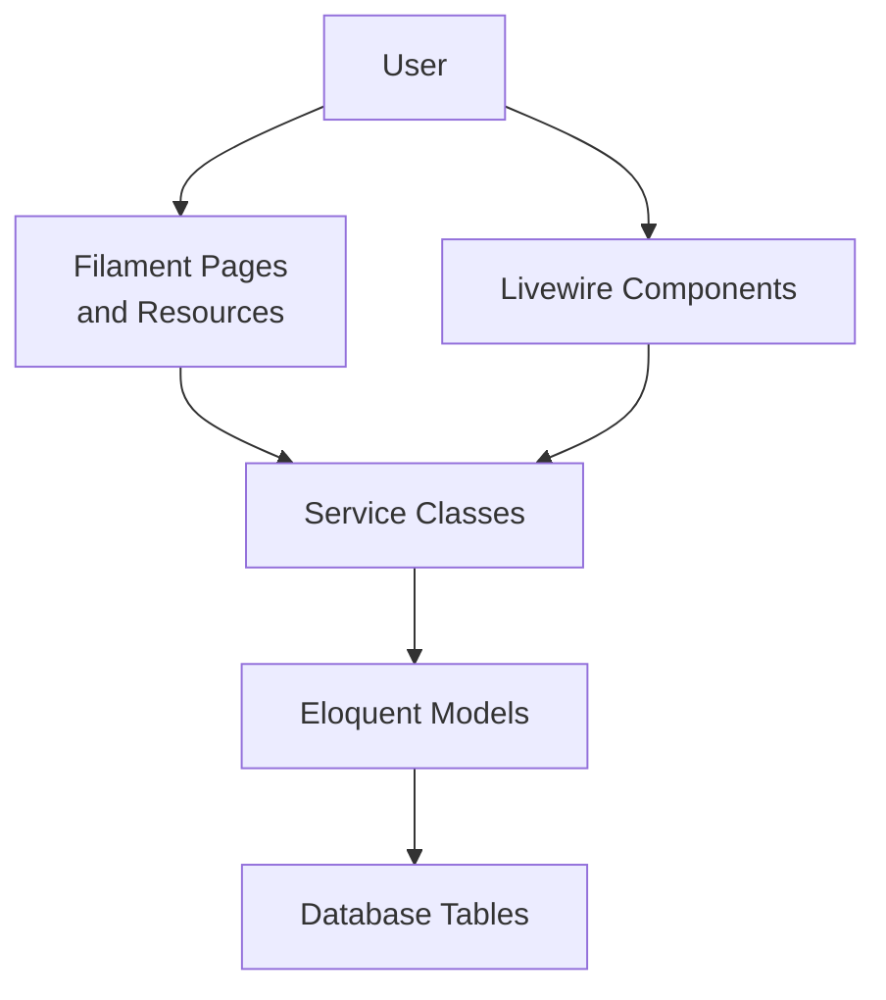
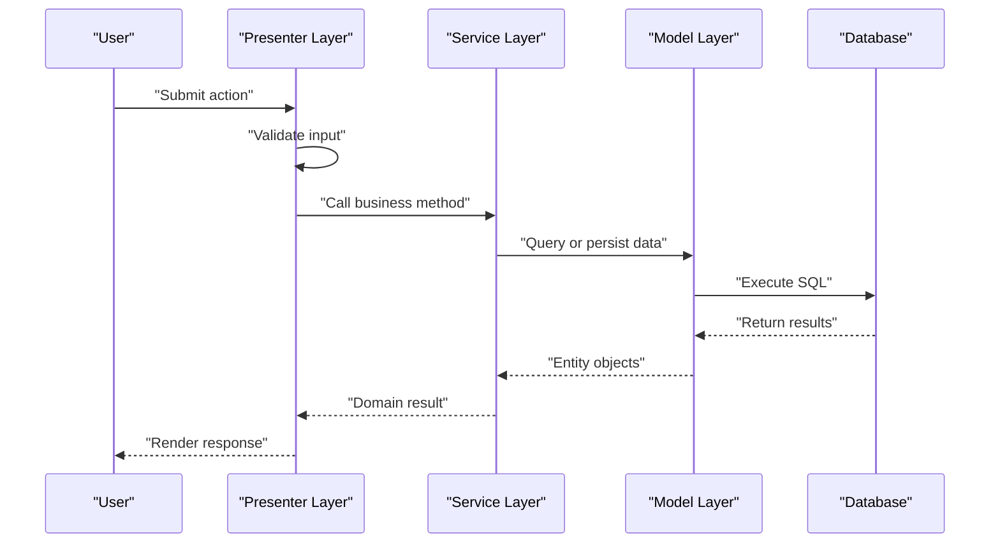
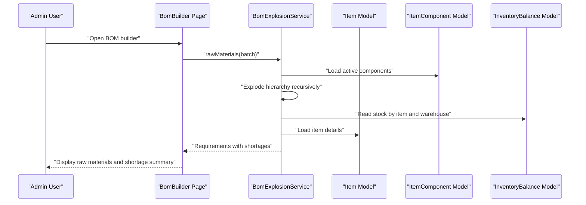
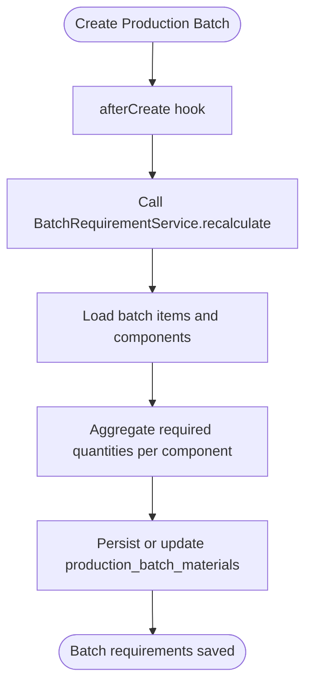
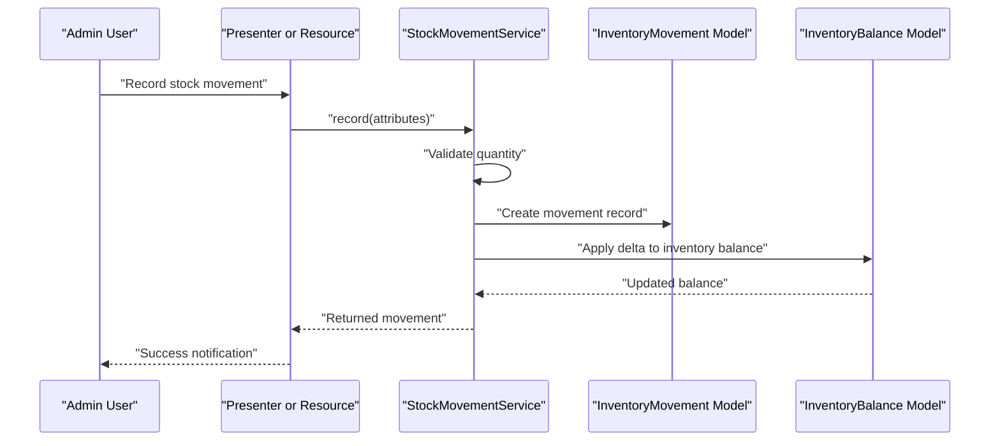
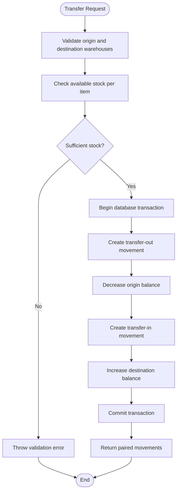
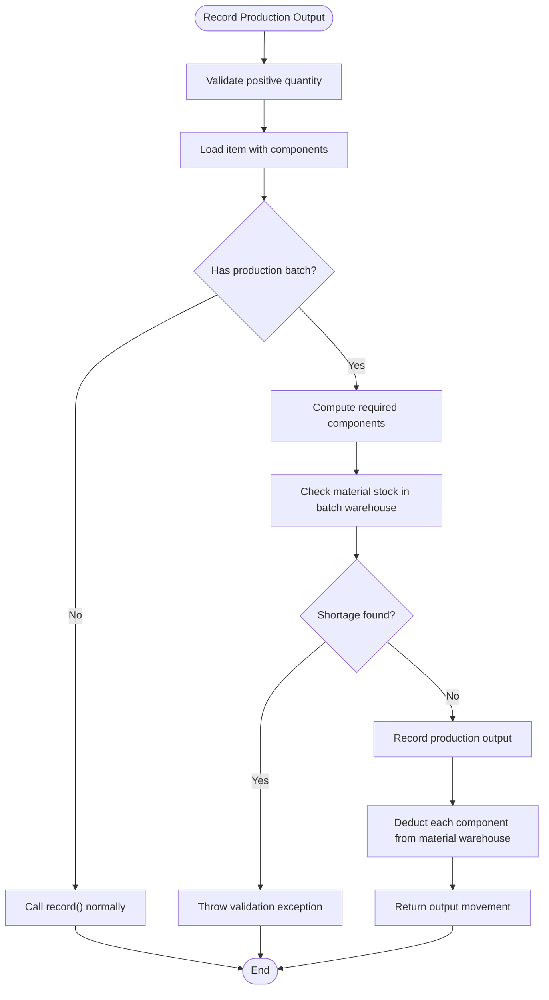
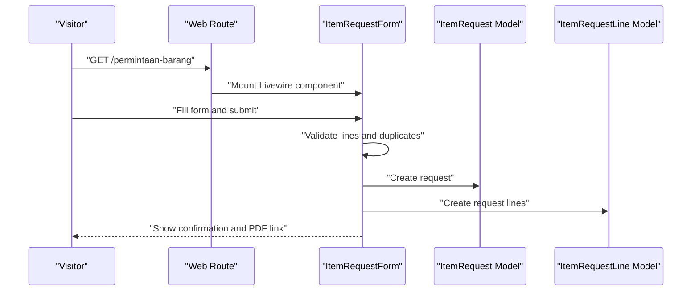
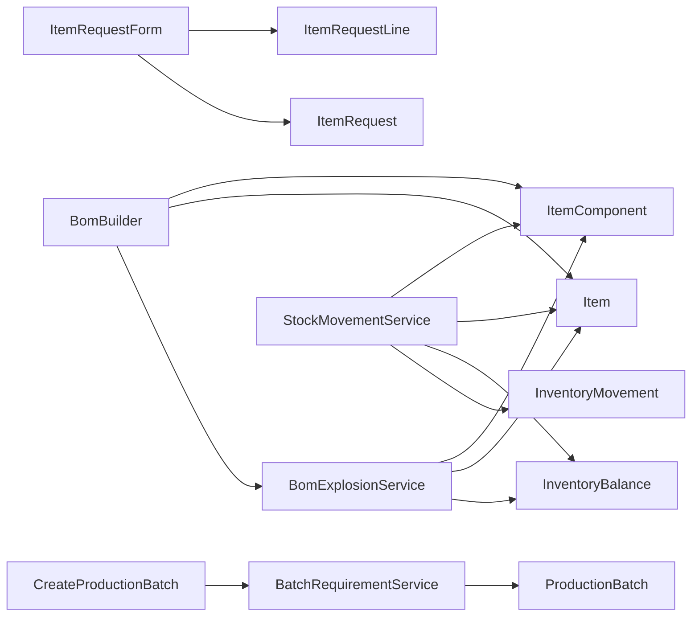

# Layered Architecture Pattern

<cite>
**Referenced Files in This Document**
- [BomExplosionService.php](file://app/Services/BomExplosionService.php)
- [StockMovementService.php](file://app/Services/StockMovementService.php)
- [BatchRequirementService.php](file://app/Services/BatchRequirementService.php)
- [Item.php](file://app/Models/Item.php)
- [InventoryMovement.php](file://app/Models/InventoryMovement.php)
- [InventoryBalance.php](file://app/Models/InventoryBalance.php)
- [ItemComponent.php](file://app/Models/ItemComponent.php)
- [BomBuilder.php](file://app/Filament/Pages/BomBuilder.php)
- [CreateProductionBatch.php](file://app/Filament/Resources/ProductionBatches/Pages/CreateProductionBatch.php)
- [ItemRequestForm.php](file://app/Livewire/ItemRequestForm.php)
- [web.php](file://routes/web.php)
</cite>

## Table of Contents
1. [Introduction](#introduction)
2. [Project Structure](#project-structure)
3. [Core Components](#core-components)
4. [Architecture Overview](#architecture-overview)
5. [Detailed Component Analysis](#detailed-component-analysis)
6. [Dependency Analysis](#dependency-analysis)
7. [Performance Considerations](#performance-considerations)
8. [Troubleshooting Guide](#troubleshooting-guide)
9. [Conclusion](#conclusion)

## Introduction
RSV Helmet implements a layered architecture that separates concerns across three main layers:

- **Presentation layer**: Filament admin pages and Livewire components handle user interaction, form state, validation, and UI rendering.
- **Business logic layer**: Service classes encapsulate domain rules such as bill-of-materials explosion, production output recording, stock transfers, and batch requirement recalculation.
- **Data access layer**: Eloquent models represent entities like items, inventory movements, inventory balances, and item components, exposing relationships and lightweight model-level behavior.

This separation makes the application easier to maintain, test, and scale. Presentation code focuses on user experience, services own business rules, and models stay close to database structure without mixing presentation or complex orchestration logic.

## Project Structure
The relevant parts of RSV Helmet follow a clear directory layout:

- `app/Filament` contains admin pages and resources.
- `app/Livewire` contains public-facing Livewire components.
- `app/Services` contains reusable business logic.
- `app/Models` contains Eloquent models.
- `routes/web.php` wires public routes to controllers and Livewire components.

**Diagram sources**
- [BomBuilder.php:26-42](file://app/Filament/Pages/BomBuilder.php#L26-L42)
- [ItemRequestForm.php:20-22](file://app/Livewire/ItemRequestForm.php#L20-L22)
- [BomExplosionService.php:11-22](file://app/Services/BomExplosionService.php#L11-L22)
- [StockMovementService.php:16-23](file://app/Services/StockMovementService.php#L16-L23)
- [Item.php:41-44](file://app/Models/Item.php#L41-L44)
- [InventoryMovement.php:28-31](file://app/Models/InventoryMovement.php#L28-L31)

**Section sources**
- [BomBuilder.php:26-42](file://app/Filament/Pages/BomBuilder.php#L26-L42)
- [ItemRequestForm.php:20-22](file://app/Livewire/ItemRequestForm.php#L20-L22)
- [web.php:7-17](file://routes/web.php#L7-L17)

## Core Components
The layered design is visible in how request flows move from UI through services to models:

| Layer | Responsibility | Examples in RSV Helmet |
|---|---|---|
| Presentation | Render forms, manage UI state, validate input, show notifications | `BomBuilder`, `ItemRequestForm` |
| Business Logic | Apply domain rules, coordinate transactions, calculate requirements, enforce stock constraints | `BomExplosionService`, `StockMovementService`, `BatchRequirementService` |
| Data Access | Represent tables, define relationships, provide query scopes and attributes | `Item`, `InventoryMovement`, `InventoryBalance`, `ItemComponent` |

Key benefits:

- **Maintainability**: Changes to BOM calculation live in `BomExplosionService`; changes to stock movement rules live in `StockMovementService`.
- **Testability**: Services can be unit-tested with mocked models; UI tests focus on user flows.
- **Scalability**: New features can add new services without polluting controllers or views.

**Section sources**
- [BomExplosionService.php:11-22](file://app/Services/BomExplosionService.php#L11-L22)
- [StockMovementService.php:16-23](file://app/Services/StockMovementService.php#L16-L23)
- [BatchRequirementService.php:8-14](file://app/Services/BatchRequirementService.php#L8-L14)
- [Item.php:41-64](file://app/Models/Item.php#L41-L64)
- [InventoryMovement.php:28-60](file://app/Models/InventoryMovement.php#L28-L60)
- [InventoryBalance.php:20-35](file://app/Models/InventoryBalance.php#L20-L35)

## Architecture Overview
At a high level, requests flow as follows:

1. A user interacts with a Filament page or Livewire component.
2. The presenter validates input and calls a service when business operations are needed.
3. The service applies domain rules, performs calculations, and coordinates database writes.
4. Eloquent models perform persistence and expose relationships.

**Diagram sources**
- [ItemRequestForm.php:95-152](file://app/Livewire/ItemRequestForm.php#L95-L152)
- [CreateProductionBatch.php:16-19](file://app/Filament/Resources/ProductionBatches/Pages/CreateProductionBatch.php#L16-L19)
- [StockMovementService.php:23-59](file://app/Services/StockMovementService.php#L23-L59)
- [InventoryMovement.php:28-60](file://app/Models/InventoryMovement.php#L28-L60)

## Detailed Component Analysis

### Bill of Materials Explosion Flow
The BOM explosion feature shows how a presentation component uses a service to compute raw material requirements for a production batch.

**Diagram sources**
- [BomBuilder.php:107-118](file://app/Filament/Pages/BomBuilder.php#L107-L118)
- [BomExplosionService.php:22-107](file://app/Services/BomExplosionService.php#L22-L107)
- [Item.php:136-144](file://app/Models/Item.php#L136-L144)
- [ItemComponent.php:36-44](file://app/Models/ItemComponent.php#L36-L44)
- [InventoryBalance.php:37-45](file://app/Models/InventoryBalance.php#L37-L45)

#### BOM Recalculation Flow
When a production batch is created, its material requirements are recalculated based on the finished goods and their active components.

**Diagram sources**
- [CreateProductionBatch.php:16-19](file://app/Filament/Resources/ProductionBatches/Pages/CreateProductionBatch.php#L16-L19)
- [BatchRequirementService.php:14-59](file://app/Services/BatchRequirementService.php#L14-L59)

**Section sources**
- [BomExplosionService.php:22-156](file://app/Services/BomExplosionService.php#L22-L156)
- [BatchRequirementService.php:14-59](file://app/Services/BatchRequirementService.php#L14-L59)
- [CreateProductionBatch.php:16-19](file://app/Filament/Resources/ProductionBatches/Pages/CreateProductionBatch.php#L16-L19)

### Stock Movement Flow
Stock movement is a strong example of layered separation. The presenter does not directly manipulate inventory balances; it delegates to `StockMovementService`, which enforces business rules and persists both movement records and balance updates.

**Diagram sources**
- [StockMovementService.php:23-59](file://app/Services/StockMovementService.php#L23-L59)
- [InventoryMovement.php:28-60](file://app/Models/InventoryMovement.php#L28-L60)
- [InventoryBalance.php:20-35](file://app/Models/InventoryBalance.php#L20-L35)

#### Transfer Flow
Transfers create paired outgoing and incoming movements and ensure stock availability before committing.

**Diagram sources**
- [StockMovementService.php:147-200](file://app/Services/StockMovementService.php#L147-L200)
- [StockMovementService.php:209-289](file://app/Services/StockMovementService.php#L209-L289)
- [InventoryMovement.php:33-49](file://app/Models/InventoryMovement.php#L33-L49)

#### Production Output Flow
Recording production output can automatically deduct raw materials when the produced item has active components.

**Diagram sources**
- [StockMovementService.php:68-139](file://app/Services/StockMovementService.php#L68-L139)
- [Item.php:136-139](file://app/Models/Item.php#L136-L139)
- [InventoryMovement.php:33-49](file://app/Models/InventoryMovement.php#L33-L49)

**Section sources**
- [StockMovementService.php:23-397](file://app/Services/StockMovementService.php#L23-L397)
- [InventoryMovement.php:28-191](file://app/Models/InventoryMovement.php#L28-L191)
- [InventoryBalance.php:20-71](file://app/Models/InventoryBalance.php#L20-L71)

### Public Item Request Flow
The public item request form demonstrates a straightforward presentation-to-data flow where a Livewire component handles validation and persistence.

**Diagram sources**
- [web.php:11-17](file://routes/web.php#L11-L17)
- [ItemRequestForm.php:95-152](file://app/Livewire/ItemRequestForm.php#L95-L152)

**Section sources**
- [ItemRequestForm.php:95-152](file://app/Livewire/ItemRequestForm.php#L95-L152)
- [web.php:11-17](file://routes/web.php#L11-L17)

## Dependency Analysis
The dependencies between layers are intentionally one-directional: presenters depend on services, and services depend on models. Presenters should not contain domain logic; services should not render UI; models should not orchestrate multi-step business workflows.

**Diagram sources**
- [BomBuilder.php:107-118](file://app/Filament/Pages/BomBuilder.php#L107-L118)
- [BomExplosionService.php:5-9](file://app/Services/BomExplosionService.php#L5-L9)
- [CreateProductionBatch.php:16-19](file://app/Filament/Resources/ProductionBatches/Pages/CreateProductionBatch.php#L16-L19)
- [BatchRequirementService.php:5-6](file://app/Services/BatchRequirementService.php#L5-L6)
- [ItemRequestForm.php:95-152](file://app/Livewire/ItemRequestForm.php#L95-L152)
- [StockMovementService.php:5-14](file://app/Services/StockMovementService.php#L5-L14)

### Coupling and Cohesion
- **High cohesion**: Each service has a focused responsibility. `BomExplosionService` computes raw material needs; `StockMovementService` manages stock transactions; `BatchRequirementService` recalculates batch requirements.
- **Low coupling**: Presenters call services through methods rather than reaching into models for complex logic.
- **Potential circular risk**: Models define relationships but do not call services, reducing the chance of circular dependencies.

**Section sources**
- [BomExplosionService.php:11-156](file://app/Services/BomExplosionService.php#L11-L156)
- [StockMovementService.php:16-397](file://app/Services/StockMovementService.php#L16-L397)
- [BatchRequirementService.php:8-59](file://app/Services/BatchRequirementService.php#L8-L59)

## Performance Considerations
- **N+1 queries**: The BOM builder loads related data explicitly, such as item components and inventory balances, to avoid repeated queries during recursion.
- **Aggregation strategy**: Raw material requirements are aggregated in memory before querying stock balances, reducing redundant database hits.
- **Transactions**: Stock operations use database transactions to keep movement records and balance updates consistent.
- **Locking**: Balance updates use row locking to prevent race conditions when multiple operations modify the same item-warehouse combination.
- **Pagination and filtering**: Filament tables and Livewire search limit dataset sizes, improving responsiveness.

Recommendations:
- Keep heavy calculations inside services so they can be cached or queued if needed.
- Avoid loading entire trees of components unless necessary; prefer lazy loading or explicit eager loading.
- Use database indexes on frequently filtered columns such as item identifiers, warehouse identifiers, and status flags.

[No sources needed since this section provides general guidance]

## Troubleshooting Guide
Common issues and where to look:

| Issue | Likely Layer | Where to Investigate |
|---|---|---|
| Negative stock after operation | Business logic or data access | `StockMovementService.applyDelta` and `InventoryBalance` updates |
| Missing material deduction on production | Business logic | `StockMovementService.recordProductionOutput` |
| Circular BOM definitions | Data model validation | `ItemComponent.wouldCreateCycle` |
| Duplicate items in request form | Presentation validation | `ItemRequestForm.submit` custom validator |
| Batch requirements not updated | Presenter-service integration | `CreateProductionBatch.afterCreate` and `BatchRequirementService.recalculate` |

**Section sources**
- [StockMovementService.php:358-387](file://app/Services/StockMovementService.php#L358-L387)
- [StockMovementService.php:68-139](file://app/Services/StockMovementService.php#L68-L139)
- [ItemComponent.php:50-84](file://app/Models/ItemComponent.php#L50-L84)
- [ItemRequestForm.php:95-152](file://app/Livewire/ItemRequestForm.php#L95-L152)
- [CreateProductionBatch.php:16-19](file://app/Filament/Resources/ProductionBatches/Pages/CreateProductionBatch.php#L16-L19)

## Conclusion
RSV Helmet’s layered architecture cleanly separates presentation, business logic, and data access. Filament pages and Livewire components manage user interactions, service classes encapsulate domain rules, and Eloquent models represent persistent data. This structure improves maintainability by localizing changes, enhances testability by isolating business logic, and supports scalability by allowing independent evolution of UI, services, and data models. Following these patterns helps future features integrate smoothly while keeping the system predictable and robust.

[No sources needed since this section summarizes without analyzing specific files]