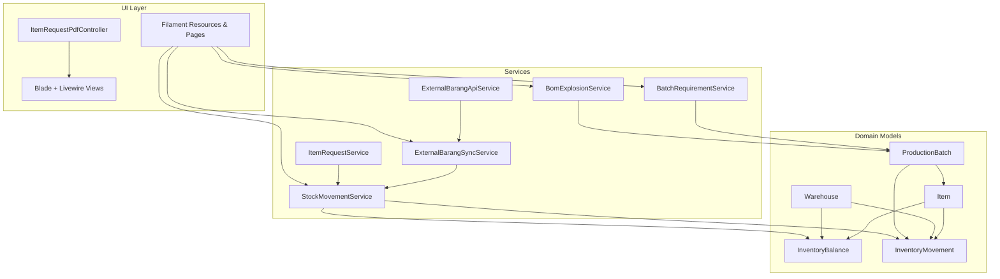
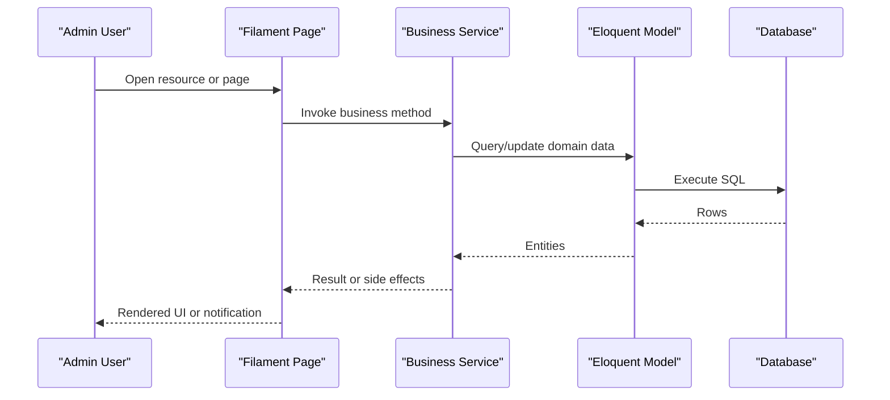
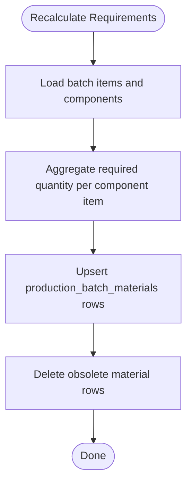
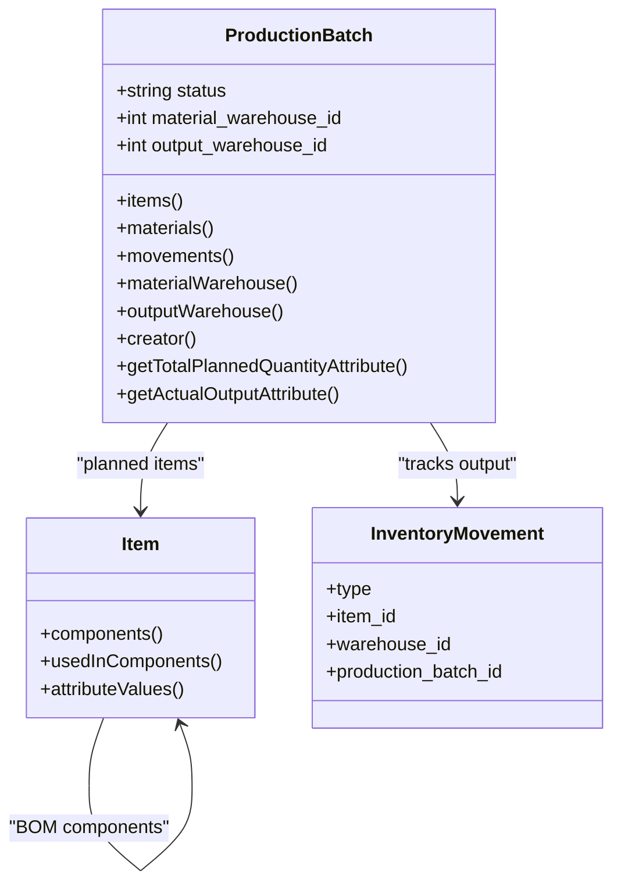
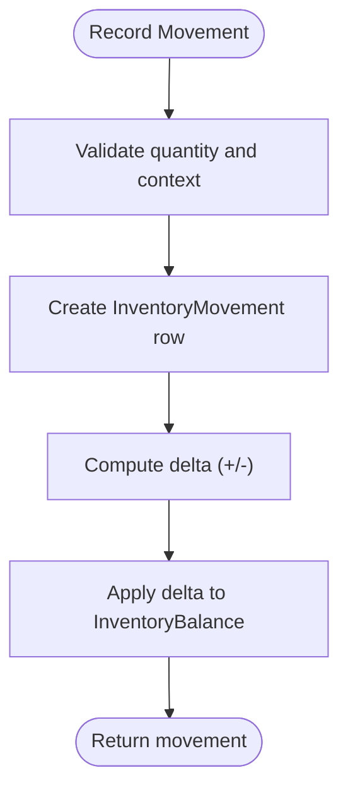
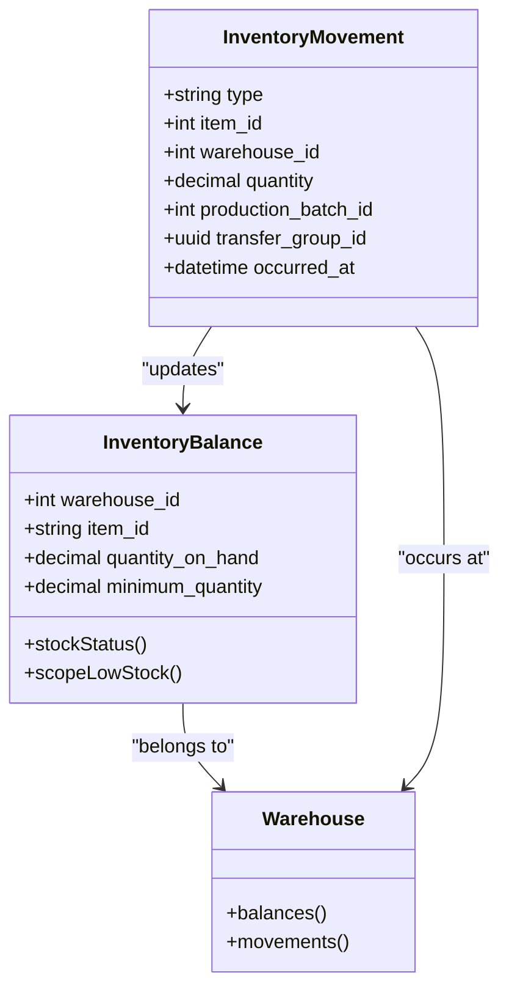
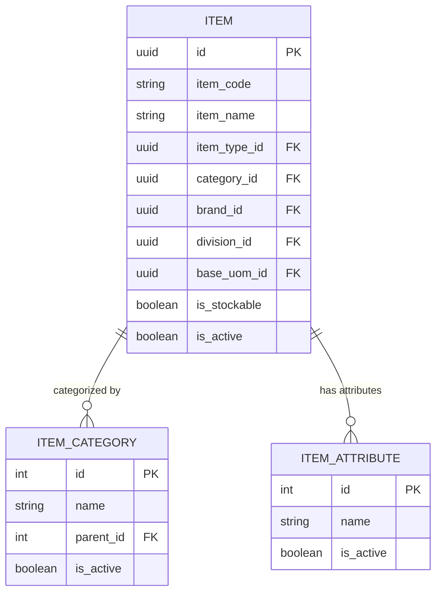
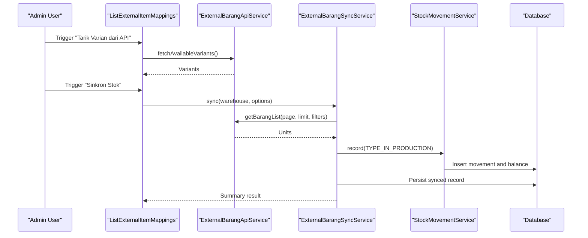
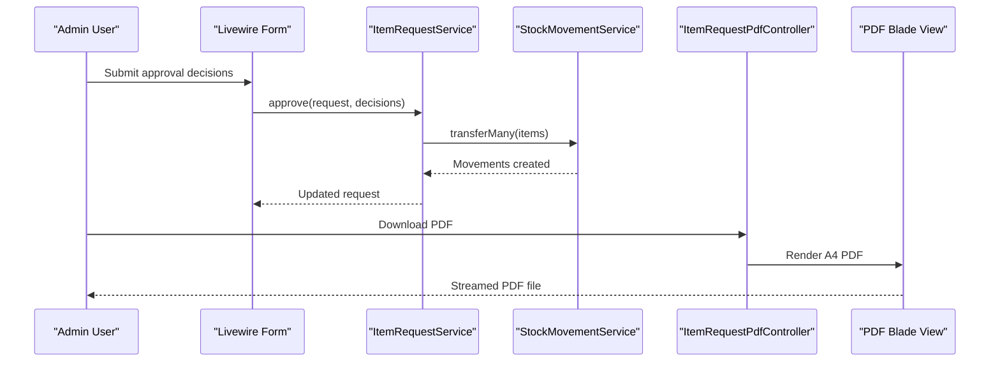
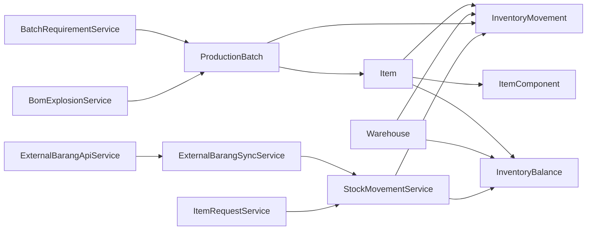

# Core Modules

<cite>
**Referenced Files in This Document**
- [ProductionBatch.php](file://app/Models/ProductionBatch.php)
- [Item.php](file://app/Models/Item.php)
- [InventoryBalance.php](file://app/Models/InventoryBalance.php)
- [Warehouse.php](file://app/Models/Warehouse.php)
- [BatchRequirementService.php](file://app/Services/BatchRequirementService.php)
- [BomExplosionService.php](file://app/Services/BomExplosionService.php)
- [StockMovementService.php](file://app/Services/StockMovementService.php)
- [ExternalBarangApiService.php](file://app/Services/ExternalBarangApiService.php)
- [ExternalBarangSyncService.php](file://app/Services/ExternalBarangSyncService.php)
- [ItemRequestPdfController.php](file://app/Http/Controllers/ItemRequestPdfController.php)
- [ItemRequestService.php](file://app/Services/ItemRequestService.php)
- [2026_11_17_000005_create_inventory_movements_table.php](file://database/migrations/2026_11_17_000005_create_inventory_movements_table.php)
- [2026_11_13_000003_create_item_categories_table.php](file://database/migrations/2026_11_13_000003_create_item_categories_table.php)
- [2026_11_13_000005_create_item_attributes_table.php](file://database/migrations/2026_11_13_000005_create_item_attributes_table.php)
- [MasterDataSeeder.php](file://database/seeders/MasterDataSeeder.php)
- [ListExternalItemMappings.php](file://app/Filament/Resources/ExternalItemMappings/Pages/ListExternalItemMappings.php)
- [BatchRealizationDetail.php](file://app/Filament/Pages/BatchRealizationDetail.php)
- [MaterialRealisationManager.php](file://app/Filament/Resources/ProductionBatches/RelationManagers/MaterialsRelationManager.php)
- [inventory_balance_resource.php](file://app/Filament/Resources/InventoryBalances/InventoryBalanceResource.php)
- [inventory_movement_resource.php](file://app/Filament/Resources/InventoryMovements/InventoryMovementResource.php)
- [item_request_form.blade.php](file://resources/views/livewire/item-request-form.blade.php)
- [pdf_item_request_view.php](file://storage/framework/views/cf631159680e99a01304eb6b39bf7d29.php)
- [app_js.js](file://resources/js/app.js)
- [production_batch_test.php](file://tests/Feature/ProductionBatchTest.php)
- [stock_movement_test.php](file://tests/Feature/StockMovementTest.php)
- [external_item_mapping_resource_test.php](file://tests/Feature/ExternalItemMappingResourceTest.php)
- [item_request_pdf_test.php](file://tests/Feature/ItemRequestPdfTest.php)
</cite>

## Table of Contents
1. [Introduction](#introduction)
2. [Project Structure](#project-structure)
3. [Core Components](#core-components)
4. [Architecture Overview](#architecture-overview)
5. [Detailed Component Analysis](#detailed-component-analysis)
6. [Dependency Analysis](#dependency-analysis)
7. [Performance Considerations](#performance-considerations)
8. [Troubleshooting Guide](#troubleshooting-guide)
9. [Conclusion](#conclusion)

## Introduction
RSV Helmet is a Laravel-based production and inventory management application. The core business modules covered here are:

- Production Management: batch planning, bill-of-materials explosion, material requirements, and progress tracking.
- Inventory Management: multi-warehouse stock control, movement recording, transfers, reconciliation, and stock cards.
- Master Data Management: item catalog, attributes, categories, units, brands, divisions, and types.
- External System Integration: API synchronization for external finished goods and variant mapping.
- Document Generation: item request creation, approval workflow, and PDF generation.

The system uses Filament for the admin interface, Eloquent models for domain data, services for business logic, migrations for schema, seeders for master data, and Blade/Livewire views for user interactions.

## Project Structure
The repository follows a layered structure:

- Models define domain entities such as Item, Warehouse, InventoryBalance, InventoryMovement, ProductionBatch, and related tables.
- Services encapsulate business workflows like stock movements, batch requirement calculation, BOM explosion, external synchronization, and item request approvals.
- Filament resources and pages provide CRUD interfaces, list pages, relation managers, and custom pages such as Batch Realization and Stock Card.
- Migrations define database schema; seeders populate reference data.
- Controllers and views handle document generation and UI behavior.

**Diagram sources**
- [ProductionBatch.php:59-87](file://app/Models/ProductionBatch.php#L59-L87)
- [Item.php:66-156](file://app/Models/Item.php#L66-L156)
- [InventoryBalance.php:37-45](file://app/Models/InventoryBalance.php#L37-L45)
- [Warehouse.php:27-35](file://app/Models/Warehouse.php#L27-L35)
- [StockMovementService.php:23-59](file://app/Services/StockMovementService.php#L23-L59)
- [BatchRequirementService.php:14-59](file://app/Services/BatchRequirementService.php#L14-L59)
- [BomExplosionService.php:22-107](file://app/Services/BomExplosionService.php#L22-L107)
- [ExternalBarangApiService.php:33-55](file://app/Services/ExternalBarangApiService.php#L33-L55)
- [ExternalBarangSyncService.php:40-221](file://app/Services/ExternalBarangSyncService.php#L40-L221)
- [ItemRequestService.php:22-185](file://app/Services/ItemRequestService.php#L22-L185)
- [ItemRequestPdfController.php:11-18](file://app/Http/Controllers/ItemRequestPdfController.php#L11-L18)

**Section sources**
- [ProductionBatch.php:1-117](file://app/Models/ProductionBatch.php#L1-L117)
- [Item.php:1-173](file://app/Models/Item.php#L1-L173)
- [InventoryBalance.php:1-71](file://app/Models/InventoryBalance.php#L1-L71)
- [Warehouse.php:1-36](file://app/Models/Warehouse.php#L1-L36)
- [StockMovementService.php:1-398](file://app/Services/StockMovementService.php#L1-L398)
- [BatchRequirementService.php:1-61](file://app/Services/BatchRequirementService.php#L1-L61)
- [BomExplosionService.php:1-158](file://app/Services/BomExplosionService.php#L1-L158)
- [ExternalBarangApiService.php:1-188](file://app/Services/ExternalBarangApiService.php#L1-L188)
- [ExternalBarangSyncService.php:1-242](file://app/Services/ExternalBarangSyncService.php#L1-L242)
- [ItemRequestService.php:1-258](file://app/Services/ItemRequestService.php#L1-L258)
- [ItemRequestPdfController.php:1-20](file://app/Http/Controllers/ItemRequestPdfController.php#L1-L20)

## Core Components
This section summarizes the main functional areas and how they interact.

- Production Management
  - Batch planning is represented by ProductionBatch with planned items and material warehouse/output warehouse references.
  - Material requirements are recalculated from active Bill-of-Materials (BOM) components per planned item quantity.
  - Raw material explosion drills down through nested components to compute total raw material needs and shortages.
  - Progress tracking compares planned output, actual output, and material usage via inventory movements.

- Inventory Management
  - Multi-warehouse stock control is modeled by InventoryBalance per item and warehouse.
  - Movements record incoming, outgoing, transfer-in, and transfer-out transactions with timestamps, references, and optional batch linkage.
  - Transfers create paired out/in movements sharing a transfer group ID.
  - Reconciliation supports stock opname flows and stock card filtering by batch.

- Master Data Management
  - Items have type, category, brand, division, base unit of measure, dimensions, pricing flags, and stockability flags.
  - Attributes and values support flexible item metadata.
  - Categories support hierarchical parent-child relationships.
  - Seeders initialize UoMs, divisions, item types, and other reference data.

- External System Integration
  - ExternalBarangApiService calls an external API for barang lists, details, and variant recap endpoints.
  - ExternalBarangSyncService paginates external units, filters statuses, checks idempotency, maps variants to internal items, and records production-in movements into a target warehouse.
  - Filament page ListExternalItemMappings exposes actions to fetch variants and trigger sync.

- Document Generation
  - ItemRequestService handles approval/rejection workflows and triggers stock transfers when approved.
  - ItemRequestPdfController renders a PDF using a Blade view configured for A4 paper.
  - Frontend JavaScript prepares and shares the generated PDF blob.

**Section sources**
- [ProductionBatch.php:27-115](file://app/Models/ProductionBatch.php#L27-L115)
- [BatchRequirementService.php:14-59](file://app/Services/BatchRequirementService.php#L14-L59)
- [BomExplosionService.php:22-107](file://app/Services/BomExplosionService.php#L22-L107)
- [InventoryBalance.php:13-69](file://app/Models/InventoryBalance.php#L13-L69)
- [2026_11_17_000005_create_inventory_movements_table.php:14-41](file://database/migrations/2026_11_17_000005_create_inventory_movements_table.php#L14-L41)
- [2026_11_13_000003_create_item_categories_table.php:14-23](file://database/migrations/2026_11_13_000003_create_item_categories_table.php#L14-L23)
- [2026_11_13_000005_create_item_attributes_table.php:14-20](file://database/migrations/2026_11_13_000005_create_item_attributes_table.php#L14-L20)
- [MasterDataSeeder.php:19-46](file://database/seeders/MasterDataSeeder.php#L19-L46)
- [ExternalBarangApiService.php:33-165](file://app/Services/ExternalBarangApiService.php#L33-L165)
- [ExternalBarangSyncService.php:40-221](file://app/Services/ExternalBarangSyncService.php#L40-L221)
- [ListExternalItemMappings.php:23-33](file://app/Filament/Resources/ExternalItemMappings/Pages/ListExternalItemMappings.php#L23-L33)
- [ItemRequestService.php:22-185](file://app/Services/ItemRequestService.php#L22-L185)
- [ItemRequestPdfController.php:11-18](file://app/Http/Controllers/ItemRequestPdfController.php#L11-L18)

## Architecture Overview
The system architecture separates concerns across models, services, controllers, and UI layers. Business rules live in services; persistence lives in models and migrations; user interaction is provided by Filament resources/pages and Blade/Livewire views.

**Diagram sources**
- [StockMovementService.php:23-59](file://app/Services/StockMovementService.php#L23-L59)
- [BatchRequirementService.php:14-59](file://app/Services/BatchRequirementService.php#L14-L59)
- [ExternalBarangSyncService.php:40-221](file://app/Services/ExternalBarangSyncService.php#L40-L221)
- [ItemRequestService.php:22-185](file://app/Services/ItemRequestService.php#L22-L185)

## Detailed Component Analysis

### Production Management
Production Management centers on Planning batches, calculating material requirements, exploding BOMs to raw materials, and tracking progress.

Key behaviors:
- Recalculate material requirements based on active BOM components and planned quantities.
- Compute raw material needs recursively while avoiding cycles.
- Track actual output via inventory movements linked to a batch.
- Display material realization including required, used, remaining, available, and shortage.

**Diagram sources**
- [BatchRequirementService.php:14-59](file://app/Services/BatchRequirementService.php#L14-L59)

**Diagram sources**
- [ProductionBatch.php:59-115](file://app/Models/ProductionBatch.php#L59-L115)
- [Item.php:136-156](file://app/Models/Item.php#L136-L156)
- [2026_11_17_000005_create_inventory_movements_table.php:14-41](file://database/migrations/2026_11_17_000005_create_inventory_movements_table.php#L14-L41)

Usage examples and workflows:
- Create a batch with planned items and a material warehouse.
- Recalculate material requirements after editing planned items or BOM.
- Record production output; if the product has active components, material consumption is automatically deducted from the material warehouse.
- View batch realization to compare required vs used materials and check shortages.

Common pitfalls:
- Forgetting to recalculate requirements after changing planned quantities or BOM.
- Attempting to record production output without sufficient material stock.

Validation and error handling:
- Shortage validation prevents negative stock during production output.
- Tests assert that material shortage is calculated from stock on hand and that raw material explosion aggregates correctly.

**Section sources**
- [BatchRequirementService.php:14-59](file://app/Services/BatchRequirementService.php#L14-L59)
- [BomExplosionService.php:22-107](file://app/Services/BomExplosionService.php#L22-L107)
- [StockMovementService.php:68-139](file://app/Services/StockMovementService.php#L68-L139)
- [BatchRealizationDetail.php:108-135](file://app/Filament/Pages/BatchRealizationDetail.php#L108-L135)
- [MaterialRealisationManager.php:41-63](file://app/Filament/Resources/ProductionBatches/RelationManagers/MaterialsRelationManager.php#L41-L63)
- [production_batch_test.php:109-142](file://tests/Feature/ProductionBatchTest.php#L109-L142)
- [production_batch_test.php:381-409](file://tests/Feature/ProductionBatchTest.php#L381-L409)

### Inventory Management
Inventory Management provides multi-warehouse stock control, movement tracking, and reconciliation.

Key behaviors:
- Record incoming/outgoing movements and update balances atomically.
- Transfer stock between warehouses with paired movements and grouping.
- Delete movements reverses deltas and cascades to child movements.
- Enforce positive stock constraints and validate transfers.

**Diagram sources**
- [StockMovementService.php:23-59](file://app/Services/StockMovementService.php#L23-L59)

**Diagram sources**
- [InventoryBalance.php:13-69](file://app/Models/InventoryBalance.php#L13-L69)
- [2026_11_17_000005_create_inventory_movements_table.php:14-41](file://database/migrations/2026_11_17_000005_create_inventory_movements_table.php#L14-L41)
- [Warehouse.php:27-35](file://app/Models/Warehouse.php#L27-L35)

Usage examples and workflows:
- Record purchase receipts to increase stock.
- Record production consumption to decrease stock.
- Perform single or mass transfers between warehouses.
- Use stock card page to filter movements by production batch.

Validation and error handling:
- Positive quantity validation.
- Insufficient stock rejection for outgoing movements.
- Transfer validation ensures origin and destination differ and exist.

**Section sources**
- [StockMovementService.php:23-398](file://app/Services/StockMovementService.php#L23-L398)
- [inventory_movement_resource.php:81-100](file://app/Filament/Resources/InventoryMovements/InventoryMovementResource.php#L81-L100)
- [inventory_balance_resource.php:1-41](file://app/Filament/Resources/InventoryBalances/InventoryBalanceResource.php#L1-L41)
- [stock_movement_test.php:34-80](file://tests/Feature/StockMovementTest.php#L34-L80)
- [stock_movement_test.php:82-118](file://tests/Feature/StockMovementTest.php#L82-L118)
- [stock_movement_test.php:314-336](file://tests/Feature/StockMovementTest.php#L314-L336)

### Master Data Management
Master Data Management defines the foundational catalog and classification of items.

Key behaviors:
- Items link to types, categories, brands, divisions, and units of measure.
- Attributes and attribute values allow flexible metadata.
- Categories support hierarchical parent-child relationships.
- Seeders initialize standard reference data.

**Diagram sources**
- [Item.php:66-156](file://app/Models/Item.php#L66-L156)
- [2026_11_13_000003_create_item_categories_table.php:14-23](file://database/migrations/2026_11_13_000003_create_item_categories_table.php#L14-L23)
- [2026_11_13_000005_create_item_attributes_table.php:14-20](file://database/migrations/2026_11_13_000005_create_item_attributes_table.php#L14-L20)

Usage examples and workflows:
- Create items with appropriate type, category, brand, and units.
- Define attributes and assign values to items.
- Organize categories hierarchically.
- Run seeders to populate default reference data.

**Section sources**
- [Item.php:1-173](file://app/Models/Item.php#L1-L173)
- [2026_11_13_000003_create_item_categories_table.php:14-23](file://database/migrations/2026_11_13_000003_create_item_categories_table.php#L14-L23)
- [2026_11_13_000005_create_item_attributes_table.php:14-20](file://database/migrations/2026_11_13_000005_create_item_attributes_table.php#L14-L20)
- [MasterDataSeeder.php:19-46](file://database/seeders/MasterDataSeeder.php#L19-L46)

### External System Integration
External System Integration synchronizes finished goods from an external API and updates local inventory.

Key behaviors:
- Fetch barang lists, details, and variant recap endpoints.
- Extract unique variants for mapping.
- Paginate external units, skip excluded statuses, avoid duplicates, map variants to internal items, and record production-in movements.

**Diagram sources**
- [ListExternalItemMappings.php:23-33](file://app/Filament/Resources/ExternalItemMappings/Pages/ListExternalItemMappings.php#L23-L33)
- [ExternalBarangApiService.php:33-165](file://app/Services/ExternalBarangApiService.php#L33-L165)
- [ExternalBarangSyncService.php:40-221](file://app/Services/ExternalBarangSyncService.php#L40-L221)
- [StockMovementService.php:23-59](file://app/Services/StockMovementService.php#L23-L59)

Usage examples and workflows:
- Map external variants to internal items.
- Pull available variants from the external API.
- Run synchronization with filters (status, variant) and dry-run mode.
- Review results and unmapped variants.

Validation and error handling:
- API errors are logged and return safe defaults.
- Idempotency prevents duplicate syncing.
- Unmapped variants are reported for manual resolution.

**Section sources**
- [ExternalBarangApiService.php:33-188](file://app/Services/ExternalBarangApiService.php#L33-L188)
- [ExternalBarangSyncService.php:40-242](file://app/Services/ExternalBarangSyncService.php#L40-L242)
- [external_item_mapping_resource_test.php:76-106](file://tests/Feature/ExternalItemMappingResourceTest.php#L76-L106)

### Document Generation
Document Generation covers item requests and PDF creation.

Key behaviors:
- Approve or reject item request lines; approved lines trigger stock transfers.
- Resolve final request status based on line decisions.
- Generate PDF documents for requests using a Blade template configured for A4.
- Frontend JavaScript prepares and shares the PDF blob.

**Diagram sources**
- [ItemRequestService.php:22-185](file://app/Services/ItemRequestService.php#L22-L185)
- [ItemRequestPdfController.php:11-18](file://app/Http/Controllers/ItemRequestPdfController.php#L11-L18)
- [pdf_item_request_view.php:1-21](file://storage/framework/views/cf631159680e99a01304eb6b39bf7d29.php#L1-L21)

Usage examples and workflows:
- Create item requests with one or more lines.
- Approve partial or full quantities; rejected lines require reasons.
- Approved lines move stock from origin to destination warehouse.
- Generate and share PDF documents for requests.

Validation and error handling:
- Approval requires valid warehouse configuration and active warehouses.
- Rejection notes are validated for length and presence.
- PDF rendering tests ensure correct pagination behavior.

**Section sources**
- [ItemRequestService.php:22-258](file://app/Services/ItemRequestService.php#L22-L258)
- [ItemRequestPdfController.php:11-18](file://app/Http/Controllers/ItemRequestPdfController.php#L11-L18)
- [item_request_form.blade.php:145-155](file://resources/views/livewire/item-request-form.blade.php#L145-L155)
- [pdf_item_request_view.php:1-21](file://storage/framework/views/cf631159680e99a01304eb6b39bf7d29.php#L1-L21)
- [app_js.js:1-35](file://resources/js/app.js#L1-L35)
- [item_request_pdf_test.php:66-109](file://tests/Feature/ItemRequestPdfTest.php#L66-L109)

## Dependency Analysis
The following diagram shows key dependencies among core modules and services.

**Diagram sources**
- [Item.php:136-156](file://app/Models/Item.php#L136-L156)
- [InventoryBalance.php:37-45](file://app/Models/InventoryBalance.php#L37-L45)
- [2026_11_17_000005_create_inventory_movements_table.php:14-41](file://database/migrations/2026_11_17_000005_create_inventory_movements_table.php#L14-L41)
- [ProductionBatch.php:59-87](file://app/Models/ProductionBatch.php#L59-L87)
- [BatchRequirementService.php:14-59](file://app/Services/BatchRequirementService.php#L14-L59)
- [BomExplosionService.php:22-107](file://app/Services/BomExplosionService.php#L22-L107)
- [StockMovementService.php:23-398](file://app/Services/StockMovementService.php#L23-L398)
- [ExternalBarangApiService.php:33-165](file://app/Services/ExternalBarangApiService.php#L33-L165)
- [ExternalBarangSyncService.php:40-221](file://app/Services/ExternalBarangSyncService.php#L40-L221)
- [ItemRequestService.php:22-185](file://app/Services/ItemRequestService.php#L22-L185)

**Section sources**
- [Item.php:1-173](file://app/Models/Item.php#L1-L173)
- [InventoryBalance.php:1-71](file://app/Models/InventoryBalance.php#L1-L71)
- [2026_11_17_000005_create_inventory_movements_table.php:14-41](file://database/migrations/2026_11_17_000005_create_inventory_movements_table.php#L14-L41)
- [ProductionBatch.php:1-117](file://app/Models/ProductionBatch.php#L1-L117)
- [BatchRequirementService.php:1-61](file://app/Services/BatchRequirementService.php#L1-L61)
- [BomExplosionService.php:1-158](file://app/Services/BomExplosionService.php#L1-L158)
- [StockMovementService.php:1-398](file://app/Services/StockMovementService.php#L1-L398)
- [ExternalBarangApiService.php:1-188](file://app/Services/ExternalBarangApiService.php#L1-L188)
- [ExternalBarangSyncService.php:1-242](file://app/Services/ExternalBarangSyncService.php#L1-L242)
- [ItemRequestService.php:1-258](file://app/Services/ItemRequestService.php#L1-L258)

## Performance Considerations
- Prefer batch operations where possible, such as mass transfers, to reduce transaction overhead.
- Use eager loading for related data in reports (e.g., batch items and components).
- Index frequently queried columns such as item_id, warehouse_id, and occurred_at in movements.
- Avoid N+1 queries when computing requirements or raw materials; pre-aggregate where feasible.
- Cache static master data (UoMs, item types, divisions) if accessed frequently.

[No sources needed since this section provides general guidance]

## Troubleshooting Guide
Common issues and resolutions:

- Production material shortage
  - Symptom: Validation error when recording production output due to insufficient material stock.
  - Resolution: Ensure material warehouse has sufficient stock or adjust planned quantities and BOM.
  - Reference: [StockMovementService.php:104-118](file://app/Services/StockMovementService.php#L104-L118)

- Insufficient stock for outgoing movements
  - Symptom: ValidationException thrown for negative stock.
  - Resolution: Verify current balance and incoming movements before recording outgoing transactions.
  - Reference: [StockMovementService.php:379-386](file://app/Services/StockMovementService.php#L379-L386)

- Transfer validation failures
  - Symptom: Errors indicating missing or identical origin/destination warehouses.
  - Resolution: Provide distinct active warehouses for transfer operations.
  - Reference: [StockMovementService.php:156-166](file://app/Services/StockMovementService.php#L156-L166)

- External API connectivity issues
  - Symptom: Empty data returned or connection errors logged.
  - Resolution: Check external API base URL and timeout settings; verify network connectivity.
  - Reference: [ExternalBarangApiService.php:33-55](file://app/Services/ExternalBarangApiService.php#L33-L55)

- Unmapped external variants
  - Symptom: Sync reports unmapped variants.
  - Resolution: Map external variants to internal items via the mapping resource.
  - Reference: [ExternalBarangSyncService.php:121-140](file://app/Services/ExternalBarangSyncService.php#L121-L140)

- PDF preparation or sharing errors
  - Symptom: Frontend errors indicating PDF cannot be downloaded or shared.
  - Resolution: Ensure PDF endpoint is reachable and browser supports Web Share API with files.
  - Reference: [app_js.js:1-35](file://resources/js/app.js#L1-L35)

**Section sources**
- [StockMovementService.php:104-118](file://app/Services/StockMovementService.php#L104-L118)
- [StockMovementService.php:379-386](file://app/Services/StockMovementService.php#L379-L386)
- [StockMovementService.php:156-166](file://app/Services/StockMovementService.php#L156-L166)
- [ExternalBarangApiService.php:33-55](file://app/Services/ExternalBarangApiService.php#L33-L55)
- [ExternalBarangSyncService.php:121-140](file://app/Services/ExternalBarangSyncService.php#L121-L140)
- [app_js.js:1-35](file://resources/js/app.js#L1-L35)

## Conclusion
RSV Helmet’s core modules form a cohesive system for production planning, inventory control, master data governance, external integration, and document generation. Services encapsulate complex workflows while models maintain clear domain relationships. The Filament interface provides intuitive access to these capabilities, and tests validate critical paths such as material shortage calculations, stock movement integrity, external synchronization, and PDF generation. By following the documented workflows and troubleshooting guidance, users can reliably plan production, manage stock across warehouses, integrate external systems, and generate official documents.

[No sources needed since this section summarizes without analyzing specific files]