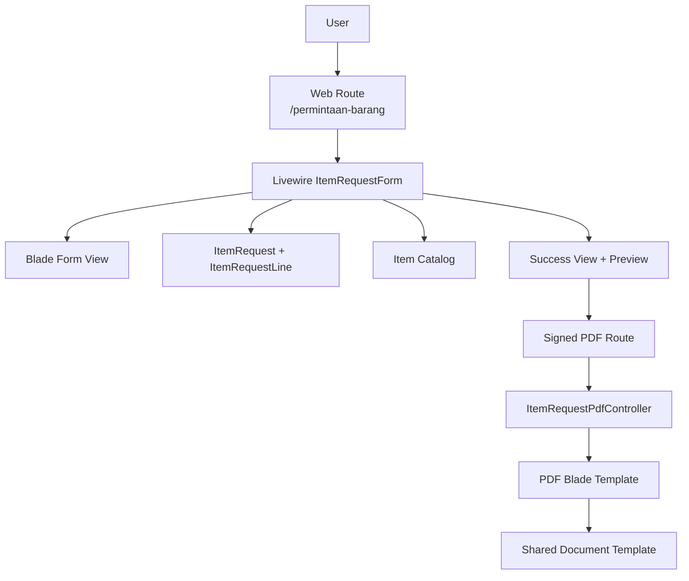
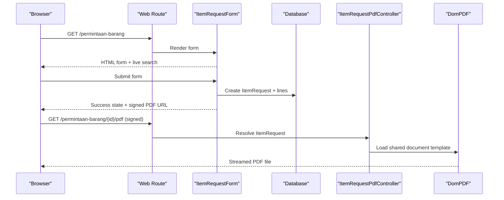
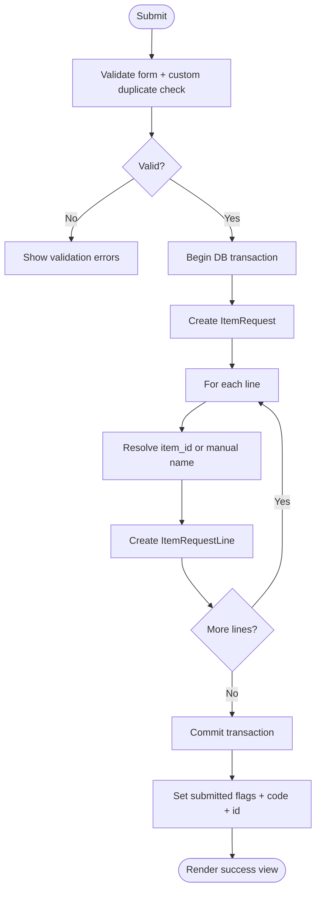
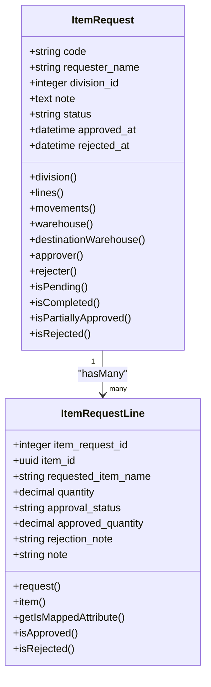
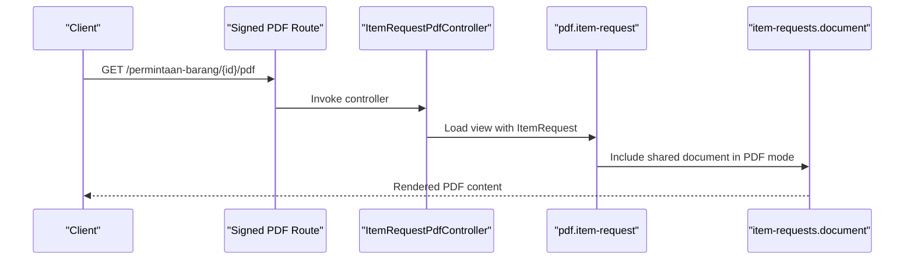
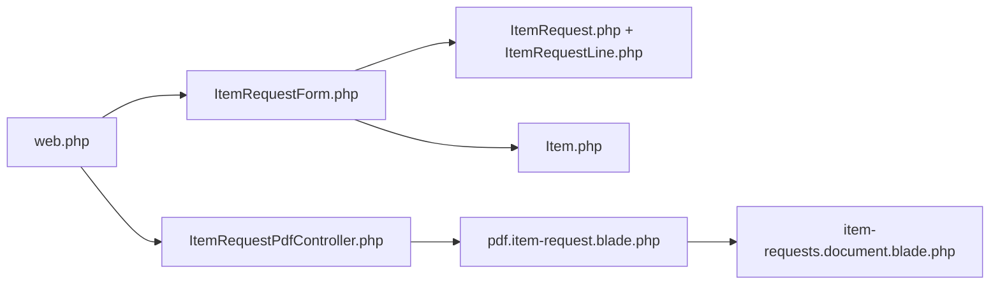

# Document Generation

<cite>
**Referenced Files in This Document**
- [ItemRequestForm.php](file://app/Livewire/ItemRequestForm.php)
- [item-request-form.blade.php](file://resources/views/livewire/item-request-form.blade.php)
- [item-request-preview.blade.php](file://resources/views/livewire/partials/item-request-preview.blade.php)
- [ItemRequest.php](file://app/Models/ItemRequest.php)
- [ItemRequestLine.php](file://app/Models/ItemRequestLine.php)
- [Item.php](file://app/Models/Item.php)
- [ItemRequestPdfController.php](file://app/Http/Controllers/ItemRequestPdfController.php)
- [item-request.blade.php](file://resources/views/pdf/item-request.blade.php)
- [document.blade.php](file://resources/views/item-requests/document.blade.php)
- [web.php](file://routes/web.php)
- [2026_11_19_000007_create_item_requests_table.php](file://database/migrations/2026_11_19_000007_create_item_requests_table.php)
- [2026_11_19_000008_create_item_request_lines_table.php](file://database/migrations/2026_11_19_000008_create_item_request_lines_table.php)
- [ItemRequestFormTest.php](file://tests/Feature/ItemRequestFormTest.php)
- [ItemRequestPdfTest.php](file://tests/Feature/ItemRequestPdfTest.php)
</cite>

## Table of Contents
1. [Introduction](#introduction)
2. [Project Structure](#project-structure)
3. [Core Components](#core-components)
4. [Architecture Overview](#architecture-overview)
5. [Detailed Component Analysis](#detailed-component-analysis)
6. [Dependency Analysis](#dependency-analysis)
7. [Performance Considerations](#performance-considerations)
8. [Troubleshooting Guide](#troubleshooting-guide)
9. [Conclusion](#conclusion)

## Introduction
This document explains the Document Generation module for item requests. It covers the full workflow from form submission to PDF generation, including:
- The Livewire component that handles interactive form input and live preview.
- The Eloquent models used for persistence and approval-related fields.
- The controller and Blade templates used for web display and PDF rendering.
- Examples for creating item requests, generating PDFs, customizing layouts, sharing links, and integrating with the approval workflow.

The system supports:
- Public item request submission without authentication.
- Live search and selection of master items or manual item names.
- Signed, shareable PDF links.
- Approval status tracking at both request and line levels.

## Project Structure
The feature spans Livewire components, Eloquent models, a controller, Blade views, routes, database migrations, and tests.

**Diagram sources**
- [web.php:11-17](file://routes/web.php#L11-L17)
- [ItemRequestForm.php:20-22](file://app/Livewire/ItemRequestForm.php#L20-L22)
- [item-request-form.blade.php:179-582](file://resources/views/livewire/item-request-form.blade.php#L179-L582)
- [ItemRequest.php:26-83](file://app/Models/ItemRequest.php#L26-L83)
- [ItemRequestLine.php:21-63](file://app/Models/ItemRequestLine.php#L21-L63)
- [ItemRequestPdfController.php:9-18](file://app/Http/Controllers/ItemRequestPdfController.php#L9-L18)
- [item-request.blade.php:17-19](file://resources/views/pdf/item-request.blade.php#L17-L19)
- [document.blade.php:282-397](file://resources/views/item-requests/document.blade.php#L282-L397)

**Section sources**
- [web.php:11-17](file://routes/web.php#L11-L17)
- [ItemRequestForm.php:20-22](file://app/Livewire/ItemRequestForm.php#L20-L22)

## Core Components
- Livewire component `ItemRequestForm` provides the public form, validation, live search, submission, success state, and PDF link generation.
- Model `ItemRequest` represents the request header, including requester, division, notes, status, and approval metadata.
- Model `ItemRequestLine` represents each requested item, including mapped or manual item names, quantity, and line-level approval data.
- Controller `ItemRequestPdfController` renders the shared document template into an A4 PDF using DomPDF.
- Blade templates include the interactive form view, preview partial, PDF wrapper, and shared document layout.

Key responsibilities:
- Input handling and validation: `ItemRequestForm`.
- Data persistence and relationships: `ItemRequest`, `ItemRequestLine`.
- PDF rendering: `ItemRequestPdfController` and `pdf.item-request`.
- Shared document layout: `item-requests.document`.

**Section sources**
- [ItemRequestForm.php:20-49](file://app/Livewire/ItemRequestForm.php#L20-L49)
- [ItemRequest.php:26-83](file://app/Models/ItemRequest.php#L26-L83)
- [ItemRequestLine.php:21-63](file://app/Models/ItemRequestLine.php#L21-L63)
- [ItemRequestPdfController.php:9-18](file://app/Http/Controllers/ItemRequestPdfController.php#L9-L18)
- [item-request.blade.php:17-19](file://resources/views/pdf/item-request.blade.php#L17-L19)
- [document.blade.php:282-397](file://resources/views/item-requests/document.blade.php#L282-L397)

## Architecture Overview
The end-to-end flow connects user interaction with server-side processing and output generation.

**Diagram sources**
- [web.php:11-17](file://routes/web.php#L11-L17)
- [ItemRequestForm.php:95-151](file://app/Livewire/ItemRequestForm.php#L95-L151)
- [ItemRequestPdfController.php:11-18](file://app/Http/Controllers/ItemRequestPdfController.php#L11-L18)

## Detailed Component Analysis

### Livewire Component: ItemRequestForm
Responsibilities:
- Manages form fields: requester name, division, note, and dynamic lines.
- Provides add/remove line actions.
- Supports selecting a master item or entering a manual item name.
- Validates inputs and prevents duplicates across selected and manual entries.
- Persists the request and lines inside a database transaction.
- Generates a success state with a signed PDF URL and share message.
- Loads divisions and active items for dropdowns and live search.

Important behaviors:
- Mount initializes one empty line.
- Add/remove lines maintain array integrity and ensure at least one line exists.
- Selecting an item clears manual query and resets validation for that line.
- Custom validator checks:
  - Each line must have either a selected item or a manual name.
  - Duplicate items are rejected by resolved ID or normalized manual name.
- Submission creates the request and lines, then sets submitted flags and IDs.
- Render prepares:
  - Active divisions.
  - Active items with base unit of measure.
  - Per-line search results when a manual query is present.
  - Submitted request details and a temporary signed PDF URL.
  - Share message text for WhatsApp integration.

Validation rules:
- Requester name required, max length.
- Division required and must be active.
- Note optional with max length.
- Lines required array with minimum one entry.
- Each line:
  - Either valid active item ID or manual name.
  - Quantity required, numeric, greater than zero.
  - Optional note with max length.

Live search:
- Searches active items by name or code.
- Limits results and includes base UOM.
- Escapes special characters to prevent SQL-like injection patterns.

Success flow:
- After successful submission, the view shows ticket number, preview, download button, and share button.
- The preview includes the shared document template in preview mode.
- The PDF URL is generated with a short expiration window.

**Diagram sources**
- [ItemRequestForm.php:95-151](file://app/Livewire/ItemRequestForm.php#L95-L151)
- [ItemRequestForm.php:174-208](file://app/Livewire/ItemRequestForm.php#L174-L208)
- [ItemRequestForm.php:264-303](file://app/Livewire/ItemRequestForm.php#L264-L303)

**Section sources**
- [ItemRequestForm.php:20-49](file://app/Livewire/ItemRequestForm.php#L20-L49)
- [ItemRequestForm.php:51-84](file://app/Livewire/ItemRequestForm.php#L51-L84)
- [ItemRequestForm.php:95-151](file://app/Livewire/ItemRequestForm.php#L95-L151)
- [ItemRequestForm.php:174-208](file://app/Livewire/ItemRequestForm.php#L174-L208)
- [ItemRequestForm.php:210-261](file://app/Livewire/ItemRequestForm.php#L210-L261)
- [ItemRequestForm.php:264-303](file://app/Livewire/ItemRequestForm.php#L264-L303)

### Blade Templates: Web Display and Preview
- Main form view:
  - Displays sections for requester data and item lines.
  - Uses Livewire directives for two-way binding, validation messages, and actions.
  - Supports adding/removing lines and live search dropdowns.
  - Includes anti-spam honeypot field.
  - Shows success confirmation with ticket number, preview, PDF download, and share options.
- Preview partial:
  - Wraps the shared document template in a scrollable container for preview mode.

Key interactions:
- Typing in the item query triggers debounced live search.
- Selecting a result updates the line’s selected item and hides manual input.
- Clearing selection restores manual input mode.
- Submitting validates and persists data, then switches to success view.

**Section sources**
- [item-request-form.blade.php:179-582](file://resources/views/livewire/item-request-form.blade.php#L179-L582)
- [item-request-preview.blade.php:1-4](file://resources/views/livewire/partials/item-request-preview.blade.php#L1-L4)

### Models: ItemRequest and ItemRequestLine
ItemRequest:
- Fillable fields include code, requester_name, division_id, note, status, warehouse identifiers, and approval metadata.
- Status constants define pending, processing, completed, partial, and rejected states.
- Casts approved_at and rejected_at as datetime.
- Automatically generates a human-readable code after creation.
- Relationships:
  - BelongsTo Division.
  - HasMany lines.
  - HasMany inventory movements.
  - BelongsTo Warehouse and destination warehouse.
  - BelongsTo approver and rejecter users.
- Helper methods determine current status and provide label mapping.

ItemRequestLine:
- Fillable fields include request foreign key, optional mapped item, manual name, quantity, approval status, approved quantity, rejection note, and note.
- Casts quantities as decimal values.
- Approval status constants define pending, approved, and rejected.
- Relationships:
  - BelongsTo ItemRequest.
  - BelongsTo Item when mapped.
- Helpers:
  - Determines if the line is mapped to a master item.
  - Checks approval and rejection states.

**Diagram sources**
- [ItemRequest.php:12-83](file://app/Models/ItemRequest.php#L12-L83)
- [ItemRequest.php:100-133](file://app/Models/ItemRequest.php#L100-L133)
- [ItemRequestLine.php:11-79](file://app/Models/ItemRequestLine.php#L11-L79)

**Section sources**
- [ItemRequest.php:12-83](file://app/Models/ItemRequest.php#L12-L83)
- [ItemRequest.php:100-133](file://app/Models/ItemRequest.php#L100-L133)
- [ItemRequestLine.php:11-79](file://app/Models/ItemRequestLine.php#L11-L79)

### PDF Creation: ItemRequestPdfController and Templates
Controller:
- Resolves the ItemRequest via route model binding.
- Eager loads related division, lines, items, and base units.
- Renders the shared document template through DomPDF.
- Streams the PDF with an A4 paper size and a filename based on the request code.

Templates:
- PDF wrapper template sets page size and body margins, then includes the shared document template in PDF mode.
- Shared document template defines the visual layout, tables, headers, signature blocks, and print styles.
- Preview mode adds a toolbar and responsive zoom; PDF mode adjusts dimensions and removes shadows.

**Diagram sources**
- [ItemRequestPdfController.php:11-18](file://app/Http/Controllers/ItemRequestPdfController.php#L11-L18)
- [item-request.blade.php:17-19](file://resources/views/pdf/item-request.blade.php#L17-L19)
- [document.blade.php:282-397](file://resources/views/item-requests/document.blade.php#L282-L397)

**Section sources**
- [ItemRequestPdfController.php:9-18](file://app/Http/Controllers/ItemRequestPdfController.php#L9-L18)
- [item-request.blade.php:1-21](file://resources/views/pdf/item-request.blade.php#L1-L21)
- [document.blade.php:1-397](file://resources/views/item-requests/document.blade.php#L1-L397)

### Database Schema and Persistence
- ItemRequests table:
  - Primary key, unique code, requester name, nullable division reference, optional note, default pending status, timestamps, and index on status.
- ItemRequestLines table:
  - Foreign key to ItemRequests, foreign UUID to Items, decimal quantity, optional note, timestamps, and unique constraint on request+item pair.

These migrations establish the core relational structure for requests and their lines.

**Section sources**
- [2026_11_19_000007_create_item_requests_table.php:14-27](file://database/migrations/2026_11_19_000007_create_item_requests_table.php#L14-L27)
- [2026_11_19_000008_create_item_request_lines_table.php:14-27](file://database/migrations/2026_11_19_000008_create_item_request_lines_table.php#L14-L27)

### Example Workflows

#### Creating an Item Request
Steps:
1. Open `/permintaan-barang`.
2. Enter requester name and select an active division.
3. Add one or more lines:
   - Search and select a master item, or type a manual item name.
   - Enter a positive quantity.
   - Optionally add per-line notes.
4. Submit the form.
5. On success, copy the ticket number, preview the document, download the PDF, or share via WhatsApp.

Validation ensures:
- Required fields are filled.
- Only active divisions and items are accepted.
- Quantities are positive numbers.
- No duplicate items exist within the same request.

**Section sources**
- [ItemRequestForm.php:95-151](file://app/Livewire/ItemRequestForm.php#L95-L151)
- [ItemRequestForm.php:174-208](file://app/Livewire/ItemRequestForm.php#L174-L208)
- [item-request-form.blade.php:179-582](file://resources/views/livewire/item-request-form.blade.php#L179-L582)

#### Generating a PDF
Options:
- From the success view, click “Unduh PDF” to download the signed PDF.
- Use the signed PDF URL generated by the component.
- Access the signed route directly if you already have a valid token.

Notes:
- The PDF route requires a signed URL.
- The controller streams an A4 PDF named after the request code.
- The shared document template renders both mapped and manual items.

**Section sources**
- [ItemRequestForm.php:234-240](file://app/Livewire/ItemRequestForm.php#L234-L240)
- [ItemRequestPdfController.php:11-18](file://app/Http/Controllers/ItemRequestPdfController.php#L11-L18)
- [item-request.blade.php:17-19](file://resources/views/pdf/item-request.blade.php#L17-L19)

#### Customizing Document Layouts
To customize the printed document:
- Edit the shared document template to adjust branding, section titles, table columns, spacing, and signature blocks.
- Adjust PDF-specific styles in the PDF wrapper template.
- Modify preview-only styles in the shared template for better screen presentation.

Guidelines:
- Keep print styles separate from screen styles.
- Ensure A4 page sizing and margins remain consistent.
- Test long lists of lines to verify pagination behavior.

**Section sources**
- [document.blade.php:6-280](file://resources/views/item-requests/document.blade.php#L6-L280)
- [document.blade.php:282-397](file://resources/views/item-requests/document.blade.php#L282-L397)
- [item-request.blade.php:1-21](file://resources/views/pdf/item-request.blade.php#L1-L21)

#### Live Preview Functionality
After submission:
- The success view includes a preview panel that renders the shared document in preview mode.
- Users can print or save the preview using the browser’s print dialog.
- The preview scales responsively on smaller screens.

**Section sources**
- [item-request-form.blade.php:100-102](file://resources/views/livewire/item-request-form.blade.php#L100-L102)
- [item-request-preview.blade.php:1-4](file://resources/views/livewire/partials/item-request-preview.blade.php#L1-L4)
- [document.blade.php:242-280](file://resources/views/item-requests/document.blade.php#L242-L280)

#### Shareable Link Generation
- The component generates a temporary signed URL for the PDF.
- The success view exposes a download button and a WhatsApp share button.
- The share message includes the request code, requester name, division, and a call to action.

Security:
- The PDF route uses Laravel’s signed route middleware.
- Unsigned access is forbidden.

**Section sources**
- [ItemRequestForm.php:234-240](file://app/Livewire/ItemRequestForm.php#L234-L240)
- [ItemRequestForm.php:242-249](file://app/Livewire/ItemRequestForm.php#L242-L249)
- [web.php:15-17](file://routes/web.php#L15-L17)

#### Integration with the Approval Workflow
Approval data is modeled at both request and line levels:
- Request status constants include pending, processing, completed, partial, and rejected.
- Line approval status constants include pending, approved, and rejected.
- The models expose helper methods to check statuses and labels.
- Tests assert that admin UI cannot manually change request status through the edit form, indicating controlled workflow transitions elsewhere.

Integration points:
- Filament resources manage item requests and lines.
- Line relation manager allows mapping manual items to master items.
- Status changes should be handled by business logic or admin workflows outside this document.

**Section sources**
- [ItemRequest.php:31-73](file://app/Models/ItemRequest.php#L31-L73)
- [ItemRequest.php:110-133](file://app/Models/ItemRequest.php#L110-L133)
- [ItemRequestLine.php:26-79](file://app/Models/ItemRequestLine.php#L26-L79)
- [ItemRequestFormTest.php:224-269](file://tests/Feature/ItemRequestFormTest.php#L224-L269)

## Dependency Analysis
High-level dependencies:
- Routes depend on Livewire component and controller classes.
- Livewire component depends on models and services for data loading and persistence.
- PDF controller depends on DomPDF facade and shared Blade templates.
- Shared document template depends on ItemRequest and its relations.

**Diagram sources**
- [web.php:11-17](file://routes/web.php#L11-L17)
- [ItemRequestForm.php:20-22](file://app/Livewire/ItemRequestForm.php#L20-L22)
- [ItemRequestPdfController.php:9-18](file://app/Http/Controllers/ItemRequestPdfController.php#L9-L18)
- [item-request.blade.php:17-19](file://resources/views/pdf/item-request.blade.php#L17-L19)
- [document.blade.php:282-397](file://resources/views/item-requests/document.blade.php#L282-L397)

**Section sources**
- [web.php:11-17](file://routes/web.php#L11-L17)
- [ItemRequestForm.php:210-261](file://app/Livewire/ItemRequestForm.php#L210-L261)
- [ItemRequestPdfController.php:11-18](file://app/Http/Controllers/ItemRequestPdfController.php#L11-L18)

## Performance Considerations
- Live search limits results to ten items and scopes to active items to reduce payload size.
- Eager loading is used for related data in both the component render and PDF controller to avoid N+1 queries.
- Validation runs before any database writes, preventing unnecessary transactions.
- PDF rendering uses a shared template to minimize duplication and improve maintainability.
- Pagination and printing styles are tuned for A4 pages to avoid excessive reflows.

Recommendations:
- Cache frequently accessed lookup data such as active items and divisions if traffic increases.
- Consider background jobs for large PDF generations if many concurrent requests occur.
- Monitor query performance for search and list operations.

[No sources needed since this section provides general guidance]

## Troubleshooting Guide
Common issues and resolutions:
- Form does not submit:
  - Check required fields: requester name, division, and at least one line with quantity.
  - Verify that the selected division and item are active.
- Duplicate item error:
  - Ensure no two lines resolve to the same master item or manual name.
- Manual item not saved:
  - If no master item matches, the manual name is stored in the line’s manual name field.
- PDF route returns forbidden:
  - Ensure the URL is signed and not expired.
- PDF layout looks incorrect:
  - Inspect shared document template styles and PDF wrapper settings.
- Preview not visible:
  - Confirm the request was successfully submitted and the preview partial is included.

Relevant test cases:
- Public form renders correctly.
- Multiple items are saved and displayed.
- Validation rejects inactive divisions, inactive items, non-positive quantities, and duplicates.
- Manual item names are persisted and later mappable.
- Signed PDF route returns PDF content and unsigned access is forbidden.
- Standard requests fit on one A4 page; long requests span multiple pages.

**Section sources**
- [ItemRequestFormTest.php:22-271](file://tests/Feature/ItemRequestFormTest.php#L22-L271)
- [ItemRequestPdfTest.php:17-108](file://tests/Feature/ItemRequestPdfTest.php#L17-L108)

## Conclusion
The Document Generation module provides a robust, user-friendly workflow for creating item requests and producing printable documents. The Livewire component handles interactive input, validation, and live search, while the models capture both request-level and line-level data, including approval states. The controller and shared Blade templates deliver consistent web and PDF outputs. Signed URLs enable secure sharing, and the design supports customization for branding and layout needs. Tests validate core behaviors, ensuring reliability for production use.

[No sources needed since this section summarizes without analyzing specific files]