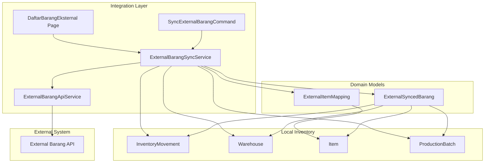
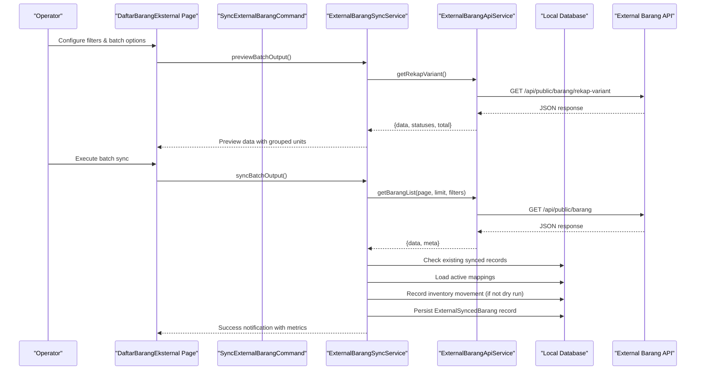
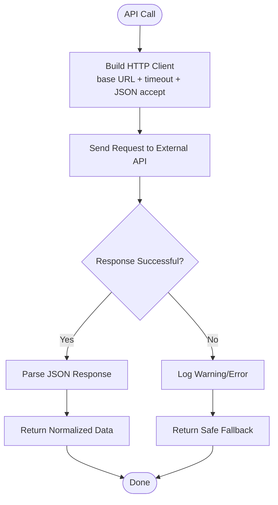
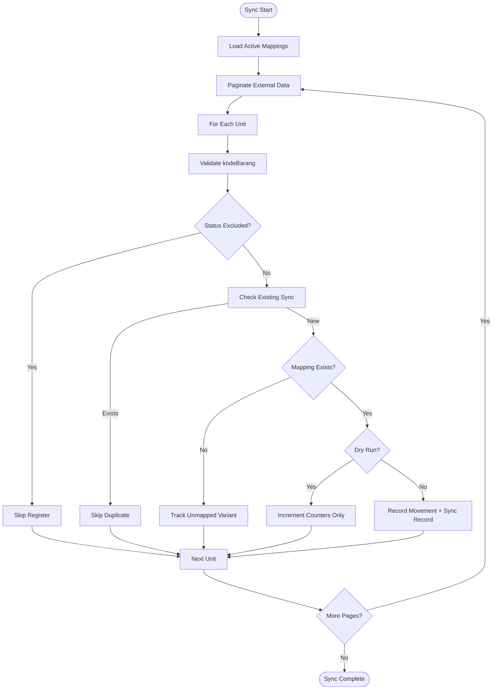
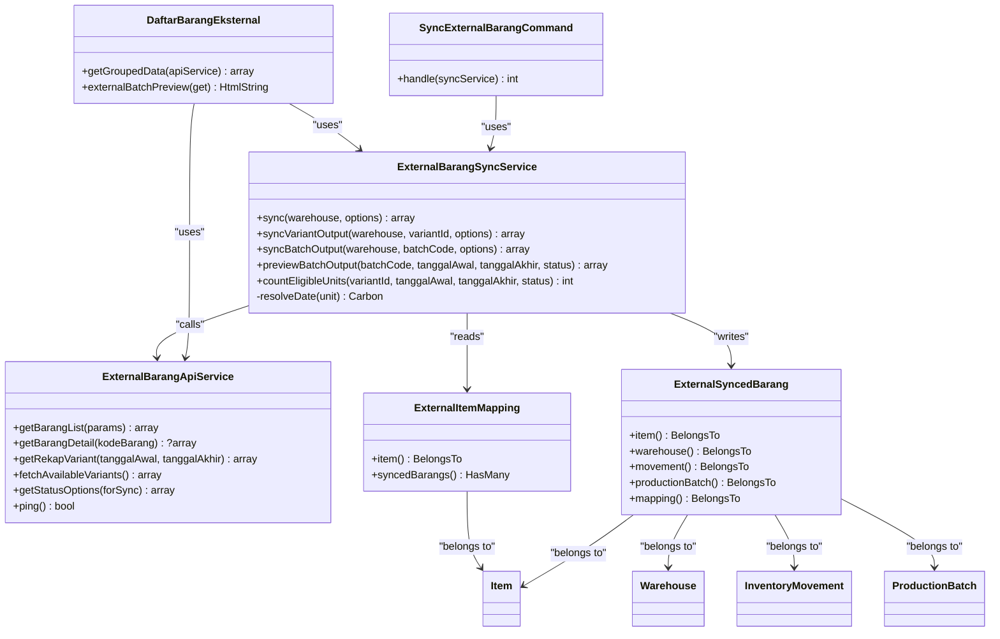

# External System Integration

<cite>
**Referenced Files in This Document**
- [ExternalBarangApiService.php](file://app/Services/ExternalBarangApiService.php)
- [ExternalBarangSyncService.php](file://app/Services/ExternalBarangSyncService.php)
- [ExternalItemMapping.php](file://app/Models/ExternalItemMapping.php)
- [ExternalSyncedBarang.php](file://app/Models/ExternalSyncedBarang.php)
- [SyncExternalBarangCommand.php](file://app/Console/Commands/SyncExternalBarangCommand.php)
- [DaftarBarangEksternal.php](file://app/Filament/Pages/DaftarBarangEksternal.php)
- [daftar-barang-eksternal.blade.php](file://resources/views/filament/pages/daftar-barang-eksternal.blade.php)
- [2026_11_23_000001_create_external_item_mappings_table.php](file://database/migrations/2026_11_23_000001_create_external_item_mappings_table.php)
- [2026_11_23_000002_create_external_synced_barangs_table.php](file://database/migrations/2026_11_23_000002_create_external_synced_barangs_table.php)
</cite>

## Update Summary
**Changes Made**
- Enhanced form interface with comprehensive filtering and batch operations
- Added status filtering with dynamic status options from external API
- Implemented unit limiting functionality with max_units parameter
- Added preview functionality for batch synchronization
- Improved error handling with comprehensive validation exceptions
- Enhanced duplicate detection with better idempotency checks
- Added batch-specific synchronization methods (syncVariantOutput, syncBatchOutput)

## Table of Contents
1. [Introduction](#introduction)
2. [Project Structure](#project-structure)
3. [Core Components](#core-components)
4. [Architecture Overview](#architecture-overview)
5. [Detailed Component Analysis](#detailed-component-analysis)
6. [Enhanced User Interface](#enhanced-user-interface)
7. [Dependency Analysis](#dependency-analysis)
8. [Performance Considerations](#performance-considerations)
9. [Troubleshooting Guide](#troubleshooting-guide)
10. [Conclusion](#conclusion)
11. [Appendices](#appendices)

## Introduction
This document explains the External System Integration module used to synchronize external "barang" (items) data into the local inventory system. The system has been significantly enhanced with an improved user interface, advanced filtering capabilities, batch processing features, and comprehensive error handling. It covers:
- The API client for communicating with an external barang endpoint.
- The synchronization service that transforms, validates, and persists synchronized stock movements.
- The mapping model that connects external variants to internal items.
- The sync tracking model that records what has been synchronized.
- The console command that automates synchronization runs.
- The enhanced Filament interface for manual operations and monitoring.

The integration is designed for safety and auditability: it avoids duplicate entries, skips unfinished or excluded statuses, requires explicit variant-to-item mappings, and records every successful sync as a warehouse inventory movement.

## Project Structure
The external integration lives under application services, models, console commands, Filament pages, and database migrations:
- Services: HTTP client and synchronization logic with batch processing capabilities.
- Models: Mapping configuration and sync history.
- Console: Automated command for running sync jobs.
- Filament Pages: Interactive interface for manual operations and monitoring.
- Migrations: Database schema for mapping and sync tracking.

**Diagram sources**
- [ExternalBarangApiService.php:10-214](file://app/Services/ExternalBarangApiService.php#L10-L214)
- [ExternalBarangSyncService.php:16-835](file://app/Services/ExternalBarangSyncService.php#L16-L835)
- [SyncExternalBarangCommand.php:10-104](file://app/Console/Commands/SyncExternalBarangCommand.php#L10-L104)
- [DaftarBarangEksternal.php:34-464](file://app/Filament/Pages/DaftarBarangEksternal.php#L34-L464)
- [ExternalItemMapping.php:23-49](file://app/Models/ExternalItemMapping.php#L23-L49)
- [ExternalSyncedBarang.php:24-68](file://app/Models/ExternalSyncedBarang.php#L24-L68)

**Section sources**
- [ExternalBarangApiService.php:10-214](file://app/Services/ExternalBarangApiService.php#L10-L214)
- [ExternalBarangSyncService.php:16-835](file://app/Services/ExternalBarangSyncService.php#L16-L835)
- [SyncExternalBarangCommand.php:10-104](file://app/Console/Commands/SyncExternalBarangCommand.php#L10-L104)
- [DaftarBarangEksternal.php:34-464](file://app/Filament/Pages/DaftarBarangEksternal.php#L34-L464)
- [ExternalItemMapping.php:23-49](file://app/Models/ExternalItemMapping.php#L23-L49)
- [ExternalSyncedBarang.php:24-68](file://app/Models/ExternalSyncedBarang.php#L24-L68)

## Core Components
- ExternalBarangApiService: A thin HTTP client wrapper around the external barang API. It provides methods to list barang, fetch details, retrieve aggregated variant recap, extract available variants, get status options, and ping connectivity.
- ExternalBarangSyncService: Orchestrates synchronization with enhanced batch processing capabilities including single variant sync, batch output sync, preview functionality, and comprehensive error handling.
- ExternalItemMapping: Stores the mapping between an external variant identifier and a local item, including metadata such as external code, product, style, color, and size names.
- ExternalSyncedBarang: Tracks each successfully synchronized external unit, linking it to the local item, warehouse, inventory movement, production batch, and original external identifiers.
- SyncExternalBarangCommand: A Laravel console command that exposes options for warehouse selection, pagination control, status filtering, dry-run simulation, and displays summary metrics.
- DaftarBarangEksternal: An enhanced Filament page providing interactive filtering, batch synchronization, and real-time preview capabilities.

**Section sources**
- [ExternalBarangApiService.php:10-214](file://app/Services/ExternalBarangApiService.php#L10-L214)
- [ExternalBarangSyncService.php:16-835](file://app/Services/ExternalBarangSyncService.php#L16-L835)
- [ExternalItemMapping.php:23-49](file://app/Models/ExternalItemMapping.php#L23-L49)
- [ExternalSyncedBarang.php:24-68](file://app/Models/ExternalSyncedBarang.php#L24-L68)
- [SyncExternalBarangCommand.php:10-104](file://app/Console/Commands/SyncExternalBarangCommand.php#L10-L104)
- [DaftarBarangEksternal.php:34-464](file://app/Filament/Pages/DaftarBarangEksternal.php#L34-L464)

## Architecture Overview
The integration follows a layered approach with enhanced UI capabilities:
- Command layer: Accepts user input and delegates to the sync service.
- Service layer: Coordinates API calls, business rules, persistence, and batch processing.
- UI layer: Provides interactive filtering, batch operations, and real-time previews.
- Data layer: Uses Eloquent models and database tables for mapping and sync tracking.
- External layer: Communicates with the external barang API over HTTP.

**Diagram sources**
- [DaftarBarangEksternal.php:325-364](file://app/Filament/Pages/DaftarBarangEksternal.php#L325-L364)
- [ExternalBarangSyncService.php:362-510](file://app/Services/ExternalBarangSyncService.php#L362-L510)
- [ExternalBarangApiService.php:33-55](file://app/Services/ExternalBarangApiService.php#L33-L55)

## Detailed Component Analysis

### ExternalBarangApiService
Responsibilities:
- Configure base URL and timeout from configuration.
- Provide methods for listing barang, fetching detail by kodeBarang, retrieving variant recap, extracting unique variants, getting status options, and pinging connectivity.
- Use Laravel HTTP client with JSON acceptance and consistent error logging.

Key behaviors:
- getBarangList returns a normalized structure with data and meta arrays; logs warnings on non-successful responses and returns safe defaults.
- getBarangDetail returns null on failure or missing data.
- getRekapVariant aggregates variant data across date ranges and returns a stable shape even on errors.
- fetchAvailableVariants builds a deduplicated set of external variants using recap first, then falls back to the barang list if needed.
- getStatusOptions retrieves available statuses from API and filters out excluded statuses based on configuration.
- ping performs a lightweight health check against the external API.

Error handling:
- All network and parsing exceptions are caught and logged; methods return safe fallback values to prevent downstream failures.

Authentication:
- No authentication headers are applied in this client; it targets public endpoints. If the external system changes to require authentication, headers should be added in the client builder method.

Retry mechanisms:
- No built-in retry policy exists. For transient failures, consider wrapping calls with a retry strategy at the caller level or introducing a dedicated HTTP retry middleware.

**Diagram sources**
- [ExternalBarangApiService.php:16-20](file://app/Services/ExternalBarangApiService.php#L16-L20)
- [ExternalBarangApiService.php:33-55](file://app/Services/ExternalBarangApiService.php#L33-L55)
- [ExternalBarangApiService.php:196-205](file://app/Services/ExternalBarangApiService.php#L196-L205)

**Section sources**
- [ExternalBarangApiService.php:10-214](file://app/Services/ExternalBarangApiService.php#L10-L214)

### ExternalBarangSyncService
Responsibilities:
- Paginate external barang data with configurable limits and optional all-pages mode.
- Filter out excluded statuses (default includes REGISTER).
- Enforce idempotency by skipping already-synced kodeBarang.
- Require active variant-to-item mappings; otherwise, track unmapped variants.
- Record inventory movements and create sync records within a database transaction.
- Resolve occurrence dates from multiple fields with fallback to current time.
- Support batch processing with unit limiting and preview functionality.

Processing flow:
- Load active mappings keyed by external_variant_id.
- Iterate pages until either no more data or all pages are processed.
- For each unit:
  - Skip empty kodeBarang.
  - Skip excluded statuses.
  - Skip duplicates via ExternalSyncedBarang lookup.
  - Validate mapping existence; collect unmapped variants.
  - In dry-run mode, increment counters without writing.
  - Otherwise, record inventory movement and persist sync record inside a transaction.

Enhanced Features:
- syncVariantOutput: Synchronizes all new units of a specific variant into a single production batch transaction.
- syncBatchOutput: Processes entire external batches with unit limiting and per-item grouping.
- previewBatchOutput: Provides preview data without actual synchronization.
- countEligibleUnits: Counts eligible units for a specific variant and date range.

Error handling:
- Individual unit processing failures are caught and logged; they do not abort the entire batch.
- Comprehensive validation exceptions for invalid inputs and business rule violations.

Idempotency:
- Duplicate prevention is enforced per kodeBarang with improved checking logic.

Date resolution:
- Attempts to parse finishGoodAt, tanggal, createdAt; falls back to now() if parsing fails.

**Diagram sources**
- [ExternalBarangSyncService.php:42-238](file://app/Services/ExternalBarangSyncService.php#L42-L238)
- [ExternalBarangSyncService.php:809-833](file://app/Services/ExternalBarangSyncService.php#L809-L833)

**Section sources**
- [ExternalBarangSyncService.php:16-835](file://app/Services/ExternalBarangSyncService.php#L16-L835)

### ExternalItemMapping Model
Purpose:
- Maps an external variant identifier to a local item.
- Stores auxiliary metadata like external code and descriptive names for product, style, color, and size.
- Supports activation toggling via is_active.

Relationships:
- Belongs to Item.
- Has many synced barang records linked by external_variant_id.

Casts:
- external_variant_id cast to integer.
- is_active cast to boolean.

Configuration example:
- Create a mapping where external_variant_id corresponds to a local item_id and mark it active.
- Optionally fill external_variant_code and descriptive fields to aid identification in UIs and reports.

**Section sources**
- [ExternalItemMapping.php:23-49](file://app/Models/ExternalItemMapping.php#L23-L49)
- [2026_11_23_000001_create_external_item_mappings_table.php:14-27](file://database/migrations/2026_11_23_000001_create_external_item_mappings_table.php#L14-L27)

### ExternalSyncedBarang Model
Purpose:
- Records each successfully synchronized external unit.
- Links to local item, warehouse, and inventory movement.
- Preserves external identifiers and timestamps for auditability.

Relationships:
- Belongs to Item, Warehouse, InventoryMovement, ProductionBatch, and ExternalItemMapping (via external_variant_id).

Casts:
- external_id, external_variant_id, external_batch_id cast to integers.
- external_occurred_at and synced_at cast to datetime.

Audit fields:
- status captures the external status at sync time.
- external_occurred_at preserves the source event timestamp when available.
- synced_at marks when the local system recorded the sync.

**Section sources**
- [ExternalSyncedBarang.php:24-68](file://app/Models/ExternalSyncedBarang.php#L24-L68)
- [2026_11_23_000002_create_external_synced_barangs_table.php:14-37](file://database/migrations/2026_11_23_000002_create_external_synced_barangs_table.php#L14-L37)

### SyncExternalBarangCommand
Purpose:
- Provides a CLI interface to run synchronization with flexible options.

Options:
- --warehouse: Target warehouse ID; defaults to configured default or first active warehouse.
- --batch: Production batch ID for linking synchronized items.
- --kode-batch: External batch code filter for targeted synchronization.
- --limit: Records per request (max 100).
- --all-pages: Fetch all paginated pages.
- --status: Filter by specific external status.
- --dry-run: Simulate without creating inventory movements.

Behavior:
- Validates presence of an active warehouse.
- Delegates to ExternalBarangSyncService with parsed options.
- Displays a summary table of metrics and lists unmapped variants if any.

Example usage patterns:
- Basic sync to default warehouse:
  - php artisan sync:external-barang
- Sync with custom limit and all pages:
  - php artisan sync:external-barang --limit=50 --all-pages
- Dry-run simulation:
  - php artisan sync:external-barang --dry-run
- Filter by status:
  - php artisan sync:external-barang --status=PRODUCTION
- Target specific warehouse:
  - php artisan sync:external-barang --warehouse=123
- Sync with production batch:
  - php artisan sync:external-barang --batch=456
- Filter by external batch code:
  - php artisan sync:external-barang --kode-batch=BC001

**Section sources**
- [SyncExternalBarangCommand.php:10-104](file://app/Console/Commands/SyncExternalBarangCommand.php#L10-L104)

## Enhanced User Interface
The DaftarBarangEksternal page provides a comprehensive interface for managing external item synchronization with advanced filtering and batch operations.

Key Features:
- Date range filtering with start and end date pickers.
- Dynamic status filtering based on available external API statuses.
- Real-time statistics showing total units, finish goods, register status, and synced counts.
- Grouped display by production date with detailed variant information.
- Batch synchronization with preview functionality.
- Direct mapping creation for unmapped variants.

Interactive Elements:
- Filter form with apply and reset buttons.
- Compact statistics dashboard showing overall totals.
- Grouped data tables with per-status breakdowns.
- Batch synchronization modal with live preview.
- Mapping creation modal with infinite search for items.

Preview Functionality:
- Real-time preview of batch synchronization results.
- Shows total units available for synchronization.
- Displays grouped units by mapped items.
- Highlights unmapped variants that will be skipped.

Error Handling:
- Comprehensive validation with user-friendly error messages.
- Notification system for success and failure feedback.
- Halt mechanism to prevent partial operations.

**Section sources**
- [DaftarBarangEksternal.php:34-464](file://app/Filament/Pages/DaftarBarangEksternal.php#L34-L464)
- [daftar-barang-eksternal.blade.php:1-151](file://resources/views/filament/pages/daftar-barang-eksternal.blade.php#L1-L151)

## Dependency Analysis
Component relationships:
- SyncExternalBarangCommand depends on ExternalBarangSyncService.
- DaftarBarangEksternal depends on ExternalBarangSyncService and ExternalBarangApiService.
- ExternalBarangSyncService depends on ExternalBarangApiService and StockMovementService.
- ExternalBarangSyncService reads ExternalItemMapping and writes ExternalSyncedBarang.
- ExternalSyncedBarang references Item, Warehouse, InventoryMovement, ProductionBatch, and ExternalItemMapping.
- ExternalItemMapping references Item.

**Diagram sources**
- [ExternalBarangApiService.php:10-214](file://app/Services/ExternalBarangApiService.php#L10-L214)
- [ExternalBarangSyncService.php:16-835](file://app/Services/ExternalBarangSyncService.php#L16-L835)
- [SyncExternalBarangCommand.php:10-104](file://app/Console/Commands/SyncExternalBarangCommand.php#L10-L104)
- [DaftarBarangEksternal.php:34-464](file://app/Filament/Pages/DaftarBarangEksternal.php#L34-L464)
- [ExternalItemMapping.php:23-49](file://app/Models/ExternalItemMapping.php#L23-L49)
- [ExternalSyncedBarang.php:24-68](file://app/Models/ExternalSyncedBarang.php#L24-L68)

**Section sources**
- [ExternalBarangApiService.php:10-214](file://app/Services/ExternalBarangApiService.php#L10-L214)
- [ExternalBarangSyncService.php:16-835](file://app/Services/ExternalBarangSyncService.php#L16-L835)
- [SyncExternalBarangCommand.php:10-104](file://app/Console/Commands/SyncExternalBarangCommand.php#L10-L104)
- [DaftarBarangEksternal.php:34-464](file://app/Filament/Pages/DaftarBarangEksternal.php#L34-L464)
- [ExternalItemMapping.php:23-49](file://app/Models/ExternalItemMapping.php#L23-L49)
- [ExternalSyncedBarang.php:24-68](file://app/Models/ExternalSyncedBarang.php#L24-L68)

## Performance Considerations
- Pagination control: Use --limit to cap page sizes; combine with --all-pages only when necessary to avoid excessive requests.
- Filtering: Apply --status or variant-specific filters to reduce payload size and processing time.
- Mapping efficiency: Ensure mappings are indexed by external_variant_id; the sync service loads them once per run.
- Transaction scope: Each successful unit is persisted in its own transaction; large batches may benefit from batching strategies or queueing.
- Logging: Excessive logging can impact performance; ensure log levels are appropriate for production environments.
- Preview optimization: Use preview functions to validate data before actual synchronization to minimize unnecessary API calls.
- Batch processing: Utilize syncBatchOutput for efficient bulk operations with unit limiting to optimize database transactions.

## Troubleshooting Guide
Common issues and resolutions:
- External API unreachable:
  - Symptoms: ping returns false; getBarangList returns empty data; logs show connection errors.
  - Actions: Verify base_url and timeout configuration; check network connectivity and firewall rules; confirm external API availability.
- No active warehouse found:
  - Symptoms: Command exits with an error indicating no active warehouse.
  - Actions: Create or activate a warehouse; pass --warehouse with a valid active ID.
- Units skipped due to excluded status:
  - Symptoms: High skipped_register_count.
  - Actions: Adjust excluded_statuses configuration or use --status to include desired statuses.
- Many unmapped variants:
  - Symptoms: Command reports unmapped variants with external IDs and metadata.
  - Actions: Create ExternalItemMapping records for those variants and mark them active.
- Duplicate sync attempts:
  - Symptoms: High skipped_duplicate_count.
  - Actions: Confirm that ExternalSyncedBarang contains the same kodeBarang; investigate why duplicates appear in external data.
- Date parsing failures:
  - Symptoms: external_occurred_at falls back to current time.
  - Actions: Inspect external data fields (finishGoodAt, tanggal, createdAt) and normalize formats upstream.
- Batch synchronization errors:
  - Symptoms: Validation exceptions during batch operations.
  - Actions: Check batch code validity, production batch existence, and unit quantity constraints.
- Preview not showing data:
  - Symptoms: Empty preview results despite having external data.
  - Actions: Verify batch code, status filter, and date range parameters.

Monitoring sync status:
- Review ExternalSyncedBarang records for recent syncs, statuses, and timestamps.
- Use inventory movement queries to verify stock increases for target warehouses.
- Check logs for warnings and errors during API calls and individual unit processing.
- Monitor the DaftarBarangEksternal page for real-time synchronization progress and statistics.

**Section sources**
- [ExternalBarangApiService.php:33-79](file://app/Services/ExternalBarangApiService.php#L33-L79)
- [ExternalBarangSyncService.php:42-238](file://app/Services/ExternalBarangSyncService.php#L42-L238)
- [SyncExternalBarangCommand.php:36-101](file://app/Console/Commands/SyncExternalBarangCommand.php#L36-L101)
- [DaftarBarangEksternal.php:148-259](file://app/Filament/Pages/DaftarBarangEksternal.php#L148-L259)

## Conclusion
The External System Integration module provides a robust, auditable pipeline for synchronizing external barang data into local inventory. With the recent enhancements, it now offers a comprehensive user interface, advanced batch processing capabilities, improved error handling, and better duplicate detection. The system emphasizes safety through status filtering, idempotency checks, mandatory mappings, and transactional persistence. Operators can automate runs via the console command, perform manual operations through the enhanced Filament interface, configure mappings through the domain model, and monitor outcomes using sync records and inventory movements. Future enhancements could include authenticated API support, retry policies, and advanced scheduling or queuing for large-scale operations.

## Appendices

### Configuration Reference
- Base URL and timeout:
  - services.external_barang.base_url
  - services.external_barang.timeout
- Default warehouse:
  - services.external_barang.default_warehouse_id
- Excluded statuses:
  - services.external_barang.excluded_statuses

These values are consumed by the API client and sync service to determine connectivity, request behavior, and filtering rules.

### Enhanced Batch Processing Options
- syncVariantOutput: Synchronizes all new units of a specific variant into a single production batch transaction.
  - Parameters: warehouse, variantId, options (production_batch_id, status, occurred_at, user_id, quantity)
- syncBatchOutput: Processes entire external batches with unit limiting and per-item grouping.
  - Parameters: warehouse, batchCode, options (production_batch_id, status, occurred_at, user_id, quantities, max_units)
- previewBatchOutput: Provides preview data without actual synchronization.
  - Parameters: batchCode, tanggalAwal, tanggalAkhir, status

**Section sources**
- [ExternalBarangApiService.php:16-20](file://app/Services/ExternalBarangApiService.php#L16-L20)
- [ExternalBarangSyncService.php:42-53](file://app/Services/ExternalBarangSyncService.php#L42-L53)
- [SyncExternalBarangCommand.php:35-39](file://app/Console/Commands/SyncExternalBarangCommand.php#L35-L39)
- [ExternalBarangSyncService.php:247-345](file://app/Services/ExternalBarangSyncService.php#L247-L345)
- [ExternalBarangSyncService.php:362-510](file://app/Services/ExternalBarangSyncService.php#L362-L510)
- [ExternalBarangSyncService.php:517-539](file://app/Services/ExternalBarangSyncService.php#L517-L539)