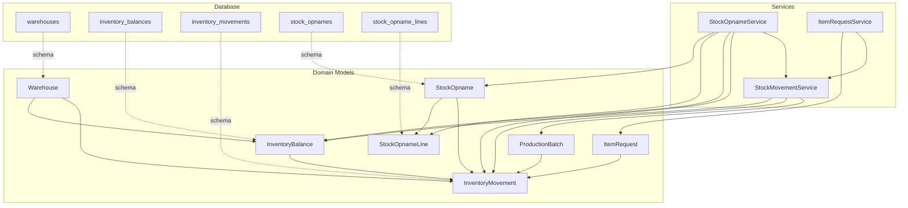
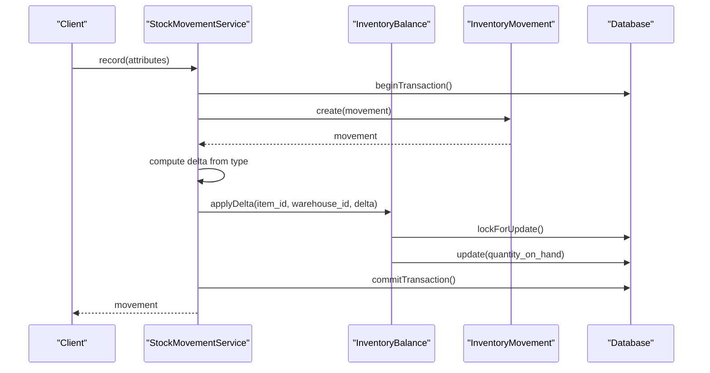
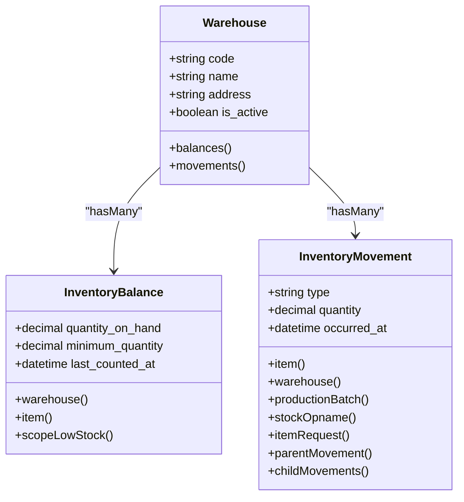
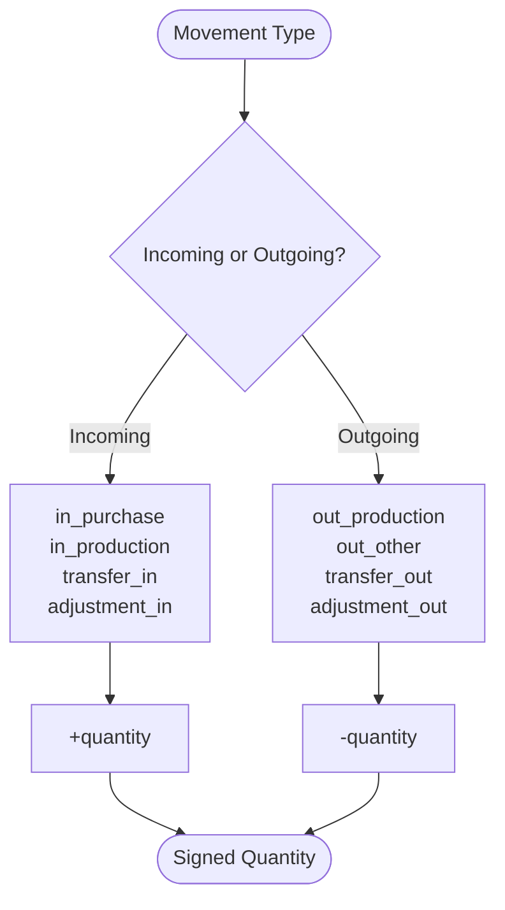
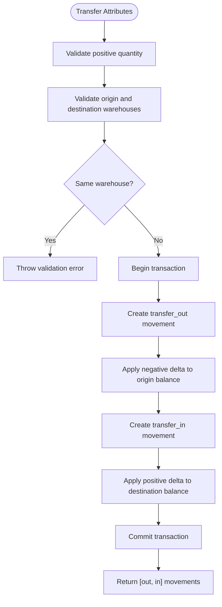
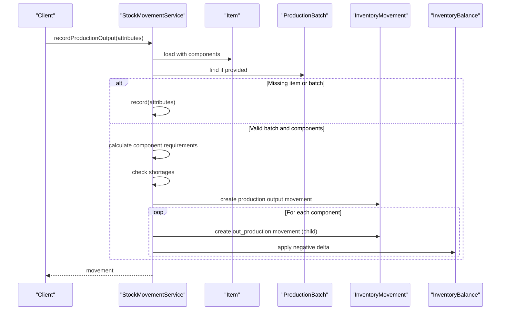
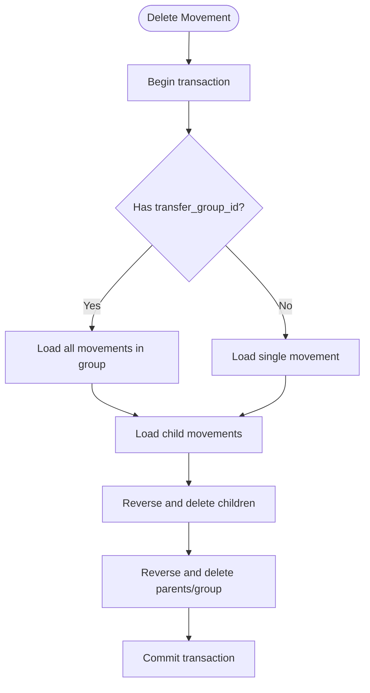
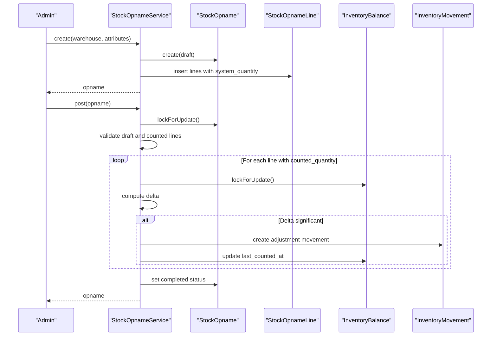
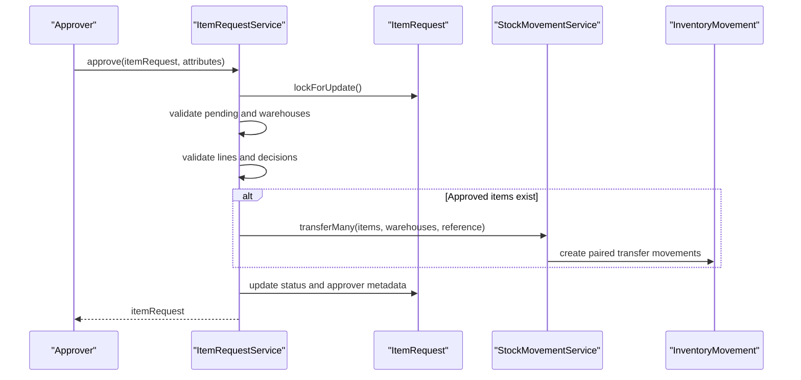
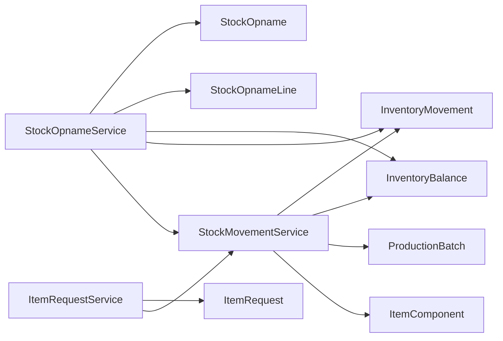

# Inventory Management

<cite>
**Referenced Files in This Document**   
- [Warehouse.php](file://app/Models/Warehouse.php)
- [InventoryBalance.php](file://app/Models/InventoryBalance.php)
- [InventoryMovement.php](file://app/Models/InventoryMovement.php)
- [StockMovementService.php](file://app/Services/StockMovementService.php)
- [StockOpnameService.php](file://app/Services/StockOpnameService.php)
- [StockOpname.php](file://app/Models/StockOpname.php)
- [StockOpnameLine.php](file://app/Models/StockOpnameLine.php)
- [ItemRequest.php](file://app/Models/ItemRequest.php)
- [ItemRequestService.php](file://app/Services/ItemRequestService.php)
- [ProductionBatch.php](file://app/Models/ProductionBatch.php)
- [2026_11_16_000001_create_warehouses_table.php](file://database/migrations/2026_11_16_000001_create_warehouses_table.php)
- [2026_11_16_000002_create_inventory_balances_table.php](file://database/migrations/2026_11_16_000002_create_inventory_balances_table.php)
- [2026_11_17_000005_create_inventory_movements_table.php](file://database/migrations/2026_11_17_000005_create_inventory_movements_table.php)
- [2026_11_19_000002_create_stock_opnames_table.php](file://database/migrations/2026_11_19_000002_create_stock_opnames_table.php)
- [2026_11_19_000003_create_stock_opname_lines_table.php](file://database/migrations/2026_11_19_000003_create_stock_opname_lines_table.php)
- [2026_11_19_000004_add_stock_opname_id_to_inventory_movements_table.php](file://database/migrations/2026_11_19_000004_add_stock_opname_id_to_inventory_movements_table.php)
</cite>

## Table of Contents
1. [Introduction](#introduction)
2. [Project Structure](#project-structure)
3. [Core Components](#core-components)
4. [Architecture Overview](#architecture-overview)
5. [Detailed Component Analysis](#detailed-component-analysis)
6. [Dependency Analysis](#dependency-analysis)
7. [Performance Considerations](#performance-considerations)
8. [Troubleshooting Guide](#troubleshooting-guide)
9. [Conclusion](#conclusion)

## Introduction
This document explains the Inventory Management module, focusing on multi-warehouse stock control, real-time balance tracking, and movement history. It covers:
- Warehouse model for location management
- InventoryBalance model for current stock levels per warehouse
- InventoryMovement model for transaction history
- StockMovementService for inventory calculations, validations, transfers, production integration, and deletions
- StockOpnameService for physical stock reconciliation
- Integration with Item Request and Production Batch modules for automatic inventory updates

The design separates read/write concerns: balances represent current state, while movements provide an immutable audit trail that drives balance changes through controlled services.

## Project Structure
The inventory domain is implemented as Eloquent models under `app/Models`, business logic under `app/Services`, and database schema under `database/migrations`. Filament resources and pages are present but not analyzed here; this document focuses on data models and services.

**Diagram sources**
- [Warehouse.php:27-35](file://app/Models/Warehouse.php#L27-L35)
- [InventoryBalance.php:37-45](file://app/Models/InventoryBalance.php#L37-L45)
- [InventoryMovement.php:62-95](file://app/Models/InventoryMovement.php#L62-L95)
- [StockOpname.php:54-67](file://app/Models/StockOpname.php#L54-L67)
- [StockOpnameLine.php:59-67](file://app/Models/StockOpnameLine.php#L59-L67)
- [ItemRequest.php:80-98](file://app/Models/ItemRequest.php#L80-L98)
- [ProductionBatch.php:59-82](file://app/Models/ProductionBatch.php#L59-L82)
- [StockMovementService.php:5-14](file://app/Services/StockMovementService.php#L5-L14)
- [StockOpnameService.php:5-11](file://app/Services/StockOpnameService.php#L5-L11)
- [ItemRequestService.php:5-12](file://app/Services/ItemRequestService.php#L5-L12)

**Section sources**
- [Warehouse.php:1-37](file://app/Models/Warehouse.php#L1-L37)
- [InventoryBalance.php:1-71](file://app/Models/InventoryBalance.php#L1-L71)
- [InventoryMovement.php:1-191](file://app/Models/InventoryMovement.php#L1-L191)
- [StockMovementService.php:1-398](file://app/Services/StockMovementService.php#L1-L398)
- [StockOpnameService.php:1-171](file://app/Services/StockOpnameService.php#L1-L171)
- [StockOpname.php:1-107](file://app/Models/StockOpname.php#L1-L107)
- [StockOpnameLine.php:1-94](file://app/Models/StockOpnameLine.php#L1-L94)
- [ItemRequest.php:1-135](file://app/Models/ItemRequest.php#L1-L135)
- [ItemRequestService.php:1-258](file://app/Services/ItemRequestService.php#L1-L258)
- [ProductionBatch.php:1-117](file://app/Models/ProductionBatch.php#L1-L117)

## Core Components
- Warehouse: represents a storage location with active/inactive status and relationships to balances and movements.
- InventoryBalance: tracks current stock per item per warehouse, including minimum quantity thresholds and last counted timestamp.
- InventoryMovement: records every stock change with type, quantity, timestamps, and references to production batches, stock opnames, item requests, and transfer groups.
- StockMovementService: central service for recording movements, applying deltas to balances, validating availability, handling transfers, production output, and safe deletion.
- StockOpnameService: manages stock opname documents, snapshots system quantities, posts adjustments, and locks documents during posting.
- ItemRequestService: approves or rejects item requests and triggers automatic stock transfers via StockMovementService.
- ProductionBatch: provides material and output warehouse context used by production output processing.

Key responsibilities:
- Multi-warehouse stock control: balances are scoped by warehouse and item.
- Real-time balance tracking: all writes go through services that update balances atomically.
- Movement history: every change is recorded with type, reference, and optional parent-child grouping.

**Section sources**
- [Warehouse.php:11-35](file://app/Models/Warehouse.php#L11-L35)
- [InventoryBalance.php:13-45](file://app/Models/InventoryBalance.php#L13-L45)
- [InventoryMovement.php:13-60](file://app/Models/InventoryMovement.php#L13-L60)
- [StockMovementService.php:18-60](file://app/Services/StockMovementService.php#L18-L60)
- [StockOpnameService.php:16-62](file://app/Services/StockOpnameService.php#L16-L62)
- [ItemRequestService.php:16-49](file://app/Services/ItemRequestService.php#L16-L49)
- [ProductionBatch.php:12-21](file://app/Models/ProductionBatch.php#L12-L21)

## Architecture Overview
The inventory architecture uses a strict separation between state (balances) and events (movements). Services encapsulate validation and atomic updates.

**Diagram sources**
- [StockMovementService.php:23-60](file://app/Services/StockMovementService.php#L23-L60)
- [StockMovementService.php:358-387](file://app/Services/StockMovementService.php#L358-L387)
- [InventoryMovement.php:161-179](file://app/Models/InventoryMovement.php#L161-L179)

## Detailed Component Analysis

### Warehouse Model
Purpose:
- Defines storage locations with code, name, address, and active flag.
- Provides relationships to inventory balances and movements.

Key behaviors:
- Boolean casting for active flag.
- HasMany relationships to balances and movements.

**Diagram sources**
- [Warehouse.php:27-35](file://app/Models/Warehouse.php#L27-L35)
- [InventoryBalance.php:37-69](file://app/Models/InventoryBalance.php#L37-L69)
- [InventoryMovement.php:62-95](file://app/Models/InventoryMovement.php#L62-L95)

**Section sources**
- [Warehouse.php:11-35](file://app/Models/Warehouse.php#L11-L35)

### InventoryBalance Model
Purpose:
- Tracks current stock level per item per warehouse.
- Supports low-stock detection and last counted timestamp.

Key behaviors:
- Decimal casting for quantities.
- Computed stock status attribute based on on-hand vs minimum.
- Scope for low stock queries.

Complexity considerations:
- Reads are O(1) per item-warehouse pair.
- Writes are protected by locking within services.

**Section sources**
- [InventoryBalance.php:13-69](file://app/Models/InventoryBalance.php#L13-L69)

### InventoryMovement Model
Purpose:
- Immutable audit trail for all inventory changes.
- Supports multiple movement types: purchase in, production in/out, other out, transfers, adjustments.

Key behaviors:
- Type constants and helpers for incoming/outgoing classification.
- Signed quantity helper for reporting.
- Parent-child relationship for production consumption lines.
- References to production batch, stock opname, item request, and transfer group.

**Diagram sources**
- [InventoryMovement.php:33-49](file://app/Models/InventoryMovement.php#L33-L49)
- [InventoryMovement.php:138-159](file://app/Models/InventoryMovement.php#L138-L159)
- [InventoryMovement.php:176-179](file://app/Models/InventoryMovement.php#L176-L179)

**Section sources**
- [InventoryMovement.php:13-60](file://app/Models/InventoryMovement.php#L13-L60)
- [InventoryMovement.php:102-179](file://app/Models/InventoryMovement.php#L102-L179)

### StockMovementService
Responsibilities:
- Record single movements and update balances atomically.
- Record production output with automatic material consumption.
- Transfer stock between warehouses with paired out/in movements.
- Bulk transfer many items with shortage checks.
- Safe deletion reversing movements and balances.
- Internal helpers for on-hand checks and delta application.

Validation and safety:
- Positive quantity enforcement.
- Origin/destination warehouse validation for transfers.
- Shortage checks before transfers and production output.
- Locking balances during updates to prevent race conditions.
- Deletion protection when downstream usage would break consistency.

**Diagram sources**
- [StockMovementService.php:147-201](file://app/Services/StockMovementService.php#L147-L201)
- [StockMovementService.php:358-387](file://app/Services/StockMovementService.php#L358-L387)

Production output flow:
- If a production batch is provided and the item has active components, it calculates required materials and deducts them from the material warehouse.
- Shortages are aggregated and thrown as validation errors.
- Material consumption movements are created as children of the production output movement.

**Diagram sources**
- [StockMovementService.php:68-139](file://app/Services/StockMovementService.php#L68-L139)
- [ProductionBatch.php:74-82](file://app/Models/ProductionBatch.php#L74-L82)

Deletion flow:
- Reverses child movements first, then parent movements.
- For transfer groups, reverses both out and in movements together.
- Validates that incoming movements can be reversed without causing negative balances.

**Diagram sources**
- [StockMovementService.php:296-344](file://app/Services/StockMovementService.php#L296-L344)

**Section sources**
- [StockMovementService.php:18-60](file://app/Services/StockMovementService.php#L18-L60)
- [StockMovementService.php:68-139](file://app/Services/StockMovementService.php#L68-L139)
- [StockMovementService.php:147-201](file://app/Services/StockMovementService.php#L147-L201)
- [StockMovementService.php:209-290](file://app/Services/StockMovementService.php#L209-L290)
- [StockMovementService.php:296-397](file://app/Services/StockMovementService.php#L296-L397)

### StockOpnameService
Responsibilities:
- Create stock opname documents and snapshot system quantities for stockable items.
- Post physical counts to generate adjustment movements and mark opname completed.
- Cancel draft opnames.

Creation process:
- Generates unique opname code per warehouse.
- Inserts stock opname lines for all stockable, non-variant items.
- Pre-populates system_quantity from current balances.

Posting process:
- Locks opname and validates draft status.
- Requires at least one line with physical count.
- Computes delta between counted and system quantity.
- Creates adjustment movements and updates balances.
- Marks opname completed and sets completion metadata.

**Diagram sources**
- [StockOpnameService.php:21-62](file://app/Services/StockOpnameService.php#L21-L62)
- [StockOpnameService.php:67-134](file://app/Services/StockOpnameService.php#L67-L134)
- [StockOpname.php:26-30](file://app/Models/StockOpname.php#L26-L30)
- [StockOpnameLine.php:39-57](file://app/Models/StockOpnameLine.php#L39-L57)

**Section sources**
- [StockOpnameService.php:16-62](file://app/Services/StockOpnameService.php#L16-L62)
- [StockOpnameService.php:67-134](file://app/Services/StockOpnameService.php#L67-L134)
- [StockOpnameService.php:139-155](file://app/Services/StockOpnameService.php#L139-L155)

### Item Request Integration
ItemRequestService coordinates approval workflows and triggers automatic stock transfers:
- Validates pending status and warehouse configuration.
- Ensures both origin and destination warehouses are active and distinct.
- Processes per-line approvals/rejections with required rejection notes.
- Calls StockMovementService.transferMany to move approved quantities.
- Updates line approval statuses and overall request status.

**Diagram sources**
- [ItemRequestService.php:22-186](file://app/Services/ItemRequestService.php#L22-L186)
- [StockMovementService.php:209-290](file://app/Services/StockMovementService.php#L209-L290)

**Section sources**
- [ItemRequestService.php:16-186](file://app/Services/ItemRequestService.php#L16-L186)
- [ItemRequest.php:31-39](file://app/Models/ItemRequest.php#L31-L39)
- [ItemRequest.php:80-98](file://app/Models/ItemRequest.php#L80-L98)

### Production Integration
ProductionBatch provides context for material and output warehouses. StockMovementService.recordProductionOutput:
- Loads item components and batch details.
- Calculates required material quantities scaled by output quantity.
- Checks available stock in the material warehouse.
- Records production output and consumes materials as child movements.

**Section sources**
- [StockMovementService.php:68-139](file://app/Services/StockMovementService.php#L68-L139)
- [ProductionBatch.php:12-21](file://app/Models/ProductionBatch.php#L12-L21)
- [ProductionBatch.php:74-82](file://app/Models/ProductionBatch.php#L74-L82)

## Dependency Analysis
High-level dependencies:
- StockMovementService depends on InventoryMovement, InventoryBalance, Item, ItemComponent, ProductionBatch, and Laravel DB transactions.
- StockOpnameService depends on StockOpname, StockOpnameLine, InventoryBalance, InventoryMovement, Item, Warehouse, and StockMovementService.
- ItemRequestService depends on ItemRequest, ItemRequestLine, ItemRequestSetting, Warehouse, and StockMovementService.
- Models define relationships to each other and to external entities like User and ProductionBatch.

**Diagram sources**
- [StockMovementService.php:5-14](file://app/Services/StockMovementService.php#L5-L14)
- [StockOpnameService.php:5-11](file://app/Services/StockOpnameService.php#L5-L11)
- [ItemRequestService.php:5-12](file://app/Services/ItemRequestService.php#L5-L12)

**Section sources**
- [StockMovementService.php:5-14](file://app/Services/StockMovementService.php#L5-L14)
- [StockOpnameService.php:5-11](file://app/Services/StockOpnameService.php#L5-L11)
- [ItemRequestService.php:5-12](file://app/Services/ItemRequestService.php#L5-L12)

## Performance Considerations
- Use of `lockForUpdate()` on balances prevents concurrent write conflicts during delta application.
- Chunked insertion of stock opname lines improves performance for large item catalogs.
- Indexes on movements (item, warehouse, occurred_at), production batch, and transfer group support efficient querying and reporting.
- Decimal precision is consistently applied to avoid rounding issues across quantities.

Recommendations:
- Keep movement records immutable; prefer reversal or new adjustments rather than direct edits.
- Batch operations where possible (e.g., transferMany) to reduce transaction overhead.
- Monitor long-running stock opname postings; consider queuing for very large inventories.

[No sources needed since this section provides general guidance]

## Troubleshooting Guide
Common issues and resolutions:
- Insufficient stock during transfers or production output:
  - Ensure origin warehouse has sufficient on-hand quantity.
  - Review shortage messages returned by services.
- Attempting to delete movements that have been consumed:
  - Deletion is blocked if reversing an incoming movement would cause negative balances.
  - Resolve downstream usage before deletion.
- Invalid warehouse selection:
  - Origin and destination must be different and active.
  - Configure Item Request settings to ensure valid default warehouses.
- Posting stock opname fails:
  - At least one line must have a physical count.
  - Only draft opnames can be posted or cancelled.

**Section sources**
- [StockMovementService.php:358-387](file://app/Services/StockMovementService.php#L358-L387)
- [StockMovementService.php:296-344](file://app/Services/StockMovementService.php#L296-L344)
- [StockOpnameService.php:67-134](file://app/Services/StockOpnameService.php#L67-L134)
- [ItemRequestService.php:32-56](file://app/Services/ItemRequestService.php#L32-L56)

## Conclusion
The Inventory Management module provides robust multi-warehouse stock control through clear separation of state and events. InventoryBalance maintains current stock levels, while InventoryMovement captures the complete audit trail. StockMovementService enforces validation and atomic updates, supporting transfers, production integration, and safe deletions. StockOpnameService enables accurate physical reconciliation with adjustment movements. Integrations with Item Request and Production Batch automate inventory updates, ensuring consistency across the system.

[No sources needed since this section summarizes without analyzing specific files]