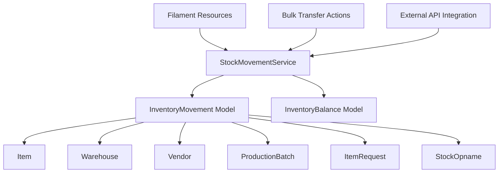
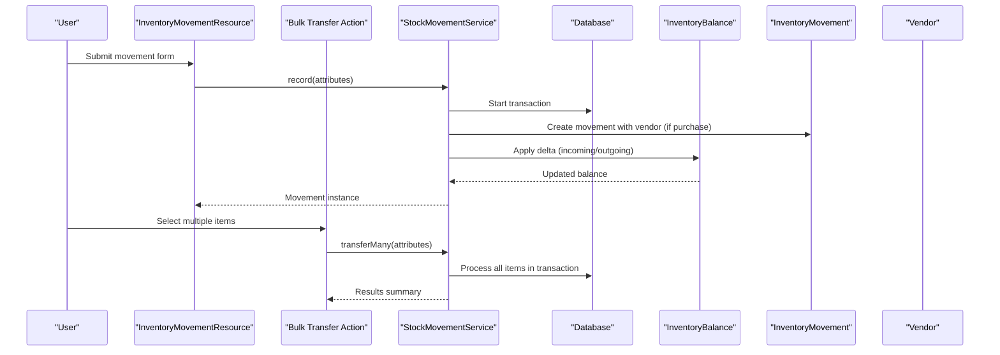
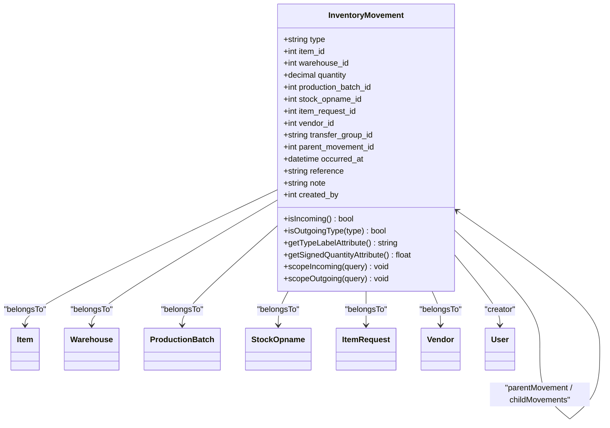
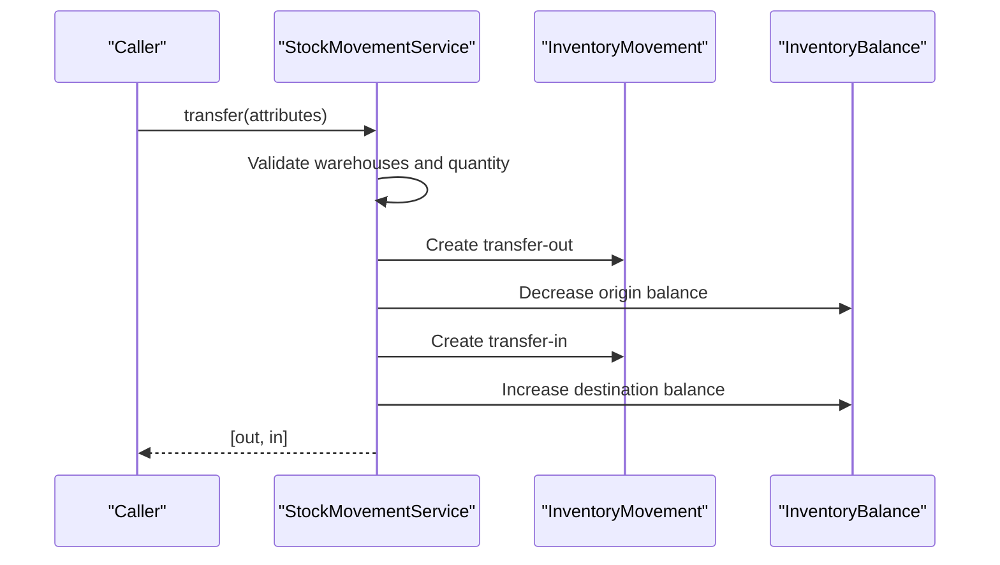
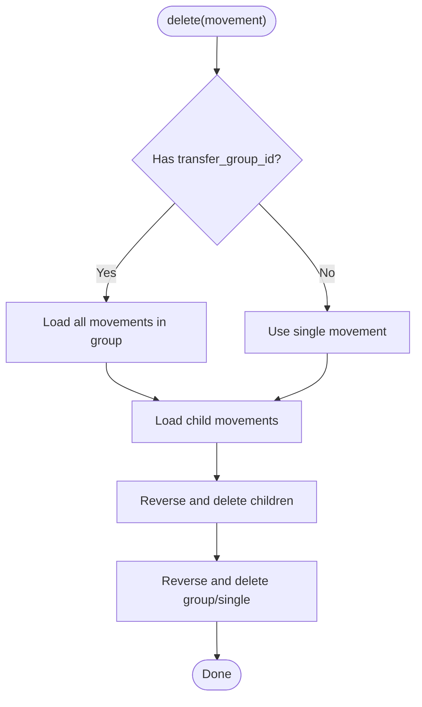
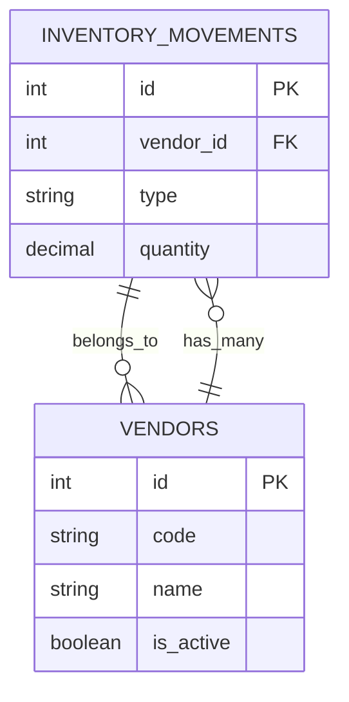
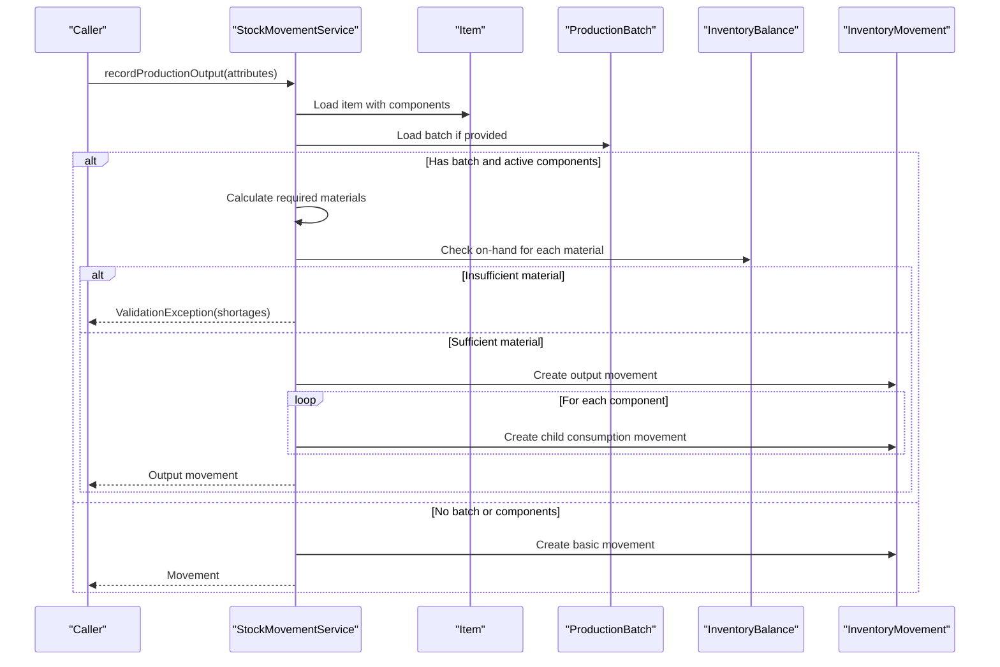
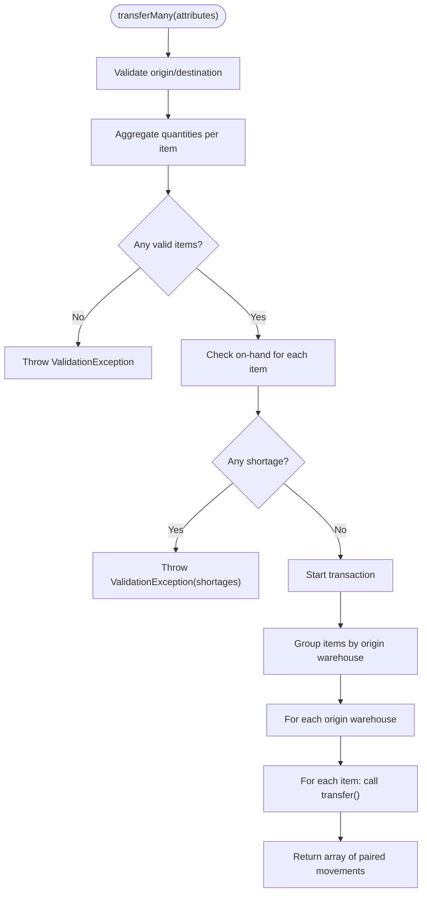
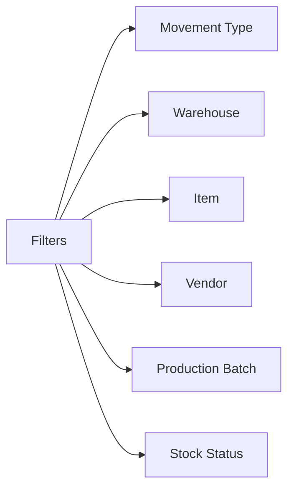
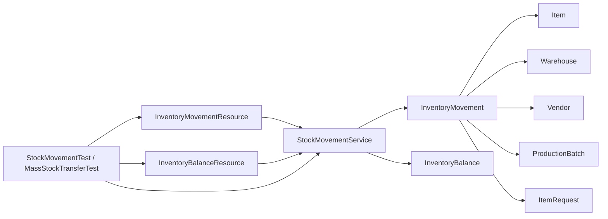

# Inventory Movement Processing

<cite>
**Referenced Files in This Document**   
- [InventoryMovement.php](file://app/Models/InventoryMovement.php)
- [StockMovementService.php](file://app/Services/StockMovementService.php)
- [Vendor.php](file://app/Models/Vendor.php)
- [InventoryMovementResource.php](file://app/Filament/Resources/InventoryMovements/InventoryMovementResource.php)
- [InventoryBalanceResource.php](file://app/Filament/Resources/InventoryBalances/InventoryBalanceResource.php)
- [StockCard.php](file://app/Filament/Pages/StockCard.php)
- [ListInventoryMovements.php](file://app/Filament/Resources/InventoryMovements/Pages/ListInventoryMovements.php)
- [StockMovementTest.php](file://tests/Feature/StockMovementTest.php)
- [MassStockTransferTest.php](file://tests/Feature/MassStockTransferTest.php)
- [2026_11_26_000003_add_vendor_id_to_inventory_movements_table.php](file://database/migrations/2026_11_26_000003_add_vendor_id_to_inventory_movements_table.php)
</cite>

## Update Summary
**Changes Made**   
- Enhanced production batch integration with automatic material consumption and external API support
- Added comprehensive bulk transfer actions for multiple items across different warehouses
- Improved filtering capabilities for inventory movements and stock cards
- Added component consumption preview and material shortage validation
- Enhanced external production output integration with batch and variant selection
- **Added vendor tracking for purchase transactions with foreign key relationship and restrictive delete behavior**
- **Implemented conditional form visibility for incoming purchase types with vendor field**

## Table of Contents
1. [Introduction](#introduction)
2. [Project Structure](#project-structure)
3. [Core Components](#core-components)
4. [Architecture Overview](#architecture-overview)
5. [Detailed Component Analysis](#detailed-component-analysis)
6. [Vendor Tracking Integration](#vendor-tracking-integration)
7. [Production Batch Integration](#production-batch-integration)
8. [Bulk Transfer Operations](#bulk-transfer-operations)
9. [Enhanced Filtering Capabilities](#enhanced-filtering-capabilities)
10. [Dependency Analysis](#dependency-analysis)
11. [Performance Considerations](#performance-considerations)
12. [Troubleshooting Guide](#troubleshooting-guide)
13. [Conclusion](#conclusion)

## Introduction
This document explains how inventory movement processing works in the system. It focuses on the `InventoryMovement` model, which records every stock transaction, and the `StockMovementService`, which validates, creates, and processes movements such as purchases, production output, material consumption, warehouse transfers, adjustments, and deletions. The system now features enhanced production batch integration with automatic material consumption, comprehensive bulk transfer operations, improved filtering capabilities, and vendor tracking for purchase transactions to provide complete supply chain traceability.

## Project Structure
The inventory movement domain is implemented across:
- A core Eloquent model for movement records with enhanced relationships including vendor tracking.
- A service layer that encapsulates business rules, balance updates, and complex workflows.
- Database migrations defining the movement schema and vendor relationships with restrictive delete behavior.
- Filament resources providing user-facing forms, tables, filters, and conditional field visibility.
- Feature tests validating movement behavior, vendor tracking, transfers, production consumption, and UI flows.

**Diagram sources**
- [InventoryMovementResource.php:45-59](file://app/Filament/Resources/InventoryMovements/InventoryMovementResource.php#L45-L59)
- [InventoryBalanceResource.php:43-57](file://app/Filament/Resources/InventoryBalances/InventoryBalanceResource.php#L43-L57)
- [StockMovementService.php:16-17](file://app/Services/StockMovementService.php#L16-L17)

**Section sources**
- [InventoryMovement.php:1-202](file://app/Models/InventoryMovement.php#L1-L202)
- [StockMovementService.php:1-401](file://app/Services/StockMovementService.php#L1-L401)
- [InventoryMovementResource.php:1-602](file://app/Filament/Resources/InventoryMovements/InventoryMovementResource.php#L1-L602)
- [InventoryBalanceResource.php:1-445](file://app/Filament/Resources/InventoryBalances/InventoryBalanceResource.php#L1-L445)

## Core Components
- `InventoryMovement`: Represents a single stock change with type, item, warehouse, quantity, timestamps, references, optional links to production batches, stock opnames, item requests, parent movements, transfer groups, and vendors for purchase tracking.
- `StockMovementService`: Encapsulates validation, creation, transfer logic, production output handling, batch operations, reversal, and safe deletion.
- `InventoryBalance`: Tracks current stock per item and warehouse; updated atomically by the service.
- `ProductionBatch`: Provides batch context for production output and material warehouse selection.
- `ItemRequest`: Links movements to approved or processed item requests.
- `Vendor`: Represents suppliers for purchase transactions with active/inactive status management.

Key responsibilities:
- Record incoming and outgoing movements safely with vendor attribution for purchases.
- Enforce positive quantities and non-negative balances.
- Create paired transfer movements with grouping.
- Automatically consume materials based on active item components when recording production output.
- Support deletion with full reversal and group-aware cleanup.
- Handle bulk operations across multiple items and warehouses.
- Track purchase transactions with vendor information and restrict inactive vendor selection.

**Section sources**
- [InventoryMovement.php:13-100](file://app/Models/InventoryMovement.php#L13-L100)
- [StockMovementService.php:16-60](file://app/Services/StockMovementService.php#L16-L60)
- [Vendor.php:11-31](file://app/Models/Vendor.php#L11-L31)

## Architecture Overview
The movement lifecycle flows through the Filament resource into the service, which persists an `InventoryMovement` and updates `InventoryBalance`. Purchase transactions include vendor attribution, while production output may create additional child movements for material consumption. Transfers create paired out/in movements grouped by UUID. Bulk transfers handle multiple items efficiently. Deletion reverses deltas and removes related movements.

**Diagram sources**
- [InventoryMovementResource.php:61-285](file://app/Filament/Resources/InventoryMovements/InventoryMovementResource.php#L61-L285)
- [InventoryBalanceResource.php:230-419](file://app/Filament/Resources/InventoryBalances/InventoryBalanceResource.php#L230-L419)
- [StockMovementService.php:23-60](file://app/Services/StockMovementService.php#L23-L60)

## Detailed Component Analysis

### InventoryMovement Model
The model defines movement types, direction helpers, labels, and relationships including vendor tracking.

- Movement types:
  - Incoming: purchase, production output, transfer-in, adjustment-in.
  - Outgoing: production consumption, other-out, transfer-out, adjustment-out.
- Direction helpers:
  - `isIncoming()` classifies movement direction.
  - `isOutgoingType()` checks if a given type is outgoing.
- Signed quantity:
  - `getSignedQuantityAttribute()` returns negative values for outgoing movements.
- Relationships:
  - Belongs to item, warehouse, production batch, stock opname, item request, creator user, and vendor.
  - Parent-child relationship via `parent_movement_id` for automatic material consumption lines.
  - Transfer grouping via `transfer_group_id`.

**Diagram sources**
- [InventoryMovement.php:28-100](file://app/Models/InventoryMovement.php#L28-L100)
- [InventoryMovement.php:105-201](file://app/Models/InventoryMovement.php#L105-L201)

**Section sources**
- [InventoryMovement.php:33-50](file://app/Models/InventoryMovement.php#L33-L50)
- [InventoryMovement.php:105-201](file://app/Models/InventoryMovement.php#L105-L201)

### StockMovementService Methods

#### Basic Movement Recording
- Validates positive quantity.
- Persists movement within a database transaction.
- Applies signed delta to `InventoryBalance`.
- Defaults timestamp and creator when not provided.
- Supports vendor attribution for purchase transactions.

Validation rules:
- Quantity must be greater than zero.
- Outgoing movements cannot reduce balance below zero.

Error handling:
- Throws `ValidationException` with localized messages for insufficient stock or invalid quantity.

**Diagram sources**
- [StockMovementService.php:23-60](file://app/Services/StockMovementService.php#L23-L60)

**Section sources**
- [StockMovementService.php:23-60](file://app/Services/StockMovementService.php#L23-L60)

#### Warehouse Transfer
- Requires distinct origin and destination warehouses.
- Creates paired movements:
  - Transfer-out from origin.
  - Transfer-in to destination.
- Assigns a shared `transfer_group_id` to both movements.
- Updates balances atomically within a transaction.

Validation rules:
- Origin and destination must be provided and different.
- Outgoing transfer cannot exceed available stock.

**Diagram sources**
- [StockMovementService.php:147-201](file://app/Services/StockMovementService.php#L147-L201)

**Section sources**
- [StockMovementService.php:147-201](file://app/Services/StockMovementService.php#L147-L201)

#### Deletion and Reversal
- Deletes a movement and reverses its balance effect.
- If part of a transfer group, deletes both paired movements.
- Deletes child consumption movements first, then parent movements.
- Prevents deletion of incoming movements if reversing would make balance negative.

Validation rules:
- Cannot delete incoming movement if stock is already consumed beyond reversal capacity.

**Diagram sources**
- [StockMovementService.php:296-344](file://app/Services/StockMovementService.php#L296-L344)

**Section sources**
- [StockMovementService.php:296-344](file://app/Services/StockMovementService.php#L296-L344)

## Vendor Tracking Integration

### Vendor Relationship and Foreign Key Constraints
The system now includes comprehensive vendor tracking for purchase transactions:

- **Foreign Key Relationship**: `vendor_id` column added to `inventory_movements` table with restrictive delete behavior.
- **Model Relationship**: `InventoryMovement` has a `belongsTo(Vendor::class)` relationship.
- **Vendor Model**: Includes `hasMany(InventoryMovement::class)` relationship for bidirectional access.
- **Restrictive Delete Behavior**: Prevents deletion of vendors that have associated purchase transactions.

Database schema changes:
- Added `vendor_id` nullable foreign key column after `item_request_id`.
- Configured `restrictOnDelete()` to prevent vendor deletion when linked to movements.
- Maintains referential integrity while allowing null values for non-purchase transactions.

**Diagram sources**
- [2026_11_26_000003_add_vendor_id_to_inventory_movements_table.php:11-17](file://database/migrations/2026_11_26_000003_add_vendor_id_to_inventory_movements_table.php#L11-L17)
- [InventoryMovement.php:88-91](file://app/Models/InventoryMovement.php#L88-L91)
- [Vendor.php:27-31](file://app/Models/Vendor.php#L27-L31)

### Conditional Form Visibility
The Filament interface provides conditional vendor field visibility:

- **Purchase Type Only**: Vendor field is only visible when transaction type is `TYPE_IN_PURCHASE`.
- **Active Vendors Only**: Form queries only active vendors (`where('is_active', true)`).
- **Searchable Interface**: Vendor field supports search by code and name with preload functionality.
- **Helper Text**: Provides guidance about supplier selection for purchase transactions.

Form behavior:
- Vendor field automatically hides when changing from purchase to other transaction types.
- Inactive vendors are filtered out from form selection but remain filterable in lists.
- Changing transaction type clears hidden vendor field to prevent data leakage.

**Section sources**
- [InventoryMovementResource.php:95-106](file://app/Filament/Resources/InventoryMovements/InventoryMovementResource.php#L95-L106)
- [StockMovementTest.php:230-250](file://tests/Feature/StockMovementTest.php#L230-L250)
- [StockMovementTest.php:252-277](file://tests/Feature/StockMovementTest.php#L252-L277)

### Vendor Filtering and Display
The system supports comprehensive vendor-based operations:

- **Table Column**: Vendor name displayed in movement list with placeholder for non-purchase transactions.
- **Filter Support**: Movements can be filtered by vendor, including inactive vendors.
- **Bidirectional Access**: Easy navigation from vendor to their purchase movements and vice versa.
- **Code Display**: Vendor codes displayed alongside names in form selections for better identification.

**Section sources**
- [InventoryMovementResource.php:345-349](file://app/Filament/Resources/InventoryMovements/InventoryMovementResource.php#L345-L349)
- [InventoryMovementResource.php:380-384](file://app/Filament/Resources/InventoryMovements/InventoryMovementResource.php#L380-L384)
- [StockMovementTest.php:279-290](file://tests/Feature/StockMovementTest.php#L279-L290)

## Production Batch Integration

### Automatic Material Consumption
When a production batch is selected and the product has active components:
- Calculates required material quantities based on component ratios and output quantity.
- Checks available stock in the batch's material warehouse.
- If any material is short, throws a validation error listing shortages.
- Creates the production output movement and linked child movements for each consumed material.
- Sets `parent_movement_id` to link consumption lines to the output line.

Business logic highlights:
- Uses active components only.
- Rounds material requirements to three decimal places.
- Falls back to basic recording when no batch or components are present.
- Supports disabling automatic consumption via `consume_components` toggle.

**Diagram sources**
- [StockMovementService.php:68-139](file://app/Services/StockMovementService.php#L68-L139)

**Section sources**
- [StockMovementService.php:68-139](file://app/Services/StockMovementService.php#L68-L139)

### External API Integration
The system supports pulling production output from external APIs:
- Integrates with external barang API to fetch finished goods.
- Supports batch-based or variant-based selection.
- Maps external variants to internal items.
- Creates movements and tracks synced external units.
- Handles date ranges and status filtering.

Form behaviors:
- Shows external mode fields when source_external is enabled.
- Displays real-time previews of available units.
- Allows manual quantity adjustment for batch pulls.
- Provides detailed component consumption previews with stock status indicators.

**Section sources**
- [InventoryMovementResource.php:73-270](file://app/Filament/Resources/InventoryMovements/InventoryMovementResource.php#L73-L270)
- [InventoryMovementResource.php:390-581](file://app/Filament/Resources/InventoryMovements/InventoryMovementResource.php#L390-L581)

## Bulk Transfer Operations

### Multi-Item Transfer System
The bulk transfer system allows transferring multiple items from different origin warehouses to a single destination:
- Accepts multiple items with quantities.
- Aggregates quantities per item and origin warehouse.
- Validates stock availability across all items before committing.
- Generates paired movements per item with a generated reference.
- Each item batch gets its own transfer group.
- Groups items by origin warehouse for efficient processing.

Validation rules:
- At least one valid item with positive quantity.
- All items must have sufficient stock; otherwise, roll back entire operation.
- Destination warehouse must be different from all origin warehouses.

**Diagram sources**
- [StockMovementService.php:209-290](file://app/Services/StockMovementService.php#L209-L290)

**Section sources**
- [StockMovementService.php:209-290](file://app/Services/StockMovementService.php#L209-L290)

### Filament Bulk Transfer Interface
The Filament interface provides a comprehensive bulk transfer experience:
- Selectable table rows with visual indicators.
- Modal dialog with destination warehouse selection.
- Editable quantities with real-time validation.
- Automatic grouping by origin warehouse.
- Progress feedback and error handling.
- Success notifications with summary statistics.

**Section sources**
- [InventoryBalanceResource.php:230-419](file://app/Filament/Resources/InventoryBalances/InventoryBalanceResource.php#L230-L419)

## Enhanced Filtering Capabilities

### Inventory Movements Filtering
The inventory movements list includes comprehensive filtering options:
- Type filter for movement categories.
- Warehouse filter for location-based queries.
- Item filter for product-specific searches.
- **Vendor filter for supplier-based tracking**.
- Production batch filter for batch-specific tracking.
- Searchable and preloaded dropdowns for performance.

### Stock Card Filtering
The stock card page provides advanced filtering:
- Item filter for specific product tracking.
- Warehouse filter for location-based views.
- Production batch filter for batch-specific analysis.
- Running balance calculations with window functions.
- Real-time balance updates based on movement history.

**Diagram sources**
- [InventoryMovementResource.php:345-362](file://app/Filament/Resources/InventoryMovements/InventoryMovementResource.php#L345-L362)
- [StockCard.php:104-122](file://app/Filament/Pages/StockCard.php#L104-L122)
- [InventoryBalanceResource.php:210-215](file://app/Filament/Resources/InventoryBalances/InventoryBalanceResource.php#L210-L215)

**Section sources**
- [InventoryMovementResource.php:345-362](file://app/Filament/Resources/InventoryMovements/InventoryMovementResource.php#L345-L362)
- [StockCard.php:104-122](file://app/Filament/Pages/StockCard.php#L104-L122)
- [InventoryBalanceResource.php:82-101](file://app/Filament/Resources/InventoryBalances/InventoryBalanceResource.php#L82-L101)

## Dependency Analysis
The service depends on models and uses transactions to ensure consistency. The resource depends on the service for persistence and validation. Tests validate both programmatic and UI-driven flows. The bulk transfer system integrates with the Filament framework for user interaction. Vendor tracking adds another dependency layer for purchase transaction management.

**Diagram sources**
- [InventoryMovementResource.php:45-59](file://app/Filament/Resources/InventoryMovements/InventoryMovementResource.php#L45-L59)
- [InventoryBalanceResource.php:43-57](file://app/Filament/Resources/InventoryBalances/InventoryBalanceResource.php#L43-L57)
- [StockMovementService.php:16-17](file://app/Services/StockMovementService.php#L16-L17)

**Section sources**
- [StockMovementService.php:16-60](file://app/Services/StockMovementService.php#L16-L60)
- [InventoryMovementResource.php:45-59](file://app/Filament/Resources/InventoryMovements/InventoryMovementResource.php#L45-L59)
- [InventoryBalanceResource.php:43-57](file://app/Filament/Resources/InventoryBalances/InventoryBalanceResource.php#L43-L57)

## Performance Considerations
- Transactions: All movement creation, transfer, and deletion operations use database transactions to maintain consistency.
- Locking: Balance updates use row locking to prevent race conditions during concurrent writes.
- Indexing: Composite indexes on item, warehouse, and occurrence time support common queries like stock cards and movement histories.
- Precision: Quantities are stored with three decimal places to avoid rounding issues in production calculations.
- Bulk Operations: Bulk transfers process items efficiently by grouping by origin warehouse and using single transactions.
- Query Optimization: Filters use eager loading and indexed relationships for optimal performance.
- **Vendor Queries**: Active vendor filtering reduces query overhead in forms while maintaining full vendor access in reports.

Recommendations:
- Keep movement queries scoped by item, warehouse, and date ranges for optimal performance.
- Use batched operations where possible to reduce round trips.
- Monitor lock contention under high concurrency and consider queueing heavy background jobs if needed.
- Leverage the bulk transfer system for large-scale warehouse reorganizations.
- Utilize vendor filtering for supply chain analysis and reporting.

## Troubleshooting Guide
Common issues and resolutions:
- Insufficient stock on outgoing movement:
  - Cause: Attempting to decrease balance below zero.
  - Resolution: Verify available stock and adjust quantity or source warehouse.
- Invalid quantity:
  - Cause: Zero or negative quantity submitted.
  - Resolution: Ensure quantity is greater than zero.
- Transfer validation errors:
  - Cause: Missing or identical origin/destination warehouses.
  - Resolution: Provide distinct warehouses for transfer.
- Mass transfer rollback:
  - Cause: One item lacks sufficient stock.
  - Resolution: Correct quantities or stock levels; retry the batch.
- Deletion blocked:
  - Cause: Reversing an incoming movement would make balance negative.
  - Resolution: Reverse downstream outgoing movements first or adjust stock.
- Material shortage in production:
  - Cause: Insufficient materials in batch warehouse.
  - Resolution: Check material stock levels or adjust production quantity.
- Bulk transfer destination conflicts:
  - Cause: Destination warehouse matches an origin warehouse.
  - Resolution: Select a different destination warehouse.
- **Inactive vendor selection**:
  - Cause: Attempting to select inactive vendor for purchase transaction.
  - Resolution: Select an active vendor or activate the vendor first.
- **Vendor deletion prevention**:
  - Cause: Trying to delete vendor with associated purchase transactions.
  - Resolution: Remove or reassign purchase transactions before deleting vendor.

Evidence from tests:
- Outgoing movement rejection when stock is insufficient.
- Deletion of already-consumed incoming movement shows a clear error message.
- Mass transfer rolls back entirely when any item is short.
- Production output validation prevents material shortages.
- Bulk transfer validation ensures destination warehouse uniqueness.
- **Inactive vendor cannot be selected for new purchase transactions**.
- **Changing transaction type does not save hidden vendor field**.
- **Transactions can be filtered by vendor even when inactive**.

**Section sources**
- [StockMovementService.php:321-344](file://app/Services/StockMovementService.php#L321-L344)
- [StockMovementService.php:358-387](file://app/Services/StockMovementService.php#L358-L387)
- [StockMovementTest.php:70-84](file://tests/Feature/StockMovementTest.php#L70-L84)
- [StockMovementTest.php:750-778](file://tests/Feature/StockMovementTest.php#L750-L778)
- [MassStockTransferTest.php:64-99](file://tests/Feature/MassStockTransferTest.php#L64-L99)
- [StockMovementTest.php:230-250](file://tests/Feature/StockMovementTest.php#L230-L250)
- [StockMovementTest.php:252-277](file://tests/Feature/StockMovementTest.php#L252-L277)
- [StockMovementTest.php:279-290](file://tests/Feature/StockMovementTest.php#L279-L290)

## Conclusion
The inventory movement system centers on a robust `InventoryMovement` model and a comprehensive `StockMovementService`. Recent enhancements include sophisticated production batch integration with automatic material consumption and external API support, comprehensive bulk transfer operations for efficient multi-item warehouse management, improved filtering capabilities for better data exploration, and comprehensive vendor tracking for purchase transactions. The vendor tracking feature provides complete supply chain traceability with foreign key relationships, restrictive delete behavior, and conditional form visibility. The system enforces strict validation, supports complex workflows like production output with automatic material consumption, and ensures data integrity through transactions and locking. The Filament integration offers intuitive forms, tables, and bulk actions, while feature tests confirm correctness across single and batch operations. With clear audit fields, indexed queries, enhanced user interfaces, and vendor attribution capabilities, the system provides reliable tracking, reporting, and operational capabilities for all stock transactions.