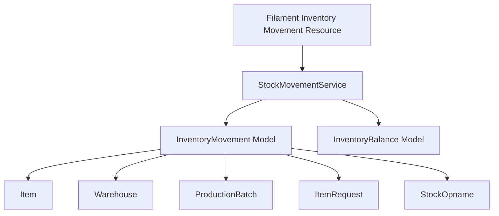
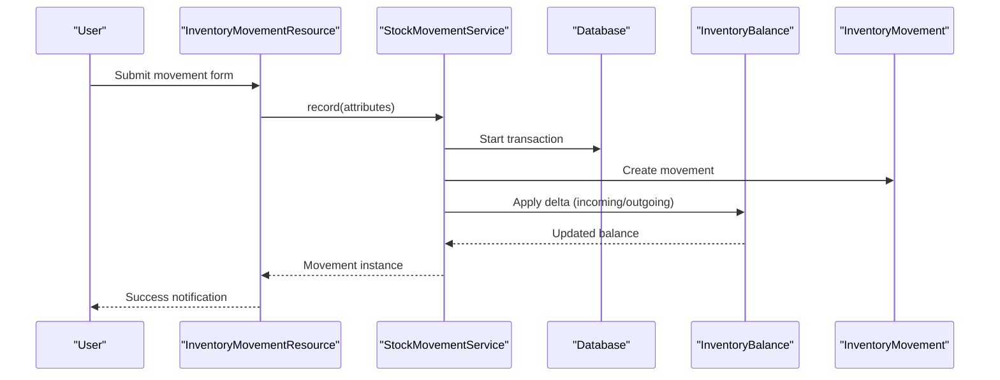
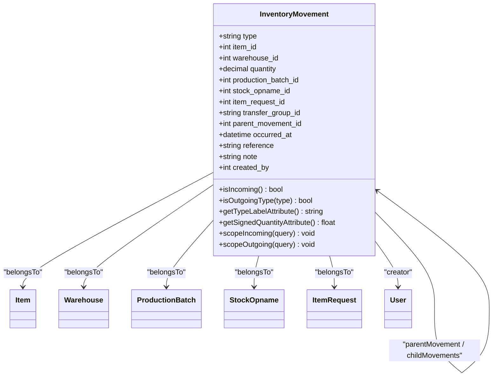
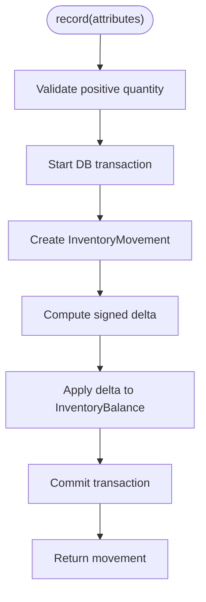
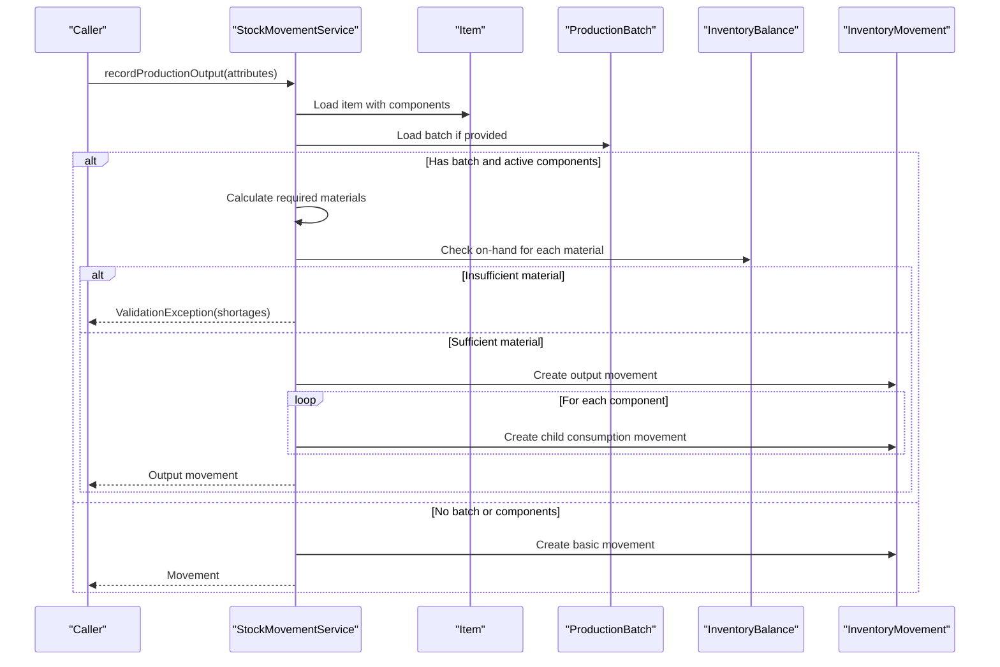
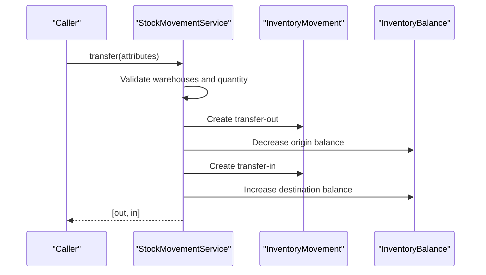
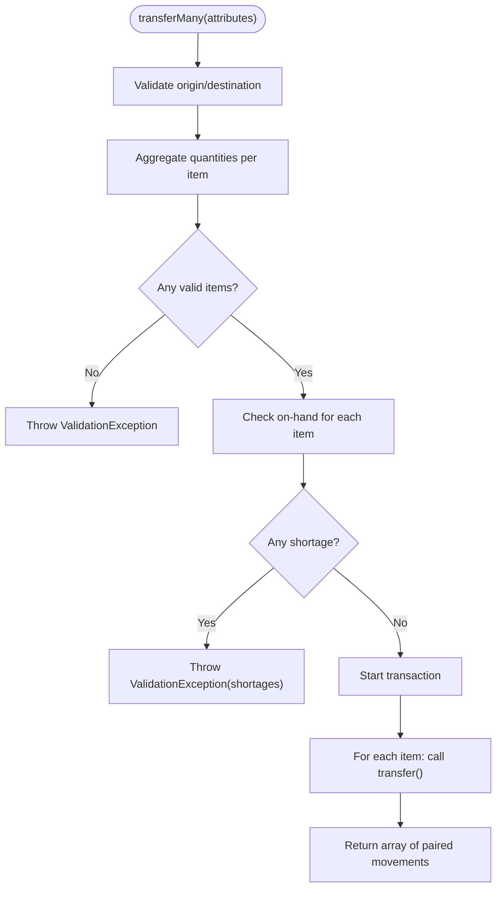
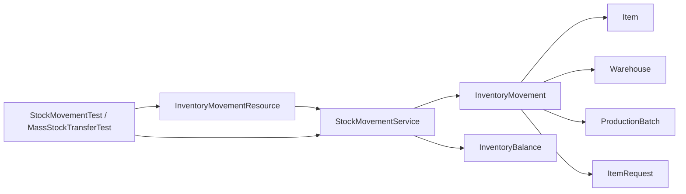

# Inventory Movement Processing

<cite>
**Referenced Files in This Document**   
- [InventoryMovement.php](file://app/Models/InventoryMovement.php)
- [StockMovementService.php](file://app/Services/StockMovementService.php)
- [InventoryBalance.php](file://app/Models/InventoryBalance.php)
- [ProductionBatch.php](file://app/Models/ProductionBatch.php)
- [ItemRequest.php](file://app/Models/ItemRequest.php)
- [2026_11_17_000005_create_inventory_movements_table.php](file://database/migrations/2026_11_17_000005_create_inventory_movements_table.php)
- [2026_11_18_000001_add_parent_movement_id_to_inventory_movements_table.php](file://database/migrations/2026_11_18_000001_add_parent_movement_id_to_inventory_movements_table.php)
- [2026_11_19_000004_add_stock_opname_id_to_inventory_movements_table.php](file://database/migrations/2026_11_19_000004_add_stock_opname_id_to_inventory_movements_table.php)
- [2026_11_19_000011_add_item_request_id_to_inventory_movements_table.php](file://database/migrations/2026_11_19_000011_add_item_request_id_to_inventory_movements_table.php)
- [InventoryMovementResource.php](file://app/Filament/Resources/InventoryMovements/InventoryMovementResource.php)
- [StockMovementTest.php](file://tests/Feature/StockMovementTest.php)
- [MassStockTransferTest.php](file://tests/Feature/MassStockTransferTest.php)
</cite>

## Table of Contents
1. [Introduction](#introduction)
2. [Project Structure](#project-structure)
3. [Core Components](#core-components)
4. [Architecture Overview](#architecture-overview)
5. [Detailed Component Analysis](#detailed-component-analysis)
6. [Dependency Analysis](#dependency-analysis)
7. [Performance Considerations](#performance-considerations)
8. [Troubleshooting Guide](#troubleshooting-guide)
9. [Conclusion](#conclusion)

## Introduction
This document explains how inventory movement processing works in the system. It focuses on the `InventoryMovement` model, which records every stock transaction, and the `StockMovementService`, which validates, creates, and processes movements such as purchases, production output, material consumption, warehouse transfers, adjustments, and deletions. It also covers integration points with production batches and item requests, audit trail fields, and movement history queries.

## Project Structure
The inventory movement domain is implemented across:
- A core Eloquent model for movement records.
- A service layer that encapsulates business rules and balance updates.
- Database migrations defining the movement schema and relationships.
- Filament resources providing user-facing forms, tables, filters, and deletion actions.
- Feature tests validating movement behavior, transfers, production consumption, and UI flows.

**Diagram sources**
- [InventoryMovementResource.php:38-163](file://app/Filament/Resources/InventoryMovements/InventoryMovementResource.php#L38-L163)
- [StockMovementService.php:16-60](file://app/Services/StockMovementService.php#L16-L60)
- [InventoryMovement.php:28-100](file://app/Models/InventoryMovement.php#L28-L100)

**Section sources**
- [InventoryMovement.php:1-191](file://app/Models/InventoryMovement.php#L1-L191)
- [StockMovementService.php:1-398](file://app/Services/StockMovementService.php#L1-L398)
- [InventoryMovementResource.php:1-340](file://app/Filament/Resources/InventoryMovements/InventoryMovementResource.php#L1-L340)

## Core Components
- `InventoryMovement`: Represents a single stock change with type, item, warehouse, quantity, timestamps, references, and optional links to production batches, stock opnames, item requests, parent movements, and transfer groups.
- `StockMovementService`: Encapsulates validation, creation, transfer logic, production output handling, batch operations, reversal, and safe deletion.
- `InventoryBalance`: Tracks current stock per item and warehouse; updated atomically by the service.
- `ProductionBatch`: Provides batch context for production output and material warehouse selection.
- `ItemRequest`: Links movements to approved or processed item requests.

Key responsibilities:
- Record incoming and outgoing movements safely.
- Enforce positive quantities and non-negative balances.
- Create paired transfer movements with grouping.
- Automatically consume materials based on active item components when recording production output.
- Support deletion with full reversal and group-aware cleanup.

**Section sources**
- [InventoryMovement.php:13-100](file://app/Models/InventoryMovement.php#L13-L100)
- [StockMovementService.php:16-60](file://app/Services/StockMovementService.php#L16-L60)
- [InventoryBalance.php:13-45](file://app/Models/InventoryBalance.php#L13-L45)
- [ProductionBatch.php:12-82](file://app/Models/ProductionBatch.php#L12-L82)
- [ItemRequest.php:12-88](file://app/Models/ItemRequest.php#L12-L88)

## Architecture Overview
The movement lifecycle flows through the Filament resource into the service, which persists an `InventoryMovement` and updates `InventoryBalance`. Production output may create additional child movements for material consumption. Transfers create paired out/in movements grouped by UUID. Deletion reverses deltas and removes related movements.

**Diagram sources**
- [InventoryMovementResource.php:54-163](file://app/Filament/Resources/InventoryMovements/InventoryMovementResource.php#L54-L163)
- [StockMovementService.php:23-60](file://app/Services/StockMovementService.php#L23-L60)
- [InventoryMovement.php:28-100](file://app/Models/InventoryMovement.php#L28-L100)

## Detailed Component Analysis

### InventoryMovement Model
The model defines movement types, direction helpers, labels, and relationships.

- Movement types:
  - Incoming: purchase, production output, transfer-in, adjustment-in.
  - Outgoing: production consumption, other-out, transfer-out, adjustment-out.
- Direction helpers:
  - `isIncoming()` classifies movement direction.
  - `isOutgoingType()` checks if a given type is outgoing.
- Signed quantity:
  - `getSignedQuantityAttribute()` returns negative values for outgoing movements.
- Relationships:
  - Belongs to item, warehouse, production batch, stock opname, item request, creator user.
  - Parent-child relationship via `parent_movement_id` for automatic material consumption lines.
  - Transfer grouping via `transfer_group_id`.

**Diagram sources**
- [InventoryMovement.php:28-100](file://app/Models/InventoryMovement.php#L28-L100)
- [InventoryMovement.php:105-189](file://app/Models/InventoryMovement.php#L105-L189)

**Section sources**
- [InventoryMovement.php:33-50](file://app/Models/InventoryMovement.php#L33-L50)
- [InventoryMovement.php:105-189](file://app/Models/InventoryMovement.php#L105-L189)

### StockMovementService Methods

#### Basic Movement Recording
- Validates positive quantity.
- Persists movement within a database transaction.
- Applies signed delta to `InventoryBalance`.
- Defaults timestamp and creator when not provided.

Validation rules:
- Quantity must be greater than zero.
- Outgoing movements cannot reduce balance below zero.

Error handling:
- Throws `ValidationException` with localized messages for insufficient stock or invalid quantity.

**Diagram sources**
- [StockMovementService.php:23-60](file://app/Services/StockMovementService.php#L23-L60)
- [StockMovementService.php:358-387](file://app/Services/StockMovementService.php#L358-L387)

**Section sources**
- [StockMovementService.php:23-60](file://app/Services/StockMovementService.php#L23-L60)
- [StockMovementService.php:389-396](file://app/Services/StockMovementService.php#L389-L396)

#### Production Output with Automatic Material Consumption
- When a production batch is selected and the product has active components:
  - Calculates required material quantities based on component ratios and output quantity.
  - Checks available stock in the batch’s material warehouse.
  - If any material is short, throws a validation error listing shortages.
  - Creates the production output movement and linked child movements for each consumed material.
  - Sets `parent_movement_id` to link consumption lines to the output line.

Business logic highlights:
- Uses active components only.
- Rounds material requirements to three decimal places.
- Falls back to basic recording when no batch or components are present.

**Diagram sources**
- [StockMovementService.php:68-139](file://app/Services/StockMovementService.php#L68-L139)
- [ProductionBatch.php:69-82](file://app/Models/ProductionBatch.php#L69-L82)

**Section sources**
- [StockMovementService.php:68-139](file://app/Services/StockMovementService.php#L68-L139)
- [StockMovementTest.php:203-245](file://tests/Feature/StockMovementTest.php#L203-L245)

#### Warehouse Transfer
- Requires distinct origin and destination warehouses.
- Creates paired movements:
  - Transfer-out from origin.
  - Transfer-in to destination.
- Assigns a shared `transfer_group_id` to both movements.
- Updates balances atomically within a transaction.

Validation rules:
- Origin and destination must be provided and different.
- Outgoing transfer cannot exceed available stock.

**Diagram sources**
- [StockMovementService.php:147-201](file://app/Services/StockMovementService.php#L147-L201)

**Section sources**
- [StockMovementService.php:147-201](file://app/Services/StockMovementService.php#L147-L201)
- [StockMovementTest.php:82-107](file://tests/Feature/StockMovementTest.php#L82-L107)

#### Batch Transfer Operations
- Accepts multiple items with quantities.
- Aggregates quantities per item.
- Validates stock availability across all items before committing.
- Generates paired movements per item with a generated reference.
- Each item batch gets its own transfer group.

Validation rules:
- At least one valid item with positive quantity.
- All items must have sufficient stock; otherwise, roll back entire operation.

**Diagram sources**
- [StockMovementService.php:209-290](file://app/Services/StockMovementService.php#L209-L290)

**Section sources**
- [StockMovementService.php:209-290](file://app/Services/StockMovementService.php#L209-L290)
- [MassStockTransferTest.php:27-62](file://tests/Feature/MassStockTransferTest.php#L27-L62)
- [MassStockTransferTest.php:64-99](file://tests/Feature/MassStockTransferTest.php#L64-L99)

#### Deletion and Reversal
- Deletes a movement and reverses its balance effect.
- If part of a transfer group, deletes both paired movements.
- Deletes child consumption movements first, then parent movements.
- Prevents deletion of incoming movements if reversing would make balance negative.

Validation rules:
- Cannot delete incoming movement if stock is already consumed beyond reversal capacity.

**Diagram sources**
- [StockMovementService.php:296-344](file://app/Services/StockMovementService.php#L296-L344)

**Section sources**
- [StockMovementService.php:296-344](file://app/Services/StockMovementService.php#L296-L344)
- [StockMovementTest.php:109-151](file://tests/Feature/StockMovementTest.php#L109-L151)
- [StockMovementTest.php:345-394](file://tests/Feature/StockMovementTest.php#L345-L394)

### Filament Integration
The Filament resource provides:
- A form with dynamic fields depending on movement type.
- A table showing incoming/outcome columns, batch, reference, notes, and creator.
- Filters for type, warehouse, item, and production batch.
- A delete action invoking the service’s deletion method with user-friendly notifications.

Form behaviors:
- Shows destination warehouse field only for transfer type.
- Allows selecting production batch to preview and enforce material consumption.
- Displays component consumption preview with stock status.

Table behaviors:
- Colors incoming vs outgoing movements.
- Formats quantities with locale-aware precision.

**Section sources**
- [InventoryMovementResource.php:54-163](file://app/Filament/Resources/InventoryMovements/InventoryMovementResource.php#L54-L163)
- [InventoryMovementResource.php:165-266](file://app/Filament/Resources/InventoryMovements/InventoryMovementResource.php#L165-L266)
- [InventoryMovementResource.php:268-330](file://app/Filament/Resources/InventoryMovements/InventoryMovementResource.php#L268-L330)

### Data Model and Schema
The movement table stores core fields plus indexes for performance. Additional migrations add parent movement linkage, stock opname linkage, and item request linkage.

Key fields:
- `type`: Movement category.
- `item_id`, `warehouse_id`: Contextual entity references.
- `quantity`: Decimal with three fractional digits.
- `production_batch_id`: Optional batch context.
- `stock_opname_id`: Optional stock count context.
- `item_request_id`: Optional request context.
- `transfer_group_id`: Groups paired transfer movements.
- `parent_movement_id`: Links child consumption movements to parent output.
- `occurred_at`, `reference`, `note`, `created_by`: Audit and traceability fields.

Indexes:
- Composite index on item, warehouse, and occurrence time.
- Indexes on production batch and transfer group for efficient filtering.

**Section sources**
- [2026_11_17_000005_create_inventory_movements_table.php:14-41](file://database/migrations/2026_11_17_000005_create_inventory_movements_table.php#L14-L41)
- [2026_11_18_000001_add_parent_movement_id_to_inventory_movements_table.php:14-20](file://database/migrations/2026_11_18_000001_add_parent_movement_id_to_inventory_movements_table.php#L14-L20)
- [2026_11_19_000004_add_stock_opname_id_to_inventory_movements_table.php:14-20](file://database/migrations/2026_11_19_000004_add_stock_opname_id_to_inventory_movements_table.php#L14-L20)
- [2026_11_19_000011_add_item_request_id_to_inventory_movements_table.php:14-20](file://database/migrations/2026_11_19_000011_add_item_request_id_to_inventory_movements_table.php#L14-L20)

## Dependency Analysis
The service depends on models and uses transactions to ensure consistency. The resource depends on the service for persistence and validation. Tests validate both programmatic and UI-driven flows.

**Diagram sources**
- [InventoryMovementResource.php:38-163](file://app/Filament/Resources/InventoryMovements/InventoryMovementResource.php#L38-L163)
- [StockMovementService.php:16-60](file://app/Services/StockMovementService.php#L16-L60)
- [StockMovementTest.php:23-32](file://tests/Feature/StockMovementTest.php#L23-L32)
- [MassStockTransferTest.php:16-25](file://tests/Feature/MassStockTransferTest.php#L16-L25)

**Section sources**
- [StockMovementService.php:16-60](file://app/Services/StockMovementService.php#L16-L60)
- [InventoryMovementResource.php:38-163](file://app/Filament/Resources/InventoryMovements/InventoryMovementResource.php#L38-L163)
- [StockMovementTest.php:34-80](file://tests/Feature/StockMovementTest.php#L34-L80)
- [MassStockTransferTest.php:27-62](file://tests/Feature/MassStockTransferTest.php#L27-L62)

## Performance Considerations
- Transactions: All movement creation, transfer, and deletion operations use database transactions to maintain consistency.
- Locking: Balance updates use row locking to prevent race conditions during concurrent writes.
- Indexing: Composite indexes on item, warehouse, and occurrence time support common queries like stock cards and movement histories.
- Precision: Quantities are stored with three decimal places to avoid rounding issues in production calculations.

Recommendations:
- Keep movement queries scoped by item, warehouse, and date ranges for optimal performance.
- Use batched operations where possible to reduce round trips.
- Monitor lock contention under high concurrency and consider queueing heavy background jobs if needed.

[No sources needed since this section provides general guidance]

## Troubleshooting Guide
Common issues and resolutions:
- Insufficient stock on outgoing movement:
  - Cause: Attempting to decrease balance below zero.
  - Resolution: Verify available stock and adjust quantity or source warehouse.
- Invalid quantity:
  - Cause: Zero or negative quantity submitted.
  - Resolution: Ensure quantity is greater than zero.
- Transfer validation errors:
  - Cause: Missing or identical origin/destination warehouses.
  - Resolution: Provide distinct warehouses for transfer.
- Mass transfer rollback:
  - Cause: One item lacks sufficient stock.
  - Resolution: Correct quantities or stock levels; retry the batch.
- Deletion blocked:
  - Cause: Reversing an incoming movement would make balance negative.
  - Resolution: Reverse downstream outgoing movements first or adjust stock.

Evidence from tests:
- Outgoing movement rejection when stock is insufficient.
- Deletion of already-consumed incoming movement shows a clear error message.
- Mass transfer rolls back entirely when any item is short.

**Section sources**
- [StockMovementService.php:321-344](file://app/Services/StockMovementService.php#L321-L344)
- [StockMovementService.php:358-387](file://app/Services/StockMovementService.php#L358-L387)
- [StockMovementTest.php:66-80](file://tests/Feature/StockMovementTest.php#L66-L80)
- [StockMovementTest.php:366-394](file://tests/Feature/StockMovementTest.php#L366-L394)
- [MassStockTransferTest.php:64-99](file://tests/Feature/MassStockTransferTest.php#L64-L99)

## Conclusion
The inventory movement system centers on a robust `InventoryMovement` model and a comprehensive `StockMovementService`. It enforces strict validation, supports complex workflows like production output with automatic material consumption, and ensures data integrity through transactions and locking. The Filament integration offers intuitive forms and tables, while feature tests confirm correctness across single and batch operations. With clear audit fields and indexed queries, the system provides reliable tracking and reporting capabilities for all stock transactions.

[No sources needed since this section summarizes without analyzing specific files]