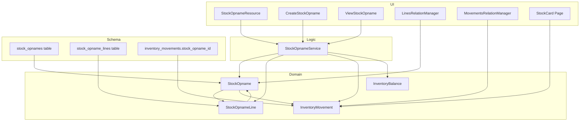
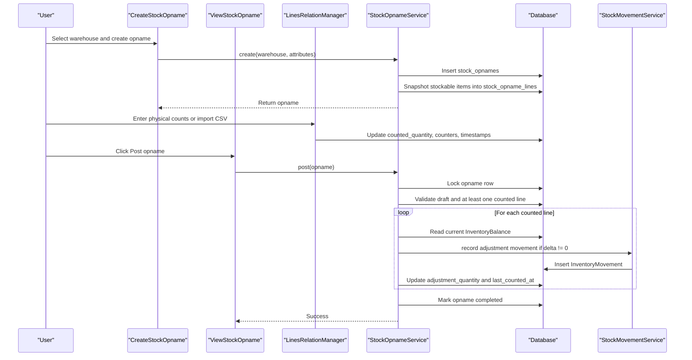
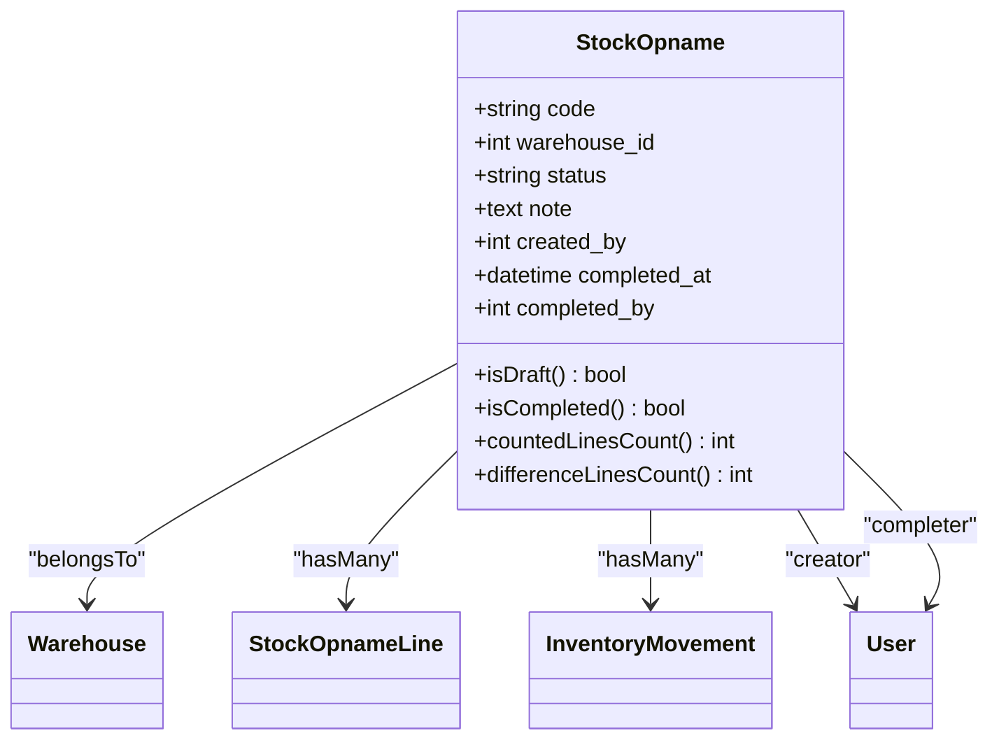
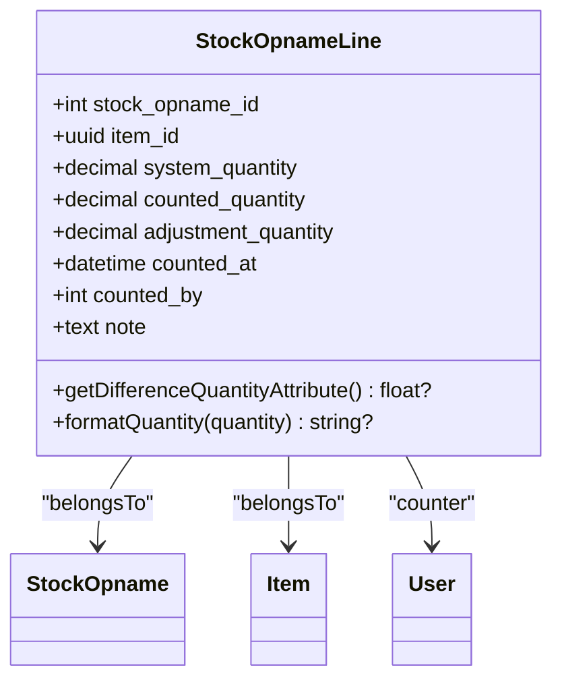
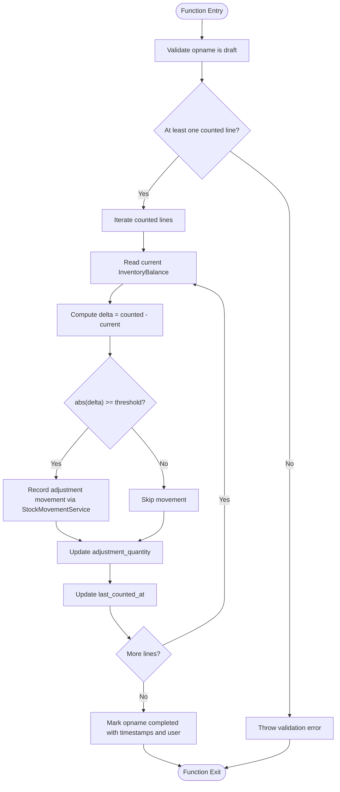
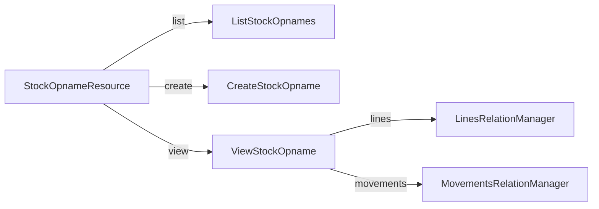
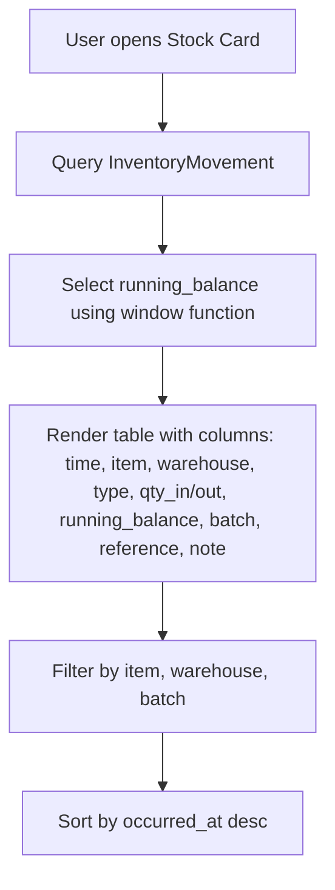
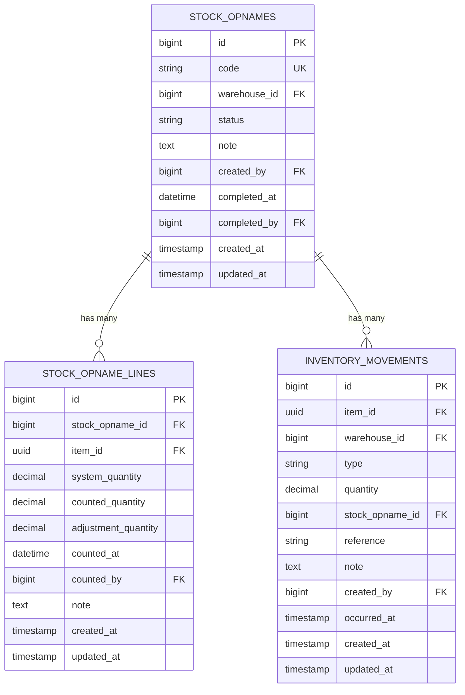
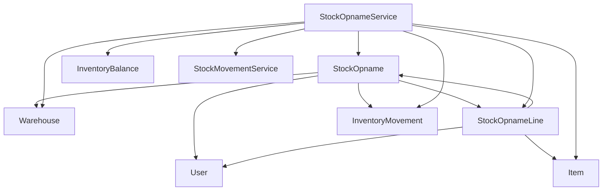

# Stock Reconciliation and Opname

<cite>
**Referenced Files in This Document**
- [StockOpname.php](file://app/Models/StockOpname.php)
- [StockOpnameLine.php](file://app/Models/StockOpnameLine.php)
- [StockOpnameService.php](file://app/Services/StockOpnameService.php)
- [stock-card.blade.php](file://resources/views/filament/pages/stock-card.blade.php)
- [StockCard.php](file://app/Filament/Pages/StockCard.php)
- [2026_11_19_000002_create_stock_opnames_table.php](file://database/migrations/2026_11_19_000002_create_stock_opnames_table.php)
- [2026_11_19_000003_create_stock_opname_lines_table.php](file://database/migrations/2026_11_19_000003_create_stock_opname_lines_table.php)
- [2026_11_19_000004_add_stock_opname_id_to_inventory_movements_table.php](file://database/migrations/2026_11_19_000004_add_stock_opname_id_to_inventory_movements_table.php)
- [StockOpnameResource.php](file://app/Filament/Resources/StockOpnames/StockOpnameResource.php)
- [CreateStockOpname.php](file://app/Filament/Resources/StockOpnames/Pages/CreateStockOpname.php)
- [ListStockOpnames.php](file://app/Filament/Resources/StockOpnames/Pages/ListStockOpnames.php)
- [ViewStockOpname.php](file://app/Filament/Resources/StockOpnames/Pages/ViewStockOpname.php)
- [LinesRelationManager.php](file://app/Filament/Resources/StockOpnames/RelationManagers/LinesRelationManager.php)
- [MovementsRelationManager.php](file://app/Filament/Resources/StockOpnames/RelationManagers/MovementsRelationManager.php)
- [StockOpnameTest.php](file://tests/Feature/StockOpnameTest.php)
</cite>

## Table of Contents
1. [Introduction](#introduction)
2. [Project Structure](#project-structure)
3. [Core Components](#core-components)
4. [Architecture Overview](#architecture-overview)
5. [Detailed Component Analysis](#detailed-component-analysis)
6. [Dependency Analysis](#dependency-analysis)
7. [Performance Considerations](#performance-considerations)
8. [Troubleshooting Guide](#troubleshooting-guide)
9. [Conclusion](#conclusion)

## Introduction
This document explains the stock reconciliation and opname processes implemented in the application. It focuses on:
- Managing stock counting sessions with the StockOpname model.
- Recording individual item counts with the StockOpnameLine model.
- The end-to-end workflow provided by StockOpnameService for creating opname sessions, recording physical counts, calculating variances, and generating adjustment entries.
- Real-time stock visualization through the Stock Card page.
- Practical examples of conducting stock opname procedures, handling discrepancies, and reconciling physical versus system quantities.
- Approval workflow and audit requirements for stock adjustments.

## Project Structure
The stock opname feature spans models, services, Filament resources and pages, migrations, and tests. The key areas are:
- Models define entities and relationships for opname sessions and lines.
- Service encapsulates business logic for creation, posting, and cancellation.
- Filament UI provides listing, creation, viewing, line management, import/export, and movement review.
- Migrations define database schema for opnames, lines, and linkage to movements.
- Tests validate core workflows and edge cases.

**Diagram sources**
- [StockOpname.php:21-106](file://app/Models/StockOpname.php#L21-L106)
- [StockOpnameLine.php:21-93](file://app/Models/StockOpnameLine.php#L21-L93)
- [StockOpnameService.php:14-170](file://app/Services/StockOpnameService.php#L14-L170)
- [StockOpnameResource.php:27-205](file://app/Filament/Resources/StockOpnames/StockOpnameResource.php#L27-L205)
- [CreateStockOpname.php:12-34](file://app/Filament/Resources/StockOpnames/Pages/CreateStockOpname.php#L12-L34)
- [ViewStockOpname.php:18-139](file://app/Filament/Resources/StockOpnames/Pages/ViewStockOpname.php#L18-L139)
- [LinesRelationManager.php:27-228](file://app/Filament/Resources/StockOpnames/RelationManagers/LinesRelationManager.php#L27-L228)
- [MovementsRelationManager.php:10-53](file://app/Filament/Resources/StockOpnames/RelationManagers/MovementsRelationManager.php#L10-L53)
- [StockCard.php:17-128](file://app/Filament/Pages/StockCard.php#L17-L128)
- [2026_11_19_000002_create_stock_opnames_table.php:14-34](file://database/migrations/2026_11_19_000002_create_stock_opnames_table.php#L14-L34)
- [2026_11_19_000003_create_stock_opname_lines_table.php:14-35](file://database/migrations/2026_11_19_000003_create_stock_opname_lines_table.php#L14-L35)
- [2026_11_19_000004_add_stock_opname_id_to_inventory_movements_table.php:14-20](file://database/migrations/2026_11_19_000004_add_stock_opname_id_to_inventory_movements_table.php#L14-L20)

**Section sources**
- [StockOpname.php:21-106](file://app/Models/StockOpname.php#L21-L106)
- [StockOpnameLine.php:21-93](file://app/Models/StockOpnameLine.php#L21-L93)
- [StockOpnameService.php:14-170](file://app/Services/StockOpnameService.php#L14-L170)
- [StockOpnameResource.php:27-205](file://app/Filament/Resources/StockOpnames/StockOpnameResource.php#L27-L205)
- [CreateStockOpname.php:12-34](file://app/Filament/Resources/StockOpnames/Pages/CreateStockOpname.php#L12-L34)
- [ViewStockOpname.php:18-139](file://app/Filament/Resources/StockOpnames/Pages/ViewStockOpname.php#L18-L139)
- [LinesRelationManager.php:27-228](file://app/Filament/Resources/StockOpnames/RelationManagers/LinesRelationManager.php#L27-L228)
- [MovementsRelationManager.php:10-54](file://app/Filament/Resources/StockOpnames/RelationManagers/MovementsRelationManager.php#L10-L54)
- [StockCard.php:17-128](file://app/Filament/Pages/StockCard.php#L17-L128)
- [stock-card.blade.php:1-4](file://resources/views/filament/pages/stock-card.blade.php#L1-L4)
- [2026_11_19_000002_create_stock_opnames_table.php:14-34](file://database/migrations/2026_11_19_000002_create_stock_opnames_table.php#L14-L34)
- [2026_11_19_000003_create_stock_opname_lines_table.php:14-35](file://database/migrations/2026_11_19_000003_create_stock_opname_lines_table.php#L14-L35)
- [2026_11_19_000004_add_stock_opname_id_to_inventory_movements_table.php:14-20](file://database/migrations/2026_11_19_000004_add_stock_opname_id_to_inventory_movements_table.php#L14-L20)

## Core Components
- StockOpname represents a stock counting session per warehouse. It tracks status (draft, completed, cancelled), creator/completer, timestamps, and aggregates like counted and difference lines.
- StockOpnameLine represents an individual item’s snapshot and count within an opname. It stores system quantity at snapshot time, physical count, computed difference, and posted adjustment quantity. It also records who counted and when.
- StockOpnameService orchestrates:
  - Creating an opname and snapshotting all stockable items into lines.
  - Posting the opname: validating draft state, requiring at least one counted line, computing deltas against current balances, creating adjustment inventory movements, updating adjustment_quantity, and marking the opname completed.
  - Cancelling draft opnames.

Key responsibilities:
- Data integrity: transactions, row locking, validation exceptions.
- Auditability: created_by, completed_by, counted_by, timestamps.
- Traceability: reference code linking movements back to opname.

**Section sources**
- [StockOpname.php:21-106](file://app/Models/StockOpname.php#L21-L106)
- [StockOpnameLine.php:21-93](file://app/Models/StockOpnameLine.php#L21-L93)
- [StockOpnameService.php:14-170](file://app/Services/StockOpnameService.php#L14-L170)

## Architecture Overview
The opname process flows from user actions in Filament pages through service methods to database updates and movement creation.

**Diagram sources**
- [CreateStockOpname.php:18-33](file://app/Filament/Resources/StockOpnames/Pages/CreateStockOpname.php#L18-L33)
- [StockOpnameService.php:21-62](file://app/Services/StockOpnameService.php#L21-L62)
- [StockOpnameService.php:67-134](file://app/Services/StockOpnameService.php#L67-L134)
- [ViewStockOpname.php:68-103](file://app/Filament/Resources/StockOpnames/Pages/ViewStockOpname.php#L68-L103)
- [LinesRelationManager.php:48-86](file://app/Filament/Resources/StockOpnames/RelationManagers/LinesRelationManager.php#L48-L86)

## Detailed Component Analysis

### StockOpname Model
Responsibilities:
- Status constants and helpers for draft, completed, cancelled.
- Relationships to Warehouse, lines, movements, creator, completer.
- Aggregators for progress and discrepancy counts.

**Diagram sources**
- [StockOpname.php:21-106](file://app/Models/StockOpname.php#L21-L106)

**Section sources**
- [StockOpname.php:21-106](file://app/Models/StockOpname.php#L21-L106)

### StockOpnameLine Model
Responsibilities:
- Stores system_quantity at snapshot time, counted_quantity, and posted adjustment_quantity.
- Auto-captures counted_at and counted_by when counted_quantity changes.
- Computes difference_quantity and formats display values.

**Diagram sources**
- [StockOpnameLine.php:21-93](file://app/Models/StockOpnameLine.php#L21-L93)

**Section sources**
- [StockOpnameLine.php:21-93](file://app/Models/StockOpnameLine.php#L21-L93)

### StockOpnameService Workflow
Key operations:
- create: Generates unique code, creates opname, snapshots all stockable items into lines with system_quantity from InventoryBalance.
- post: Validates draft state, ensures at least one counted line, computes delta vs current balance, creates adjustment movements for non-zero deltas, updates adjustment_quantity and last_counted_at, marks opname completed.
- cancel: Only allows cancelling draft opnames.

**Diagram sources**
- [StockOpnameService.php:67-134](file://app/Services/StockOpnameService.php#L67-L134)

**Section sources**
- [StockOpnameService.php:21-62](file://app/Services/StockOpnameService.php#L21-L62)
- [StockOpnameService.php:67-134](file://app/Services/StockOpnameService.php#L67-L134)
- [StockOpnameService.php:139-155](file://app/Services/StockOpnameService.php#L139-L155)

### Filament UI for Stock Opname
- StockOpnameResource: Lists opnames with progress and discrepancy badges; filters by status, warehouse, and date range; exposes view and delete actions.
- CreateStockOpname: Delegates to StockOpnameService.create and redirects to view page.
- ViewStockOpname: Displays opname details, shows progress and differences, and provides header actions to post or cancel.
- LinesRelationManager: In-table editing of counted_quantity, bulk actions to fill from system, clear counts, add items, import/export CSV.
- MovementsRelationManager: Shows adjustment movements generated by posting.

**Diagram sources**
- [StockOpnameResource.php:27-205](file://app/Filament/Resources/StockOpnames/StockOpnameResource.php#L27-L205)
- [CreateStockOpname.php:12-34](file://app/Filament/Resources/StockOpnames/Pages/CreateStockOpname.php#L12-L34)
- [ViewStockOpname.php:18-139](file://app/Filament/Resources/StockOpnames/Pages/ViewStockOpname.php#L18-L139)
- [LinesRelationManager.php:27-228](file://app/Filament/Resources/StockOpnames/RelationManagers/LinesRelationManager.php#L27-L228)
- [MovementsRelationManager.php:10-54](file://app/Filament/Resources/StockOpnames/RelationManagers/MovementsRelationManager.php#L10-L54)

**Section sources**
- [StockOpnameResource.php:27-205](file://app/Filament/Resources/StockOpnames/StockOpnameResource.php#L27-L205)
- [CreateStockOpname.php:12-34](file://app/Filament/Resources/StockOpnames/Pages/CreateStockOpname.php#L12-L34)
- [ListStockOpnames.php:9-19](file://app/Filament/Resources/StockOpnames/Pages/ListStockOpnames.php#L9-L19)
- [ViewStockOpname.php:18-139](file://app/Filament/Resources/StockOpnames/Pages/ViewStockOpname.php#L18-L139)
- [LinesRelationManager.php:27-228](file://app/Filament/Resources/StockOpnames/RelationManagers/LinesRelationManager.php#L27-L228)
- [MovementsRelationManager.php:10-54](file://app/Filament/Resources/StockOpnames/RelationManagers/MovementsRelationManager.php#L10-L54)

### Stock Card for Real-Time Visualization
The Stock Card page displays real-time stock history with running balances per item and warehouse. It uses window functions to compute running balance across movements and supports filtering by item, warehouse, and production batch.

**Diagram sources**
- [StockCard.php:17-128](file://app/Filament/Pages/StockCard.php#L17-L128)
- [stock-card.blade.php:1-4](file://resources/views/filament/pages/stock-card.blade.php#L1-L4)

**Section sources**
- [StockCard.php:17-128](file://app/Filament/Pages/StockCard.php#L17-L128)
- [stock-card.blade.php:1-4](file://resources/views/filament/pages/stock-card.blade.php#L1-L4)

### Database Schema Highlights
- stock_opnames: Unique code, warehouse association, status, notes, creator/completer, timestamps, indexes for warehouse and status.
- stock_opname_lines: Links to opname and item, system/counted/adjustment quantities, counter info, notes, unique constraint per opname+item.
- inventory_movements: Receives stock_opname_id to link adjustment movements back to the originating opname.

**Diagram sources**
- [2026_11_19_000002_create_stock_opnames_table.php:14-34](file://database/migrations/2026_11_19_000002_create_stock_opnames_table.php#L14-L34)
- [2026_11_19_000003_create_stock_opname_lines_table.php:14-35](file://database/migrations/2026_11_19_000003_create_stock_opname_lines_table.php#L14-L35)
- [2026_11_19_000004_add_stock_opname_id_to_inventory_movements_table.php:14-20](file://database/migrations/2026_11_19_000004_add_stock_opname_id_to_inventory_movements_table.php#L14-L20)

**Section sources**
- [2026_11_19_000002_create_stock_opnames_table.php:14-34](file://database/migrations/2026_11_19_000002_create_stock_opnames_table.php#L14-L34)
- [2026_11_19_000003_create_stock_opname_lines_table.php:14-35](file://database/migrations/2026_11_19_000003_create_stock_opname_lines_table.php#L14-L35)
- [2026_11_19_000004_add_stock_opname_id_to_inventory_movements_table.php:14-20](file://database/migrations/2026_11_19_000004_add_stock_opname_id_to_inventory_movements_table.php#L14-L20)

## Dependency Analysis
- StockOpname depends on Warehouse, User, StockOpnameLine, InventoryMovement.
- StockOpnameLine depends on StockOpname, Item, User.
- StockOpnameService depends on InventoryBalance, InventoryMovement, Item, StockOpname, StockOpnameLine, Warehouse, and StockMovementService.
- Filament components depend on models and services to render data and perform actions.

**Diagram sources**
- [StockOpname.php:54-77](file://app/Models/StockOpname.php#L54-L77)
- [StockOpnameLine.php:59-72](file://app/Models/StockOpnameLine.php#L59-L72)
- [StockOpnameService.php:5-11](file://app/Services/StockOpnameService.php#L5-L11)

**Section sources**
- [StockOpname.php:54-77](file://app/Models/StockOpname.php#L54-L77)
- [StockOpnameLine.php:59-72](file://app/Models/StockOpnameLine.php#L59-L72)
- [StockOpnameService.php:5-11](file://app/Services/StockOpnameService.php#L5-L11)

## Performance Considerations
- Batch insertion of opname lines during creation reduces round-trips for large catalogs.
- Row-level locking (lockForUpdate) prevents race conditions during posting.
- Window function for running balance in Stock Card avoids multiple queries for cumulative totals.
- Indexes on warehouse_id and status improve list performance.

[No sources needed since this section provides general guidance]

## Troubleshooting Guide
Common issues and resolutions:
- Posting fails because no lines were counted: Ensure at least one line has counted_quantity set before posting.
- Posting fails because opname is not draft: Only draft opnames can be posted or cancelled. Completed opnames are locked.
- Adjustment not created: If counted_quantity equals current balance (within rounding threshold), no movement is recorded; check delta calculation.
- Import errors:
  - Unknown item code: Verify item exists and is stockable.
  - Item outside opname scope: Only items present in the opname snapshot can be imported.
  - Completed opname: Import is disabled for non-draft opnames.
- Export includes all lines regardless of table filter: Use export action to get full dataset; use table filters for visual inspection only.

Validation and behavior are covered by tests that assert:
- Creation snapshots correct system quantities.
- Posting adjusts balances and creates movements.
- Uncounted lines are skipped.
- Completed opnames cannot be reposted or cancelled.
- Draft opnames can be cancelled.
- Counting lines captures counter and timestamp.
- Fill system and clear counts work as expected.
- Import/export behaviors match expectations.

**Section sources**
- [StockOpnameService.php:67-134](file://app/Services/StockOpnameService.php#L67-L134)
- [StockOpnameService.php:139-155](file://app/Services/StockOpnameService.php#L139-L155)
- [StockOpnameTest.php:92-122](file://tests/Feature/StockOpnameTest.php#L92-L122)
- [StockOpnameTest.php:124-180](file://tests/Feature/StockOpnameTest.php#L124-L180)
- [StockOpnameTest.php:182-215](file://tests/Feature/StockOpnameTest.php#L182-L215)
- [StockOpnameTest.php:217-283](file://tests/Feature/StockOpnameTest.php#L217-L283)
- [StockOpnameTest.php:285-299](file://tests/Feature/StockOpnameTest.php#L285-L299)
- [StockOpnameTest.php:301-325](file://tests/Feature/StockOpnameTest.php#L301-L325)
- [StockOpnameTest.php:327-360](file://tests/Feature/StockOpnameTest.php#L327-L360)
- [StockOpnameTest.php:362-524](file://tests/Feature/StockOpnameTest.php#L362-L524)
- [StockOpnameTest.php:526-596](file://tests/Feature/StockOpnameTest.php#L526-L596)

## Conclusion
The stock reconciliation and opname implementation provides a robust, auditable process for aligning physical stock with system records. Key strengths include:
- Clear lifecycle management for opname sessions with draft, completed, and cancelled states.
- Accurate variance computation and automatic generation of adjustment movements.
- Strong audit trails capturing creators, completers, and counters with timestamps.
- Flexible UI for manual entry, bulk operations, and CSV import/export.
- Real-time stock visibility through the Stock Card page.

Approval workflow and audit requirements:
- The current implementation does not include a separate approval step; posting transitions directly from draft to completed.
- Auditability is achieved through user attribution (created_by, completed_by, counted_by) and linkage of adjustment movements to opname codes.
- To introduce formal approvals, consider adding an intermediate approved state and restricting posting until approved, while preserving existing audit fields and movement references.

[No sources needed since this section summarizes without analyzing specific files]