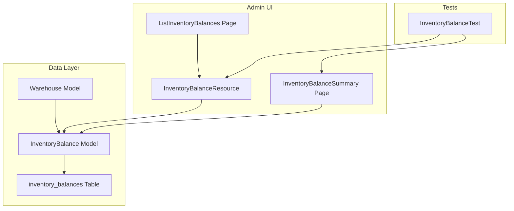
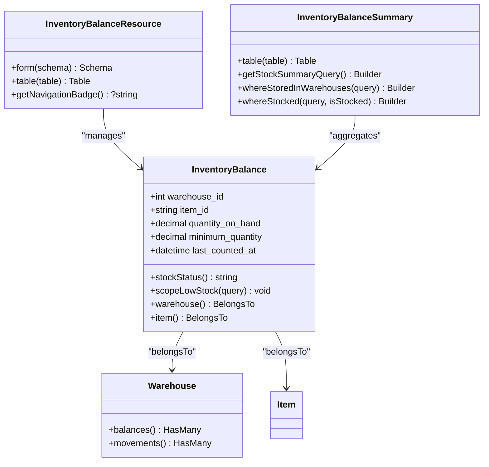
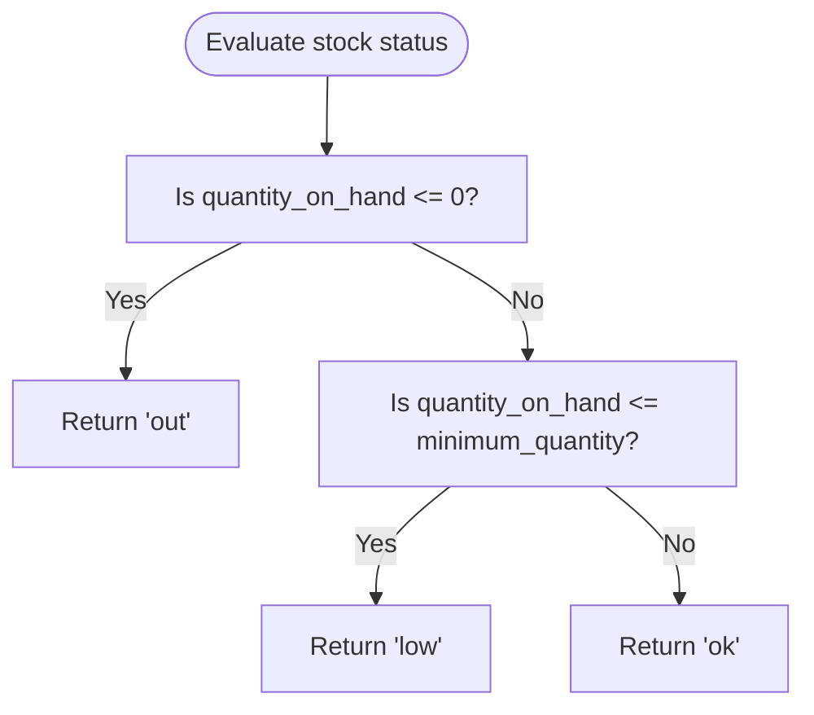
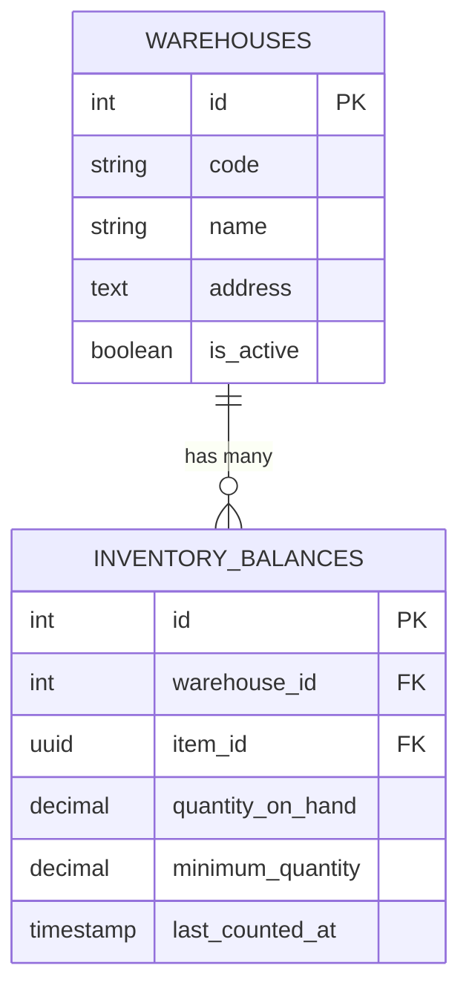
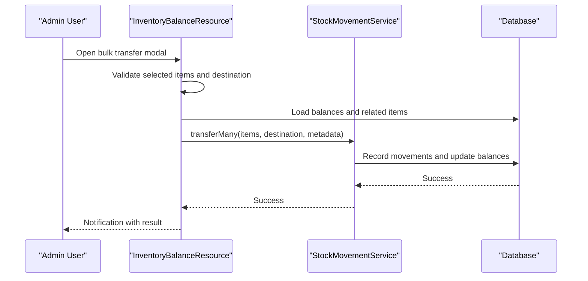
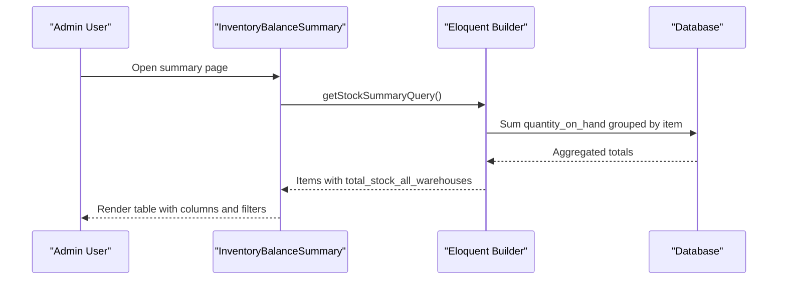
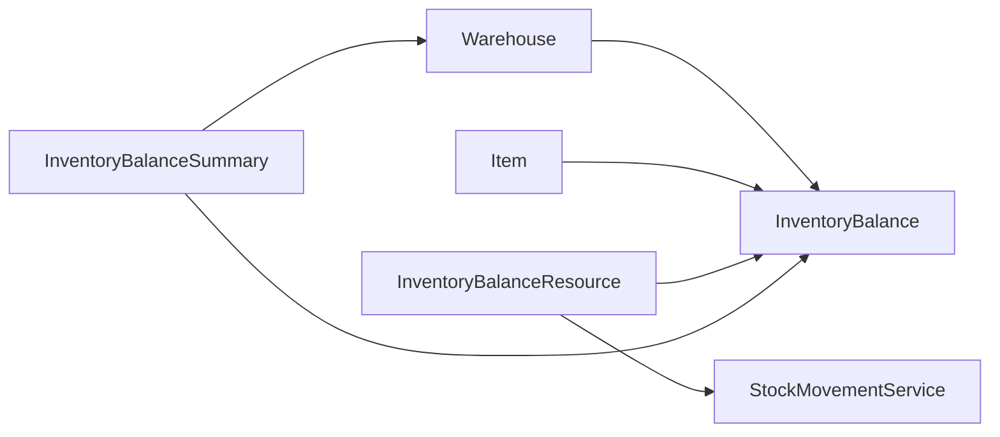

# Stock Tracking and Balance Management

<cite>
**Referenced Files in This Document**
- [InventoryBalance.php](file://app/Models/InventoryBalance.php)
- [Warehouse.php](file://app/Models/Warehouse.php)
- [2026_11_16_000002_create_inventory_balances_table.php](file://database/migrations/2026_11_16_000002_create_inventory_balances_table.php)
- [InventoryBalanceResource.php](file://app/Filament/Resources/InventoryBalances/InventoryBalanceResource.php)
- [ListInventoryBalances.php](file://app/Filament/Resources/InventoryBalances/Pages/ListInventoryBalances.php)
- [InventoryBalanceSummary.php](file://app/Filament/Pages/InventoryBalanceSummary.php)
- [inventory-balance-summary.blade.php](file://resources/views/filament/pages/inventory-balance-summary.blade.php)
- [InventoryBalanceTest.php](file://tests/Feature/InventoryBalanceTest.php)
</cite>

## Table of Contents
1. [Introduction](#introduction)
2. [Project Structure](#project-structure)
3. [Core Components](#core-components)
4. [Architecture Overview](#architecture-overview)
5. [Detailed Component Analysis](#detailed-component-analysis)
6. [Dependency Analysis](#dependency-analysis)
7. [Performance Considerations](#performance-considerations)
8. [Troubleshooting Guide](#troubleshooting-guide)
9. [Conclusion](#conclusion)

## Introduction
This document explains stock tracking and balance management for the application. It focuses on the InventoryBalance model, its fields, stock status calculation logic, multi-warehouse relationships with Warehouse, and how Filament admin interfaces expose inventory operations. It also documents the inventory balance summary page that aggregates stock across warehouses and supports filtering by warehouse, item type, category, brand, and stock availability.

## Project Structure
The stock tracking feature spans models, database schema, Filament resources, a dedicated summary page, and tests:

- Models define data structure and relationships.
- Migration defines the inventory balances table.
- Filament Resource provides CRUD, filters, bulk transfer, and navigation badge.
- Summary Page provides an aggregated view per item across warehouses.
- Tests validate rendering, aggregation, and filtering behavior.

**Diagram sources**
- [InventoryBalance.php:13-45](file://app/Models/InventoryBalance.php#L13-L45)
- [Warehouse.php:27-35](file://app/Models/Warehouse.php#L27-L35)
- [2026_11_16_000002_create_inventory_balances_table.php:14-30](file://database/migrations/2026_11_16_000002_create_inventory_balances_table.php#L14-L30)
- [InventoryBalanceResource.php:43-74](file://app/Filament/Resources/InventoryBalances/InventoryBalanceResource.php#L43-L74)
- [ListInventoryBalances.php:9-18](file://app/Filament/Resources/InventoryBalances/Pages/ListInventoryBalances.php#L9-L18)
- [InventoryBalanceSummary.php:18-37](file://app/Filament/Pages/InventoryBalanceSummary.php#L18-L37)
- [InventoryBalanceTest.php:49-87](file://tests/Feature/InventoryBalanceTest.php#L49-L87)

**Section sources**
- [InventoryBalance.php:13-45](file://app/Models/InventoryBalance.php#L13-L45)
- [Warehouse.php:27-35](file://app/Models/Warehouse.php#L27-L35)
- [2026_11_16_000002_create_inventory_balances_table.php:14-30](file://database/migrations/2026_11_16_000002_create_inventory_balances_table.php#L14-L30)
- [InventoryBalanceResource.php:43-74](file://app/Filament/Resources/InventoryBalances/InventoryBalanceResource.php#L43-L74)
- [ListInventoryBalances.php:9-18](file://app/Filament/Resources/InventoryBalances/Pages/ListInventoryBalances.php#L9-L18)
- [InventoryBalanceSummary.php:18-37](file://app/Filament/Pages/InventoryBalanceSummary.php#L18-L37)
- [InventoryBalanceTest.php:49-87](file://tests/Feature/InventoryBalanceTest.php#L49-L87)

## Core Components
- InventoryBalance model:
  - Fields: warehouse_id, item_id, quantity_on_hand, minimum_quantity, last_counted_at.
  - Casts: decimal precision for quantities; datetime for last count timestamp.
  - Relationships: belongs to Warehouse and Item.
  - Computed attribute: stockStatus returns out, low, or ok based on thresholds.
  - Scope: scopeLowStock filters rows where quantity_on_hand is less than or equal to minimum_quantity.

- Warehouse model:
  - Relationship: hasMany InventoryBalance, enabling multi-warehouse support.

- Database schema:
  - inventory_balances table includes foreign keys to warehouses and items, unique constraint on (warehouse_id, item_id), and indexes.

- Filament Admin:
  - InventoryBalanceResource provides forms, tables, filters, bulk transfer, and navigation badge showing low stock counts.
  - ListInventoryBalances page renders the resource list with infinite scroll.

- InventoryBalanceSummary page:
  - Aggregates total stock per item across warehouses.
  - Supports filtering by warehouse, item type, category, brand, and stock availability.

**Section sources**
- [InventoryBalance.php:13-70](file://app/Models/InventoryBalance.php#L13-L70)
- [Warehouse.php:27-35](file://app/Models/Warehouse.php#L27-L35)
- [2026_11_16_000002_create_inventory_balances_table.php:14-30](file://database/migrations/2026_11_16_000002_create_inventory_balances_table.php#L14-L30)
- [InventoryBalanceResource.php:76-229](file://app/Filament/Resources/InventoryBalances/InventoryBalanceResource.php#L76-L229)
- [ListInventoryBalances.php:9-18](file://app/Filament/Resources/InventoryBalances/Pages/ListInventoryBalances.php#L9-L18)
- [InventoryBalanceSummary.php:39-120](file://app/Filament/Pages/InventoryBalanceSummary.php#L39-L120)

## Architecture Overview
The system uses Eloquent models to represent inventory balances per warehouse and item. The Filament Resource exposes CRUD and operational features, while the Summary Page computes totals per item using Eloquent aggregations. Filters propagate to queries to restrict results by warehouse and other attributes.

**Diagram sources**
- [InventoryBalance.php:37-69](file://app/Models/InventoryBalance.php#L37-L69)
- [Warehouse.php:27-35](file://app/Models/Warehouse.php#L27-L35)
- [InventoryBalanceResource.php:76-229](file://app/Filament/Resources/InventoryBalances/InventoryBalanceResource.php#L76-L229)
- [InventoryBalanceSummary.php:39-164](file://app/Filament/Pages/InventoryBalanceSummary.php#L39-L164)

## Detailed Component Analysis

### InventoryBalance Model
- Fields and casts:
  - quantity_on_hand and minimum_quantity are decimals with three fractional digits.
  - last_counted_at is cast as datetime.
- Relationships:
  - Belongs to Warehouse and Item.
- Stock status calculation:
  - out when quantity_on_hand is less than or equal to zero.
  - low when quantity_on_hand is greater than zero but less than or equal to minimum_quantity.
  - ok otherwise.
- Low stock scope:
  - scopeLowStock filters rows where quantity_on_hand <= minimum_quantity.

**Diagram sources**
- [InventoryBalance.php:47-64](file://app/Models/InventoryBalance.php#L47-L64)

**Section sources**
- [InventoryBalance.php:13-70](file://app/Models/InventoryBalance.php#L13-L70)

### Multi-Warehouse Support via Warehouse Model
- Warehouse has many InventoryBalance records.
- This relationship enables per-warehouse stock tracking and filtering.

**Diagram sources**
- [Warehouse.php:27-35](file://app/Models/Warehouse.php#L27-L35)
- [2026_11_16_000002_create_inventory_balances_table.php:14-30](file://database/migrations/2026_11_16_000002_create_inventory_balances_table.php#L14-L30)

**Section sources**
- [Warehouse.php:27-35](file://app/Models/Warehouse.php#L27-L35)
- [2026_11_16_000002_create_inventory_balances_table.php:14-30](file://database/migrations/2026_11_16_000002_create_inventory_balances_table.php#L14-L30)

### Filament Admin Interface for Inventory Balances
- Navigation:
  - Grouped under “Gudang” with label “Stok Gudang”.
  - Badge shows the count of low stock balances.
- Form:
  - Select warehouse and item (only stockable items without variants).
  - Enforces uniqueness of item per warehouse.
  - Inputs for quantity_on_hand and minimum_quantity with numeric validation and helper text.
  - Optional last_counted_at timestamp.
- Table:
  - Columns include item code/name, warehouse, quantities, computed stock status with badges and colors, and last counted date.
  - Filters by warehouse and stock status (out, low, ok).
- Bulk Transfer:
  - Transfers selected balances to another warehouse, validates quantities against available stock, prevents same-origin transfers, and uses a transactional service to record movements.

**Diagram sources**
- [InventoryBalanceResource.php:231-419](file://app/Filament/Resources/InventoryBalances/InventoryBalanceResource.php#L231-L419)

**Section sources**
- [InventoryBalanceResource.php:59-74](file://app/Filament/Resources/InventoryBalances/InventoryBalanceResource.php#L59-L74)
- [InventoryBalanceResource.php:76-149](file://app/Filament/Resources/InventoryBalances/InventoryBalanceResource.php#L76-L149)
- [InventoryBalanceResource.php:151-229](file://app/Filament/Resources/InventoryBalances/InventoryBalanceResource.php#L151-L229)
- [InventoryBalanceResource.php:231-419](file://app/Filament/Resources/InventoryBalances/InventoryBalanceResource.php#L231-L419)

### Inventory Balance Summary Page
- Purpose:
  - Shows total stock per item across all warehouses.
  - Allows filtering by warehouse(s), item type, category, brand, and stock availability.
- Query logic:
  - Uses Item::query with withSum over inventoryBalances to compute total_stock_all_warehouses.
  - When warehouse filter is set, sums only balances stored in selected warehouses.
  - Filters items by whereHas/whereDoesntHave on inventoryBalances to show stocked or out-of-stock items.
- View:
  - Blade template renders the page content.

**Diagram sources**
- [InventoryBalanceSummary.php:39-120](file://app/Filament/Pages/InventoryBalanceSummary.php#L39-L120)

**Section sources**
- [InventoryBalanceSummary.php:39-164](file://app/Filament/Pages/InventoryBalanceSummary.php#L39-L164)
- [inventory-balance-summary.blade.php](file://resources/views/filament/pages/inventory-balance-summary.blade.php)

## Dependency Analysis
- InventoryBalance depends on:
  - Warehouse (foreign key and relationship).
  - Item (foreign key and relationship).
- Filament Resource depends on:
  - InventoryBalance model for form/table configuration.
  - StockMovementService for bulk transfer operations.
- Summary Page depends on:
  - Item model and inventoryBalances relationship for aggregation.
  - Warehouse model for filter options.

**Diagram sources**
- [InventoryBalance.php:37-45](file://app/Models/InventoryBalance.php#L37-L45)
- [InventoryBalanceResource.php:12](file://app/Filament/Resources/InventoryBalances/InventoryBalanceResource.php#L12)
- [InventoryBalanceSummary.php:5-6](file://app/Filament/Pages/InventoryBalanceSummary.php#L5-L6)

**Section sources**
- [InventoryBalance.php:37-45](file://app/Models/InventoryBalance.php#L37-L45)
- [InventoryBalanceResource.php:12](file://app/Filament/Resources/InventoryBalances/InventoryBalanceResource.php#L12)
- [InventoryBalanceSummary.php:5-6](file://app/Filament/Pages/InventoryBalanceSummary.php#L5-L6)

## Performance Considerations
- Use scopes like scopeLowStock to avoid repeated calculations in PHP.
- Leverage Eloquent withSum for aggregated totals instead of loading all balances into memory.
- Indexes on item_id and unique constraint on (warehouse_id, item_id) improve query performance.
- Filter early in queries (e.g., warehouse selection) to reduce dataset size.

[No sources needed since this section provides general guidance]

## Troubleshooting Guide
- Low stock badge not updating:
  - Ensure scopeLowStock is used correctly in navigation badge and filters.
- Summary totals incorrect:
  - Verify warehouse filter propagation to both whereStoredInWarehouses and getStockSummaryQuery.
- Form uniqueness errors:
  - Confirm rule ensures uniqueness of item_id per warehouse_id.
- Bulk transfer failures:
  - Check validation messages for exceeding available stock or selecting same origin/destination warehouse.

**Section sources**
- [InventoryBalanceResource.php:59-74](file://app/Filament/Resources/InventoryBalances/InventoryBalanceResource.php#L59-L74)
- [InventoryBalanceResource.php:118-123](file://app/Filament/Resources/InventoryBalances/InventoryBalanceResource.php#L118-L123)
- [InventoryBalanceResource.php:330-419](file://app/Filament/Resources/InventoryBalances/InventoryBalanceResource.php#L330-L419)
- [InventoryBalanceSummary.php:107-164](file://app/Filament/Pages/InventoryBalanceSummary.php#L107-L164)

## Conclusion
The stock tracking system centers on InventoryBalance, which tracks per-warehouse stock levels and computes status based on thresholds. The Warehouse relationship enables multi-warehouse support. Filament’s InventoryBalanceResource provides comprehensive administration including CRUD, filtering, and bulk transfers. The InventoryBalanceSummary page offers aggregated insights across warehouses with flexible filters. Together, these components deliver robust inventory management capabilities.

[No sources needed since this section summarizes without analyzing specific files]