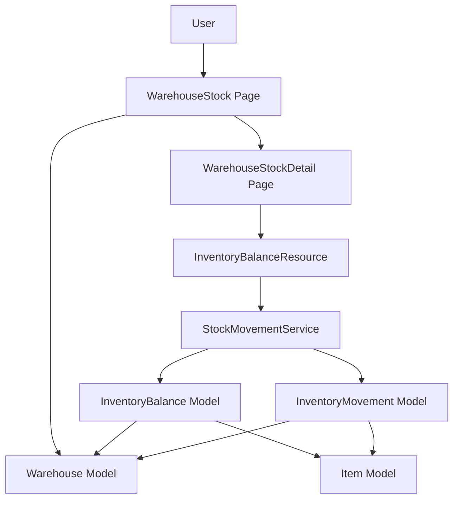
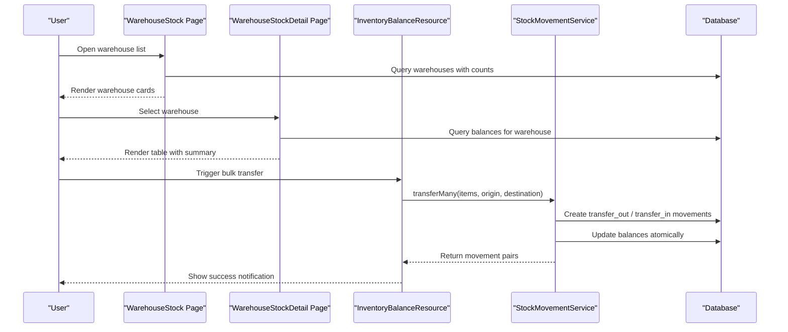
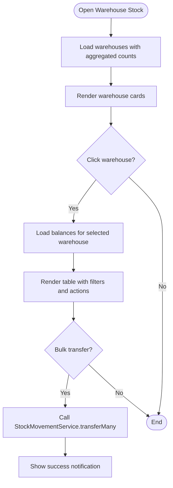
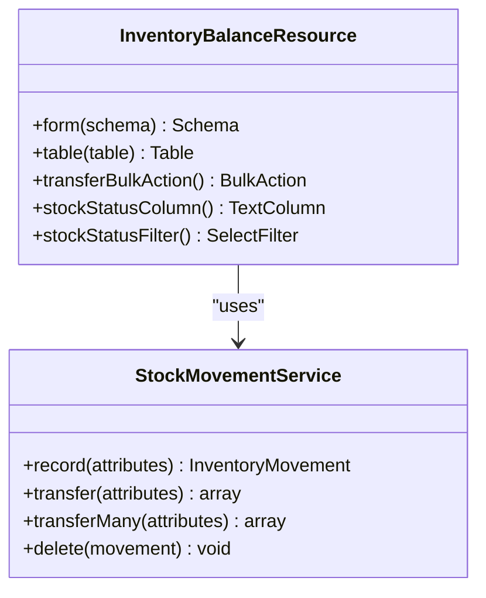
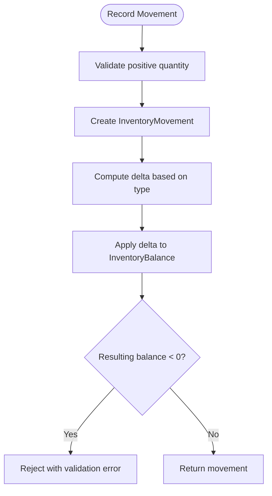
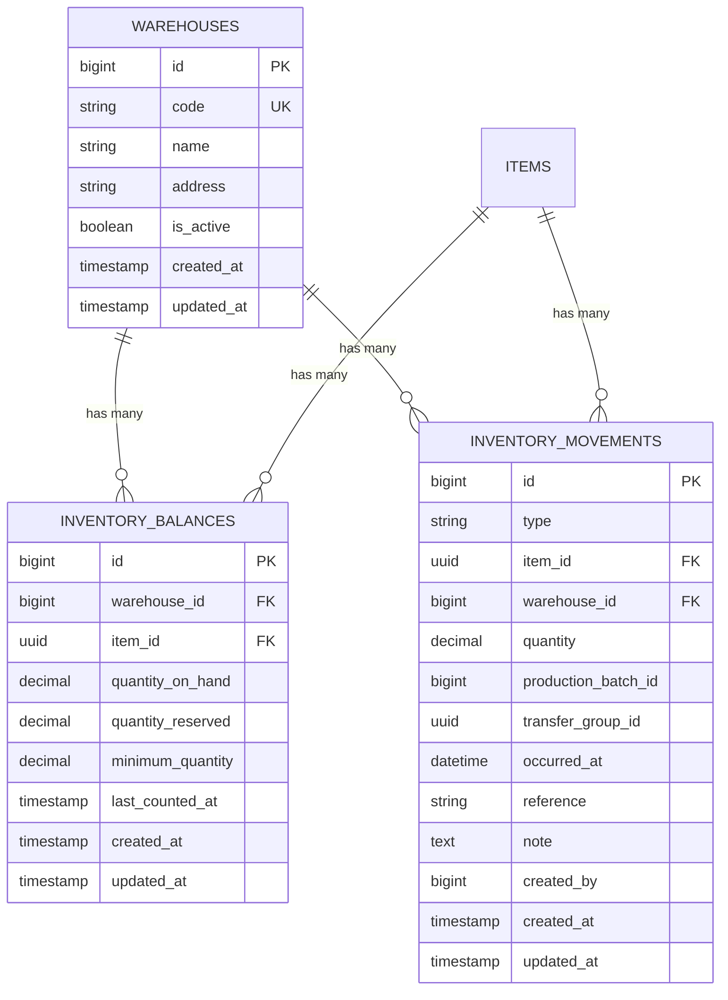
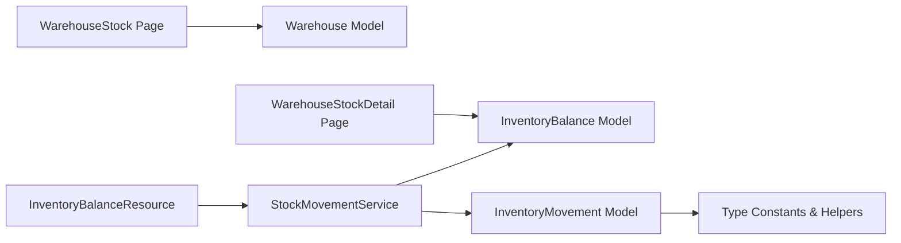

# Warehouse Stock Management

<cite>
**Referenced Files in This Document**
- [WarehouseStock.php](file://app/Filament/Pages/WarehouseStock.php)
- [WarehouseStockDetail.php](file://app/Filament/Pages/WarehouseStockDetail.php)
- [InventoryBalanceResource.php](file://app/Filament/Resources/InventoryBalances/InventoryBalanceResource.php)
- [Warehouse.php](file://app/Filament/Pages/Warehouse.php)
- [warehouse-stock.blade.php](file://resources/views/filament/pages/warehouse-stock.blade.php)
- [InventoryBalance.php](file://app/Models/InventoryBalance.php)
- [InventoryMovement.php](file://app/Models/InventoryMovement.php)
- [Warehouse.php](file://app/Models/Warehouse.php)
- [StockMovementService.php](file://app/Services/StockMovementService.php)
- [2026_11_16_000001_create_warehouses_table.php](file://database/migrations/2026_11_16_000001_create_warehouses_table.php)
- [2026_11_16_000002_create_inventory_balances_table.php](file://database/migrations/2026_11_16_000002_create_inventory_balances_table.php)
- [2026_11_17_000005_create_inventory_movements_table.php](file://database/migrations/2026_11_17_000005_create_inventory_movements_table.php)
- [MassStockTransferTest.php](file://tests/Feature/MassStockTransferTest.php)
- [StockMovementTest.php](file://tests/Feature/StockMovementTest.php)
</cite>

## Table of Contents
1. [Introduction](#introduction)
2. [Project Structure](#project-structure)
3. [Core Components](#core-components)
4. [Architecture Overview](#architecture-overview)
5. [Detailed Component Analysis](#detailed-component-analysis)
6. [Dependency Analysis](#dependency-analysis)
7. [Performance Considerations](#performance-considerations)
8. [Troubleshooting Guide](#troubleshooting-guide)
9. [Conclusion](#conclusion)

## Introduction
This document explains the warehouse stock management feature in the project. It covers how physical stock is modeled, how stock movements are recorded, how balances are updated, and how users interact with warehouses through Filament pages and resources. The system supports single-item transfers, mass transfers across multiple origin warehouses, production output with automatic material consumption, movement deletion with balance reversal, and low-stock alerts.

## Project Structure
The warehouse stock feature spans several layers:
- Presentation layer: Filament pages and Blade views for selecting a warehouse and viewing its stock list.
- Resource layer: Inventory balance resource providing forms, tables, filters, bulk transfer actions, and shared UI helpers.
- Domain models: Inventory balance per item per warehouse, inventory movement history, and warehouse entity.
- Service layer: Transactional logic for recording movements, transferring stock, handling production output, and reversing deletions.
- Database schema: Warehouses, inventory balances, and inventory movements with indexes and constraints.

**Diagram sources**
- [WarehouseStock.php:15-88](file://app/Filament/Pages/WarehouseStock.php#L15-L88)
- [WarehouseStockDetail.php:19-148](file://app/Filament/Pages/WarehouseStockDetail.php#L19-L148)
- [InventoryBalanceResource.php:43-445](file://app/Filament/Resources/InventoryBalances/InventoryBalanceResource.php#L43-L445)
- [StockMovementService.php:16-399](file://app/Services/StockMovementService.php#L16-L399)
- [InventoryBalance.php:20-70](file://app/Models/InventoryBalance.php#L20-L70)
- [InventoryMovement.php:28-195](file://app/Models/InventoryMovement.php#L28-L195)
- [Warehouse.php:12-36](file://app/Models/Warehouse.php#L12-L36)

**Section sources**
- [WarehouseStock.php:15-88](file://app/Filament/Pages/WarehouseStock.php#L15-L88)
- [WarehouseStockDetail.php:19-148](file://app/Filament/Pages/WarehouseStockDetail.php#L19-L148)
- [InventoryBalanceResource.php:43-445](file://app/Filament/Resources/InventoryBalances/InventoryBalanceResource.php#L43-L445)
- [StockMovementService.php:16-399](file://app/Services/StockMovementService.php#L16-L399)
- [InventoryBalance.php:20-70](file://app/Models/InventoryBalance.php#L20-L70)
- [InventoryMovement.php:28-195](file://app/Models/InventoryMovement.php#L28-L195)
- [Warehouse.php:12-36](file://app/Models/Warehouse.php#L12-L36)

## Core Components
- Warehouse model represents storage locations with code, name, address, and active status.
- InventoryBalance tracks physical quantity on hand and minimum threshold per item per warehouse.
- InventoryMovement records every change to stock with type, quantity, timestamps, and contextual links such as production batch or stock opname.
- StockMovementService encapsulates transactional operations: record, transfer, transferMany, delete, and production output.
- Filament pages provide navigation and dashboards for warehouse selection and detailed stock lists.
- InventoryBalanceResource provides CRUD, filtering by stock status, and bulk transfer workflows.

Key responsibilities:
- WarehouseStock page aggregates warehouse cards with counts of items, total quantity, low stock, and out-of-stock.
- WarehouseStockDetail page shows paginated stock rows for a selected warehouse with summary metrics and bulk transfer action.
- InventoryBalanceResource exposes reusable stock status column/filter and a bulk transfer modal that groups items by origin warehouse.
- StockMovementService ensures atomic updates to balances and consistent movement history.

**Section sources**
- [Warehouse.php:12-36](file://app/Models/Warehouse.php#L12-L36)
- [InventoryBalance.php:20-70](file://app/Models/InventoryBalance.php#L20-L70)
- [InventoryMovement.php:28-195](file://app/Models/InventoryMovement.php#L28-L195)
- [StockMovementService.php:16-399](file://app/Services/StockMovementService.php#L16-L399)
- [WarehouseStock.php:15-88](file://app/Filament/Pages/WarehouseStock.php#L15-L88)
- [WarehouseStockDetail.php:19-148](file://app/Filament/Pages/WarehouseStockDetail.php#L19-L148)
- [InventoryBalanceResource.php:43-445](file://app/Filament/Resources/InventoryBalances/InventoryBalanceResource.php#L43-L445)

## Architecture Overview
The system follows a layered architecture:
- Pages render user interfaces and delegate data queries to models and services.
- Resources define forms, tables, filters, and bulk actions, reusing shared helpers like stock status column and filter.
- Services implement domain logic with database transactions, validation, and side effects such as creating child movements for production consumption.
- Models represent entities and relationships, including scopes and attributes for business rules like stock status.

**Diagram sources**
- [WarehouseStock.php:31-88](file://app/Filament/Pages/WarehouseStock.php#L31-L88)
- [WarehouseStockDetail.php:70-148](file://app/Filament/Pages/WarehouseStockDetail.php#L70-L148)
- [InventoryBalanceResource.php:230-418](file://app/Filament/Resources/InventoryBalances/InventoryBalanceResource.php#L230-L418)
- [StockMovementService.php:147-290](file://app/Services/StockMovementService.php#L147-L290)

## Detailed Component Analysis

### Warehouse Stock Pages
- WarehouseStock page:
  - Displays a grid of warehouse cards with computed totals and badges for low/out-of-stock conditions.
  - Provides header action to view all stock via InventoryBalanceResource.
  - Computes warehouse-level counts using Eloquent aggregations over balances.
- WarehouseStockDetail page:
  - Accepts a warehouse parameter and renders a table of inventory balances for that warehouse.
  - Shows summary metrics: total items, total quantity, low stock count, out-of-stock count.
  - Integrates stock status filter and bulk transfer action from InventoryBalanceResource.

**Diagram sources**
- [WarehouseStock.php:58-88](file://app/Filament/Pages/WarehouseStock.php#L58-L88)
- [WarehouseStockDetail.php:70-148](file://app/Filament/Pages/WarehouseStockDetail.php#L70-L148)

**Section sources**
- [WarehouseStock.php:15-88](file://app/Filament/Pages/WarehouseStock.php#L15-L88)
- [WarehouseStockDetail.php:19-148](file://app/Filament/Pages/WarehouseStockDetail.php#L19-L148)
- [warehouse-stock.blade.php:1-110](file://resources/views/filament/pages/warehouse-stock.blade.php#L1-L110)

### Inventory Balance Resource
- Form:
  - Allows selecting warehouse and item, ensuring uniqueness per warehouse.
  - Supports numeric inputs for current stock and minimum stock, with formatting helpers.
- Table:
  - Lists balances with item code/name, warehouse, quantities, stock status badge, and last counted date.
  - Filters include warehouse and stock status (out/low/ok).
- Bulk Transfer:
  - Modal collects destination warehouse, timestamp, optional reference/note, and a repeater of items with editable quantities.
  - Validates quantities against available stock and prevents same-origin destination.
  - Groups items by origin warehouse and calls StockMovementService.transferMany within a transaction.
  - Returns success or failure notifications based on ValidationException outcomes.

**Diagram sources**
- [InventoryBalanceResource.php:103-418](file://app/Filament/Resources/InventoryBalances/InventoryBalanceResource.php#L103-L418)
- [StockMovementService.php:23-290](file://app/Services/StockMovementService.php#L23-L290)

**Section sources**
- [InventoryBalanceResource.php:43-445](file://app/Filament/Resources/InventoryBalances/InventoryBalanceResource.php#L43-L445)

### Stock Movement Service
Core behaviors:
- Record:
  - Validates positive quantity.
  - Creates an InventoryMovement with normalized fields and current timestamp.
  - Applies delta to InventoryBalance; creates balance row if missing.
  - Prevents negative resulting balance.
- Transfer:
  - Validates origin and destination warehouses differ.
  - Creates paired transfer_out and transfer_in movements with shared transfer_group_id.
  - Updates balances atomically.
- Transfer Many:
  - Aggregates requested quantities per item.
  - Pre-validates shortages across origin warehouses.
  - Calls transfer per item, grouping by origin warehouse.
- Delete:
  - Reverses incoming/outgoing deltas.
  - Deletes related external synced barang records.
  - For transfers, deletes both paired movements.
  - Protects against deleting consumed incoming movements by checking current balance.
- Production Output:
  - If a production batch is provided and the product has active components, calculates required materials.
  - Checks material availability; throws validation error if insufficient.
  - Records output movement and child consumption movements linked by parent_movement_id.

**Diagram sources**
- [StockMovementService.php:23-60](file://app/Services/StockMovementService.php#L23-L60)
- [StockMovementService.php:360-389](file://app/Services/StockMovementService.php#L360-L389)

**Section sources**
- [StockMovementService.php:16-399](file://app/Services/StockMovementService.php#L16-L399)

### Data Models
- Warehouse:
  - Represents storage location with unique code, name, optional address, and active flag.
  - Has many balances and movements.
- InventoryBalance:
  - Unique per warehouse and item.
  - Tracks quantity_on_hand and minimum_quantity.
  - Exposes stock_status attribute and low_stock scope.
- InventoryMovement:
  - Enumerates types for incoming, outgoing, transfer, and adjustment flows.
  - Links to item, warehouse, production batch, stock opname, item request, creator.
  - Supports parent-child relationships for production consumption and transfer pairing.

**Diagram sources**
- [2026_11_16_000001_create_warehouses_table.php:14-21](file://database/migrations/2026_11_16_000001_create_warehouses_table.php#L14-L21)
- [2026_11_16_000002_create_inventory_balances_table.php:14-30](file://database/migrations/2026_11_16_000002_create_inventory_balances_table.php#L14-L30)
- [2026_11_17_000005_create_inventory_movements_table.php:14-41](file://database/migrations/2026_11_17_000005_create_inventory_movements_table.php#L14-L41)

**Section sources**
- [Warehouse.php:12-36](file://app/Models/Warehouse.php#L12-L36)
- [InventoryBalance.php:20-70](file://app/Models/InventoryBalance.php#L20-L70)
- [InventoryMovement.php:28-195](file://app/Models/InventoryMovement.php#L28-L195)
- [2026_11_16_000001_create_warehouses_table.php:14-21](file://database/migrations/2026_11_16_000001_create_warehouses_table.php#L14-L21)
- [2026_11_16_000002_create_inventory_balances_table.php:14-30](file://database/migrations/2026_11_16_000002_create_inventory_balances_table.php#L14-L30)
- [2026_11_17_000005_create_inventory_movements_table.php:14-41](file://database/migrations/2026_11_17_000005_create_inventory_movements_table.php#L14-L41)

## Dependency Analysis
- Pages depend on models for data and on resources for shared UI behavior.
- InventoryBalanceResource depends on StockMovementService for transactional operations.
- StockMovementService depends on InventoryBalance and InventoryMovement models and uses database transactions.
- InventoryMovement defines type constants and helper methods used throughout service and UI.
- Tests validate critical paths: single movement, transfers, mass transfers, production output, deletion reversals, and Filewire integration.

**Diagram sources**
- [WarehouseStock.php:70-88](file://app/Filament/Pages/WarehouseStock.php#L70-L88)
- [WarehouseStockDetail.php:91-148](file://app/Filament/Pages/WarehouseStockDetail.php#L91-L148)
- [InventoryBalanceResource.php:230-418](file://app/Filament/Resources/InventoryBalances/InventoryBalanceResource.php#L230-L418)
- [StockMovementService.php:23-290](file://app/Services/StockMovementService.php#L23-L290)
- [InventoryMovement.php:33-195](file://app/Models/InventoryMovement.php#L33-L195)

**Section sources**
- [InventoryMovement.php:33-195](file://app/Models/InventoryMovement.php#L33-L195)
- [StockMovementService.php:23-290](file://app/Services/StockMovementService.php#L23-L290)
- [InventoryBalanceResource.php:230-418](file://app/Filament/Resources/InventoryBalances/InventoryBalanceResource.php#L230-L418)

## Performance Considerations
- Use indexed columns for frequent queries:
  - inventory_movements(item_id, warehouse_id, occurred_at)
  - inventory_movements(production_batch_id)
  - inventory_movements(transfer_group_id)
  - inventory_balances(warehouse_id, item_id) unique constraint
- Prefer Eloquent aggregations and withCount/withSum for dashboard summaries to reduce N+1 queries.
- Avoid loading unnecessary relations in list views; use lazy loading where appropriate.
- Batch operations should group by origin warehouse to minimize transaction overhead.
- Decimal precision is set to three places; ensure consistent formatting in UI to avoid rounding issues.

[No sources needed since this section provides general guidance]

## Troubleshooting Guide
Common issues and resolutions:
- Insufficient stock when recording outgoing movements:
  - Ensure quantity does not exceed current balance; service throws validation errors.
- Mass transfer fails due to shortage:
  - All items are validated before committing; fix quantities or source stock.
- Destination warehouse equals origin:
  - Both single and mass transfers reject identical origin/destination.
- Deleting consumed incoming movement:
  - Deletion is blocked if reversing would make balance negative; clear message indicates current vs required quantity.
- Production output rejects due to missing materials:
  - Verify material stock in the designated material warehouse; adjust quantities or enable/disable component consumption.

Relevant test cases:
- Single movement increase/decrease and rejection on insufficient stock.
- Transfer creates paired movements and restores balances on deletion.
- Mass transfer rolls back entirely when any item is short.
- Filament bulk transfer validates and groups items by origin warehouse.
- Production output consumes materials automatically and can be disabled.

**Section sources**
- [StockMovementTest.php:38-84](file://tests/Feature/StockMovementTest.php#L38-L84)
- [StockMovementTest.php:86-155](file://tests/Feature/StockMovementTest.php#L86-L155)
- [StockMovementTest.php:207-297](file://tests/Feature/StockMovementTest.php#L207-L297)
- [MassStockTransferTest.php:27-99](file://tests/Feature/MassStockTransferTest.php#L27-L99)
- [MassStockTransferTest.php:120-217](file://tests/Feature/MassStockTransferTest.php#L120-L217)

## Conclusion
The warehouse stock management system provides robust tracking of physical inventory through explicit movement history and per-warehouse balances. Users can navigate warehouses, inspect stock levels, perform single and mass transfers, and integrate production outputs with automatic material consumption. The service layer enforces consistency via transactions and validations, while tests cover critical scenarios to ensure reliability. Proper indexing and aggregation strategies support performance at scale.