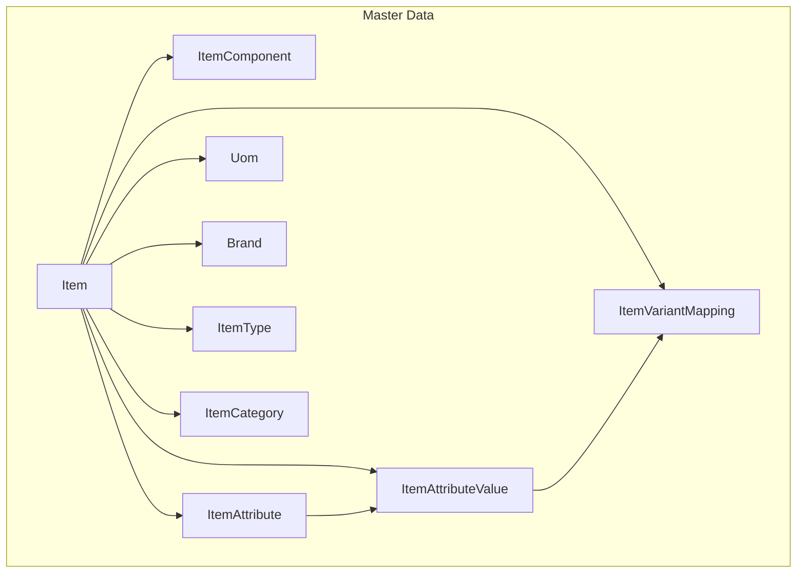
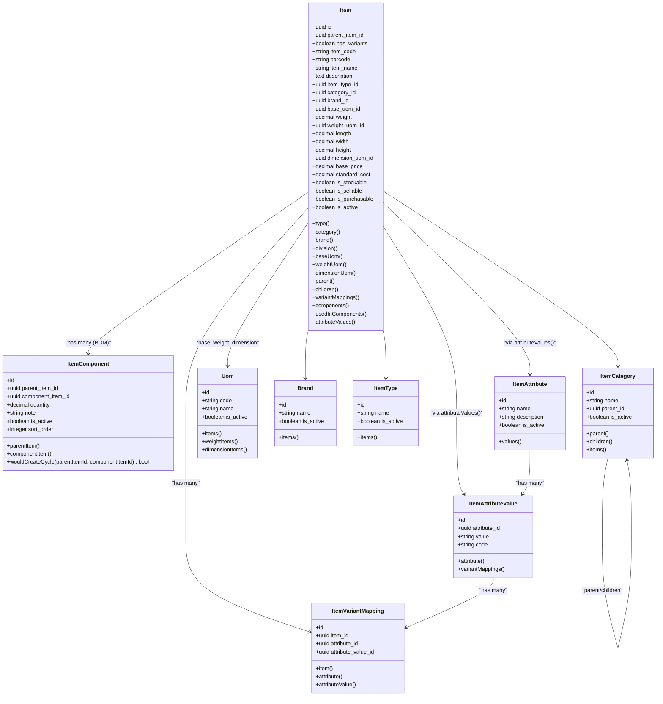
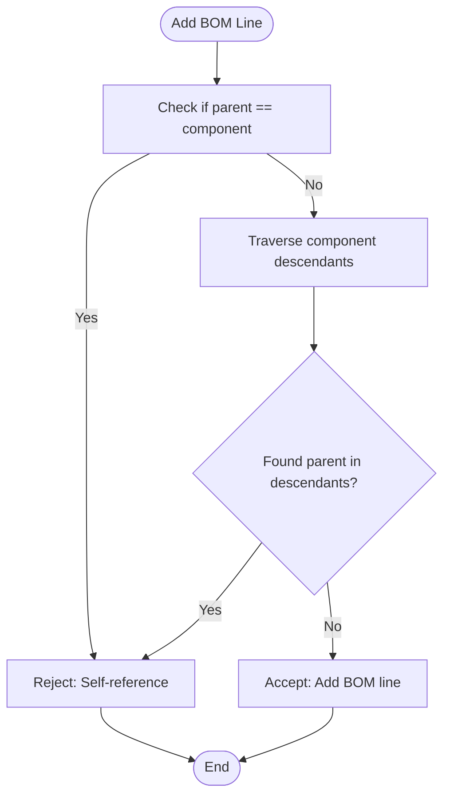
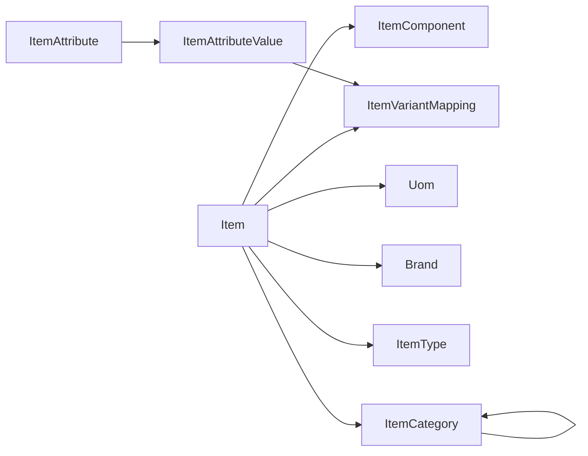

# Master Data Management

<cite>
**Referenced Files in This Document**
- [Item.php](file://app/Models/Item.php)
- [ItemComponent.php](file://app/Models/ItemComponent.php)
- [ItemAttribute.php](file://app/Models/ItemAttribute.php)
- [ItemAttributeValue.php](file://app/Models/ItemAttributeValue.php)
- [Uom.php](file://app/Models/Uom.php)
- [Brand.php](file://app/Models/Brand.php)
- [ItemType.php](file://app/Models/ItemType.php)
- [ItemCategory.php](file://app/Models/ItemCategory.php)
- [ItemVariantMapping.php](file://app/Models/ItemVariantMapping.php)
- [2026_11_13_000007_create_items_table.php](file://database/migrations/2026_11_13_000007_create_items_table.php)
- [2026_11_17_000001_create_item_components_table.php](file://database/migrations/2026_11_17_000001_create_item_components_table.php)
- [2026_11_13_000008_create_item_variant_mappings_table.php](file://database/migrations/2026_11_13_000008_create_item_variant_mappings_table.php)
</cite>

## Table of Contents
1. Introduction
2. Project Structure
3. Core Components
4. Architecture Overview
5. Detailed Component Analysis
6. Dependency Analysis
7. Performance Considerations
8. Troubleshooting Guide
9. Conclusion

## Introduction
This document describes the Master Data Management module with a focus on the Item model as the central entity. It explains how items are categorized, dimensioned, priced, and related to components (Bill of Materials), variants, attributes, units of measure, brands, types, and categories. It also covers data validation rules, relationship constraints, and business logic such as variant configuration and cycle prevention in BOM relationships. Practical examples illustrate creating items with attributes, managing variants, and setting up product hierarchies.

## Project Structure
The master data domain is implemented through Eloquent models and database migrations:
- Models define entities, relationships, casts, and core business rules.
- Migrations define schema, foreign keys, uniqueness, and referential actions.

[No sources needed since this diagram shows conceptual structure]

## Core Components
- Item: Central entity for products/components with identity, classification, dimensions, pricing, behavior flags, parent/variant relationships, inventory links, BOM relationships, and attribute-value mappings.
- ItemComponent: Represents Bill of Materials lines linking a parent item to its component items with quantity, notes, active flag, and sort order; includes cycle detection logic.
- ItemAttribute and ItemAttributeValue: Define dynamic properties and their allowed values.
- Uom: Units of measure used for base unit, weight, and dimensions.
- Brand and ItemType: Classification references for items.
- ItemCategory: Hierarchical categorization with parent-child relationships.
- ItemVariantMapping: Links an item to specific attribute values to represent variants.

Key responsibilities and behaviors:
- Item supports hierarchical organization via parent_item_id and has_variants flag.
- Item stores multiple UOMs for different purposes (base, weight, dimensions).
- ItemComponent prevents circular BOM dependencies.
- ItemAttribute/ItemAttributeValue enable flexible attribute-driven variants.
- ItemCategory provides tree-like categorization.

**Section sources**
- [Item.php:16-64](file://app/Models/Item.php#L16-L64)
- [Item.php:66-171](file://app/Models/Item.php#L66-L171)
- [ItemComponent.php:11-34](file://app/Models/ItemComponent.php#L11-L34)
- [ItemComponent.php:36-84](file://app/Models/ItemComponent.php#L36-L84)
- [ItemAttribute.php:11-30](file://app/Models/ItemAttribute.php#L11-L30)
- [ItemAttributeValue.php:12-26](file://app/Models/ItemAttributeValue.php#L12-L26)
- [Uom.php:11-40](file://app/Models/Uom.php#L11-L40)
- [Brand.php:11-30](file://app/Models/Brand.php#L11-L30)
- [ItemType.php:11-30](file://app/Models/ItemType.php#L11-L30)
- [ItemCategory.php:12-41](file://app/Models/ItemCategory.php#L12-L41)
- [ItemVariantMapping.php:9-25](file://app/Models/ItemVariantMapping.php#L9-L25)

## Architecture Overview
The architecture centers around Item with rich relationships to supporting models. The database enforces referential integrity and uniqueness constraints that reflect business rules.

**Diagram sources**
- [Item.php:16-171](file://app/Models/Item.php#L16-L171)
- [ItemComponent.php:11-84](file://app/Models/ItemComponent.php#L11-L84)
- [ItemAttribute.php:11-30](file://app/Models/ItemAttribute.php#L11-L30)
- [ItemAttributeValue.php:12-26](file://app/Models/ItemAttributeValue.php#L12-L26)
- [Uom.php:11-40](file://app/Models/Uom.php#L11-L40)
- [Brand.php:11-30](file://app/Models/Brand.php#L11-L30)
- [ItemType.php:11-30](file://app/Models/ItemType.php#L11-L30)
- [ItemCategory.php:12-41](file://app/Models/ItemCategory.php#L12-L41)
- [ItemVariantMapping.php:9-25](file://app/Models/ItemVariantMapping.php#L9-L25)

## Detailed Component Analysis

### Item Model
Responsibilities:
- Identity and classification: item_code, barcode, item_name, description, type, category, brand.
- Measurement and pricing: base_uom, weight and weight_uom, length/width/height and dimension_uom, base_price, standard_cost.
- Behavior flags: is_stockable, is_sellable, is_purchasable, is_active.
- Variant hierarchy: parent_item_id and has_variants to distinguish parent items from child variants.
- Relationships:
  - BelongsTo: type, category, brand, division, baseUom, weightUom, dimensionUom, parent.
  - HasMany: children, variantMappings, components, usedInComponents, inventoryBalances, inventoryMovements, externalSyncedUnits.
  - BelongsToMany: attributeValues via pivot table item_variant_mappings.
- Scopes: active, parents, variants.

Validation and casting:
- Boolean fields cast to boolean.
- Numeric fields cast to decimal with appropriate precision.

Business rules:
- Parent/child self-referencing allows building product families and variants.
- Attribute values are associated per item through variant mappings.

Example usage patterns:
- Create a parent item with has_variants = true.
- Create child items referencing parent_item_id.
- Attach attribute values to a variant via ItemVariantMapping.

**Section sources**
- [Item.php:16-64](file://app/Models/Item.php#L16-L64)
- [Item.php:66-171](file://app/Models/Item.php#L66-L171)
- [2026_11_13_000007_create_items_table.php:14-73](file://database/migrations/2026_11_13_000007_create_items_table.php#L14-L73)

### ItemComponent Model (BOM)
Responsibilities:
- Defines a line item in a Bill of Materials: which component item is required by a parent item, quantity, optional note, active flag, and sort order.
- Relationships: parentItem and componentItem both reference Item.

Business rules:
- Uniqueness constraint on (parent_item_id, component_item_id) prevents duplicate BOM lines.
- Cycle prevention: wouldCreateCycle detects if adding a component would create a circular dependency in the BOM graph.

Data types:
- quantity cast to decimal(15,3).
- is_active cast to boolean.
- sort_order cast to integer.

Operational guidance:
- Always validate wouldCreateCycle before inserting or updating a BOM line.
- Use sort_order to control component display and processing sequence.

**Section sources**
- [ItemComponent.php:11-34](file://app/Models/ItemComponent.php#L11-L34)
- [ItemComponent.php:36-84](file://app/Models/ItemComponent.php#L36-L84)
- [2026_11_17_000001_create_item_components_table.php:14-28](file://database/migrations/2026_11_17_000001_create_item_components_table.php#L14-L28)

#### BOM Cycle Prevention Flow

**Diagram sources**
- [ItemComponent.php:50-84](file://app/Models/ItemComponent.php#L50-L84)

### ItemAttribute and ItemAttributeValue
Responsibilities:
- ItemAttribute defines a named property (e.g., Color, Size) with optional description and active status.
- ItemAttributeValue defines concrete values for an attribute (e.g., Red, Large) with optional code.

Relationships:
- ItemAttribute has many ItemAttributeValue.
- ItemAttributeValue belongs to ItemAttribute and participates in variant mappings.

Usage:
- Define attributes once and reuse across items.
- Assign attribute values to specific items via ItemVariantMapping to describe variants.

**Section sources**
- [ItemAttribute.php:11-30](file://app/Models/ItemAttribute.php#L11-L30)
- [ItemAttributeValue.php:12-26](file://app/Models/ItemAttributeValue.php#L12-L26)

### Uom Model
Responsibilities:
- Stores units of measure with code, name, and active status.
- Used by Item for base unit, weight unit, and dimension unit.

Relationships:
- Items reference Uom in three roles: base_uom_id, weight_uom_id, dimension_uom_id.

Usage:
- Ensure consistent measurement units across items.
- Enable conversion contexts where additional logic may be added later.

**Section sources**
- [Uom.php:11-40](file://app/Models/Uom.php#L11-L40)
- [2026_11_13_000007_create_items_table.php:39-55](file://database/migrations/2026_11_13_000007_create_items_table.php#L39-L55)

### Brand and ItemType
Responsibilities:
- Brand groups items by manufacturer or brand.
- ItemType classifies items (e.g., Raw Material, Finished Good).

Relationships:
- Both have one-to-many relationships to Item.

Usage:
- Apply filters and reports by brand or type.
- Enforce classification at creation time.

**Section sources**
- [Brand.php:11-30](file://app/Models/Brand.php#L11-L30)
- [ItemType.php:11-30](file://app/Models/ItemType.php#L11-L30)
- [2026_11_13_000007_create_items_table.php:28-38](file://database/migrations/2026_11_13_000007_create_items_table.php#L28-L38)

### ItemCategory Model
Responsibilities:
- Provides hierarchical categorization via parent_id self-reference.
- Supports active/inactive categories.

Relationships:
- parent and children self-references.
- One-to-many relationship to Item.

Usage:
- Organize items into nested categories for navigation and reporting.

**Section sources**
- [ItemCategory.php:12-41](file://app/Models/ItemCategory.php#L12-L41)

### ItemVariantMapping Model
Responsibilities:
- Associates an Item with specific attribute values to define variants.
- Ensures each item has at most one mapping per attribute (enforced by unique constraint on item_id + attribute_id).

Relationships:
- BelongsTo Item, ItemAttribute, and ItemAttributeValue.

Database constraints:
- Unique index on (item_id, attribute_id) ensures one value per attribute per item.

Usage:
- Build variants by assigning combinations of attribute values to child items.

**Section sources**
- [ItemVariantMapping.php:9-25](file://app/Models/ItemVariantMapping.php#L9-L25)
- [2026_11_13_000008_create_item_variant_mappings_table.php:14-28](file://database/migrations/2026_11_13_000008_create_item_variant_mappings_table.php#L14-L28)

## Dependency Analysis
High-level dependencies among master data models:

**Diagram sources**
- [Item.php:66-171](file://app/Models/Item.php#L66-L171)
- [ItemComponent.php:36-44](file://app/Models/ItemComponent.php#L36-L44)
- [ItemVariantMapping.php:12-25](file://app/Models/ItemVariantMapping.php#L12-L25)
- [Uom.php:27-40](file://app/Models/Uom.php#L27-L40)
- [Brand.php:27-30](file://app/Models/Brand.php#L27-L30)
- [ItemType.php:27-30](file://app/Models/ItemType.php#L27-L30)
- [ItemCategory.php:28-41](file://app/Models/ItemCategory.php#L28-L41)
- [ItemAttribute.php:27-30](file://app/Models/ItemAttribute.php#L27-L30)
- [ItemAttributeValue.php:18-26](file://app/Models/ItemAttributeValue.php#L18-L26)

**Section sources**
- [Item.php:66-171](file://app/Models/Item.php#L66-L171)
- [ItemComponent.php:36-44](file://app/Models/ItemComponent.php#L36-L44)
- [ItemVariantMapping.php:12-25](file://app/Models/ItemVariantMapping.php#L12-L25)
- [Uom.php:27-40](file://app/Models/Uom.php#L27-L40)
- [Brand.php:27-30](file://app/Models/Brand.php#L27-L30)
- [ItemType.php:27-30](file://app/Models/ItemType.php#L27-L30)
- [ItemCategory.php:28-41](file://app/Models/ItemCategory.php#L28-L41)
- [ItemAttribute.php:27-30](file://app/Models/ItemAttribute.php#L27-L30)
- [ItemAttributeValue.php:18-26](file://app/Models/ItemAttributeValue.php#L18-L26)

## Performance Considerations
- Prefer eager loading when retrieving items with relationships (e.g., type, category, brand, baseUom, components, attributeValues) to avoid N+1 queries.
- Use scopes like active, parents, and variants to filter datasets efficiently.
- Leverage unique constraints on item_code, barcode, and composite keys (e.g., item_id + attribute_id) to prevent redundant data and ensure fast lookups.
- Keep BOM traversal minimal; use wouldCreateCycle only during write operations.

[No sources needed since this section provides general guidance]

## Troubleshooting Guide
Common issues and resolutions:
- Duplicate item identifiers:
  - Symptom: Integrity error on item_code or barcode.
  - Resolution: Ensure uniqueness before insert; update existing records instead of duplicating.
- Invalid BOM cycles:
  - Symptom: Attempting to add a component that creates a loop.
  - Resolution: Call wouldCreateCycle before saving; adjust BOM structure to break cycles.
- Missing attribute mappings:
  - Symptom: Variant cannot be resolved due to missing attribute values.
  - Resolution: Verify ItemVariantMapping entries exist for all required attributes.
- Unit mismatches:
  - Symptom: Incorrect weight/dimension calculations.
  - Resolution: Confirm correct UOM assignments for base, weight, and dimensions.

**Section sources**
- [ItemComponent.php:50-84](file://app/Models/ItemComponent.php#L50-L84)
- [2026_11_13_000007_create_items_table.php:22-25](file://database/migrations/2026_11_13_000007_create_items_table.php#L22-L25)
- [2026_11_13_000008_create_item_variant_mappings_table.php:27-28](file://database/migrations/2026_11_13_000008_create_item_variant_mappings_table.php#L27-L28)

## Conclusion
The Master Data Management module centers on a robust Item model supported by clear relationships and constraints. Variants are modeled through attribute-value mappings, while BOM relationships are enforced to maintain acyclic structures. Categories, brands, types, and units provide comprehensive classification and measurement capabilities. Following the validation rules and using the provided relationships and utilities will ensure consistent, reliable master data management.

[No sources needed since this section summarizes without analyzing specific files]