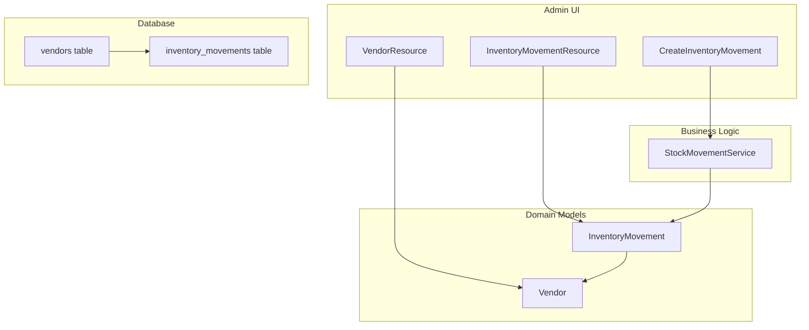
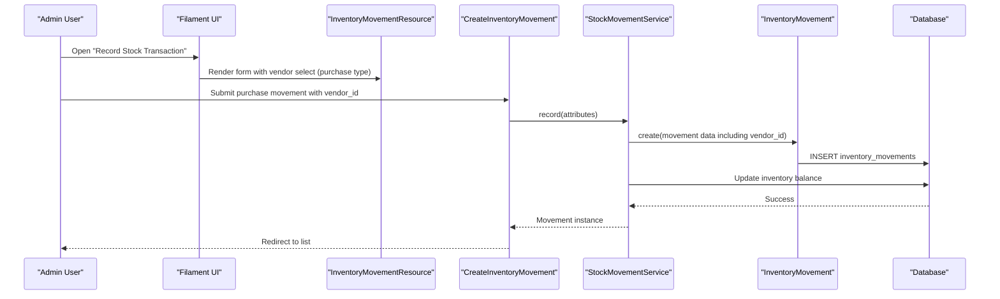
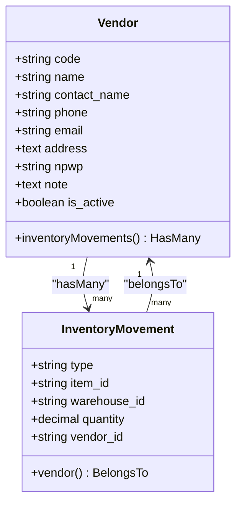
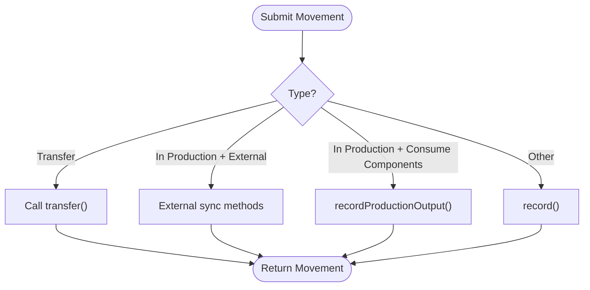
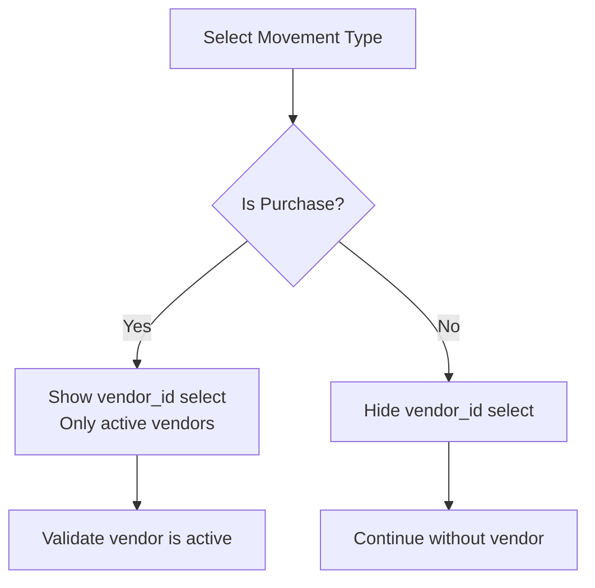
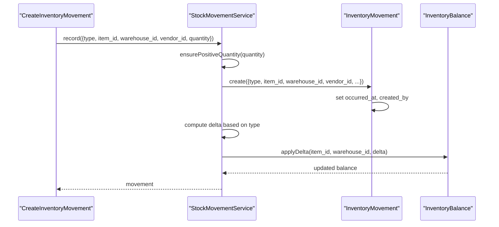
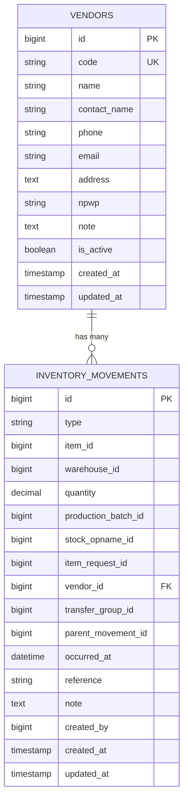
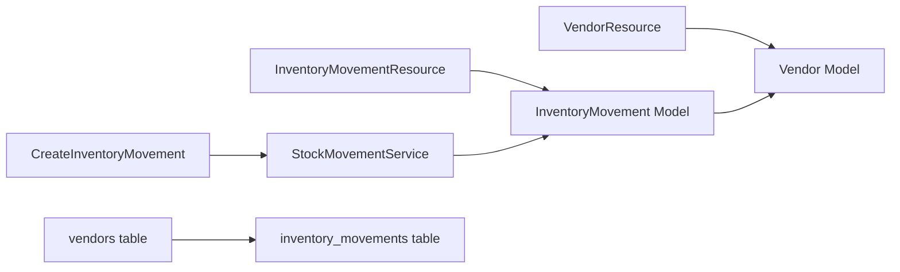

# Vendor Management System

<cite>
**Referenced Files in This Document**
- [Vendor.php](file://app/Models/Vendor.php)
- [InventoryMovement.php](file://app/Models/InventoryMovement.php)
- [VendorResource.php](file://app/Filament/Resources/Vendors/VendorResource.php)
- [CreateInventoryMovement.php](file://app/Filament/Resources/InventoryMovements/Pages/CreateInventoryMovement.php)
- [InventoryMovementResource.php](file://app/Filament/Resources/InventoryMovements/InventoryMovementResource.php)
- [StockMovementService.php](file://app/Services/StockMovementService.php)
- [2026_11_26_000002_create_vendors_table.php](file://database/migrations/2026_11_26_000002_create_vendors_table.php)
- [2026_11_26_000003_add_vendor_id_to_inventory_movements_table.php](file://database/migrations/2026_11_26_000003_add_vendor_id_to_inventory_movements_table.php)
- [StockMovementTest.php](file://tests/Feature/StockMovementTest.php)
</cite>

## Table of Contents
1. [Introduction](#introduction)
2. [Project Structure](#project-structure)
3. [Core Components](#core-components)
4. [Architecture Overview](#architecture-overview)
5. [Detailed Component Analysis](#detailed-component-analysis)
6. [Dependency Analysis](#dependency-analysis)
7. [Performance Considerations](#performance-considerations)
8. [Troubleshooting Guide](#troubleshooting-guide)
9. [Conclusion](#conclusion)

## Introduction
This document explains the vendor management functionality within the inventory system. Vendors represent suppliers and are linked to purchase-related stock movements. The system provides a Filament-based admin interface for managing vendors, while inventory movement creation validates that only active vendors can be selected for purchase transactions. The vendor relationship is persisted through a foreign key on the inventory movements table and exposed via Eloquent relationships.

## Project Structure
The vendor feature spans models, database migrations, Filament resources, pages, services, and tests:

- Data model: `Vendor`
- Movement model with vendor relationship: `InventoryMovement`
- Admin resource for vendor CRUD: `VendorResource`
- Inventory movement creation page routing business logic: `CreateInventoryMovement`
- Inventory movement form configuration including vendor selection: `InventoryMovementResource`
- Core transaction service handling movement recording and validation: `StockMovementService`
- Database schema definitions for vendors and vendor linkage: migration files
- Feature tests validating vendor behavior during stock movements: `StockMovementTest`

**Diagram sources**
- [VendorResource.php:24-40](file://app/Filament/Resources/Vendors/VendorResource.php#L24-L40)
- [CreateInventoryMovement.php:20-54](file://app/Filament/Resources/InventoryMovements/Pages/CreateInventoryMovement.php#L20-L54)
- [InventoryMovementResource.php:95-106](file://app/Filament/Resources/InventoryMovements/InventoryMovementResource.php#L95-L106)
- [Vendor.php:27-30](file://app/Models/Vendor.php#L27-L30)
- [InventoryMovement.php:88-91](file://app/Models/InventoryMovement.php#L88-L91)
- [StockMovementService.php:23-61](file://app/Services/StockMovementService.php#L23-L61)
- [2026_11_26_000002_create_vendors_table.php:11-23](file://database/migrations/2026_11_26_000002_create_vendors_table.php#L11-L23)
- [2026_11_26_000003_add_vendor_id_to_inventory_movements_table.php:11-17](file://database/migrations/2026_11_26_000003_add_vendor_id_to_inventory_movements_table.php#L11-L17)

**Section sources**
- [Vendor.php:1-32](file://app/Models/Vendor.php#L1-L32)
- [InventoryMovement.php:13-28](file://app/Models/InventoryMovement.php#L13-L28)
- [VendorResource.php:24-40](file://app/Filament/Resources/Vendors/VendorResource.php#L24-L40)
- [CreateInventoryMovement.php:20-54](file://app/Filament/Resources/InventoryMovements/Pages/CreateInventoryMovement.php#L20-L54)
- [InventoryMovementResource.php:95-106](file://app/Filament/Resources/InventoryMovements/InventoryMovementResource.php#L95-L106)
- [StockMovementService.php:23-61](file://app/Services/StockMovementService.php#L23-L61)
- [2026_11_26_000002_create_vendors_table.php:11-23](file://database/migrations/2026_11_26_000002_create_vendors_table.php#L11-L23)
- [2026_11_26_000003_add_vendor_id_to_inventory_movements_table.php:11-17](file://database/migrations/2026_11_26_000003_add_vendor_id_to_inventory_movements_table.php#L11-L17)

## Core Components
- Vendor model defines fillable fields, boolean casting, and a one-to-many relationship to inventory movements.
- InventoryMovement model includes a belongsTo relationship to Vendor and exposes type constants used across the application.
- VendorResource configures the Filament form, table columns, filters, actions, and navigation metadata for vendor management.
- CreateInventoryMovement routes different movement types to appropriate service methods and handles validation exceptions.
- InventoryMovementResource configures the movement form, including conditional visibility of the vendor field for purchase-type movements.
- StockMovementService records movements, updates balances, enforces positive quantities, and manages production output and transfers.

**Section sources**
- [Vendor.php:11-30](file://app/Models/Vendor.php#L11-L30)
- [InventoryMovement.php:34-91](file://app/Models/InventoryMovement.php#L34-L91)
- [VendorResource.php:42-135](file://app/Filament/Resources/Vendors/VendorResource.php#L42-L135)
- [CreateInventoryMovement.php:20-54](file://app/Filament/Resources/InventoryMovements/Pages/CreateInventoryMovement.php#L20-L54)
- [InventoryMovementResource.php:95-106](file://app/Filament/Resources/InventoryMovements/InventoryMovementResource.php#L95-L106)
- [StockMovementService.php:23-61](file://app/Services/StockMovementService.php#L23-L61)

## Architecture Overview
The vendor management flow integrates UI, domain models, and services:

**Diagram sources**
- [InventoryMovementResource.php:95-106](file://app/Filament/Resources/InventoryMovements/InventoryMovementResource.php#L95-L106)
- [CreateInventoryMovement.php:20-54](file://app/Filament/Resources/InventoryMovements/Pages/CreateInventoryMovement.php#L20-L54)
- [StockMovementService.php:23-61](file://app/Services/StockMovementService.php#L23-L61)
- [InventoryMovement.php:88-91](file://app/Models/InventoryMovement.php#L88-L91)

## Detailed Component Analysis

### Vendor Model
The Vendor model encapsulates supplier information and links to inventory movements. It casts `is_active` to boolean and exposes a `hasMany` relationship to `InventoryMovement`.

**Diagram sources**
- [Vendor.php:11-30](file://app/Models/Vendor.php#L11-L30)
- [InventoryMovement.php:88-91](file://app/Models/InventoryMovement.php#L88-L91)

**Section sources**
- [Vendor.php:11-30](file://app/Models/Vendor.php#L11-L30)

### Vendor Resource (Filament Admin)
The VendorResource configures:
- Navigation group and icon
- Record title attribute
- Form fields for vendor details and active status
- Table columns including searchable and sortable fields, counts of related movements, and an active indicator
- Filters for active status
- Actions allowing edit and delete, with delete hidden when the vendor has associated movements
- Pages mapping index, create, and edit routes

Key behaviors:
- Unique code validation
- Active toggle with helper text explaining inactive vendor restrictions
- Deletion protection based on movement count

**Section sources**
- [VendorResource.php:24-40](file://app/Filament/Resources/Vendors/VendorResource.php#L24-L40)
- [VendorResource.php:42-82](file://app/Filament/Resources/Vendors/VendorResource.php#L42-L82)
- [VendorResource.php:84-135](file://app/Filament/Resources/Vendors/VendorResource.php#L84-L135)
- [VendorResource.php:138-145](file://app/Filament/Resources/Vendors/VendorResource.php#L138-L145)

### Inventory Movement Creation Flow
The CreateInventoryMovement page delegates to StockMovementService based on movement type:
- Transfer flows call transfer method
- External production outputs delegate to external sync services
- Production output with component consumption calls recordProductionOutput
- Default path calls record

Validation exceptions from the service are rethrown with prefixed keys for proper form error display.

**Diagram sources**
- [CreateInventoryMovement.php:20-54](file://app/Filament/Resources/InventoryMovements/Pages/CreateInventoryMovement.php#L20-L54)
- [StockMovementService.php:148-201](file://app/Services/StockMovementService.php#L148-L201)
- [StockMovementService.php:69-140](file://app/Services/StockMovementService.php#L69-L140)
- [StockMovementService.php:23-61](file://app/Services/StockMovementService.php#L23-L61)

**Section sources**
- [CreateInventoryMovement.php:20-54](file://app/Filament/Resources/InventoryMovements/Pages/CreateInventoryMovement.php#L20-L54)

### Inventory Movement Form Vendor Selection
The inventory movement form conditionally shows the vendor field only for purchase-type movements. The vendor select restricts options to active vendors and displays both code and name.

**Diagram sources**
- [InventoryMovementResource.php:95-106](file://app/Filament/Resources/InventoryMovements/InventoryMovementResource.php#L95-L106)

**Section sources**
- [InventoryMovementResource.php:95-106](file://app/Filament/Resources/InventoryMovements/InventoryMovementResource.php#L95-L106)

### Stock Movement Service and Vendor Handling
The StockMovementService records movements by:
- Validating positive quantity
- Creating an InventoryMovement with allowed attributes including vendor_id
- Applying delta to inventory balance
- Returning the created movement

For purchase-type movements, the vendor_id is preserved and accessible via the relationship. Tests assert that inactive vendors cannot be selected for new purchases and that changing transaction type does not save a hidden vendor.

**Diagram sources**
- [StockMovementService.php:23-61](file://app/Services/StockMovementService.php#L23-L61)
- [StockMovementService.php:349-390](file://app/Services/StockMovementService.php#L349-L390)

**Section sources**
- [StockMovementService.php:23-61](file://app/Services/StockMovementService.php#L23-L61)
- [StockMovementTest.php:190-256](file://tests/Feature/StockMovementTest.php#L190-L256)

### Database Schema for Vendors and Movements
- Vendors table includes unique code, name, contact details, NPWP, address, notes, and active flag.
- Inventory movements table gains a nullable vendor_id foreign key referencing vendors with restrict-on-delete behavior.

**Diagram sources**
- [2026_11_26_000002_create_vendors_table.php:11-23](file://database/migrations/2026_11_26_000002_create_vendors_table.php#L11-L23)
- [2026_11_26_000003_add_vendor_id_to_inventory_movements_table.php:11-17](file://database/migrations/2026_11_26_000003_add_vendor_id_to_inventory_movements_table.php#L11-L17)

**Section sources**
- [2026_11_26_000002_create_vendors_table.php:11-23](file://database/migrations/2026_11_26_000002_create_vendors_table.php#L11-L23)
- [2026_11_26_000003_add_vendor_id_to_inventory_movements_table.php:11-17](file://database/migrations/2026_11_26_000003_add_vendor_id_to_inventory_movements_table.php#L11-L17)

## Dependency Analysis
The vendor feature depends on:
- Eloquent relationships between Vendor and InventoryMovement
- Filament resource configuration for vendor CRUD and movement forms
- Service layer for movement recording and validation
- Database constraints ensuring referential integrity

**Diagram sources**
- [VendorResource.php:24-40](file://app/Filament/Resources/Vendors/VendorResource.php#L24-L40)
- [InventoryMovementResource.php:95-106](file://app/Filament/Resources/InventoryMovements/InventoryMovementResource.php#L95-L106)
- [CreateInventoryMovement.php:20-54](file://app/Filament/Resources/InventoryMovements/Pages/CreateInventoryMovement.php#L20-L54)
- [StockMovementService.php:23-61](file://app/Services/StockMovementService.php#L23-L61)
- [Vendor.php:27-30](file://app/Models/Vendor.php#L27-L30)
- [InventoryMovement.php:88-91](file://app/Models/InventoryMovement.php#L88-L91)
- [2026_11_26_000002_create_vendors_table.php:11-23](file://database/migrations/2026_11_26_000002_create_vendors_table.php#L11-L23)
- [2026_11_26_000003_add_vendor_id_to_inventory_movements_table.php:11-17](file://database/migrations/2026_11_26_000003_add_vendor_id_to_inventory_movements_table.php#L11-L17)

**Section sources**
- [Vendor.php:27-30](file://app/Models/Vendor.php#L27-L30)
- [InventoryMovement.php:88-91](file://app/Models/InventoryMovement.php#L88-L91)
- [VendorResource.php:24-40](file://app/Filament/Resources/Vendors/VendorResource.php#L24-L40)
- [InventoryMovementResource.php:95-106](file://app/Filament/Resources/InventoryMovements/InventoryMovementResource.php#L95-L106)
- [CreateInventoryMovement.php:20-54](file://app/Filament/Resources/InventoryMovements/Pages/CreateInventoryMovement.php#L20-L54)
- [StockMovementService.php:23-61](file://app/Services/StockMovementService.php#L23-L61)

## Performance Considerations
- Vendor selection uses a filtered query for active vendors, reducing option set size.
- Movement recording uses database transactions to ensure consistency when updating balances.
- Delete operations protect vendors with existing movements, preventing accidental data loss.
- Table counts for vendor movements avoid N+1 queries by using eager counting.

[No sources needed since this section provides general guidance]

## Troubleshooting Guide
Common issues and resolutions:
- Inactive vendor selected for purchase movement:
  - Ensure the vendor is marked active before creating purchase movements.
  - The form restricts vendor options to active vendors; if a vendor was previously selected and then deactivated, the submission will fail validation.
- Hidden vendor field not saved:
  - Changing transaction type hides the vendor field; ensure the correct type is selected when setting vendor_id.
- Movement deletion blocked due to stock usage:
  - If inventory has been consumed after an incoming movement, deletion may be prevented to maintain balance integrity.

**Section sources**
- [StockMovementTest.php:230-256](file://tests/Feature/StockMovementTest.php#L230-L256)
- [StockMovementService.php:297-347](file://app/Services/StockMovementService.php#L297-L347)

## Conclusion
The vendor management system integrates vendor master data with inventory purchase transactions. The Filament admin interface provides robust CRUD capabilities for vendors, while inventory movement creation ensures only active vendors are used for purchases. The database schema enforces referential integrity, and the service layer guarantees consistent stock updates. Tests validate critical behaviors such as vendor activation checks and preservation of vendor associations during purchase movements.

[No sources needed since this section summarizes without analyzing specific files]