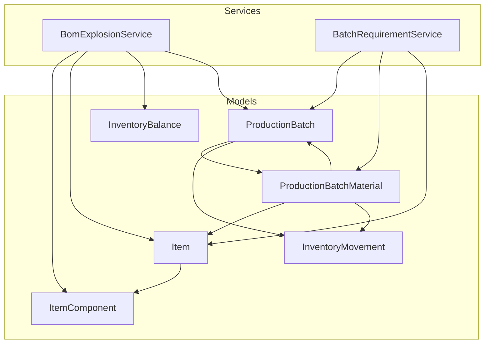
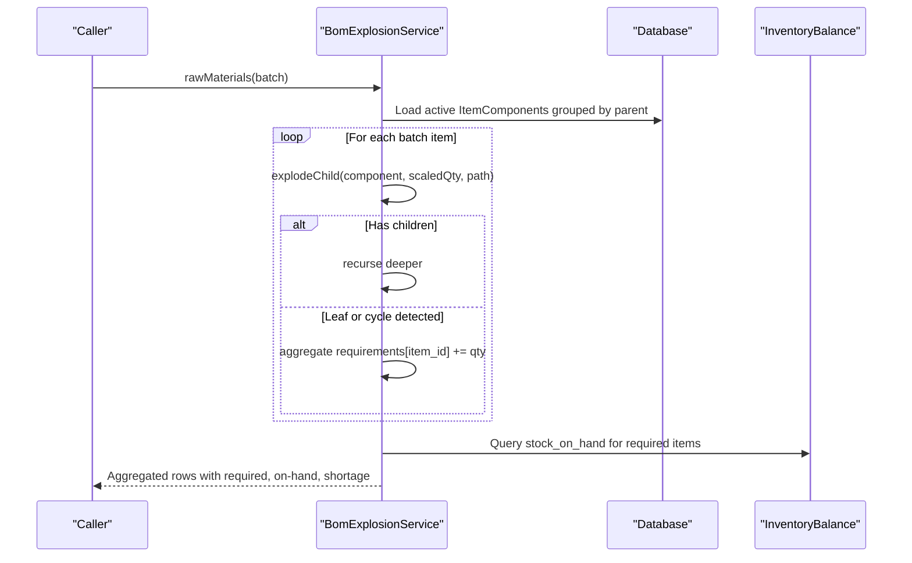
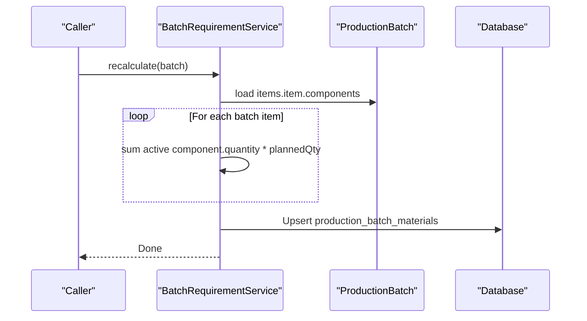
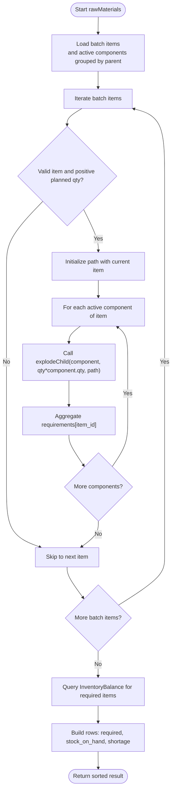
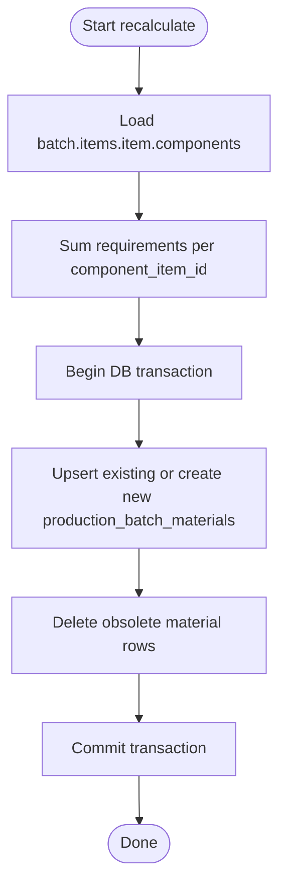
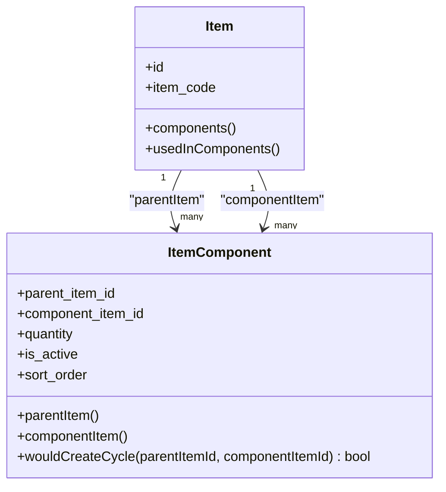
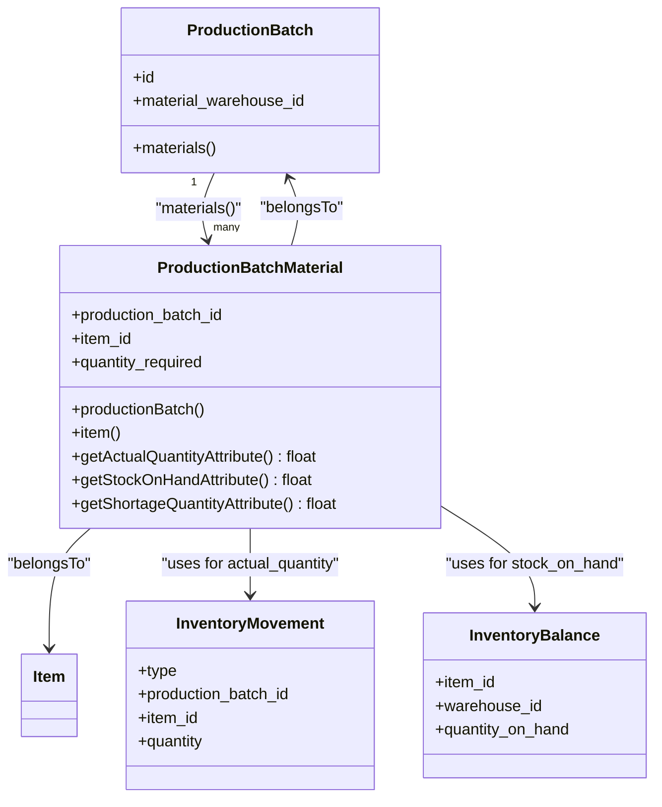
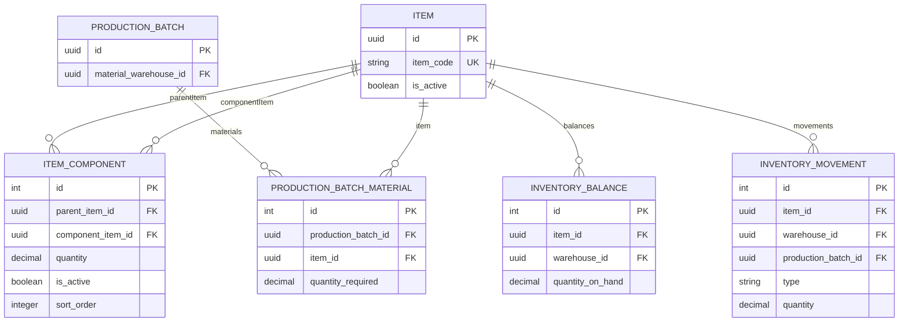
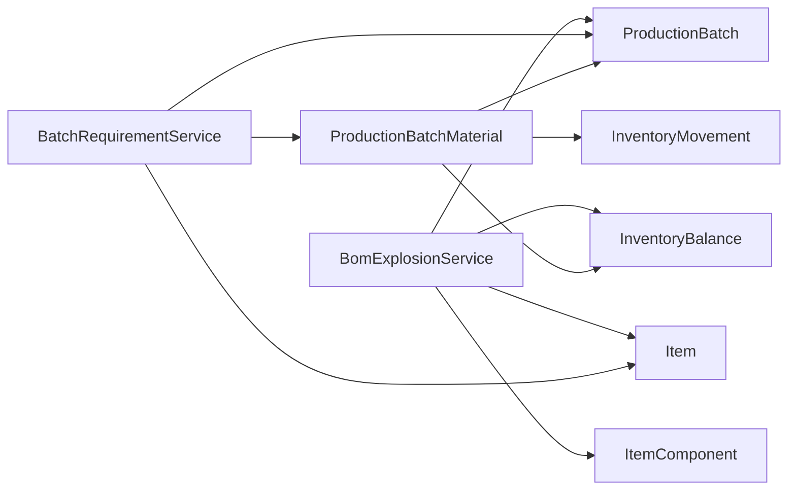

# BOM Explosion & Material Planning

<cite>
**Referenced Files in This Document**
- [BomExplosionService.php](file://app/Services/BomExplosionService.php)
- [BatchRequirementService.php](file://app/Services/BatchRequirementService.php)
- [ItemComponent.php](file://app/Models/ItemComponent.php)
- [ProductionBatchMaterial.php](file://app/Models/ProductionBatchMaterial.php)
- [Item.php](file://app/Models/Item.php)
- [ProductionBatch.php](file://app/Models/ProductionBatch.php)
- [InventoryBalance.php](file://app/Models/InventoryBalance.php)
- [InventoryMovement.php](file://app/Models/InventoryMovement.php)
- [BomBuilderTest.php](file://tests/Feature/BomBuilderTest.php)
- [ProductionBatchTest.php](file://tests/Feature/ProductionBatchTest.php)
</cite>

## Table of Contents
1. [Introduction](#introduction)
2. [Project Structure](#project-structure)
3. [Core Components](#core-components)
4. [Architecture Overview](#architecture-overview)
5. [Detailed Component Analysis](#detailed-component-analysis)
6. [Dependency Analysis](#dependency-analysis)
7. [Performance Considerations](#performance-considerations)
8. [Troubleshooting Guide](#troubleshooting-guide)
9. [Conclusion](#conclusion)

## Introduction
This document explains the Bill of Materials explosion and material requirement planning logic in the project. It focuses on:
- How `BomExplosionService` recursively expands product hierarchies into raw material requirements.
- How `BatchRequirementService` calculates and persists material needs for a production batch based on planned quantities and active BOM components.
- The data models that define product hierarchies and track required materials, including integration with inventory levels to compute net shortages.
- Examples of complex BOM structures, calculation workflows, and how inventory balances determine whether materials are sufficient.

The goal is to make these concepts accessible while preserving precise technical details about the implementation.

## Project Structure
The relevant code lives under `app/Services`, `app/Models`, and tests under `tests/Feature`. The services encapsulate business logic for BOM explosion and batch material planning, while Eloquent models represent items, components, batches, and inventory.

**Diagram sources**
- [BomExplosionService.php:11-107](file://app/Services/BomExplosionService.php#L11-L107)
- [BatchRequirementService.php:14-59](file://app/Services/BatchRequirementService.php#L14-L59)
- [ItemComponent.php:36-44](file://app/Models/ItemComponent.php#L36-L44)
- [ProductionBatchMaterial.php:31-39](file://app/Models/ProductionBatchMaterial.php#L31-L39)
- [Item.php:136-144](file://app/Models/Item.php#L136-L144)
- [ProductionBatch.php:59-72](file://app/Models/ProductionBatch.php#L59-L72)
- [InventoryBalance.php:37-45](file://app/Models/InventoryBalance.php#L37-L45)
- [InventoryMovement.php:62-75](file://app/Models/InventoryMovement.php#L62-L75)

**Section sources**
- [BomExplosionService.php:11-107](file://app/Services/BomExplosionService.php#L11-L107)
- [BatchRequirementService.php:14-59](file://app/Services/BatchRequirementService.php#L14-L59)
- [ItemComponent.php:36-44](file://app/Models/ItemComponent.php#L36-L44)
- [ProductionBatchMaterial.php:31-39](file://app/Models/ProductionBatchMaterial.php#L31-L39)
- [Item.php:136-144](file://app/Models/Item.php#L136-L144)
- [ProductionBatch.php:59-72](file://app/Models/ProductionBatch.php#L59-L72)
- [InventoryBalance.php:37-45](file://app/Models/InventoryBalance.php#L37-L45)
- [InventoryMovement.php:62-75](file://app/Models/InventoryMovement.php#L62-L75)

## Core Components
- `BomExplosionService`: Recursively explodes parent items into leaf-level component requirements, aggregates total required quantities per item, and integrates current inventory to calculate shortage.
- `BatchRequirementService`: Computes direct material requirements from active BOM lines for each planned product in a batch and persists them as snapshots in `production_batch_materials`.
- `ItemComponent`: Defines hierarchical relationships between parent items and their components, including cycle prevention utilities.
- `ProductionBatchMaterial`: Represents required materials for a batch, with computed attributes for actual usage, stock on hand, and shortage quantity.

Key responsibilities:
- BOM traversal and aggregation: `BomExplosionService::rawMaterials` and its recursive helper.
- Batch material snapshotting: `BatchRequirementService::recalculate`.
- Inventory-aware shortage calculation: both services use `InventoryBalance`; `ProductionBatchMaterial` also exposes convenience attributes.

**Section sources**
- [BomExplosionService.php:22-107](file://app/Services/BomExplosionService.php#L22-L107)
- [BatchRequirementService.php:14-59](file://app/Services/BatchRequirementService.php#L14-L59)
- [ItemComponent.php:11-44](file://app/Models/ItemComponent.php#L11-L44)
- [ProductionBatchMaterial.php:11-39](file://app/Models/ProductionBatchMaterial.php#L11-L39)

## Architecture Overview
The system separates two related but distinct concerns:
- Exploded raw material requirements (including multi-level BOM expansion and inventory integration).
- Direct batch material requirements (snapshot of immediate components needed by planned products).

**Diagram sources**
- [BomExplosionService.php:22-107](file://app/Services/BomExplosionService.php#L22-L107)
- [InventoryBalance.php:37-45](file://app/Models/InventoryBalance.php#L37-L45)

**Diagram sources**
- [BatchRequirementService.php:14-59](file://app/Services/BatchRequirementService.php#L14-L59)
- [ProductionBatch.php:59-67](file://app/Models/ProductionBatch.php#L59-L67)

## Detailed Component Analysis

### BomExplosionService: Recursive BOM Explosion
`BomExplosionService::rawMaterials` performs the following:
- Loads batch items and preloads related data.
- Loads all active `ItemComponent` records grouped by parent item for efficient lookup.
- Iterates over each planned batch item and starts recursion from its components.
- Uses `explodeChild` to traverse the BOM tree:
  - If an item has no active children or a cycle is detected via the `path` tracker, it treats the item as a leaf and accumulates its required quantity.
  - Otherwise, it recurses into child components, scaling quantities by component ratios.
- After recursion, aggregates total required quantities per item ID.
- Joins current inventory (`InventoryBalance`) filtered by the batch’s material warehouse when present.
- Returns a collection of rows containing item, required quantity, stock on hand, and shortage quantity.

Complexity considerations:
- Time complexity is proportional to the number of BOM edges traversed plus inventory lookups for unique required items.
- Space complexity includes the aggregated requirements map and recursion stack depth bounded by BOM depth.

Cycle protection:
- The service uses an in-memory `path` array to avoid infinite recursion if cycles exist in the BOM graph.
- Additionally, `ItemComponent::wouldCreateCycle` provides a utility to validate new component assignments before saving.

**Diagram sources**
- [BomExplosionService.php:22-107](file://app/Services/BomExplosionService.php#L22-L107)

**Section sources**
- [BomExplosionService.php:22-107](file://app/Services/BomExplosionService.php#L22-L107)
- [ItemComponent.php:50-84](file://app/Models/ItemComponent.php#L50-L84)

### BatchRequirementService: Batch Material Snapshot
`BatchRequirementService::recalculate` computes direct material requirements for a production batch:
- Loads batch items and their active components.
- Sums up required quantities per component item across all planned products.
- Persists results atomically within a database transaction:
  - Updates existing `production_batch_materials` rows where applicable.
  - Creates new rows for missing components.
  - Deletes obsolete rows not present in the new requirements set.

This approach ensures the snapshot always reflects the latest BOM and planned quantities.

**Diagram sources**
- [BatchRequirementService.php:14-59](file://app/Services/BatchRequirementService.php#L14-L59)

**Section sources**
- [BatchRequirementService.php:14-59](file://app/Services/BatchRequirementService.php#L14-L59)

### ItemComponent Model: Product Hierarchy Definition
`ItemComponent` defines the relationship between a parent item and its component item:
- Fields include parent and component item IDs, quantity per unit, notes, activity flag, and sort order.
- Relationships:
  - `parentItem`: belongs to the parent `Item`.
  - `componentItem`: belongs to the component `Item`.
- Cycle prevention:
  - `wouldCreateCycle` checks whether adding a component would introduce a cycle by traversing descendants of the proposed component and checking if any ancestor equals the parent.

**Diagram sources**
- [ItemComponent.php:36-44](file://app/Models/ItemComponent.php#L36-L44)
- [Item.php:136-144](file://app/Models/Item.php#L136-L144)

**Section sources**
- [ItemComponent.php:11-84](file://app/Models/ItemComponent.php#L11-L84)
- [Item.php:136-144](file://app/Models/Item.php#L136-L144)

### ProductionBatchMaterial Model: Required Materials Tracking
`ProductionBatchMaterial` represents the required materials for a production batch:
- Links to `ProductionBatch` and `Item`.
- Provides computed attributes:
  - `actual_quantity`: sums outgoing production movements for this batch and item.
  - `stock_on_hand`: sums inventory balances for the item, optionally scoped to the batch’s material warehouse.
  - `shortage_quantity`: difference between required and available stock, floored at zero.

**Diagram sources**
- [ProductionBatchMaterial.php:31-72](file://app/Models/ProductionBatchMaterial.php#L31-L72)
- [InventoryMovement.php:62-75](file://app/Models/InventoryMovement.php#L62-L75)
- [InventoryBalance.php:37-45](file://app/Models/InventoryBalance.php#L37-L45)

**Section sources**
- [ProductionBatchMaterial.php:11-72](file://app/Models/ProductionBatchMaterial.php#L11-L72)
- [InventoryMovement.php:62-75](file://app/Models/InventoryMovement.php#L62-L75)
- [InventoryBalance.php:37-45](file://app/Models/InventoryBalance.php#L37-L45)

### Data Models Overview
The core entities involved in BOM explosion and material planning are:

**Diagram sources**
- [Item.php:16-44](file://app/Models/Item.php#L16-L44)
- [ItemComponent.php:11-18](file://app/Models/ItemComponent.php#L11-L18)
- [ProductionBatch.php:12-21](file://app/Models/ProductionBatch.php#L12-L21)
- [ProductionBatchMaterial.php:11-15](file://app/Models/ProductionBatchMaterial.php#L11-L15)
- [InventoryBalance.php:13-19](file://app/Models/InventoryBalance.php#L13-L19)
- [InventoryMovement.php:13-27](file://app/Models/InventoryMovement.php#L13-L27)

## Dependency Analysis
- `BomExplosionService` depends on:
  - `ItemComponent` for BOM structure.
  - `Item` for item metadata.
  - `InventoryBalance` for current stock levels.
  - `ProductionBatch` for context such as material warehouse.
- `BatchRequirementService` depends on:
  - `ProductionBatch` and its `items` and `materials` relations.
  - `Item` through loaded components.
  - Database transactions for atomic updates.
- `ProductionBatchMaterial` depends on:
  - `InventoryMovement` to compute actual consumption.
  - `InventoryBalance` to compute available stock.
  - `ProductionBatch` to scope warehouse and linkage.

**Diagram sources**
- [BomExplosionService.php:11-107](file://app/Services/BomExplosionService.php#L11-L107)
- [BatchRequirementService.php:14-59](file://app/Services/BatchRequirementService.php#L14-L59)
- [ProductionBatchMaterial.php:31-72](file://app/Models/ProductionBatchMaterial.php#L31-L72)

**Section sources**
- [BomExplosionService.php:11-107](file://app/Services/BomExplosionService.php#L11-L107)
- [BatchRequirementService.php:14-59](file://app/Services/BatchRequirementService.php#L14-L59)
- [ProductionBatchMaterial.php:31-72](file://app/Models/ProductionBatchMaterial.php#L31-L72)

## Performance Considerations
- Preloading and grouping:
  - `BomExplosionService` loads all active components once and groups by parent to minimize repeated queries during recursion.
- Warehouse scoping:
  - Both services consider the batch’s material warehouse when querying inventory balances, reducing unnecessary data and improving accuracy.
- Atomic updates:
  - `BatchRequirementService` wraps material snapshot updates in a transaction to prevent partial states.
- Rounding and precision:
  - Quantities are cast to decimals with appropriate precision to avoid floating-point drift.

Recommendations:
- Index frequently queried foreign keys (e.g., `item_components.parent_item_id`, `inventory_balances.item_id`).
- Consider caching static BOM structures if they change infrequently.
- Monitor deep BOM trees for excessive recursion; consider iterative approaches for very large hierarchies.

[No sources needed since this section provides general guidance]

## Troubleshooting Guide
Common issues and resolutions:
- Unexpected zero requirements:
  - Ensure planned quantities are positive and items exist.
  - Verify that components are marked active.
- Missing materials after recalculation:
  - Confirm that `BatchRequirementService::recalculate` was invoked after updating BOM or planned quantities.
  - Check that the transaction committed successfully.
- Incorrect shortage values:
  - Validate inventory balances for the correct warehouse.
  - Ensure `ProductionBatchMaterial::getStockOnHandAttribute` is using the batch’s material warehouse.
- Infinite recursion or performance degradation:
  - Inspect BOM for cycles; use `ItemComponent::wouldCreateCycle` to validate new entries.
  - Review deep hierarchies and consider flattening or optimizing BOM design.

**Section sources**
- [BomExplosionService.php:22-107](file://app/Services/BomExplosionService.php#L22-L107)
- [BatchRequirementService.php:14-59](file://app/Services/BatchRequirementService.php#L14-L59)
- [ItemComponent.php:50-84](file://app/Models/ItemComponent.php#L50-L84)
- [ProductionBatchMaterial.php:41-72](file://app/Models/ProductionBatchMaterial.php#L41-L72)

## Conclusion
The system implements robust BOM explosion and material planning:
- `BomExplosionService` provides detailed, inventory-aware raw material requirements by recursively expanding product hierarchies.
- `BatchRequirementService` maintains accurate, transactional snapshots of direct material needs for production batches.
- Models like `ItemComponent` and `ProductionBatchMaterial` provide clear relationships and computed attributes to support shortage analysis and tracking.
- Integration with inventory balances ensures net requirements reflect real-world stock positions, enabling informed procurement and production decisions.

[No sources needed since this section summarizes without analyzing specific files]