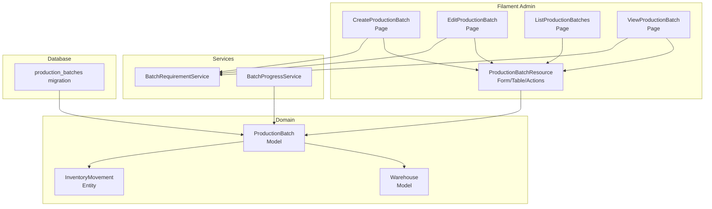
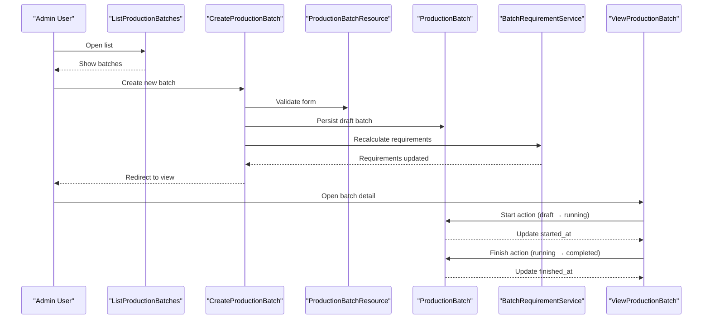
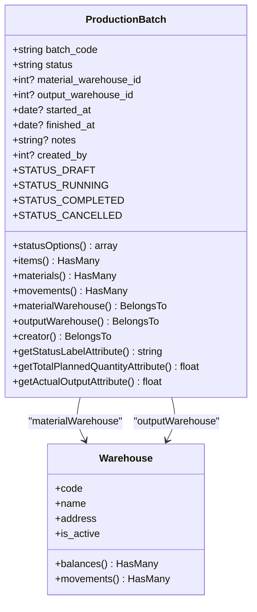
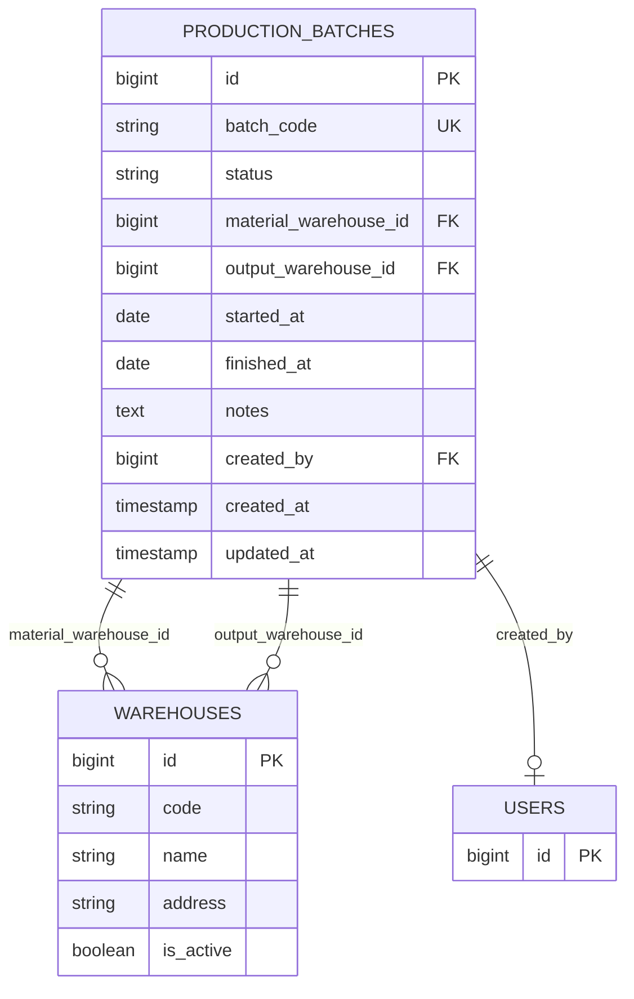
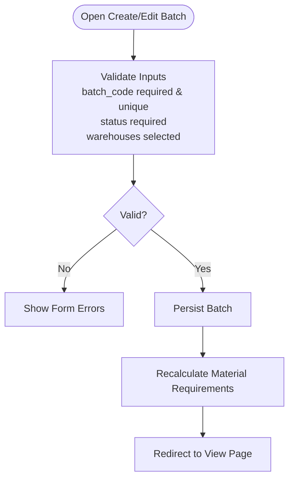
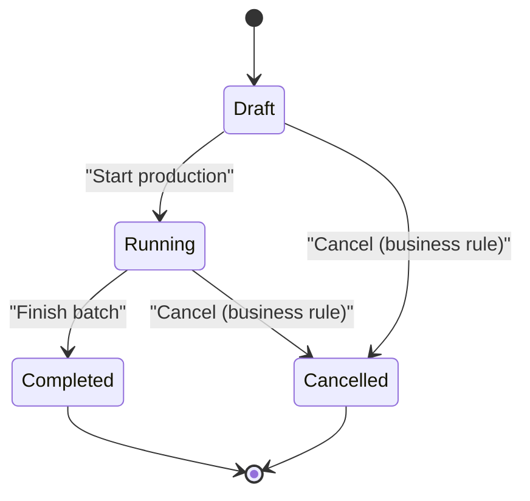
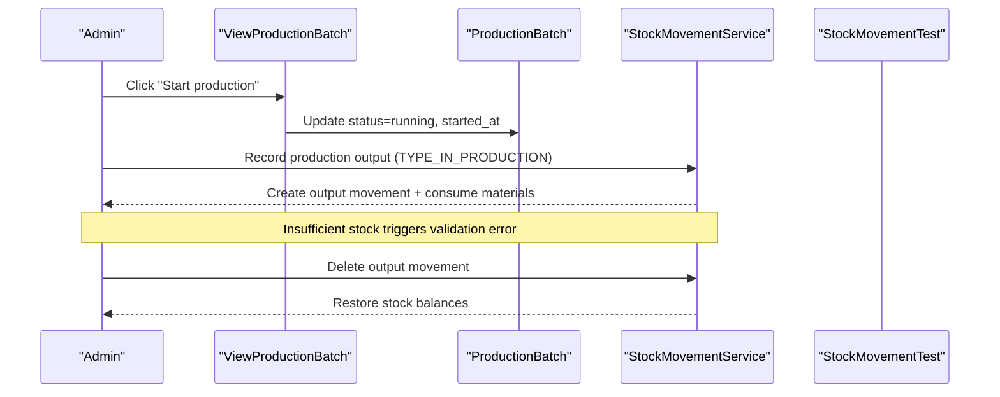
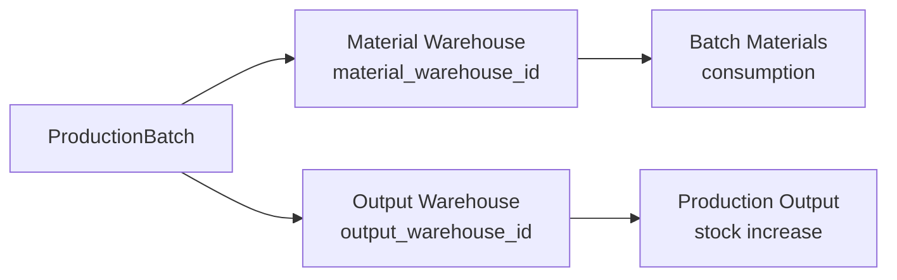
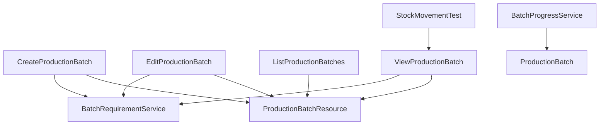

# Production Batch Lifecycle

<cite>
**Referenced Files in This Document**
- [ProductionBatch.php](file://app/Models/ProductionBatch.php)
- [2026_11_17_000002_create_production_batches_table.php](file://database/migrations/2026_11_17_000002_create_production_batches_table.php)
- [ProductionBatchResource.php](file://app/Filament/Resources/ProductionBatches/ProductionBatchResource.php)
- [CreateProductionBatch.php](file://app/Filament/Resources/ProductionBatches/Pages/CreateProductionBatch.php)
- [EditProductionBatch.php](file://app/Filament/Resources/ProductionBatches/Pages/EditProductionBatch.php)
- [ListProductionBatches.php](file://app/Filament/Resources/ProductionBatches/Pages/ListProductionBatches.php)
- [ViewProductionBatch.php](file://app/Filament/Resources/ProductionBatches/Pages/ViewProductionBatch.php)
- [Warehouse.php](file://app/Models/Warehouse.php)
- [BatchRequirementService.php](file://app/Services/BatchRequirementService.php)
- [BatchProgressService.php](file://app/Services/BatchProgressService.php)
- [StockMovementTest.php](file://tests/Feature/StockMovementTest.php)
</cite>

## Table of Contents
1. [Introduction](#introduction)
2. [Project Structure](#project-structure)
3. [Core Components](#core-components)
4. [Architecture Overview](#architecture-overview)
5. [Detailed Component Analysis](#detailed-component-analysis)
6. [Dependency Analysis](#dependency-analysis)
7. [Performance Considerations](#performance-considerations)
8. [Troubleshooting Guide](#troubleshooting-guide)
9. [Conclusion](#conclusion)

## Introduction
This document explains the Production Batch lifecycle management in the application. It covers:
- The four batch statuses and their allowed transitions.
- The `ProductionBatch` model properties, including `batch_code`, `status`, `material_warehouse_id`, `output_warehouse_id`, `started_at`, `finished_at`, and `notes`.
- How batches are created through Filament resources, including form validation and data entry.
- The relationship between batches and warehouses for material sourcing and output storage.
- Examples of state transitions and business rules governing each status change.

The production batch is a planning and execution container that ties planned products, required materials, inventory movements, and warehouse locations together.

## Project Structure
The production batch feature spans models, database schema, Filament resources/pages, services, and tests:
- Model and schema define the batch entity and its fields.
- Filament resource defines forms, tables, filters, and actions.
- Pages implement creation, editing, listing, and viewing workflows.
- Services calculate material requirements and progress metrics.
- Tests validate lifecycle behavior and stock movement integration.

**Diagram sources**
- [ProductionBatch.php:12-21](file://app/Models/ProductionBatch.php#L12-L21)
- [2026_11_17_000002_create_production_batches_table.php:14-33](file://database/migrations/2026_11_17_000002_create_production_batches_table.php#L14-L33)
- [ProductionBatchResource.php:70-113](file://app/Filament/Resources/ProductionBatches/ProductionBatchResource.php#L70-L113)
- [CreateProductionBatch.php:16-19](file://app/Filament/Resources/ProductionBatches/Pages/CreateProductionBatch.php#L16-L19)
- [EditProductionBatch.php:13-16](file://app/Filament/Resources/ProductionBatches/Pages/EditProductionBatch.php#L13-L16)
- [ViewProductionBatch.php:97-163](file://app/Filament/Resources/ProductionBatches/Pages/ViewProductionBatch.php#L97-L163)
- [BatchRequirementService.php:14-59](file://app/Services/BatchRequirementService.php#L14-L59)
- [BatchProgressService.php:68-77](file://app/Services/BatchProgressService.php#L68-L77)

**Section sources**
- [ProductionBatch.php:12-21](file://app/Models/ProductionBatch.php#L12-L21)
- [2026_11_17_000002_create_production_batches_table.php:14-33](file://database/migrations/2026_11_17_000002_create_production_batches_table.php#L14-L33)
- [ProductionBatchResource.php:70-113](file://app/Filament/Resources/ProductionBatches/ProductionBatchResource.php#L70-L113)
- [CreateProductionBatch.php:16-19](file://app/Filament/Resources/ProductionBatches/Pages/CreateProductionBatch.php#L16-L19)
- [EditProductionBatch.php:13-16](file://app/Filament/Resources/ProductionBatches/Pages/EditProductionBatch.php#L13-L16)
- [ViewProductionBatch.php:97-163](file://app/Filament/Resources/ProductionBatches/Pages/ViewProductionBatch.php#L97-L163)
- [BatchRequirementService.php:14-59](file://app/Services/BatchRequirementService.php#L14-L59)
- [BatchProgressService.php:68-77](file://app/Services/BatchProgressService.php#L68-L77)

## Core Components
- **ProductionBatch model**: Defines fillable fields, status constants, casts, relationships to items, materials, movements, warehouses, and creator, plus computed attributes for label, planned quantity, and actual output.
- **Migration**: Creates the `production_batches` table with unique `batch_code`, default `draft` status, nullable warehouse foreign keys, date fields, notes, and user ownership.
- **Filament Resource**: Provides form schema, table columns, filters, and relation managers for items, materials, raw materials, and movements.
- **Pages**: Implement create/edit/list/view flows; view page exposes start/finish/recalculate actions.
- **Services**: Calculate material requirements from BOM and compute dashboard progress/status counts.

**Section sources**
- [ProductionBatch.php:12-115](file://app/Models/ProductionBatch.php#L12-L115)
- [2026_11_17_000002_create_production_batches_table.php:14-33](file://database/migrations/2026_11_17_000002_create_production_batches_table.php#L14-L33)
- [ProductionBatchResource.php:70-184](file://app/Filament/Resources/ProductionBatches/ProductionBatchResource.php#L70-L184)
- [CreateProductionBatch.php:16-19](file://app/Filament/Resources/ProductionBatches/Pages/CreateProductionBatch.php#L16-L19)
- [EditProductionBatch.php:13-16](file://app/Filament/Resources/ProductionBatches/Pages/EditProductionBatch.php#L13-L16)
- [ViewProductionBatch.php:97-163](file://app/Filament/Resources/ProductionBatches/Pages/ViewProductionBatch.php#L97-L163)
- [BatchRequirementService.php:14-59](file://app/Services/BatchRequirementService.php#L14-L59)
- [BatchProgressService.php:68-77](file://app/Services/BatchProgressService.php#L68-L77)

## Architecture Overview
The production batch lifecycle is driven by Filament UI actions and backed by model methods and services.

**Diagram sources**
- [ListProductionBatches.php:13-17](file://app/Filament/Resources/ProductionBatches/Pages/ListProductionBatches.php#L13-L17)
- [CreateProductionBatch.php:16-19](file://app/Filament/Resources/ProductionBatches/Pages/CreateProductionBatch.php#L16-L19)
- [ProductionBatchResource.php:70-113](file://app/Filament/Resources/ProductionBatches/ProductionBatchResource.php#L70-L113)
- [ViewProductionBatch.php:100-137](file://app/Filament/Resources/ProductionBatches/Pages/ViewProductionBatch.php#L100-L137)
- [BatchRequirementService.php:14-59](file://app/Services/BatchRequirementService.php#L14-L59)

## Detailed Component Analysis

### ProductionBatch Model
The model centralizes batch state and relationships:
- Fillable fields include `batch_code`, `status`, `material_warehouse_id`, `output_warehouse_id`, `started_at`, `finished_at`, `notes`, and `created_by`.
- Status constants define the lifecycle states: `draft`, `running`, `completed`, `cancelled`.
- Date casting ensures `started_at` and `finished_at` are treated as dates.
- Relationships:
  - `items`: planned product lines.
  - `materials`: calculated material requirements.
  - `movements`: inventory movements tied to the batch.
  - `materialWarehouse` and `outputWarehouse`: warehouse associations.
  - `creator`: user who created the batch.
- Computed attributes:
  - `statusLabelAttribute`: human-readable status label.
  - `totalPlannedQuantityAttribute`: sum of planned quantities across items.
  - `actualOutputAttribute`: prefers explicit `actual_output`, otherwise aggregates production-in movements or item-level actual quantities.

**Diagram sources**
- [ProductionBatch.php:12-115](file://app/Models/ProductionBatch.php#L12-L115)
- [Warehouse.php:11-35](file://app/Models/Warehouse.php#L11-L35)

**Section sources**
- [ProductionBatch.php:12-115](file://app/Models/ProductionBatch.php#L12-L115)
- [Warehouse.php:11-35](file://app/Models/Warehouse.php#L11-L35)

### Database Schema
The migration defines the core batch table:
- Unique `batch_code` up to 50 characters.
- Default `status` set to `draft`.
- Nullable foreign keys to `warehouses` for both material and output warehouses.
- Nullable date fields for `started_at` and `finished_at`.
- Optional text `notes`.
- Optional `created_by` referencing users.

**Diagram sources**
- [2026_11_17_000002_create_production_batches_table.php:14-33](file://database/migrations/2026_11_17_000002_create_production_batches_table.php#L14-L33)

**Section sources**
- [2026_11_17_000002_create_production_batches_table.php:14-33](file://database/migrations/2026_11_17_000002_create_production_batches_table.php#L14-L33)

### Filament Resource and Forms
The resource configures:
- Form sections with inputs for `batch_code`, `status`, `material_warehouse_id`, `output_warehouse_id`, `started_at`, `finished_at`, and `notes`.
- Validation:
  - `batch_code` is required, limited to 50 characters, and must be unique (ignoring current record on edit).
  - `status` is required and defaults to `draft`; it is disabled in the form because lifecycle changes occur via actions.
  - Warehouse selects are searchable and preloaded.
  - Dates are optional.
  - Notes textarea is optional.
- Table displays batch code, status badge with color mapping, planned quantity, warehouse names, and dates. Filters allow filtering by status and material warehouse.
- Relation managers expose items, materials, raw materials, and movements.

**Diagram sources**
- [ProductionBatchResource.php:70-113](file://app/Filament/Resources/ProductionBatches/ProductionBatchResource.php#L70-L113)
- [CreateProductionBatch.php:16-19](file://app/Filament/Resources/ProductionBatches/Pages/CreateProductionBatch.php#L16-L19)
- [EditProductionBatch.php:13-16](file://app/Filament/Resources/ProductionBatches/Pages/EditProductionBatch.php#L13-L16)

**Section sources**
- [ProductionBatchResource.php:70-184](file://app/Filament/Resources/ProductionBatches/ProductionBatchResource.php#L70-L184)
- [CreateProductionBatch.php:16-19](file://app/Filament/Resources/ProductionBatches/Pages/CreateProductionBatch.php#L16-L19)
- [EditProductionBatch.php:13-16](file://app/Filament/Resources/ProductionBatches/Pages/EditProductionBatch.php#L13-L16)

### Batch State Transitions
Lifecycle states and transitions:
- Draft → Running: Triggered by the “Start production” action on the view page. Sets status to `running` and fills `started_at` if not already set.
- Running → Completed: Triggered by the “Finish batch” action on the view page. Sets status to `completed` and fills `finished_at` if not already set.
- Cancelled: Defined as a valid status constant but no direct UI action is exposed in the analyzed files. It can be used to represent cancelled batches.

**Diagram sources**
- [ViewProductionBatch.php:100-137](file://app/Filament/Resources/ProductionBatches/Pages/ViewProductionBatch.php#L100-L137)
- [ProductionBatch.php:27-33](file://app/Models/ProductionBatch.php#L27-L33)

**Section sources**
- [ViewProductionBatch.php:100-137](file://app/Filament/Resources/ProductionBatches/Pages/ViewProductionBatch.php#L100-L137)
- [ProductionBatch.php:27-33](file://app/Models/ProductionBatch.php#L27-L33)

### Business Rules and Data Entry Flow
- Creation:
  - Users create a batch with a unique code, select material and output warehouses, optionally set dates and notes.
  - After creation, material requirements are recalculated based on the batch’s planned items and their bill of materials.
- Editing:
  - Changes to planned items or batch details trigger recalculation of material requirements.
- Starting production:
  - Only batches in `draft` can be started.
  - Starting sets status to `running` and records `started_at`.
- Finishing production:
  - Only batches in `running` can be finished.
  - Finishing sets status to `completed` and records `finished_at`.
- Inventory integration:
  - Recording production output against a batch creates an inventory movement and may consume materials from the material warehouse according to the BOM.
  - If insufficient material stock exists, the operation fails validation.
  - Deleting a production output reverses stock changes.

**Diagram sources**
- [ViewProductionBatch.php:100-137](file://app/Filament/Resources/ProductionBatches/Pages/ViewProductionBatch.php#L100-L137)
- [StockMovementTest.php:203-290](file://tests/Feature/StockMovementTest.php#L203-L290)

**Section sources**
- [CreateProductionBatch.php:16-19](file://app/Filament/Resources/ProductionBatches/Pages/CreateProductionBatch.php#L16-L19)
- [EditProductionBatch.php:13-16](file://app/Filament/Resources/ProductionBatches/Pages/EditProductionBatch.php#L13-L16)
- [ViewProductionBatch.php:100-137](file://app/Filament/Resources/ProductionBatches/Pages/ViewProductionBatch.php#L100-L137)
- [StockMovementTest.php:203-290](file://tests/Feature/StockMovementTest.php#L203-L290)

### Relationship Between Batches and Warehouses
- Material sourcing:
  - `material_warehouse_id` indicates the warehouse where raw materials are consumed during production.
  - Material requirement calculations use this warehouse context when assessing availability and shortages.
- Output storage:
  - `output_warehouse_id` indicates the warehouse where produced goods are stored.
  - Production output movements target this warehouse.

**Diagram sources**
- [ProductionBatch.php:74-82](file://app/Models/ProductionBatch.php#L74-L82)
- [ProductionBatchResource.php:91-102](file://app/Filament/Resources/ProductionBatches/ProductionBatchResource.php#L91-L102)
- [BatchRealizationDetail.php:108-135](file://app/Filament/Pages/BatchRealizationDetail.php#L108-L135)

**Section sources**
- [ProductionBatch.php:74-82](file://app/Models/ProductionBatch.php#L74-L82)
- [ProductionBatchResource.php:91-102](file://app/Filament/Resources/ProductionBatches/ProductionBatchResource.php#L91-L102)
- [BatchRealizationDetail.php:108-135](file://app/Filament/Pages/BatchRealizationDetail.php#L108-L135)

## Dependency Analysis
Key dependencies and interactions:
- Filament pages depend on the resource for form/table definitions and redirect to the view page after create/edit.
- The view page exposes actions that mutate batch state and interact with notifications.
- Batch requirement service depends on batch items and their components to compute material snapshots.
- Progress service queries batches by status and computes summary metrics.
- Tests assert lifecycle transitions and stock movement behavior.

**Diagram sources**
- [CreateProductionBatch.php:16-19](file://app/Filament/Resources/ProductionBatches/Pages/CreateProductionBatch.php#L16-L19)
- [EditProductionBatch.php:13-16](file://app/Filament/Resources/ProductionBatches/Pages/EditProductionBatch.php#L13-L16)
- [ListProductionBatches.php:13-17](file://app/Filament/Resources/ProductionBatches/Pages/ListProductionBatches.php#L13-L17)
- [ViewProductionBatch.php:97-163](file://app/Filament/Resources/ProductionBatches/Pages/ViewProductionBatch.php#L97-L163)
- [BatchRequirementService.php:14-59](file://app/Services/BatchRequirementService.php#L14-L59)
- [BatchProgressService.php:68-77](file://app/Services/BatchProgressService.php#L68-L77)
- [StockMovementTest.php:203-290](file://tests/Feature/StockMovementTest.php#L203-L290)

**Section sources**
- [CreateProductionBatch.php:16-19](file://app/Filament/Resources/ProductionBatches/Pages/CreateProductionBatch.php#L16-L19)
- [EditProductionBatch.php:13-16](file://app/Filament/Resources/ProductionBatches/Pages/EditProductionBatch.php#L13-L16)
- [ListProductionBatches.php:13-17](file://app/Filament/Resources/ProductionBatches/Pages/ListProductionBatches.php#L13-L17)
- [ViewProductionBatch.php:97-163](file://app/Filament/Resources/ProductionBatches/Pages/ViewProductionBatch.php#L97-L163)
- [BatchRequirementService.php:14-59](file://app/Services/BatchRequirementService.php#L14-L59)
- [BatchProgressService.php:68-77](file://app/Services/BatchProgressService.php#L68-L77)
- [StockMovementTest.php:203-290](file://tests/Feature/StockMovementTest.php#L203-L290)

## Performance Considerations
- Batch listing uses eager loading and aggregated sums to minimize N+1 queries for planned quantities.
- Status counts and recent completed batches are computed via grouped queries and limits to keep dashboards responsive.
- Material requirement recalculation runs within a transaction to ensure consistency when updating or deleting material snapshots.

[No sources needed since this section provides general guidance]

## Troubleshooting Guide
Common issues and resolutions:
- Cannot start or finish a batch:
  - Ensure the batch is in the correct state (`draft` to start, `running` to finish).
  - Verify that the view page actions are visible for the current status.
- Material shortage errors when recording production output:
  - Check available stock in the material warehouse.
  - Review calculated material requirements and adjust planned quantities or replenish stock.
- Incorrect actual output values:
  - Confirm that production output movements are recorded against the batch.
  - Ensure the batch’s `actual_output` field is either explicitly set or derived from movements.

**Section sources**
- [ViewProductionBatch.php:100-137](file://app/Filament/Resources/ProductionBatches/Pages/ViewProductionBatch.php#L100-L137)
- [StockMovementTest.php:203-290](file://tests/Feature/StockMovementTest.php#L203-L290)
- [ProductionBatch.php:99-115](file://app/Models/ProductionBatch.php#L99-L115)

## Conclusion
The Production Batch lifecycle is modeled around clear states and controlled transitions. Filament resources provide intuitive forms and actions for creating, editing, and operating batches. The model and migration define robust fields and relationships, while services handle material requirements and progress metrics. Integration with inventory movements ensures accurate stock tracking and enforces business rules such as material availability.

[No sources needed since this section summarizes without analyzing specific files]