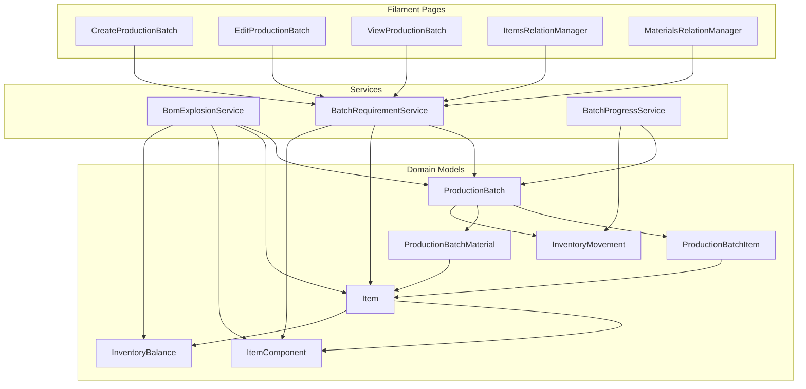
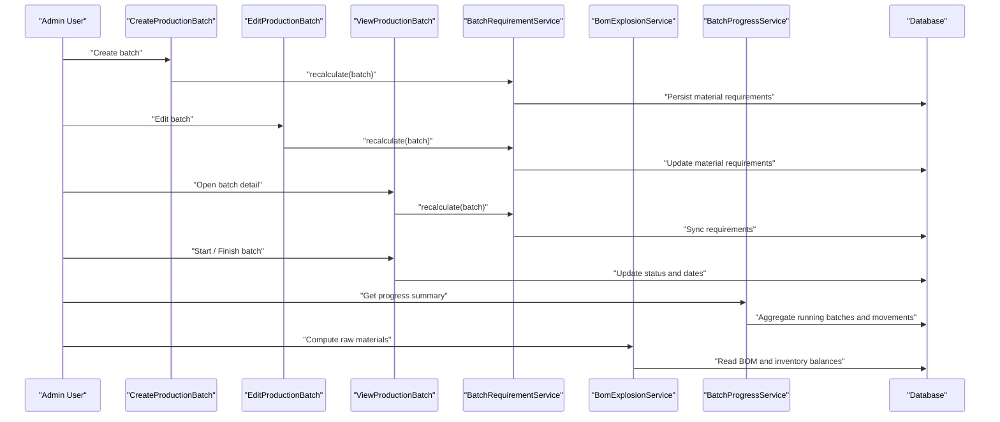
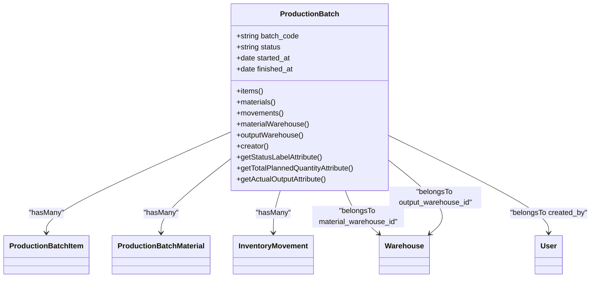
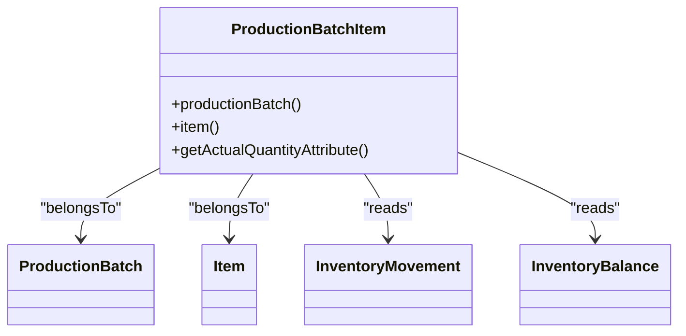
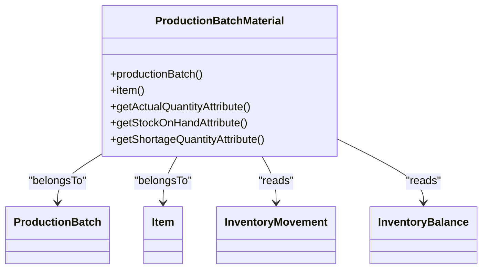
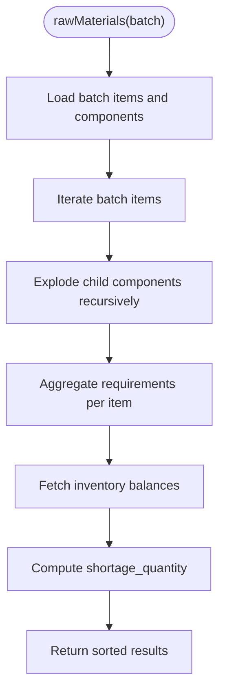
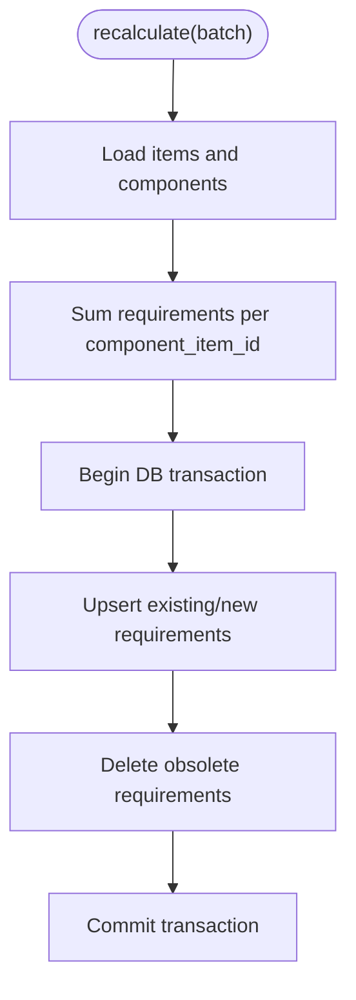
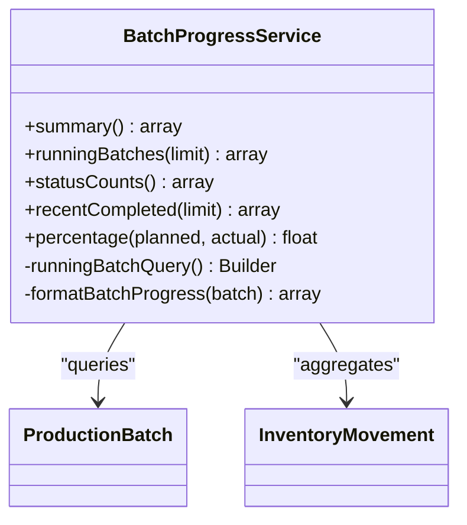
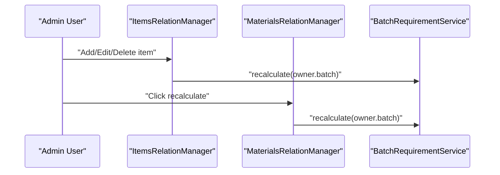
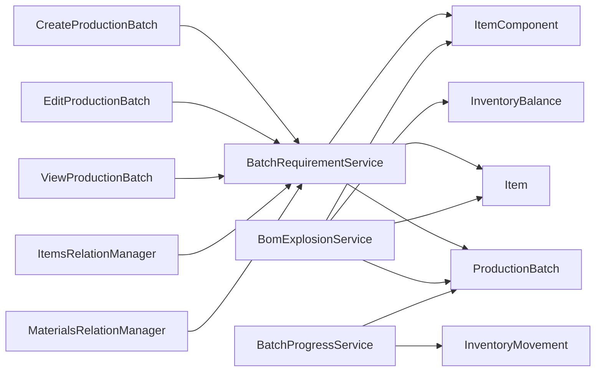

# Production Management

<cite>
**Referenced Files in This Document**
- [ProductionBatch.php](file://app/Models/ProductionBatch.php)
- [ProductionBatchItem.php](file://app/Models/ProductionBatchItem.php)
- [ProductionBatchMaterial.php](file://app/Models/ProductionBatchMaterial.php)
- [BomExplosionService.php](file://app/Services/BomExplosionService.php)
- [BatchProgressService.php](file://app/Services/BatchProgressService.php)
- [BatchRequirementService.php](file://app/Services/BatchRequirementService.php)
- [Item.php](file://app/Models/Item.php)
- [ItemComponent.php](file://app/Models/ItemComponent.php)
- [InventoryMovement.php](file://app/Models/InventoryMovement.php)
- [InventoryBalance.php](file://app/Models/InventoryBalance.php)
- [2026_11_17_000002_create_production_batches_table.php](file://database/migrations/2026_11_17_000002_create_production_batches_table.php)
- [2026_11_17_000003_create_production_batch_items_table.php](file://database/migrations/2026_11_17_000003_create_production_batch_items_table.php)
- [2026_11_17_000004_create_production_batch_materials_table.php](file://database/migrations/2026_11_17_000004_create_production_batch_materials_table.php)
- [CreateProductionBatch.php](file://app/Filament/Resources/ProductionBatches/Pages/CreateProductionBatch.php)
- [EditProductionBatch.php](file://app/Filament/Resources/ProductionBatches/Pages/EditProductionBatch.php)
- [ViewProductionBatch.php](file://app/Filament/Resources/ProductionBatches/Pages/ViewProductionBatch.php)
- [ItemsRelationManager.php](file://app/Filament/Resources/ProductionBatches/RelationManagers/ItemsRelationManager.php)
- [MaterialsRelationManager.php](file://app/Filament/Resources/ProductionBatches/RelationManagers/MaterialsRelationManager.php)
</cite>

## Table of Contents
1. [Introduction](#introduction)
2. [Project Structure](#project-structure)
3. [Core Components](#core-components)
4. [Architecture Overview](#architecture-overview)
5. [Detailed Component Analysis](#detailed-component-analysis)
6. [Dependency Analysis](#dependency-analysis)
7. [Performance Considerations](#performance-considerations)
8. [Troubleshooting Guide](#troubleshooting-guide)
9. [Conclusion](#conclusion)

## Introduction
This document explains the Production Management module, focusing on the end-to-end production batch lifecycle from creation to completion. It covers material requirement planning and BOM explosion algorithms, the core data models, and the services that calculate requirements, track progress, and integrate with inventory management for automatic stock adjustments during production.

## Project Structure
The Production Management feature is implemented as a set of Eloquent models, domain services, Filament admin pages, and database migrations:

- Models define the production entities and their relationships to items, warehouses, users, and inventory movements.
- Services encapsulate business logic for BOM explosion, material requirement planning, and production progress tracking.
- Filament resources provide UI workflows for creating batches, managing produced items, viewing material needs, starting and finishing batches, and recalculating requirements.
- Migrations define the persistent schema for production batches, produced items, and required materials.

**Diagram sources**
- [ProductionBatch.php:59-87](file://app/Models/ProductionBatch.php#L59-L87)
- [ProductionBatchItem.php:31-39](file://app/Models/ProductionBatchItem.php#L31-L39)
- [ProductionBatchMaterial.php:31-39](file://app/Models/ProductionBatchMaterial.php#L31-L39)
- [Item.php:136-144](file://app/Models/Item.php#L136-L144)
- [ItemComponent.php:36-44](file://app/Models/ItemComponent.php#L36-L44)
- [InventoryMovement.php:62-75](file://app/Models/InventoryMovement.php#L62-L75)
- [InventoryBalance.php:37-45](file://app/Models/InventoryBalance.php#L37-L45)
- [BomExplosionService.php:22-107](file://app/Services/BomExplosionService.php#L22-L107)
- [BatchRequirementService.php:14-59](file://app/Services/BatchRequirementService.php#L14-L59)
- [BatchProgressService.php:20-131](file://app/Services/BatchProgressService.php#L20-L131)
- [CreateProductionBatch.php:16-19](file://app/Filament/Resources/ProductionBatches/Pages/CreateProductionBatch.php#L16-L19)
- [EditProductionBatch.php:13-16](file://app/Filament/Resources/ProductionBatches/Pages/EditProductionBatch.php#L13-L16)
- [ViewProductionBatch.php:138-149](file://app/Filament/Resources/ProductionBatches/Pages/ViewProductionBatch.php#L138-L149)
- [ItemsRelationManager.php:96-112](file://app/Filament/Resources/ProductionBatches/RelationManagers/ItemsRelationManager.php#L96-L112)
- [MaterialsRelationManager.php:85-98](file://app/Filament/Resources/ProductionBatches/RelationManagers/MaterialsRelationManager.php#L85-L98)

**Section sources**
- [ProductionBatch.php:12-87](file://app/Models/ProductionBatch.php#L12-L87)
- [ProductionBatchItem.php:11-39](file://app/Models/ProductionBatchItem.php#L11-L39)
- [ProductionBatchMaterial.php:11-39](file://app/Models/ProductionBatchMaterial.php#L11-L39)
- [BomExplosionService.php:11-157](file://app/Services/BomExplosionService.php#L11-L157)
- [BatchProgressService.php:9-151](file://app/Services/BatchProgressService.php#L9-L151)
- [BatchRequirementService.php:8-60](file://app/Services/BatchRequirementService.php#L8-L60)
- [CreateProductionBatch.php:10-28](file://app/Filament/Resources/ProductionBatches/Pages/CreateProductionBatch.php#L10-L28)
- [EditProductionBatch.php:9-17](file://app/Filament/Resources/ProductionBatches/Pages/EditProductionBatch.php#L9-L17)
- [ViewProductionBatch.php:21-165](file://app/Filament/Resources/ProductionBatches/Pages/ViewProductionBatch.php#L21-L165)
- [ItemsRelationManager.php:20-113](file://app/Filament/Resources/ProductionBatches/RelationManagers/ItemsRelationManager.php#L20-L113)
- [MaterialsRelationManager.php:15-102](file://app/Filament/Resources/ProductionBatches/RelationManagers/MaterialsRelationManager.php#L15-L102)

## Core Components
- ProductionBatch: Represents a production order with status, dates, warehouses, and links to produced items, required materials, and inventory movements.
- ProductionBatchItem: Records planned output quantities per item within a batch and derives actual output from inventory movements or balances.
- ProductionBatchMaterial: Stores calculated material requirements per item and tracks consumed quantities and shortages.
- BomExplosionService: Recursively explodes BOMs to compute raw material requirements for a batch.
- BatchRequirementService: Calculates and persists material requirements based on active BOM components.
- BatchProgressService: Aggregates running batches, computes overall progress, and reports recent completions.

Key responsibilities:
- Data modeling and relationships between batches, items, materials, and inventory.
- BOM explosion and raw material aggregation.
- Material requirement planning and persistence.
- Progress calculation and reporting.
- UI-driven lifecycle actions (create, edit, start, finish, recalculate).

**Section sources**
- [ProductionBatch.php:27-115](file://app/Models/ProductionBatch.php#L27-L115)
- [ProductionBatchItem.php:24-73](file://app/Models/ProductionBatchItem.php#L24-L73)
- [ProductionBatchMaterial.php:24-72](file://app/Models/ProductionBatchMaterial.php#L24-L72)
- [BomExplosionService.php:22-157](file://app/Services/BomExplosionService.php#L22-L157)
- [BatchRequirementService.php:14-59](file://app/Services/BatchRequirementService.php#L14-L59)
- [BatchProgressService.php:20-151](file://app/Services/BatchProgressService.php#L20-L151)

## Architecture Overview
The production workflow integrates UI actions, service logic, and inventory operations:

**Diagram sources**
- [CreateProductionBatch.php:16-19](file://app/Filament/Resources/ProductionBatches/Pages/CreateProductionBatch.php#L16-L19)
- [EditProductionBatch.php:13-16](file://app/Filament/Resources/ProductionBatches/Pages/EditProductionBatch.php#L13-L16)
- [ViewProductionBatch.php:108-137](file://app/Filament/Resources/ProductionBatches/Pages/ViewProductionBatch.php#L108-L137)
- [ViewProductionBatch.php:138-149](file://app/Filament/Resources/ProductionBatches/Pages/ViewProductionBatch.php#L138-L149)
- [BatchRequirementService.php:14-59](file://app/Services/BatchRequirementService.php#L14-L59)
- [BomExplosionService.php:22-107](file://app/Services/BomExplosionService.php#L22-L107)
- [BatchProgressService.php:20-131](file://app/Services/BatchProgressService.php#L20-L131)

## Detailed Component Analysis

### ProductionBatch Model
Responsibilities:
- Defines batch lifecycle statuses and labels.
- Relates to produced items, required materials, inventory movements, and warehouses.
- Computes total planned quantity and actual output by aggregating movements and item-level actuals.

**Diagram sources**
- [ProductionBatch.php:59-87](file://app/Models/ProductionBatch.php#L59-L87)
- [ProductionBatch.php:94-115](file://app/Models/ProductionBatch.php#L94-L115)

**Section sources**
- [ProductionBatch.php:27-115](file://app/Models/ProductionBatch.php#L27-L115)

### ProductionBatchItem Model
Responsibilities:
- Links a produced item to a batch with planned quantity.
- Derives actual output by prioritizing in-production movements, then output warehouse balance, then global balance.

**Diagram sources**
- [ProductionBatchItem.php:31-73](file://app/Models/ProductionBatchItem.php#L31-L73)

**Section sources**
- [ProductionBatchItem.php:24-73](file://app/Models/ProductionBatchItem.php#L24-L73)

### ProductionBatchMaterial Model
Responsibilities:
- Stores required quantity per material item for a batch.
- Tracks actual consumption via out-production movements.
- Computes stock on hand across warehouses and shortage quantity.

**Diagram sources**
- [ProductionBatchMaterial.php:31-72](file://app/Models/ProductionBatchMaterial.php#L31-L72)

**Section sources**
- [ProductionBatchMaterial.php:24-72](file://app/Models/ProductionBatchMaterial.php#L24-L72)

### BomExplosionService
Purpose:
- Recursively explodes BOMs to compute raw material requirements for a batch.
- Aggregates requirements per component item, considering planned quantities and component ratios.
- Joins with inventory balances to report on-hand and shortage quantities.

Algorithm overview:
- Load batch items and their BOM components.
- For each produced item, traverse its active components recursively.
- Accumulate required quantities per component item.
- Fetch inventory balances (optionally scoped to the batch’s material warehouse).
- Compute shortage as max(required - on_hand, 0).

**Diagram sources**
- [BomExplosionService.php:22-107](file://app/Services/BomExplosionService.php#L22-L107)
- [BomExplosionService.php:114-156](file://app/Services/BomExplosionService.php#L114-L156)

**Section sources**
- [BomExplosionService.php:11-157](file://app/Services/BomExplosionService.php#L11-L157)

### BatchRequirementService
Purpose:
- Calculates material requirements for a batch based on active BOM components.
- Persists requirements atomically, updating existing rows and removing obsolete ones.

Processing steps:
- Load batch items and their active components.
- Sum required quantities per component item.
- Within a transaction:
  - Update existing material records.
  - Create new material records.
  - Delete records no longer required.

**Diagram sources**
- [BatchRequirementService.php:14-59](file://app/Services/BatchRequirementService.php#L14-L59)

**Section sources**
- [BatchRequirementService.php:8-60](file://app/Services/BatchRequirementService.php#L8-L60)

### BatchProgressService
Purpose:
- Provides summaries and lists for production progress.
- Computes running batch counts, planned vs actual quantities, and percentage progress.
- Reports recently completed batches.

Key methods:
- summary(): aggregates running batches and monthly completions.
- runningBatches(): returns top running batches with progress metrics.
- statusCounts(): returns counts per batch status.
- recentCompleted(): returns recent completed batches with progress metrics.

**Diagram sources**
- [BatchProgressService.php:20-151](file://app/Services/BatchProgressService.php#L20-L151)

**Section sources**
- [BatchProgressService.php:9-151](file://app/Services/BatchProgressService.php#L9-L151)

### Filament Integration Points
- CreateProductionBatch: triggers requirement recalculation after creation.
- EditProductionBatch: triggers requirement recalculation after save.
- ViewProductionBatch: exposes actions to start, finish, and recalculate requirements; displays planned output, actual output, and material shortage counts.
- ItemsRelationManager: manages produced items and auto-recalculates requirements on create/edit/delete.
- MaterialsRelationManager: displays material requirements, actual consumption, variance, and shortage; supports manual recalculation.

**Diagram sources**
- [ItemsRelationManager.php:96-112](file://app/Filament/Resources/ProductionBatches/RelationManagers/ItemsRelationManager.php#L96-L112)
- [MaterialsRelationManager.php:85-98](file://app/Filament/Resources/ProductionBatches/RelationManagers/MaterialsRelationManager.php#L85-L98)

**Section sources**
- [CreateProductionBatch.php:16-19](file://app/Filament/Resources/ProductionBatches/Pages/CreateProductionBatch.php#L16-L19)
- [EditProductionBatch.php:13-16](file://app/Filament/Resources/ProductionBatches/Pages/EditProductionBatch.php#L13-L16)
- [ViewProductionBatch.php:97-165](file://app/Filament/Resources/ProductionBatches/Pages/ViewProductionBatch.php#L97-L165)
- [ItemsRelationManager.php:20-113](file://app/Filament/Resources/ProductionBatches/RelationManagers/ItemsRelationManager.php#L20-L113)
- [MaterialsRelationManager.php:15-102](file://app/Filament/Resources/ProductionBatches/RelationManagers/MaterialsRelationManager.php#L15-L102)

## Dependency Analysis
The module exhibits clear separation of concerns:
- Models encapsulate entity relationships and derived attributes.
- Services encapsulate domain logic for BOM explosion, requirement planning, and progress tracking.
- Filament pages orchestrate user interactions and invoke services.

**Diagram sources**
- [CreateProductionBatch.php:16-19](file://app/Filament/Resources/ProductionBatches/Pages/CreateProductionBatch.php#L16-L19)
- [EditProductionBatch.php:13-16](file://app/Filament/Resources/ProductionBatches/Pages/EditProductionBatch.php#L13-L16)
- [ViewProductionBatch.php:138-149](file://app/Filament/Resources/ProductionBatches/Pages/ViewProductionBatch.php#L138-L149)
- [ItemsRelationManager.php:96-112](file://app/Filament/Resources/ProductionBatches/RelationManagers/ItemsRelationManager.php#L96-L112)
- [MaterialsRelationManager.php:85-98](file://app/Filament/Resources/ProductionBatches/RelationManagers/MaterialsRelationManager.php#L85-L98)
- [BatchRequirementService.php:14-59](file://app/Services/BatchRequirementService.php#L14-L59)
- [BomExplosionService.php:22-107](file://app/Services/BomExplosionService.php#L22-L107)
- [BatchProgressService.php:20-131](file://app/Services/BatchProgressService.php#L20-L131)

**Section sources**
- [BatchRequirementService.php:14-59](file://app/Services/BatchRequirementService.php#L14-L59)
- [BomExplosionService.php:22-157](file://app/Services/BomExplosionService.php#L22-L157)
- [BatchProgressService.php:20-151](file://app/Services/BatchProgressService.php#L20-L151)

## Performance Considerations
- BatchRequirementService uses a single database transaction to upsert and delete material requirements, reducing round-trips and ensuring consistency.
- BomExplosionService preloads active components grouped by parent item to minimize repeated queries during recursive explosion.
- BatchProgressService leverages Eloquent aggregate functions (withSum) to compute planned and actual quantities efficiently.
- Inventory queries are filtered by warehouse when applicable to reduce result sets.

Recommendations:
- Cache frequently accessed BOM structures if BOM depth or breadth grows significantly.
- Consider indexing foreign keys and commonly filtered columns (e.g., production_batch_id, item_id, type) to optimize movement and balance queries.
- Use eager loading judiciously in list views to avoid N+1 queries.

[No sources needed since this section provides general guidance]

## Troubleshooting Guide
Common issues and resolutions:
- Material requirements not updated:
  - Ensure BOM components are defined and marked active.
  - Trigger recalculation via the “Recalculate” action in the view page or relation managers.
- Shortage quantity shows incorrect values:
  - Verify inventory balances exist for the material warehouse.
  - Confirm that out-production movements are recorded against the correct batch and item.
- Actual output not reflected:
  - Check that in-production movements are recorded for the batch and item.
  - If using output warehouse balance fallback, ensure the output warehouse is set and has stock.

Operational checks:
- Validate batch status transitions: draft → running → completed.
- Confirm that started_at and finished_at are populated appropriately.
- Review movement types: TYPE_IN_PRODUCTION for output, TYPE_OUT_PRODUCTION for material consumption.

**Section sources**
- [ViewProductionBatch.php:108-137](file://app/Filament/Resources/ProductionBatches/Pages/ViewProductionBatch.php#L108-L137)
- [ViewProductionBatch.php:138-149](file://app/Filament/Resources/ProductionBatches/Pages/ViewProductionBatch.php#L138-L149)
- [ProductionBatchMaterial.php:41-72](file://app/Models/ProductionBatchMaterial.php#L41-L72)
- [ProductionBatchItem.php:41-73](file://app/Models/ProductionBatchItem.php#L41-L73)
- [InventoryMovement.php:33-49](file://app/Models/InventoryMovement.php#L33-L49)

## Conclusion
The Production Management module provides a robust framework for managing production batches, calculating material requirements through BOM explosion, and tracking production progress. The integration with inventory management ensures accurate stock adjustments during production. The Filament interface streamlines operational tasks such as creating batches, managing produced items, viewing material needs, and controlling batch lifecycle states. By following the documented workflows and leveraging the provided services, teams can maintain reliable production planning and execution.

[No sources needed since this section summarizes without analyzing specific files]