# Production Progress Tracking

<cite>
**Referenced Files in This Document**
- [BatchProgressService.php](file://app/Services/BatchProgressService.php)
- [ProductionBatch.php](file://app/Models/ProductionBatch.php)
- [ProductionBatchItem.php](file://app/Models/ProductionBatchItem.php)
- [InventoryMovement.php](file://app/Models/InventoryMovement.php)
- [BatchProgressChart.php](file://app/Filament/Widgets/BatchProgressChart.php)
- [BatchProgressTable.php](file://app/Filament/Widgets/BatchProgressTable.php)
- [BatchStatusChart.php](file://app/Filament/Widgets/BatchStatusChart.php)
- [RecentCompletedBatchesTable.php](file://app/Filament/Widgets/RecentCompletedBatchesTable.php)
- [ProductionOverview.php](file://app/Filament/Widgets/ProductionOverview.php)
- [progress-bar.blade.php](file://resources/views/filament/tables/columns/progress-bar.blade.php)
</cite>

## Table of Contents
1. [Introduction](#introduction)
2. [Project Structure](#project-structure)
3. [Core Components](#core-components)
4. [Architecture Overview](#architecture-overview)
5. [Detailed Component Analysis](#detailed-component-analysis)
6. [Dependency Analysis](#dependency-analysis)
7. [Performance Considerations](#performance-considerations)
8. [Troubleshooting Guide](#troubleshooting-guide)
9. [Conclusion](#conclusion)

## Introduction
This document explains how production progress is tracked and monitored in the application. It focuses on:
- How completion percentages and production metrics are calculated
- How individual item production within batches is modeled and measured
- How inventory movements capture production-related stock changes
- How Filament widgets visualize progress, status, and recent completions
- Examples of formulas, real-time updates, and reporting features

The goal is to make the system understandable for both technical and non-technical users while providing precise references to the source code.

## Project Structure
Production progress tracking spans services, models, and Filament widgets:
- Service layer computes batch-level summaries and per-batch progress
- Models define entities for batches, batch items, and inventory movements
- Widgets render dashboards with charts and tables, including auto-refresh

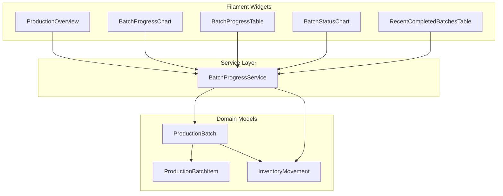

**Diagram sources**
- [BatchProgressService.php:10-151](file://app/Services/BatchProgressService.php#L10-L151)
- [ProductionBatch.php:22-115](file://app/Models/ProductionBatch.php#L22-L115)
- [ProductionBatchItem.php:16-73](file://app/Models/ProductionBatchItem.php#L16-L73)
- [InventoryMovement.php:28-190](file://app/Models/InventoryMovement.php#L28-L190)
- [ProductionOverview.php:10-39](file://app/Filament/Widgets/ProductionOverview.php#L10-L39)
- [BatchProgressChart.php:8-60](file://app/Filament/Widgets/BatchProgressChart.php#L8-L60)
- [BatchProgressTable.php:18-99](file://app/Filament/Widgets/BatchProgressTable.php#L18-L99)
- [BatchStatusChart.php:9-43](file://app/Filament/Widgets/BatchStatusChart.php#L9-L43)
- [RecentCompletedBatchesTable.php:14-67](file://app/Filament/Widgets/RecentCompletedBatchesTable.php#L14-L67)

**Section sources**
- [BatchProgressService.php:10-151](file://app/Services/BatchProgressService.php#L10-L151)
- [ProductionBatch.php:22-115](file://app/Models/ProductionBatch.php#L22-L115)
- [ProductionBatchItem.php:16-73](file://app/Models/ProductionBatchItem.php#L16-L73)
- [InventoryMovement.php:28-190](file://app/Models/InventoryMovement.php#L28-L190)
- [ProductionOverview.php:10-39](file://app/Filament/Widgets/ProductionOverview.php#L10-L39)
- [BatchProgressChart.php:8-60](file://app/Filament/Widgets/BatchProgressChart.php#L8-L60)
- [BatchProgressTable.php:18-99](file://app/Filament/Widgets/BatchProgressTable.php#L18-L99)
- [BatchStatusChart.php:9-43](file://app/Filament/Widgets/BatchStatusChart.php#L9-L43)
- [RecentCompletedBatchesTable.php:14-67](file://app/Filament/Widgets/RecentCompletedBatchesTable.php#L14-L67)

## Core Components
- BatchProgressService: Computes running batch counts, planned vs actual quantities, overall percentage, status distribution, and recent completed batches.
- ProductionBatch: Represents a production run with status, dates, warehouses, and relationships to items, materials, and movements. Provides computed attributes for total planned quantity and actual output.
- ProductionBatchItem: Represents an item line within a batch, storing planned quantity and computing actual produced quantity based on inventory movements or balances.
- InventoryMovement: Records all stock changes, including production-specific types used to measure realized output.

Key responsibilities:
- Metrics calculation: service aggregates planned and actual outputs across running batches
- Item-level measurement: model derives actual quantity from movement history or current inventory
- Visualization: widgets present summary stats, bar charts, doughnut charts, and tables with progress bars

**Section sources**
- [BatchProgressService.php:10-151](file://app/Services/BatchProgressService.php#L10-L151)
- [ProductionBatch.php:22-115](file://app/Models/ProductionBatch.php#L22-L115)
- [ProductionBatchItem.php:16-73](file://app/Models/ProductionBatchItem.php#L16-L73)
- [InventoryMovement.php:28-190](file://app/Models/InventoryMovement.php#L28-L190)

## Architecture Overview
The dashboard pulls data through BatchProgressService, which queries ProductionBatch and InventoryMovement to compute metrics. Widgets consume these results to render charts and tables.

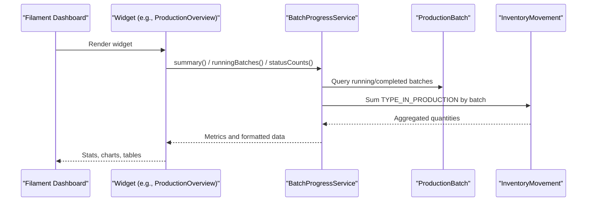

**Diagram sources**
- [BatchProgressService.php:20-108](file://app/Services/BatchProgressService.php#L20-L108)
- [ProductionBatch.php:59-115](file://app/Models/ProductionBatch.php#L59-L115)
- [InventoryMovement.php:33-49](file://app/Models/InventoryMovement.php#L33-L49)
- [ProductionOverview.php:18-39](file://app/Filament/Widgets/ProductionOverview.php#L18-L39)

## Detailed Component Analysis

### BatchProgressService Calculations
Responsibilities:
- Summary: counts running batches, sums planned and actual quantities, calculates overall percentage, and counts completed batches this month
- Running batches: returns top N running batches with planned vs actual and percentage
- Status counts: returns counts per batch status using predefined options
- Recent completed: returns recently finished batches with planned vs actual and percentage

Completion percentage formula:
- percentage = round((actual_quantity / planned_quantity) * 100, 1), with zero when planned_quantity <= 0

Actual output derivation:
- For running batches and recent completed, actual_output is the sum of InventoryMovement records where type equals production input and linked to the batch

Planned quantity derivation:
- Planned quantity is the sum of ProductionBatchItem.quantity_planned for the batch

Real-time behavior:
- Widgets poll every 60 seconds to refresh data

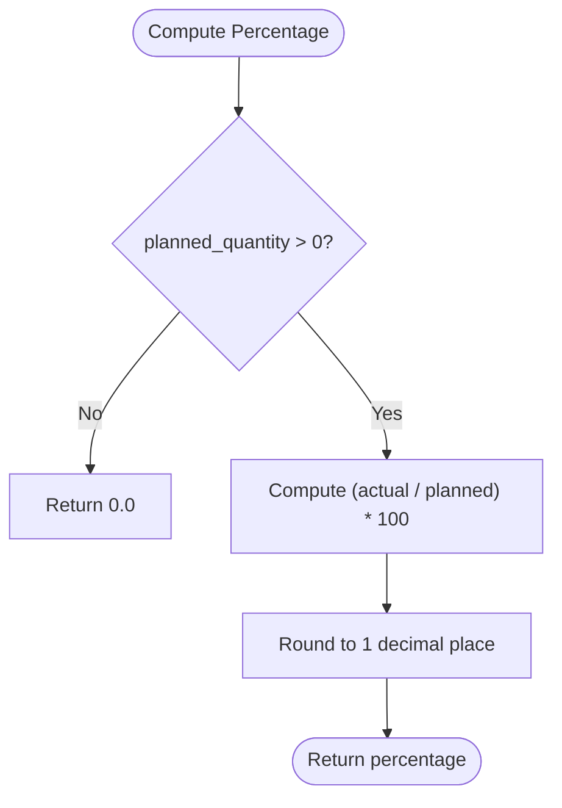

**Diagram sources**
- [BatchProgressService.php:110-117](file://app/Services/BatchProgressService.php#L110-L117)

**Section sources**
- [BatchProgressService.php:20-108](file://app/Services/BatchProgressService.php#L20-L108)
- [BatchProgressService.php:110-117](file://app/Services/BatchProgressService.php#L110-L117)
- [BatchProgressService.php:122-131](file://app/Services/BatchProgressService.php#L122-L131)
- [BatchProgressService.php:140-150](file://app/Services/BatchProgressService.php#L140-L150)

### ProductionBatchItem Model
Purpose:
- Tracks planned quantity per item within a batch
- Computes actual produced quantity by prioritizing:
  1. Sum of InventoryMovement records for the same batch and item with production input type
  2. Current stock at the batch’s output warehouse for that item
  3. Fallback to total stock across all warehouses for that item

Complexity considerations:
- Each call may trigger multiple queries; caching or eager loading can reduce overhead in list views

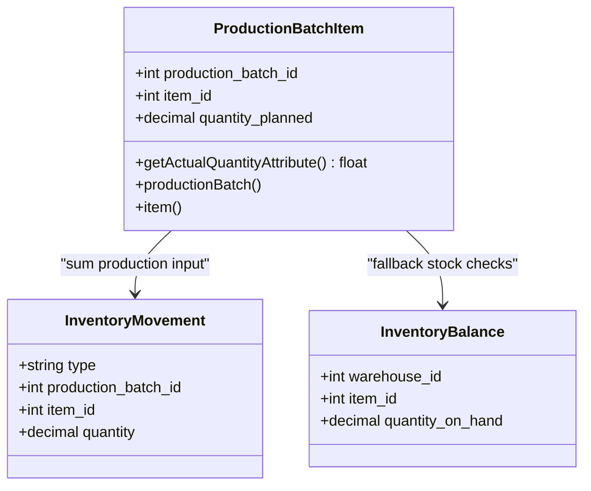

**Diagram sources**
- [ProductionBatchItem.php:16-73](file://app/Models/ProductionBatchItem.php#L16-L73)
- [InventoryMovement.php:33-49](file://app/Models/InventoryMovement.php#L33-L49)

**Section sources**
- [ProductionBatchItem.php:16-73](file://app/Models/ProductionBatchItem.php#L16-L73)

### InventoryMovement Records and Role in Progress Calculation
Types relevant to production:
- Production input: indicates realized output added during production
- Other types exist for purchases, transfers, adjustments, etc.

Role in progress:
- Actual output for a batch is derived by summing production input movements linked to the batch
- Per-item actual quantity uses the same type filter to attribute production output to specific items

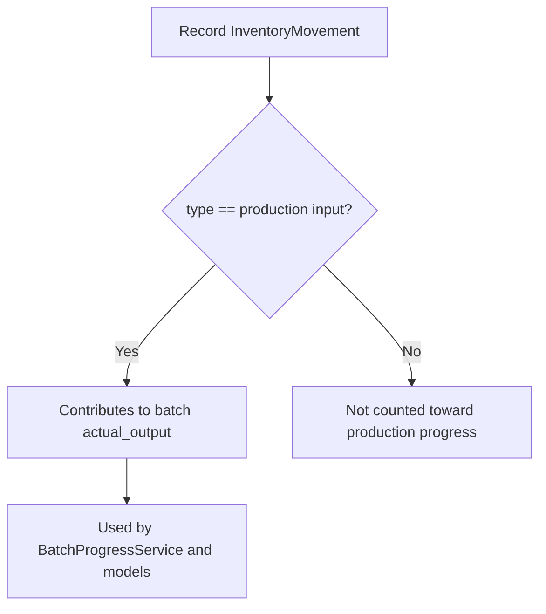

**Diagram sources**
- [InventoryMovement.php:33-49](file://app/Models/InventoryMovement.php#L33-L49)
- [BatchProgressService.php:92-96](file://app/Services/BatchProgressService.php#L92-L96)
- [BatchProgressService.php:126-129](file://app/Services/BatchProgressService.php#L126-L129)

**Section sources**
- [InventoryMovement.php:33-49](file://app/Models/InventoryMovement.php#L33-L49)
- [InventoryMovement.php:105-133](file://app/Models/InventoryMovement.php#L105-L133)
- [BatchProgressService.php:92-96](file://app/Services/BatchProgressService.php#L92-L96)
- [BatchProgressService.php:126-129](file://app/Services/BatchProgressService.php#L126-L129)

### Filament Widgets for Visualizing Production Progress

#### ProductionOverview
- Displays key metrics: running batches, planned quantity, actual quantity, and total progress percentage
- Uses BatchProgressService.summary() and formats numbers according to locale
- Auto-refreshes every 60 seconds

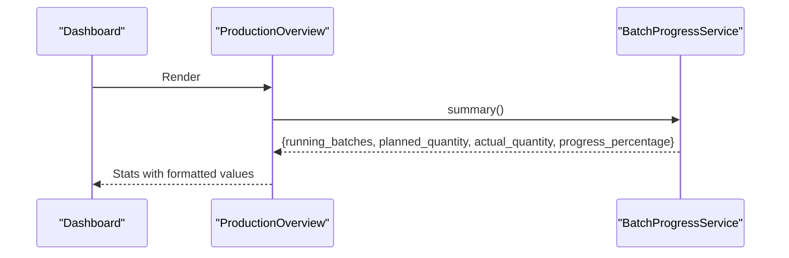

**Diagram sources**
- [ProductionOverview.php:18-39](file://app/Filament/Widgets/ProductionOverview.php#L18-L39)
- [BatchProgressService.php:20-44](file://app/Services/BatchProgressService.php#L20-L44)

**Section sources**
- [ProductionOverview.php:10-39](file://app/Filament/Widgets/ProductionOverview.php#L10-L39)

#### BatchProgressChart
- Horizontal bar chart comparing planned vs realized quantities for running batches
- Data sourced from BatchProgressService.runningBatches()

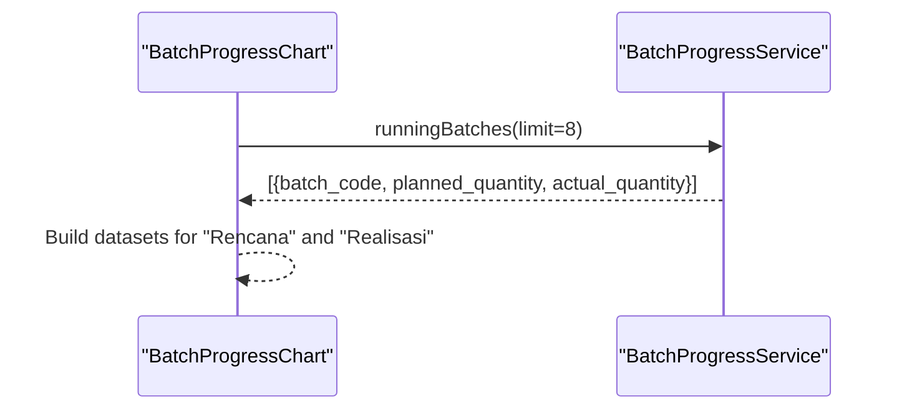

**Diagram sources**
- [BatchProgressChart.php:18-37](file://app/Filament/Widgets/BatchProgressChart.php#L18-L37)
- [BatchProgressService.php:54-63](file://app/Services/BatchProgressService.php#L54-L63)

**Section sources**
- [BatchProgressChart.php:8-60](file://app/Filament/Widgets/BatchProgressChart.php#L8-L60)

#### BatchProgressTable
- Lists batches with columns for code, status, start date, planned quantity, actual output, difference, and progress percentage
- Uses BatchProgressService::percentage() to compute progress
- Includes filters by status and actions to view details
- Polls every 60 seconds for real-time updates

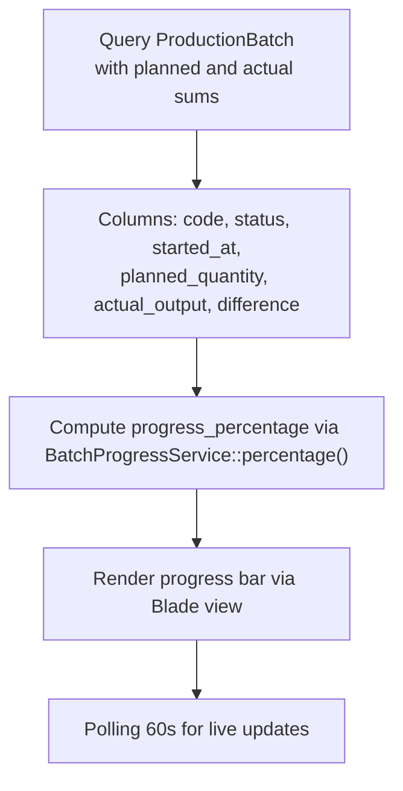

**Diagram sources**
- [BatchProgressTable.php:24-98](file://app/Filament/Widgets/BatchProgressTable.php#L24-L98)
- [progress-bar.blade.php:1-29](file://resources/views/filament/tables/columns/progress-bar.blade.php#L1-L29)
- [BatchProgressService.php:110-117](file://app/Services/BatchProgressService.php#L110-L117)

**Section sources**
- [BatchProgressTable.php:18-99](file://app/Filament/Widgets/BatchProgressTable.php#L18-L99)
- [progress-bar.blade.php:1-29](file://resources/views/filament/tables/columns/progress-bar.blade.php#L1-L29)

#### BatchStatusChart
- Doughnut chart showing distribution of batches by status
- Data sourced from BatchProgressService.statusCounts()

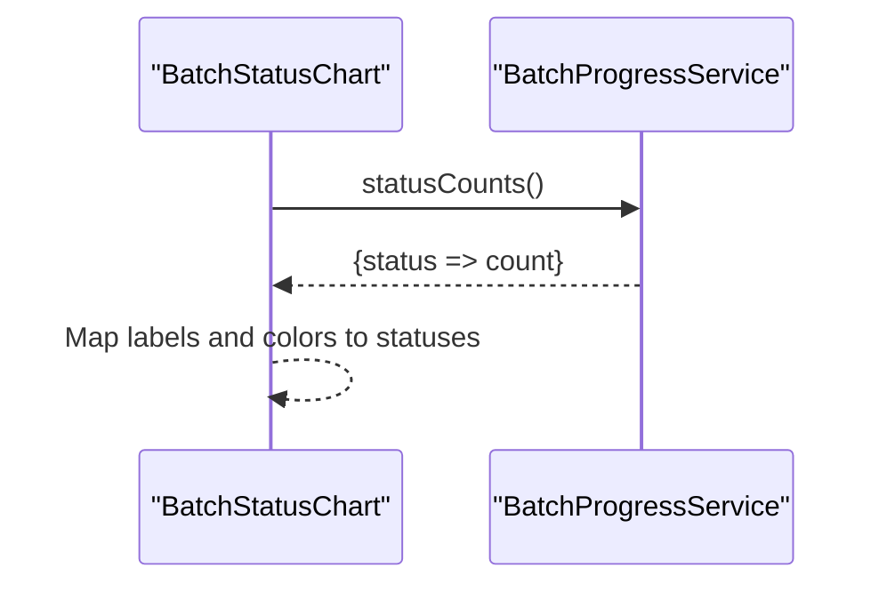

**Diagram sources**
- [BatchStatusChart.php:19-36](file://app/Filament/Widgets/BatchStatusChart.php#L19-L36)
- [BatchProgressService.php:68-78](file://app/Services/BatchProgressService.php#L68-L78)

**Section sources**
- [BatchStatusChart.php:9-43](file://app/Filament/Widgets/BatchStatusChart.php#L9-L43)

#### RecentCompletedBatchesTable
- Shows the most recently completed batches with planned vs actual and progress percentage
- Queries completed batches ordered by finish date and ID

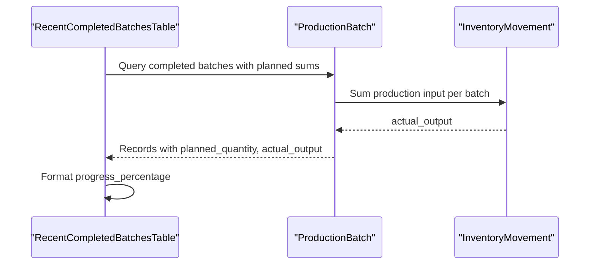

**Diagram sources**
- [RecentCompletedBatchesTable.php:20-66](file://app/Filament/Widgets/RecentCompletedBatchesTable.php#L20-L66)
- [BatchProgressService.php:89-108](file://app/Services/BatchProgressService.php#L89-L108)

**Section sources**
- [RecentCompletedBatchesTable.php:14-67](file://app/Filament/Widgets/RecentCompletedBatchesTable.php#L14-L67)

### Real-Time Updates and Reporting Features
- Real-time updates:
  - ProductionOverview polls every 60 seconds
  - BatchProgressTable polls every 60 seconds
- Reporting features:
  - Summary stats for planning vs realization
  - Charts for visual comparison and status distribution
  - Tables for detailed inspection and drill-down actions

**Section sources**
- [ProductionOverview.php:16-16](file://app/Filament/Widgets/ProductionOverview.php#L16-L16)
- [BatchProgressTable.php:95-95](file://app/Filament/Widgets/BatchProgressTable.php#L95-L95)

## Dependency Analysis
Relationships among core components:

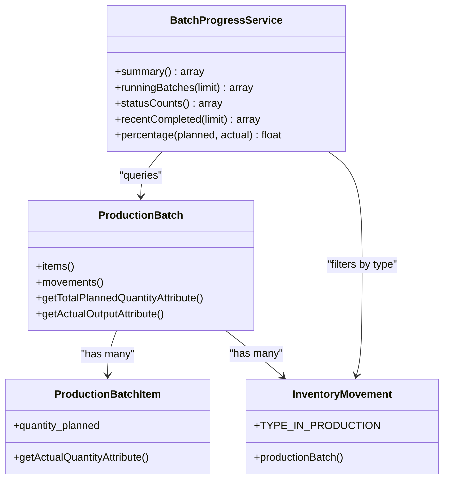

**Diagram sources**
- [BatchProgressService.php:10-151](file://app/Services/BatchProgressService.php#L10-L151)
- [ProductionBatch.php:59-115](file://app/Models/ProductionBatch.php#L59-L115)
- [ProductionBatchItem.php:16-73](file://app/Models/ProductionBatchItem.php#L16-L73)
- [InventoryMovement.php:33-49](file://app/Models/InventoryMovement.php#L33-L49)

Coupling and cohesion:
- BatchProgressService depends on ProductionBatch and InventoryMovement for accurate metrics
- Widgets depend on BatchProgressService for consistent calculations
- Cohesion is high within each component: service handles calculations, models encapsulate domain logic, widgets focus on presentation

Potential circular dependencies:
- None observed between service, models, and widgets

External dependencies:
- Filament widgets rely on Chart.js for rendering charts
- Blade view renders progress bars with Tailwind classes

**Section sources**
- [BatchProgressService.php:10-151](file://app/Services/BatchProgressService.php#L10-L151)
- [ProductionBatch.php:59-115](file://app/Models/ProductionBatch.php#L59-L115)
- [ProductionBatchItem.php:16-73](file://app/Models/ProductionBatchItem.php#L16-L73)
- [InventoryMovement.php:33-49](file://app/Models/InventoryMovement.php#L33-L49)

## Performance Considerations
- Use eager loading for planned and actual sums to avoid N+1 queries in lists
- Limit result sets (e.g., limit(8)) in widgets to reduce payload size
- Prefer database-side aggregation (withSum) over PHP loops
- Cache frequently accessed aggregations if needed (e.g., status counts)
- Avoid repeated fallback stock lookups in ProductionBatchItem.getActualQuantityAttribute(); consider precomputing or caching when used in bulk

[No sources needed since this section provides general guidance]

## Troubleshooting Guide
Common issues and resolutions:
- Zero or unexpected progress percentage:
  - Verify planned_quantity is greater than zero
  - Ensure InventoryMovement records with production input type exist for the batch
- Actual output not updating:
  - Confirm InventoryMovement.type is set to production input
  - Check that production_batch_id and item_id are correctly associated
- Widget shows stale data:
  - Ensure polling intervals are enabled (60s)
  - Clear any server-side caches if custom caching is introduced
- Large dataset performance:
  - Reduce limits in widgets
  - Add appropriate indexes on production_batch_id, item_id, and type columns

**Section sources**
- [BatchProgressService.php:110-117](file://app/Services/BatchProgressService.php#L110-L117)
- [InventoryMovement.php:33-49](file://app/Models/InventoryMovement.php#L33-L49)
- [BatchProgressTable.php:95-95](file://app/Filament/Widgets/BatchProgressTable.php#L95-L95)

## Conclusion
The production progress tracking system combines robust service-layer calculations, clear domain models, and intuitive Filament widgets to provide actionable insights into manufacturing output. By leveraging InventoryMovement records for actual output and ProductionBatchItem for item-level tracking, the system ensures accurate and timely progress visualization. The design supports real-time monitoring and reporting, enabling operators and managers to monitor performance and make informed decisions.

[No sources needed since this section summarizes without analyzing specific files]