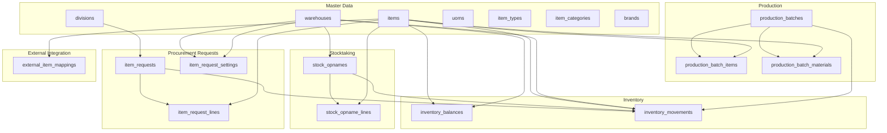
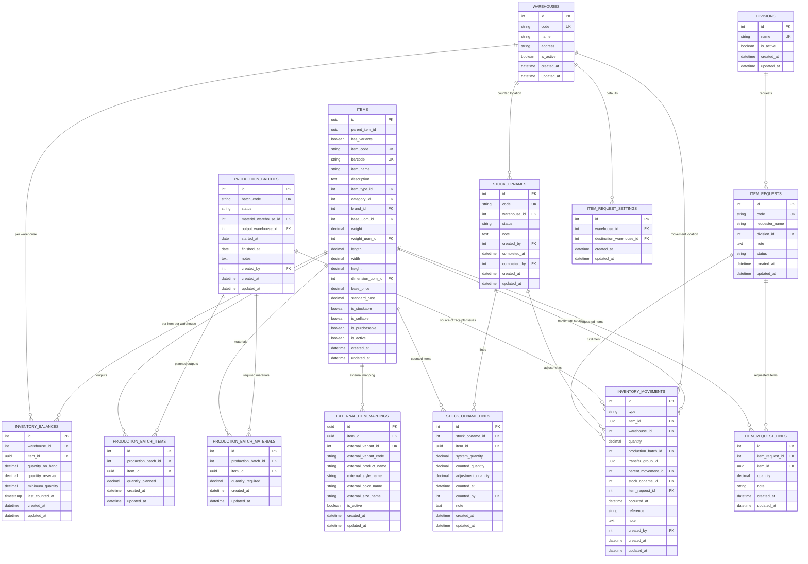
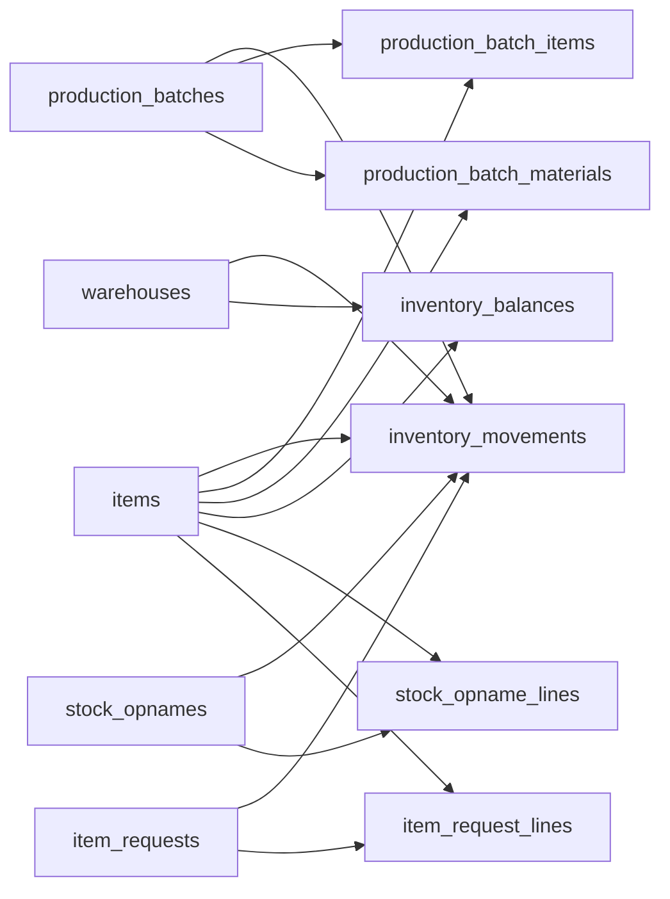

# Database Schema

<cite>
**Referenced Files in This Document**
- [2026_11_13_000007_create_items_table.php](file://database/migrations/2026_11_13_000007_create_items_table.php)
- [2026_11_16_000001_create_warehouses_table.php](file://database/migrations/2026_11_16_000001_create_warehouses_table.php)
- [2026_11_16_000002_create_inventory_balances_table.php](file://database/migrations/2026_11_16_000002_create_inventory_balances_table.php)
- [2026_11_17_000002_create_production_batches_table.php](file://database/migrations/2026_11_17_000002_create_production_batches_table.php)
- [2026_11_17_000003_create_production_batch_items_table.php](file://database/migrations/2026_11_17_000003_create_production_batch_items_table.php)
- [2026_11_17_000004_create_production_batch_materials_table.php](file://database/migrations/2026_11_17_000004_create_production_batch_materials_table.php)
- [2026_11_17_000005_create_inventory_movements_table.php](file://database/migrations/2026_11_17_000005_create_inventory_movements_table.php)
- [2026_11_18_000001_add_parent_movement_id_to_inventory_movements_table.php](file://database/migrations/2026_11_18_000001_add_parent_movement_id_to_inventory_movements_table.php)
- [2026_11_19_000002_create_stock_opnames_table.php](file://database/migrations/2026_11_19_000002_create_stock_opnames_table.php)
- [2026_11_19_000003_create_stock_opname_lines_table.php](file://database/migrations/2026_11_19_000003_create_stock_opname_lines_table.php)
- [2026_11_19_000004_add_stock_opname_id_to_inventory_movements_table.php](file://database/migrations/2026_11_19_000004_add_stock_opname_id_to_inventory_movements_table.php)
- [2026_11_19_000005_create_divisions_table.php](file://database/migrations/2026_11_19_000005_create_divisions_table.php)
- [2026_11_19_000007_create_item_requests_table.php](file://database/migrations/2026_11_19_000007_create_item_requests_table.php)
- [2026_11_19_000008_create_item_request_lines_table.php](file://database/migrations/2026_11_19_000008_create_item_request_lines_table.php)
- [2026_11_19_000011_add_item_request_id_to_inventory_movements_table.php](file://database/migrations/2026_11_19_000011_add_item_request_id_to_inventory_movements_table.php)
- [2026_11_19_000012_create_item_request_settings_table.php](file://database/migrations/2026_11_19_000012_create_item_request_settings_table.php)
- [2026_11_23_000001_create_external_item_mappings_table.php](file://database/migrations/2026_11_23_000001_create_external_item_mappings_table.php)
</cite>

## Table of Contents
1. [Introduction](#introduction)
2. [Project Structure](#project-structure)
3. [Core Components](#core-components)
4. [Architecture Overview](#architecture-overview)
5. [Detailed Component Analysis](#detailed-component-analysis)
6. [Dependency Analysis](#dependency-analysis)
7. [Performance Considerations](#performance-considerations)
8. [Troubleshooting Guide](#troubleshooting-guide)
9. [Conclusion](#conclusion)
10. [Appendices](#appendices)

## Introduction
This document describes the database schema for RSV Helmet, focusing on core inventory and production entities: Items, Warehouses, InventoryBalances, InventoryMovements, ProductionBatches, StockOpnames, ItemRequests, Divisions, and related supporting tables. It explains table structures, field definitions, data types, constraints, indexes, migration strategy, validation rules enforced at the database level, data lifecycle considerations, and guidance for extending the schema.

## Project Structure
The database schema is defined through Laravel migrations under database/migrations. The most relevant files for this documentation are listed above. Each migration creates or alters a table and defines relationships, constraints, and indexes.

**Diagram sources**
- [2026_11_13_000007_create_items_table.php:14-73](file://database/migrations/2026_11_13_000007_create_items_table.php#L14-L73)
- [2026_11_16_000001_create_warehouses_table.php:14-21](file://database/migrations/2026_11_16_000001_create_warehouses_table.php#L14-L21)
- [2026_11_16_000002_create_inventory_balances_table.php:14-30](file://database/migrations/2026_11_16_000002_create_inventory_balances_table.php#L14-L30)
- [2026_11_17_000002_create_production_batches_table.php:14-34](file://database/migrations/2026_11_17_000002_create_production_batches_table.php#L14-L34)
- [2026_11_17_000003_create_production_batch_items_table.php:14-26](file://database/migrations/2026_11_17_000003_create_production_batch_items_table.php#L14-L26)
- [2026_11_17_000004_create_production_batch_materials_table.php:14-26](file://database/migrations/2026_11_17_000004_create_production_batch_materials_table.php#L14-L26)
- [2026_11_17_000005_create_inventory_movements_table.php:14-41](file://database/migrations/2026_11_17_000005_create_inventory_movements_table.php#L14-L41)
- [2026_11_19_000002_create_stock_opnames_table.php:14-34](file://database/migrations/2026_11_19_000002_create_stock_opnames_table.php#L14-L34)
- [2026_11_19_000003_create_stock_opname_lines_table.php:14-35](file://database/migrations/2026_11_19_000003_create_stock_opname_lines_table.php#L14-L35)
- [2026_11_19_000007_create_item_requests_table.php:14-27](file://database/migrations/2026_11_19_000007_create_item_requests_table.php#L14-L27)
- [2026_11_19_000008_create_item_request_lines_table.php:14-27](file://database/migrations/2026_11_19_000008_create_item_request_lines_table.php#L14-L27)
- [2026_11_19_000012_create_item_request_settings_table.php:14-25](file://database/migrations/2026_11_19_000012_create_item_request_settings_table.php#L14-L25)
- [2026_11_23_000001_create_external_item_mappings_table.php:14-27](file://database/migrations/2026_11_23_000001_create_external_item_mappings_table.php#L14-L27)

**Section sources**
- [2026_11_13_000007_create_items_table.php:14-73](file://database/migrations/2026_11_13_000007_create_items_table.php#L14-L73)
- [2026_11_16_000001_create_warehouses_table.php:14-21](file://database/migrations/2026_11_16_000001_create_warehouses_table.php#L14-L21)
- [2026_11_16_000002_create_inventory_balances_table.php:14-30](file://database/migrations/2026_11_16_000002_create_inventory_balances_table.php#L14-L30)
- [2026_11_17_000002_create_production_batches_table.php:14-34](file://database/migrations/2026_11_17_000002_create_production_batches_table.php#L14-L34)
- [2026_11_17_000003_create_production_batch_items_table.php:14-26](file://database/migrations/2026_11_17_000003_create_production_batch_items_table.php#L14-L26)
- [2026_11_17_000004_create_production_batch_materials_table.php:14-26](file://database/migrations/2026_11_17_000004_create_production_batch_materials_table.php#L14-L26)
- [2026_11_17_000005_create_inventory_movements_table.php:14-41](file://database/migrations/2026_11_17_000005_create_inventory_movements_table.php#L14-L41)
- [2026_11_19_000002_create_stock_opnames_table.php:14-34](file://database/migrations/2026_11_19_000002_create_stock_opnames_table.php#L14-L34)
- [2026_11_19_000003_create_stock_opname_lines_table.php:14-35](file://database/migrations/2026_11_19_000003_create_stock_opname_lines_table.php#L14-L35)
- [2026_11_19_000007_create_item_requests_table.php:14-27](file://database/migrations/2026_11_19_000007_create_item_requests_table.php#L14-L27)
- [2026_11_19_000008_create_item_request_lines_table.php:14-27](file://database/migrations/2026_11_19_000008_create_item_request_lines_table.php#L14-L27)
- [2026_11_19_000012_create_item_request_settings_table.php:14-25](file://database/migrations/2026_11_19_000012_create_item_request_settings_table.php#L14-L25)
- [2026_11_23_000001_create_external_item_mappings_table.php:14-27](file://database/migrations/2026_11_23_000001_create_external_item_mappings_table.php#L14-L27)

## Core Components
- Items: Master product catalog with classification, dimensions, pricing, and variant configuration.
- Warehouses: Physical storage locations.
- InventoryBalances: Per-item per-warehouse stock levels.
- InventoryMovements: Immutable audit trail of stock changes (receipts, issues, transfers, adjustments).
- ProductionBatches: Manufacturing orders linking planned outputs and required materials.
- StockOpnames: Periodic physical counts with line-level details and adjustments.
- ItemRequests: Procurement requests with lines and optional approval workflow.
- ExternalItemMappings: Mapping between internal items and external system variants.

Key characteristics:
- Quantities use decimal(15,3) to support fractional units.
- Foreign keys enforce referential integrity across master and transactional tables.
- Indexes optimize common queries by item, warehouse, time, and status.

**Section sources**
- [2026_11_13_000007_create_items_table.php:14-73](file://database/migrations/2026_11_13_000007_create_items_table.php#L14-L73)
- [2026_11_16_000001_create_warehouses_table.php:14-21](file://database/migrations/2026_11_16_000001_create_warehouses_table.php#L14-L21)
- [2026_11_16_000002_create_inventory_balances_table.php:14-30](file://database/migrations/2026_11_16_000002_create_inventory_balances_table.php#L14-L30)
- [2026_11_17_000005_create_inventory_movements_table.php:14-41](file://database/migrations/2026_11_17_000005_create_inventory_movements_table.php#L14-L41)
- [2026_11_17_000002_create_production_batches_table.php:14-34](file://database/migrations/2026_11_17_000002_create_production_batches_table.php#L14-L34)
- [2026_11_19_000002_create_stock_opnames_table.php:14-34](file://database/migrations/2026_11_19_000002_create_stock_opnames_table.php#L14-L34)
- [2026_11_19_000007_create_item_requests_table.php:14-27](file://database/migrations/2026_11_19_000007_create_item_requests_table.php#L14-L27)
- [2026_11_23_000001_create_external_item_mappings_table.php:14-27](file://database/migrations/2026_11_23_000001_create_external_item_mappings_table.php#L14-L27)

## Architecture Overview
The schema separates master data from transactional records and provides an immutable movement ledger. Production batches define planned outputs and material requirements; stock opnames capture physical counts; item requests drive procurement flows. All movements reference the originating business event when applicable.

**Diagram sources**
- [2026_11_13_000007_create_items_table.php:14-73](file://database/migrations/2026_11_13_000007_create_items_table.php#L14-L73)
- [2026_11_16_000001_create_warehouses_table.php:14-21](file://database/migrations/2026_11_16_000001_create_warehouses_table.php#L14-L21)
- [2026_11_16_000002_create_inventory_balances_table.php:14-30](file://database/migrations/2026_11_16_000002_create_inventory_balances_table.php#L14-L30)
- [2026_11_17_000005_create_inventory_movements_table.php:14-41](file://database/migrations/2026_11_17_000005_create_inventory_movements_table.php#L14-L41)
- [2026_11_17_000002_create_production_batches_table.php:14-34](file://database/migrations/2026_11_17_000002_create_production_batches_table.php#L14-L34)
- [2026_11_17_000003_create_production_batch_items_table.php:14-26](file://database/migrations/2026_11_17_000003_create_production_batch_items_table.php#L14-L26)
- [2026_11_17_000004_create_production_batch_materials_table.php:14-26](file://database/migrations/2026_11_17_000004_create_production_batch_materials_table.php#L14-L26)
- [2026_11_19_000002_create_stock_opnames_table.php:14-34](file://database/migrations/2026_11_19_000002_create_stock_opnames_table.php#L14-L34)
- [2026_11_19_000003_create_stock_opname_lines_table.php:14-35](file://database/migrations/2026_11_19_000003_create_stock_opname_lines_table.php#L14-L35)
- [2026_11_19_000007_create_item_requests_table.php:14-27](file://database/migrations/2026_11_19_000007_create_item_requests_table.php#L14-L27)
- [2026_11_19_000008_create_item_request_lines_table.php:14-27](file://database/migrations/2026_11_19_000008_create_item_request_lines_table.php#L14-L27)
- [2026_11_19_000012_create_item_request_settings_table.php:14-25](file://database/migrations/2026_11_19_000012_create_item_request_settings_table.php#L14-L25)
- [2026_11_23_000001_create_external_item_mappings_table.php:14-27](file://database/migrations/2026_11_23_000001_create_external_item_mappings_table.php#L14-L27)

## Detailed Component Analysis

### Items
- Purpose: Central product catalog with classification, dimensions, pricing, and variant hierarchy.
- Key fields:
  - id: UUID primary key.
  - parent_item_id: Self-referencing foreign key enabling parent/variant relationships.
  - has_variants: Boolean flag indicating presence of variants.
  - item_code, barcode: Unique identifiers for lookup and scanning.
  - item_name, description: Human-readable attributes.
  - item_type_id, category_id, brand_id: Classification references.
  - base_uom_id, weight_uom_id, dimension_uom_id: Units of measure references.
  - weight, length, width, height: Physical attributes.
  - base_price, standard_cost: Pricing and costing.
  - is_stockable, is_sellable, is_purchasable, is_active: Behavior flags.
- Constraints:
  - Unique indexes on item_code and barcode.
  - Foreign keys to item_types, item_categories, brands, uoms.
  - Self-referencing cascade delete for parent_item_id.
- Indexes:
  - Unique constraints ensure identity uniqueness.

**Section sources**
- [2026_11_13_000007_create_items_table.php:14-73](file://database/migrations/2026_11_13_000007_create_items_table.php#L14-L73)

### Warehouses
- Purpose: Define physical storage locations.
- Key fields:
  - id: Auto-increment primary key.
  - code: Unique short code.
  - name, address: Descriptive fields.
  - is_active: Soft-active flag.
- Constraints:
  - Unique index on code.

**Section sources**
- [2026_11_16_000001_create_warehouses_table.php:14-21](file://database/migrations/2026_11_16_000001_create_warehouses_table.php#L14-L21)

### InventoryBalances
- Purpose: Snapshot of on-hand quantities per item per warehouse.
- Key fields:
  - warehouse_id, item_id: Composite unique key ensures one balance row per item per warehouse.
  - quantity_on_hand: Current stock level.
  - quantity_reserved: Reserved stock (note: later removed via migration).
  - minimum_quantity: Reorder threshold.
  - last_counted_at: Last physical count timestamp.
- Constraints:
  - Unique composite index on (warehouse_id, item_id).
  - Foreign keys to warehouses and items.
- Indexes:
  - Additional index on item_id for performance.

Notes:
- A subsequent migration removes quantity_reserved from this table.

**Section sources**
- [2026_11_16_000002_create_inventory_balances_table.php:14-30](file://database/migrations/2026_11_16_000002_create_inventory_balances_table.php#L14-L30)

### InventoryMovements
- Purpose: Immutable ledger of all stock changes with rich context.
- Key fields:
  - type: Movement type (e.g., receipt, issue, transfer, adjustment).
  - item_id, warehouse_id: Dimensions of change.
  - quantity: Signed or absolute quantity depending on type semantics.
  - production_batch_id: Optional link to production events.
  - transfer_group_id: Groups related outbound/inbound legs.
  - parent_movement_id: Hierarchical grouping of related movements.
  - stock_opname_id: Link to stocktaking adjustments.
  - item_request_id: Link to fulfillment of requests.
  - occurred_at: Business timestamp of the event.
  - reference, note: Auditability.
  - created_by: System user who recorded the movement.
- Constraints:
  - Foreign keys to items, warehouses, users, production_batches, stock_opnames, item_requests.
- Indexes:
  - Composite index on (item_id, warehouse_id, occurred_at).
  - Indexes on production_batch_id and transfer_group_id.

**Section sources**
- [2026_11_17_000005_create_inventory_movements_table.php:14-41](file://database/migrations/2026_11_17_000005_create_inventory_movements_table.php#L14-L41)
- [2026_11_18_000001_add_parent_movement_id_to_inventory_movements_table.php:14-20](file://database/migrations/2026_11_18_000001_add_parent_movement_id_to_inventory_movements_table.php#L14-L20)
- [2026_11_19_000004_add_stock_opname_id_to_inventory_movements_table.php:14-20](file://database/migrations/2026_11_19_000004_add_stock_opname_id_to_inventory_movements_table.php#L14-L20)
- [2026_11_19_000011_add_item_request_id_to_inventory_movements_table.php:14-20](file://database/migrations/2026_11_19_000011_add_item_request_id_to_inventory_movements_table.php#L14-L20)

### ProductionBatches
- Purpose: Manufacturing orders capturing planned outputs and material requirements.
- Key fields:
  - batch_code: Unique identifier.
  - status: Workflow state (e.g., draft).
  - material_warehouse_id, output_warehouse_id: Source and destination warehouses.
  - started_at, finished_at: Dates.
  - notes: Free-form context.
  - created_by: User who created the batch.
- Constraints:
  - Unique index on batch_code.
  - Foreign keys to warehouses and users.

**Section sources**
- [2026_11_17_000002_create_production_batches_table.php:14-34](file://database/migrations/2026_11_17_000002_create_production_batches_table.php#L14-L34)

### ProductionBatchItems and ProductionBatchMaterials
- Purpose: Detail lines for planned outputs and required materials.
- Key fields:
  - production_batch_id: Parent batch.
  - item_id: Referenced item.
  - quantity_planned / quantity_required: Planned amounts.
- Constraints:
  - Unique composite index on (production_batch_id, item_id) prevents duplicates.
  - Foreign keys to production_batches and items.

**Section sources**
- [2026_11_17_000003_create_production_batch_items_table.php:14-26](file://database/migrations/2026_11_17_000003_create_production_batch_items_table.php#L14-L26)
- [2026_11_17_000004_create_production_batch_materials_table.php:14-26](file://database/migrations/2026_11_17_000004_create_production_batch_materials_table.php#L14-L26)

### StockOpnames and StockOpnameLines
- Purpose: Physical inventory counting process with line-level detail and adjustments.
- Key fields:
  - stock_opnames: code, warehouse_id, status, note, created_by, completed_at, completed_by.
  - stock_opname_lines: stock_opname_id, item_id, system_quantity, counted_quantity, adjustment_quantity, counted_at, counted_by, note.
- Constraints:
  - Unique composite index on (stock_opname_id, item_id).
  - Index on item_id for performance.
  - Foreign keys to warehouses, items, users, stock_opnames.

**Section sources**
- [2026_11_19_000002_create_stock_opnames_table.php:14-34](file://database/migrations/2026_11_19_000002_create_stock_opnames_table.php#L14-L34)
- [2026_11_19_000003_create_stock_opname_lines_table.php:14-35](file://database/migrations/2026_11_19_000003_create_stock_opname_lines_table.php#L14-L35)

### ItemRequests and ItemRequestLines
- Purpose: Internal procurement request workflow with optional approval columns added later.
- Key fields:
  - item_requests: code, requester_name, division_id, note, status.
  - item_request_lines: item_request_id, item_id, quantity, note.
- Constraints:
  - Unique composite index on (item_request_id, item_id).
  - Index on status for filtering.
  - Foreign keys to divisions, items, item_requests.

**Section sources**
- [2026_11_19_000007_create_item_requests_table.php:14-27](file://database/migrations/2026_11_19_000007_create_item_requests_table.php#L14-L27)
- [2026_11_19_000008_create_item_request_lines_table.php:14-27](file://database/migrations/2026_11_19_000008_create_item_request_lines_table.php#L14-L27)

### ItemRequestSettings
- Purpose: Default settings for item requests, including origin and destination warehouses.
- Key fields:
  - warehouse_id, destination_warehouse_id: Nullable defaults.

**Section sources**
- [2026_11_19_000012_create_item_request_settings_table.php:14-25](file://database/migrations/2026_11_19_000012_create_item_request_settings_table.php#L14-L25)

### ExternalItemMappings
- Purpose: Map internal items to external system variants.
- Key fields:
  - id: UUID primary key.
  - item_id: Internal item reference.
  - external_variant_id: Unique external identifier.
  - external_variant_code, external_product_name, external_style_name, external_color_name, external_size_name: External descriptors.
  - is_active: Active mapping flag.

**Section sources**
- [2026_11_23_000001_create_external_item_mappings_table.php:14-27](file://database/migrations/2026_11_23_000001_create_external_item_mappings_table.php#L14-L27)

## Dependency Analysis
- High cohesion within domains:
  - Inventory domain: items, warehouses, inventory_balances, inventory_movements.
  - Production domain: production_batches, production_batch_items, production_batch_materials.
  - Stocktaking domain: stock_opnames, stock_opname_lines.
  - Procurement domain: item_requests, item_request_lines, item_request_settings.
  - External integration: external_item_mappings.
- Coupling points:
  - inventory_movements acts as a central hub connecting production, stocktaking, and procurement events.
  - items and warehouses are referenced by multiple transactional tables.

**Diagram sources**
- [2026_11_17_000005_create_inventory_movements_table.php:14-41](file://database/migrations/2026_11_17_000005_create_inventory_movements_table.php#L14-L41)
- [2026_11_17_000002_create_production_batches_table.php:14-34](file://database/migrations/2026_11_17_000002_create_production_batches_table.php#L14-L34)
- [2026_11_17_000003_create_production_batch_items_table.php:14-26](file://database/migrations/2026_11_17_000003_create_production_batch_items_table.php#L14-L26)
- [2026_11_17_000004_create_production_batch_materials_table.php:14-26](file://database/migrations/2026_11_17_000004_create_production_batch_materials_table.php#L14-L26)
- [2026_11_16_000002_create_inventory_balances_table.php:14-30](file://database/migrations/2026_11_16_000002_create_inventory_balances_table.php#L14-L30)
- [2026_11_19_000002_create_stock_opnames_table.php:14-34](file://database/migrations/2026_11_19_000002_create_stock_opnames_table.php#L14-L34)
- [2026_11_19_000003_create_stock_opname_lines_table.php:14-35](file://database/migrations/2026_11_19_000003_create_stock_opname_lines_table.php#L14-L35)
- [2026_11_19_000007_create_item_requests_table.php:14-27](file://database/migrations/2026_11_19_000007_create_item_requests_table.php#L14-L27)
- [2026_11_19_000008_create_item_request_lines_table.php:14-27](file://database/migrations/2026_11_19_000008_create_item_request_lines_table.php#L14-L27)

**Section sources**
- [2026_11_17_000005_create_inventory_movements_table.php:14-41](file://database/migrations/2026_11_17_000005_create_inventory_movements_table.php#L14-L41)
- [2026_11_16_000002_create_inventory_balances_table.php:14-30](file://database/migrations/2026_11_16_000002_create_inventory_balances_table.php#L14-L30)
- [2026_11_19_000002_create_stock_opnames_table.php:14-34](file://database/migrations/2026_11_19_000002_create_stock_opnames_table.php#L14-L34)
- [2026_11_19_000007_create_item_requests_table.php:14-27](file://database/migrations/2026_11_19_000007_create_item_requests_table.php#L14-L27)

## Performance Considerations
- Indexing strategy:
  - inventory_movements uses composite index on (item_id, warehouse_id, occurred_at) to accelerate stock history queries.
  - Additional indexes on production_batch_id and transfer_group_id improve lookups by batch and grouped transfers.
  - stock_opname_lines includes index on item_id for faster joins.
  - item_requests indexes status for filtering.
- Denormalization trade-offs:
  - inventory_balances provides fast read access to current stock per item per warehouse but must be kept consistent with inventory_movements.
- Data volume growth:
  - inventory_movements will grow continuously; consider partitioning by occurred_at if query patterns allow.
- Concurrency:
  - Use transactions around multi-step operations that update balances and create movements to maintain consistency.

[No sources needed since this section provides general guidance]

## Troubleshooting Guide
- Referential integrity errors:
  - Ensure referenced items, warehouses, users, and batches exist before creating movements or balances.
- Duplicate entries:
  - Prevent duplicate lines in production batches and stock opname lines using composite unique constraints.
- Inconsistent stock levels:
  - Validate that inventory_movements sum matches inventory_balances; reconcile discrepancies via stock opnames.
- Missing context links:
  - When movements lack production_batch_id, stock_opname_id, or item_request_id, trace back to application logic to ensure proper linkage.

**Section sources**
- [2026_11_17_000005_create_inventory_movements_table.php:14-41](file://database/migrations/2026_11_17_000005_create_inventory_movements_table.php#L14-L41)
- [2026_11_17_000003_create_production_batch_items_table.php:14-26](file://database/migrations/2026_11_17_000003_create_production_batch_items_table.php#L14-L26)
- [2026_11_17_000004_create_production_batch_materials_table.php:14-26](file://database/migrations/2026_11_17_000004_create_production_batch_materials_table.php#L14-L26)
- [2026_11_19_000003_create_stock_opname_lines_table.php:14-35](file://database/migrations/2026_11_19_000003_create_stock_opname_lines_table.php#L14-L35)

## Conclusion
The RSV Helmet database schema enforces strong referential integrity, supports fractional quantities, and maintains an immutable movement ledger. It cleanly separates master data from transactional records and provides robust indexing for common queries. The design accommodates production planning, stocktaking, and procurement workflows while allowing extensibility through additional mappings and settings.

[No sources needed since this section summarizes without analyzing specific files]

## Appendices

### Migration Strategy and Versioning
- Migrations are timestamp-prefixed and ordered chronologically.
- Additive changes only: new tables and columns are added; existing columns are not renamed in place.
- Column removals are explicit via dedicated migrations (e.g., removing quantity_reserved from inventory_balances).
- Relationships are introduced gradually, adding foreign keys where needed (e.g., parent_movement_id, stock_opname_id, item_request_id on inventory_movements).

**Section sources**
- [2026_11_18_000001_add_parent_movement_id_to_inventory_movements_table.php:14-20](file://database/migrations/2026_11_18_000001_add_parent_movement_id_to_inventory_movements_table.php#L14-L20)
- [2026_11_19_000004_add_stock_opname_id_to_inventory_movements_table.php:14-20](file://database/migrations/2026_11_19_000004_add_stock_opname_id_to_inventory_movements_table.php#L14-L20)
- [2026_11_19_000011_add_item_request_id_to_inventory_movements_table.php:14-20](file://database/migrations/2026_11_19_000011_add_item_request_id_to_inventory_movements_table.php#L14-L20)

### Data Validation Rules and Business Constraints
- Uniqueness:
  - items.item_code, items.barcode, warehouses.code, production_batches.batch_code, stock_opnames.code, external_item_mappings.external_variant_id.
- Referential integrity:
  - Foreign keys enforce valid relationships across items, warehouses, users, production_batches, stock_opnames, item_requests.
- Domain constraints:
  - inventory_balances unique per (warehouse_id, item_id).
  - production_batch_items and production_batch_materials unique per (production_batch_id, item_id).
  - stock_opname_lines unique per (stock_opname_id, item_id).
- Numeric precision:
  - Decimal(15,3) used for all quantity-related fields to support fractional units.

**Section sources**
- [2026_11_13_000007_create_items_table.php:14-73](file://database/migrations/2026_11_13_000007_create_items_table.php#L14-L73)
- [2026_11_16_000001_create_warehouses_table.php:14-21](file://database/migrations/2026_11_16_000001_create_warehouses_table.php#L14-L21)
- [2026_11_16_000002_create_inventory_balances_table.php:14-30](file://database/migrations/2026_11_16_000002_create_inventory_balances_table.php#L14-L30)
- [2026_11_17_000002_create_production_batches_table.php:14-34](file://database/migrations/2026_11_17_000002_create_production_batches_table.php#L14-L34)
- [2026_11_17_000003_create_production_batch_items_table.php:14-26](file://database/migrations/2026_11_17_000003_create_production_batch_items_table.php#L14-L26)
- [2026_11_17_000004_create_production_batch_materials_table.php:14-26](file://database/migrations/2026_11_17_000004_create_production_batch_materials_table.php#L14-L26)
- [2026_11_19_000002_create_stock_opnames_table.php:14-34](file://database/migrations/2026_11_19_000002_create_stock_opnames_table.php#L14-L34)
- [2026_11_19_000003_create_stock_opname_lines_table.php:14-35](file://database/migrations/2026_11_19_000003_create_stock_opname_lines_table.php#L14-L35)
- [2026_11_23_000001_create_external_item_mappings_table.php:14-27](file://database/migrations/2026_11_23_000001_create_external_item_mappings_table.php#L14-L27)

### Data Lifecycle, Archival, and Backup Considerations
- Lifecycle:
  - Master data (items, warehouses, divisions) is long-lived and relatively static.
  - Transactional data (movements, batch lines, opname lines) grows continuously.
- Archival:
  - Consider archiving old inventory_movements partitions by occurred_at to keep active tables lean.
  - Retain historical stock opnames and their lines for auditability.
- Backup:
  - Back up both master and transactional schemas regularly.
  - Ensure point-in-time recovery for movement-ledger continuity.

[No sources needed since this section provides general guidance]

### Extending the Schema
- Adding new movement types:
  - Extend inventory_movements.type values and add any necessary contextual columns.
- Adding new attributes to items:
  - Add nullable columns to items to preserve backward compatibility.
- New operational domains:
  - Create new tables with clear foreign keys to items and warehouses.
  - Link new operations to inventory_movements for auditability.
- External integrations:
  - Extend external_item_mappings or create new mapping tables as needed.

[No sources needed since this section provides general guidance]