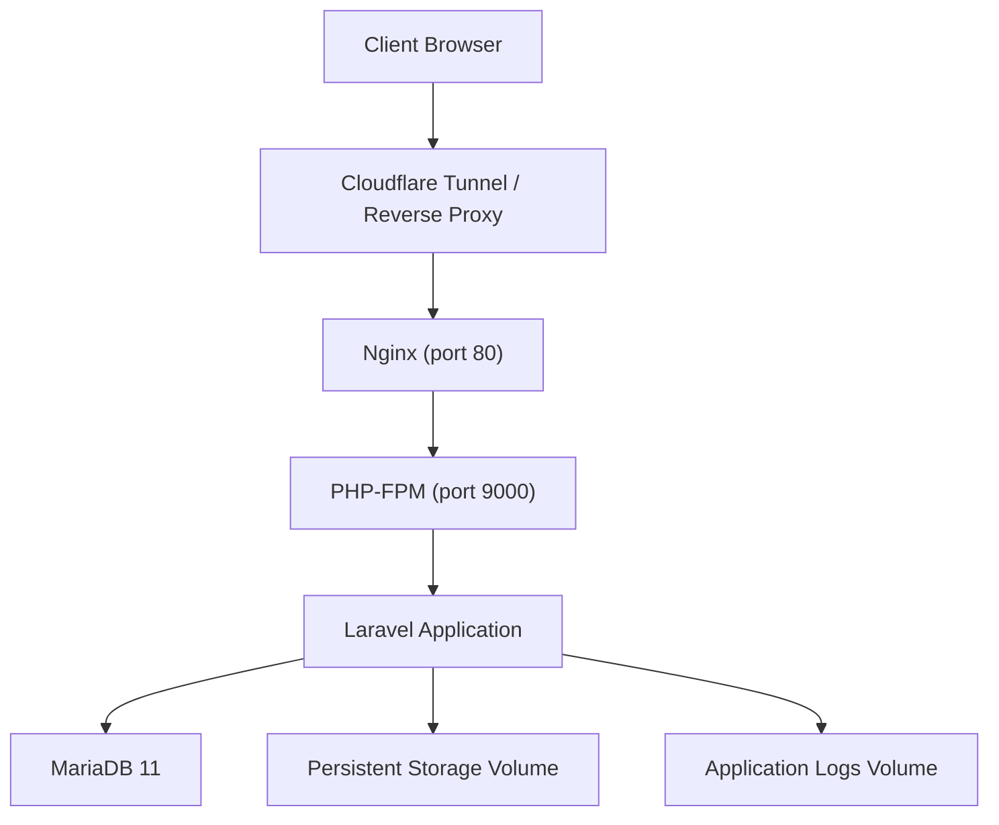
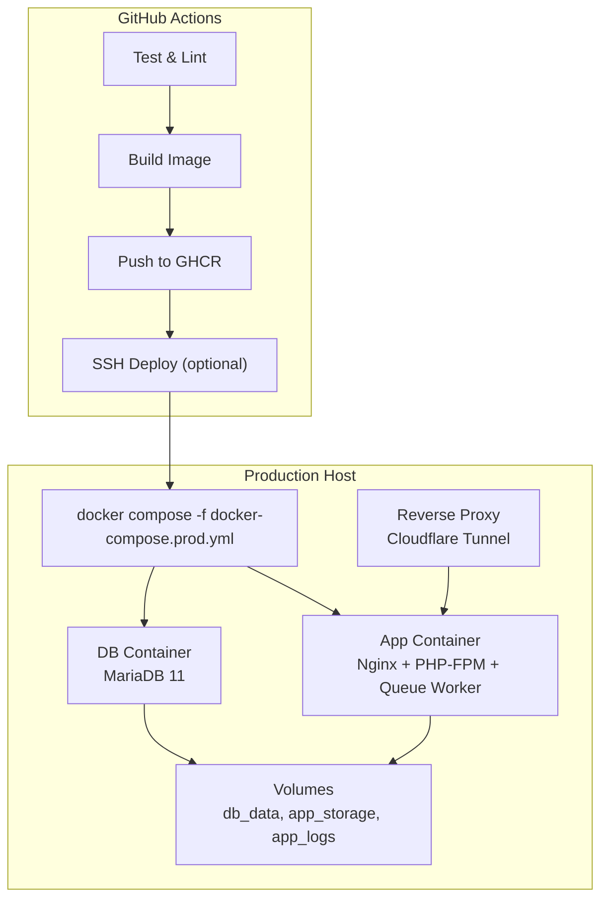
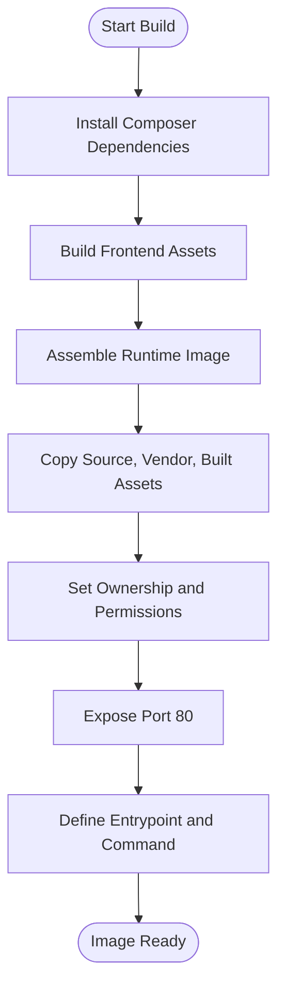
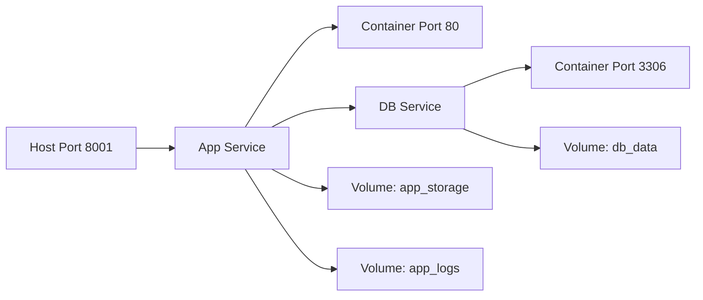
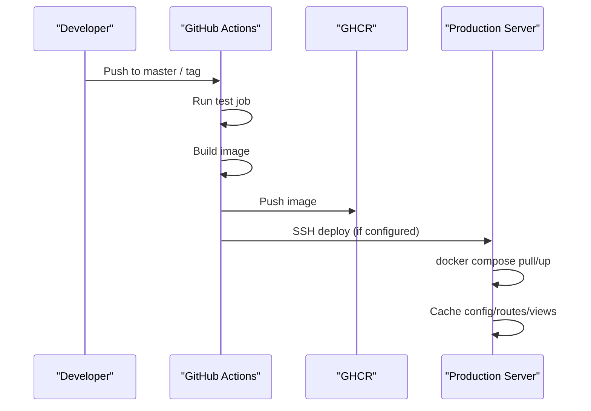
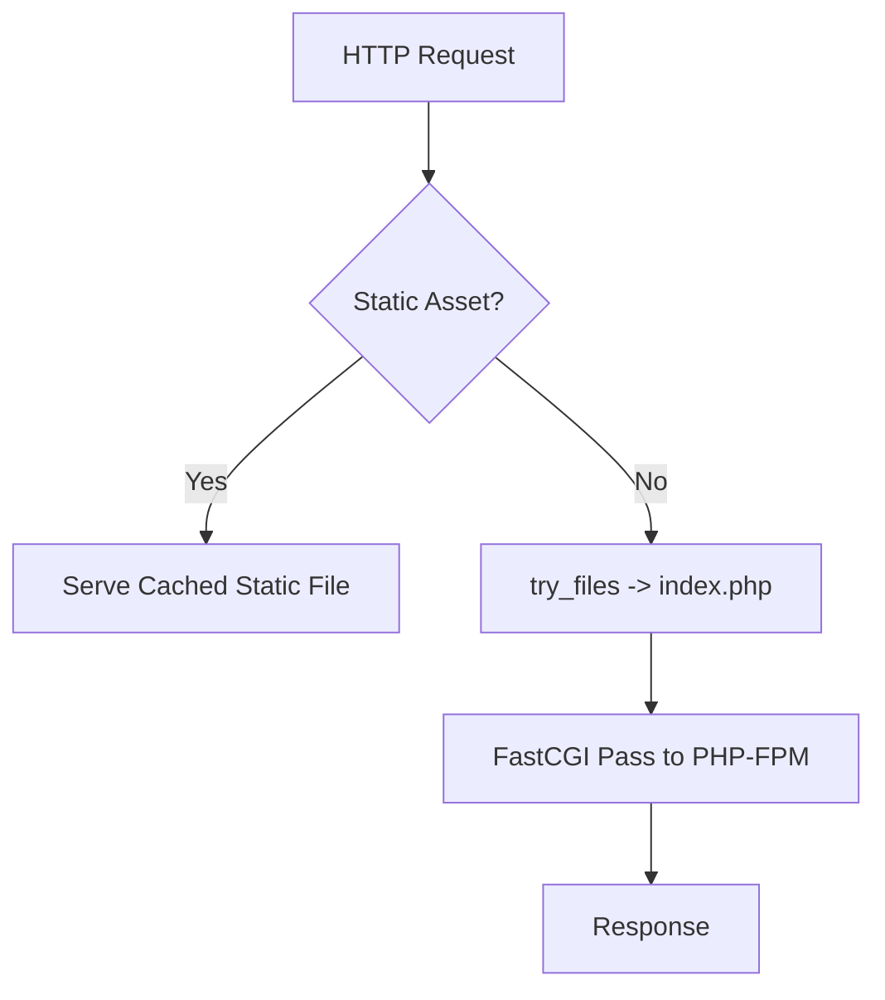
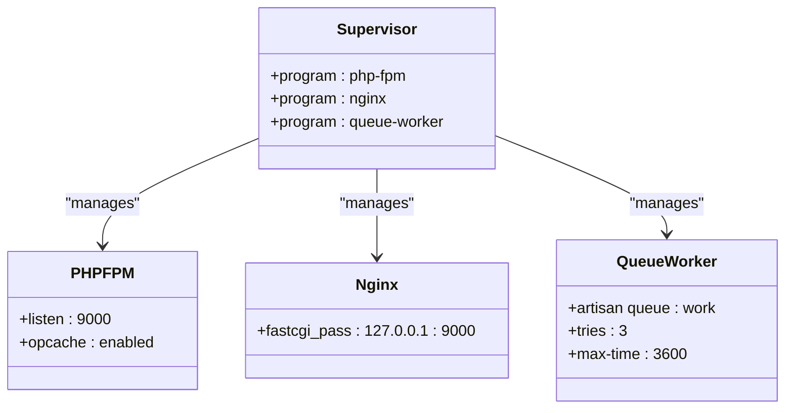
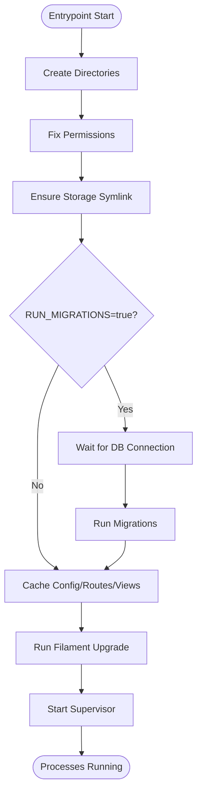
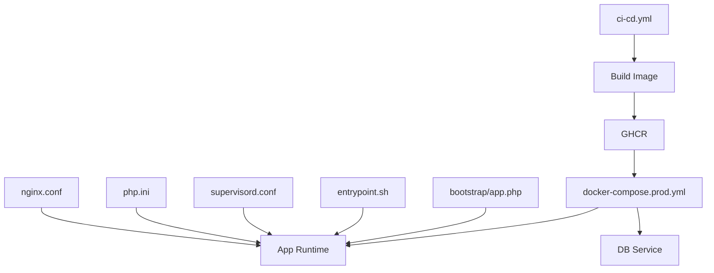

# Deployment Guide

<cite>
**Referenced Files in This Document**
- [README.md](file://README.md)
- [Dockerfile.prod](file://Dockerfile.prod)
- [docker-compose.prod.yml](file://docker-compose.prod.yml)
- [.github/workflows/ci-cd.yml](file://.github/workflows/ci-cd.yml)
- [deploy.sh](file://deploy.sh)
- [docs/DEPLOYMENT.md](file://docs/DEPLOYMENT.md)
- [docker/production/nginx.conf](file://docker/production/nginx.conf)
- [docker/production/php.ini](file://docker/production/php.ini)
- [docker/production/supervisord.conf](file://docker/production/supervisord.conf)
- [docker/production/entrypoint.sh](file://docker/production/entrypoint.sh)
- [bootstrap/app.php](file://bootstrap/app.php)
</cite>

## Update Summary
**Changes Made**
- Added new section on Cloudflare Tunnel and HTTPS Proxy Configuration
- Updated Nginx configuration section to include reverse proxy considerations
- Enhanced security hardening checklist with proxy-specific recommendations
- Added troubleshooting guidance for mixed content issues with HTTPS proxies

## Table of Contents
1. [Introduction](#introduction)
2. [Project Structure](#project-structure)
3. [Core Components](#core-components)
4. [Architecture Overview](#architecture-overview)
5. [Detailed Component Analysis](#detailed-component-analysis)
6. [Cloudflare Tunnel and HTTPS Proxy Configuration](#cloudflare-tunnel-and-https-proxy-configuration)
7. [Dependency Analysis](#dependency-analysis)
8. [Performance Considerations](#performance-considerations)
9. [Troubleshooting Guide](#troubleshooting-guide)
10. [Conclusion](#conclusion)
11. [Appendices](#appendices)

## Introduction
This deployment guide explains how to run RSV Helmet in production using Docker containers, Nginx, and PHP-FPM. It covers the containerized application stack, CI/CD pipeline with GitHub Actions, automated builds and releases, environment configuration, security hardening, monitoring considerations, scaling and load balancing strategies, disaster recovery procedures, troubleshooting, and performance tuning.

RSV Helmet is a Laravel 13 application that runs PHP 8.4 inside Alpine-based containers. The production image combines Nginx, PHP-FPM, and a queue worker under Supervisor. Database persistence uses MariaDB 11. Frontend assets are built with Vite during the multi-stage Docker build.

The application supports deployment behind reverse proxies like Cloudflare Tunnel, with proper HTTPS termination handling through trusted proxy configuration.

## Project Structure
The repository provides:
- A production Dockerfile with three stages: Composer dependency installation, Node asset building, and a runtime image with Nginx + PHP-FPM + Supervisor.
- A production Compose file defining the app and database services, persistent volumes, networking, health checks, and environment variables.
- A GitHub Actions workflow for testing, building, pushing images to GitHub Container Registry, and optional SSH-based deployment.
- A server-side deployment helper script.
- Production configurations for Nginx, PHP, and Supervisor.
- An entrypoint script that prepares storage, permissions, migrations, caching, and starts Supervisor.
- Application bootstrap configuration with HTTPS proxy support for Cloudflare Tunnel deployments.



**Diagram sources**
- [bootstrap/app.php:14-24](file://bootstrap/app.php#L14-L24)
- [docker/production/nginx.conf:37-81](file://docker/production/nginx.conf#L37-L81)
- [docker/production/supervisord.conf:7-35](file://docker/production/supervisord.conf#L7-L35)
- [docker-compose.prod.yml:1-84](file://docker-compose.prod.yml#L1-L84)

**Section sources**
- [README.md:1-115](file://README.md#L1-L115)
- [docs/DEPLOYMENT.md:1-75](file://docs/DEPLOYMENT.md#L1-L75)
- [bootstrap/app.php:1-31](file://bootstrap/app.php#L1-L31)

## Core Components
- Production Docker image: Multi-stage build producing a minimal Alpine image with Nginx, PHP-FPM, Supervisor, and required extensions.
- Compose services: App service exposing port 8001 on host; DB service with persistent volume and health check.
- CI/CD pipeline: Tests, code style checks, image build/push to GHCR, and optional SSH deploy.
- Server deployment script: Pulls latest image, starts containers, caches config/routes/views, and links storage.
- Runtime configuration: Nginx routing, static asset caching, security headers; PHP memory, upload limits, timezone, Opcache; Supervisor managing Nginx, PHP-FPM, and queue worker.
- Entrypoint initialization: Creates directories, fixes permissions, ensures storage symlink, waits for DB, runs migrations if enabled, caches Laravel artifacts, then starts Supervisor.
- **Updated** HTTPS proxy configuration: Trust proxy middleware enabling proper HTTPS detection when deployed behind Cloudflare Tunnel or similar reverse proxies.

**Section sources**
- [Dockerfile.prod:1-97](file://Dockerfile.prod#L1-L97)
- [docker-compose.prod.yml:1-84](file://docker-compose.prod.yml#L1-L84)
- [.github/workflows/ci-cd.yml:1-150](file://.github/workflows/ci-cd.yml#L1-L150)
- [deploy.sh:1-39](file://deploy.sh#L1-L39)
- [docker/production/nginx.conf:1-83](file://docker/production/nginx.conf#L1-L83)
- [docker/production/php.ini:1-18](file://docker/production/php.ini#L1-L18)
- [docker/production/supervisord.conf:1-36](file://docker/production/supervisord.conf#L1-L36)
- [docker/production/entrypoint.sh:1-65](file://docker/production/entrypoint.sh#L1-L65)
- [bootstrap/app.php:14-24](file://bootstrap/app.php#L14-L24)

## Architecture Overview
The production architecture consists of:
- A single container running Nginx and PHP-FPM, orchestrated by Supervisor.
- A separate MariaDB container with persistent data volume.
- Persistent storage and logs mounted as named volumes.
- Network isolation via a bridge network.
- CI/CD pipeline that tests code, builds an optimized image, pushes it to GHCR, and optionally deploys via SSH.
- **Updated** Support for reverse proxy deployments including Cloudflare Tunnel with proper HTTPS termination handling.



**Diagram sources**
- [.github/workflows/ci-cd.yml:15-150](file://.github/workflows/ci-cd.yml#L15-L150)
- [docker-compose.prod.yml:1-84](file://docker-compose.prod.yml#L1-L84)
- [bootstrap/app.php:14-24](file://bootstrap/app.php#L14-L24)

## Detailed Component Analysis

### Production Docker Image
The production image is built in three stages:
1. Composer stage installs production dependencies without dev packages and optimizes autoloader.
2. Node stage installs frontend dependencies and builds Vite assets, including Filament theme requirements.
3. Runtime stage installs system packages, PHP extensions, copies application code, vendor, and compiled assets, sets permissions, exposes port 80, and defines entrypoint and command.

Key behaviors:
- System packages include Nginx, Supervisor, curl, git, unzip, MySQL client, and development libraries for GD and ICU.
- PHP extensions include PDO MySQL, bcmath, GD, intl, zip, opcache, pcntl.
- Permissions ensure www-data owns storage and bootstrap/cache.
- Exposed port is 80; entrypoint initializes the app and Supervisor manages processes.



**Diagram sources**
- [Dockerfile.prod:4-97](file://Dockerfile.prod#L4-L97)

**Section sources**
- [Dockerfile.prod:1-97](file://Dockerfile.prod#L1-L97)

### Compose Services and Networking
The production Compose file defines:
- App service: Uses a configurable image from GHCR, maps host port 8001 to container port 80, sets environment variables for app configuration, database connection, session/cache/queue drivers, and external API URL. It depends on DB being healthy and mounts storage/logs volumes.
- DB service: MariaDB 11 with UTF-8 settings, timezone, environment variables for database credentials, exposed port 3308, persistent volume, and health check.
- Network: Bridge network isolates services.
- Volumes: Named volumes for DB data, app storage, and app logs.

Operational notes:
- APP_KEY and DB_PASSWORD are required environment variables.
- RUN_MIGRATIONS controls whether migrations run at startup.
- Session, cache, and queue use the database driver.



**Diagram sources**
- [docker-compose.prod.yml:1-84](file://docker-compose.prod.yml#L1-L84)

**Section sources**
- [docker-compose.prod.yml:1-84](file://docker-compose.prod.yml#L1-L84)

### CI/CD Pipeline
The GitHub Actions workflow includes:
- Test job: Sets up PHP 8.4 and Node 22, installs dependencies, builds assets, runs Laravel Pint, generates key, and executes PHPUnit with SQLite in-memory database.
- Build-and-push job: Builds the production image using Docker Buildx, logs into GHCR, extracts metadata tags, and pushes image with tags like latest and short SHA. Caching is enabled via GHA cache.
- Deploy job: On push to master, attempts SSH deployment if secrets are configured. It pulls the latest image, starts containers, and caches Laravel configuration, routes, and views.

Security and access:
- GHCR login uses GITHUB_TOKEN.
- Optional SSH deployment requires SSH_HOST, SSH_USER, SSH_KEY, and optionally SSH_PORT.



**Diagram sources**
- [.github/workflows/ci-cd.yml:15-150](file://.github/workflows/ci-cd.yml#L15-L150)

**Section sources**
- [.github/workflows/ci-cd.yml:1-150](file://.github/workflows/ci-cd.yml#L1-L150)

### Server Deployment Script
The deployment script automates:
- Checking for .env presence.
- Pulling the latest image from GHCR.
- Starting or updating containers.
- Waiting briefly for readiness.
- Running post-deployment optimizations: config cache, route cache, view cache, and storage link.

Usage:
- Place docker-compose.prod.yml, .env, and deploy.sh on the server.
- Execute deploy.sh to perform updates.

**Section sources**
- [deploy.sh:1-39](file://deploy.sh#L1-L39)

### Nginx Configuration
Nginx serves the Laravel application with:
- Single server block listening on port 80.
- Root set to public directory.
- Security headers: X-Frame-Options, X-Content-Type-Options, X-XSS-Protection.
- try_files routing to index.php for dynamic requests.
- FastCGI pass to PHP-FPM on localhost:9000.
- Static asset caching with long expiry and off access logging.
- Deny access to hidden files except well-known.
- Gzip compression enabled for common types.
- Client body size limit set to 64M.

**Updated** When deploying behind reverse proxies like Cloudflare Tunnel, Nginx receives requests over HTTP internally while the proxy handles HTTPS termination. The application layer trusts proxy headers to determine the original request scheme and protocol.



**Diagram sources**
- [docker/production/nginx.conf:37-81](file://docker/production/nginx.conf#L37-L81)

**Section sources**
- [docker/production/nginx.conf:1-83](file://docker/production/nginx.conf#L1-L83)

### PHP-FPM and PHP Configuration
PHP runtime configuration includes:
- Memory limit 512M.
- Max execution time 300 seconds.
- Upload and post sizes 64M.
- Timezone Asia/Jakarta.
- expose_php disabled.
- Opcache enabled with tuned parameters for memory consumption, string buffer, max accelerated files, timestamp validation disabled, comments saved, and fast shutdown.

Supervisor manages:
- php-fpm process.
- nginx process.
- queue worker running artisan queue:work with retries, sleep interval, and max runtime.



**Diagram sources**
- [docker/production/supervisord.conf:1-36](file://docker/production/supervisord.conf#L1-L36)
- [docker/production/php.ini:1-18](file://docker/production/php.ini#L1-L18)

**Section sources**
- [docker/production/php.ini:1-18](file://docker/production/php.ini#L1-L18)
- [docker/production/supervisord.conf:1-36](file://docker/production/supervisord.conf#L1-L36)

### Entrypoint Initialization
The entrypoint script performs:
- Creating necessary directories for cache, sessions, views, logs, and public storage.
- Fixing ownership and permissions for storage and bootstrap/cache.
- Ensuring storage symlink exists.
- Optionally waiting for database connectivity and running migrations.
- Caching configuration, routes, and views; running Filament upgrade.
- Executing Supervisor to start Nginx, PHP-FPM, and queue worker.



**Diagram sources**
- [docker/production/entrypoint.sh:1-65](file://docker/production/entrypoint.sh#L1-L65)

**Section sources**
- [docker/production/entrypoint.sh:1-65](file://docker/production/entrypoint.sh#L1-L65)

## Cloudflare Tunnel and HTTPS Proxy Configuration

### Overview
RSV Helmet supports deployment behind reverse proxies like Cloudflare Tunnel, which terminate TLS connections and forward requests to the application over HTTP. This setup requires proper configuration to handle HTTPS detection and prevent mixed content security issues.

### Trust Proxy Configuration
The application includes middleware configuration that trusts proxy headers to correctly identify the original request scheme, client IP, and port:

```php
$middleware->trustProxies(
    at: '*',
    headers: Request::HEADER_X_FORWARDED_FOR
        | Request::HEADER_X_FORWARDED_PROTO
        | Request::HEADER_X_FORWARDED_PORT,
);
```

This configuration enables:
- **X-Forwarded-For**: Identifies the original client IP address
- **X-Forwarded-Proto**: Determines the original request scheme (HTTPS vs HTTP)
- **X-Forwarded-Port**: Preserves the original client port number

### Mixed Content Resolution
Without this configuration, Laravel assumes all requests are HTTP, causing:
- Livewire and Filament URLs to be generated as `http://` instead of `https://`
- Browser security blocks preventing form submissions on HTTPS pages
- Mixed content warnings and failed authentication flows

With trust proxy configuration:
- All generated URLs respect the original HTTPS scheme
- Form submissions work correctly on HTTPS pages
- No mixed content security errors occur

### Cloudflare Tunnel Setup
When deploying with Cloudflare Tunnel:
1. Configure Cloudflare Tunnel to forward traffic to your application's internal IP/port
2. Ensure Cloudflare sends the appropriate X-Forwarded-* headers
3. Verify that the application trusts these headers through the middleware configuration
4. Test HTTPS functionality including form submissions and redirects

### Alternative Reverse Proxies
The same trust proxy configuration works with other reverse proxies:
- Nginx/Apache reverse proxy
- AWS ALB/NLB
- Azure Application Gateway
- Kubernetes Ingress controllers

**Section sources**
- [bootstrap/app.php:14-24](file://bootstrap/app.php#L14-L24)

## Dependency Analysis
The production stack has clear separation of concerns:
- Nginx handles HTTP requests, static assets, and forwards PHP requests to PHP-FPM.
- PHP-FPM executes Laravel application logic.
- Supervisor orchestrates all processes within the container.
- MariaDB stores relational data and is accessed over the internal network.
- CI/CD pipeline depends on GitHub Actions, Docker Buildx, GHCR, and optional SSH access.
- **Updated** Trust proxy middleware handles reverse proxy scenarios for proper HTTPS detection.



**Diagram sources**
- [docker/production/nginx.conf:1-83](file://docker/production/nginx.conf#L1-L83)
- [docker/production/php.ini:1-18](file://docker/production/php.ini#L1-L18)
- [docker/production/supervisord.conf:1-36](file://docker/production/supervisord.conf#L1-L36)
- [docker/production/entrypoint.sh:1-65](file://docker/production/entrypoint.sh#L1-L65)
- [bootstrap/app.php:14-24](file://bootstrap/app.php#L14-L24)
- [docker-compose.prod.yml:1-84](file://docker-compose.prod.yml#L1-L84)
- [.github/workflows/ci-cd.yml:1-150](file://.github/workflows/ci-cd.yml#L1-L150)

**Section sources**
- [docker/production/nginx.conf:1-83](file://docker/production/nginx.conf#L1-L83)
- [docker/production/php.ini:1-18](file://docker/production/php.ini#L1-L18)
- [docker/production/supervisord.conf:1-36](file://docker/production/supervisord.conf#L1-L36)
- [docker/production/entrypoint.sh:1-65](file://docker/production/entrypoint.sh#L1-L65)
- [bootstrap/app.php:14-24](file://bootstrap/app.php#L14-L24)
- [docker-compose.prod.yml:1-84](file://docker-compose.prod.yml#L1-L84)
- [.github/workflows/ci-cd.yml:1-150](file://.github/workflows/ci-cd.yml#L1-L150)

## Performance Considerations
- Opcache is enabled with tuned memory and acceleration settings to reduce PHP compilation overhead.
- Nginx gzip compression is enabled for text, CSS, JS, JSON, SVG, and other common types.
- Static assets are cached with long expiry times to reduce backend load.
- PHP-FPM listens on localhost:9000 for low-latency communication with Nginx.
- Queue worker runs with retry and timeout settings suitable for background jobs.
- Database timezone is set to Asia/Jakarta to avoid conversion overhead.
- **Updated** Trust proxy configuration adds minimal overhead while ensuring correct HTTPS handling.

Recommendations:
- Monitor Opcache hit rate and adjust memory_consumption based on application size.
- Tune Nginx worker_processes and worker_connections according to CPU cores and expected concurrency.
- Use database query profiling and indexing to optimize slow queries.
- Consider enabling Redis/Memcached for cache/session if traffic grows beyond database-backed store capacity.
- Monitor reverse proxy performance and consider CDN caching for static assets.

[No sources needed since this section provides general guidance]

## Troubleshooting Guide
Common issues and resolutions:
- Missing .env: The deployment script exits early if .env is not present. Ensure .env exists with required variables such as APP_KEY and DB_PASSWORD.
- Database connection failures: Entrypoint waits for DB connectivity and runs migrations only when reachable. Verify DB_HOST, DB_PORT, DB_DATABASE, DB_USERNAME, and DB_PASSWORD.
- Permission errors: Entrypoint sets ownership and permissions for storage and bootstrap/cache. If issues persist, verify volume mounts and user IDs.
- Storage symlink missing: Entrypoint creates the symlink; if it fails, run storage:link manually.
- Queue worker not processing: Ensure queue_connection is set appropriately and supervisor is running the queue-worker program.
- Static assets not loading: Confirm Vite build completed and assets exist in public/build. Rebuild assets if necessary.
- Nginx 404/502 errors: Check Nginx error log and FastCGI configuration. Ensure PHP-FPM is listening on 9000.
- **Updated** Mixed content errors with HTTPS: Verify trust proxy configuration is active and reverse proxy sends proper X-Forwarded-* headers. Check browser console for mixed content warnings.
- **Updated** Login form submission blocked on HTTPS: Ensure trust proxy middleware is configured and Cloudflare Tunnel is properly forwarding HTTPS requests.

**Updated** HTTPS Proxy Troubleshooting:
- **Symptom**: Forms fail to submit on HTTPS pages
- **Cause**: Laravel generates HTTP URLs instead of HTTPS due to missing trust proxy configuration
- **Solution**: Verify trust proxy middleware is configured in bootstrap/app.php
- **Verification**: Check that X-Forwarded-Proto header is present in incoming requests

Operational commands:
- View container status: docker compose ps
- Follow logs: docker compose logs -f app
- Run artisan commands: docker compose exec -T app php artisan [command]
- **Updated** Test HTTPS functionality: curl -I https://your-domain.com to verify proper HTTPS response headers

**Section sources**
- [deploy.sh:14-33](file://deploy.sh#L14-L33)
- [docker/production/entrypoint.sh:6-62](file://docker/production/entrypoint.sh#L6-L62)
- [docker/production/nginx.conf:47-81](file://docker/production/nginx.conf#L47-L81)
- [docker/production/supervisord.conf:25-35](file://docker/production/supervisord.conf#L25-L35)
- [bootstrap/app.php:14-24](file://bootstrap/app.php#L14-L24)

## Conclusion
RSV Helmet's production deployment leverages a robust, containerized stack with Nginx, PHP-FPM, and Supervisor, backed by MariaDB. The CI/CD pipeline automates testing, building, and pushing images to GHCR, with optional SSH-based deployment. Environment configuration is centralized in Compose and environment variables, while security headers and PHP hardening are applied in Nginx and PHP configs. The application now supports deployment behind reverse proxies like Cloudflare Tunnel with proper HTTPS termination handling through trust proxy configuration. For scale-out, consider horizontal scaling of app containers behind a reverse proxy, externalizing cache/session stores, and using managed databases. Disaster recovery should focus on backing up DB volumes and application storage/logs.

[No sources needed since this section summarizes without analyzing specific files]

## Appendices

### Environment Variables Reference
- APP_NAME, APP_ENV, APP_KEY, APP_DEBUG, APP_URL, APP_LOCALE, APP_FALLBACK_LOCALE
- LOG_CHANNEL, LOG_STACK, LOG_LEVEL
- DB_CONNECTION, DB_HOST, DB_PORT, DB_DATABASE, DB_USERNAME, DB_PASSWORD
- SESSION_DRIVER, SESSION_LIFETIME, CACHE_STORE, QUEUE_CONNECTION
- RUN_MIGRATIONS
- EXTERNAL_BARANG_API_URL

These variables are defined in the Compose file and consumed by the application at runtime.

**Section sources**
- [docker-compose.prod.yml:10-37](file://docker-compose.prod.yml#L10-L37)

### Security Hardening Checklist
- Enable security headers in Nginx (X-Frame-Options, X-Content-Type-Options, X-XSS-Protection).
- Disable server tokens and PHP exposure.
- Restrict access to hidden files.
- Use HTTPS termination at a reverse proxy or load balancer outside the container.
- Rotate secrets regularly and manage them securely (e.g., secret managers).
- Limit request body size and timeouts appropriately.
- **Updated** Configure trust proxy middleware for reverse proxy deployments to prevent mixed content issues.
- **Updated** Verify X-Forwarded-* headers are properly handled by the application.

**Section sources**
- [docker/production/nginx.conf:26-80](file://docker/production/nginx.conf#L26-L80)
- [docker/production/php.ini:6-7](file://docker/production/php.ini#L6-L7)
- [bootstrap/app.php:14-24](file://bootstrap/app.php#L14-L24)

### Scaling and Load Balancing
- Scale horizontally by running multiple app containers behind a reverse proxy (e.g., Nginx, HAProxy, Traefik).
- Externalize shared state: move cache/session to Redis/Memcached and queues to RabbitMQ/Redis.
- Use read replicas for database reads if applicable.
- Configure health checks and graceful shutdowns for zero-downtime deployments.
- **Updated** Ensure trust proxy configuration works across all application instances behind load balancers.

[No sources needed since this section provides general guidance]

### Disaster Recovery Procedures
- Back up DB volumes regularly (db_data).
- Snapshot application storage and logs volumes (app_storage, app_logs).
- Maintain versioned images in GHCR for rollback capability.
- Document restore steps: recreate volumes, restore backups, re-run migrations if schema changed, restart services.
- **Updated** Verify HTTPS proxy configuration remains intact after restoration.

[No sources needed since this section provides general guidance]

### Cloudflare Tunnel Configuration Examples

#### Basic Cloudflare Tunnel Setup
```bash
# Install cloudflared
curl -L https://github.com/cloudflare/cloudflared/releases/latest/download/cloudflared-linux-amd64.deb -o cloudflared.deb
sudo dpkg -i cloudflared.deb

# Login to Cloudflare
cloudflared tunnel login

# Create tunnel
cloudflared tunnel create rsv-helmet

# Configure DNS record
cloudflared tunnel route dns rsv-helmet app.yourdomain.com

# Start tunnel with local app
cloudflared tunnel --no-autoupdate run rsv-helmet
```

#### Reverse Proxy Header Verification
```bash
# Test if headers are being forwarded
curl -I https://yourdomain.com
# Should show proper HTTPS headers and no mixed content warnings
```

**Section sources**
- [bootstrap/app.php:14-24](file://bootstrap/app.php#L14-L24)