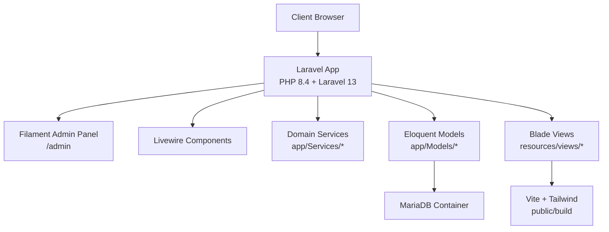
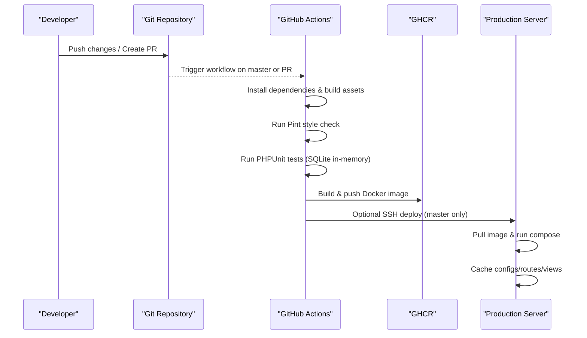
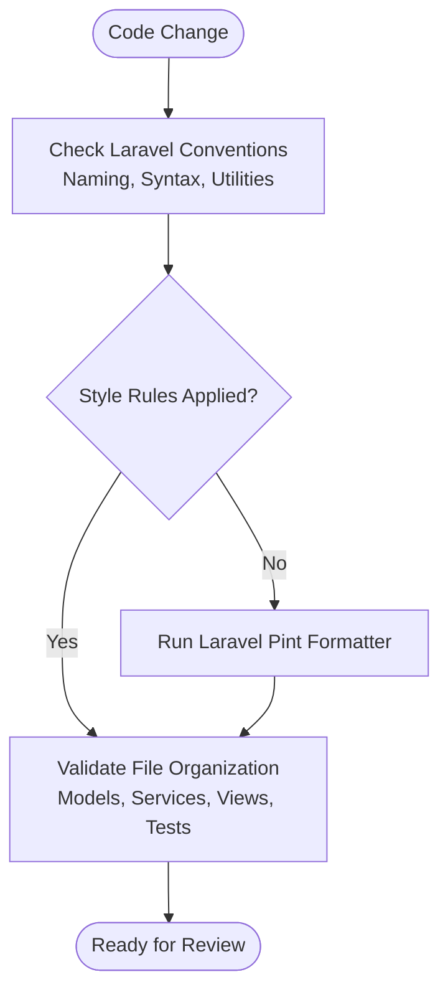
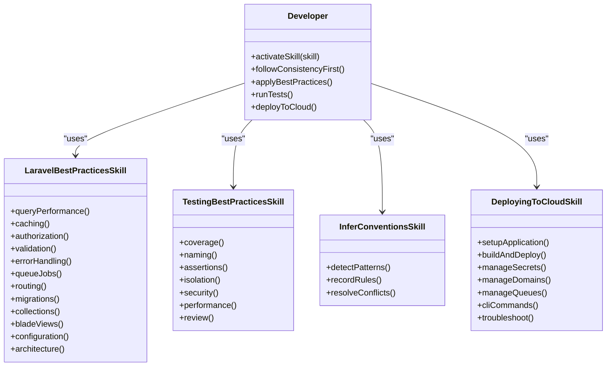
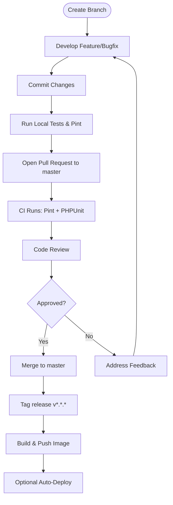
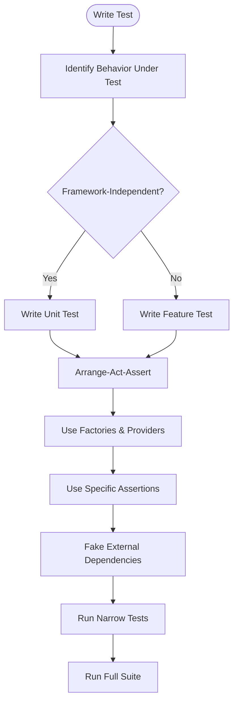
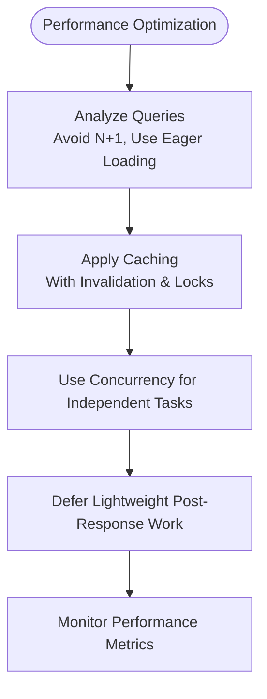
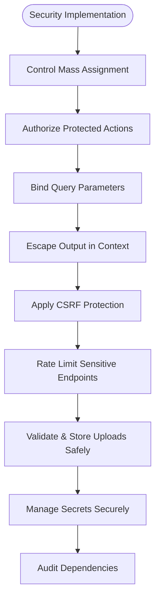
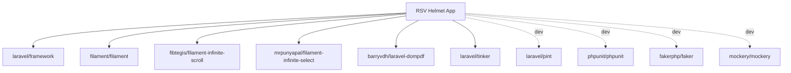

# Development Guidelines

<cite>
**Referenced Files in This Document**
- [README.md](file://README.md)
- [AGENTS.md](file://AGENTS.md)
- [CLAUDE.md](file://CLAUDE.md)
- [composer.json](file://composer.json)
- [.editorconfig](file://.editorconfig)
- [.github/workflows/ci-cd.yml](file://.github/workflows/ci-cd.yml)
- [.claude/skills/laravel-best-practices/SKILL.md](file://.claude/skills/laravel-best-practices/SKILL.md)
- [.claude/skills/testing-best-practices/SKILL.md](file://.claude/skills/testing-best-practices/SKILL.md)
- [.claude/skills/infer-conventions/SKILL.md](file://.claude/skills/infer-conventions/SKILL.md)
- [.claude/skills/deploying-to-cloud/SKILL.md](file://.claude/skills/deploying-to-cloud/SKILL.md)
- [.claude/skills/laravel-best-practices/rules/style.md](file://.claude/skills/laravel-best-practices/rules/style.md)
- [.claude/skills/laravel-best-practices/rules/architecture.md](file://.claude/skills/laravel-best-practices/rules/architecture.md)
- [.claude/skills/laravel-best-practices/rules/security.md](file://.claude/skills/laravel-best-practices/rules/security.md)
- [.claude/skills/testing-best-practices/rules/naming.md](file://.claude/skills/testing-best-practices/rules/naming.md)
- [.claude/skills/testing-best-practices/rules/assertions.md](file://.claude/skills/testing-best-practices/rules/assertions.md)
- [.claude/skills/testing-best-practices/rules/test-data.md](file://.claude/skills/testing-best-practices/rules/test-data.md)
- [phpunit.xml](file://phpunit.xml)
- [package.json](file://package.json)
</cite>

## Table of Contents
1. [Introduction](#introduction)
2. [Project Structure](#project-structure)
3. [Core Components](#core-components)
4. [Architecture Overview](#architecture-overview)
5. [Detailed Component Analysis](#detailed-component-analysis)
6. [Dependency Analysis](#dependency-analysis)
7. [Performance Considerations](#performance-considerations)
8. [Troubleshooting Guide](#troubleshooting-guide)
9. [Conclusion](#conclusion)
10. [Appendices](#appendices)

## Introduction
This document defines the development guidelines for contributing to RSV Helmet, a Laravel 13 inventory and production management application with a Filament admin panel, Livewire components, MariaDB, Vite, and Tailwind CSS. It covers coding standards, file organization, naming patterns, Git workflow, branching strategy, code review expectations, skill-based development using Claude skills, testing, documentation, backward compatibility, performance, security, and debugging techniques.

The repository is containerized with Docker Compose for local development, uses GitHub Actions for CI/CD, and follows Laravel conventions while enforcing project-specific rules through `.claude` skills and Boost guidelines.

**Section sources**
- [README.md:1-115](file://README.md#L1-L115)
- [AGENTS.md:1-126](file://AGENTS.md#L1-L126)
- [CLAUDE.md:1-159](file://CLAUDE.md#L1-L159)

## Project Structure
RSV Helmet follows a standard Laravel layout with domain-oriented extensions:

- `app/Models`: Eloquent models with UUID primary keys and casts.
- `app/Services`: Domain workflows that span multiple models; keep Filament resources thin.
- `app/Filament`: Admin panel resources, pages, widgets, imports/exports, forms, and custom components.
- `app/Livewire`: Livewire components such as item request forms.
- `app/Http/Controllers`: HTTP controllers (thin layer).
- `database/migrations`, `database/factories`, `database/seeders`: Schema evolution and test data.
- `resources/views`: Blade templates for public pages, Filament pages, Livewire partials, and PDFs.
- `routes/web.php`, `routes/console.php`: Web routes and console commands.
- `tests/Feature`, `tests/Unit`: Feature and unit tests.
- `config/`: Application configuration files.
- `public/`: Public assets and generated Filament assets.
- `docker/production/`: Production Docker entrypoint, Nginx config, PHP settings, Supervisor config.
- `.github/workflows/ci-cd.yml`: CI/CD pipeline for tests, build, push, and optional deploy.

**Diagram sources**
- [README.md:1-115](file://README.md#L1-L115)
- [AGENTS.md:31-57](file://AGENTS.md#L31-L57)

**Section sources**
- [README.md:1-115](file://README.md#L1-L115)
- [AGENTS.md:31-57](file://AGENTS.md#L31-L57)

## Core Components
Key development components and responsibilities:

- **Laravel Framework**: Application runtime, routing, service container, Eloquent ORM, queues, caching, and configuration.
- **Filament Admin Panel**: CRUD resources, custom pages, widgets, imports/exports, and infinite scroll list pages.
- **Livewire**: Interactive UI components for item requests and related features.
- **Database Layer**: Migrations, factories, seeders, and Eloquent models with UUIDs and casts.
- **Services Layer**: Business logic orchestration across models (e.g., batch requirements, BOM explosion, stock movements).
- **Frontend Build**: Vite dev server and production builds with Tailwind CSS.
- **Testing Suite**: PHPUnit feature and unit tests with SQLite in-memory database in CI.
- **CI/CD Pipeline**: GitHub Actions running Pint checks, tests, Docker image build/push, and optional SSH deployment.

**Section sources**
- [composer.json:1-93](file://composer.json#L1-L93)
- [AGENTS.md:31-57](file://AGENTS.md#L31-L57)
- [phpunit.xml:1-37](file://phpunit.xml#L1-L37)
- [.github/workflows/ci-cd.yml:1-150](file://.github/workflows/ci-cd.yml#L1-L150)

## Architecture Overview
The system architecture emphasizes separation of concerns:

- Thin HTTP controllers and Filament resources delegate complex workflows to services.
- Models encapsulate data access and relationships.
- Blade views render UI; Livewire handles interactive client-server interactions.
- Vite compiles frontend assets; Tailwind styles are applied via CSS.
- MariaDB stores persistent data; migrations evolve schema safely.
- CI/CD ensures code quality, tests pass, images are built, and deployments can be automated.

**Diagram sources**
- [.github/workflows/ci-cd.yml:1-150](file://.github/workflows/ci-cd.yml#L1-L150)

**Section sources**
- [.github/workflows/ci-cd.yml:1-150](file://.github/workflows/ci-cd.yml#L1-L150)

## Detailed Component Analysis

### Coding Standards and File Organization
- Use Laravel conventions for controllers, models, tables, columns, routes, methods, variables, collections, objects, views, configuration files, and enumerations.
- Prefer clear, idiomatic syntax and framework utilities (`Str`, `Arr`, `Number`, `Uri`) when they clarify intent.
- Keep presentation code maintainable by using asset pipelines, components, and existing conventions; avoid large inline scripts/styles in Blade.
- Write comments that explain why, not what.
- EditorConfig enforces UTF-8, LF line endings, space indentation, final newlines, and trailing whitespace trimming.

**Diagram sources**
- [.claude/skills/laravel-best-practices/rules/style.md:1-111](file://.claude/skills/laravel-best-practices/rules/style.md#L1-L111)
- [.editorconfig:1-19](file://.editorconfig#L1-L19)

**Section sources**
- [.claude/skills/laravel-best-practices/rules/style.md:1-111](file://.claude/skills/laravel-best-practices/rules/style.md#L1-L111)
- [.editorconfig:1-19](file://.editorconfig#L1-L19)

### Skill-Based Development with Claude Skills
- Activate relevant skills before working in a domain: Laravel best practices, testing best practices, infer conventions, deploying to cloud.
- Follow consistency-first principles: inspect sibling files and existing patterns before introducing new approaches.
- Use skills to guide query performance, caching, authorization, validation, error handling, queue jobs, routing, migrations, collections, Blade, configuration, architecture, and testing.
- For testing, use the testing-best-practices skill to select coverage, naming, assertions, isolation, security, performance, and review criteria.
- Infer conventions skill helps document actual project conventions and resolve mixed patterns.
- Deploying-to-cloud skill provides guidance for Laravel Cloud operations, secrets, domains, storage, queues, scheduling, CLI usage, and troubleshooting.

**Diagram sources**
- [.claude/skills/laravel-best-practices/SKILL.md:1-60](file://.claude/skills/laravel-best-practices/SKILL.md#L1-L60)
- [.claude/skills/testing-best-practices/SKILL.md:1-58](file://.claude/skills/testing-best-practices/SKILL.md#L1-L58)
- [.claude/skills/infer-conventions/SKILL.md:1-106](file://.claude/skills/infer-conventions/SKILL.md#L1-L106)
- [.claude/skills/deploying-to-cloud/SKILL.md:1-294](file://.claude/skills/deploying-to-cloud/SKILL.md#L1-L294)

**Section sources**
- [.claude/skills/laravel-best-practices/SKILL.md:1-60](file://.claude/skills/laravel-best-practices/SKILL.md#L1-L60)
- [.claude/skills/testing-best-practices/SKILL.md:1-58](file://.claude/skills/testing-best-practices/SKILL.md#L1-L58)
- [.claude/skills/infer-conventions/SKILL.md:1-106](file://.claude/skills/infer-conventions/SKILL.md#L1-L106)
- [.claude/skills/deploying-to-cloud/SKILL.md:1-294](file://.claude/skills/deploying-to-cloud/SKILL.md#L1-L294)

### Git Workflow, Branching Strategy, and Code Review
- The CI/CD pipeline triggers on pushes to `master`, tags matching `v*.*.*`, pull requests targeting `master`, and manual dispatch.
- Recommended branching strategy:
  - `master`: Stable branch protected by CI checks.
  - `feature/<short-description>`: Feature branches for new functionality.
  - `bugfix/<issue-id>`: Bug fix branches.
  - `release/vX.Y.Z`: Release preparation branches.
  - `hotfix/<issue-id>`: Emergency fixes merged directly into `master`.
- Code review process:
  - Ensure all CI checks pass (Pint, tests).
  - Verify adherence to Laravel and project conventions.
  - Confirm tests cover changed behavior and failure modes.
  - Review service layer complexity and model relationships.
  - Validate security considerations (mass assignment, authorization, CSRF, rate limiting, uploads, secrets).
  - Check performance implications (N+1 queries, caching, indexing).
  - Confirm backward compatibility for migrations and API contracts.

**Diagram sources**
- [.github/workflows/ci-cd.yml:1-150](file://.github/workflows/ci-cd.yml#L1-L150)

**Section sources**
- [.github/workflows/ci-cd.yml:1-150](file://.github/workflows/ci-cd.yml#L1-L150)

### Writing Tests
- Use PHPUnit with feature tests covering observable behavior and unit tests for framework-independent logic.
- Name tests descriptively, following the pattern `test_<behavior>()`.
- Arrange-act-assert structure with clear separation between setup, action, and assertions.
- Use specific assertions for subjects (HTTP responses, database state, models, queues, events, mail, notifications).
- Manage test data with factories, named states, sequences, and providers.
- Isolate dependencies using fakes for HTTP, time, randomness, and databases.
- Run narrowest relevant tests during iteration and full suite after changes.

**Diagram sources**
- [.claude/skills/testing-best-practices/rules/naming.md:1-39](file://.claude/skills/testing-best-practices/rules/naming.md#L1-L39)
- [.claude/skills/testing-best-practices/rules/assertions.md:1-61](file://.claude/skills/testing-best-practices/rules/assertions.md#L1-L61)
- [.claude/skills/testing-best-practices/rules/test-data.md:1-69](file://.claude/skills/testing-best-practices/rules/test-data.md#L1-L69)

**Section sources**
- [.claude/skills/testing-best-practices/rules/naming.md:1-39](file://.claude/skills/testing-best-practices/rules/naming.md#L1-L39)
- [.claude/skills/testing-best-practices/rules/assertions.md:1-61](file://.claude/skills/testing-best-practices/rules/assertions.md#L1-L61)
- [.claude/skills/testing-best-practices/rules/test-data.md:1-69](file://.claude/skills/testing-best-practices/rules/test-data.md#L1-L69)
- [phpunit.xml:1-37](file://phpunit.xml#L1-L37)

### Documentation and Backward Compatibility
- Document code using PHPDoc blocks for methods, parameters, return types, and array shapes.
- Add concise comments for non-obvious constraints, tradeoffs, workarounds, regular expressions, or external behavior.
- Maintain backward compatibility:
  - Avoid breaking changes in API contracts.
  - Use migrations carefully; add columns before removing them.
  - Preserve existing Filament resource behaviors and labels.
  - Keep Livewire component interfaces stable.
  - Update configuration files without changing expected keys.

**Section sources**
- [.claude/skills/laravel-best-practices/rules/style.md:91-111](file://.claude/skills/laravel-best-practices/rules/style.md#L91-L111)
- [.claude/skills/laravel-best-practices/rules/architecture.md:190-220](file://.claude/skills/laravel-best-practices/rules/architecture.md#L190-L220)

### Performance Considerations
- Optimize database queries: avoid N+1 queries, use eager loading, indexes, and efficient aggregations.
- Use caching strategically with proper invalidation and locks.
- Leverage Laravel’s concurrency features for independent operations.
- Use deferred execution for lightweight post-response tasks.
- Monitor query performance and collection operations.

**Diagram sources**
- [.claude/skills/laravel-best-practices/rules/architecture.md:85-189](file://.claude/skills/laravel-best-practices/rules/architecture.md#L85-L189)

**Section sources**
- [.claude/skills/laravel-best-practices/rules/architecture.md:85-189](file://.claude/skills/laravel-best-practices/rules/architecture.md#L85-L189)

### Security Best Practices
- Control mass assignment using `$fillable` or consistent model guards.
- Authorize protected actions with policies, gates, or form request authorization.
- Bind query parameters to prevent SQL injection.
- Escape output in appropriate contexts (HTML, URLs, JavaScript, CSS).
- Apply CSRF protection for state-changing forms.
- Rate limit sensitive endpoints.
- Validate and store uploads safely.
- Keep secrets out of application code; use environment variables and encrypted attributes where appropriate.
- Audit dependencies regularly.

**Diagram sources**
- [.claude/skills/laravel-best-practices/rules/security.md:1-157](file://.claude/skills/laravel-best-practices/rules/security.md#L1-L157)

**Section sources**
- [.claude/skills/laravel-best-practices/rules/security.md:1-157](file://.claude/skills/laravel-best-practices/rules/security.md#L1-L157)

### Debugging Techniques
- Use Laravel Boost tools for database queries, schema inspection, URL resolution, and browser logs.
- Run Artisan commands for route inspection, configuration reading, and tinker sessions.
- Inspect logs and errors in Docker containers.
- Use browser developer tools to diagnose frontend issues.
- Leverage Laravel’s debugging helpers and context logging.

**Section sources**
- [CLAUDE.md:45-82](file://CLAUDE.md#L45-L82)
- [AGENTS.md:11-29](file://AGENTS.md#L11-L29)

## Dependency Analysis
Key dependencies and their roles:

- **laravel/framework**: Core Laravel framework providing MVC, Eloquent, queues, caching, and configuration.
- **filament/filament**: Admin panel framework for rapid CRUD development.
- **fibtegis/filament-infinite-scroll**: Infinite scroll plugin for Filament tables.
- **mrpunyapal/filament-infinite-select**: Infinite select component for large datasets.
- **barryvdh/laravel-dompdf**: PDF generation for item requests.
- **laravel/tinker**: Interactive shell for debugging and exploration.
- **Development dependencies**: Pint (formatter), PHPUnit (testing), Faker (test data), Mockery (mocking), Collision (error rendering), Pail (log viewer), Pao (API docs).

**Diagram sources**
- [composer.json:1-93](file://composer.json#L1-L93)

**Section sources**
- [composer.json:1-93](file://composer.json#L1-L93)

## Performance Considerations
- Optimize database queries by avoiding N+1 problems and using eager loading.
- Implement caching strategies with proper invalidation and locking mechanisms.
- Use Laravel’s concurrency features for independent operations.
- Defer lightweight post-response tasks to improve user experience.
- Monitor query performance and collection operations for efficiency.
- Build frontend assets efficiently using Vite and optimize for production.

[No sources needed since this section provides general guidance]

## Troubleshooting Guide
Common issues and resolutions:

- **Frontend Asset Issues**: Rebuild assets with `npm run build` or run `npm run dev` for development.
- **Filament Assets**: Run `php artisan filament:upgrade` to publish assets and clear cache.
- **Database Connection**: Verify `.env` configuration and Docker Compose database settings.
- **Permission Issues**: Ensure container user matches host user for file ownership.
- **Test Failures**: Run narrow tests first, then full suite; check SQLite in-memory database configuration.
- **Deployment Issues**: Check CI/CD logs, verify secrets configuration, and monitor deployment status.

**Section sources**
- [README.md:98-103](file://README.md#L98-L103)
- [AGENTS.md:113-119](file://AGENTS.md#L113-L119)
- [phpunit.xml:20-35](file://phpunit.xml#L20-L35)

## Conclusion
RSV Helmet follows established Laravel conventions while enforcing project-specific standards through Claude skills and CI/CD automation. Contributors should prioritize consistency, write comprehensive tests, follow security best practices, and maintain backward compatibility. The skill-based development approach ensures consistent code quality, while the Git workflow and code review process maintain code integrity. Performance optimization and debugging techniques help deliver reliable, efficient applications.

[No sources needed since this section summarizes without analyzing specific files]

## Appendices

### Environment Variables and Configuration
- Database credentials are configured in `.env` and used by Docker Compose.
- Application configuration files are located in `config/`.
- Environment-specific settings are managed through Laravel’s configuration system.

**Section sources**
- [README.md:56-72](file://README.md#L56-L72)
- [composer.json:76-80](file://composer.json#L76-L80)

### Frontend Build Process
- Vite development server runs on port 5174.
- Production builds are generated to `public/build`.
- Tailwind CSS is integrated with Vite for styling.

**Section sources**
- [package.json:1-20](file://package.json#L1-L20)
- [README.md:35-54](file://README.md#L35-L54)