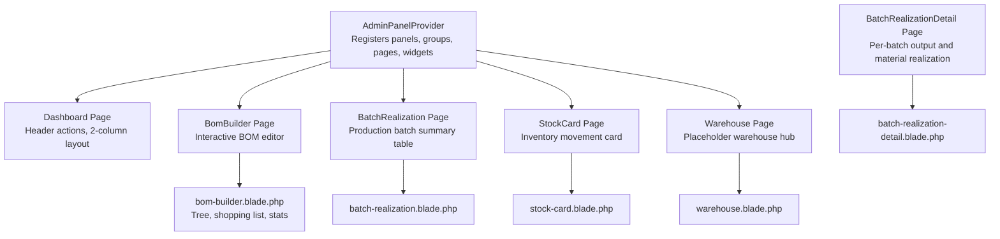
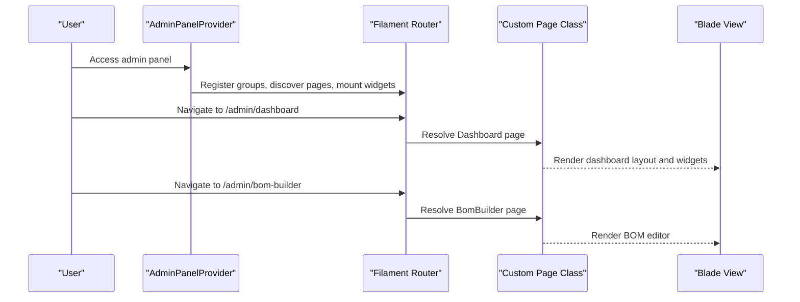
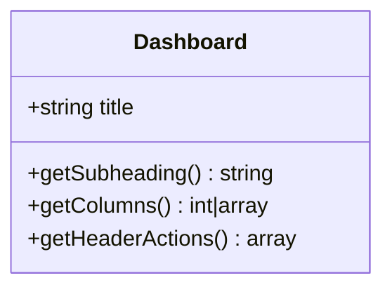
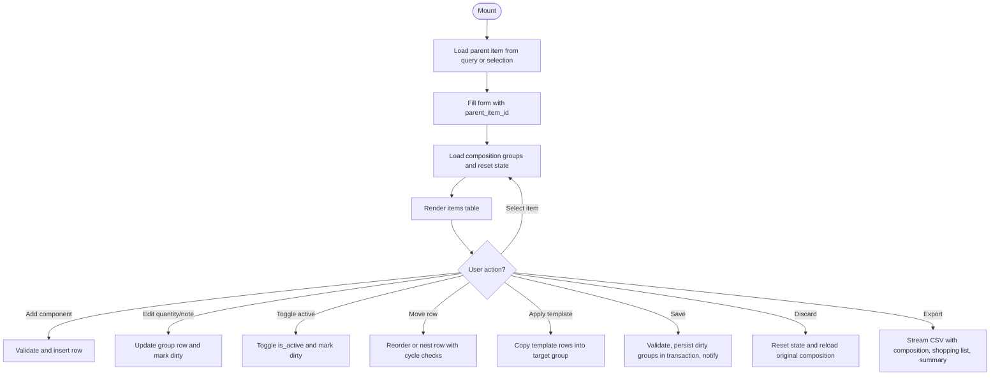
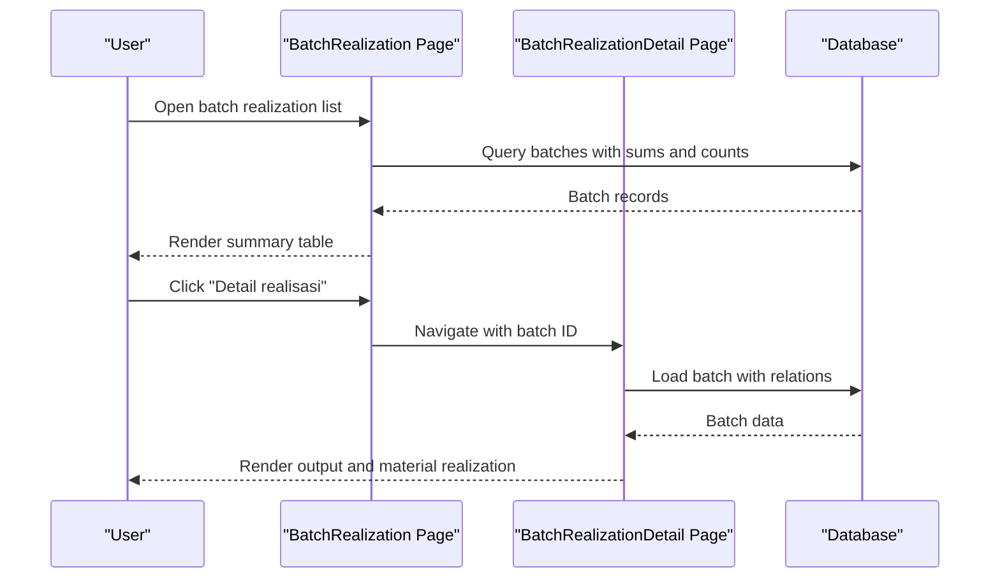
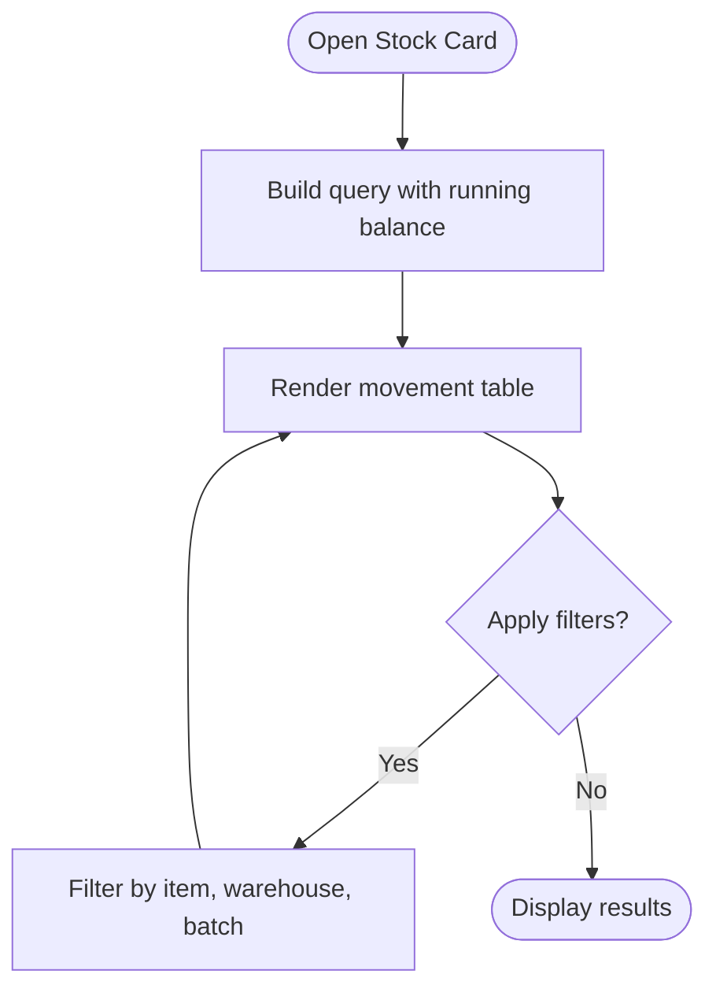
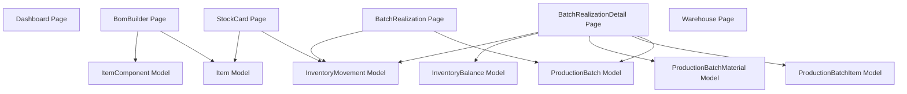

# Custom Pages

<cite>
**Referenced Files in This Document **
- [AdminPanelProvider.php](file://app/Providers/Filament/AdminPanelProvider.php)
- [Dashboard.php](file://app/Filament/Pages/Dashboard.php)
- [BomBuilder.php](file://app/Filament/Pages/BomBuilder.php)
- [bom-builder.blade.php](file://resources/views/filament/pages/bom-builder.blade.php)
- [BatchRealization.php](file://app/Filament/Pages/BatchRealization.php)
- [batch-realization.blade.php](file://resources/views/filament/pages/batch-realization.blade.php)
- [BatchRealizationDetail.php](file://app/Filament/Pages/BatchRealizationDetail.php)
- [batch-realization-detail.blade.php](file://resources/views/filament/pages/batch-realization-detail.blade.php)
- [StockCard.php](file://app/Filament/Pages/StockCard.php)
- [stock-card.blade.php](file://resources/views/filament/pages/stock-card.blade.php)
- [Warehouse.php](file://app/Filament/Pages/Warehouse.php)
- [warehouse.blade.php](file://resources/views/filament/pages/warehouse.blade.php)
</cite>

## Table of Contents
1. [Introduction](#introduction)
2. [Project Structure](#project-structure)
3. [Core Components](#core-components)
4. [Architecture Overview](#architecture-overview)
5. [Detailed Component Analysis](#detailed-component-analysis)
6. [Dependency Analysis](#dependency-analysis)
7. [Performance Considerations](#performance-considerations)
8. [Troubleshooting Guide](#troubleshooting-guide)
9. [Guidelines for Creating New Custom Pages](#guidelines-for-creating-new-custom-pages)
10. [Conclusion](#conclusion)

## Introduction
This document explains how the custom pages in this Filament-based application implement complex business workflows. It focuses on:
- The main Dashboard page layout and widget integration.
- The BOM Builder page for interactive bill-of-materials creation and editing.
- Batch Realization pages for production completion workflows.
- Stock Card pages for inventory tracking.
- Warehouse management placeholder page.
It also documents page routing, data binding, form handling, state management patterns, and guidelines for adding new custom pages to the navigation structure.

## Project Structure
Custom pages live under `app/Filament/Pages`, with corresponding Blade views under `resources/views/filament/pages`. The Filament panel provider registers navigation groups, discovers pages, and mounts dashboard widgets.

**Diagram sources**
- [AdminPanelProvider.php:31-62](file://app/Providers/Filament/AdminPanelProvider.php#L31-L62)
- [Dashboard.php:9-35](file://app/Filament/Pages/Dashboard.php#L9-L35)
- [BomBuilder.php:26-42](file://app/Filament/Pages/BomBuilder.php#L26-L42)
- [bom-builder.blade.php:1-30](file://resources/views/filament/pages/bom-builder.blade.php#L1-L30)
- [BatchRealization.php:19-33](file://app/Filament/Pages/BatchRealization.php#L19-L33)
- [batch-realization.blade.php:1-4](file://resources/views/filament/pages/batch-realization.blade.php#L1-L4)
- [BatchRealizationDetail.php:18-26](file://app/Filament/Pages/BatchRealizationDetail.php#L18-L26)
- [batch-realization-detail.blade.php:1-23](file://resources/views/filament/pages/batch-realization-detail.blade.php#L1-L23)
- [StockCard.php:17-31](file://app/Filament/Pages/StockCard.php#L17-L31)
- [stock-card.blade.php:1-4](file://resources/views/filament/pages/stock-card.blade.php#L1-L4)
- [Warehouse.php:8-20](file://app/Filament/Pages/Warehouse.php#L8-L20)
- [warehouse.blade.php:1-13](file://resources/views/filament/pages/warehouse.blade.php#L1-L13)

**Section sources**
- [AdminPanelProvider.php:31-62](file://app/Providers/Filament/AdminPanelProvider.php#L31-L62)

## Core Components
The custom pages are Filament `Page` classes that render Blade templates and often integrate tables, forms, or header actions.

- Dashboard: Extends Filament’s base dashboard, sets a two-column grid, adds header actions for reports and batch creation.
- BOM Builder: Full interactive page with a table of buildable items, an infinite-select form, tree-based composition editor, template reuse, CSV export, and Livewire-driven state.
- Batch Realization: Summary table of production batches with planned vs actual output and shortage indicators; links to detail page.
- Batch Realization Detail: Per-batch view of output realization and material usage, with CSV export and print support.
- Stock Card: Inventory movement ledger with running balance computed via SQL window function, filters by item, warehouse, and production batch.
- Warehouse: Placeholder page grouping warehouse-related menus.

**Section sources**
- [Dashboard.php:9-35](file://app/Filament/Pages/Dashboard.php#L9-L35)
- [BomBuilder.php:26-42](file://app/Filament/Pages/BomBuilder.php#L26-L42)
- [BatchRealization.php:19-33](file://app/Filament/Pages/BatchRealization.php#L19-L33)
- [BatchRealizationDetail.php:18-26](file://app/Filament/Pages/BatchRealizationDetail.php#L18-L26)
- [StockCard.php:17-31](file://app/Filament/Pages/StockCard.php#L17-L31)
- [Warehouse.php:8-20](file://app/Filament/Pages/Warehouse.php#L8-L20)

## Architecture Overview
The system uses Filament’s panel provider to register navigation groups and discover pages. Widgets are mounted on the dashboard. Custom pages can be registered as default pages or discovered automatically.

**Diagram sources**
- [AdminPanelProvider.php:31-62](file://app/Providers/Filament/AdminPanelProvider.php#L31-L62)
- [Dashboard.php:9-35](file://app/Filament/Pages/Dashboard.php#L9-L35)
- [BomBuilder.php:26-42](file://app/Filament/Pages/BomBuilder.php#L26-L42)

## Detailed Component Analysis

### Dashboard Page Layout and Widget Integration
The dashboard extends Filament’s base dashboard class, defines a title and subheading, configures a two-column layout, and provides header actions linking to batch realization reports and batch creation.

Key responsibilities:
- Title and subheading for context.
- Column count for widget grid.
- Header actions for quick navigation to reports and batch creation.

**Diagram sources**
- [Dashboard.php:9-35](file://app/Filament/Pages/Dashboard.php#L9-L35)

**Section sources**
- [Dashboard.php:9-35](file://app/Filament/Pages/Dashboard.php#L9-L35)

### BOM Builder Page: Interactive Bill of Materials Creation and Editing
The BOM Builder is the most complex custom page. It combines:
- A Filament table listing items with existing compositions.
- An infinite-select form to choose the parent item.
- A tree-based composition editor with drag-and-drop reordering, nested sub-assemblies, quantity and note editing, active/inactive toggling.
- Template reuse from other items’ compositions.
- Production quantity input affecting cost summaries.
- CSV export of composition, shopping list, and cost summary.
- State management through public properties and methods bound to the Blade view.

Data model and state:
- Public properties track selected parent item, production quantity, current tab, composition groups, dirty flags, collapsed nodes, visible depth level, search terms, and caches.
- Methods handle mounting, loading composition, validation, saving within transactions, discarding changes, adding/removing/moving components, updating quantities and notes, toggling active status, exporting CSV, and applying templates.

Rendering:
- Blade template renders library of components, template list, root info, statistics, tabs (tree/shopping), add component panel, draggable tree rows, and action buttons.
- Livewire wires user interactions to page methods.

**Diagram sources**
- [BomBuilder.php:107-118](file://app/Filament/Pages/BomBuilder.php#L107-L118)
- [BomBuilder.php:291-332](file://app/Filament/Pages/BomBuilder.php#L291-L332)
- [BomBuilder.php:334-354](file://app/Filament/Pages/BomBuilder.php#L334-L354)
- [BomBuilder.php:455-503](file://app/Filament/Pages/BomBuilder.php#L455-L503)
- [BomBuilder.php:516-551](file://app/Filament/Pages/BomBuilder.php#L516-L551)
- [BomBuilder.php:553-612](file://app/Filament/Pages/BomBuilder.php#L553-L612)
- [BomBuilder.php:614-670](file://app/Filament/Pages/BomBuilder.php#L614-L670)
- [BomBuilder.php:721-761](file://app/Filament/Pages/BomBuilder.php#L721-L761)
- [bom-builder.blade.php:30-437](file://resources/views/filament/pages/bom-builder.blade.php#L30-L437)

State management patterns:
- Public properties represent UI state and are directly bound to inputs using `wire:model`.
- Methods act as event handlers invoked by `wire:click`, `wire:change`, and `wire:input`.
- Dirty tracking (`dirtyGroups`, `dirty`) ensures only changed groups are persisted.
- Caches (`allRowsCache`, `itemCache`, `summaryCache`, `shoppingCache`) reduce repeated computations.
- Notifications provide user feedback for errors and success states.

Form handling:
- Uses Filament Schema with an infinite select for large item lists.
- Live updates trigger composition reload and warnings for unsaved changes.

Validation and persistence:
- Validation error collection before save.
- Database transaction wrapping group persistence.

Routing and navigation:
- Registered via discovery; slug `bom-builder`; grouped under `Produksi`.

**Section sources**
- [BomBuilder.php:26-42](file://app/Filament/Pages/BomBuilder.php#L26-L42)
- [BomBuilder.php:107-118](file://app/Filament/Pages/BomBuilder.php#L107-L118)
- [BomBuilder.php:214-265](file://app/Filament/Pages/BomBuilder.php#L214-L265)
- [BomBuilder.php:291-332](file://app/Filament/Pages/BomBuilder.php#L291-L332)
- [BomBuilder.php:455-503](file://app/Filament/Pages/BomBuilder.php#L455-L503)
- [BomBuilder.php:553-612](file://app/Filament/Pages/BomBuilder.php#L553-L612)
- [BomBuilder.php:614-670](file://app/Filament/Pages/BomBuilder.php#L614-L670)
- [BomBuilder.php:721-761](file://app/Filament/Pages/BomBuilder.php#L721-L761)
- [bom-builder.blade.php:30-437](file://resources/views/filament/pages/bom-builder.blade.php#L30-L437)

### Batch Realization Pages: Production Completion Workflows
Batch Realization provides a summary table of production batches, showing planned vs actual output, material shortages, and links to detailed per-batch realization.

Key responsibilities:
- Query batches with planned quantity sums, actual output sums from movements, and material counts.
- Columns display batch code, status badge, planned/actual quantities, material types, shortage count, start/finish dates.
- Filters allow narrowing by status.
- Record actions link to detail page and resource view.

Detail page responsibilities:
- Mounts a specific batch with related items, materials, movements, warehouses, and creator.
- Computes output realization (planned vs actual) and material realization (required vs used vs available vs shortage).
- Provides CSV export and print actions.
- Renders sections summarizing batch metadata, output realization table, and material realization table.

**Diagram sources**
- [BatchRealization.php:40-110](file://app/Filament/Pages/BatchRealization.php#L40-L110)
- [BatchRealizationDetail.php:30-41](file://app/Filament/Pages/BatchRealizationDetail.php#L30-L41)
- [BatchRealizationDetail.php:84-147](file://app/Filament/Pages/BatchRealizationDetail.php#L84-L147)

**Section sources**
- [BatchRealization.php:19-33](file://app/Filament/Pages/BatchRealization.php#L19-L33)
- [BatchRealization.php:40-110](file://app/Filament/Pages/BatchRealization.php#L40-L110)
- [batch-realization.blade.php:1-4](file://resources/views/filament/pages/batch-realization.blade.php#L1-L4)
- [BatchRealizationDetail.php:18-26](file://app/Filament/Pages/BatchRealizationDetail.php#L18-L26)
- [BatchRealizationDetail.php:30-41](file://app/Filament/Pages/BatchRealizationDetail.php#L30-L41)
- [BatchRealizationDetail.php:84-147](file://app/Filament/Pages/BatchRealizationDetail.php#L84-L147)
- [batch-realization-detail.blade.php:1-23](file://resources/views/filament/pages/batch-realization-detail.blade.php#L1-L23)

### Stock Card Page: Inventory Tracking
Stock Card displays inventory movements with a running balance per item and warehouse.

Key responsibilities:
- Selects movements and computes running balance using a SQL window function partitioned by item and warehouse.
- Columns show time, item code/name, warehouse, type (incoming/outgoing), quantities in/out, running balance, batch reference, note.
- Filters allow selecting item, warehouse, and production batch.
- Sorting defaults to latest movement first.

**Diagram sources**
- [StockCard.php:38-127](file://app/Filament/Pages/StockCard.php#L38-L127)

**Section sources**
- [StockCard.php:17-31](file://app/Filament/Pages/StockCard.php#L17-L31)
- [StockCard.php:38-127](file://app/Filament/Pages/StockCard.php#L38-L127)
- [stock-card.blade.php:1-4](file://resources/views/filament/pages/stock-card.blade.php#L1-L4)

### Warehouse Management Page
The Warehouse page is currently a placeholder that guides users to the correct navigation groups for inventory, production, and master data.

**Section sources**
- [Warehouse.php:8-20](file://app/Filament/Pages/Warehouse.php#L8-L20)
- [warehouse.blade.php:1-13](file://resources/views/filament/pages/warehouse.blade.php#L1-L13)

## Dependency Analysis
Pages depend on models and services for data access and computation. The following diagram shows key relationships among custom pages and their primary dependencies.

**Diagram sources**
- [BomBuilder.php:5-24](file://app/Filament/Pages/BomBuilder.php#L5-L24)
- [BatchRealization.php:5-17](file://app/Filament/Pages/BatchRealization.php#L5-L17)
- [BatchRealizationDetail.php:5-16](file://app/Filament/Pages/BatchRealizationDetail.php#L5-L16)
- [StockCard.php:5-15](file://app/Filament/Pages/StockCard.php#L5-L15)

**Section sources**
- [BomBuilder.php:5-24](file://app/Filament/Pages/BomBuilder.php#L5-L24)
- [BatchRealization.php:5-17](file://app/Filament/Pages/BatchRealization.php#L5-L17)
- [BatchRealizationDetail.php:5-16](file://app/Filament/Pages/BatchRealizationDetail.php#L5-L16)
- [StockCard.php:5-15](file://app/Filament/Pages/StockCard.php#L5-L15)

## Performance Considerations
- BOM Builder uses caching for expensive computations like all rows, item lookups, summary totals, and shopping lists. Clear caches when state changes.
- Infinite select pagination reduces payload size for large item lists.
- Running balance in Stock Card is computed at the database layer using window functions, minimizing PHP-side aggregation.
- Batch Realization queries use eager loading and aggregate functions to reduce N+1 issues.
- CSV exports stream responses to avoid memory spikes.

[No sources needed since this section provides general guidance]

## Troubleshooting Guide
Common issues and resolutions:
- Unsaved changes warning when switching parent items in BOM Builder: ensure you save or discard changes before switching.
- Cycle detection errors when adding or moving components: verify that no circular dependencies are introduced between parent and child items.
- Empty composition after clearing: remember to save to persist deletion; otherwise, changes remain in-memory.
- Missing item in BOM library: confirm the item is stockable and not a variant.
- Batch realization shortage indicator: check material warehouse configuration and current inventory balances.
- Stock Card running balance mismatch: verify movement ordering and incoming/outgoing classification.

**Section sources**
- [BomBuilder.php:250-263](file://app/Filament/Pages/BomBuilder.php#L250-L263)
- [BomBuilder.php:455-503](file://app/Filament/Pages/BomBuilder.php#L455-L503)
- [BomBuilder.php:553-612](file://app/Filament/Pages/BomBuilder.php#L553-L612)
- [BatchRealizationDetail.php:113-147](file://app/Filament/Pages/BatchRealizationDetail.php#L113-L147)
- [StockCard.php:45-52](file://app/Filament/Pages/StockCard.php#L45-L52)

## Guidelines for Creating New Custom Pages
To create a new custom page and integrate it into the navigation structure:

1. Create a Page class under `app/Filament/Pages`:
   - Extend `Filament\Pages\Page`.
   - Set navigation metadata: `$navigationGroup`, `$navigationLabel`, `$title`, `$navigationIcon`, `$navigationSort`, optional `$slug`.
   - Optionally set `$shouldRegisterNavigation = false` if the page should not appear in the sidebar but still be routable.
   - Define `$view` pointing to a Blade file under `resources/views/filament/pages`.

2. Implement page logic:
   - Use public properties for state and bind them in Blade with `wire:model`.
   - Provide methods for actions triggered by `wire:click`, `wire:change`, etc.
   - For tables, implement `table(Table $table)` and use `InteractsWithTable`.
   - For forms, implement `form(Schema $schema)` and use Filament schema components.

3. Create the Blade view under `resources/views/filament/pages`:
   - Wrap content in `<x-filament-panels::page>` or appropriate Filament components.
   - Render tables via `{{ $this->table }}` or forms via `{{ $this->form }}`.
   - Use Livewire directives to bind user interactions to page methods.

4. Register the page:
   - If auto-discovery is enabled, pages under `app/Filament/Pages` are discovered automatically.
   - To explicitly register a default page, add it to the `pages([...])` array in `AdminPanelProvider`.
   - Ensure navigation groups are defined in `AdminPanelProvider` so the page appears under the intended group.

5. Test routing and navigation:
   - Verify the page URL matches the configured slug or route name.
   - Confirm the page appears in the sidebar under the correct group.
   - Validate that header actions and record actions navigate correctly.

6. Follow existing patterns:
   - Use notifications for user feedback.
   - Use transactions for data mutations.
   - Cache expensive computations and clear caches on state changes.
   - Keep views focused on presentation and move business logic into page methods or services.

**Section sources**
- [AdminPanelProvider.php:44-54](file://app/Providers/Filament/AdminPanelProvider.php#L44-L54)
- [BomBuilder.php:30-42](file://app/Filament/Pages/BomBuilder.php#L30-L42)
- [BatchRealizationDetail.php:20-26](file://app/Filament/Pages/BatchRealizationDetail.php#L20-L26)
- [Warehouse.php:10-20](file://app/Filament/Pages/Warehouse.php#L10-L20)

## Conclusion
The custom pages in this application demonstrate robust patterns for complex business workflows:
- Dashboard integrates widgets and header actions for quick navigation.
- BOM Builder provides a comprehensive interactive editor with state management, validation, and export capabilities.
- Batch Realization pages offer production oversight with drill-down details and reporting.
- Stock Card delivers precise inventory tracking with efficient SQL-based calculations.
- Warehouse serves as a navigational anchor for future enhancements.

By following the provided guidelines and patterns, developers can extend the system with new custom pages that integrate seamlessly into the Filament navigation and maintain consistency in data binding, form handling, and state management.

[No sources needed since this section summarizes without analyzing specific files]