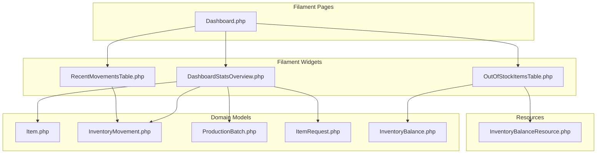
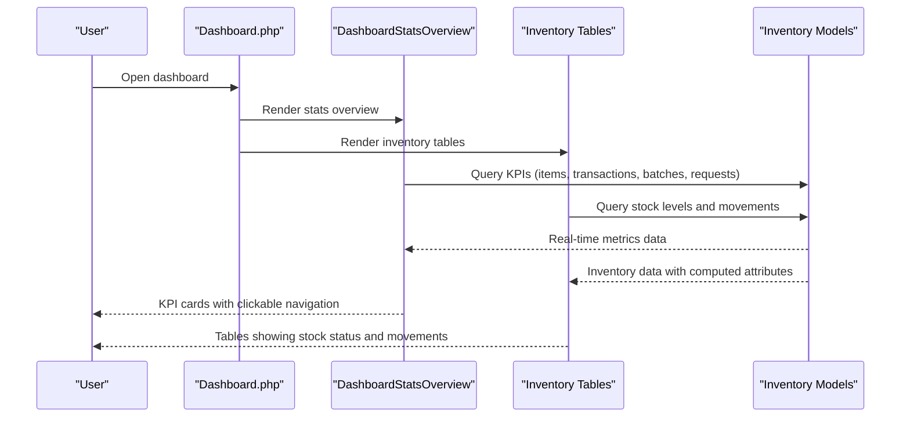
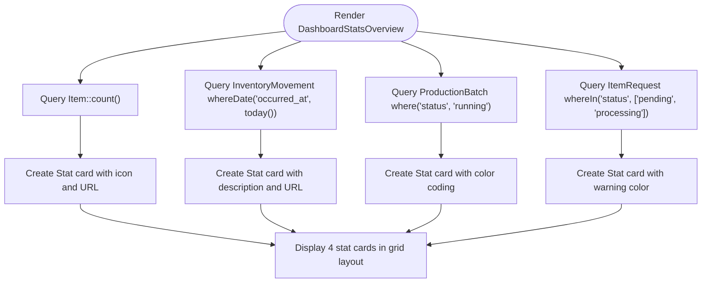
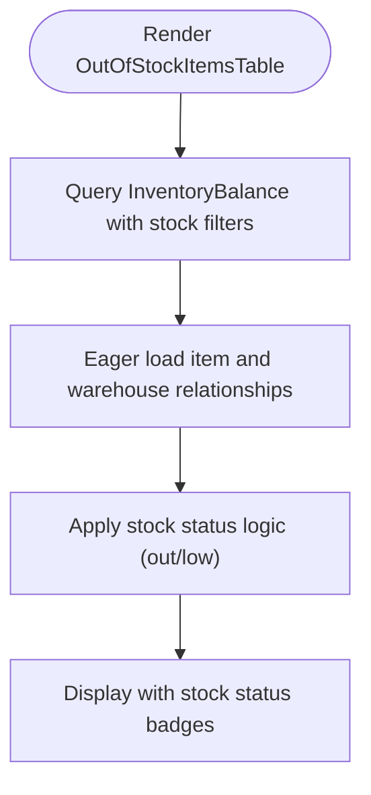
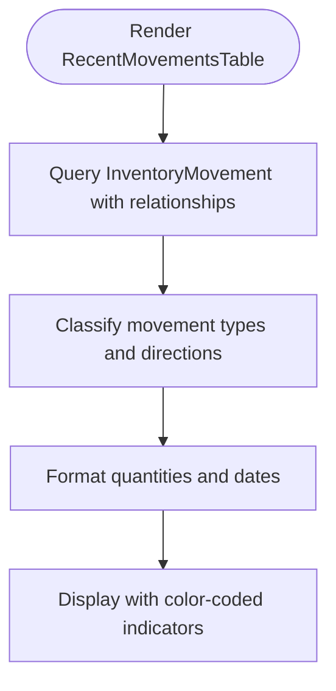
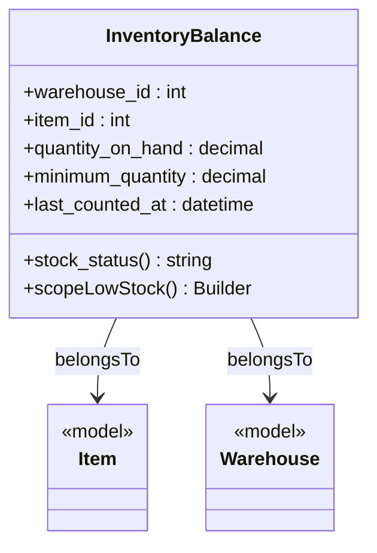
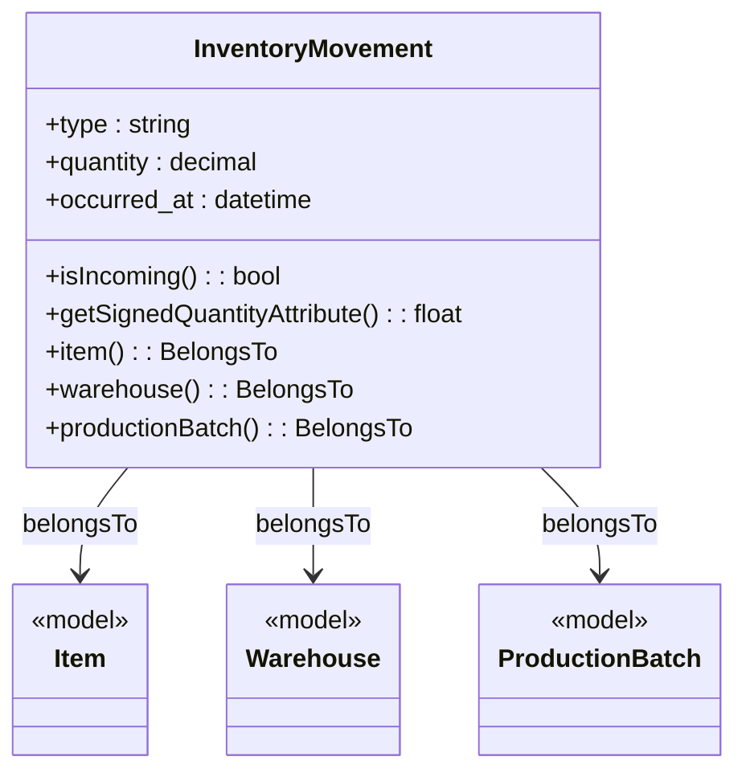
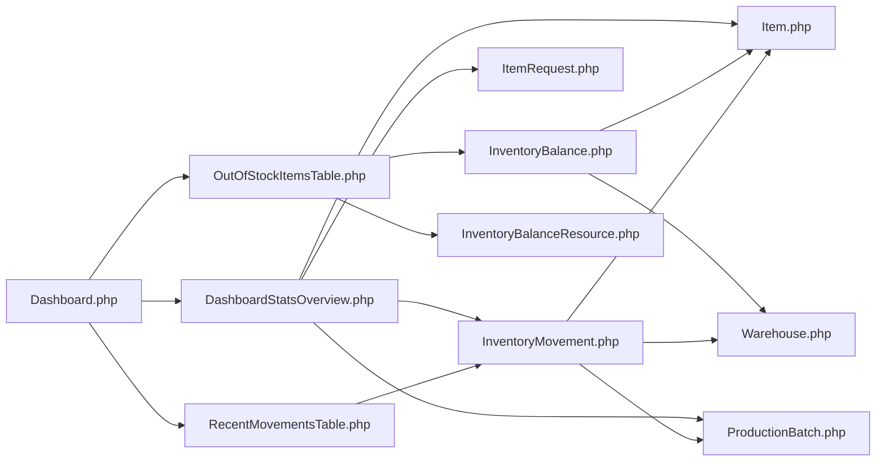

# Dashboard Widgets

<cite>
**Referenced Files in This Document**
- [DashboardStatsOverview.php](file://app/Filament/Widgets/DashboardStatsOverview.php)
- [OutOfStockItemsTable.php](file://app/Filament/Widgets/OutOfStockItemsTable.php)
- [RecentMovementsTable.php](file://app/Filament/Widgets/RecentMovementsTable.php)
- [Dashboard.php](file://app/Filament/Pages/Dashboard.php)
- [Item.php](file://app/Models/Item.php)
- [InventoryMovement.php](file://app/Models/InventoryMovement.php)
- [ProductionBatch.php](file://app/Models/ProductionBatch.php)
- [ItemRequest.php](file://app/Models/ItemRequest.php)
- [InventoryBalance.php](file://app/Models/InventoryBalance.php)
- [InventoryBalanceResource.php](file://app/Filament/Resources/InventoryBalances/InventoryBalanceResource.php)
</cite>

## Update Summary
**Changes Made**
- Added comprehensive documentation for the new DashboardStatsOverview widget providing real-time metrics and KPIs
- Enhanced the dashboard architecture section to include the stats overview component
- Updated widget lifecycle methods reference to include StatsOverviewWidget patterns
- Expanded examples to demonstrate creating custom stat widgets with clickable navigation
- Added performance considerations specific to real-time metric calculations

## Table of Contents
1. [Introduction](#introduction)
2. [Project Structure](#project-structure)
3. [Core Components](#core-components)
4. [Architecture Overview](#architecture-overview)
5. [Detailed Component Analysis](#detailed-component-analysis)
6. [Dependency Analysis](#dependency-analysis)
7. [Performance Considerations](#performance-considerations)
8. [Troubleshooting Guide](#troubleshooting-guide)
9. [Conclusion](#conclusion)
10. [Appendices](#appendices)

## Introduction
This document explains the dashboard widgets that provide comprehensive inventory management insights through real-time stock monitoring, movement tracking, and key performance indicators. It covers:
- **DashboardStatsOverview**: Real-time metrics widget displaying total inventory items, daily transactions, active production batches, and pending item requests with clickable navigation
- Inventory-focused table widgets replacing production monitoring functionality
- Table widgets for displaying out-of-stock items and recent inventory movements
- Real-time inventory status tracking with stock level monitoring
- Widget lifecycle methods, data fetching strategies, and responsive design considerations
- Examples of creating custom inventory widgets and integrating with inventory models

The implementation uses Filament widgets backed by inventory models to provide comprehensive inventory visibility and control, combining both statistical overviews and detailed tabular data.

## Project Structure
The dashboard is composed of:
- A Filament dashboard page that hosts all widgets including the new stats overview
- Stats overview widget for real-time KPIs and metrics
- Table widgets for monitoring stock levels and tracking inventory movements
- Inventory models defining stock balances, movements, and business entities
- Resource classes providing reusable components and business logic

**Diagram sources**
- [Dashboard.php:1-16](file://app/Filament/Pages/Dashboard.php#L1-L16)
- [DashboardStatsOverview.php:1-48](file://app/Filament/Widgets/DashboardStatsOverview.php#L1-L48)
- [OutOfStockItemsTable.php:1-64](file://app/Filament/Widgets/OutOfStockItemsTable.php#L1-L64)
- [RecentMovementsTable.php:1-79](file://app/Filament/Widgets/RecentMovementsTable.php#L1-L79)
- [Item.php:1-173](file://app/Models/Item.php#L1-L173)
- [InventoryMovement.php:1-196](file://app/Models/InventoryMovement.php#L1-L196)
- [ProductionBatch.php:1-117](file://app/Models/ProductionBatch.php#L1-L117)
- [ItemRequest.php:1-135](file://app/Models/ItemRequest.php#L1-L135)
- [InventoryBalance.php:1-71](file://app/Models/InventoryBalance.php#L1-L71)
- [InventoryBalanceResource.php:1-445](file://app/Filament/Resources/InventoryBalances/InventoryBalanceResource.php#L1-L445)

**Section sources**
- [Dashboard.php:1-16](file://app/Filament/Pages/Dashboard.php#L1-L16)

## Core Components
- **DashboardStatsOverview**: Real-time metrics widget displaying four key KPIs - total inventory items, daily transactions, active production batches, and pending item requests, each with clickable navigation to relevant resources.
- **OutOfStockItemsTable**: Displays items with zero or low stock levels, including item details, warehouse information, stock quantities, and stock status badges.
- **RecentMovementsTable**: Shows the most recent inventory movements with type classification, quantity tracking, and associated batch information.
- **InventoryBalance**: Model representing stock levels per warehouse-item combination with computed stock status attributes.
- **InventoryMovement**: Model tracking all inventory changes with type classification, directional indicators, and relationship mappings.
- **Item**: Core model for inventory items with extensive relationships and business logic.
- **ProductionBatch**: Model for production batch management with status tracking and completion metrics.
- **ItemRequest**: Model for item request workflow with approval states and processing tracking.
- **InventoryBalanceResource**: Provides reusable components like stock status columns and filters used across the application.

Key responsibilities:
- Real-time KPI calculation and display through stats overview widget
- Stock monitoring and alerting through out-of-stock detection
- Movement tracking and visualization with directional indicators
- Status computation and presentation through computed attributes
- Reusable UI components through resource methods

**Section sources**
- [DashboardStatsOverview.php:1-48](file://app/Filament/Widgets/DashboardStatsOverview.php#L1-L48)
- [OutOfStockItemsTable.php:1-64](file://app/Filament/Widgets/OutOfStockItemsTable.php#L1-L64)
- [RecentMovementsTable.php:1-79](file://app/Filament/Widgets/RecentMovementsTable.php#L1-L79)
- [Item.php:1-173](file://app/Models/Item.php#L1-L173)
- [InventoryMovement.php:1-196](file://app/Models/InventoryMovement.php#L1-L196)
- [ProductionBatch.php:1-117](file://app/Models/ProductionBatch.php#L1-L117)
- [ItemRequest.php:1-135](file://app/Models/ItemRequest.php#L1-L135)
- [InventoryBalance.php:1-71](file://app/Models/InventoryBalance.php#L1-L71)
- [InventoryBalanceResource.php:65-80](file://app/Filament/Resources/InventoryBalances/InventoryBalanceResource.php#L65-L80)

## Architecture Overview
The dashboard follows a clean separation between presentation (widgets), domain models, and business logic:
- Presentation layer: Filament widgets render both statistical overviews and detailed tables
- Domain layer: Inventory models provide relationships and computed attributes
- Business logic: Resource classes encapsulate reusable components and validation

**Diagram sources**
- [Dashboard.php:1-16](file://app/Filament/Pages/Dashboard.php#L1-L16)
- [DashboardStatsOverview.php:1-48](file://app/Filament/Widgets/DashboardStatsOverview.php#L1-L48)
- [OutOfStockItemsTable.php:1-64](file://app/Filament/Widgets/OutOfStockItemsTable.php#L1-L64)
- [RecentMovementsTable.php:1-79](file://app/Filament/Widgets/RecentMovementsTable.php#L1-L79)
- [Item.php:1-173](file://app/Models/Item.php#L1-L173)
- [InventoryMovement.php:1-196](file://app/Models/InventoryMovement.php#L1-L196)
- [ProductionBatch.php:1-117](file://app/Models/ProductionBatch.php#L1-L117)
- [ItemRequest.php:1-135](file://app/Models/ItemRequest.php#L1-L135)

## Detailed Component Analysis

### DashboardStatsOverview Widget
**New** - Real-time metrics and KPIs widget providing high-level operational insights.

Purpose:
- Display critical business metrics at a glance with real-time data
- Provide quick navigation to detailed views through clickable stat cards
- Monitor inventory health, transaction volume, production activity, and request pipeline

Key features:
- **Total Items**: Counts all inventory items with direct navigation to item management
- **Daily Transactions**: Shows today's inventory movement count with date filtering
- **Active Batches**: Displays running production batches with status-based filtering
- **Pending Requests**: Counts item requests in pending or processing states

Data flow:
- Queries multiple models simultaneously for different KPIs
- Uses efficient database queries with appropriate filters
- Integrates with Filament resources for seamless navigation

**Diagram sources**
- [DashboardStatsOverview.php:23-46](file://app/Filament/Widgets/DashboardStatsOverview.php#L23-L46)
- [Item.php:1-173](file://app/Models/Item.php#L1-L173)
- [InventoryMovement.php:1-196](file://app/Models/InventoryMovement.php#L1-L196)
- [ProductionBatch.php:1-117](file://app/Models/ProductionBatch.php#L1-L117)
- [ItemRequest.php:1-135](file://app/Models/ItemRequest.php#L1-L135)

**Section sources**
- [DashboardStatsOverview.php:1-48](file://app/Filament/Widgets/DashboardStatsOverview.php#L1-L48)
- [Item.php:1-173](file://app/Models/Item.php#L1-L173)
- [InventoryMovement.php:1-196](file://app/Models/InventoryMovement.php#L1-L196)
- [ProductionBatch.php:1-117](file://app/Models/ProductionBatch.php#L1-L117)
- [ItemRequest.php:1-135](file://app/Models/ItemRequest.php#L1-L135)

### OutOfStockItemsTable Widget
Purpose:
- Monitor items with zero or critically low stock levels
- Provide quick access to items requiring immediate attention
- Display stock status with visual indicators and actionable insights

Key features:
- Filters items where quantity_on_hand ≤ 0 OR quantity_on_hand ≤ minimum_quantity
- Shows item code, name, warehouse, stock quantities, and computed stock status
- Includes header action to view all inventory balances
- Uses pagination disabled for focused display of critical items only

Data flow:
- Queries InventoryBalance model with complex filtering conditions
- Eager loads related item and warehouse relationships
- Applies sorting by stock level and minimum quantity thresholds

**Diagram sources**
- [OutOfStockItemsTable.php:19-62](file://app/Filament/Widgets/OutOfStockItemsTable.php#L19-L62)
- [InventoryBalance.php:47-64](file://app/Models/InventoryBalance.php#L47-L64)

**Section sources**
- [OutOfStockItemsTable.php:1-64](file://app/Filament/Widgets/OutOfStockItemsTable.php#L1-L64)
- [InventoryBalance.php:47-64](file://app/Models/InventoryBalance.php#L47-L64)

### RecentMovementsTable Widget
Purpose:
- Track and visualize recent inventory movements
- Show incoming vs outgoing transactions with color-coded indicators
- Provide context about associated production batches and reference documents

Key features:
- Displays last 8 inventory movements ordered by occurrence time
- Color-codes movement types (green for incoming, red for outgoing)
- Shows formatted quantities with locale-aware number formatting
- Includes optional batch reference column for traceability

Data flow:
- Queries InventoryMovement model with eager loading
- Applies movement type classification and directional logic
- Formats quantities based on movement direction (incoming/outgoing)

**Diagram sources**
- [RecentMovementsTable.php:19-77](file://app/Filament/Widgets/RecentMovementsTable.php#L19-L77)
- [InventoryMovement.php:143-174](file://app/Models/InventoryMovement.php#L143-L174)

**Section sources**
- [RecentMovementsTable.php:1-79](file://app/Filament/Widgets/RecentMovementsTable.php#L1-L79)
- [InventoryMovement.php:143-174](file://app/Models/InventoryMovement.php#L143-L174)

### Inventory Balance Model
Purpose:
- Represent stock levels for specific items in specific warehouses
- Compute stock status based on quantity thresholds
- Provide relationships to related entities

Key features:
- Decimal precision casting for accurate stock calculations
- Computed stock_status attribute determining 'out', 'low', or 'ok' status
- Relationships to Item and Warehouse models
- Scope method for low stock queries

**Diagram sources**
- [InventoryBalance.php:1-71](file://app/Models/InventoryBalance.php#L1-L71)

**Section sources**
- [InventoryBalance.php:1-71](file://app/Models/InventoryBalance.php#L1-L71)

### Inventory Movement Model
Purpose:
- Track all inventory changes with detailed metadata
- Classify movement types and directions
- Provide relationships to source documents and entities

Key features:
- Multiple movement type constants (purchase, production, transfer, adjustment)
- Directional classification methods (isIncoming, isOutgoingType)
- Signed quantity calculation for net movement tracking
- Relationships to Item, Warehouse, ProductionBatch, and other entities

**Diagram sources**
- [InventoryMovement.php:1-196](file://app/Models/InventoryMovement.php#L1-L196)

**Section sources**
- [InventoryMovement.php:1-196](file://app/Models/InventoryMovement.php#L1-L196)

### Inventory Balance Resource
Purpose:
- Provide reusable components for inventory balance displays
- Define stock status visualization and filtering logic
- Encapsulate business rules for stock management

Key features:
- Reusable stock status column component with badge styling
- Stock status filter for querying by stock condition
- Form components for inventory management
- Bulk operations for warehouse transfers

**Section sources**
- [InventoryBalanceResource.php:65-101](file://app/Filament/Resources/InventoryBalances/InventoryBalanceResource.php#L65-L101)

## Dependency Analysis
Component relationships:
- Dashboard page orchestrates all widget rendering
- Stats overview widget depends on multiple domain models for KPI calculations
- Table widgets depend on inventory models for data and resource classes for reusable components
- All widgets leverage Filament's widget system for consistent presentation

**Diagram sources**
- [Dashboard.php:1-16](file://app/Filament/Pages/Dashboard.php#L1-L16)
- [DashboardStatsOverview.php:1-48](file://app/Filament/Widgets/DashboardStatsOverview.php#L1-L48)
- [OutOfStockItemsTable.php:1-64](file://app/Filament/Widgets/OutOfStockItemsTable.php#L1-L64)
- [RecentMovementsTable.php:1-79](file://app/Filament/Widgets/RecentMovementsTable.php#L1-L79)
- [Item.php:1-173](file://app/Models/Item.php#L1-L173)
- [InventoryMovement.php:1-196](file://app/Models/InventoryMovement.php#L1-L196)
- [ProductionBatch.php:1-117](file://app/Models/ProductionBatch.php#L1-L117)
- [ItemRequest.php:1-135](file://app/Models/ItemRequest.php#L1-L135)
- [InventoryBalance.php:1-71](file://app/Models/InventoryBalance.php#L1-L71)
- [InventoryBalanceResource.php:1-445](file://app/Filament/Resources/InventoryBalances/InventoryBalanceResource.php#L1-L445)

**Section sources**
- [Dashboard.php:1-16](file://app/Filament/Pages/Dashboard.php#L1-L16)

## Performance Considerations
- Use eager loading (`with`) to prevent N+1 queries when displaying related data
- Limit result sets to reduce payload size (e.g., limit(8) for dashboard widgets)
- Disable pagination for focused dashboard views to avoid unnecessary overhead
- Leverage database-level filtering and sorting where possible
- Use computed attributes sparingly as they execute on every record access
- Consider caching frequently accessed inventory data if performance becomes an issue
- **For stats widgets**: Optimize KPI queries by using efficient counting methods and avoiding unnecessary joins
- **Real-time metrics**: Ensure database indexes exist on frequently queried columns (occurred_at, status, etc.)
- **Concurrent access**: Handle potential race conditions when multiple users access dashboard simultaneously

## Troubleshooting Guide
Common issues and resolutions:
- **Missing stock status**: Ensure InventoryBalance::stock_status computed attribute is properly defined and returns correct values ('out', 'low', 'ok').
- **Incorrect movement classification**: Verify InventoryMovement::incomingTypes() and outgoingTypes() arrays match expected movement types.
- **Locale formatting issues**: Confirm app()->getLocale() is set correctly and Number::format is used consistently for quantity display.
- **Relationship loading problems**: Check that eager loading is properly configured in widget queries to avoid N+1 query issues.
- **Stats widget performance**: If KPI calculations are slow, verify database indexes on frequently filtered columns and consider query optimization.
- **Navigation links not working**: Ensure Filament resource URLs are correctly configured and accessible to authenticated users.

**Section sources**
- [InventoryBalance.php:47-64](file://app/Models/InventoryBalance.php#L47-L64)
- [InventoryMovement.php:143-174](file://app/Models/InventoryMovement.php#L143-L174)

## Conclusion
The dashboard widgets provide comprehensive inventory management capabilities through a combination of real-time statistical overviews and detailed table displays. The architecture separates concerns between presentation (widgets), domain data (models), and reusable components (resources). With the addition of the DashboardStatsOverview widget, users now have immediate access to critical KPIs alongside detailed operational data. The system maintains maintainability and performance through careful use of eager loading, computed attributes, clear model relationships, and optimized KPI calculations.

## Appendices

### Widget Lifecycle Methods Reference
- **StatsOverviewWidget** (DashboardStatsOverview):
  - getStats(): Returns array of Stat objects with labels, icons, colors, descriptions, and URLs
  - $sort: Controls widget ordering within the dashboard layout
- **TableWidget** (OutOfStockItemsTable, RecentMovementsTable):
  - table(Table $table): Defines query, columns, filters, actions, sorting, and pagination settings
  - $sort: Controls widget ordering within the dashboard layout
  - $columnSpan: Determines horizontal space allocation in grid layouts

**Section sources**
- [DashboardStatsOverview.php:18-46](file://app/Filament/Widgets/DashboardStatsOverview.php#L18-L46)
- [OutOfStockItemsTable.php:13-17](file://app/Filament/Widgets/OutOfStockItemsTable.php#L13-L17)
- [RecentMovementsTable.php:13-17](file://app/Filament/Widgets/RecentMovementsTable.php#L13-L17)

### Creating Custom Dashboard Widgets
Steps for StatsOverviewWidget:
- Extend Filament's StatsOverviewWidget base class for statistical displays
- Implement the getStats() method to return array of Stat objects
- Configure each stat with label, icon, color, description, and optional URL navigation
- Set widget sort order and positioning properties

Steps for TableWidget:
- Extend Filament's TableWidget base class for inventory-related displays
- Implement the table() method to define queries, columns, and interactions
- Use inventory models (InventoryBalance, InventoryMovement) for data access
- Leverage resource classes for reusable components like stock status columns
- Configure layout properties ($sort, $columnSpan) and interactive behaviors

Example references:
- Stats overview pattern: [DashboardStatsOverview.php:1-48](file://app/Filament/Widgets/DashboardStatsOverview.php#L1-L48)
- Out-of-stock monitoring pattern: [OutOfStockItemsTable.php:1-64](file://app/Filament/Widgets/OutOfStockItemsTable.php#L1-L64)
- Movement tracking pattern: [RecentMovementsTable.php:1-79](file://app/Filament/Widgets/RecentMovementsTable.php#L1-L79)
- Stock status component usage: [InventoryBalanceResource.php:65-80](file://app/Filament/Resources/InventoryBalances/InventoryBalanceResource.php#L65-L80)

**Section sources**
- [DashboardStatsOverview.php:1-48](file://app/Filament/Widgets/DashboardStatsOverview.php#L1-L48)
- [OutOfStockItemsTable.php:1-64](file://app/Filament/Widgets/OutOfStockItemsTable.php#L1-L64)
- [RecentMovementsTable.php:1-79](file://app/Filament/Widgets/RecentMovementsTable.php#L1-L79)
- [InventoryBalanceResource.php:65-80](file://app/Filament/Resources/InventoryBalances/InventoryBalanceResource.php#L65-L80)

### Integrating External Data Sources
Approach:
- Create service classes to fetch and normalize external inventory data
- Map external data to internal inventory models and relationships
- Expose new datasets via custom widgets or extend existing ones
- Apply caching at the service layer to mitigate external API latency

Guidance:
- Keep external integrations isolated in services to preserve widget simplicity
- Validate and sanitize external payloads before processing
- Handle errors gracefully and fallback to cached or default values
- Maintain data consistency through proper transaction handling
- For real-time metrics: Implement background jobs or queues for expensive KPI calculations