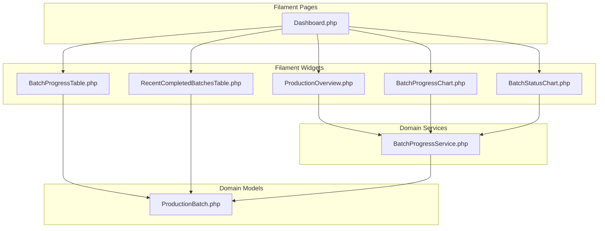
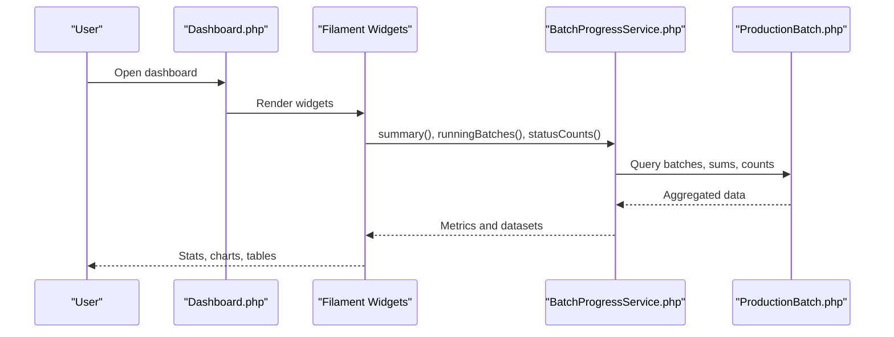
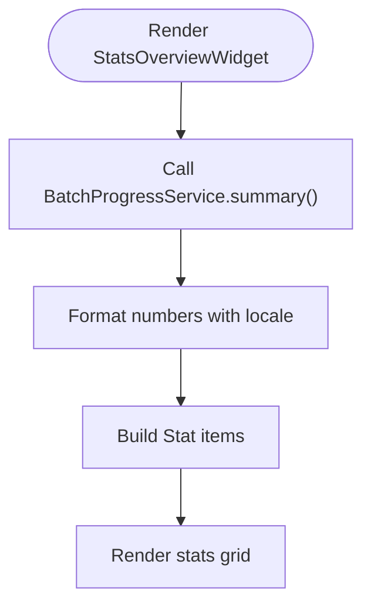
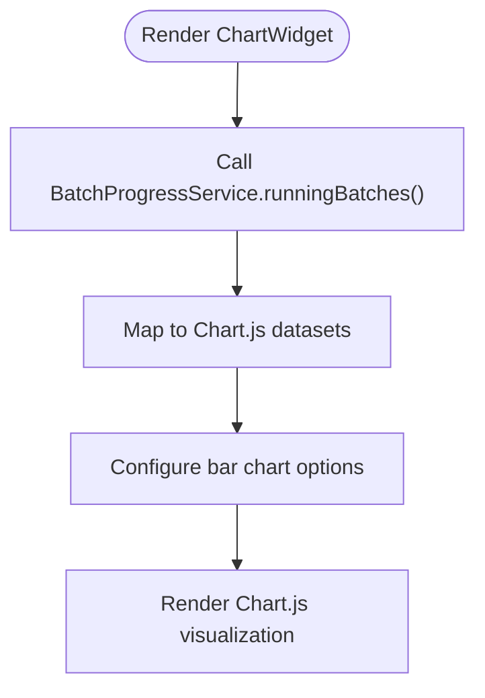
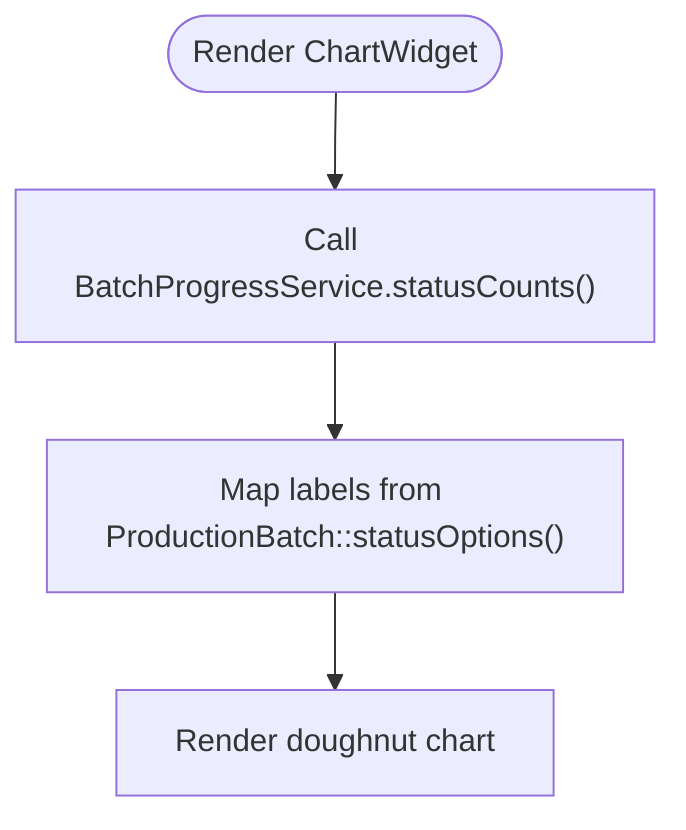
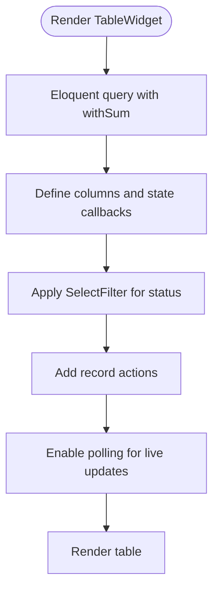
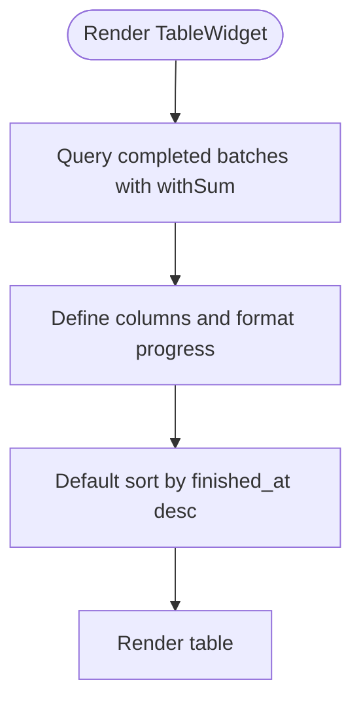
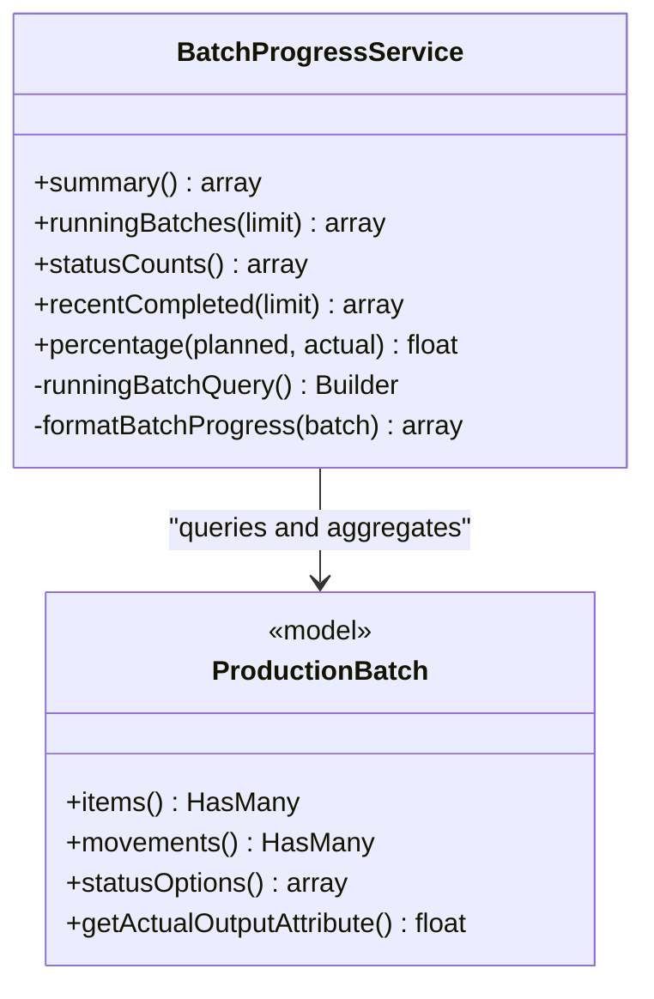
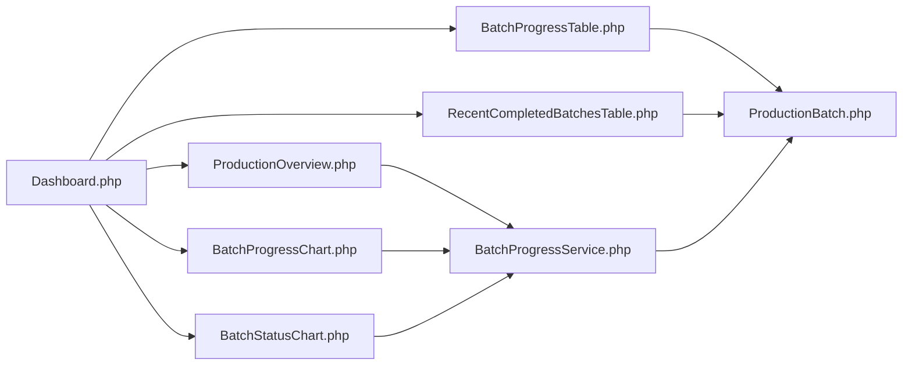

# Dashboard Widgets

<cite>
**Referenced Files in This Document**
- [ProductionOverview.php](file://app/Filament/Widgets/ProductionOverview.php)
- [BatchProgressChart.php](file://app/Filament/Widgets/BatchProgressChart.php)
- [BatchStatusChart.php](file://app/Filament/Widgets/BatchStatusChart.php)
- [BatchProgressTable.php](file://app/Filament/Widgets/BatchProgressTable.php)
- [RecentCompletedBatchesTable.php](file://app/Filament/Widgets/RecentCompletedBatchesTable.php)
- [BatchProgressService.php](file://app/Services/BatchProgressService.php)
- [ProductionBatch.php](file://app/Models/ProductionBatch.php)
- [Dashboard.php](file://app/Filament/Pages/Dashboard.php)
</cite>

## Table of Contents
1. [Introduction](#introduction)
2. [Project Structure](#project-structure)
3. [Core Components](#core-components)
4. [Architecture Overview](#architecture-overview)
5. [Detailed Component Analysis](#detailed-component-analysis)
6. [Dependency Analysis](#dependency-analysis)
7. [Performance Considerations](#performance-considerations)
8. [Troubleshooting Guide](#troubleshooting-guide)
9. [Conclusion](#conclusion)
10. [Appendices](#appendices)

## Introduction
This document explains the dashboard widgets that visualize production batch progress and completion metrics. It covers:
- The production overview widget showing key metrics and KPIs
- Chart widgets for batch progress visualization using Filament’s Chart.js integration
- Status tracking via a doughnut chart
- Table widgets for recent completed batches and production statistics
- Widget lifecycle methods, data fetching strategies, caching mechanisms, and responsive design considerations
- Examples for creating custom widgets and integrating external data sources

The implementation uses Filament widgets backed by a dedicated service layer to aggregate batch data from Eloquent models.

## Project Structure
The dashboard is composed of:
- A Filament dashboard page that hosts widgets
- Stats overview widget for high-level KPIs
- Chart widgets for visualizing running batch progress and status distribution
- Table widgets for detailed views of running and completed batches
- A service class that encapsulates query logic and calculations
- An Eloquent model defining batch statuses and relationships

**Diagram sources**
- [Dashboard.php:1-37](file://app/Filament/Pages/Dashboard.php#L1-L37)
- [ProductionOverview.php:1-40](file://app/Filament/Widgets/ProductionOverview.php#L1-L40)
- [BatchProgressChart.php:1-61](file://app/Filament/Widgets/BatchProgressChart.php#L1-L61)
- [BatchStatusChart.php:1-44](file://app/Filament/Widgets/BatchStatusChart.php#L1-L44)
- [BatchProgressTable.php:1-100](file://app/Filament/Widgets/BatchProgressTable.php#L1-L100)
- [RecentCompletedBatchesTable.php:1-68](file://app/Filament/Widgets/RecentCompletedBatchesTable.php#L1-L68)
- [BatchProgressService.php:1-152](file://app/Services/BatchProgressService.php#L1-L152)
- [ProductionBatch.php:1-117](file://app/Models/ProductionBatch.php#L1-L117)

**Section sources**
- [Dashboard.php:1-37](file://app/Filament/Pages/Dashboard.php#L1-L37)

## Core Components
- ProductionOverview: Displays KPIs such as running batches, planned vs actual output, and overall progress percentage. Uses a stats overview widget with polling enabled.
- BatchProgressChart: Horizontal bar chart comparing planned vs realized quantities for running batches.
- BatchStatusChart: Doughnut chart showing the distribution of batches across statuses.
- BatchProgressTable: Detailed table of running/planned batches with filters, actions, and real-time updates.
- RecentCompletedBatchesTable: Summary table of recently completed batches with progress percentages.
- BatchProgressService: Centralized service for aggregating batch metrics, computing percentages, and providing datasets for charts and tables.
- ProductionBatch: Model defining batch statuses, relationships, and computed attributes used by widgets and services.

Key responsibilities:
- Data aggregation and calculation are centralized in BatchProgressService to avoid duplication across widgets.
- Charts use Filament’s ChartWidget API which renders Chart.js visuals on the frontend.
- Tables use Filament’s TableWidget API with Eloquent queries, filters, and actions.

**Section sources**
- [ProductionOverview.php:1-40](file://app/Filament/Widgets/ProductionOverview.php#L1-L40)
- [BatchProgressChart.php:1-61](file://app/Filament/Widgets/BatchProgressChart.php#L1-L61)
- [BatchStatusChart.php:1-44](file://app/Filament/Widgets/BatchStatusChart.php#L1-L44)
- [BatchProgressTable.php:1-100](file://app/Filament/Widgets/BatchProgressTable.php#L1-L100)
- [RecentCompletedBatchesTable.php:1-68](file://app/Filament/Widgets/RecentCompletedBatchesTable.php#L1-L68)
- [BatchProgressService.php:1-152](file://app/Services/BatchProgressService.php#L1-L152)
- [ProductionBatch.php:1-117](file://app/Models/ProductionBatch.php#L1-L117)

## Architecture Overview
The dashboard follows a layered approach:
- Presentation layer: Filament widgets render UI components (stats, charts, tables).
- Service layer: BatchProgressService encapsulates business logic and data aggregation.
- Domain layer: ProductionBatch model provides relationships and constants.

**Diagram sources**
- [Dashboard.php:1-37](file://app/Filament/Pages/Dashboard.php#L1-L37)
- [ProductionOverview.php:1-40](file://app/Filament/Widgets/ProductionOverview.php#L1-L40)
- [BatchProgressChart.php:1-61](file://app/Filament/Widgets/BatchProgressChart.php#L1-L61)
- [BatchStatusChart.php:1-44](file://app/Filament/Widgets/BatchStatusChart.php#L1-L44)
- [BatchProgressService.php:1-152](file://app/Services/BatchProgressService.php#L1-L152)
- [ProductionBatch.php:1-117](file://app/Models/ProductionBatch.php#L1-L117)

## Detailed Component Analysis

### ProductionOverview Widget
Purpose:
- Show key production metrics: running batches count, planned quantity, actual quantity, and total progress percentage.
- Provide localized number formatting and periodic refresh.

Lifecycle and behavior:
- Sorting and column span configured for layout control.
- Polling interval set to refresh stats periodically.
- getStats() fetches aggregated data from BatchProgressService and formats values for display.

Data flow:
- Calls BatchProgressService.summary() to compute totals and percentage.
- Uses Number::format() for locale-aware presentation.

**Diagram sources**
- [ProductionOverview.php:1-40](file://app/Filament/Widgets/ProductionOverview.php#L1-L40)
- [BatchProgressService.php:20-44](file://app/Services/BatchProgressService.php#L20-L44)

**Section sources**
- [ProductionOverview.php:1-40](file://app/Filament/Widgets/ProductionOverview.php#L1-L40)
- [BatchProgressService.php:20-44](file://app/Services/BatchProgressService.php#L20-L44)

### BatchProgressChart Widget
Purpose:
- Visualize planned vs realized quantities for running batches using a horizontal bar chart.

Lifecycle and behavior:
- getData() retrieves running batches via BatchProgressService.runningBatches().
- Maps batch data into Chart.js dataset structure with labels and two datasets (planned, realized).
- getType() returns 'bar' and options configure axis orientation and legend placement.

**Diagram sources**
- [BatchProgressChart.php:1-61](file://app/Filament/Widgets/BatchProgressChart.php#L1-L61)
- [BatchProgressService.php:54-63](file://app/Services/BatchProgressService.php#L54-L63)

**Section sources**
- [BatchProgressChart.php:1-61](file://app/Filament/Widgets/BatchProgressChart.php#L1-L61)
- [BatchProgressService.php:54-63](file://app/Services/BatchProgressService.php#L54-L63)

### BatchStatusChart Widget
Purpose:
- Display the distribution of batches across statuses using a doughnut chart.

Lifecycle and behavior:
- getData() calls BatchProgressService.statusCounts() to get counts per status.
- Labels are derived from ProductionBatch::statusOptions() ensuring consistent ordering.
- getType() returns 'doughnut'.

**Diagram sources**
- [BatchStatusChart.php:1-44](file://app/Filament/Widgets/BatchStatusChart.php#L1-L44)
- [BatchProgressService.php:68-78](file://app/Services/BatchProgressService.php#L68-L78)
- [ProductionBatch.php:49-57](file://app/Models/ProductionBatch.php#L49-L57)

**Section sources**
- [BatchStatusChart.php:1-44](file://app/Filament/Widgets/BatchStatusChart.php#L1-L44)
- [BatchProgressService.php:68-78](file://app/Services/BatchProgressService.php#L68-L78)
- [ProductionBatch.php:49-57](file://app/Models/ProductionBatch.php#L49-L57)

### BatchProgressTable Widget
Purpose:
- Provide a detailed view of running/planned batches including planned vs actual outputs, difference, and progress percentage.
- Include filters, record actions, and real-time updates.

Key features:
- Eloquent query aggregates planned_quantity and actual_output using withSum.
- Columns include searchable/sortable fields, formatted status badges, numeric columns, and a progress bar view.
- Filters allow selecting multiple statuses; defaults show draft and running.
- Record actions navigate to realization detail and batch view pages.
- Polling enabled for real-time updates.

**Diagram sources**
- [BatchProgressTable.php:1-100](file://app/Filament/Widgets/BatchProgressTable.php#L1-L100)
- [ProductionBatch.php:59-72](file://app/Models/ProductionBatch.php#L59-L72)

**Section sources**
- [BatchProgressTable.php:1-100](file://app/Filament/Widgets/BatchProgressTable.php#L1-L100)
- [ProductionBatch.php:59-72](file://app/Models/ProductionBatch.php#L59-L72)

### RecentCompletedBatchesTable Widget
Purpose:
- Show the most recently completed batches with planned vs actual outputs and progress percentage.

Key features:
- Eloquent query filters completed batches, orders by finish date and ID, and limits results.
- Columns include batch code, finish date, planned/actual quantities, and formatted progress percentage.
- Default sorting by finish date descending.

**Diagram sources**
- [RecentCompletedBatchesTable.php:1-68](file://app/Filament/Widgets/RecentCompletedBatchesTable.php#L1-L68)
- [ProductionBatch.php:94-115](file://app/Models/ProductionBatch.php#L94-L115)

**Section sources**
- [RecentCompletedBatchesTable.php:1-68](file://app/Filament/Widgets/RecentCompletedBatchesTable.php#L1-L68)
- [ProductionBatch.php:94-115](file://app/Models/ProductionBatch.php#L94-L115)

### BatchProgressService
Purpose:
- Centralize batch metric computation and provide datasets for widgets.

Key methods:
- summary(): Computes running batches count, planned/actual totals, progress percentage, and completed this month.
- runningBatches(limit): Returns top running batches with planned/actual quantities and progress percentage.
- statusCounts(): Returns counts per status aligned with model-defined options.
- recentCompleted(limit): Returns recently completed batches with aggregated metrics.
- percentage(planned, actual): Calculates percentage safely handling zero planned quantity.

Complexity and performance:
- Queries leverage Eloquent withSum to minimize N+1 issues.
- Aggregations are performed at the database level where possible.
- Percentage calculation is O(1).

**Diagram sources**
- [BatchProgressService.php:1-152](file://app/Services/BatchProgressService.php#L1-L152)
- [ProductionBatch.php:1-117](file://app/Models/ProductionBatch.php#L1-L117)

**Section sources**
- [BatchProgressService.php:1-152](file://app/Services/BatchProgressService.php#L1-L152)
- [ProductionBatch.php:1-117](file://app/Models/ProductionBatch.php#L1-L117)

### Dashboard Page
Purpose:
- Host widgets and provide header actions for navigation to reports and batch creation.

Behavior:
- Sets title and subheading.
- Configures column layout.
- Adds header actions linking to batch realization report and create batch resource.

**Section sources**
- [Dashboard.php:1-37](file://app/Filament/Pages/Dashboard.php#L1-L37)

## Dependency Analysis
Component relationships:
- Widgets depend on BatchProgressService for data and on ProductionBatch for constants and relationships.
- BatchProgressService depends on ProductionBatch for querying and aggregation.
- Dashboard page orchestrates widget rendering and user navigation.

**Diagram sources**
- [Dashboard.php:1-37](file://app/Filament/Pages/Dashboard.php#L1-L37)
- [ProductionOverview.php:1-40](file://app/Filament/Widgets/ProductionOverview.php#L1-L40)
- [BatchProgressChart.php:1-61](file://app/Filament/Widgets/BatchProgressChart.php#L1-L61)
- [BatchStatusChart.php:1-44](file://app/Filament/Widgets/BatchStatusChart.php#L1-L44)
- [BatchProgressTable.php:1-100](file://app/Filament/Widgets/BatchProgressTable.php#L1-L100)
- [RecentCompletedBatchesTable.php:1-68](file://app/Filament/Widgets/RecentCompletedBatchesTable.php#L1-L68)
- [BatchProgressService.php:1-152](file://app/Services/BatchProgressService.php#L1-L152)
- [ProductionBatch.php:1-117](file://app/Models/ProductionBatch.php#L1-L117)

**Section sources**
- [Dashboard.php:1-37](file://app/Filament/Pages/Dashboard.php#L1-L37)
- [BatchProgressService.php:1-152](file://app/Services/BatchProgressService.php#L1-L152)

## Performance Considerations
- Use withSum to aggregate related data efficiently and avoid N+1 queries in tables and services.
- Limit result sets (e.g., limit(8)) for charts and tables to reduce payload size.
- Enable polling only where necessary (e.g., stats overview and progress table) to balance freshness and load.
- Prefer server-side filtering and sorting in tables to minimize client processing.
- Cache expensive computations if needed (e.g., cache summary or status counts) using Laravel’s cache layer when traffic increases.

[No sources needed since this section provides general guidance]

## Troubleshooting Guide
Common issues and resolutions:
- Missing or incorrect status labels: Ensure ProductionBatch::statusOptions() matches expected keys and values.
- Zero planned quantity causing division issues: BatchProgressService.percentage handles zero planned quantity by returning 0%.
- Stale data in charts/tables: Verify polling intervals and ensure backend updates are reflected; check database constraints and movement types.
- Localization formatting problems: Confirm app()->getLocale() is set correctly and Number::format is used consistently.

**Section sources**
- [BatchProgressService.php:110-117](file://app/Services/BatchProgressService.php#L110-L117)
- [ProductionBatch.php:49-57](file://app/Models/ProductionBatch.php#L49-L57)

## Conclusion
The dashboard widgets provide a cohesive view of production batch progress through stats, charts, and tables. The architecture separates concerns between presentation (widgets), business logic (service), and domain data (models). With careful use of Eloquent aggregations, controlled polling, and clear service contracts, the system remains maintainable and performant. Extending the dashboard with additional widgets or external data sources can follow the established patterns demonstrated here.

[No sources needed since this section summarizes without analyzing specific files]

## Appendices

### Widget Lifecycle Methods Reference
- StatsOverviewWidget:
  - getStats(): Provides stat definitions and values.
  - $pollingInterval: Controls automatic refresh frequency.
- ChartWidget:
  - getData(): Returns Chart.js-compatible data arrays.
  - getType(): Specifies chart type (e.g., 'bar', 'doughnut').
  - getOptions(): Configures Chart.js options like axes and legends.
- TableWidget:
  - table(Table $table): Defines query, columns, filters, actions, sorting, and polling.

**Section sources**
- [ProductionOverview.php:1-40](file://app/Filament/Widgets/ProductionOverview.php#L1-L40)
- [BatchProgressChart.php:1-61](file://app/Filament/Widgets/BatchProgressChart.php#L1-L61)
- [BatchStatusChart.php:1-44](file://app/Filament/Widgets/BatchStatusChart.php#L1-L44)
- [BatchProgressTable.php:1-100](file://app/Filament/Widgets/BatchProgressTable.php#L1-L100)

### Creating Custom Widgets
Steps:
- Extend appropriate Filament widget base class (StatsOverviewWidget, ChartWidget, TableWidget).
- Implement required methods (getStats, getData/getType/getOptions, table).
- Inject or resolve BatchProgressService for data access.
- Configure layout properties ($columnSpan, $sort) and interactive behaviors (polling, filters, actions).

Example references:
- Stats overview pattern: [ProductionOverview.php:1-40](file://app/Filament/Widgets/ProductionOverview.php#L1-L40)
- Bar chart pattern: [BatchProgressChart.php:1-61](file://app/Filament/Widgets/BatchProgressChart.php#L1-L61)
- Doughnut chart pattern: [BatchStatusChart.php:1-44](file://app/Filament/Widgets/BatchStatusChart.php#L1-L44)
- Table pattern: [BatchProgressTable.php:1-100](file://app/Filament/Widgets/BatchProgressTable.php#L1-L100)

**Section sources**
- [ProductionOverview.php:1-40](file://app/Filament/Widgets/ProductionOverview.php#L1-L40)
- [BatchProgressChart.php:1-61](file://app/Filament/Widgets/BatchProgressChart.php#L1-L61)
- [BatchStatusChart.php:1-44](file://app/Filament/Widgets/BatchStatusChart.php#L1-L44)
- [BatchProgressTable.php:1-100](file://app/Filament/Widgets/BatchProgressTable.php#L1-L100)

### Integrating External Data Sources
Approach:
- Create a new service method to fetch and normalize external data.
- Merge external metrics with internal batch metrics in BatchProgressService.
- Expose new datasets via getData() in relevant widgets or add new widgets.
- Apply caching at the service layer to mitigate external API latency.

Guidance:
- Keep external integrations isolated in services to preserve widget simplicity.
- Validate and sanitize external payloads before rendering.
- Handle errors gracefully and fallback to cached or default values.

[No sources needed since this section provides general guidance]