# Filament Admin Panel

<cite>
**Referenced Files in This Document**
- [AdminPanelProvider.php](file://app/Providers/Filament/AdminPanelProvider.php)
- [Dashboard.php](file://app/Filament/Pages/Dashboard.php)
- [InfiniteSelect.php](file://app/Filament/Forms/Components/InfiniteSelect.php)
- [theme.css](file://resources/css/filament/admin/theme.css)
- [ItemResource.php](file://app/Filament/Resources/Items/ItemResource.php)
- [ProductionBatchResource.php](file://app/Filament/Resources/ProductionBatches/ProductionBatchResource.php)
- [WarehouseResource.php](file://app/Filament/Resources/Warehouses/WarehouseResource.php)
- [StockOpnameResource.php](file://app/Filament/Resources/StockOpnames/StockOpnameResource.php)
- [InventoryBalanceResource.php](file://app/Filament/Resources/InventoryBalances/InventoryBalanceResource.php)
- [ProductionOverview.php](file://app/Filament/Widgets/ProductionOverview.php)
- [BatchProgressChart.php](file://app/Filament/Widgets/BatchProgressChart.php)
- [BomBuilder.php](file://app/Filament/Pages/BomBuilder.php)
- [ItemComponentsRelationManager.php](file://app/Filament/Resources/Items/RelationManagers/ItemComponentsRelationManager.php)
- [LinesRelationManager.php](file://app/Filament/Resources/StockOpnames/RelationManagers/LinesRelationManager.php)
- [WarehouseStock.php](file://app/Filament/Pages/WarehouseStock.php)
- [WarehouseStockDetail.php](file://app/Filament/Pages/WarehouseStockDetail.php)
- [InventoryBalanceSummary.php](file://app/Filament/Pages/InventoryBalanceSummary.php)
- [StockCard.php](file://app/Filament/Pages/StockCard.php)
- [warehouse-stock.blade.php](file://resources/views/filament/pages/warehouse-stock.blade.php)
- [warehouse-stock-detail.blade.php](file://resources/views/filament/pages/warehouse-stock-detail.blade.php)
- [inventory-balance-summary.blade.php](file://resources/views/filament/pages/inventory-balance-summary.blade.php)
- [stock-card.blade.php](file://resources/views/filament/pages/stock-card.blade.php)
</cite>

## Update Summary
**Changes Made**
- Added documentation for new warehouse stock pages (WarehouseStock, WarehouseStockDetail)
- Updated navigation structure to include new inventory management pages
- Enhanced documentation for improved navigation badges for stock issues
- Added comprehensive coverage of inventory balance summary and stock card pages
- Updated architecture diagrams to reflect new page relationships

## Table of Contents
1. [Introduction](#introduction)
2. [Project Structure](#project-structure)
3. [Core Components](#core-components)
4. [Architecture Overview](#architecture-overview)
5. [Detailed Component Analysis](#detailed-component-analysis)
6. [Dependency Analysis](#dependency-analysis)
7. [Performance Considerations](#performance-considerations)
8. [Troubleshooting Guide](#troubleshooting-guide)
9. [Conclusion](#conclusion)
10. [Appendices](#appendices)

## Introduction
This document explains the Filament admin panel implementation for inventory, production, and master data management. It covers panel configuration, navigation groups, resource definitions (forms, tables, filters), custom widgets for dashboard analytics, specialized pages for complex workflows, and styling customization including responsive design. The system now includes enhanced warehouse stock management with dedicated pages for per-warehouse stock viewing, inventory balance summaries, and stock card tracking. It also provides guidelines for adding new resources and customizing existing ones.

## Project Structure
The admin panel is configured through a single provider that registers navigation groups, discovers resources and widgets, mounts custom pages, and applies theme and middleware. Resources are organized by domain under Filament/Resources with associated Pages and RelationManagers. Custom form components live under Filament/Forms/Components, and dashboard widgets under Filament/Widgets. The system now includes specialized warehouse management pages under Filament/Pages for enhanced inventory control. Styling is centralized in a Vite-managed CSS file.

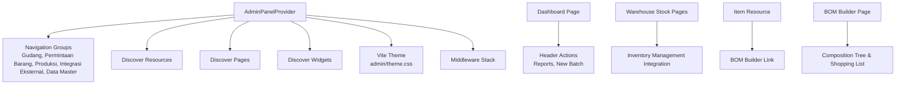

**Diagram sources**
- [AdminPanelProvider.php:31-88](file://app/Providers/Filament/AdminPanelProvider.php#L31-L88)
- [Dashboard.php:23-35](file://app/Filament/Pages/Dashboard.php#L23-L35)
- [ItemResource.php:261-278](file://app/Filament/Resources/Items/ItemResource.php#L261-L278)
- [BomBuilder.php:26-42](file://app/Filament/Pages/BomBuilder.php#L26-L42)
- [WarehouseStock.php:15-29](file://app/Filament/Pages/WarehouseStock.php#L15-L29)

**Section sources**
- [AdminPanelProvider.php:31-88](file://app/Providers/Filament/AdminPanelProvider.php#L31-L88)

## Core Components
- Panel configuration and registration:
  - Default panel id and path, login page, primary color, Vite theme, SPA mode, relation manager behavior, navigation groups, discovery of resources/pages/widgets, registered widgets, render hooks, and middleware stack.
- Dashboard page:
  - Title, subheading, column layout, header actions linking to reports and batch creation.
- Custom form component InfiniteSelect:
  - Extends base infinite select to support paginated options and search results via exposed methods.
- Key resources:
  - Items: forms with sections, infinite select for parent item, table columns, filters, bulk export, and link to BOM builder.
  - Production Batches: status badge, planned quantity aggregation, warehouse selection, view/edit/delete actions, infinite list.
  - Warehouses: basic CRUD, counts of balances, infinite list.
  - Stock Opnames: draft badges, progress counters, difference indicators, date range filter, view-only for non-drafts, infinite list.
  - Inventory Balances: stock status, low-stock warning badge, bulk transfer action with validation and service integration, infinite list.
- **New warehouse stock pages**:
  - WarehouseStock: Main entry point for per-warehouse stock viewing with navigation badge showing low stock items.
  - WarehouseStockDetail: Detailed stock listing per warehouse with summary statistics and filtering capabilities.
  - InventoryBalanceSummary: Comprehensive inventory overview across all warehouses with advanced filtering.
  - StockCard: Transaction history with running balance calculations and production batch tracking.
- Dashboard widgets:
  - Production overview stats with polling interval.
  - Batch progress bar chart comparing planned vs actual quantities.

**Section sources**
- [AdminPanelProvider.php:31-88](file://app/Providers/Filament/AdminPanelProvider.php#L31-L88)
- [Dashboard.php:9-35](file://app/Filament/Pages/Dashboard.php#L9-L35)
- [InfiniteSelect.php:9-41](file://app/Filament/Forms/Components/InfiniteSelect.php#L9-L41)
- [ItemResource.php:55-278](file://app/Filament/Resources/Items/ItemResource.php#L55-L278)
- [ProductionBatchResource.php:33-196](file://app/Filament/Resources/ProductionBatches/ProductionBatchResource.php#L33-L196)
- [WarehouseResource.php:26-130](file://app/Filament/Resources/Warehouses/WarehouseResource.php#L26-L130)
- [StockOpnameResource.php:27-205](file://app/Filament/Resources/StockOpnames/StockOpnameResource.php#L27-L205)
- [InventoryBalanceResource.php:43-445](file://app/Filament/Resources/InventoryBalances/InventoryBalanceResource.php#L43-L445)
- [WarehouseStock.php:15-89](file://app/Filament/Pages/WarehouseStock.php#L15-L89)
- [WarehouseStockDetail.php:19-149](file://app/Filament/Pages/WarehouseStockDetail.php#L19-L149)
- [InventoryBalanceSummary.php:22-243](file://app/Filament/Pages/InventoryBalanceSummary.php#L22-L243)
- [StockCard.php:17-128](file://app/Filament/Pages/StockCard.php#L17-L128)
- [ProductionOverview.php:10-39](file://app/Filament/Widgets/ProductionOverview.php#L10-L39)
- [BatchProgressChart.php:8-60](file://app/Filament/Widgets/BatchProgressChart.php#L8-L60)

## Architecture Overview
The admin panel follows a layered structure:
- Provider layer configures the panel, navigation, discovery, widgets, and middleware.
- Pages provide custom UI beyond standard CRUD, such as the dashboard, BOM builder, and new warehouse stock management interfaces.
- Resources encapsulate model-specific forms, tables, filters, actions, and relations.
- Widgets deliver dashboard analytics using services.
- Custom form components extend Filament's capabilities for large datasets.

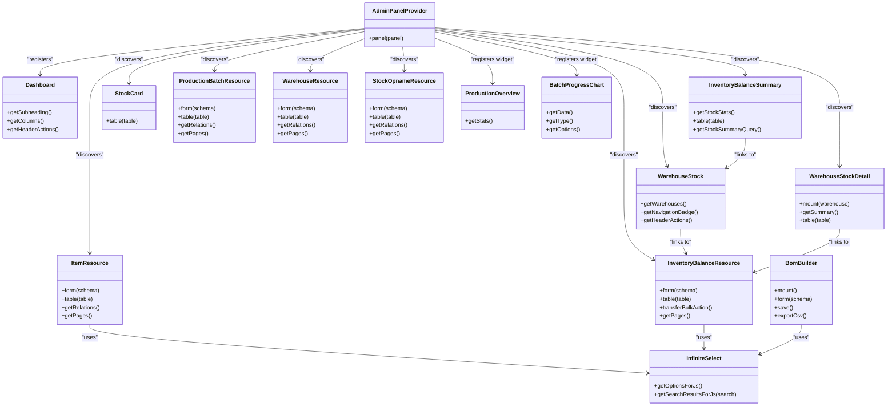

**Diagram sources**
- [AdminPanelProvider.php:31-88](file://app/Providers/Filament/AdminPanelProvider.php#L31-L88)
- [Dashboard.php:9-35](file://app/Filament/Pages/Dashboard.php#L9-L35)
- [WarehouseStock.php:15-89](file://app/Filament/Pages/WarehouseStock.php#L15-L89)
- [WarehouseStockDetail.php:19-149](file://app/Filament/Pages/WarehouseStockDetail.php#L19-L149)
- [InventoryBalanceSummary.php:22-243](file://app/Filament/Pages/InventoryBalanceSummary.php#L22-L243)
- [StockCard.php:17-128](file://app/Filament/Pages/StockCard.php#L17-L128)
- [ItemResource.php:37-298](file://app/Filament/Resources/Items/ItemResource.php#L37-L298)
- [ProductionBatchResource.php:33-196](file://app/Filament/Resources/ProductionBatches/ProductionBatchResource.php#L33-L196)
- [WarehouseResource.php:26-130](file://app/Filament/Resources/Warehouses/WarehouseResource.php#L26-L130)
- [StockOpnameResource.php:27-205](file://app/Filament/Resources/StockOpnames/StockOpnameResource.php#L27-L205)
- [InventoryBalanceResource.php:43-445](file://app/Filament/Resources/InventoryBalances/InventoryBalanceResource.php#L43-L445)
- [ProductionOverview.php:10-39](file://app/Filament/Widgets/ProductionOverview.php#L10-L39)
- [BatchProgressChart.php:8-60](file://app/Filament/Widgets/BatchProgressChart.php#L8-L60)
- [InfiniteSelect.php:9-41](file://app/Filament/Forms/Components/InfiniteSelect.php#L9-L41)
- [BomBuilder.php:26-42](file://app/Filament/Pages/BomBuilder.php#L26-L42)

## Detailed Component Analysis

### Panel Configuration and Navigation
- The panel sets default id/path, login page, primary color, Vite theme, SPA mode, and disables read-only relation managers on resource view pages by default.
- Navigation groups: Gudang, Permintaan Barang, Produksi, Integrasi Eksternal, Data Master (all collapsible).
- Discovery: resources, pages, and widgets are auto-discovered; specific widgets are explicitly registered.
- Render hooks inject branding and lockup partials into auth layouts and append an SPA fix script at body end.
- Middleware includes encryption, session handling, CSRF protection, binding substitution, and Filament-specific middleware.

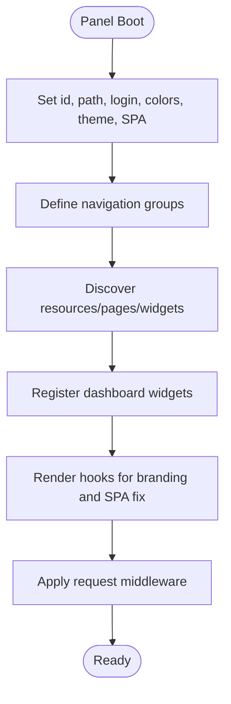

**Diagram sources**
- [AdminPanelProvider.php:31-88](file://app/Providers/Filament/AdminPanelProvider.php#L31-L88)

**Section sources**
- [AdminPanelProvider.php:31-88](file://app/Providers/Filament/AdminPanelProvider.php#L31-L88)

### Dashboard Page
- Displays a title and subheading focused on production batch progress.
- Uses a two-column grid for widgets.
- Header actions provide quick links to batch realization reports and creating a new production batch.

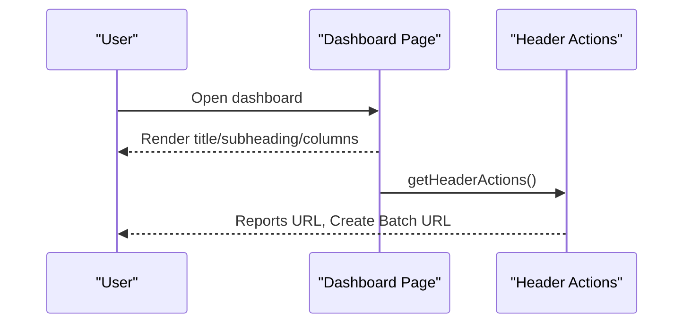

**Diagram sources**
- [Dashboard.php:9-35](file://app/Filament/Pages/Dashboard.php#L9-L35)

**Section sources**
- [Dashboard.php:9-35](file://app/Filament/Pages/Dashboard.php#L9-L35)

### New Warehouse Stock Management Pages

#### WarehouseStock Page
- Main entry point for per-warehouse stock viewing with navigation badge showing low stock count.
- Displays warehouse cards with stock statistics including total items, total quantity, low stock warnings, and out-of-stock alerts.
- Provides header action to view all stock across warehouses.
- Calculates warehouse metrics including active status, item counts, and stock levels.

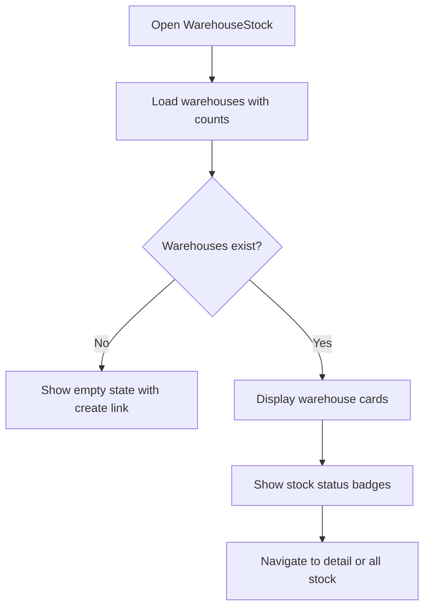

**Diagram sources**
- [WarehouseStock.php:15-89](file://app/Filament/Pages/WarehouseStock.php#L15-L89)
- [warehouse-stock.blade.php:1-110](file://resources/views/filament/pages/warehouse-stock.blade.php#L1-L110)

**Section sources**
- [WarehouseStock.php:15-89](file://app/Filament/Pages/WarehouseStock.php#L15-L89)
- [warehouse-stock.blade.php:1-110](file://resources/views/filament/pages/warehouse-stock.blade.php#L1-L110)

#### WarehouseStockDetail Page
- Detailed stock listing per warehouse with summary statistics and filtering capabilities.
- Shows summary cards for total items, total quantity, low stock count, and out-of-stock count.
- Provides table with stock status filtering, editing capabilities, and bulk transfer actions.
- Includes header actions for adding new stock and navigating back to warehouse selection.

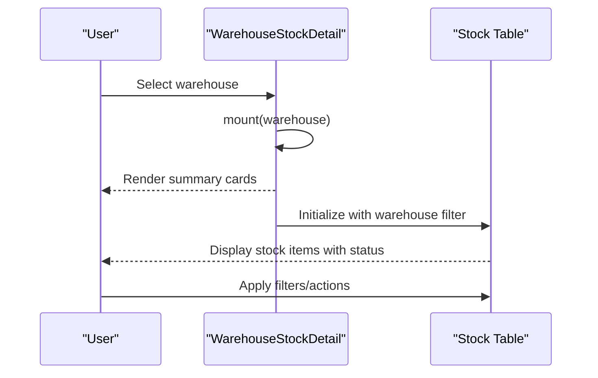

**Diagram sources**
- [WarehouseStockDetail.php:19-149](file://app/Filament/Pages/WarehouseStockDetail.php#L19-L149)
- [warehouse-stock-detail.blade.php:1-51](file://resources/views/filament/pages/warehouse-stock-detail.blade.php#L1-L51)

**Section sources**
- [WarehouseStockDetail.php:19-149](file://app/Filament/Pages/WarehouseStockDetail.php#L19-L149)
- [warehouse-stock-detail.blade.php:1-51](file://resources/views/filament/pages/warehouse-stock-detail.blade.php#L1-L51)

#### InventoryBalanceSummary Page
- Comprehensive inventory overview across all warehouses with advanced filtering capabilities.
- Provides compact statistical summary showing registered items, total units, stocked items, and out-of-stock items.
- Features multi-warehouse filtering that affects both table display and summary calculations.
- Includes navigation to detailed per-warehouse stock view.

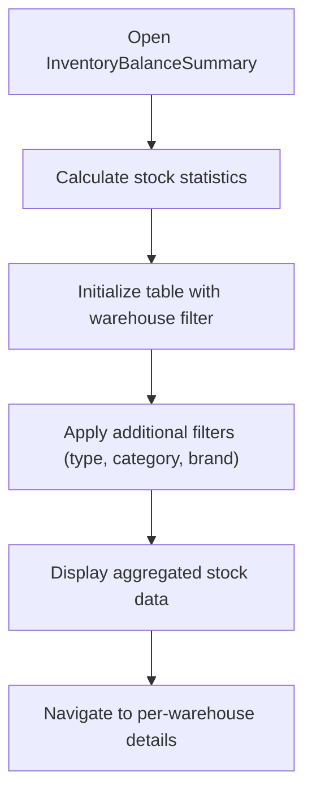

**Diagram sources**
- [InventoryBalanceSummary.php:22-243](file://app/Filament/Pages/InventoryBalanceSummary.php#L22-L243)
- [inventory-balance-summary.blade.php:1-39](file://resources/views/filament/pages/inventory-balance-summary.blade.php#L1-L39)

**Section sources**
- [InventoryBalanceSummary.php:22-243](file://app/Filament/Pages/InventoryBalanceSummary.php#L22-L243)
- [inventory-balance-summary.blade.php:1-39](file://resources/views/filament/pages/inventory-balance-summary.blade.php#L1-L39)

#### StockCard Page
- Transaction history with running balance calculations and production batch tracking.
- Displays incoming/outgoing transactions with color-coded badges and formatted quantities.
- Shows running balance calculation using window functions for real-time stock tracking.
- Supports filtering by item, warehouse, and production batch.

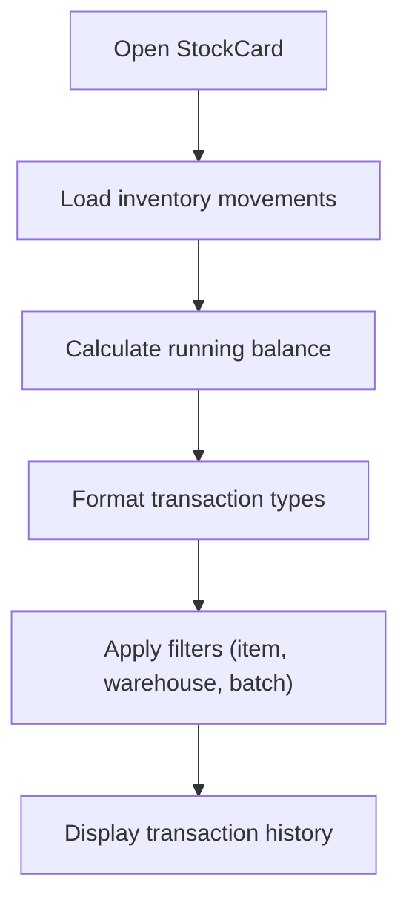

**Diagram sources**
- [StockCard.php:17-128](file://app/Filament/Pages/StockCard.php#L17-L128)
- [stock-card.blade.php:1-4](file://resources/views/filament/pages/stock-card.blade.php#L1-L4)

**Section sources**
- [StockCard.php:17-128](file://app/Filament/Pages/StockCard.php#L17-L128)
- [stock-card.blade.php:1-4](file://resources/views/filament/pages/stock-card.blade.php#L1-L4)

### Custom Form Component: InfiniteSelect
- Extends the base infinite select to expose JavaScript-friendly methods for paginated options and search results.
- When paginated options are enabled, it returns structured option arrays with pagination metadata.

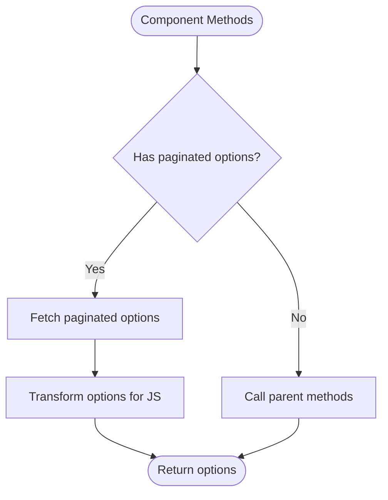

**Diagram sources**
- [InfiniteSelect.php:9-41](file://app/Filament/Forms/Components/InfiniteSelect.php#L9-L41)

**Section sources**
- [InfiniteSelect.php:9-41](file://app/Filament/Forms/Components/InfiniteSelect.php#L9-L41)

### Resource: Items
- Form sections: identity, variants, dimensions/weight, pricing, behavior toggles.
- Uses InfiniteSelect for parent item selection with paginated search and label resolution.
- Table columns include code, name, type, category, brand, division, unit, price, variant flag, active flag, and parent item.
- Filters by type, category, brand, division, variants, and active status.
- Record actions include composition link to BOM builder, edit, delete.
- Toolbar supports bulk export and delete.
- Infinite list with per-page size.

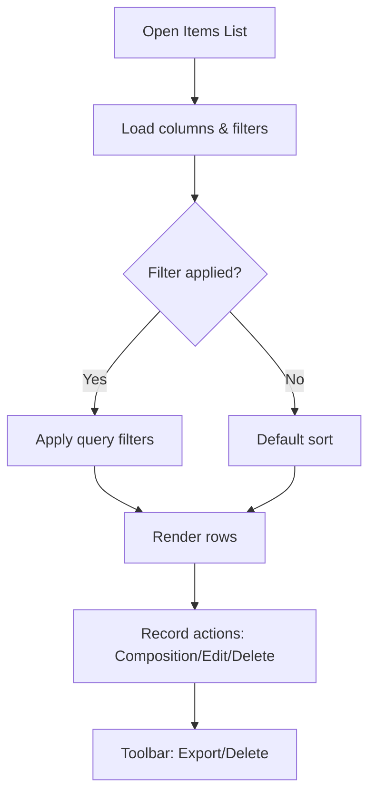

**Diagram sources**
- [ItemResource.php:55-278](file://app/Filament/Resources/Items/ItemResource.php#L55-L278)

**Section sources**
- [ItemResource.php:55-278](file://app/Filament/Resources/Items/ItemResource.php#L55-L278)

### Resource: Production Batches
- Form fields: batch code, status (disabled, changed via actions), material/output warehouses, start/finish dates, notes.
- Table shows batch code, status badge with color mapping, planned quantity sum, warehouses, dates.
- Filters by status and material warehouse.
- Actions: view, edit, delete; bulk delete.
- Infinite list sorted by created date descending.

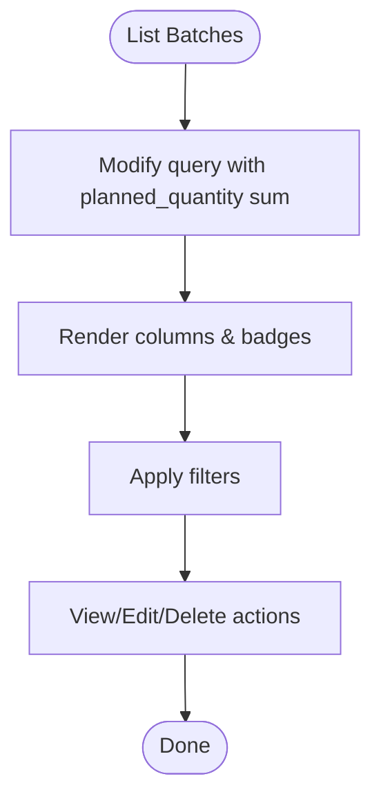

**Diagram sources**
- [ProductionBatchResource.php:70-174](file://app/Filament/Resources/ProductionBatches/ProductionBatchResource.php#L70-L174)

**Section sources**
- [ProductionBatchResource.php:33-196](file://app/Filament/Resources/ProductionBatches/ProductionBatchResource.php#L33-L196)

### Resource: Warehouses
- Simple CRUD with code, name, address, active toggle.
- Table includes balance count and active flag.
- Filters by active status.
- Infinite list sorted by code.

**Section sources**
- [WarehouseResource.php:44-130](file://app/Filament/Resources/Warehouses/WarehouseResource.php#L44-L130)

### Resource: Stock Opnames
- Form selects active warehouse and allows notes.
- Table aggregates line counts for progress and differences, displays status badge, creator, timestamps.
- Filters by status, warehouse, and date range.
- View action available; delete only for drafts.
- Infinite list with empty state messaging.

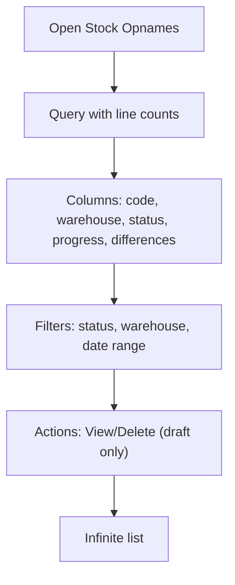

**Diagram sources**
- [StockOpnameResource.php:64-177](file://app/Filament/Resources/StockOpnames/StockOpnameResource.php#L64-L177)

**Section sources**
- [StockOpnameResource.php:27-205](file://app/Filament/Resources/StockOpnames/StockOpnameResource.php#L27-L205)

### Resource: Inventory Balances
- Form selects warehouse and uses InfiniteSelect for items with uniqueness rule per warehouse.
- Fields for on-hand quantity, minimum quantity, last counted timestamp.
- Table shows stock status badge (out/low/ok), sortable numeric fields, last counted date.
- Filters by warehouse and computed stock status.
- Bulk transfer action validates inputs, prevents same-origin destination, enforces transactional updates via service, and shows notifications.

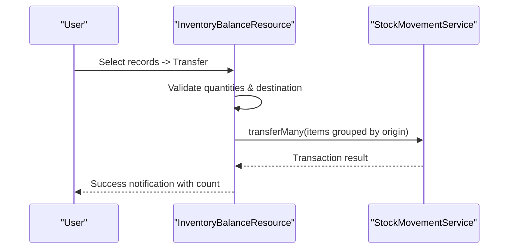

**Diagram sources**
- [InventoryBalanceResource.php:231-419](file://app/Filament/Resources/InventoryBalances/InventoryBalanceResource.php#L231-L419)

**Section sources**
- [InventoryBalanceResource.php:76-445](file://app/Filament/Resources/InventoryBalances/InventoryBalanceResource.php#L76-L445)

### Specialized Page: BOM Builder
- Purpose: build and manage bill-of-materials compositions for stockable, non-variant items.
- Features:
  - Parent item picker using InfiniteSelect with live loading of composition.
  - Tree view and shopping list tabs.
  - Add/remove/move components with cycle detection and duplicate prevention.
  - Template application from existing compositions.
  - CSV export with BOM details and shopping list.
  - Validation and transactional persistence of dirty groups.

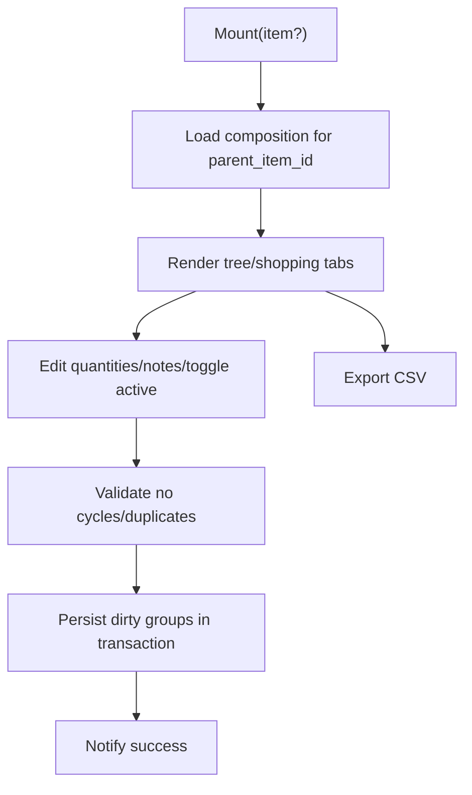

**Diagram sources**
- [BomBuilder.php:107-118](file://app/Filament/Pages/BomBuilder.php#L107-L118)
- [BomBuilder.php:214-264](file://app/Filament/Pages/BomBuilder.php#L214-L264)
- [BomBuilder.php:291-332](file://app/Filament/Pages/BomBuilder.php#L291-L332)
- [BomBuilder.php:614-670](file://app/Filament/Pages/BomBuilder.php#L614-L670)

**Section sources**
- [BomBuilder.php:26-42](file://app/Filament/Pages/BomBuilder.php#L26-L42)
- [BomBuilder.php:107-118](file://app/Filament/Pages/BomBuilder.php#L107-L118)
- [BomBuilder.php:214-264](file://app/Filament/Pages/BomBuilder.php#L214-L264)
- [BomBuilder.php:291-332](file://app/Filament/Pages/BomBuilder.php#L291-L332)
- [BomBuilder.php:614-670](file://app/Filament/Pages/BomBuilder.php#L614-L670)

### Relation Managers
- Item Components:
  - Uses InfiniteSelect for component items with uniqueness per parent and cycle detection.
  - Table shows component code/name, quantity per unit, note, active flag.
- Stock Opname Lines:
  - Inline editable physical count with system quantity reference.
  - Actions to fill from system, clear counts, add items, import/export CSV.
  - Filters by count status.

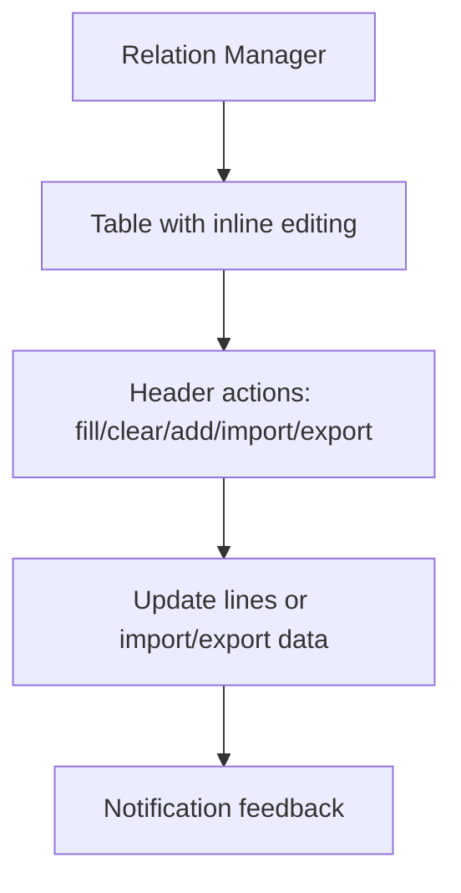

**Diagram sources**
- [ItemComponentsRelationManager.php:29-123](file://app/Filament/Resources/Items/RelationManagers/ItemComponentsRelationManager.php#L29-L123)
- [LinesRelationManager.php:33-222](file://app/Filament/Resources/StockOpnames/RelationManagers/LinesRelationManager.php#L33-L222)

**Section sources**
- [ItemComponentsRelationManager.php:23-125](file://app/Filament/Resources/Items/RelationManagers/ItemComponentsRelationManager.php#L23-L125)
- [LinesRelationManager.php:27-229](file://app/Filament/Resources/StockOpnames/RelationManagers/LinesRelationManager.php#L27-L229)

### Dashboard Widgets
- ProductionOverview:
  - Stats overview with polling interval, showing running batches, planned/actual quantities, and total progress percentage.
- BatchProgressChart:
  - Horizontal bar chart comparing planned vs actual quantities for running batches.

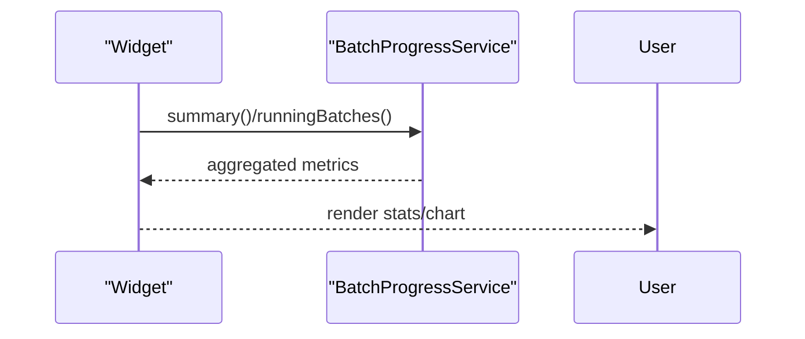

**Diagram sources**
- [ProductionOverview.php:18-39](file://app/Filament/Widgets/ProductionOverview.php#L18-L39)
- [BatchProgressChart.php:18-59](file://app/Filament/Widgets/BatchProgressChart.php#L18-L59)

**Section sources**
- [ProductionOverview.php:10-39](file://app/Filament/Widgets/ProductionOverview.php#L10-L39)
- [BatchProgressChart.php:8-60](file://app/Filament/Widgets/BatchProgressChart.php#L8-L60)

## Dependency Analysis
- Provider depends on:
  - Auth Login page, Dashboard page, multiple widgets, navigation groups, render hooks, and middleware.
- Resources depend on:
  - Models, services (e.g., StockMovementService), custom components (InfiniteSelect), and related relation managers.
- **New warehouse pages depend on**:
  - InventoryBalance models and resources for stock data access.
  - Warehouse models for location-based filtering.
  - InventoryMovement models for stock card functionality.
- Widgets depend on:
  - Services for data aggregation.
- Pages depend on:
  - Models and services; BOM Builder integrates with Item and ItemComponent models.

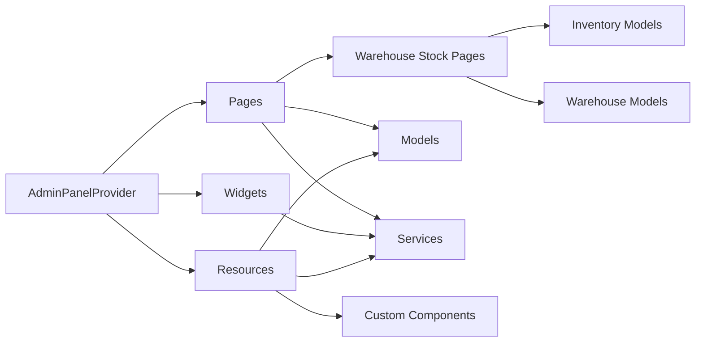

**Diagram sources**
- [AdminPanelProvider.php:31-88](file://app/Providers/Filament/AdminPanelProvider.php#L31-L88)
- [WarehouseStock.php:15-89](file://app/Filament/Pages/WarehouseStock.php#L15-L89)
- [WarehouseStockDetail.php:19-149](file://app/Filament/Pages/WarehouseStockDetail.php#L19-L149)
- [InventoryBalanceSummary.php:22-243](file://app/Filament/Pages/InventoryBalanceSummary.php#L22-L243)
- [StockCard.php:17-128](file://app/Filament/Pages/StockCard.php#L17-L128)
- [InventoryBalanceResource.php:385-401](file://app/Filament/Resources/InventoryBalances/InventoryBalanceResource.php#L385-L401)
- [ProductionOverview.php:18-39](file://app/Filament/Widgets/ProductionOverview.php#L18-L39)
- [BomBuilder.php:214-264](file://app/Filament/Pages/BomBuilder.php#L214-L264)

**Section sources**
- [AdminPanelProvider.php:31-88](file://app/Providers/Filament/AdminPanelProvider.php#L31-L88)
- [InventoryBalanceResource.php:385-401](file://app/Filament/Resources/InventoryBalances/InventoryBalanceResource.php#L385-L401)
- [ProductionOverview.php:18-39](file://app/Filament/Widgets/ProductionOverview.php#L18-L39)
- [BomBuilder.php:214-264](file://app/Filament/Pages/BomBuilder.php#L214-L264)

## Performance Considerations
- Use InfiniteSelect for large option sets to avoid heavy client-side payloads.
- Enable infinite lists on tables to improve responsiveness with large datasets.
- Aggregate data in queries (e.g., withSum/withCount) to reduce N+1 issues.
- Polling intervals on widgets should be balanced against server load.
- Bulk operations should group by origin and use transactions to minimize DB round-trips.
- **New warehouse pages optimize performance through**:
  - Efficient warehouse counting with eager loading of balance statistics.
  - Database-level aggregation for stock summaries using SQL window functions.
  - Pagination on large stock lists to prevent memory overload.
  - Filtered queries that scope data to specific warehouses when needed.

[No sources needed since this section provides general guidance]

## Troubleshooting Guide
- InfiniteSelect not loading options:
  - Ensure getPaginatedOptionsUsing returns correct structure with options and hasMore.
  - Verify search filters and ordering do not exclude expected records.
- Bulk transfer fails:
  - Check validation messages for exceeding available stock or invalid destination.
  - Confirm destination warehouse differs from all origins.
- Cycle detection errors:
  - Avoid setting an item as its own component or creating nested loops.
- Draft-only actions missing:
  - Ensure record status is draft where required (e.g., deleting stock opname lines).
- **New warehouse pages troubleshooting**:
  - Warehouse cards not displaying: Check if warehouses exist and have proper balance data.
  - Low stock badge not updating: Verify InventoryBalance::lowStock() scope is working correctly.
  - Stock card running balance incorrect: Ensure inventory movements are properly ordered by occurred_at and id.
  - Inventory summary filters not working: Check warehouse filter state parsing in getSelectedWarehouseIds().

**Section sources**
- [InfiniteSelect.php:16-41](file://app/Filament/Forms/Components/InfiniteSelect.php#L16-L41)
- [InventoryBalanceResource.php:330-419](file://app/Filament/Resources/InventoryBalances/InventoryBalanceResource.php#L330-L419)
- [ItemComponentsRelationManager.php:66-74](file://app/Filament/Resources/Items/RelationManagers/ItemComponentsRelationManager.php#L66-L74)
- [StockOpnameResource.php:168-173](file://app/Filament/Resources/StockOpnames/StockOpnameResource.php#L168-L173)
- [WarehouseStock.php:31-46](file://app/Filament/Pages/WarehouseStock.php#L31-L46)
- [StockCard.php:46-52](file://app/Filament/Pages/StockCard.php#L46-L52)
- [InventoryBalanceSummary.php:206-214](file://app/Filament/Pages/InventoryBalanceSummary.php#L206-L214)

## Conclusion
The Filament admin panel provides a robust foundation for managing inventory, production, and master data. With the addition of comprehensive warehouse stock management pages, the system now offers enhanced visibility and control over inventory levels across multiple locations. The new pages provide intuitive interfaces for monitoring stock levels, tracking transactions, and analyzing inventory trends. Following the patterns outlined here will help you extend the system consistently and maintain performance and usability.

[No sources needed since this section summarizes without analyzing specific files]

## Appendices

### Styling Customization and Responsive Design
- Theme entry point:
  - Vite theme file imports base Filament theme and defines custom styles for sidebar, topbar, auth pages, and responsive breakpoints.
- Sidebar:
  - Dark gradient background, active item highlight with accent color, typography adjustments.
- Topbar:
  - Glassmorphism effect, hover states, user menu styling.
- Auth pages:
  - Split layout on desktop with branded left panel and centered card on right.
  - Lockup mark, headings, input/button styling, and feature list.
- Responsive considerations:
  - Grid layout for auth pages at min-width 1024px.
  - Adaptive padding and font sizes using clamp and media queries.

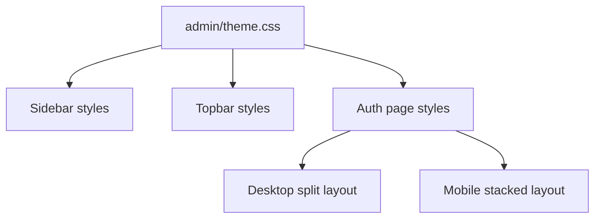

**Diagram sources**
- [theme.css:1-489](file://resources/css/filament/admin/theme.css#L1-L489)

**Section sources**
- [theme.css:1-489](file://resources/css/filament/admin/theme.css#L1-L489)

### Guidelines for Adding New Resources
- Create a Resource class under Filament/Resources/{Domain}/{Entity}Resource.php.
- Define model, navigation group/icon/label, and optional navigation badge.
- Implement form(Schema) with Sections and components.
- Implement table(Table) with columns, filters, actions, and infinite list settings.
- Register relation managers if needed.
- Map custom pages via getPages() if overriding default routes.
- Use InfiniteSelect for large dropdowns and ensure pagination metadata is returned.
- Apply filters using SelectFilter/TernaryFilter/Filter with custom query closures.
- Integrate services for complex business logic within actions.
- **For new warehouse-style pages**:
  - Follow the pattern established by WarehouseStock and WarehouseStockDetail.
  - Implement navigation badges for important metrics like low stock counts.
  - Provide summary statistics with appropriate formatting and localization.
  - Include proper filtering capabilities that affect both display and calculations.
  - Ensure proper routing and URL structures for nested navigation.

**Section sources**
- [ItemResource.php:37-298](file://app/Filament/Resources/Items/ItemResource.php#L37-L298)
- [ProductionBatchResource.php:33-196](file://app/Filament/Resources/ProductionBatches/ProductionBatchResource.php#L33-L196)
- [WarehouseResource.php:26-130](file://app/Filament/Resources/Warehouses/WarehouseResource.php#L26-L130)
- [StockOpnameResource.php:27-205](file://app/Filament/Resources/StockOpnames/StockOpnameResource.php#L27-L205)
- [InventoryBalanceResource.php:43-445](file://app/Filament/Resources/InventoryBalances/InventoryBalanceResource.php#L43-L445)
- [WarehouseStock.php:15-89](file://app/Filament/Pages/WarehouseStock.php#L15-L89)
- [WarehouseStockDetail.php:19-149](file://app/Filament/Pages/WarehouseStockDetail.php#L19-L149)
- [InventoryBalanceSummary.php:22-243](file://app/Filament/Pages/InventoryBalanceSummary.php#L22-L243)
- [StockCard.php:17-128](file://app/Filament/Pages/StockCard.php#L17-L128)