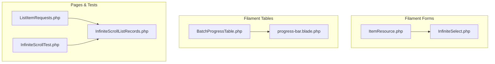
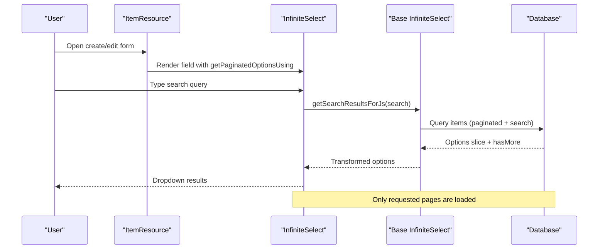
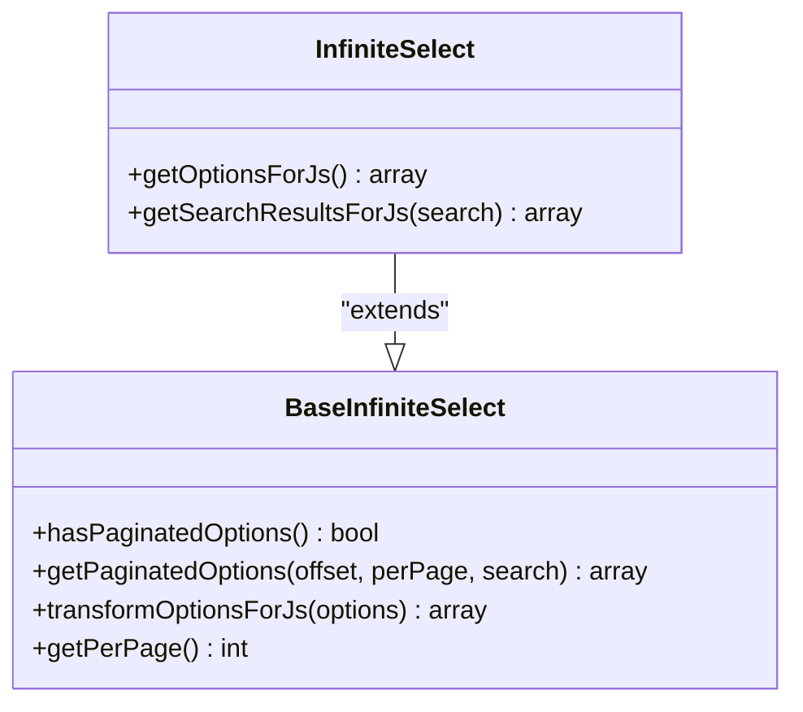
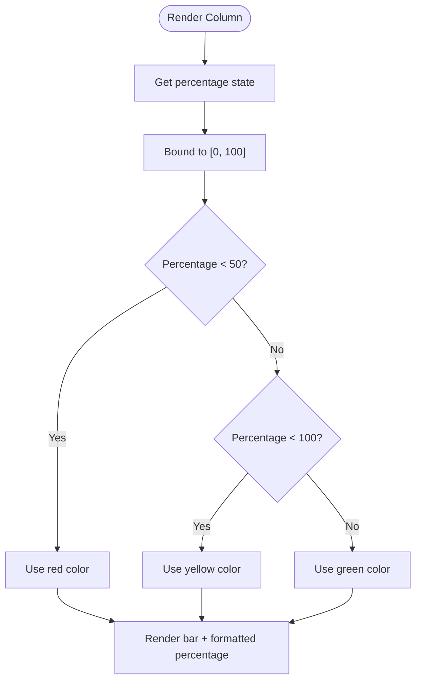
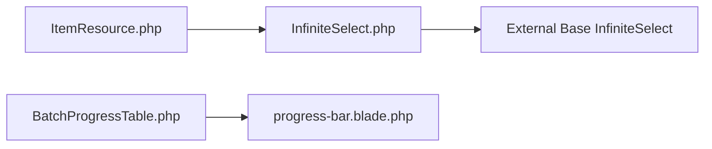

# Form Components

<cite>
**Referenced Files in This Document**
- [InfiniteSelect.php](file://app/Filament/Forms/Components/InfiniteSelect.php)
- [ItemResource.php](file://app/Filament/Resources/Items/ItemResource.php)
- [progress-bar.blade.php](file://resources/views/filament/tables/columns/progress-bar.blade.php)
- [BatchProgressTable.php](file://app/Filament/Widgets/BatchProgressTable.php)
- [InfiniteScrollListRecords.php](file://app/Filament/Resources/Pages/InfiniteScrollListRecords.php)
- [ListItemRequests.php](file://app/Filament/Resources/ItemRequests/Pages/ListItemRequests.php)
- [InfiniteScrollTest.php](file://tests/Feature/InfiniteScrollTest.php)
- [AGENTS.md](file://AGENTS.md)
</cite>

## Table of Contents
1. [Introduction](#introduction)
2. [Project Structure](#project-structure)
3. [Core Components](#core-components)
4. [Architecture Overview](#architecture-overview)
5. [Detailed Component Analysis](#detailed-component-analysis)
6. [Dependency Analysis](#dependency-analysis)
7. [Performance Considerations](#performance-considerations)
8. [Troubleshooting Guide](#troubleshooting-guide)
9. [Conclusion](#conclusion)

## Introduction
This document explains the custom form and table components used across the application:
- InfiniteSelect: a large-dataset select component with search and pagination, built on top of an external package and extended for this project.
- Progress bar column: a Blade-based table column that renders a visual progress indicator with accessibility attributes.

It covers architecture, configuration, event handling, styling customization, examples, performance optimization, and accessibility considerations.

## Project Structure
The relevant UI components live in two main areas:
- Custom Filament form component under `app/Filament/Forms/Components`.
- Custom table column view under `resources/views/filament/tables/columns`.

**Diagram sources**
- [InfiniteSelect.php:1-43](file://app/Filament/Forms/Components/InfiniteSelect.php#L1-L43)
- [ItemResource.php:108-135](file://app/Filament/Resources/Items/ItemResource.php#L108-L135)
- [progress-bar.blade.php:1-29](file://resources/views/filament/tables/columns/progress-bar.blade.php#L1-L29)
- [BatchProgressTable.php:65-71](file://app/Filament/Widgets/BatchProgressTable.php#L65-L71)
- [InfiniteScrollListRecords.php:1-12](file://app/Filament/Resources/Pages/InfiniteScrollListRecords.php#L1-L12)
- [ListItemRequests.php:1-16](file://app/Filament/Resources/ItemRequests/Pages/ListItemRequests.php#L1-L16)
- [InfiniteScrollTest.php:23-38](file://tests/Feature/InfiniteScrollTest.php#L23-L38)

**Section sources**
- [InfiniteSelect.php:1-43](file://app/Filament/Forms/Components/InfiniteSelect.php#L1-L43)
- [ItemResource.php:108-135](file://app/Filament/Resources/Items/ItemResource.php#L108-L135)
- [progress-bar.blade.php:1-29](file://resources/views/filament/tables/columns/progress-bar.blade.php#L1-L29)
- [BatchProgressTable.php:65-71](file://app/Filament/Widgets/BatchProgressTable.php#L65-L71)
- [InfiniteScrollListRecords.php:1-12](file://app/Filament/Resources/Pages/InfiniteScrollListRecords.php#L1-L12)
- [ListItemRequests.php:1-16](file://app/Filament/Resources/ItemRequests/Pages/ListItemRequests.php#L1-L16)
- [InfiniteScrollTest.php:23-38](file://tests/Feature/InfiniteScrollTest.php#L23-L38)

## Core Components
- InfiniteSelect: Extends the external `MrPunyapal\FilamentInfiniteSelect\InfiniteSelect` to integrate paginated options and search results into JavaScript via exposed Livewire methods. It delegates to the base implementation when not using paginated options.
- Progress Bar Column: A Blade view rendering a percentage progress bar with color-coded segments and accessible ARIA attributes.

Key responsibilities:
- InfiniteSelect: Provide efficient option loading for large datasets, support search, and expose data to the frontend without full page reloads.
- Progress Bar Column: Visualize completion percentages in tables with clear, accessible markup.

**Section sources**
- [InfiniteSelect.php:9-42](file://app/Filament/Forms/Components/InfiniteSelect.php#L9-L42)
- [progress-bar.blade.php:1-29](file://resources/views/filament/tables/columns/progress-bar.blade.php#L1-L29)

## Architecture Overview
The system integrates three layers:
- Form layer: Resources define schemas using custom components like InfiniteSelect.
- Data layer: Paginated queries fetch only needed rows for selection lists.
- View layer: Blade views render table columns such as the progress bar.

**Diagram sources**
- [ItemResource.php:113-134](file://app/Filament/Resources/Items/ItemResource.php#L113-L134)
- [InfiniteSelect.php:16-41](file://app/Filament/Forms/Components/InfiniteSelect.php#L16-L41)

## Detailed Component Analysis

### InfiniteSelect Component
Purpose:
- Provide a searchable, paginated dropdown for large datasets.
- Integrate with Filament forms and Livewire.

Implementation highlights:
- Extends the external base class.
- Overrides JavaScript exposure methods to use paginated options when configured.
- Uses `#[Exposed]` and `#[Renderless]` Livewire attributes to expose methods to the frontend without re-rendering the whole component.

Props and configuration:
- `getPaginatedOptionsUsing`: Closure returning `{ options, hasMore }` based on offset, limit, and optional search string.
- `getOptionLabelUsing`: Closure to resolve display labels from stored IDs.
- Inherits other base props from the external package (e.g., per-page size).

Event handling:
- Search input triggers `getSearchResultsForJs`, which calls the paginated query closure.
- Initial load uses `getOptionsForJs` to fetch the first page.

Styling customization:
- Styling is delegated to the underlying package’s view; customize at the package level or by overriding the view if needed.

Example usage pattern:
- See ItemResource where InfiniteSelect is configured for parent item selection with filtering and label resolution.

Accessibility:
- The underlying package provides standard select semantics. Ensure proper labels and helper text are set.

Performance characteristics:
- Pagination reduces memory and network payload.
- Search is applied server-side within the provided query.

**Diagram sources**
- [InfiniteSelect.php:9-42](file://app/Filament/Forms/Components/InfiniteSelect.php#L9-L42)

**Section sources**
- [InfiniteSelect.php:9-42](file://app/Filament/Forms/Components/InfiniteSelect.php#L9-L42)
- [ItemResource.php:113-134](file://app/Filament/Resources/Items/ItemResource.php#L113-L134)
- [AGENTS.md:59-93](file://AGENTS.md#L59-L93)

### Progress Bar Column Component
Purpose:
- Render a visual progress indicator in Filament tables.

Implementation highlights:
- Computes bounded percentage between 0 and 100.
- Applies color coding: red below 50%, yellow below 100%, green at 100%.
- Includes ARIA attributes (`role="progressbar"`, `aria-valuemin`, `aria-valuemax`, `aria-valuenow`) for accessibility.
- Formats the percentage value using localized number formatting.

Props and configuration:
- Consumed via Filament’s `ViewColumn::make(...)->state(...)->view(...)`.
- State is a numeric percentage computed from business logic.

Event handling:
- No direct events; updates occur through table state changes.

Styling customization:
- Tailwind utility classes control layout and colors. Modify the Blade view to adjust colors, sizes, or spacing.

Accessibility:
- Proper ARIA roles and values make it screen-reader friendly.

Usage example:
- BatchProgressTable defines a ViewColumn bound to a percentage state and renders the progress-bar view.

**Diagram sources**
- [progress-bar.blade.php:1-29](file://resources/views/filament/tables/columns/progress-bar.blade.php#L1-L29)
- [BatchProgressTable.php:65-71](file://app/Filament/Widgets/BatchProgressTable.php#L65-L71)

**Section sources**
- [progress-bar.blade.php:1-29](file://resources/views/filament/tables/columns/progress-bar.blade.php#L1-L29)
- [BatchProgressTable.php:65-71](file://app/Filament/Widgets/BatchProgressTable.php#L65-L71)

## Dependency Analysis
- InfiniteSelect depends on:
  - External package `MrPunyapal\FilamentInfiniteSelect`.
  - Livewire attributes for exposing methods to the frontend.
  - Filament form schema APIs.
- Progress bar column depends on:
  - Blade templating.
  - Filament’s ViewColumn API.
  - Laravel’s Number formatter for localization.

**Diagram sources**
- [ItemResource.php:113-134](file://app/Filament/Resources/Items/ItemResource.php#L113-L134)
- [InfiniteSelect.php:9-42](file://app/Filament/Forms/Components/InfiniteSelect.php#L9-L42)
- [BatchProgressTable.php:65-71](file://app/Filament/Widgets/BatchProgressTable.php#L65-L71)
- [progress-bar.blade.php:1-29](file://resources/views/filament/tables/columns/progress-bar.blade.php#L1-L29)

**Section sources**
- [ItemResource.php:113-134](file://app/Filament/Resources/Items/ItemResource.php#L113-L134)
- [InfiniteSelect.php:9-42](file://app/Filament/Forms/Components/InfiniteSelect.php#L9-L42)
- [BatchProgressTable.php:65-71](file://app/Filament/Widgets/BatchProgressTable.php#L65-L71)
- [progress-bar.blade.php:1-29](file://resources/views/filament/tables/columns/progress-bar.blade.php#L1-L29)

## Performance Considerations
- Use paginated options for large datasets:
  - Implement `getPaginatedOptionsUsing` to return a limited slice plus a `hasMore` flag.
  - Avoid preloading entire option sets.
- Keep queries efficient:
  - Apply search filters server-side.
  - Order results consistently to avoid unstable pagination.
- Leverage existing infinite list infrastructure:
  - For list pages, extend `InfiniteScrollListRecords` and configure per-page size.
  - Validate behavior with tests that assert incremental loading.

Practical references:
- ItemResource demonstrates InfiniteSelect configuration with paginated options and label resolution.
- InfiniteScrollListRecords and ListItemRequests show how to enable infinite scrolling for list pages.
- InfiniteScrollTest validates batch loading behavior.

**Section sources**
- [ItemResource.php:113-134](file://app/Filament/Resources/Items/ItemResource.php#L113-L134)
- [InfiniteScrollListRecords.php:1-12](file://app/Filament/Resources/Pages/InfiniteScrollListRecords.php#L1-L12)
- [ListItemRequests.php:1-16](file://app/Filament/Resources/ItemRequests/Pages/ListItemRequests.php#L1-L16)
- [InfiniteScrollTest.php:23-38](file://tests/Feature/InfiniteScrollTest.php#L23-L38)

## Troubleshooting Guide
Common issues and resolutions:
- InfiniteSelect shows no options:
  - Verify `getPaginatedOptionsUsing` returns both `options` and `hasMore`.
  - Ensure the query applies search filters correctly and orders results.
- Label not displayed after selection:
  - Provide `getOptionLabelUsing` to map stored IDs back to readable labels.
- Duplicate manual entries in related forms:
  - Follow guidance to avoid duplicate manual item names using validation rules that read other fields dynamically.
- Infinite list not loading more records:
  - Confirm the list page extends `InfiniteScrollListRecords` and the per-page setting matches expectations.
  - Inspect test assertions for expected record counts after additional loads.

References:
- Guidance on item-heavy selects and validation constraints.
- Test coverage for infinite scroll behavior.

**Section sources**
- [AGENTS.md:59-93](file://AGENTS.md#L59-L93)
- [InfiniteScrollTest.php:23-38](file://tests/Feature/InfiniteScrollTest.php#L23-L38)

## Conclusion
The project implements robust, scalable UI components for forms and tables:
- InfiniteSelect enables efficient selection from large datasets with search and pagination.
- The progress bar column provides accessible, visually clear indicators in tables.
By following the patterns shown here—paginated option loaders, explicit label resolvers, and accessible Blade views—you can build consistent, performant, and user-friendly interfaces across the application.