# Panel Configuration

<cite>
**Referenced Files in This Document**
- [AdminPanelProvider.php](file://app/Providers/Filament/AdminPanelProvider.php)
- [Login.php](file://app/Filament/Auth/Login.php)
- [theme.css](file://resources/css/filament/admin/theme.css)
- [auth-brand-panel.blade.php](file://resources/views/filament/partials/auth-brand-panel.blade.php)
- [auth-lockup.blade.php](file://resources/views/filament/partials/auth-lockup.blade.php)
- [infinite-scroll-spa-fix.blade.php](file://resources/views/filament/partials/infinite-scroll-spa-fix.blade.php)
- [providers.php](file://bootstrap/providers.php)
- [InventoryBalanceResource.php](file://app/Filament/Resources/InventoryBalances/InventoryBalanceResource.php)
- [ProductionBatchResource.php](file://app/Filament/Resources/ProductionBatches/ProductionBatchResource.php)
- [ItemResource.php](file://app/Filament/Resources/Items/ItemResource.php)
- [WarehouseResourcesTest.php](file://tests/Feature/WarehouseResourcesTest.php)
</cite>

## Table of Contents
1. [Introduction](#introduction)
2. [Project Structure](#project-structure)
3. [Core Components](#core-components)
4. [Architecture Overview](#architecture-overview)
5. [Detailed Component Analysis](#detailed-component-analysis)
6. [Dependency Analysis](#dependency-analysis)
7. [Performance Considerations](#performance-considerations)
8. [Troubleshooting Guide](#troubleshooting-guide)
9. [Conclusion](#conclusion)
10. [Appendices](#appendices)

## Introduction
This document explains how the Filament admin panel is configured in the RSV Helmet application. It focuses on the `AdminPanelProvider`, authentication integration, Amber-based theming with Vite, navigation groups for Gudang, Produksi, and Data Master, middleware configuration, render hooks, SPA mode, relation manager behavior, and service provider registration. It also provides guidance for extending the panel and customizing the admin experience.

## Project Structure
The Filament panel is registered as a Laravel service provider and lives under `app/Providers/Filament`. The main entry point is `AdminPanelProvider`, which configures the default panel ID, path, login page, colors, Vite theme, SPA mode, navigation groups, resource discovery, pages, widgets, render hooks, and middleware.

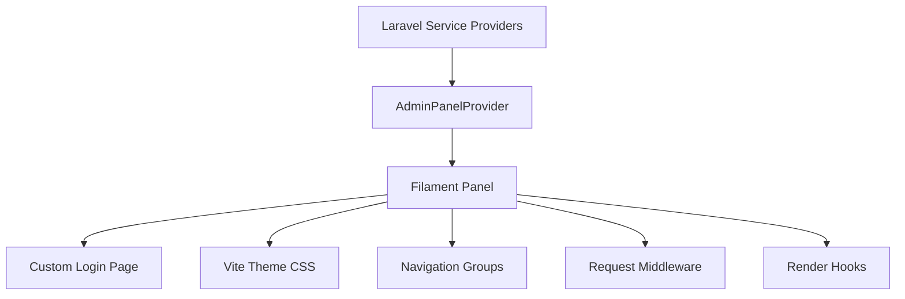

**Diagram sources**
- [AdminPanelProvider.php:31-88](file://app/Providers/Filament/AdminPanelProvider.php#L31-L88)
- [Login.php:8-17](file://app/Filament/Auth/Login.php#L8-L17)
- [theme.css:1-489](file://resources/css/filament/admin/theme.css#L1-L489)

**Section sources**
- [AdminPanelProvider.php:1-91](file://app/Providers/Filament/AdminPanelProvider.php#L1-L91)
- [providers.php:1-10](file://bootstrap/providers.php#L1-L10)

## Core Components
- Panel identity and routing:
  - Default panel enabled.
  - Panel ID set to `admin`.
  - Path set to `/admin`.
- Authentication:
  - Custom login page class is used instead of the default.
  - The custom login overrides the subheading text for non-MFA users.
- Theming:
  - Primary color uses Filament’s Amber palette.
  - Vite theme file is registered at `resources/css/filament/admin/theme.css`.
- SPA mode:
  - SPA mode is enabled.
  - Relation managers are not read-only by default on resource view pages.
- Navigation groups:
  - Three groups are defined: `Gudang`, `Produksi`, and `Data Master`.
  - `Data Master` is marked collapsible.
- Resource and page discovery:
  - Resources under `app/Filament/Resources` are auto-discovered.
  - Pages under `app/Filament/Pages` are auto-discovered.
  - A dashboard page is explicitly registered.
- Widgets:
  - Production overview and batch-related widgets are registered.
- Render hooks:
  - Branding partial injected into simple layout start.
  - Lockup partial injected into simple page start.
  - Infinite scroll SPA fix script injected at body end.
- Middleware:
  - Standard request middleware pipeline is configured.
  - Filament auth middleware is configured.

**Section sources**
- [AdminPanelProvider.php:31-88](file://app/Providers/Filament/AdminPanelProvider.php#L31-L88)
- [Login.php:8-17](file://app/Filament/Auth/Login.php#L8-L17)

## Architecture Overview
The panel configuration follows a layered approach:
- Provider layer registers the panel and wires up features.
- Auth layer integrates a custom login page.
- Theme layer applies Amber primary color and sidebar/topbar styling through Vite.
- Navigation layer organizes resources into domain groups.
- Rendering layer injects branding and UI enhancements via render hooks.
- Request layer applies middleware for cookies, sessions, CSRF protection, bindings, and Filament events.

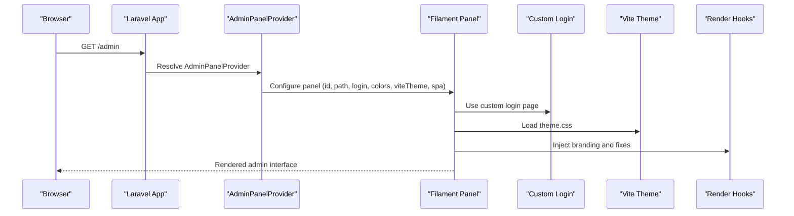

**Diagram sources**
- [AdminPanelProvider.php:31-88](file://app/Providers/Filament/AdminPanelProvider.php#L31-L88)
- [Login.php:8-17](file://app/Filament/Auth/Login.php#L8-L17)
- [theme.css:1-489](file://resources/css/filament/admin/theme.css#L1-L489)

## Detailed Component Analysis

### AdminPanelProvider
The provider defines the complete panel setup:
- Panel ID and path:
  - ID: `admin`
  - Path: `admin`
- Authentication:
  - Uses `App\Filament\Auth\Login`.
- Colors:
  - Primary color set to Amber.
- Vite theme:
  - Points to `resources/css/filament/admin/theme.css`.
- SPA mode:
  - Enabled via `spa()`.
- Relation managers:
  - Not read-only by default on resource view pages.
- Navigation groups:
  - `Gudang`
  - `Produksi`
  - `Data Master` (collapsible)
- Discovery:
  - Resources discovered from `app/Filament/Resources`.
  - Pages discovered from `app/Filament/Pages`.
  - Dashboard page explicitly added.
- Widgets:
  - Production and batch widgets registered.
- Render hooks:
  - Simple layout start: brand panel partial.
  - Simple page start: lockup partial.
  - Body end: infinite scroll SPA fix script.
- Middleware:
  - Encrypt cookies, queued cookies, session start, session auth, share errors, CSRF prevention, route binding, disable Blade icon components, dispatch serving event.
- Auth middleware:
  - Filament authenticate middleware.

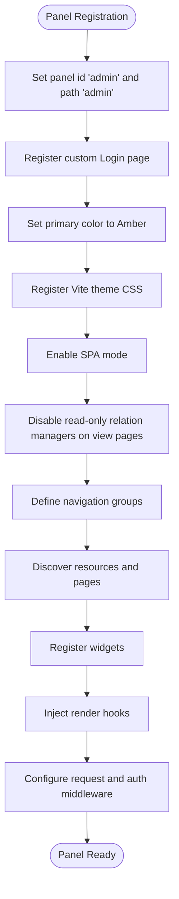

**Diagram sources**
- [AdminPanelProvider.php:31-88](file://app/Providers/Filament/AdminPanelProvider.php#L31-L88)

**Section sources**
- [AdminPanelProvider.php:31-88](file://app/Providers/Filament/AdminPanelProvider.php#L31-L88)

### Authentication Integration
- Custom login page:
  - Extends Filament’s base login page.
  - Overrides subheading to show Indonesian instructional text when multi-factor authentication is not required.
- Render hook integration:
  - Brand panel partial is injected at the start of the simple layout.
  - Lockup partial is injected at the start of the simple page.

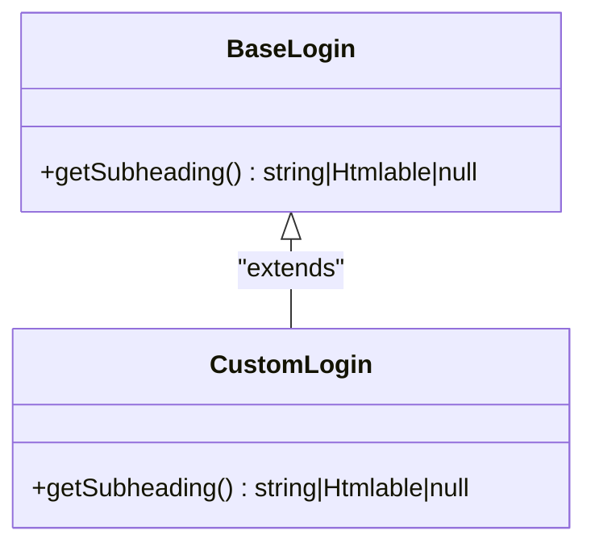

**Diagram sources**
- [Login.php:8-17](file://app/Filament/Auth/Login.php#L8-L17)

**Section sources**
- [Login.php:8-17](file://app/Filament/Auth/Login.php#L8-L17)
- [auth-brand-panel.blade.php:1-29](file://resources/views/filament/partials/auth-brand-panel.blade.php#L1-L29)
- [auth-lockup.blade.php:1-6](file://resources/views/filament/partials/auth-lockup.blade.php#L1-L6)

### Color Theming and Vite Theme
- Primary color:
  - Amber is used as the primary color across the panel.
- Vite theme:
  - The theme file imports Filament’s base theme and adds extensive custom styles for sidebar, topbar, auth pages, and branding elements.
- Visual highlights:
  - Sidebar active item uses an amber accent border and highlighted label/icon.
  - Auth pages include a branded left panel and card lockup.

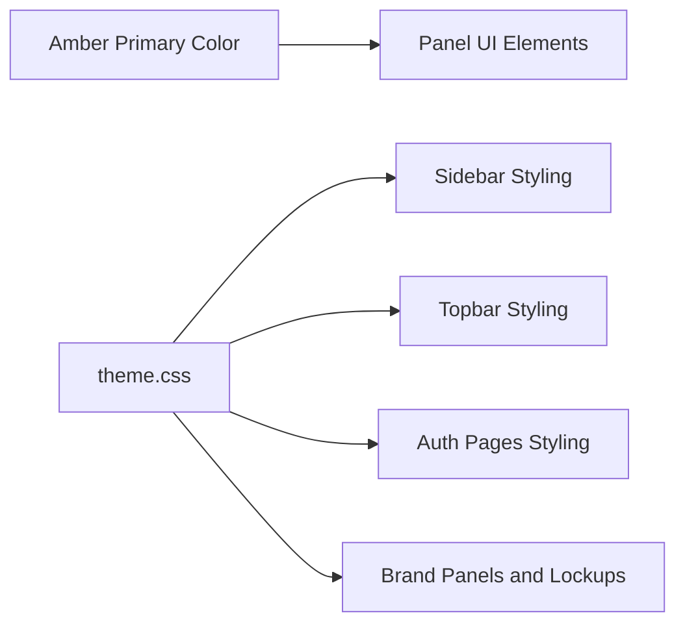

**Diagram sources**
- [AdminPanelProvider.php:38-41](file://app/Providers/Filament/AdminPanelProvider.php#L38-L41)
- [theme.css:1-489](file://resources/css/filament/admin/theme.css#L1-L489)

**Section sources**
- [AdminPanelProvider.php:38-41](file://app/Providers/Filament/AdminPanelProvider.php#L38-L41)
- [theme.css:1-489](file://resources/css/filament/admin/theme.css#L1-L489)

### Navigation Groups Structure
- Group definitions:
  - `Gudang`: Warehouse and inventory resources.
  - `Produksi`: Production batch resources.
  - `Data Master`: Reference/master data resources; collapsible.
- Resource assignments:
  - Inventory balance resource belongs to `Gudang`.
  - Production batch resource belongs to `Produksi`.
  - Item resource belongs to `Data Master`.
- Test coverage:
  - Tests assert that master data resources are grouped under `Data Master` and have expected labels and icons.

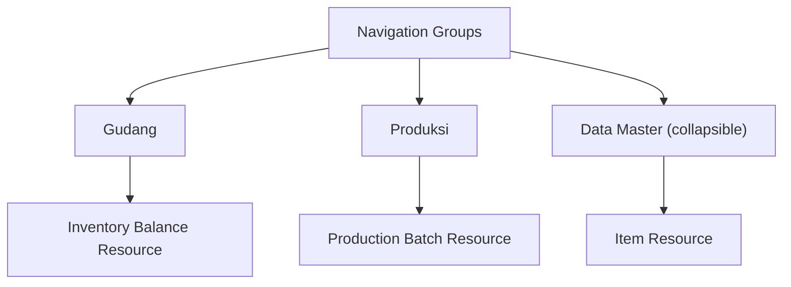

**Diagram sources**
- [AdminPanelProvider.php:44-49](file://app/Providers/Filament/AdminPanelProvider.php#L44-L49)
- [InventoryBalanceResource.php:47-57](file://app/Filament/Resources/InventoryBalances/InventoryBalanceResource.php#L47-L57)
- [ProductionBatchResource.php:37-47](file://app/Filament/Resources/ProductionBatches/ProductionBatchResource.php#L37-L47)
- [ItemResource.php:41-51](file://app/Filament/Resources/Items/ItemResource.php#L41-L51)
- [WarehouseResourcesTest.php:56-75](file://tests/Feature/WarehouseResourcesTest.php#L56-L75)

**Section sources**
- [AdminPanelProvider.php:44-49](file://app/Providers/Filament/AdminPanelProvider.php#L44-L49)
- [InventoryBalanceResource.php:47-57](file://app/Filament/Resources/InventoryBalances/InventoryBalanceResource.php#L47-L57)
- [ProductionBatchResource.php:37-47](file://app/Filament/Resources/ProductionBatches/ProductionBatchResource.php#L37-L47)
- [ItemResource.php:41-51](file://app/Filament/Resources/Items/ItemResource.php#L41-L51)
- [WarehouseResourcesTest.php:56-75](file://tests/Feature/WarehouseResourcesTest.php#L56-L75)

### Middleware Configuration
- Request middleware includes:
  - Cookie encryption and queuing.
  - Session start and authentication.
  - Error sharing from session.
  - CSRF protection.
  - Route model binding.
  - Disabling Blade icon components.
  - Dispatching Filament serving events.
- Auth middleware:
  - Uses Filament’s authenticate middleware.

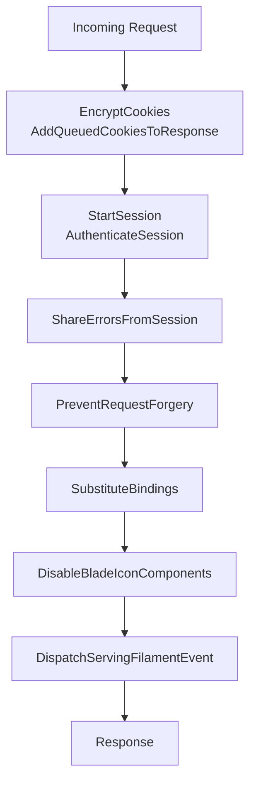

**Diagram sources**
- [AdminPanelProvider.php:75-88](file://app/Providers/Filament/AdminPanelProvider.php#L75-L88)

**Section sources**
- [AdminPanelProvider.php:75-88](file://app/Providers/Filament/AdminPanelProvider.php#L75-L88)

### Render Hooks for Branding and UI Enhancements
- Simple layout start:
  - Injects the brand panel partial for large screens.
- Simple page start:
  - Injects the small lockup above the auth form title.
- Body end:
  - Injects a script that adjusts table container height during Livewire SPA navigation.

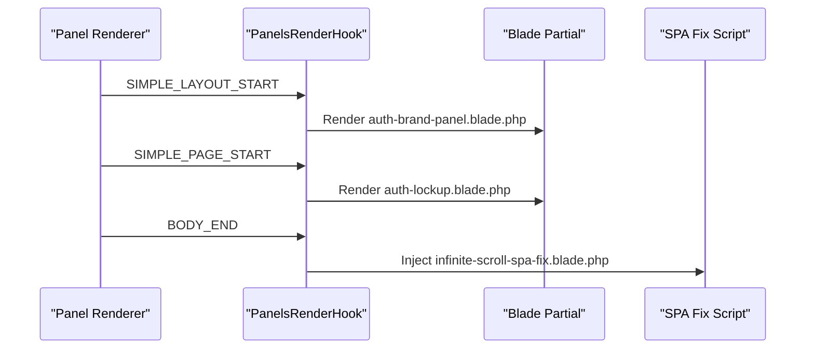

**Diagram sources**
- [AdminPanelProvider.php:63-74](file://app/Providers/Filament/AdminPanelProvider.php#L63-L74)
- [auth-brand-panel.blade.php:1-29](file://resources/views/filament/partials/auth-brand-panel.blade.php#L1-L29)
- [auth-lockup.blade.php:1-6](file://resources/views/filament/partials/auth-lockup.blade.php#L1-L6)
- [infinite-scroll-spa-fix.blade.php:1-20](file://resources/views/filament/partials/infinite-scroll-spa-fix.blade.php#L1-L20)

**Section sources**
- [AdminPanelProvider.php:63-74](file://app/Providers/Filament/AdminPanelProvider.php#L63-L74)
- [auth-brand-panel.blade.php:1-29](file://resources/views/filament/partials/auth-brand-panel.blade.php#L1-L29)
- [auth-lockup.blade.php:1-6](file://resources/views/filament/partials/auth-lockup.blade.php#L1-L6)
- [infinite-scroll-spa-fix.blade.php:1-20](file://resources/views/filament/partials/infinite-scroll-spa-fix.blade.php#L1-L20)

### SPA Mode Configuration and Relation Managers Behavior
- SPA mode:
  - Enabled via `spa()` to improve client-side navigation performance.
- Relation managers:
  - Read-only behavior on resource view pages is disabled by default, allowing full CRUD operations within relation managers.

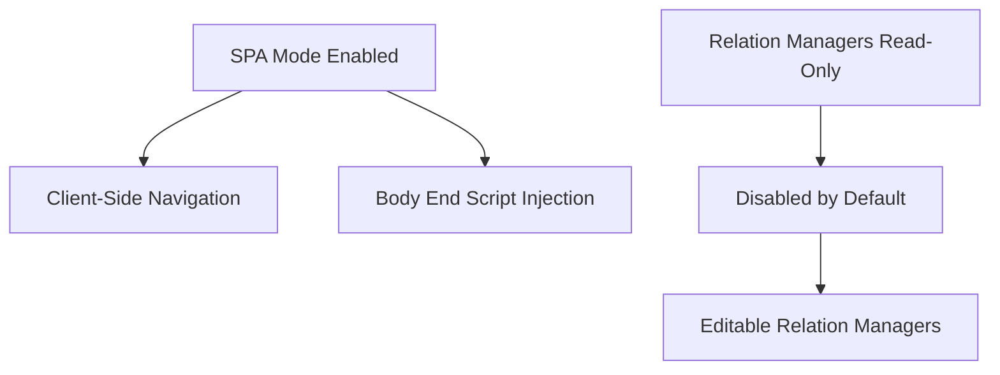

**Diagram sources**
- [AdminPanelProvider.php:42-43](file://app/Providers/Filament/AdminPanelProvider.php#L42-L43)
- [infinite-scroll-spa-fix.blade.php:1-20](file://resources/views/filament/partials/infinite-scroll-spa-fix.blade.php#L1-L20)

**Section sources**
- [AdminPanelProvider.php:42-43](file://app/Providers/Filament/AdminPanelProvider.php#L42-L43)
- [infinite-scroll-spa-fix.blade.php:1-20](file://resources/views/filament/partials/infinite-scroll-spa-fix.blade.php#L1-L20)

### Service Provider Registration
- The `AdminPanelProvider` is registered in the global providers list so Laravel loads it during bootstrapping.

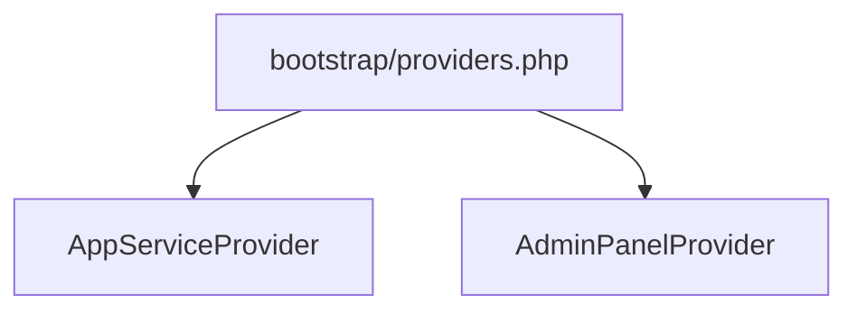

**Diagram sources**
- [providers.php:1-10](file://bootstrap/providers.php#L1-L10)

**Section sources**
- [providers.php:1-10](file://bootstrap/providers.php#L1-L10)

## Dependency Analysis
The panel configuration depends on:
- Filament core classes for panels, navigation, colors, and render hooks.
- Laravel middleware for cookies, sessions, CSRF, and bindings.
- Blade views for branding and UI enhancements.
- Resource classes for grouping and labeling navigation items.

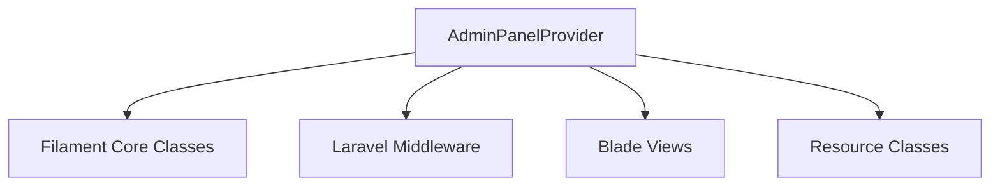

**Diagram sources**
- [AdminPanelProvider.php:12-27](file://app/Providers/Filament/AdminPanelProvider.php#L12-L27)
- [AdminPanelProvider.php:31-88](file://app/Providers/Filament/AdminPanelProvider.php#L31-L88)

**Section sources**
- [AdminPanelProvider.php:12-27](file://app/Providers/Filament/AdminPanelProvider.php#L12-L27)
- [AdminPanelProvider.php:31-88](file://app/Providers/Filament/AdminPanelProvider.php#L31-L88)

## Performance Considerations
- SPA mode reduces server round-trips for navigation but requires careful handling of dynamic content such as tables.
- The injected body-end script recalculates table container height after Livewire navigation to prevent overflow issues.
- Vite theme compilation should be optimized in production builds to minimize CSS payload.
- Widget queries and resource badges perform database counts; ensure appropriate indexing if datasets grow large.

[No sources needed since this section provides general guidance]

## Troubleshooting Guide
- Custom login subheading not showing:
  - Verify the custom login class overrides the subheading method correctly.
- Branding or lockup not visible:
  - Confirm render hooks are registered and Blade partials exist at the expected paths.
- Tables misaligned in SPA mode:
  - Ensure the body-end script is injected and Livewire navigation events are firing.
- Navigation groups not applied:
  - Check resource `$navigationGroup` values match group names defined in the panel provider.
- Theme not applied:
  - Confirm Vite theme path is correct and assets are compiled.

**Section sources**
- [Login.php:10-17](file://app/Filament/Auth/Login.php#L10-L17)
- [AdminPanelProvider.php:63-74](file://app/Providers/Filament/AdminPanelProvider.php#L63-L74)
- [infinite-scroll-spa-fix.blade.php:1-20](file://resources/views/filament/partials/infinite-scroll-spa-fix.blade.php#L1-L20)
- [AdminPanelProvider.php:44-49](file://app/Providers/Filament/AdminPanelProvider.php#L44-L49)
- [AdminPanelProvider.php:38-41](file://app/Providers/Filament/AdminPanelProvider.php#L38-L41)

## Conclusion
The Filament panel in RSV Helmet is configured through a single provider that centralizes panel identity, authentication, theming, navigation, rendering, and middleware. The configuration supports SPA navigation, customizable relation managers, and structured navigation groups aligned with warehouse, production, and master data domains. Extending the panel typically involves adding resources to existing groups, registering additional widgets, or injecting new render hooks while maintaining consistency with the Amber-themed design.

[No sources needed since this section summarizes without analyzing specific files]

## Appendices

### Examples of Extending Panel Configuration
- Add a new navigation group:
  - Define a new `NavigationGroup::make('Your Group')` in the provider.
  - Assign resources to the group using `$navigationGroup = 'Your Group'`.
- Customize the login page further:
  - Extend the custom login class to override headings, subheadings, or actions.
- Add more widgets:
  - Register widget classes in the provider’s widget list.
- Inject additional render hooks:
  - Use `renderHook()` with appropriate panel render hook constants to insert Blade views.
- Adjust relation manager behavior:
  - Modify the read-only setting for relation managers on view pages if needed.

[No sources needed since this section provides general guidance]