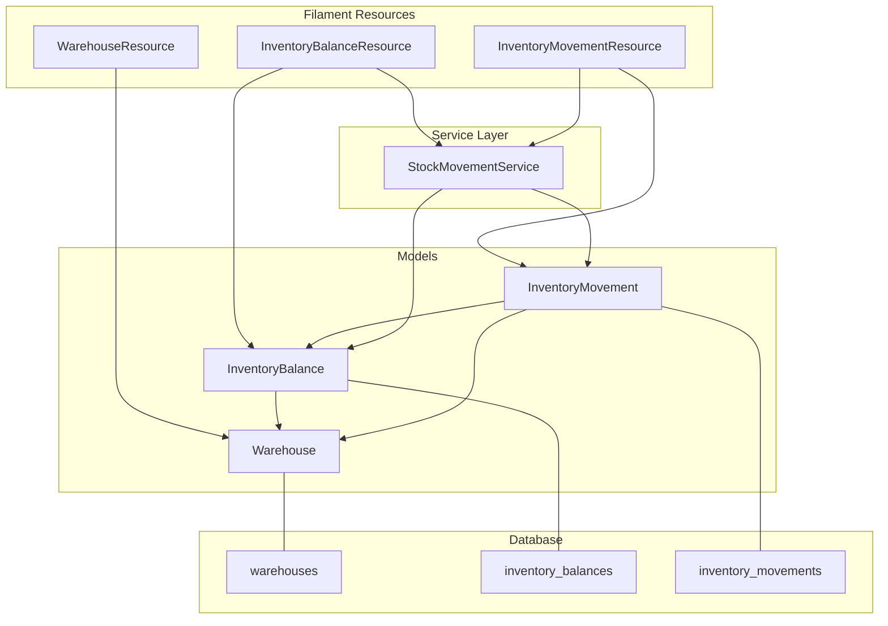
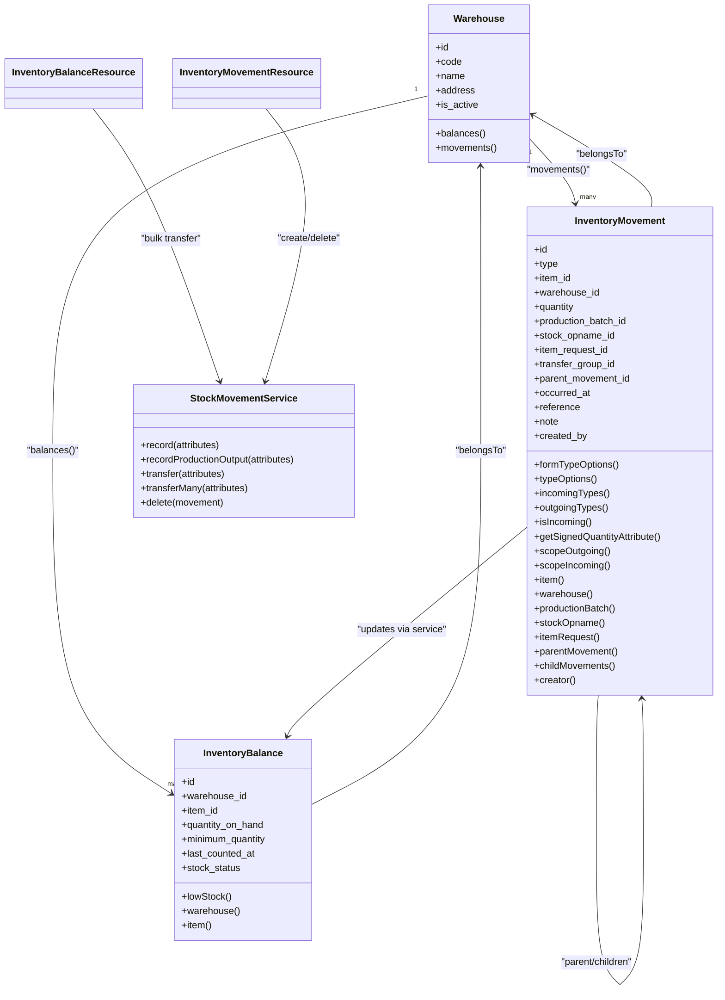
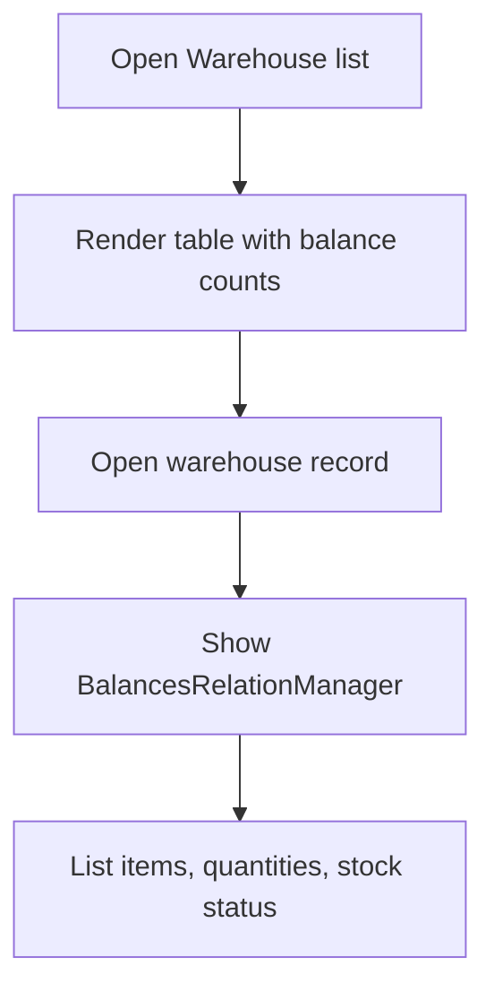
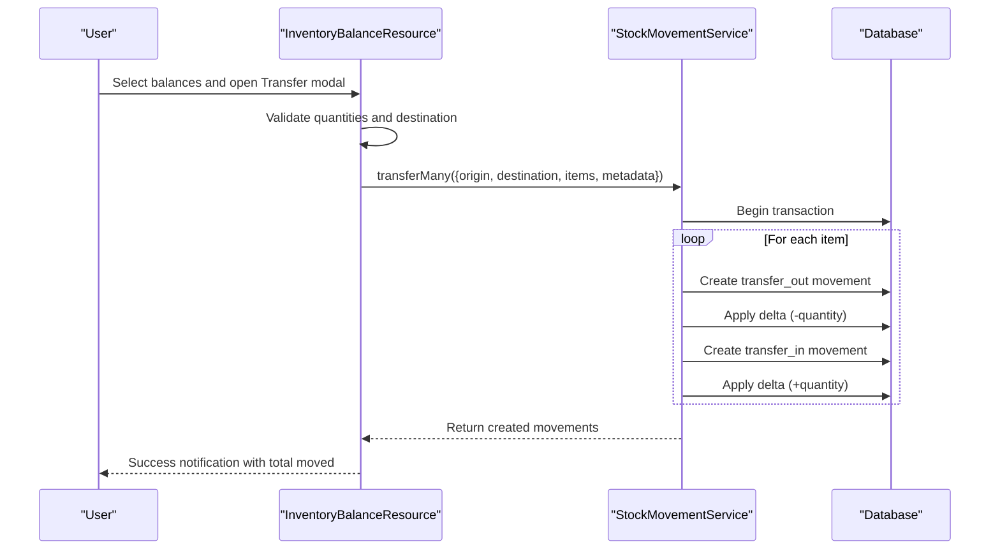
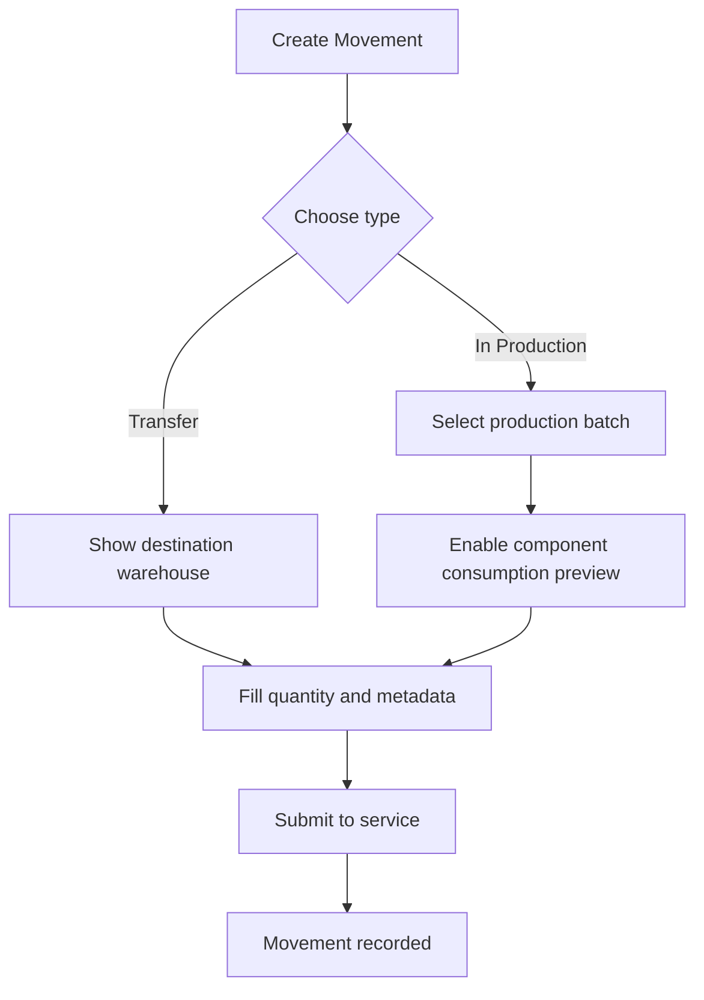
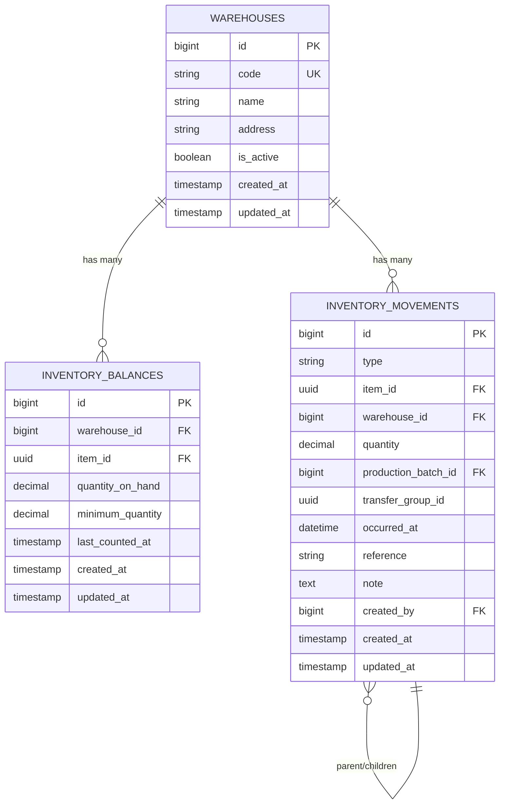
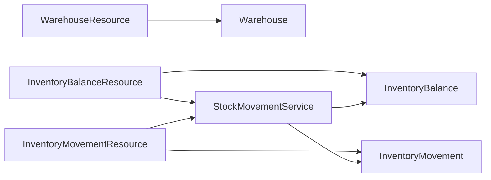

# Inventory Management Resources

<cite>
**Referenced Files in This Document**
- [WarehouseResource.php](file://app/Filament/Resources/Warehouses/WarehouseResource.php)
- [BalancesRelationManager.php](file://app/Filament/Resources/Warehouses/RelationManagers/BalancesRelationManager.php)
- [InventoryBalanceResource.php](file://app/Filament/Resources/InventoryBalances/InventoryBalanceResource.php)
- [InventoryMovementResource.php](file://app/Filament/Resources/InventoryMovements/InventoryMovementResource.php)
- [Warehouse.php](file://app/Models/Warehouse.php)
- [InventoryBalance.php](file://app/Models/InventoryBalance.php)
- [InventoryMovement.php](file://app/Models/InventoryMovement.php)
- [StockMovementService.php](file://app/Services/StockMovementService.php)
- [2026_11_16_000001_create_warehouses_table.php](file://database/migrations/2026_11_16_000001_create_warehouses_table.php)
- [2026_11_16_000002_create_inventory_balances_table.php](file://database/migrations/2026_11_16_000002_create_inventory_balances_table.php)
- [2026_11_17_000005_create_inventory_movements_table.php](file://database/migrations/2026_11_17_000005_create_inventory_movements_table.php)
</cite>

## Table of Contents
1. [Introduction](#introduction)
2. [Project Structure](#project-structure)
3. [Core Components](#core-components)
4. [Architecture Overview](#architecture-overview)
5. [Detailed Component Analysis](#detailed-component-analysis)
6. [Dependency Analysis](#dependency-analysis)
7. [Performance Considerations](#performance-considerations)
8. [Troubleshooting Guide](#troubleshooting-guide)
9. [Conclusion](#conclusion)

## Introduction
This document explains the inventory management resources for warehouses, inventory balances, and inventory movements. It focuses on:
- The Warehouse resource structure and its BalancesRelationManager for multi-warehouse stock visibility.
- The InventoryBalance resource for real-time stock level monitoring, low-stock warnings, and bulk warehouse transfers.
- The InventoryMovement resource for transaction history, movement types, production material consumption, and stock adjustments.
- How warehouses relate to inventory balances, how movement types drive stock changes, and how the StockMovementService enforces consistency.

## Project Structure
The inventory domain is implemented as Filament resources backed by Eloquent models and a dedicated service layer.

**Diagram sources**
- [WarehouseResource.php:26-130](file://app/Filament/Resources/Warehouses/WarehouseResource.php#L26-L130)
- [InventoryBalanceResource.php:43-445](file://app/Filament/Resources/InventoryBalances/InventoryBalanceResource.php#L43-L445)
- [InventoryMovementResource.php:38-339](file://app/Filament/Resources/InventoryMovements/InventoryMovementResource.php#L38-L339)
- [Warehouse.php:12-36](file://app/Models/Warehouse.php#L12-L36)
- [InventoryBalance.php:20-70](file://app/Models/InventoryBalance.php#L20-L70)
- [InventoryMovement.php:28-190](file://app/Models/InventoryMovement.php#L28-L190)
- [StockMovementService.php:16-397](file://app/Services/StockMovementService.php#L16-L397)
- [2026_11_16_000001_create_warehouses_table.php:14-21](file://database/migrations/2026_11_16_000001_create_warehouses_table.php#L14-L21)
- [2026_11_16_000002_create_inventory_balances_table.php:14-30](file://database/migrations/2026_11_16_000002_create_inventory_balances_table.php#L14-L30)
- [2026_11_17_000005_create_inventory_movements_table.php:14-41](file://database/migrations/2026_11_17_000005_create_inventory_movements_table.php#L14-L41)

**Section sources**
- [WarehouseResource.php:26-130](file://app/Filament/Resources/Warehouses/WarehouseResource.php#L26-L130)
- [InventoryBalanceResource.php:43-445](file://app/Filament/Resources/InventoryBalances/InventoryBalanceResource.php#L43-L445)
- [InventoryMovementResource.php:38-339](file://app/Filament/Resources/InventoryMovements/InventoryMovementResource.php#L38-L339)
- [Warehouse.php:12-36](file://app/Models/Warehouse.php#L12-L36)
- [InventoryBalance.php:20-70](file://app/Models/InventoryBalance.php#L20-L70)
- [InventoryMovement.php:28-190](file://app/Models/InventoryMovement.php#L28-L190)
- [StockMovementService.php:16-397](file://app/Services/StockMovementService.php#L16-L397)
- [2026_11_16_000001_create_warehouses_table.php:14-21](file://database/migrations/2026_11_16_000001_create_warehouses_table.php#L14-L21)
- [2026_11_16_000002_create_inventory_balances_table.php:14-30](file://database/migrations/2026_11_16_000002_create_inventory_balances_table.php#L14-L30)
- [2026_11_17_000005_create_inventory_movements_table.php:14-41](file://database/migrations/2026_11_17_000005_create_inventory_movements_table.php#L14-L41)

## Core Components
- WarehouseResource: manages warehouse master data, lists balances count per warehouse, supports filtering by active status, and exposes the BalancesRelationManager.
- BalancesRelationManager: shows all inventory balances under a specific warehouse with item code, name, quantities, and stock status.
- InventoryBalanceResource: manages per-warehouse per-item stock levels, minimum thresholds, last counted date, low-stock badge, filters, and bulk transfer between warehouses.
- InventoryMovementResource: records incoming/outgoing/transfer/adjustment transactions, optional production batch linkage, component consumption preview, and deletion that reverses stock.
- StockMovementService: centralizes safe stock updates, movement creation, transfer logic, production output with automatic material deduction, and reversal on delete.

**Section sources**
- [WarehouseResource.php:26-130](file://app/Filament/Resources/Warehouses/WarehouseResource.php#L26-L130)
- [BalancesRelationManager.php:9-51](file://app/Filament/Resources/Warehouses/RelationManagers/BalancesRelationManager.php#L9-L51)
- [InventoryBalanceResource.php:43-445](file://app/Filament/Resources/InventoryBalances/InventoryBalanceResource.php#L43-L445)
- [InventoryMovementResource.php:38-339](file://app/Filament/Resources/InventoryMovements/InventoryMovementResource.php#L38-L339)
- [StockMovementService.php:16-397](file://app/Services/StockMovementService.php#L16-L397)

## Architecture Overview
The system separates UI (Filament resources), domain models, and transactional logic (service).

**Diagram sources**
- [Warehouse.php:12-36](file://app/Models/Warehouse.php#L12-L36)
- [InventoryBalance.php:20-70](file://app/Models/InventoryBalance.php#L20-L70)
- [InventoryMovement.php:28-190](file://app/Models/InventoryMovement.php#L28-L190)
- [StockMovementService.php:16-397](file://app/Services/StockMovementService.php#L16-L397)
- [InventoryBalanceResource.php:231-419](file://app/Filament/Resources/InventoryBalances/InventoryBalanceResource.php#L231-L419)
- [InventoryMovementResource.php:241-263](file://app/Filament/Resources/InventoryMovements/InventoryMovementResource.php#L241-L263)

## Detailed Component Analysis

### Warehouse Resource and BalancesRelationManager
- WarehouseResource defines form fields for code, name, address, and active flag; table columns include counts of related balances; it registers the BalancesRelationManager.
- BalancesRelationManager displays per-warehouse balances with item details, quantities, and computed stock status badges.

Key behaviors:
- Relationship exposure: `getRelations()` returns BalancesRelationManager.
- Table counts balances using `counts('balances')`.
- Filtering by active status via TernaryFilter.

**Diagram sources**
- [WarehouseResource.php:44-113](file://app/Filament/Resources/Warehouses/WarehouseResource.php#L44-L113)
- [WarehouseResource.php:115-120](file://app/Filament/Resources/Warehouses/WarehouseResource.php#L115-L120)
- [BalancesRelationManager.php:15-50](file://app/Filament/Resources/Warehouses/RelationManagers/BalancesRelationManager.php#L15-L50)

**Section sources**
- [WarehouseResource.php:44-113](file://app/Filament/Resources/Warehouses/WarehouseResource.php#L44-L113)
- [WarehouseResource.php:115-120](file://app/Filament/Resources/Warehouses/WarehouseResource.php#L115-L120)
- [BalancesRelationManager.php:15-50](file://app/Filament/Resources/Warehouses/RelationManagers/BalancesRelationManager.php#L15-L50)

### InventoryBalance Resource
Responsibilities:
- Create/edit per-warehouse per-item stock levels, minimum quantity, and last counted timestamp.
- Display stock status (out, low, ok) with color-coded badges.
- Navigation badge showing low-stock count.
- Filters by warehouse and stock status.
- Bulk transfer action to move selected balances to another warehouse.

Bulk transfer flow:
- User selects multiple balances.
- Modal collects destination warehouse, occurrence time, optional reference/note, and per-item quantities.
- Validates quantities against available stock and prevents same-origin destination.
- Groups items by origin warehouse and calls StockMovementService.transferMany within a database transaction.
- Shows success or validation error notifications.

**Diagram sources**
- [InventoryBalanceResource.php:231-419](file://app/Filament/Resources/InventoryBalances/InventoryBalanceResource.php#L231-L419)
- [StockMovementService.php:209-290](file://app/Services/StockMovementService.php#L209-L290)

**Section sources**
- [InventoryBalanceResource.php:59-74](file://app/Filament/Resources/InventoryBalances/InventoryBalanceResource.php#L59-L74)
- [InventoryBalanceResource.php:76-149](file://app/Filament/Resources/InventoryBalances/InventoryBalanceResource.php#L76-L149)
- [InventoryBalanceResource.php:151-229](file://app/Filament/Resources/InventoryBalances/InventoryBalanceResource.php#L151-L229)
- [InventoryBalanceResource.php:231-419](file://app/Filament/Resources/InventoryBalances/InventoryBalanceResource.php#L231-L419)

### InventoryMovement Resource
Responsibilities:
- Record various movement types: purchase in, production in, production out, other out, transfer, adjustment in/out.
- Optional linkage to production batches and automatic component consumption preview.
- Table shows incoming/outside quantities, type badges, and filters by type, warehouse, item, and production batch.
- Delete action reverses stock and removes related child movements when part of a transfer group.

Form behavior highlights:
- Destination warehouse field appears only for transfer type.
- Production batch selection enables component consumption preview.
- Preview calculates required materials based on active components and current stock in the material warehouse.

**Diagram sources**
- [InventoryMovementResource.php:54-162](file://app/Filament/Resources/InventoryMovements/InventoryMovementResource.php#L54-L162)
- [InventoryMovementResource.php:268-330](file://app/Filament/Resources/InventoryMovements/InventoryMovementResource.php#L268-L330)

**Section sources**
- [InventoryMovementResource.php:54-162](file://app/Filament/Resources/InventoryMovements/InventoryMovementResource.php#L54-L162)
- [InventoryMovementResource.php:165-265](file://app/Filament/Resources/InventoryMovements/InventoryMovementResource.php#L165-L265)
- [InventoryMovementResource.php:268-330](file://app/Filament/Resources/InventoryMovements/InventoryMovementResource.php#L268-L330)

### Data Model Relationships and Schema
- Warehouses store location master data and are linked to balances and movements.
- InventoryBalances represent per-warehouse per-item stock levels with minimum thresholds and last counted timestamps.
- InventoryMovements capture every stock change with typed entries, optional batch linkage, transfer grouping, and audit fields.

**Diagram sources**
- [2026_11_16_000001_create_warehouses_table.php:14-21](file://database/migrations/2026_11_16_000001_create_warehouses_table.php#L14-L21)
- [2026_11_16_000002_create_inventory_balances_table.php:14-30](file://database/migrations/2026_11_16_000002_create_inventory_balances_table.php#L14-L30)
- [2026_11_17_000005_create_inventory_movements_table.php:14-41](file://database/migrations/2026_11_17_000005_create_inventory_movements_table.php#L14-L41)

**Section sources**
- [2026_11_16_000001_create_warehouses_table.php:14-21](file://database/migrations/2026_11_16_000001_create_warehouses_table.php#L14-L21)
- [2026_11_16_000002_create_inventory_balances_table.php:14-30](file://database/migrations/2026_11_16_000002_create_inventory_balances_table.php#L14-L30)
- [2026_11_17_000005_create_inventory_movements_table.php:14-41](file://database/migrations/2026_11_17_000005_create_inventory_movements_table.php#L14-L41)

## Dependency Analysis
- WarehouseResource depends on Warehouse model and registers BalancesRelationManager.
- InventoryBalanceResource depends on InventoryBalance model and uses StockMovementService for bulk transfers.
- InventoryMovementResource depends on InventoryMovement model and uses StockMovementService for create and delete operations.
- StockMovementService orchestrates InventoryMovement creation and InventoryBalance updates atomically.

**Diagram sources**
- [WarehouseResource.php:26-130](file://app/Filament/Resources/Warehouses/WarehouseResource.php#L26-L130)
- [InventoryBalanceResource.php:43-445](file://app/Filament/Resources/InventoryBalances/InventoryBalanceResource.php#L43-L445)
- [InventoryMovementResource.php:38-339](file://app/Filament/Resources/InventoryMovements/InventoryMovementResource.php#L38-L339)
- [StockMovementService.php:16-397](file://app/Services/StockMovementService.php#L16-L397)

**Section sources**
- [WarehouseResource.php:26-130](file://app/Filament/Resources/Warehouses/WarehouseResource.php#L26-L130)
- [InventoryBalanceResource.php:43-445](file://app/Filament/Resources/InventoryBalances/InventoryBalanceResource.php#L43-L445)
- [InventoryMovementResource.php:38-339](file://app/Filament/Resources/InventoryMovements/InventoryMovementResource.php#L38-L339)
- [StockMovementService.php:16-397](file://app/Services/StockMovementService.php#L16-L397)

## Performance Considerations
- Use indexed queries: inventory movements index item, warehouse, and occurred_at; balances have unique composite key on warehouse and item.
- Prefer relationship loading where needed to avoid N+1 queries in tables and relation managers.
- Batch operations should be grouped by origin warehouse to minimize repeated lookups and reduce transaction overhead.
- Decimal precision is set to three decimal places for quantities to support fractional units while keeping storage efficient.

[No sources needed since this section provides general guidance]

## Troubleshooting Guide
Common issues and resolutions:
- Low-stock navigation badge not updating: ensure minimum_quantity is set correctly and stock_status attribute is used consistently.
- Bulk transfer fails due to insufficient stock: verify selected quantities do not exceed available stock; check validation messages from the service.
- Cannot delete a movement: if stock has been consumed after the movement, reversal will fail; adjust downstream balances before deletion.
- Transfer destination equals origin: the service explicitly rejects same-origin and same-destination transfers.

Operational notes:
- Deletion of a movement reverses stock; if part of a transfer group, both outgoing and incoming rows are removed together.
- Production output with component consumption validates material availability before recording output and deducting components.

**Section sources**
- [InventoryBalanceResource.php:59-74](file://app/Filament/Resources/InventoryBalances/InventoryBalanceResource.php#L59-L74)
- [InventoryMovementResource.php:241-263](file://app/Filament/Resources/InventoryMovements/InventoryMovementResource.php#L241-L263)
- [StockMovementService.php:296-344](file://app/Services/StockMovementService.php#L296-L344)
- [StockMovementService.php:358-387](file://app/Services/StockMovementService.php#L358-L387)

## Conclusion
The inventory management resources provide a robust, user-friendly interface for managing warehouses, tracking real-time stock levels, and maintaining an auditable history of stock movements. The design cleanly separates presentation (Filament resources), domain models, and transactional logic (StockMovementService), ensuring consistency through atomic operations, comprehensive validation, and clear reporting features such as low-stock indicators and movement type filters.

[No sources needed since this section summarizes without analyzing specific files]