# Master Data Resources

<cite>
**Referenced Files in This Document**
- [ItemResource.php](file://app/Filament/Resources/Items/ItemResource.php)
- [Item.php](file://app/Models/Item.php)
- [ItemComponentsRelationManager.php](file://app/Filament/Resources/Items/RelationManagers/ItemComponentsRelationManager.php)
- [VariantMappingsRelationManager.php](file://app/Filament/Resources/Items/RelationManagers/VariantMappingsRelationManager.php)
- [InventoryBalancesRelationManager.php](file://app/Filament/Resources/Items/RelationManagers/InventoryBalancesRelationManager.php)
- [InfiniteSelect.php](file://app/Filament/Forms/Components/InfiniteSelect.php)
- [ItemComponent.php](file://app/Models/ItemComponent.php)
- [ItemVariantMapping.php](file://app/Models/ItemVariantMapping.php)
- [InventoryBalance.php](file://app/Models/InventoryBalance.php)
- [ItemAttribute.php](file://app/Models/ItemAttribute.php)
- [ItemAttributeValue.php](file://app/Models/ItemAttributeValue.php)
- [ItemAttributeResource.php](file://app/Filament/Resources/ItemAttributes/ItemAttributeResource.php)
- [ItemCategoryResource.php](file://app/Filament/Resources/ItemCategories/ItemCategoryResource.php)
- [BrandResource.php](file://app/Filament/Resources/Brands/BrandResource.php)
- [ItemTypeResource.php](file://app/Filament/Resources/ItemTypes/ItemTypeResource.php)
- [UomResource.php](file://app/Filament/Resources/Uoms/UomResource.php)
</cite>

## Table of Contents
1. [Introduction](#introduction)
2. [Project Structure](#project-structure)
3. [Core Components](#core-components)
4. [Architecture Overview](#architecture-overview)
5. [Detailed Component Analysis](#detailed-component-analysis)
6. [Dependency Analysis](#dependency-analysis)
7. [Performance Considerations](#performance-considerations)
8. [Troubleshooting Guide](#troubleshooting-guide)
9. [Conclusion](#conclusion)

## Introduction
This document explains the master data management resources for Items, Categories, Brands, Types, Units of Measurement (UoMs), and Attributes. It focuses on Item as the central entity with complex relationships to components, variants, and inventory balances. It also documents form structures, validation rules, custom field components such as InfiniteSelect, and relationship managers for managing composition, attribute-value mappings, and warehouse stock levels. Guidelines are provided for hierarchical data structures, attribute-value pairs, and unit conversions.

## Project Structure
The master data is implemented using Filament Resources backed by Eloquent models:
- ItemResource defines the primary Item UI, including forms, tables, filters, actions, and relation managers.
- Supporting resources manage Categories, Brands, Types, UoMs, and Attributes.
- Models define relationships, casts, scopes, and business logic such as cycle detection for compositions and stock status computation.

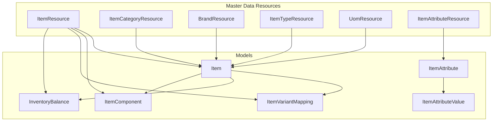

**Diagram sources**
- [ItemResource.php:37-299](file://app/Filament/Resources/Items/ItemResource.php#L37-L299)
- [Item.php:41-172](file://app/Models/Item.php#L41-L172)
- [ItemComponent.php:19-85](file://app/Models/ItemComponent.php#L19-L85)
- [ItemVariantMapping.php:10-26](file://app/Models/ItemVariantMapping.php#L10-L26)
- [InventoryBalance.php:20-70](file://app/Models/InventoryBalance.php#L20-L70)
- [ItemAttribute.php:12-31](file://app/Models/ItemAttribute.php#L12-L31)
- [ItemAttributeValue.php:13-27](file://app/Models/ItemAttributeValue.php#L13-L27)
- [ItemResource.php:281-287](file://app/Filament/Resources/Items/ItemResource.php#L281-L287)
- [ItemCategoryResource.php:26-117](file://app/Filament/Resources/ItemCategories/ItemCategoryResource.php#L26-L117)
- [BrandResource.php:24-104](file://app/Filament/Resources/Brands/BrandResource.php#L24-L104)
- [ItemTypeResource.php:24-100](file://app/Filament/Resources/ItemTypes/ItemTypeResource.php#L24-L100)
- [UomResource.php:24-108](file://app/Filament/Resources/Uoms/UomResource.php#L24-L108)
- [ItemAttributeResource.php:26-122](file://app/Filament/Resources/ItemAttributes/ItemAttributeResource.php#L26-L122)

**Section sources**
- [ItemResource.php:37-299](file://app/Filament/Resources/Items/ItemResource.php#L37-L299)
- [Item.php:41-172](file://app/Models/Item.php#L41-L172)
- [ItemCategoryResource.php:26-117](file://app/Filament/Resources/ItemCategories/ItemCategoryResource.php#L26-L117)
- [BrandResource.php:24-104](file://app/Filament/Resources/Brands/BrandResource.php#L24-L104)
- [ItemTypeResource.php:24-100](file://app/Filament/Resources/ItemTypes/ItemTypeResource.php#L24-L100)
- [UomResource.php:24-108](file://app/Filament/Resources/Uoms/UomResource.php#L24-L108)
- [ItemAttributeResource.php:26-122](file://app/Filament/Resources/ItemAttributes/ItemAttributeResource.php#L26-L122)

## Core Components
- ItemResource: Central resource for Items with sections for identity, variants, dimensions/weight, pricing, and behavior toggles. Provides table columns, filters, bulk export, and navigation to a Bill of Materials builder.
- Item model: Defines relationships to types, categories, brands, divisions, UoMs, parent/children hierarchy, variant mappings, external mappings, inventory balances/movements, and component relationships. Includes casts for numeric and boolean fields and scopes for active, parents, and variants.
- ItemComponentsRelationManager: Manages item composition with infinite select for components, uniqueness constraints per parent, and cycle prevention.
- VariantMappingsRelationManager: Manages attribute-value pairs for variants, ensuring unique attributes per item and dynamic value selection based on chosen attribute.
- InventoryBalancesRelationManager: Displays per-warehouse stock levels and computed stock status badges.
- InfiniteSelect: Custom Filament component enabling paginated options and search for large option sets.
- Attribute models and resource: Define attribute definitions and values; resource exposes values via a relation manager.

**Section sources**
- [ItemResource.php:55-195](file://app/Filament/Resources/Items/ItemResource.php#L55-L195)
- [ItemResource.php:197-279](file://app/Filament/Resources/Items/ItemResource.php#L197-L279)
- [Item.php:41-172](file://app/Models/Item.php#L41-L172)
- [ItemComponentsRelationManager.php:23-124](file://app/Filament/Resources/Items/RelationManagers/ItemComponentsRelationManager.php#L23-L124)
- [VariantMappingsRelationManager.php:19-97](file://app/Filament/Resources/Items/RelationManagers/VariantMappingsRelationManager.php#L19-L97)
- [InventoryBalancesRelationManager.php:9-50](file://app/Filament/Resources/Items/RelationManagers/InventoryBalancesRelationManager.php#L9-L50)
- [InfiniteSelect.php:9-42](file://app/Filament/Forms/Components/InfiniteSelect.php#L9-L42)
- [ItemAttributeResource.php:44-122](file://app/Filament/Resources/ItemAttributes/ItemAttributeResource.php#L44-L122)

## Architecture Overview
The system organizes master data through Filament resources that render forms, tables, and relation managers. The Item resource orchestrates related data:
- Composition: Item -> ItemComponent -> Item (component).
- Variants: Item -> ItemVariantMapping -> ItemAttribute + ItemAttributeValue.
- Inventory: Item -> InventoryBalance -> Warehouse.

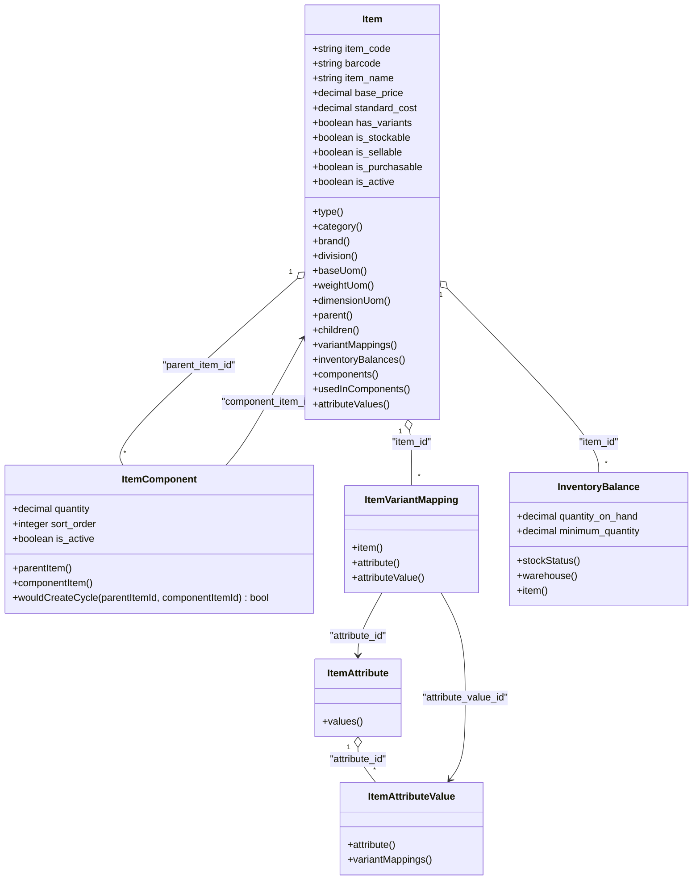

**Diagram sources**
- [Item.php:66-156](file://app/Models/Item.php#L66-L156)
- [ItemComponent.php:36-84](file://app/Models/ItemComponent.php#L36-L84)
- [ItemVariantMapping.php:12-25](file://app/Models/ItemVariantMapping.php#L12-L25)
- [InventoryBalance.php:37-69](file://app/Models/InventoryBalance.php#L37-L69)
- [ItemAttribute.php:27-30](file://app/Models/ItemAttribute.php#L27-L30)
- [ItemAttributeValue.php:18-26](file://app/Models/ItemAttributeValue.php#L18-L26)

## Detailed Component Analysis

### ItemResource
- Form structure:
  - Identity section: code, barcode, name, description, type, base UoM, category, brand, division.
  - Variants section: toggle for has_variants and parent_item_id using InfiniteSelect with paginated options and label resolution.
  - Dimensions & weight: numeric fields for weight, length, width, height with respective UoM selects.
  - Pricing: base price and standard cost.
  - Behavior: toggles for stockable, sellable, purchasable, and active.
- Table and filters:
  - Columns include code, name, type, category, brand, division, base UoM, base price, variant flag, active flag, and parent item name.
  - Filters by type, category, brand, division, has_variants, and is_active.
  - Actions include composition link to BomBuilder, edit, delete, bulk export, and bulk delete.
- Relations:
  - Registers VariantMappingsRelationManager, ItemComponentsRelationManager, and InventoryBalancesRelationManager.

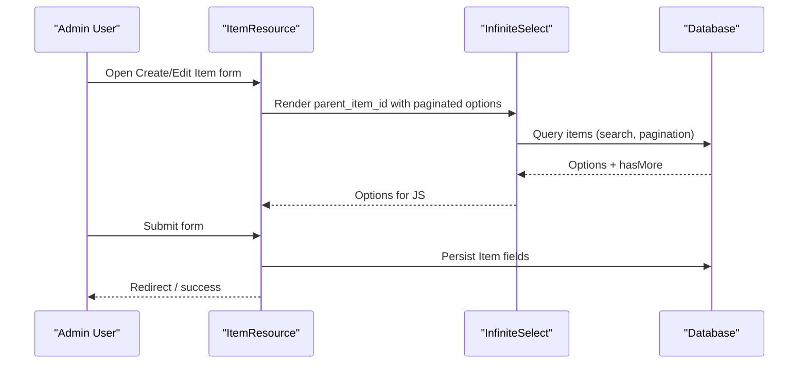

**Diagram sources**
- [ItemResource.php:55-195](file://app/Filament/Resources/Items/ItemResource.php#L55-L195)
- [ItemResource.php:197-279](file://app/Filament/Resources/Items/ItemResource.php#L197-L279)
- [ItemResource.php:281-287](file://app/Filament/Resources/Items/ItemResource.php#L281-L287)
- [InfiniteSelect.php:16-40](file://app/Filament/Forms/Components/InfiniteSelect.php#L16-L40)

**Section sources**
- [ItemResource.php:55-195](file://app/Filament/Resources/Items/ItemResource.php#L55-L195)
- [ItemResource.php:197-279](file://app/Filament/Resources/Items/ItemResource.php#L197-L279)
- [ItemResource.php:281-287](file://app/Filament/Resources/Items/ItemResource.php#L281-L287)

### Item Model Relationships and Scopes
- Relationships:
  - BelongsTo: type, category, brand, division, baseUom, weightUom, dimensionUom, parent.
  - HasMany: children, variantMappings, inventoryBalances, inventoryMovements, components, usedInComponents, externalSyncedUnits.
  - BelongsToMany: attributeValues via pivot with attribute_id and timestamps.
- Scopes:
  - Active: filters by is_active.
  - Parents: filters where parent_item_id is null.
  - Variants: filters where parent_item_id is not null.
- Casts:
  - Numeric decimals for weight, length, width, height, base_price, standard_cost.
  - Booleans for flags.

```mermaid
flowchart TD
Start(["Item Model"]) --> RelType["BelongsTo Type"]
Start --> RelCat["BelongsTo Category"]
Start --> RelBrand["BelongsTo Brand"]
Start --> RelDiv["BelongsTo Division"]
Start --> RelBaseUom["BelongsTo Base UoM"]
Start --> RelWeightUom["BelongsTo Weight UoM"]
Start --> RelDimUom["BelongsTo Dimension UoM"]
Start --> RelParent["BelongsTo Parent"]
Start --> RelChildren["HasMany Children"]
Start --> RelVM["HasMany VariantMappings"]
Start --> RelIB["HasMany InventoryBalances"]
Start --> RelIM["HasMany InventoryMovements"]
Start --> RelComp["HasMany Components"]
Start --> RelUsed["HasMany UsedInComponents"]
Start --> RelAttrVals["BelongsToMany AttributeValues"]
```

**Diagram sources**
- [Item.php:66-156](file://app/Models/Item.php#L66-L156)
- [Item.php:158-171](file://app/Models/Item.php#L158-L171)

**Section sources**
- [Item.php:41-172](file://app/Models/Item.php#L41-L172)

### ItemComponentsRelationManager
- Purpose: Manage bill-of-materials composition for an Item.
- Form fields:
  - component_item_id: InfiniteSelect filtering stockable, non-variant items excluding the parent itself; supports search and pagination.
  - quantity: numeric, minimum positive threshold, default 1.
  - note: optional text.
  - is_active: toggle.
- Validation:
  - Uniqueness of component_item_id per parent_item_id.
  - Cycle prevention using ItemComponent::wouldCreateCycle to avoid circular dependencies.
- Table:
  - Displays component code/name, quantity, note, and active status.

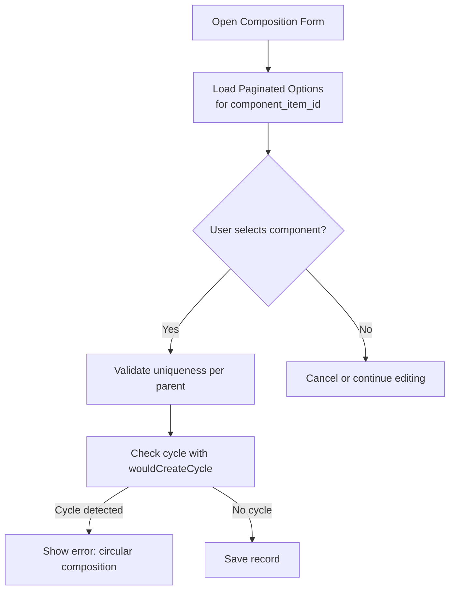

**Diagram sources**
- [ItemComponentsRelationManager.php:29-91](file://app/Filament/Resources/Items/RelationManagers/ItemComponentsRelationManager.php#L29-L91)
- [ItemComponent.php:50-84](file://app/Models/ItemComponent.php#L50-L84)

**Section sources**
- [ItemComponentsRelationManager.php:23-124](file://app/Filament/Resources/Items/RelationManagers/ItemComponentsRelationManager.php#L23-L124)
- [ItemComponent.php:19-85](file://app/Models/ItemComponent.php#L19-L85)

### VariantMappingsRelationManager
- Purpose: Manage attribute-value pairs for an Item’s variants.
- Form fields:
  - attribute_id: Select from ItemAttribute with live filtering to exclude already used attributes for the same Item.
  - attribute_value_id: Dynamic options filtered by selected attribute_id.
- Validation:
  - Unique attribute_id per Item.
  - attribute_value_id must exist under the selected attribute_id.
- Table:
  - Shows attribute name, value, code, and creation timestamp.

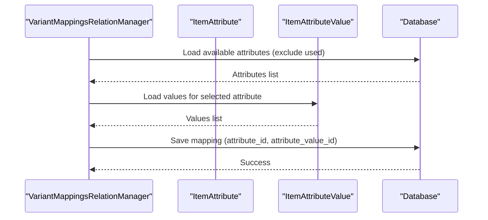

**Diagram sources**
- [VariantMappingsRelationManager.php:25-68](file://app/Filament/Resources/Items/RelationManagers/VariantMappingsRelationManager.php#L25-L68)
- [ItemVariantMapping.php:12-25](file://app/Models/ItemVariantMapping.php#L12-L25)

**Section sources**
- [VariantMappingsRelationManager.php:19-97](file://app/Filament/Resources/Items/RelationManagers/VariantMappingsRelationManager.php#L19-L97)
- [ItemVariantMapping.php:10-26](file://app/Models/ItemVariantMapping.php#L10-L26)

### InventoryBalancesRelationManager
- Purpose: Display per-warehouse inventory balances for an Item.
- Table columns:
  - Warehouse code and name.
  - Quantity on hand and minimum quantity.
  - Stock status badge derived from InventoryBalance::stockStatus.

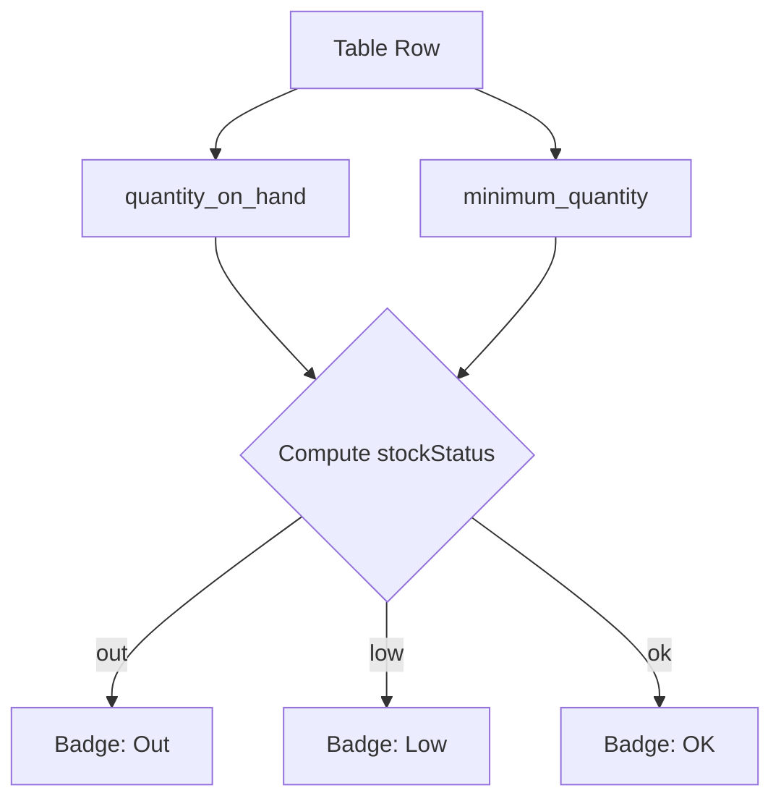

**Diagram sources**
- [InventoryBalancesRelationManager.php:15-49](file://app/Filament/Resources/Items/RelationManagers/InventoryBalancesRelationManager.php#L15-L49)
- [InventoryBalance.php:47-69](file://app/Models/InventoryBalance.php#L47-L69)

**Section sources**
- [InventoryBalancesRelationManager.php:9-50](file://app/Filament/Resources/Items/RelationManagers/InventoryBalancesRelationManager.php#L9-L50)
- [InventoryBalance.php:20-70](file://app/Models/InventoryBalance.php#L20-L70)

### InfiniteSelect Custom Field
- Purpose: Provide paginated options and search for large datasets.
- Behavior:
  - getOptionsForJs: returns initial page of options when paginated options are configured.
  - getSearchResultsForJs: returns search results using the same paginated options mechanism.
- Usage:
  - In ItemResource for parent_item_id.
  - In ItemComponentsRelationManager for component_item_id.

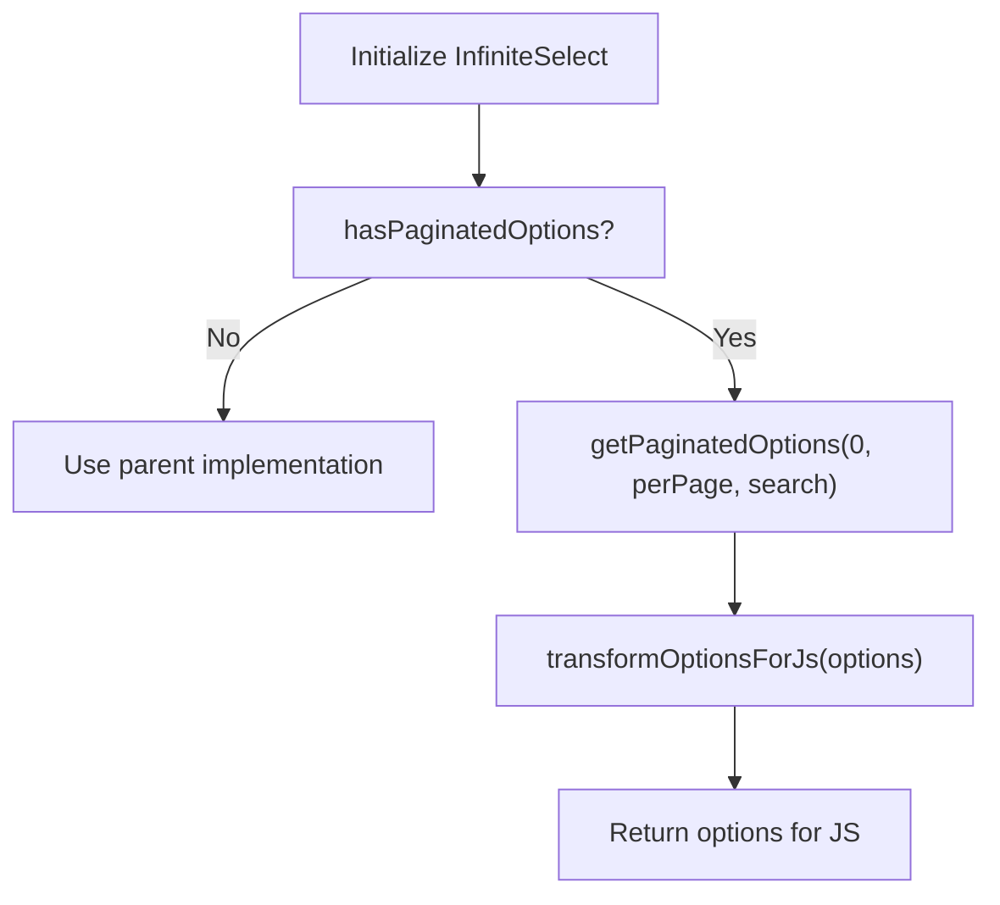

**Diagram sources**
- [InfiniteSelect.php:16-40](file://app/Filament/Forms/Components/InfiniteSelect.php#L16-L40)

**Section sources**
- [InfiniteSelect.php:9-42](file://app/Filament/Forms/Components/InfiniteSelect.php#L9-L42)
- [ItemResource.php:113-134](file://app/Filament/Resources/Items/ItemResource.php#L113-L134)
- [ItemComponentsRelationManager.php:33-65](file://app/Filament/Resources/Items/RelationManagers/ItemComponentsRelationManager.php#L33-L65)

### Hierarchical Data Structures
- Item hierarchy:
  - parent_item_id links child Items to a parent Item.
  - Item::parent and Item::children provide bidirectional traversal.
  - Scopes parents and variants help filter root vs leaf nodes.
- Category hierarchy:
  - parent_id enables nested categories.
  - ItemCategoryResource displays parent name and item counts.

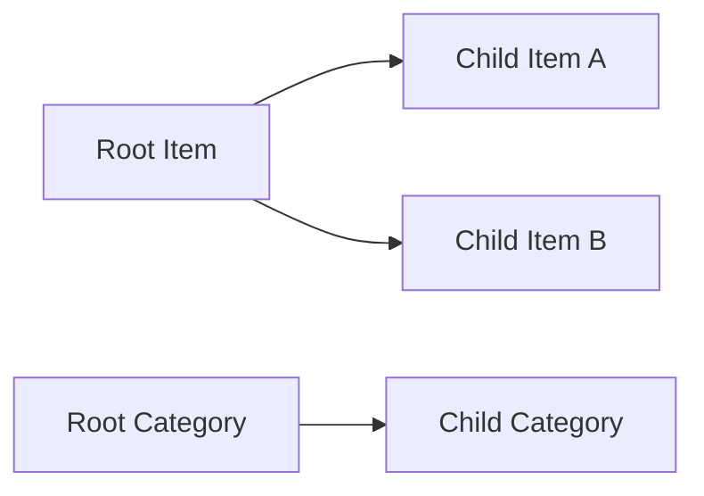

**Diagram sources**
- [Item.php:101-109](file://app/Models/Item.php#L101-L109)
- [Item.php:163-171](file://app/Models/Item.php#L163-L171)
- [ItemCategoryResource.php:44-60](file://app/Filament/Resources/ItemCategories/ItemCategoryResource.php#L44-L60)

**Section sources**
- [Item.php:101-109](file://app/Models/Item.php#L101-L109)
- [Item.php:163-171](file://app/Models/Item.php#L163-L171)
- [ItemCategoryResource.php:44-60](file://app/Filament/Resources/ItemCategories/ItemCategoryResource.php#L44-L60)

### Attribute-Value Pairs
- Definition:
  - ItemAttribute defines attribute names and descriptions.
  - ItemAttributeValue stores values and codes per attribute.
- Association:
  - ItemVariantMapping links an Item to an attribute and its specific value.
  - Item::attributeValues provides a many-to-many view with pivot attribute_id.

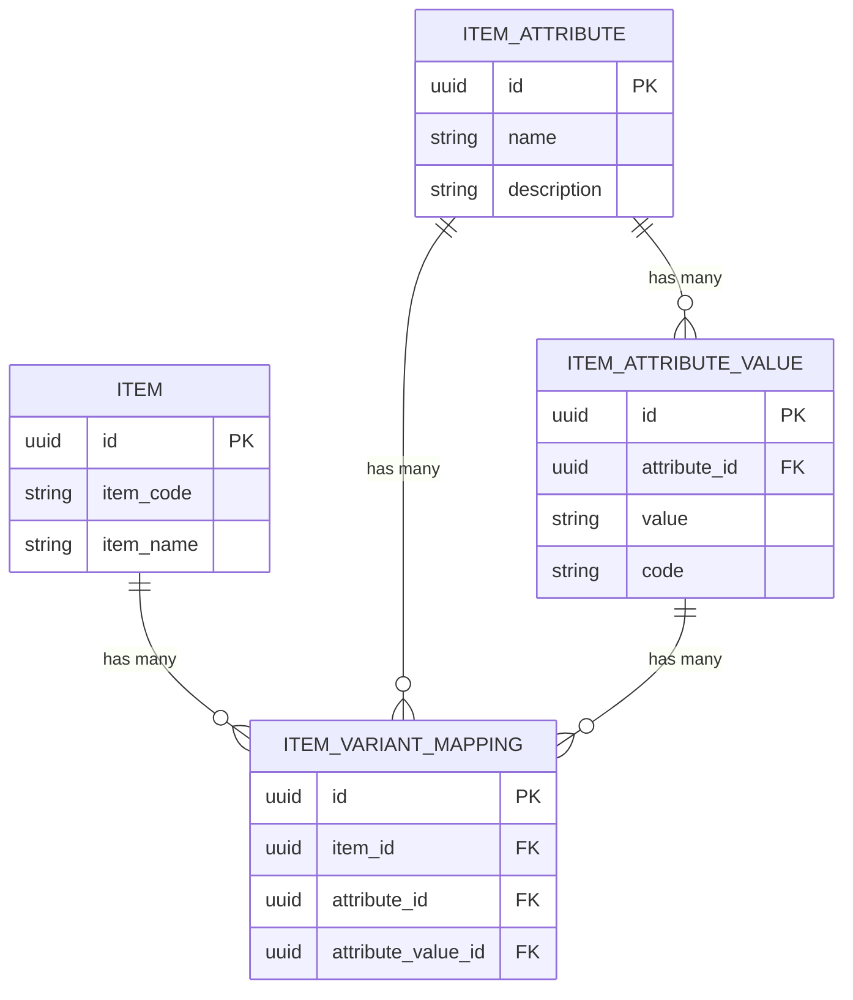

**Diagram sources**
- [ItemAttribute.php:12-31](file://app/Models/ItemAttribute.php#L12-L31)
- [ItemAttributeValue.php:13-27](file://app/Models/ItemAttributeValue.php#L13-L27)
- [ItemVariantMapping.php:10-26](file://app/Models/ItemVariantMapping.php#L10-L26)
- [Item.php:146-156](file://app/Models/Item.php#L146-L156)

**Section sources**
- [ItemAttributeResource.php:44-122](file://app/Filament/Resources/ItemAttributes/ItemAttributeResource.php#L44-L122)
- [ItemAttribute.php:12-31](file://app/Models/ItemAttribute.php#L12-L31)
- [ItemAttributeValue.php:13-27](file://app/Models/ItemAttributeValue.php#L13-L27)
- [ItemVariantMapping.php:10-26](file://app/Models/ItemVariantMapping.php#L10-L26)
- [Item.php:146-156](file://app/Models/Item.php#L146-L156)

### Unit Conversions and UoMs
- UoM resource manages units with code and name.
- Item uses multiple UoM references:
  - base_uom_id for primary unit.
  - weight_uom_id for weight measurements.
  - dimension_uom_id for length/width/height.
- Best practices:
  - Ensure consistent use of decimal casts for quantities and prices.
  - Validate UoM selections in forms.
  - When converting units at runtime, compute ratios based on UoM definitions (not shown here).

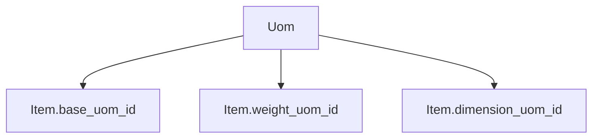

**Diagram sources**
- [UomResource.php:42-58](file://app/Filament/Resources/Uoms/UomResource.php#L42-L58)
- [Item.php:86-99](file://app/Models/Item.php#L86-L99)

**Section sources**
- [UomResource.php:24-108](file://app/Filament/Resources/Uoms/UomResource.php#L24-L108)
- [Item.php:86-99](file://app/Models/Item.php#L86-L99)

## Dependency Analysis
- Resource-to-model coupling:
  - ItemResource depends on Item and its relations.
  - RelationManagers depend on ItemComponent, ItemVariantMapping, and InventoryBalance.
- External integrations:
  - InfiniteSelect integrates with MrPunyapal\FilamentInfiniteSelect package.
- Potential circular dependencies:
  - Composition cycles are explicitly prevented by ItemComponent::wouldCreateCycle.

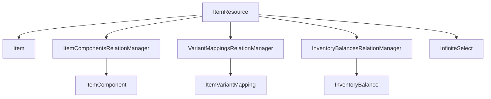

**Diagram sources**
- [ItemResource.php:37-299](file://app/Filament/Resources/Items/ItemResource.php#L37-L299)
- [ItemComponentsRelationManager.php:23-124](file://app/Filament/Resources/Items/RelationManagers/ItemComponentsRelationManager.php#L23-L124)
- [VariantMappingsRelationManager.php:19-97](file://app/Filament/Resources/Items/RelationManagers/VariantMappingsRelationManager.php#L19-L97)
- [InventoryBalancesRelationManager.php:9-50](file://app/Filament/Resources/Items/RelationManagers/InventoryBalancesRelationManager.php#L9-L50)
- [InfiniteSelect.php:9-42](file://app/Filament/Forms/Components/InfiniteSelect.php#L9-L42)

**Section sources**
- [ItemResource.php:37-299](file://app/Filament/Resources/Items/ItemResource.php#L37-L299)
- [ItemComponent.php:50-84](file://app/Models/ItemComponent.php#L50-L84)

## Performance Considerations
- Pagination:
  - InfiniteSelect uses paginated options to handle large option sets efficiently.
  - Tables use infinite scrolling with perPage settings.
- Queries:
  - Relationship queries should be eager-loaded where appropriate to avoid N+1 issues.
  - Filters leverage database-level conditions.
- Computation:
  - Stock status is computed via an Eloquent attribute accessor to minimize repeated logic.

[No sources needed since this section provides general guidance]

## Troubleshooting Guide
- Circular composition errors:
  - Occur when adding a component that creates a loop back to the parent.
  - Resolved by checking ItemComponent::wouldCreateCycle before saving.
- Duplicate component entries:
  - Prevented by uniqueness rule on component_item_id per parent_item_id.
- Invalid attribute-value mappings:
  - Ensure attribute_value_id belongs to the selected attribute_id.
  - Unique attribute_id per Item enforced by validation rules.
- Stock status anomalies:
  - Verify quantity_on_hand and minimum_quantity values.
  - Confirm stockStatus logic aligns with business thresholds.

**Section sources**
- [ItemComponentsRelationManager.php:63-77](file://app/Filament/Resources/Items/RelationManagers/ItemComponentsRelationManager.php#L63-L77)
- [ItemComponent.php:50-84](file://app/Models/ItemComponent.php#L50-L84)
- [VariantMappingsRelationManager.php:51-67](file://app/Filament/Resources/Items/RelationManagers/VariantMappingsRelationManager.php#L51-L67)
- [InventoryBalance.php:47-69](file://app/Models/InventoryBalance.php#L47-L69)

## Conclusion
The master data resources provide a robust foundation for managing Items and their relationships. ItemResource serves as the central hub, integrating composition, variants, and inventory balances through dedicated relation managers. Hierarchical structures for Items and Categories, along with flexible attribute-value pairs and unit references, enable comprehensive product modeling. Validation rules and custom components like InfiniteSelect ensure data integrity and performance at scale.

[No sources needed since this section summarizes without analyzing specific files]