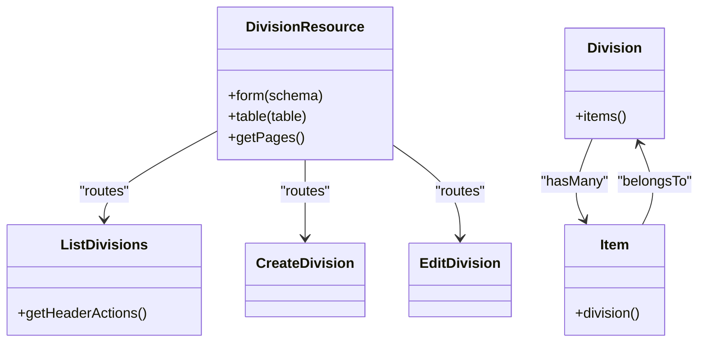
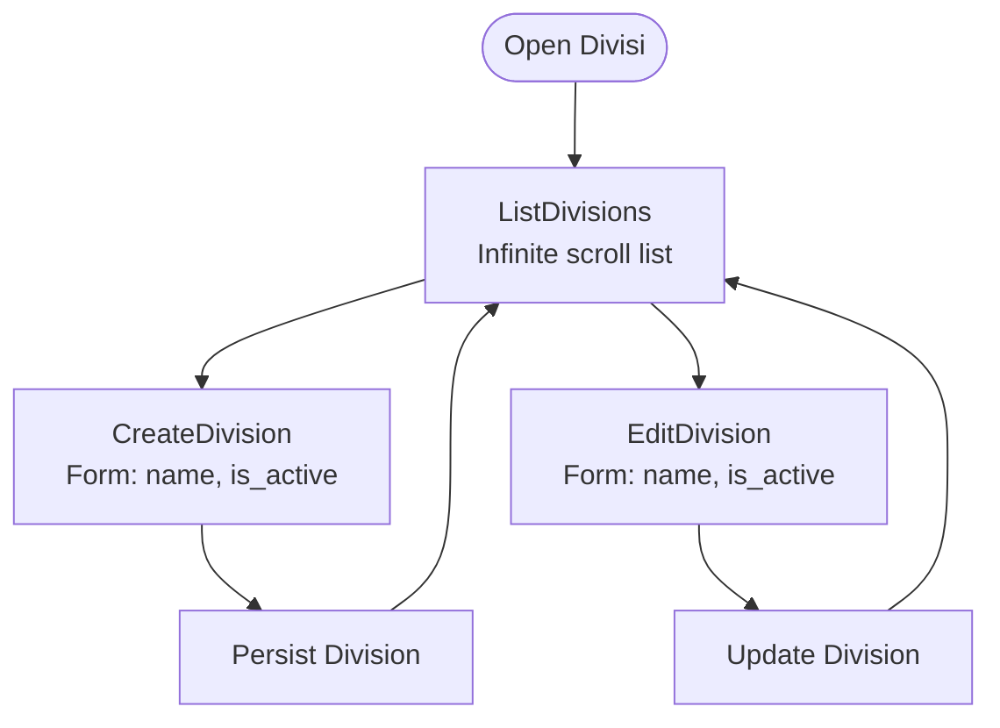
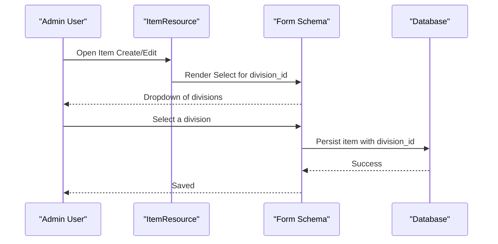
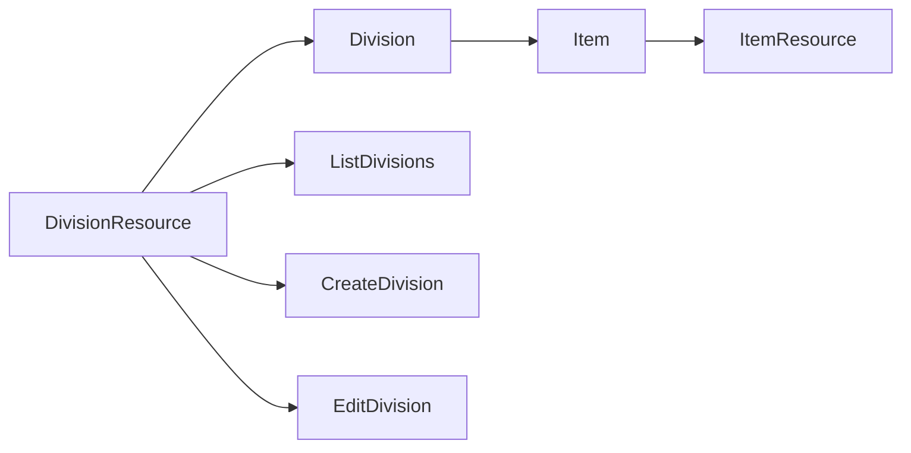

# Organizational Resources

<cite>
**Referenced Files in This Document**   
- [DivisionResource.php](file://app/Filament/Resources/Divisions/DivisionResource.php)
- [CreateDivision.php](file://app/Filament/Resources/Divisions/Pages/CreateDivision.php)
- [EditDivision.php](file://app/Filament/Resources/Divisions/Pages/EditDivision.php)
- [ListDivisions.php](file://app/Filament/Resources/Divisions/Pages/ListDivisions.php)
- [Division.php](file://app/Models/Division.php)
- [Item.php](file://app/Models/Item.php)
- [2026_11_19_000005_create_divisions_table.php](file://database/migrations/2026_11_19_000005_create_divisions_table.php)
- [2026_11_19_000006_add_division_id_to_items_table.php](file://database/migrations/2026_11_19_000006_add_division_id_to_items_table.php)
- [ItemResource.php](file://app/Filament/Resources/Items/ItemResource.php)
- [DivisionFactory.php](file://database/factories/DivisionFactory.php)
</cite>

## Table of Contents
1. [Introduction](#introduction)
2. [Project Structure](#project-structure)
3. [Core Components](#core-components)
4. [Architecture Overview](#architecture-overview)
5. [Detailed Component Analysis](#detailed-component-analysis)
6. [Dependency Analysis](#dependency-analysis)
7. [Performance Considerations](#performance-considerations)
8. [Troubleshooting Guide](#troubleshooting-guide)
9. [Conclusion](#conclusion)

## Introduction
This document explains the organizational resources focused on Division management for company divisions and departments. It covers the CRUD operations exposed through Filament, the form structure, table configuration, and how divisions integrate with other business entities such as Items via a division_id relationship. It also clarifies current user assignment capabilities and organizational hierarchy support.

## Project Structure
The Division feature is implemented as a Filament Resource with dedicated pages for listing, creating, and editing records. The data model defines a simple organization unit that can be linked to items.

```mermaid
graph TB
subgraph "Filament Admin"
DR["DivisionResource"]
LD["ListDivisions"]
CD["CreateDivision"]
ED["EditDivision"]
end
subgraph "Domain Models"
DIV["Division"]
ITM["Item"]
end
subgraph "Database"
T_DIV["divisions"]
T_ITEM["items"]
end
DR --> LD
DR --> CD
DR --> ED
DR --> DIV
DIV --> |hasMany| ITM
ITM --> |belongsTo| DIV
T_DIV < --> T_ITEM
```

**Diagram sources**
- [DivisionResource.php:24-103](file://app/Filament/Resources/Divisions/DivisionResource.php#L24-L103)
- [ListDivisions.php:9-19](file://app/Filament/Resources/Divisions/Pages/ListDivisions.php#L9-L19)
- [CreateDivision.php:8-11](file://app/Filament/Resources/Divisions/Pages/CreateDivision.php#L8-L11)
- [EditDivision.php:8-11](file://app/Filament/Resources/Divisions/Pages/EditDivision.php#L8-L11)
- [Division.php:27-30](file://app/Models/Division.php#L27-L30)
- [Item.php:81-84](file://app/Models/Item.php#L81-L84)
- [2026_11_19_000005_create_divisions_table.php:14-19](file://database/migrations/2026_11_19_000005_create_divisions_table.php#L14-L19)
- [2026_11_19_000006_add_division_id_to_items_table.php:14-20](file://database/migrations/2026_11_19_000006_add_division_id_to_items_table.php#L14-L20)

**Section sources**
- [DivisionResource.php:24-103](file://app/Filament/Resources/Divisions/DivisionResource.php#L24-L103)
- [ListDivisions.php:9-19](file://app/Filament/Resources/Divisions/Pages/ListDivisions.php#L9-L19)
- [CreateDivision.php:8-11](file://app/Filament/Resources/Divisions/Pages/CreateDivision.php#L8-L11)
- [EditDivision.php:8-11](file://app/Filament/Resources/Divisions/Pages/EditDivision.php#L8-L11)
- [Division.php:11-30](file://app/Models/Division.php#L11-L30)
- [2026_11_19_000005_create_divisions_table.php:14-19](file://database/migrations/2026_11_19_000005_create_divisions_table.php#L14-L19)
- [2026_11_19_000006_add_division_id_to_items_table.php:14-20](file://database/migrations/2026_11_19_000006_add_division_id_to_items_table.php#L14-L20)

## Core Components
- DivisionResource: Central Filament resource defining navigation metadata, form schema, table columns, filters, actions, and page routes.
- Division Model: Eloquent model with fillable fields, boolean casting, and a hasMany relationship to Item.
- Division Pages: ListDivisions, CreateDivision, EditDivision implement standard Filament pages bound to DivisionResource.
- Database Schema: divisions table with unique name and active flag; items table includes nullable division_id foreign key.

Key responsibilities:
- Provide CRUD UI for managing divisions.
- Display item counts per division in the list view.
- Allow filtering by active status.
- Integrate division selection into Item forms and tables.

**Section sources**
- [DivisionResource.php:24-103](file://app/Filament/Resources/Divisions/DivisionResource.php#L24-L103)
- [Division.php:11-30](file://app/Models/Division.php#L11-L30)
- [ListDivisions.php:9-19](file://app/Filament/Resources/Divisions/Pages/ListDivisions.php#L9-L19)
- [CreateDivision.php:8-11](file://app/Filament/Resources/Divisions/Pages/CreateDivision.php#L8-L11)
- [EditDivision.php:8-11](file://app/Filament/Resources/Divisions/Pages/EditDivision.php#L8-L11)
- [2026_11_19_000005_create_divisions_table.php:14-19](file://database/migrations/2026_11_19_000005_create_divisions_table.php#L14-L19)
- [2026_11_19_000006_add_division_id_to_items_table.php:14-20](file://database/migrations/2026_11_19_000006_add_division_id_to_items_table.php#L14-L20)

## Architecture Overview
The Division feature follows a standard Filament Resource pattern:
- Resource class configures form, table, and routes.
- Page classes extend base Filament page classes and bind to the resource.
- Eloquent models define relationships and casts.
- Migrations define persistent schema and referential integrity.



**Diagram sources**
- [DivisionResource.php:42-103](file://app/Filament/Resources/Divisions/DivisionResource.php#L42-L103)
- [ListDivisions.php:9-19](file://app/Filament/Resources/Divisions/Pages/ListDivisions.php#L9-L19)
- [CreateDivision.php:8-11](file://app/Filament/Resources/Divisions/Pages/CreateDivision.php#L8-L11)
- [EditDivision.php:8-11](file://app/Filament/Resources/Divisions/Pages/EditDivision.php#L8-L11)
- [Division.php:27-30](file://app/Models/Division.php#L27-L30)
- [Item.php:81-84](file://app/Models/Item.php#L81-L84)

## Detailed Component Analysis

### DivisionResource
Responsibilities:
- Navigation metadata and labels under Data Master.
- Form with name (unique, required) and is_active toggle.
- Table showing name, item count, active status, and creation time.
- Filters for active status.
- Record actions for edit and delete.
- Bulk delete action.
- Infinite scrolling list with default sort by name.
- Route mapping to List, Create, and Edit pages.

Form structure:
- Name field: required, max length, globally unique.
- Active toggle: defaults to true.

Table features:
- Columns: name (searchable, sortable), items_count (counts relation), is_active (boolean icon), created_at (datetime).
- Filters: active status ternary filter.
- Actions: edit, delete per record; bulk delete.
- Pagination: infinite scroll with 50 items per page.

Routes:
- index -> ListDivisions
- create -> CreateDivision
- edit/{record} -> EditDivision



**Diagram sources**
- [DivisionResource.php:42-103](file://app/Filament/Resources/Divisions/DivisionResource.php#L42-L103)
- [ListDivisions.php:9-19](file://app/Filament/Resources/Divisions/Pages/ListDivisions.php#L9-L19)
- [CreateDivision.php:8-11](file://app/Filament/Resources/Divisions/Pages/CreateDivision.php#L8-L11)
- [EditDivision.php:8-11](file://app/Filament/Resources/Divisions/Pages/EditDivision.php#L8-L11)

**Section sources**
- [DivisionResource.php:24-103](file://app/Filament/Resources/Divisions/DivisionResource.php#L24-L103)

### Division Model
- Fillable attributes: name, is_active.
- Casts: is_active as boolean.
- Relationship: items() returns HasMany<Item>.

Complexity:
- O(1) attribute access.
- Relationship queries are delegated to Eloquent; performance depends on usage and indexing.

**Section sources**
- [Division.php:11-30](file://app/Models/Division.php#L11-L30)

### Division Pages
- ListDivisions extends InfiniteScrollListRecords and adds a header Create action.
- CreateDivision and EditDivision bind to DivisionResource.

Behavior:
- List page uses infinite scrolling and provides a Create action.
- Create/Edit pages use the resource’s form schema.

**Section sources**
- [ListDivisions.php:9-19](file://app/Filament/Resources/Divisions/Pages/ListDivisions.php#L9-L19)
- [CreateDivision.php:8-11](file://app/Filament/Resources/Divisions/Pages/CreateDivision.php#L8-L11)
- [EditDivision.php:8-11](file://app/Filament/Resources/Divisions/Pages/EditDivision.php#L8-L11)

### Database Schema
- divisions table: id, unique name, is_active, timestamps.
- items table: includes nullable division_id foreign key referencing divisions with null-on-delete behavior.

Implications:
- Division names must be unique across the system.
- Items can exist without a division; deleting a division does not cascade-delete related items.

**Section sources**
- [2026_11_19_000005_create_divisions_table.php:14-19](file://database/migrations/2026_11_19_000005_create_divisions_table.php#L14-L19)
- [2026_11_19_000006_add_division_id_to_items_table.php:14-20](file://database/migrations/2026_11_19_000006_add_division_id_to_items_table.php#L14-L20)

### Integration with Items
- Item model defines belongsTo(Division) via division_id.
- ItemResource form includes a Select for division_id using the division relationship.
- ItemResource table displays division.name and supports filtering by division_id.



**Diagram sources**
- [Item.php:81-84](file://app/Models/Item.php#L81-L84)
- [ItemResource.php:102-106](file://app/Filament/Resources/Items/ItemResource.php#L102-L106)
- [ItemResource.php:221-224](file://app/Filament/Resources/Items/ItemResource.php#L221-L224)
- [ItemResource.php:253-255](file://app/Filament/Resources/Items/ItemResource.php#L253-L255)

**Section sources**
- [Item.php:81-84](file://app/Models/Item.php#L81-L84)
- [ItemResource.php:102-106](file://app/Filament/Resources/Items/ItemResource.php#L102-L106)
- [ItemResource.php:221-224](file://app/Filament/Resources/Items/ItemResource.php#L221-L224)
- [ItemResource.php:253-255](file://app/Filament/Resources/Items/ItemResource.php#L253-L255)

### User Assignment Capabilities
Current implementation:
- Division model and resource do not include user assignment fields or relations.
- No direct association between users and divisions is present in the analyzed files.

Recommendation:
- If user-to-division assignment is required, add a user_id column to Division or introduce a pivot table, then update the model, form, and authorization policies accordingly.

[No sources needed since this section provides general guidance]

### Organizational Hierarchy Management
Current implementation:
- Division model does not define parent-child hierarchy fields or recursive relationships.
- Only a flat set of divisions is supported.

Recommendation:
- To manage hierarchical divisions, add parent_id to the divisions table and implement recursive relationships in the Division model. Update the form and table to visualize and manage the hierarchy.

[No sources needed since this section provides general guidance]

## Dependency Analysis
Relationships and coupling:
- DivisionResource depends on Division model and three page classes.
- Division model depends on Item model via hasMany.
- Item model depends on Division model via belongsTo.
- ItemResource integrates division selection and filtering.



**Diagram sources**
- [DivisionResource.php:24-103](file://app/Filament/Resources/Divisions/DivisionResource.php#L24-L103)
- [Division.php:27-30](file://app/Models/Division.php#L27-L30)
- [Item.php:81-84](file://app/Models/Item.php#L81-L84)
- [ItemResource.php:102-106](file://app/Filament/Resources/Items/ItemResource.php#L102-L106)

**Section sources**
- [DivisionResource.php:24-103](file://app/Filament/Resources/Divisions/DivisionResource.php#L24-L103)
- [Division.php:27-30](file://app/Models/Division.php#L27-L30)
- [Item.php:81-84](file://app/Models/Item.php#L81-L84)
- [ItemResource.php:102-106](file://app/Filament/Resources/Items/ItemResource.php#L102-L106)

## Performance Considerations
- Division list uses infinite scrolling with 50 items per page, improving UX for large datasets.
- items_count column leverages Eloquent counts; ensure proper indexing on items.division_id if querying frequently by division.
- Unique constraint on division.name prevents duplicates but may cause validation overhead on large inserts; consider batching strategies if importing many divisions.

[No sources needed since this section provides general guidance]

## Troubleshooting Guide
Common issues and resolutions:
- Duplicate division name error: Occurs when creating or updating a division with an existing name due to unique constraint. Resolve by choosing a different name or updating the existing record.
- Deleting a division with items: Deletion is allowed because items.division_id is nullable and configured with null-on-delete. Items will remain unassigned after deletion.
- Missing division in Item dropdown: Ensure the selected division exists and is accessible; verify database integrity and that the division is not soft-deleted if future soft deletes are introduced.

Validation and constraints:
- Division name uniqueness enforced at the database level.
- Items can be associated with zero or one division.

**Section sources**
- [2026_11_19_000005_create_divisions_table.php:14-19](file://database/migrations/2026_11_19_000005_create_divisions_table.php#L14-L19)
- [2026_11_19_000006_add_division_id_to_items_table.php:14-20](file://database/migrations/2026_11_19_000006_add_division_id_to_items_table.php#L14-L20)

## Conclusion
The Division resource provides a straightforward way to manage organizational units within the application. It offers full CRUD capabilities, integrates with Items through a division_id relationship, and exposes useful table features like counts and filters. Currently, it does not support user assignment or hierarchical structures. Extending the model and resource to include these features would require additional schema changes and UI updates.