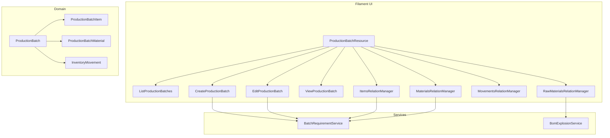
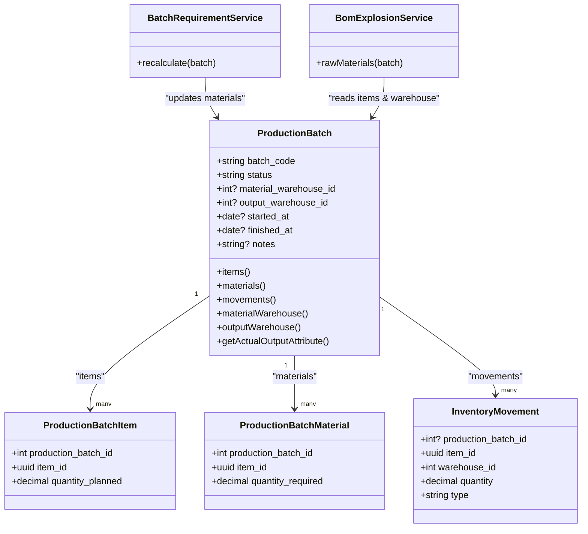
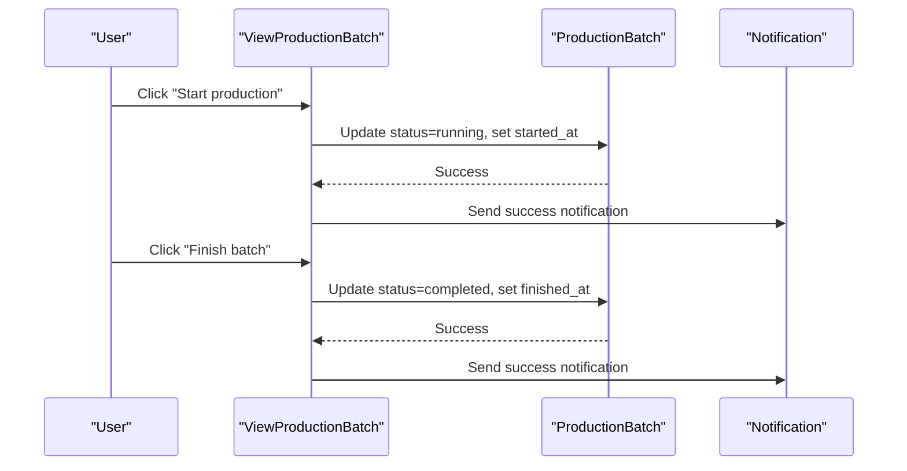
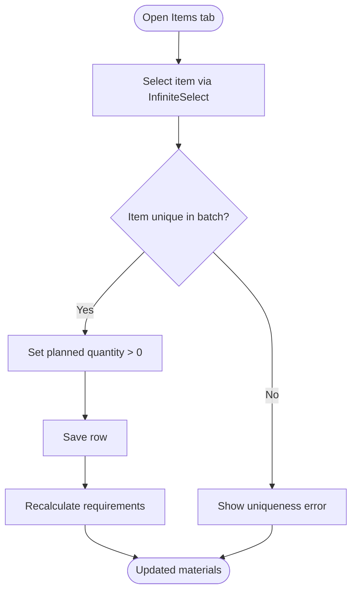
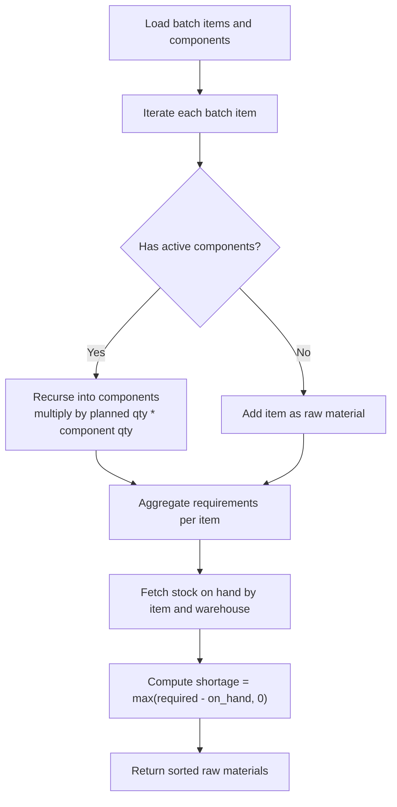
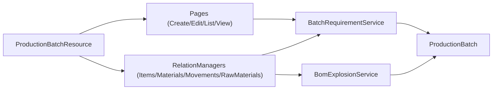

# Production Batch Resource

<cite>
**Referenced Files in This Document**
- [ProductionBatchResource.php](file://app/Filament/Resources/ProductionBatches/ProductionBatchResource.php)
- [CreateProductionBatch.php](file://app/Filament/Resources/ProductionBatches/Pages/CreateProductionBatch.php)
- [EditProductionBatch.php](file://app/Filament/Resources/ProductionBatches/Pages/EditProductionBatch.php)
- [ListProductionBatches.php](file://app/Filament/Resources/ProductionBatches/Pages/ListProductionBatches.php)
- [ViewProductionBatch.php](file://app/Filament/Resources/ProductionBatches/Pages/ViewProductionBatch.php)
- [ItemsRelationManager.php](file://app/Filament/Resources/ProductionBatches/RelationManagers/ItemsRelationManager.php)
- [MaterialsRelationManager.php](file://app/Filament/Resources/ProductionBatches/RelationManagers/MaterialsRelationManager.php)
- [MovementsRelationManager.php](file://app/Filament/Resources/ProductionBatches/RelationManagers/MovementsRelationManager.php)
- [RawMaterialsRelationManager.php](file://app/Filament/Resources/ProductionBatches/RelationManagers/RawMaterialsRelationManager.php)
- [ProductionBatch.php](file://app/Models/ProductionBatch.php)
- [BatchRequirementService.php](file://app/Services/BatchRequirementService.php)
- [BomExplosionService.php](file://app/Services/BomExplosionService.php)
- [2026_11_17_000002_create_production_batches_table.php](file://database/migrations/2026_11_17_000002_create_production_batches_table.php)
- [2026_11_17_000003_create_production_batch_items_table.php](file://database/migrations/2026_11_17_000003_create_production_batch_items_table.php)
- [2026_11_17_000004_create_production_batch_materials_table.php](file://database/migrations/2026_11_17_000004_create_production_batch_materials_table.php)
</cite>

## Table of Contents
1. Introduction
2. Project Structure
3. Core Components
4. Architecture Overview
5. Detailed Component Analysis
6. Dependency Analysis
7. Performance Considerations
8. Troubleshooting Guide
9. Conclusion

## Introduction
This document explains the ProductionBatchResource Filament resource and its complete production batch lifecycle management. It covers creation, editing, listing, viewing, and status transitions for batches, as well as four relation managers:
- ItemsRelationManager: finished goods planned and realized per batch
- MaterialsRelationManager: direct material requirements and variance
- MovementsRelationManager: inventory movements linked to a batch
- RawMaterialsRelationManager: exploded raw material requirements from BOM

It also documents form validation, business rules, integration with BatchRequirementService and BomExplosionService, and provides examples of planning workflows, material allocation, and progress tracking.

## Project Structure
The Production Batch feature is implemented as a Filament Resource with custom pages and relation managers. The model defines batch metadata, statuses, and relationships to items, materials, and movements. Services encapsulate requirement calculation and BOM explosion logic. Migrations define the core tables.

**Diagram sources**
- [ProductionBatchResource.php:33-195](file://app/Filament/Resources/ProductionBatches/ProductionBatchResource.php#L33-L195)
- [ListProductionBatches.php:9-19](file://app/Filament/Resources/ProductionBatches/Pages/ListProductionBatches.php#L9-L19)
- [CreateProductionBatch.php:10-28](file://app/Filament/Resources/ProductionBatches/Pages/CreateProductionBatch.php#L10-L28)
- [EditProductionBatch.php:9-17](file://app/Filament/Resources/ProductionBatches/Pages/EditProductionBatch.php#L9-L17)
- [ViewProductionBatch.php:21-165](file://app/Filament/Resources/ProductionBatches/Pages/ViewProductionBatch.php#L21-L165)
- [ItemsRelationManager.php:20-113](file://app/Filament/Resources/ProductionBatches/RelationManagers/ItemsRelationManager.php#L20-L113)
- [MaterialsRelationManager.php:15-102](file://app/Filament/Resources/ProductionBatches/RelationManagers/MaterialsRelationManager.php#L15-L102)
- [MovementsRelationManager.php:10-55](file://app/Filament/Resources/ProductionBatches/RelationManagers/MovementsRelationManager.php#L10-L55)
- [RawMaterialsRelationManager.php:15-82](file://app/Filament/Resources/ProductionBatches/RelationManagers/RawMaterialsRelationManager.php#L15-L82)
- [ProductionBatch.php:22-116](file://app/Models/ProductionBatch.php#L22-L116)
- [BatchRequirementService.php:8-60](file://app/Services/BatchRequirementService.php#L8-L60)
- [BomExplosionService.php:11-157](file://app/Services/BomExplosionService.php#L11-L157)

**Section sources**
- [ProductionBatchResource.php:33-195](file://app/Filament/Resources/ProductionBatches/ProductionBatchResource.php#L33-L195)
- [ProductionBatch.php:22-116](file://app/Models/ProductionBatch.php#L22-L116)

## Core Components
- ProductionBatchResource: central resource defining navigation, form schema, table columns/filters/actions, relations, and pages.
- Pages: List, Create, Edit, View for CRUD and operational actions (start, finish, recalculate).
- Relation Managers:
  - ItemsRelationManager: plan and edit finished goods per batch; enforces uniqueness and triggers requirement recalculation.
  - MaterialsRelationManager: displays computed material requirements, stock on hand, variance, shortage, and status.
  - MovementsRelationManager: lists inventory movements associated with the batch.
  - RawMaterialsRelationManager: shows exploded raw material requirements using BOM explosion service.
- Services:
  - BatchRequirementService: computes and persists required quantities per material based on active components.
  - BomExplosionService: recursively explodes BOM into raw materials and aggregates shortages against warehouse stock.

Key responsibilities and behaviors:
- Form validation:
  - Batch code unique across records.
  - Status is fixed via UI actions; default draft.
  - Finished goods item_id must be unique within a batch.
  - Planned quantity must be positive.
- Business rules:
  - Start and Finish actions update status and dates.
  - Requirement snapshots are recalculated whenever batch items change or explicitly requested.
  - Actual output is derived from explicit actual_output, production-in movements, or sum of item actual_quantity.
- Integration points:
  - BatchRequirementService is invoked after create/edit and on item changes.
  - BomExplosionService powers raw materials view.

**Section sources**
- [ProductionBatchResource.php:70-113](file://app/Filament/Resources/ProductionBatches/ProductionBatchResource.php#L70-L113)
- [ProductionBatchResource.php:115-175](file://app/Filament/Resources/ProductionBatches/ProductionBatchResource.php#L115-L175)
- [ProductionBatchResource.php:177-195](file://app/Filament/Resources/ProductionBatches/ProductionBatchResource.php#L177-L195)
- [ItemsRelationManager.php:26-70](file://app/Filament/Resources/ProductionBatches/RelationManagers/ItemsRelationManager.php#L26-L70)
- [ItemsRelationManager.php:73-113](file://app/Filament/Resources/ProductionBatches/RelationManagers/ItemsRelationManager.php#L73-L113)
- [MaterialsRelationManager.php:21-102](file://app/Filament/Resources/ProductionBatches/RelationManagers/MaterialsRelationManager.php#L21-L102)
- [MovementsRelationManager.php:16-55](file://app/Filament/Resources/ProductionBatches/RelationManagers/MovementsRelationManager.php#L16-L55)
- [RawMaterialsRelationManager.php:23-82](file://app/Filament/Resources/ProductionBatches/RelationManagers/RawMaterialsRelationManager.php#L23-L82)
- [ProductionBatch.php:94-115](file://app/Models/ProductionBatch.php#L94-L115)
- [BatchRequirementService.php:14-59](file://app/Services/BatchRequirementService.php#L14-L59)
- [BomExplosionService.php:22-107](file://app/Services/BomExplosionService.php#L22-L107)

## Architecture Overview
The system follows a layered approach:
- Presentation layer: Filament resources, pages, and relation managers.
- Domain layer: Eloquent models representing batches, items, materials, and movements.
- Service layer: BatchRequirementService and BomExplosionService encapsulating business logic.

**Diagram sources**
- [ProductionBatch.php:22-116](file://app/Models/ProductionBatch.php#L22-L116)
- [2026_11_17_000003_create_production_batch_items_table.php:14-26](file://database/migrations/2026_11_17_000003_create_production_batch_items_table.php#L14-L26)
- [2026_11_17_000004_create_production_batch_materials_table.php:14-26](file://database/migrations/2026_11_17_000004_create_production_batch_materials_table.php#L14-L26)
- [BatchRequirementService.php:14-59](file://app/Services/BatchRequirementService.php#L14-L59)
- [BomExplosionService.php:22-107](file://app/Services/BomExplosionService.php#L22-L107)

## Detailed Component Analysis

### ProductionBatchResource
Responsibilities:
- Defines navigation group, labels, icon, and badge showing running batches.
- Provides form schema for batch metadata including warehouses, dates, and notes.
- Configures table columns, filters, record actions, bulk delete, infinite scroll.
- Registers relation managers and page routes.

Validation and UX highlights:
- Batch code is required, unique, and defaults to a timestamped code.
- Status is disabled in form; changed via start/finish actions.
- Warehouse selectors are searchable and preloaded.

Table behavior:
- Aggregates planned quantity across items using an eager sum.
- Colors status badges consistently with model constants.

Relations:
- Items, Materials, Raw Materials, Movements.

Pages:
- index, create, view, edit.

**Section sources**
- [ProductionBatchResource.php:33-68](file://app/Filament/Resources/ProductionBatches/ProductionBatchResource.php#L33-L68)
- [ProductionBatchResource.php:70-113](file://app/Filament/Resources/ProductionBatches/ProductionBatchResource.php#L70-L113)
- [ProductionBatchResource.php:115-175](file://app/Filament/Resources/ProductionBatches/ProductionBatchResource.php#L115-L175)
- [ProductionBatchResource.php:177-195](file://app/Filament/Resources/ProductionBatches/ProductionBatchResource.php#L177-L195)

### CreateProductionBatch Page
Behavior:
- After creating a batch, it recalculates material requirements via BatchRequirementService.
- Redirects to the batch view page.

Integration:
- Ensures initial material snapshot is consistent with planned items.

**Section sources**
- [CreateProductionBatch.php:10-28](file://app/Filament/Resources/ProductionBatches/Pages/CreateProductionBatch.php#L10-L28)
- [BatchRequirementService.php:14-59](file://app/Services/BatchRequirementService.php#L14-L59)

### EditProductionBatch Page
Behavior:
- After saving batch metadata, recalculates material requirements.

**Section sources**
- [EditProductionBatch.php:9-17](file://app/Filament/Resources/ProductionBatches/Pages/EditProductionBatch.php#L9-L17)
- [BatchRequirementService.php:14-59](file://app/Services/BatchRequirementService.php#L14-L59)

### ListProductionBatches Page
Behavior:
- Extends infinite scrolling list and adds a header action to create a new batch.

**Section sources**
- [ListProductionBatches.php:9-19](file://app/Filament/Resources/ProductionBatches/Pages/ListProductionBatches.php#L9-L19)

### ViewProductionBatch Page
Responsibilities:
- Displays batch info and production realization summary.
- Provides header actions:
  - Start production: sets status to running and started date.
  - Finish batch: sets status to completed and finished date.
  - Recalculate requirements: re-runs BatchRequirementService.
  - Import/export batch items.

Business rules enforced by UI:
- Start visible only when draft.
- Finish visible only when running.
- Notifications confirm state changes.

Progress tracking:
- Shows planned quantity, actual output, number of required materials, and count of materials with shortages.

**Section sources**
- [ViewProductionBatch.php:27-95](file://app/Filament/Resources/ProductionBatches/Pages/ViewProductionBatch.php#L27-L95)
- [ViewProductionBatch.php:97-165](file://app/Filament/Resources/ProductionBatches/Pages/ViewProductionBatch.php#L97-L165)
- [ProductionBatch.php:94-115](file://app/Models/ProductionBatch.php#L94-L115)

#### Sequence: Start and Finish Batch

**Diagram sources**
- [ViewProductionBatch.php:100-137](file://app/Filament/Resources/ProductionBatches/Pages/ViewProductionBatch.php#L100-L137)

### ItemsRelationManager (Finished Goods Tracking)
Form validation:
- Item selection uses InfiniteSelect with paginated options filtered to stockable, non-variant items.
- Uniqueness rule ensures each item appears at most once per batch.
- Planned quantity must be positive.

Table features:
- Displays item code/name, planned vs actual quantities, and difference with color coding.
- On create/edit/delete, recalculates requirements.

Business rules:
- Prevents duplicate items per batch.
- Triggers requirement recalculation to keep materials up to date.

**Section sources**
- [ItemsRelationManager.php:26-70](file://app/Filament/Resources/ProductionBatches/RelationManagers/ItemsRelationManager.php#L26-L70)
- [ItemsRelationManager.php:73-113](file://app/Filament/Resources/ProductionBatches/RelationManagers/ItemsRelationManager.php#L73-L113)

#### Flowchart: Add/Edit Finished Good

**Diagram sources**
- [ItemsRelationManager.php:30-69](file://app/Filament/Resources/ProductionBatches/RelationManagers/ItemsRelationManager.php#L30-L69)
- [ItemsRelationManager.php:96-112](file://app/Filament/Resources/ProductionBatches/RelationManagers/ItemsRelationManager.php#L96-L112)

### MaterialsRelationManager (Direct Material Requirements)
Display:
- Loads item components to show component counts.
- Columns include required quantity, actual consumption, stock on hand, variance, shortage, and status.
- Header action allows manual recalculation with user feedback.

Business rules:
- Empty state guides users to add finished goods and ensure BOM composition exists.
- Shortage and status reflect current vs required quantities.

**Section sources**
- [MaterialsRelationManager.php:21-102](file://app/Filament/Resources/ProductionBatches/RelationManagers/MaterialsRelationManager.php#L21-L102)

### MovementsRelationManager (Inventory Movements)
Display:
- Lists inventory movements linked to the batch with time, type, item, warehouse, quantity, reference, and note.
- Sorts by occurrence time descending.
- Empty state instructs users to record movements through the inventory movement menu selecting this batch.

**Section sources**
- [MovementsRelationManager.php:16-55](file://app/Filament/Resources/ProductionBatches/RelationManagers/MovementsRelationManager.php#L16-L55)

### RawMaterialsRelationManager (Exploded Raw Materials)
Display:
- Uses BomExplosionService to compute raw materials from nested BOMs.
- Shows required quantity, stock on hand, shortage, and status.
- Notes that stock deduction still uses direct materials; this view is informational.

Data computation:
- Aggregates requirements recursively while avoiding cycles.
- Joins stock balances for the batch’s material warehouse.

**Section sources**
- [RawMaterialsRelationManager.php:23-82](file://app/Filament/Resources/ProductionBatches/RelationManagers/RawMaterialsRelationManager.php#L23-L82)
- [BomExplosionService.php:22-107](file://app/Services/BomExplosionService.php#L22-L107)

#### Flowchart: BOM Explosion to Raw Materials

**Diagram sources**
- [BomExplosionService.php:22-107](file://app/Services/BomExplosionService.php#L22-L107)
- [BomExplosionService.php:114-156](file://app/Services/BomExplosionService.php#L114-L156)

## Dependency Analysis
Coupling and cohesion:
- ProductionBatchResource orchestrates UI and delegates business logic to services.
- Relation managers depend on services for requirement updates and BOM explosion.
- Models expose relationships used by both UI and services.

External dependencies:
- Filament components for forms, tables, actions, notifications.
- Laravel database transactions for safe requirement updates.

Potential circular dependencies:
- None observed between resource, pages, relation managers, models, and services.

**Diagram sources**
- [ProductionBatchResource.php:33-195](file://app/Filament/Resources/ProductionBatches/ProductionBatchResource.php#L33-L195)
- [CreateProductionBatch.php:10-28](file://app/Filament/Resources/ProductionBatches/Pages/CreateProductionBatch.php#L10-L28)
- [EditProductionBatch.php:9-17](file://app/Filament/Resources/ProductionBatches/Pages/EditProductionBatch.php#L9-L17)
- [ViewProductionBatch.php:97-165](file://app/Filament/Resources/ProductionBatches/Pages/ViewProductionBatch.php#L97-L165)
- [ItemsRelationManager.php:96-112](file://app/Filament/Resources/ProductionBatches/RelationManagers/ItemsRelationManager.php#L96-L112)
- [MaterialsRelationManager.php:85-102](file://app/Filament/Resources/ProductionBatches/RelationManagers/MaterialsRelationManager.php#L85-L102)
- [RawMaterialsRelationManager.php:62-82](file://app/Filament/Resources/ProductionBatches/RelationManagers/RawMaterialsRelationManager.php#L62-L82)
- [BatchRequirementService.php:14-59](file://app/Services/BatchRequirementService.php#L14-L59)
- [BomExplosionService.php:22-107](file://app/Services/BomExplosionService.php#L22-L107)
- [ProductionBatch.php:22-116](file://app/Models/ProductionBatch.php#L22-L116)

**Section sources**
- [ProductionBatchResource.php:33-195](file://app/Filament/Resources/ProductionBatches/ProductionBatchResource.php#L33-L195)
- [BatchRequirementService.php:14-59](file://app/Services/BatchRequirementService.php#L14-L59)
- [BomExplosionService.php:22-107](file://app/Services/BomExplosionService.php#L22-L107)

## Performance Considerations
- Use eager loading where possible:
  - BatchRequirementService loads items and their components before computing requirements.
  - BomExplosionService loads missing relationships and groups components efficiently.
- Avoid N+1 queries:
  - MaterialsRelationManager preloads item components for display.
  - RawMaterialsRelationManager aggregates requirements and fetches stock balances in bulk.
- Database transactions:
  - BatchRequirementService wraps requirement updates in a transaction to maintain consistency.
- Pagination and infinite scroll:
  - List page uses infinite scroll to improve responsiveness for large datasets.
- Computed attributes:
  - Actual output derivation avoids unnecessary DB calls by prioritizing stored values and movement sums.

[No sources needed since this section provides general guidance]

## Troubleshooting Guide
Common issues and resolutions:
- Duplicate item in batch:
  - Cause: Adding the same item twice to a batch.
  - Resolution: Ensure unique item selection; the form enforces uniqueness per batch.
- No material requirements shown:
  - Cause: No finished goods added or missing BOM components.
  - Resolution: Add finished goods and ensure items have active components; use Recalculate action.
- Shortage indicators not updating:
  - Cause: Stale requirement snapshot.
  - Resolution: Trigger Recalculate from Materials tab or View page.
- Actual output mismatch:
  - Cause: Missing actual_output or production-in movements.
  - Resolution: Record movements or update actual_output; the attribute falls back to movement sums and item actual_quantity.
- Raw materials empty:
  - Cause: No nested BOM down to raw materials.
  - Resolution: Define component hierarchy until reaching raw materials; then refresh Raw Materials tab.

Operational tips:
- Always recalculate after changing planned quantities or BOM structure.
- Use Start/Finish actions to control batch lifecycle and reporting periods.

**Section sources**
- [ItemsRelationManager.php:59-64](file://app/Filament/Resources/ProductionBatches/RelationManagers/ItemsRelationManager.php#L59-L64)
- [MaterialsRelationManager.php:85-102](file://app/Filament/Resources/ProductionBatches/RelationManagers/MaterialsRelationManager.php#L85-L102)
- [ViewProductionBatch.php:138-149](file://app/Filament/Resources/ProductionBatches/Pages/ViewProductionBatch.php#L138-L149)
- [ProductionBatch.php:99-115](file://app/Models/ProductionBatch.php#L99-L115)
- [RawMaterialsRelationManager.php:55-56](file://app/Filament/Resources/ProductionBatches/RelationManagers/RawMaterialsRelationManager.php#L55-L56)

## Conclusion
The ProductionBatchResource provides a comprehensive interface for managing production batches end-to-end. It integrates robust validation, clear business rules, and service-driven calculations to support planning, execution, and monitoring. Relation managers offer focused views for finished goods, direct materials, inventory movements, and exploded raw materials, enabling accurate material allocation and progress tracking throughout the production lifecycle.

[No sources needed since this section summarizes without analyzing specific files]