# Production Management Resources

<cite>
**Referenced Files in This Document**
- [ProductionBatchResource.php](file://app/Filament/Resources/ProductionBatches/ProductionBatchResource.php)
- [StockOpnameResource.php](file://app/Filament/Resources/StockOpnames/StockOpnameResource.php)
- [ItemsRelationManager.php](file://app/Filament/Resources/ProductionBatches/RelationManagers/ItemsRelationManager.php)
- [MaterialsRelationManager.php](file://app/Filament/Resources/ProductionBatches/RelationManagers/MaterialsRelationManager.php)
- [MovementsRelationManager.php](file://app/Filament/Resources/ProductionBatches/RelationManagers/MovementsRelationManager.php)
- [RawMaterialsRelationManager.php](file://app/Filament/Resources/ProductionBatches/RelationManagers/RawMaterialsRelationManager.php)
- [BatchRealization.php](file://app/Filament/Pages/BatchRealization.php)
- [BatchRealizationDetail.php](file://app/Filament/Pages/BatchRealizationDetail.php)
- [BomBuilder.php](file://app/Filament/Pages/BomBuilder.php)
- [ProductionBatch.php](file://app/Models/ProductionBatch.php)
- [ProductionBatchItem.php](file://app/Models/ProductionBatchItem.php)
- [ProductionBatchMaterial.php](file://app/Models/ProductionBatchMaterial.php)
- [StockOpname.php](file://app/Models/StockOpname.php)
- [BatchRequirementService.php](file://app/Services/BatchRequirementService.php)
- [BomExplosionService.php](file://app/Services/BomExplosionService.php)
- [StockOpnameService.php](file://app/Services/StockOpnameService.php)
</cite>

## Table of Contents
1. [Introduction](#introduction)
2. [Project Structure](#project-structure)
3. [Core Components](#core-components)
4. [Architecture Overview](#architecture-overview)
5. [Detailed Component Analysis](#detailed-component-analysis)
6. [Dependency Analysis](#dependency-analysis)
7. [Performance Considerations](#performance-considerations)
8. [Troubleshooting Guide](#troubleshooting-guide)
9. [Conclusion](#conclusion)

## Introduction
This document explains the production management resources and pages that support end-to-end manufacturing workflows: planning a production batch, calculating material requirements from Bill of Materials, tracking actual output and material usage through inventory movements, completing batches, and reconciling physical stock with system balances. It focuses on:

- ProductionBatchResource for production batch lifecycle management
- StockOpnameResource for stock reconciliation
- Specialized pages BatchRealization and BomBuilder
- Complex relationship managers ItemsRelationManager, MaterialsRelationManager, MovementsRelationManager, and RawMaterialsRelationManager
- Services BatchRequirementService, BomExplosionService, and StockOpnameService that implement core business logic

## Project Structure
The production management domain is implemented as Filament resources, relation managers, custom pages, Eloquent models, and services. The main entry points are:

- ProductionBatchResource: defines the batch form, table, filters, actions, and related tabs
- StockOpnameResource: defines the stock opname form, table, filters, actions, and related tabs
- BatchRealization and BatchRealizationDetail: reporting and drill-down for planned vs realized output and material usage
- BomBuilder: interactive Bill of Materials composition tool
- Models: ProductionBatch, ProductionBatchItem, ProductionBatchMaterial, StockOpname
- Services: BatchRequirementService, BomExplosionService, StockOpnameService

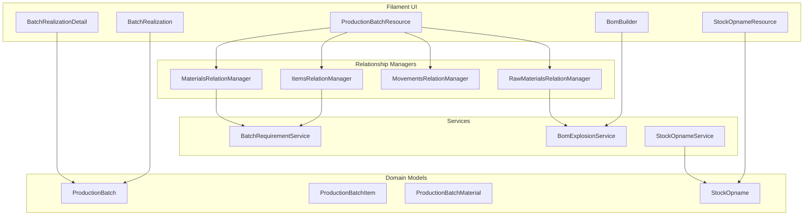

**Diagram sources**
- [ProductionBatchResource.php:33-196](file://app/Filament/Resources/ProductionBatches/ProductionBatchResource.php#L33-L196)
- [StockOpnameResource.php:27-205](file://app/Filament/Resources/StockOpnames/StockOpnameResource.php#L27-L205)
- [BatchRealization.php:19-111](file://app/Filament/Pages/BatchRealization.php#L19-L111)
- [BatchRealizationDetail.php:18-215](file://app/Filament/Pages/BatchRealizationDetail.php#L18-L215)
- [BomBuilder.php:26-800](file://app/Filament/Pages/BomBuilder.php#L26-L800)
- [ItemsRelationManager.php:20-113](file://app/Filament/Resources/ProductionBatches/RelationManagers/ItemsRelationManager.php#L20-L113)
- [MaterialsRelationManager.php:15-102](file://app/Filament/Resources/ProductionBatches/RelationManagers/MaterialsRelationManager.php#L15-L102)
- [MovementsRelationManager.php:10-55](file://app/Filament/Resources/ProductionBatches/RelationManagers/MovementsRelationManager.php#L10-L55)
- [RawMaterialsRelationManager.php:15-82](file://app/Filament/Resources/ProductionBatches/RelationManagers/RawMaterialsRelationManager.php#L15-L82)
- [BatchRequirementService.php:8-60](file://app/Services/BatchRequirementService.php#L8-L60)
- [BomExplosionService.php:11-157](file://app/Services/BomExplosionService.php#L11-L157)
- [StockOpnameService.php:14-170](file://app/Services/StockOpnameService.php#L14-L170)

**Section sources**
- [ProductionBatchResource.php:33-196](file://app/Filament/Resources/ProductionBatches/ProductionBatchResource.php#L33-L196)
- [StockOpnameResource.php:27-205](file://app/Filament/Resources/StockOpnames/StockOpnameResource.php#L27-L205)

## Core Components
- ProductionBatchResource: manages batch metadata (code, status, warehouses, dates, notes), lists batches with planned quantity aggregation, and exposes four relation managers for outputs, direct materials, raw materials, and inventory movements.
- StockOpnameResource: manages stock opname documents per warehouse, shows progress and differences, and exposes line and movement relation managers.
- Relationship managers:
  - ItemsRelationManager: plan produced items and quantities; triggers requirement recalculation.
  - MaterialsRelationManager: displays required vs used materials, stock on hand, shortage, and status; supports manual recalculation.
  - MovementsRelationManager: shows inventory movements linked to the batch or opname.
  - RawMaterialsRelationManager: shows exploded raw material requirements using BomExplosionService.
- Specialized pages:
  - BatchRealization: summary report comparing planned vs actual output and highlighting shortages.
  - BatchRealizationDetail: detailed breakdown of output realization and material usage with CSV export.
  - BomBuilder: interactive BOM builder with tree view, shopping list, template reuse, validation, and CSV export.
- Services:
  - BatchRequirementService: calculates and persists direct material requirements from active components.
  - BomExplosionService: recursively explodes BOM into raw materials and aggregates requirements with stock checks.
  - StockOpnameService: creates opname snapshots, posts adjustments, and cancels drafts safely.

**Section sources**
- [ProductionBatchResource.php:70-184](file://app/Filament/Resources/ProductionBatches/ProductionBatchResource.php#L70-L184)
- [StockOpnameResource.php:64-194](file://app/Filament/Resources/StockOpnames/StockOpnameResource.php#L64-L194)
- [ItemsRelationManager.php:26-112](file://app/Filament/Resources/ProductionBatches/RelationManagers/ItemsRelationManager.php#L26-L112)
- [MaterialsRelationManager.php:21-101](file://app/Filament/Resources/ProductionBatches/RelationManagers/MaterialsRelationManager.php#L21-L101)
- [MovementsRelationManager.php:16-54](file://app/Filament/Resources/ProductionBatches/RelationManagers/MovementsRelationManager.php#L16-L54)
- [RawMaterialsRelationManager.php:23-81](file://app/Filament/Resources/ProductionBatches/RelationManagers/RawMaterialsRelationManager.php#L23-L81)
- [BatchRequirementService.php:14-59](file://app/Services/BatchRequirementService.php#L14-L59)
- [BomExplosionService.php:22-107](file://app/Services/BomExplosionService.php#L22-L107)
- [StockOpnameService.php:21-134](file://app/Services/StockOpnameService.php#L21-L134)

## Architecture Overview
The production workflow connects user interfaces, models, and services:

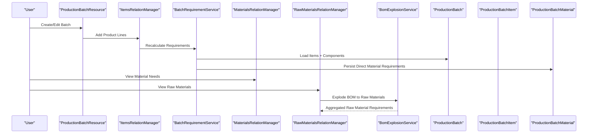

**Diagram sources**
- [ProductionBatchResource.php:177-184](file://app/Filament/Resources/ProductionBatches/ProductionBatchResource.php#L177-L184)
- [ItemsRelationManager.php:96-112](file://app/Filament/Resources/ProductionBatches/RelationManagers/ItemsRelationManager.php#L96-L112)
- [BatchRequirementService.php:14-59](file://app/Services/BatchRequirementService.php#L14-L59)
- [MaterialsRelationManager.php:85-100](file://app/Filament/Resources/ProductionBatches/RelationManagers/MaterialsRelationManager.php#L85-L100)
- [RawMaterialsRelationManager.php:62-81](file://app/Filament/Resources/ProductionBatches/RelationManagers/RawMaterialsRelationManager.php#L62-L81)
- [BomExplosionService.php:22-107](file://app/Services/BomExplosionService.php#L22-L107)

## Detailed Component Analysis

### ProductionBatchResource
- Purpose: Central hub for production batch planning and monitoring.
- Form fields: batch code, status, material warehouse, output warehouse, start/end dates, notes.
- Table columns: batch code, status badge with color mapping, planned quantity, warehouses, dates.
- Filters: status and material warehouse.
- Relations: ItemsRelationManager, MaterialsRelationManager, RawMaterialsRelationManager, MovementsRelationManager.
- Pages: index, create, view, edit.

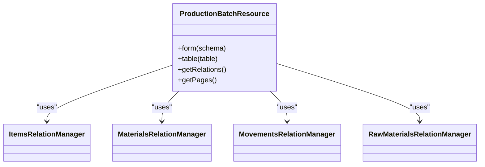

**Diagram sources**
- [ProductionBatchResource.php:70-184](file://app/Filament/Resources/ProductionBatches/ProductionBatchResource.php#L70-L184)

**Section sources**
- [ProductionBatchResource.php:70-184](file://app/Filament/Resources/ProductionBatches/ProductionBatchResource.php#L70-L184)

### StockOpnameResource
- Purpose: Manage stock opname documents per warehouse and track counting progress and differences.
- Form fields: warehouse selection (active only), note.
- Table columns: code, warehouse, status badge, counted lines progress, difference count, creator, created/completed timestamps.
- Filters: status, warehouse, date range.
- Actions: view, delete (draft only).
- Relations: LinesRelationManager, MovementsRelationManager.
- Pages: index, create, view.

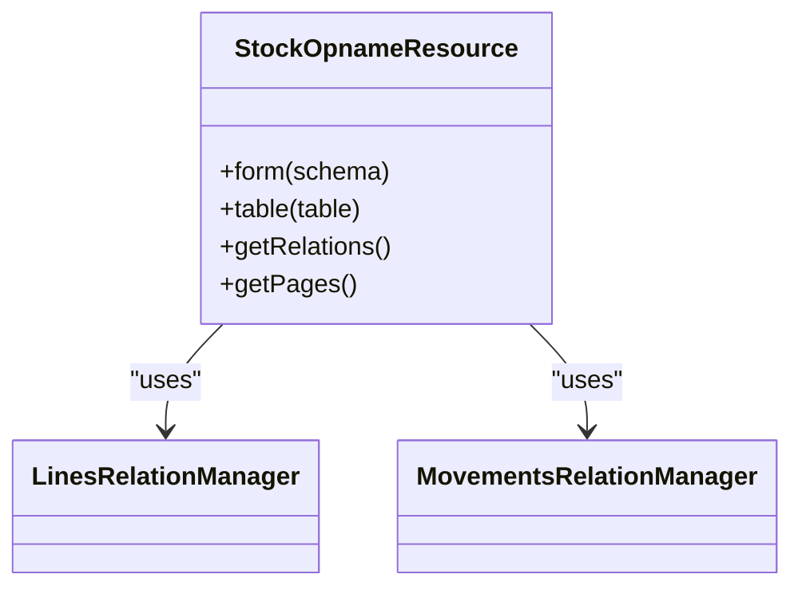

**Diagram sources**
- [StockOpnameResource.php:64-194](file://app/Filament/Resources/StockOpnames/StockOpnameResource.php#L64-L194)

**Section sources**
- [StockOpnameResource.php:64-194](file://app/Filament/Resources/StockOpnames/StockOpnameResource.php#L64-L194)

### Relationship Managers for Production Batches

#### ItemsRelationManager
- Manages planned output items per batch.
- Uses InfiniteSelect for large item lists.
- Ensures uniqueness of item per batch.
- On create/edit/delete, recalculates material requirements via BatchRequirementService.

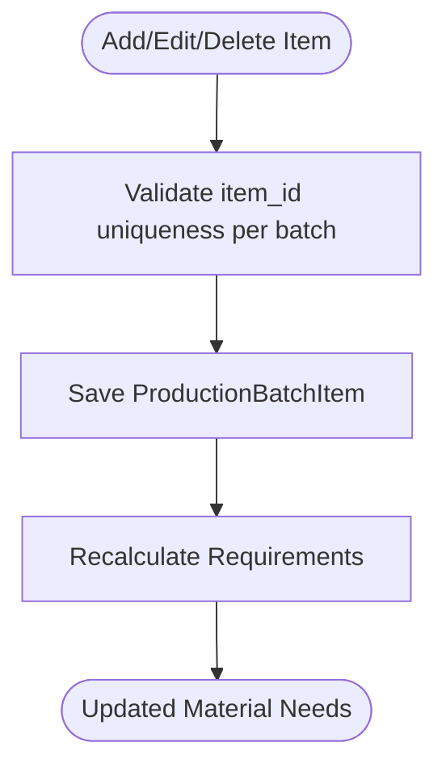

**Diagram sources**
- [ItemsRelationManager.php:26-112](file://app/Filament/Resources/ProductionBatches/RelationManagers/ItemsRelationManager.php#L26-L112)
- [BatchRequirementService.php:14-59](file://app/Services/BatchRequirementService.php#L14-L59)

**Section sources**
- [ItemsRelationManager.php:26-112](file://app/Filament/Resources/ProductionBatches/RelationManagers/ItemsRelationManager.php#L26-L112)

#### MaterialsRelationManager
- Displays direct material requirements, actual usage, stock on hand, variance, shortage, and status.
- Provides a manual recalculate action to refresh requirements.

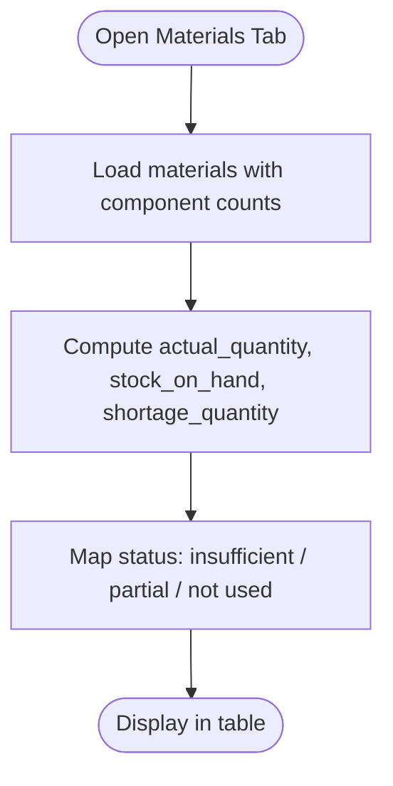

**Diagram sources**
- [MaterialsRelationManager.php:21-101](file://app/Filament/Resources/ProductionBatches/RelationManagers/MaterialsRelationManager.php#L21-L101)
- [ProductionBatchMaterial.php:41-72](file://app/Models/ProductionBatchMaterial.php#L41-L72)

**Section sources**
- [MaterialsRelationManager.php:21-101](file://app/Filament/Resources/ProductionBatches/RelationManagers/MaterialsRelationManager.php#L21-L101)
- [ProductionBatchMaterial.php:41-72](file://app/Models/ProductionBatchMaterial.php#L41-L72)

#### MovementsRelationManager
- Shows inventory movements associated with a production batch.
- Types are formatted and colored by incoming/outgoing semantics.

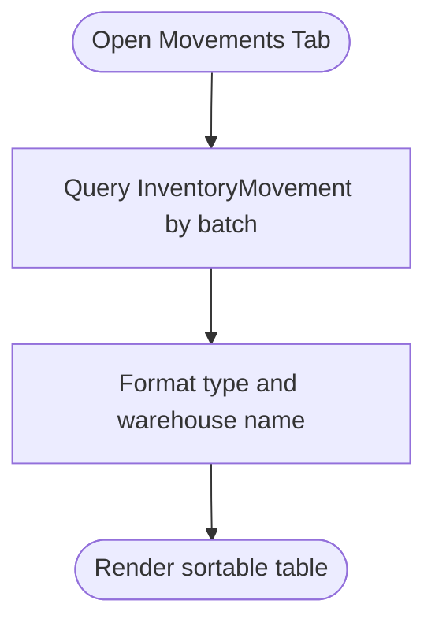

**Diagram sources**
- [MovementsRelationManager.php:16-54](file://app/Filament/Resources/ProductionBatches/RelationManagers/MovementsRelationManager.php#L16-L54)

**Section sources**
- [MovementsRelationManager.php:16-54](file://app/Filament/Resources/ProductionBatches/RelationManagers/MovementsRelationManager.php#L16-L54)

#### RawMaterialsRelationManager
- Presents exploded raw material requirements using BomExplosionService.
- Computes required quantity, stock on hand, shortage, and status per raw material.

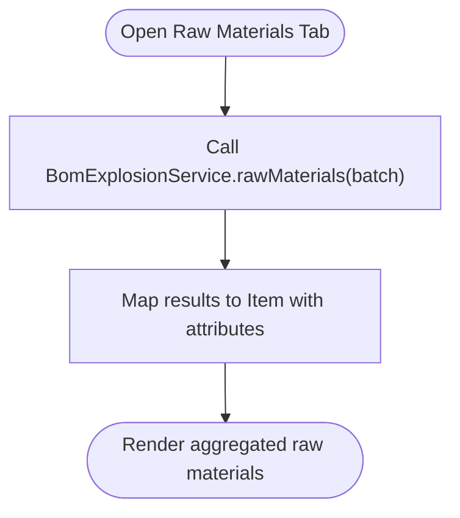

**Diagram sources**
- [RawMaterialsRelationManager.php:23-81](file://app/Filament/Resources/ProductionBatches/RelationManagers/RawMaterialsRelationManager.php#L23-L81)
- [BomExplosionService.php:22-107](file://app/Services/BomExplosionService.php#L22-L107)

**Section sources**
- [RawMaterialsRelationManager.php:23-81](file://app/Filament/Resources/ProductionBatches/RelationManagers/RawMaterialsRelationManager.php#L23-L81)
- [BomExplosionService.php:22-107](file://app/Services/BomExplosionService.php#L22-L107)

### BatchRealization and BatchRealizationDetail
- BatchRealization: summarizes planned vs actual output and highlights material shortages per batch.
- BatchRealizationDetail: provides detailed output realization and material realization with CSV export.

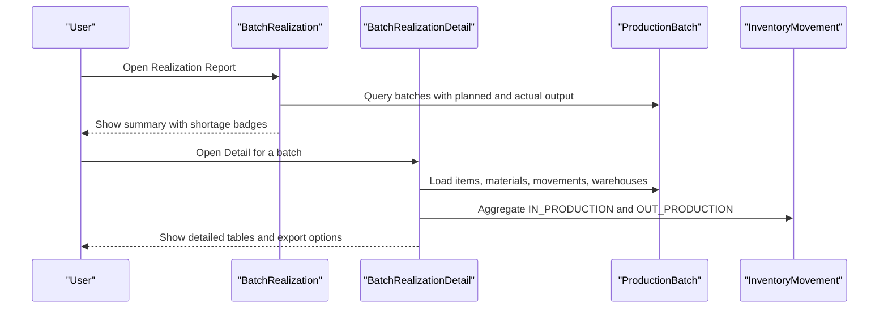

**Diagram sources**
- [BatchRealization.php:40-110](file://app/Filament/Pages/BatchRealization.php#L40-L110)
- [BatchRealizationDetail.php:30-147](file://app/Filament/Pages/BatchRealizationDetail.php#L30-L147)

**Section sources**
- [BatchRealization.php:40-110](file://app/Filament/Pages/BatchRealization.php#L40-L110)
- [BatchRealizationDetail.php:30-147](file://app/Filament/Pages/BatchRealizationDetail.php#L30-L147)

### BomBuilder
- Interactive page to compose and manage Bill of Materials.
- Supports selecting parent items, adding/removing components, reordering, toggling active status, setting quantities and notes.
- Validates against cycles, self-references, duplicates, and buildable items.
- Persists changes in transactions and marks dirty groups for efficient updates.
- Provides templates: copy existing BOM as template or apply template to target item.
- Exports current composition and shopping list to CSV.

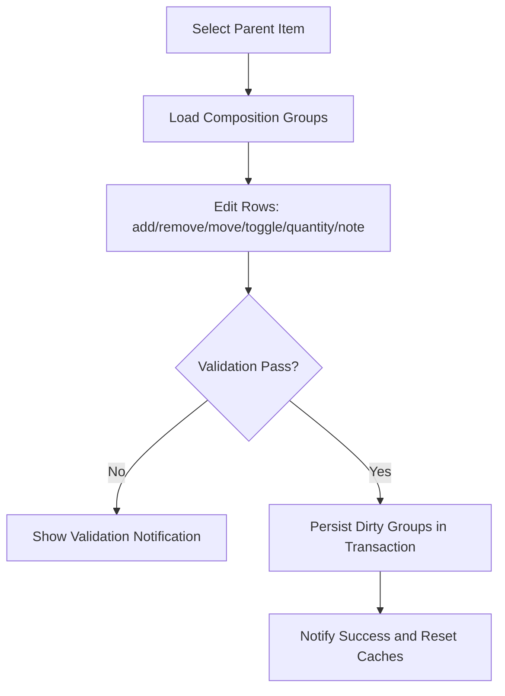

**Diagram sources**
- [BomBuilder.php:107-118](file://app/Filament/Pages/BomBuilder.php#L107-L118)
- [BomBuilder.php:291-332](file://app/Filament/Pages/BomBuilder.php#L291-L332)
- [BomBuilder.php:455-503](file://app/Filament/Pages/BomBuilder.php#L455-L503)
- [BomBuilder.php:553-612](file://app/Filament/Pages/BomBuilder.php#L553-L612)
- [BomBuilder.php:614-670](file://app/Filament/Pages/BomBuilder.php#L614-L670)

**Section sources**
- [BomBuilder.php:107-118](file://app/Filament/Pages/BomBuilder.php#L107-L118)
- [BomBuilder.php:291-332](file://app/Filament/Pages/BomBuilder.php#L291-L332)
- [BomBuilder.php:455-503](file://app/Filament/Pages/BomBuilder.php#L455-L503)
- [BomBuilder.php:553-612](file://app/Filament/Pages/BomBuilder.php#L553-L612)
- [BomBuilder.php:614-670](file://app/Filament/Pages/BomBuilder.php#L614-L670)

### Data Models and Relationships
- ProductionBatch: stores batch metadata, links to items, materials, movements, and warehouses.
- ProductionBatchItem: tracks planned quantity and computes actual output based on movements and balances.
- ProductionBatchMaterial: tracks required quantity, actual usage, stock on hand, and shortage.
- StockOpname: represents a stock reconciliation document with lines and movements.

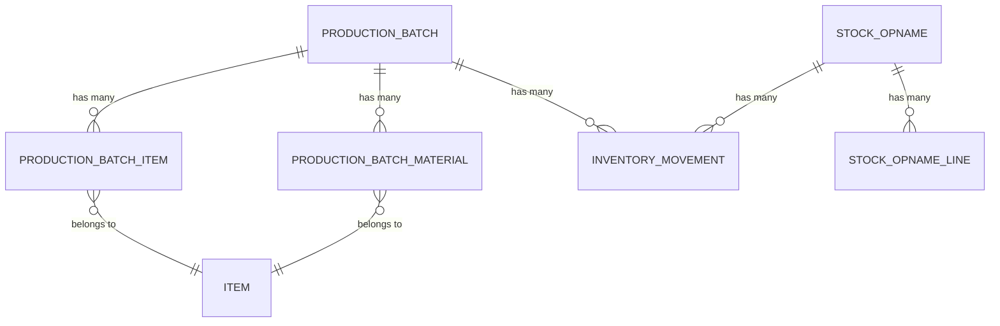

**Diagram sources**
- [ProductionBatch.php:59-87](file://app/Models/ProductionBatch.php#L59-L87)
- [ProductionBatchItem.php:31-73](file://app/Models/ProductionBatchItem.php#L31-L73)
- [ProductionBatchMaterial.php:31-72](file://app/Models/ProductionBatchMaterial.php#L31-L72)
- [StockOpname.php:54-77](file://app/Models/StockOpname.php#L54-L77)

**Section sources**
- [ProductionBatch.php:59-87](file://app/Models/ProductionBatch.php#L59-L87)
- [ProductionBatchItem.php:31-73](file://app/Models/ProductionBatchItem.php#L31-L73)
- [ProductionBatchMaterial.php:31-72](file://app/Models/ProductionBatchMaterial.php#L31-L72)
- [StockOpname.php:54-77](file://app/Models/StockOpname.php#L54-L77)

## Dependency Analysis
Key dependencies and interactions:

- ProductionBatchResource depends on its relation managers and pages.
- ItemsRelationManager and MaterialsRelationManager depend on BatchRequirementService to compute and persist direct material requirements.
- RawMaterialsRelationManager depends on BomExplosionService to compute raw material needs.
- BatchRealization and BatchRealizationDetail depend on ProductionBatch and InventoryMovement to calculate planned vs actual output and material usage.
- StockOpnameResource depends on StockOpnameService for creation, posting, and cancellation.

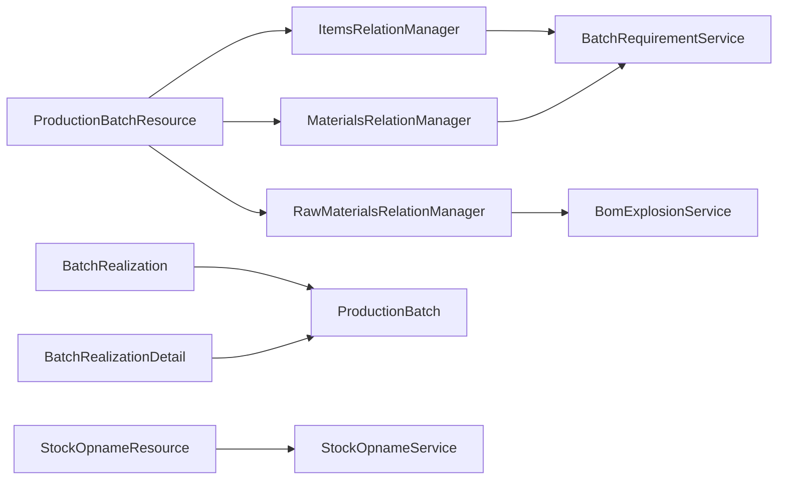

**Diagram sources**
- [ProductionBatchResource.php:177-184](file://app/Filament/Resources/ProductionBatches/ProductionBatchResource.php#L177-L184)
- [ItemsRelationManager.php:109-112](file://app/Filament/Resources/ProductionBatches/RelationManagers/ItemsRelationManager.php#L109-L112)
- [MaterialsRelationManager.php:85-97](file://app/Filament/Resources/ProductionBatches/RelationManagers/MaterialsRelationManager.php#L85-L97)
- [RawMaterialsRelationManager.php:62-81](file://app/Filament/Resources/ProductionBatches/RelationManagers/RawMaterialsRelationManager.php#L62-L81)
- [BatchRealization.php:40-110](file://app/Filament/Pages/BatchRealization.php#L40-L110)
- [BatchRealizationDetail.php:30-147](file://app/Filament/Pages/BatchRealizationDetail.php#L30-L147)
- [StockOpnameResource.php:189-194](file://app/Filament/Resources/StockOpnames/StockOpnameResource.php#L189-L194)

**Section sources**
- [ProductionBatchResource.php:177-184](file://app/Filament/Resources/ProductionBatches/ProductionBatchResource.php#L177-L184)
- [ItemsRelationManager.php:109-112](file://app/Filament/Resources/ProductionBatches/RelationManagers/ItemsRelationManager.php#L109-L112)
- [MaterialsRelationManager.php:85-97](file://app/Filament/Resources/ProductionBatches/RelationManagers/MaterialsRelationManager.php#L85-L97)
- [RawMaterialsRelationManager.php:62-81](file://app/Filament/Resources/ProductionBatches/RelationManagers/RawMaterialsRelationManager.php#L62-L81)
- [BatchRealization.php:40-110](file://app/Filament/Pages/BatchRealization.php#L40-L110)
- [BatchRealizationDetail.php:30-147](file://app/Filament/Pages/BatchRealizationDetail.php#L30-L147)
- [StockOpnameResource.php:189-194](file://app/Filament/Resources/StockOpnames/StockOpnameResource.php#L189-L194)

## Performance Considerations
- Use paginated InfiniteSelect for large item lists to reduce payload size and improve responsiveness.
- Prefer aggregate queries (withSum, withCount) in tables to avoid N+1 issues.
- Cache computed summaries within page state where appropriate (e.g., BomBuilder caches rows, item data, summary, and shopping list).
- Use database transactions for bulk writes to ensure consistency and reduce lock contention.
- Avoid unnecessary reloads by marking only dirty groups in BomBuilder and resetting caches selectively.

[No sources needed since this section provides general guidance]

## Troubleshooting Guide
- Material shortage indicators:
  - If MaterialsRelationManager shows “Kurang”, verify that BatchRequirementService was triggered after updating product lines and that item components are active.
  - Check stock on hand in the configured material warehouse.
- Actual output discrepancies:
  - Ensure inventory movements are recorded with correct types (IN_PRODUCTION for output, OUT_PRODUCTION for material usage).
  - Confirm that MovementRelationManager filters and sorts correctly.
- Stock opname posting errors:
  - Posting requires at least one counted line; otherwise, StockOpnameService throws validation errors.
  - Only draft opnames can be posted or cancelled; check status before attempting operations.
- BOM validation failures:
  - Self-reference and cycle detection will prevent invalid compositions; review hierarchy and remove circular dependencies.
  - Duplicate components under the same parent are rejected; consolidate or reorder rows.

**Section sources**
- [MaterialsRelationManager.php:71-83](file://app/Filament/Resources/ProductionBatches/RelationManagers/MaterialsRelationManager.php#L71-L83)
- [MovementsRelationManager.php:24-28](file://app/Filament/Resources/ProductionBatches/RelationManagers/MovementsRelationManager.php#L24-L28)
- [StockOpnameService.php:67-87](file://app/Services/StockOpnameService.php#L67-L87)
- [StockOpnameService.php:139-154](file://app/Services/StockOpnameService.php#L139-L154)
- [BomBuilder.php:455-503](file://app/Filament/Pages/BomBuilder.php#L455-L503)
- [BomBuilder.php:553-612](file://app/Filament/Pages/BomBuilder.php#L553-L612)

## Conclusion
The production management resources provide a cohesive system for planning, executing, and closing production batches while maintaining accurate material requirements and inventory records. Relationship managers expose clear views of planned outputs, direct materials, raw materials, and movements. Specialized pages enable comprehensive reporting and interactive BOM construction. Services encapsulate complex calculations and ensure data integrity through transactions and validations. Together, these components deliver a robust foundation for production planning, execution, and reconciliation.

[No sources needed since this section summarizes without analyzing specific files]