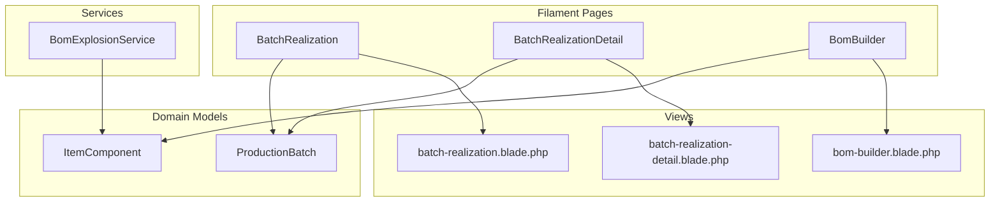
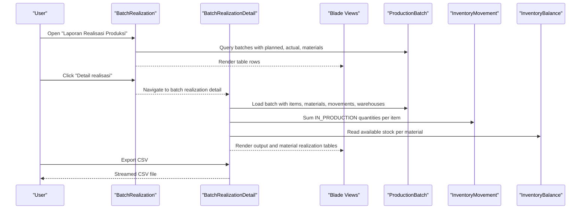
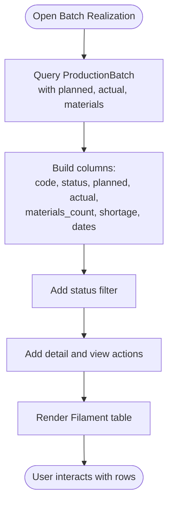
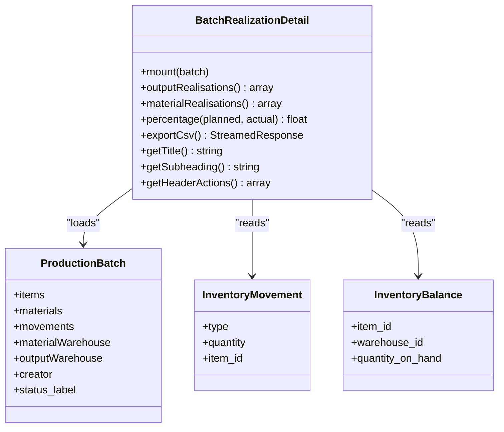
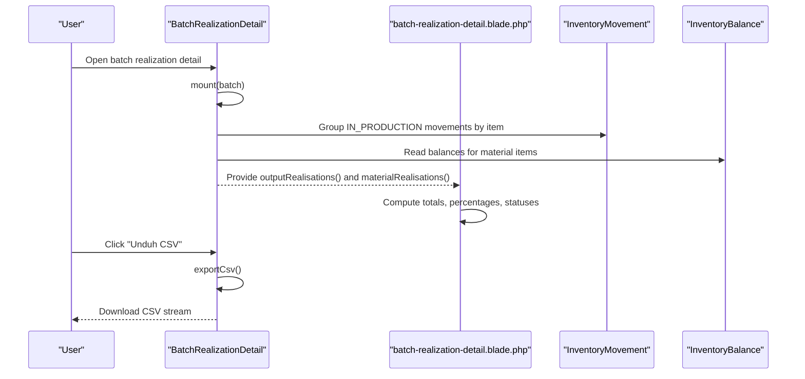
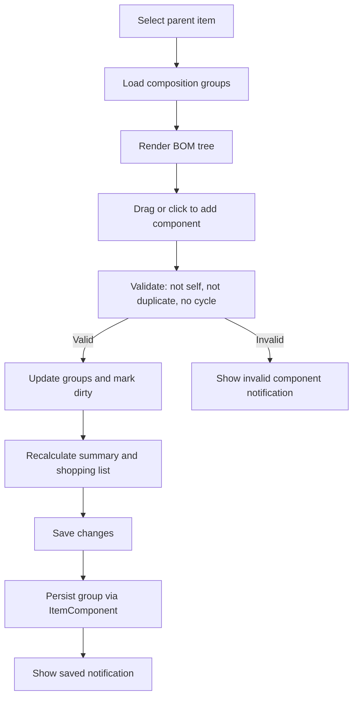
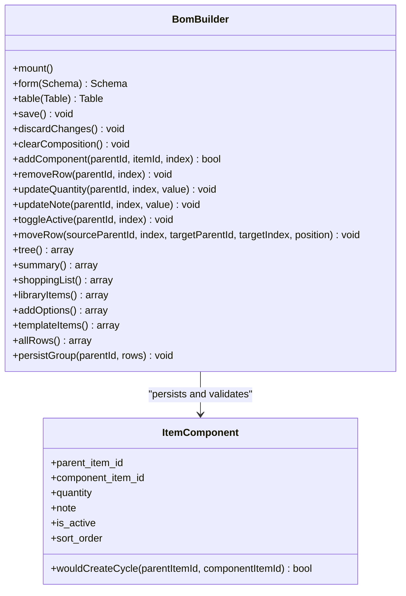
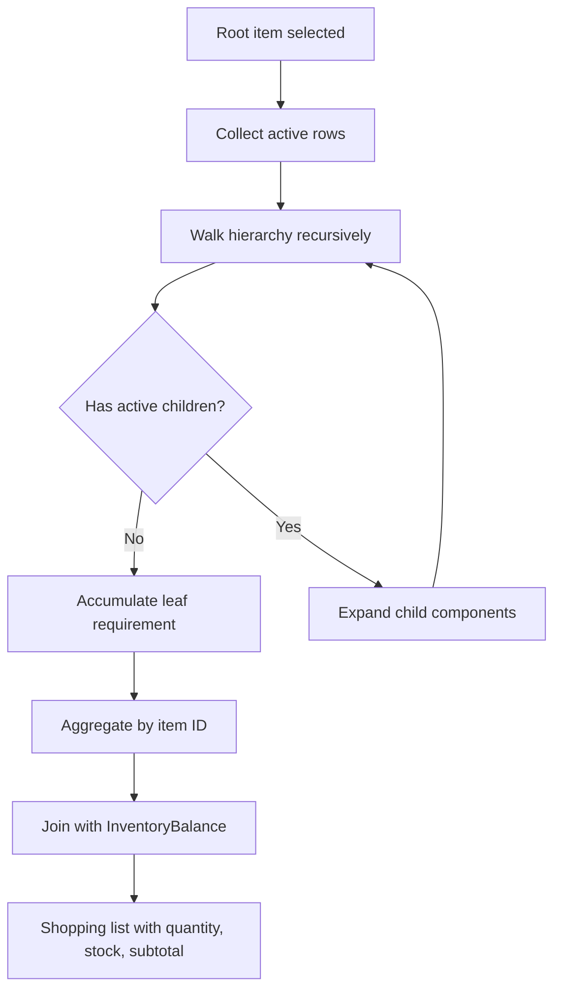
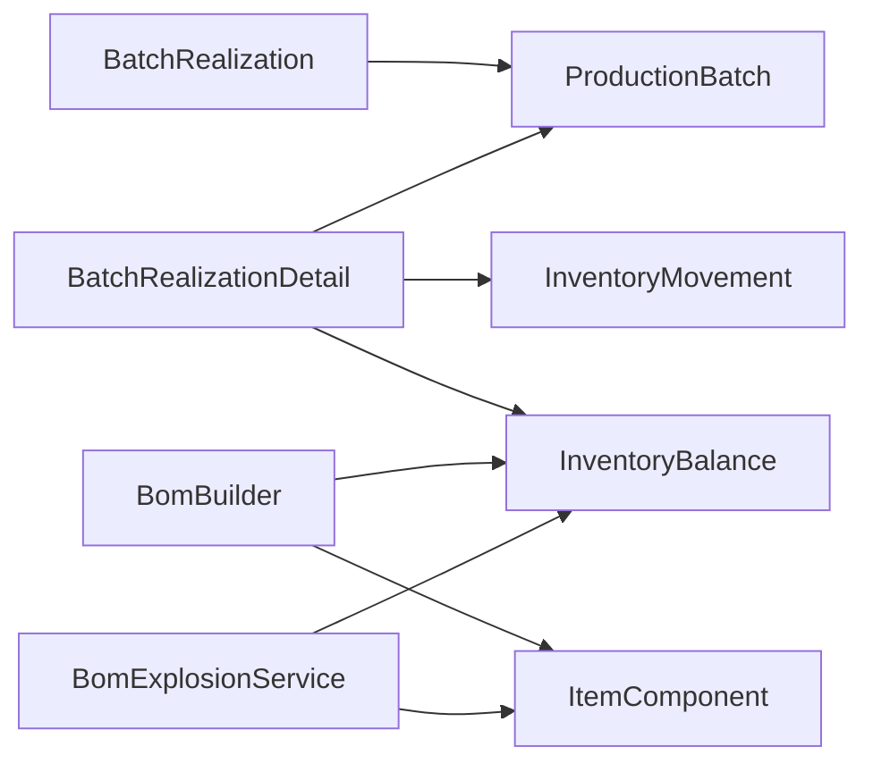

# Specialized Production Pages

<cite>
**Referenced Files in This Document**   
- [BatchRealization.php](file://app/Filament/Pages/BatchRealization.php)
- [batch-realization.blade.php](file://resources/views/filament/pages/batch-realization.blade.php)
- [BatchRealizationDetail.php](file://app/Filament/Pages/BatchRealizationDetail.php)
- [batch-realization-detail.blade.php](file://resources/views/filament/pages/batch-realization-detail.blade.php)
- [BomBuilder.php](file://app/Filament/Pages/BomBuilder.php)
- [bom-builder.blade.php](file://resources/views/filament/pages/bom-builder.blade.php)
- [ProductionBatch.php](file://app/Models/ProductionBatch.php)
- [ItemComponent.php](file://app/Models/ItemComponent.php)
- [BomExplosionService.php](file://app/Services/BomExplosionService.php)
</cite>

## Table of Contents
1. [Introduction](#introduction)
2. [Project Structure](#project-structure)
3. [Core Components](#core-components)
4. [Architecture Overview](#architecture-overview)
5. [Detailed Component Analysis](#detailed-component-analysis)
6. [Dependency Analysis](#dependency-analysis)
7. [Performance Considerations](#performance-considerations)
8. [Troubleshooting Guide](#troubleshooting-guide)
9. [Conclusion](#conclusion)

## Introduction
This document explains three specialized production workflow pages:

- **Batch Realization**: a summary report comparing planned versus realized production output per batch, including material shortage indicators.
- **Batch Realization Detail**: a detailed view for one production batch showing planned vs realized output and required vs used materials, with CSV export and print support.
- **BOM Builder**: an interactive Bill of Materials builder where users construct hierarchical item compositions, calculate material requirements, preview shopping lists, validate cycles, and persist component structures.

These pages are Filament admin pages backed by Blade views and Laravel models. They integrate with inventory balances, inventory movements, warehouses, items, and item components to support production planning, execution tracking, and completion reporting.

## Project Structure
The relevant code is organized into Filament pages, Blade views, Eloquent models, and a BOM explosion service:

**Diagram sources**
- [BatchRealization.php:19-110](file://app/Filament/Pages/BatchRealization.php#L19-L110)
- [BatchRealizationDetail.php:18-77](file://app/Filament/Pages/BatchRealizationDetail.php#L18-L77)
- [BomBuilder.php:26-42](file://app/Filament/Pages/BomBuilder.php#L26-L42)
- [batch-realization.blade.php:1-4](file://resources/views/filament/pages/batch-realization.blade.php#L1-L4)
- [batch-realization-detail.blade.php:1-264](file://resources/views/filament/pages/batch-realization-detail.blade.php#L1-L264)
- [bom-builder.blade.php:1-1348](file://resources/views/filament/pages/bom-builder.blade.php#L1-L1348)
- [ProductionBatch.php:22-116](file://app/Models/ProductionBatch.php#L22-L116)
- [ItemComponent.php:19-85](file://app/Models/ItemComponent.php#L19-L85)
- [BomExplosionService.php:11-158](file://app/Services/BomExplosionService.php#L11-L158)

**Section sources**
- [BatchRealization.php:19-110](file://app/Filament/Pages/BatchRealization.php#L19-L110)
- [BatchRealizationDetail.php:18-77](file://app/Filament/Pages/BatchRealizationDetail.php#L18-L77)
- [BomBuilder.php:26-42](file://app/Filament/Pages/BomBuilder.php#L26-L42)

## Core Components
- **BatchRealization** renders a table of production batches with planned quantity, actual output, material type count, and shortage badge. It provides actions to open the detail page or the standard batch view.
- **BatchRealizationDetail** loads a single batch with related items, materials, movements, warehouses, and creator. It computes output realizations and material realizations, then exposes them to the Blade view for display and CSV export.
- **BomBuilder** provides an interactive BOM editor with a library of stockable items, template reuse, drag-and-drop tree editing, cost summaries, shopping list calculation against inventory balances, cycle validation, and persistence to `ItemComponent`.

**Section sources**
- [BatchRealization.php:35-110](file://app/Filament/Pages/BatchRealization.php#L35-L110)
- [BatchRealizationDetail.php:28-77](file://app/Filament/Pages/BatchRealizationDetail.php#L28-L77)
- [BomBuilder.php:44-118](file://app/Filament/Pages/BomBuilder.php#L44-L118)

## Architecture Overview
The pages follow a layered pattern:

- Page classes define UI state, actions, queries, and data transformations.
- Blade views render tables, sections, forms, and interactive trees.
- Models encapsulate domain entities such as production batches and item components.
- Services compute derived data like raw material requirements from exploded BOMs.

**Diagram sources**
- [BatchRealization.php:40-110](file://app/Filament/Pages/BatchRealization.php#L40-L110)
- [BatchRealizationDetail.php:30-77](file://app/Filament/Pages/BatchRealizationDetail.php#L30-L77)
- [batch-realization-detail.blade.php:52-262](file://resources/views/filament/pages/batch-realization-detail.blade.php#L52-L262)

## Detailed Component Analysis

### Batch Realization Report
The report page shows a paginated table of production batches. Each row includes:

- Batch code and status badge.
- Planned output aggregated from batch items.
- Actual output aggregated from inventory movements marked as production input.
- Number of material types.
- Shortage badge counting materials with positive shortage.
- Start and finish dates.
- Actions to open the detail page or the standard batch view.

Key behaviors:

- The query uses eager aggregation for planned quantity, actual output, and material count.
- Status labels and colors come from production batch status options.
- Shortage is computed by filtering materials with positive shortage values.

**Diagram sources**
- [BatchRealization.php:40-110](file://app/Filament/Pages/BatchRealization.php#L40-L110)

**Section sources**
- [BatchRealization.php:19-110](file://app/Filament/Pages/BatchRealization.php#L19-L110)
- [batch-realization.blade.php:1-4](file://resources/views/filament/pages/batch-realization.blade.php#L1-L4)
- [ProductionBatch.php:27-57](file://app/Models/ProductionBatch.php#L27-L57)

### Batch Realization Detail
The detail page focuses on one production batch. It displays:

- A batch summary section with code, status, creator, material warehouse, output warehouse, date range, notes, and overall achievement percentage.
- An output realization table comparing planned vs realized quantities per finished item, including difference and percentage.
- A material realization table comparing required vs used quantities, remaining need, stock shortage, and usage status.
- Header actions for CSV export, printing, and returning to the report.

Data computation highlights:

- Output realization aggregates movement quantities by item and falls back to batch item actual quantity when no movement exists.
- Material realization aggregates used quantities from OUT_PRODUCTION movements, reads current inventory balance optionally filtered by the batch’s material warehouse, and calculates remaining need and shortage.
- Percentage calculation guards against zero planned values.

CSV export writes:

- Batch header metadata.
- Output realization rows.
- Material realization rows.
- UTF-8 BOM for correct Indonesian character rendering in Excel.

**Diagram sources**
- [BatchRealizationDetail.php:18-214](file://app/Filament/Pages/BatchRealizationDetail.php#L18-L214)
- [ProductionBatch.php:59-116](file://app/Models/ProductionBatch.php#L59-L116)

**Diagram sources**
- [BatchRealizationDetail.php:30-77](file://app/Filament/Pages/BatchRealizationDetail.php#L30-L77)
- [BatchRealizationDetail.php:84-156](file://app/Filament/Pages/BatchRealizationDetail.php#L84-L156)
- [BatchRealizationDetail.php:158-213](file://app/Filament/Pages/BatchRealizationDetail.php#L158-L213)
- [batch-realization-detail.blade.php:5-262](file://resources/views/filament/pages/batch-realization-detail.blade.php#L5-L262)

**Section sources**
- [BatchRealizationDetail.php:18-214](file://app/Filament/Pages/BatchRealizationDetail.php#L18-L214)
- [batch-realization-detail.blade.php:1-264](file://resources/views/filament/pages/batch-realization-detail.blade.php#L1-L264)

### BOM Builder
The BOM Builder is the most complex page. It supports:

- Selecting a parent item through an infinite select form field.
- Loading existing composition groups from `ItemComponent`.
- Displaying a library of stockable items grouped by type.
- Reusing templates from other items that already have components.
- Drag-and-drop tree editing with before/after/in placement.
- Inline editing of quantity, note, active flag, and collapse state.
- Summary statistics: per-unit cost, total cost for production quantity, row count, leaf component count, and maximum level.
- Shopping list calculation aggregating leaf requirements and comparing with inventory balances.
- Validation preventing self-references, duplicate components, and cyclic relationships.
- Persistence wrapped in a database transaction, updating, creating, or deleting `ItemComponent` records.

#### Interactive Building Workflow

**Diagram sources**
- [BomBuilder.php:107-118](file://app/Filament/Pages/BomBuilder.php#L107-L118)
- [BomBuilder.php:455-503](file://app/Filament/Pages/BomBuilder.php#L455-L503)
- [BomBuilder.php:1321-1407](file://app/Filament/Pages/BomBuilder.php#L1321-L1407)
- [BomBuilder.php:1412-1455](file://app/Filament/Pages/BomBuilder.php#L1412-L1455)

#### Data Structures and Complexity
- Groups are stored as nested arrays keyed by parent item ID, each containing component rows with component item ID, quantity, note, active flag, and sort order.
- Tree rendering walks active rows recursively while limiting depth and avoiding cycles.
- Cost calculation memoizes unit costs per item to avoid recomputation across the hierarchy.
- Shopping list traversal accumulates leaf requirements and merges quantities by item ID.

Complexity considerations:

- Tree walk is proportional to the number of active component rows.
- Unit cost recursion is bounded by hierarchy depth and protected by ancestor stack checks.
- Shopping list recursion is bounded by path length and a hard limit to prevent excessive nesting.

**Diagram sources**
- [BomBuilder.php:26-118](file://app/Filament/Pages/BomBuilder.php#L26-L118)
- [BomBuilder.php:455-612](file://app/Filament/Pages/BomBuilder.php#L455-L612)
- [BomBuilder.php:810-903](file://app/Filament/Pages/BomBuilder.php#L810-L903)
- [BomBuilder.php:910-991](file://app/Filament/Pages/BomBuilder.php#L910-L991)
- [BomBuilder.php:1070-1162](file://app/Filament/Pages/BomBuilder.php#L1070-L1162)
- [BomBuilder.php:1412-1455](file://app/Filament/Pages/BomBuilder.php#L1412-L1455)
- [ItemComponent.php:19-85](file://app/Models/ItemComponent.php#L19-L85)

#### Material Requirement Calculations
The BOM Builder calculates:

- Per-unit cost by summing active component quantities multiplied by their recursive unit cost.
- Total cost by multiplying per-unit cost by the production quantity.
- Shopping list by walking the active BOM tree, accumulating leaf requirements, and joining with inventory balances to show stock levels and estimated cost.

Material requirement logic in the BOM Builder differs from the production batch raw material calculation:

- BOM Builder focuses on building and validating item compositions and estimating costs and purchases.
- `BomExplosionService.rawMaterials` explodes planned batch items into raw materials and compares required quantities with inventory balances to compute shortages.

**Diagram sources**
- [BomBuilder.php:910-991](file://app/Filament/Pages/BomBuilder.php#L910-L991)
- [BomBuilder.php:1070-1162](file://app/Filament/Pages/BomBuilder.php#L1070-L1162)

**Section sources**
- [BomBuilder.php:26-118](file://app/Filament/Pages/BomBuilder.php#L26-L118)
- [BomBuilder.php:455-612](file://app/Filament/Pages/BomBuilder.php#L455-L612)
- [BomBuilder.php:810-991](file://app/Filament/Pages/BomBuilder.php#L810-L991)
- [BomBuilder.php:1070-1162](file://app/Filament/Pages/BomBuilder.php#L1070-L1162)
- [BomBuilder.php:1321-1455](file://app/Filament/Pages/BomBuilder.php#L1321-L1455)
- [bom-builder.blade.php:1-1348](file://resources/views/filament/pages/bom-builder.blade.php#L1-L1348)
- [BomExplosionService.php:22-107](file://app/Services/BomExplosionService.php#L22-L107)

## Dependency Analysis
The pages depend on shared domain concepts:

- Production batch status and relationships drive report and detail views.
- Inventory movements provide actual production output and material consumption.
- Inventory balances provide current stock levels for shortage and shopping list calculations.
- Item components store hierarchical BOM structures and include cycle detection helpers.

**Diagram sources**
- [BatchRealization.php:40-110](file://app/Filament/Pages/BatchRealization.php#L40-L110)
- [BatchRealizationDetail.php:84-156](file://app/Filament/Pages/BatchRealizationDetail.php#L84-L156)
- [BomBuilder.php:910-991](file://app/Filament/Pages/BomBuilder.php#L910-L991)
- [BomExplosionService.php:22-107](file://app/Services/BomExplosionService.php#L22-L107)

**Section sources**
- [BatchRealization.php:40-110](file://app/Filament/Pages/BatchRealization.php#L40-L110)
- [BatchRealizationDetail.php:84-156](file://app/Filament/Pages/BatchRealizationDetail.php#L84-L156)
- [BomBuilder.php:910-991](file://app/Filament/Pages/BomBuilder.php#L910-L991)
- [BomExplosionService.php:22-107](file://app/Services/BomExplosionService.php#L22-L107)

## Performance Considerations
- Use eager loading for batch relationships to reduce N+1 queries in report and detail pages.
- Cache computed results within the BOM Builder session state using private caches for all rows, item map, summary, and shopping list.
- Limit recursion depth and path length during BOM traversal to prevent excessive memory use.
- Prefer grouped queries for aggregating movement quantities and inventory balances.
- Stream CSV exports instead of building large in-memory strings.

[No sources needed since this section provides general guidance]

## Troubleshooting Guide
Common issues and resolutions:

- **No production output recorded**: Check whether inventory movements exist with the production input type for the batch. The detail page falls back to batch item actual quantity only when no movement is present.
- **Material shortage shown**: Compare required material quantities from the BOM with current inventory balances at the material warehouse. Resolve shortages by procuring materials or adjusting planned quantities.
- **Cannot add component**: Ensure the component is not the same as the parent, is not already present in the assembly, and does not create a cycle. The page shows a danger notification and marks the groups field invalid.
- **Duplicate component in assembly**: The save validation rejects assemblies with repeated component IDs under the same parent.
- **Cyclic composition detected**: Both the BOM Builder and `ItemComponent.wouldCreateCycle` detect cycles; remove or reorder components to break the loop.
- **Unsaved changes warning**: Changing the parent item without saving triggers a warning about discarded previous changes.

**Section sources**
- [BatchRealizationDetail.php:84-156](file://app/Filament/Pages/BatchRealizationDetail.php#L84-L156)
- [BomBuilder.php:455-503](file://app/Filament/Pages/BomBuilder.php#L455-L503)
- [BomBuilder.php:1321-1407](file://app/Filament/Pages/BomBuilder.php#L1321-L1407)
- [ItemComponent.php:50-84](file://app/Models/ItemComponent.php#L50-L84)

## Conclusion
The specialized production pages provide a cohesive workflow:

- Build and validate hierarchical BOMs interactively.
- Plan production batches with expected outputs and material needs.
- Track actual output and material usage through inventory movements.
- Review completion reports with clear metrics and export capabilities.
- Integrate inventory balances to estimate purchasing needs and identify shortages.

Together, these pages connect user interactions with domain data to support accurate production planning, execution, and reporting.