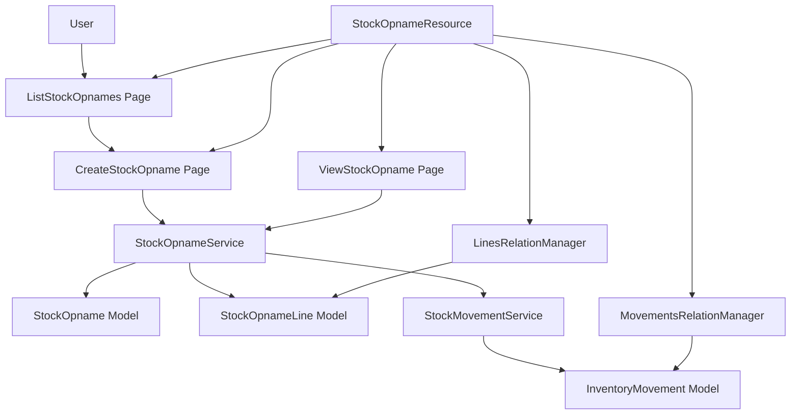
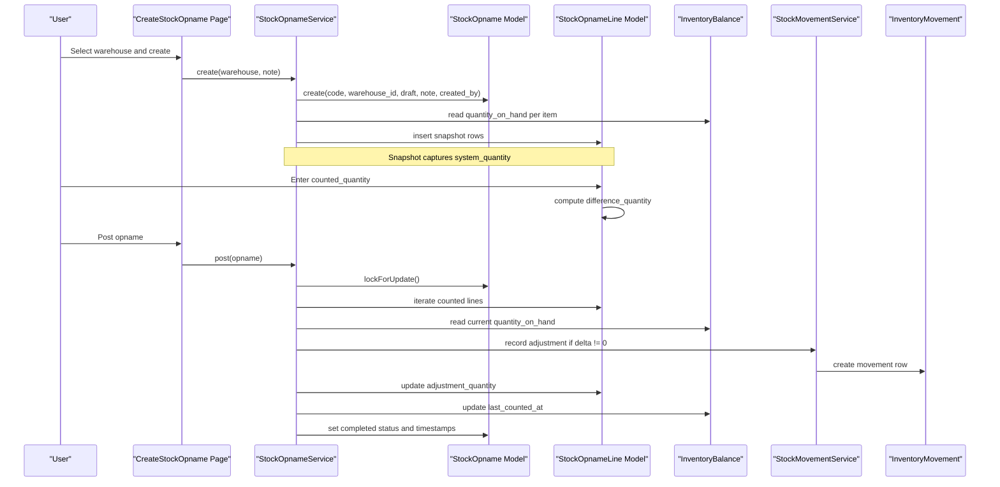
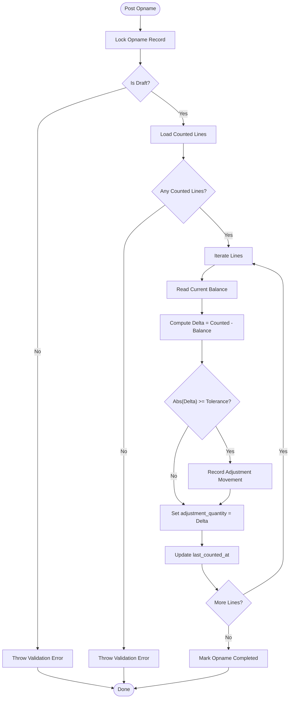
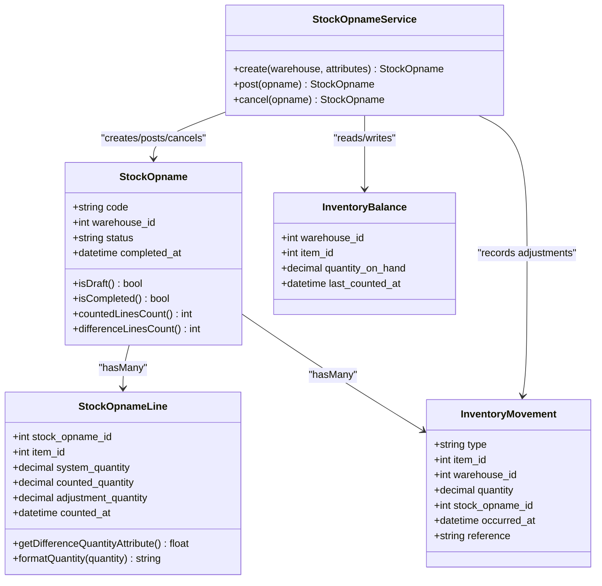
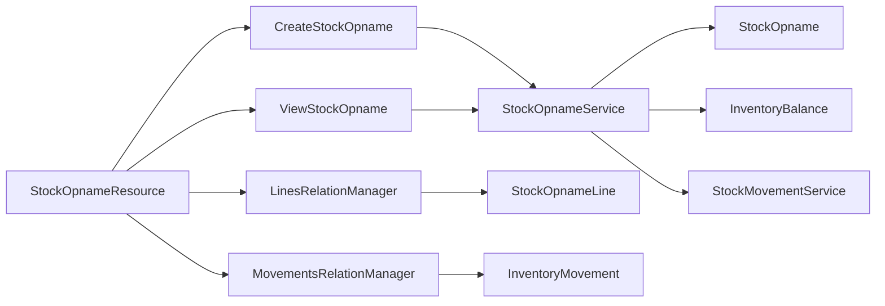

# Stock Opname Resource

<cite>
**Referenced Files in This Document**
- [StockOpnameResource.php](file://app/Filament/Resources/StockOpnames/StockOpnameResource.php)
- [CreateStockOpname.php](file://app/Filament/Resources/StockOpnames/Pages/CreateStockOpname.php)
- [ListStockOpnames.php](file://app/Filament/Resources/StockOpnames/Pages/ListStockOpnames.php)
- [ViewStockOpname.php](file://app/Filament/Resources/StockOpnames/Pages/ViewStockOpname.php)
- [LinesRelationManager.php](file://app/Filament/Resources/StockOpnames/RelationManagers/LinesRelationManager.php)
- [MovementsRelationManager.php](file://app/Filament/Resources/StockOpnames/RelationManagers/MovementsRelationManager.php)
- [StockOpname.php](file://app/Models/StockOpname.php)
- [StockOpnameLine.php](file://app/Models/StockOpnameLine.php)
- [StockOpnameService.php](file://app/Services/StockOpnameService.php)
- [2026_11_19_000002_create_stock_opnames_table.php](file://database/migrations/2026_11_19_000002_create_stock_opnames_table.php)
- [2026_11_19_000003_create_stock_opname_lines_table.php](file://database/migrations/2026_11_19_000003_create_stock_opname_lines_table.php)
- [2026_11_19_000004_add_stock_opname_id_to_inventory_movements_table.php](file://database/migrations/2026_11_19_000004_add_stock_opname_id_to_inventory_movements_table.php)
</cite>

## Table of Contents
1. [Introduction](#introduction)
2. [Project Structure](#project-structure)
3. [Core Components](#core-components)
4. [Architecture Overview](#architecture-overview)
5. [Detailed Component Analysis](#detailed-component-analysis)
6. [Dependency Analysis](#dependency-analysis)
7. [Performance Considerations](#performance-considerations)
8. [Troubleshooting Guide](#troubleshooting-guide)
9. [Conclusion](#conclusion)

## Introduction
This document explains the Stock Opname feature used for stock reconciliation and inventory counting. It covers how a stock opname is created, how physical counts are managed through line items, how adjustments are calculated and posted, and how audit trails are maintained through inventory movements. The documentation also includes practical workflows for conducting physical counts, handling discrepancies, and generating reports.

## Project Structure
The Stock Opname feature is implemented as a Filament resource with dedicated pages and relation managers:

- Resource definition and list view configuration
- Create page that initializes an opname snapshot
- View page that displays summary information and exposes posting and cancellation actions
- Lines relation manager for physical count entry and bulk operations
- Movements relation manager for viewing adjustment transactions
- Service layer for transactional creation, posting, and cancellation
- Database migrations defining the core tables and relationships

**Diagram sources**
- [StockOpnameResource.php:27-43](file://app/Filament/Resources/StockOpnames/StockOpnameResource.php#L27-L43)
- [StockOpnameResource.php:90-177](file://app/Filament/Resources/StockOpnames/StockOpnameResource.php#L90-L177)
- [StockOpnameResource.php:189-204](file://app/Filament/Resources/StockOpnames/StockOpnameResource.php#L189-L204)
- [CreateStockOpname.php:12-33](file://app/Filament/Resources/StockOpnames/Pages/CreateStockOpname.php#L12-L33)
- [ViewStockOpname.php:18-138](file://app/Filament/Resources/StockOpnames/Pages/ViewStockOpname.php#L18-L138)
- [LinesRelationManager.php:27-227](file://app/Filament/Resources/StockOpnames/RelationManagers/LinesRelationManager.php#L27-L227)
- [MovementsRelationManager.php:10-52](file://app/Filament/Resources/StockOpnames/RelationManagers/MovementsRelationManager.php#L10-L52)
- [StockOpnameService.php:14-170](file://app/Services/StockOpnameService.php#L14-L170)

**Section sources**
- [StockOpnameResource.php:27-43](file://app/Filament/Resources/StockOpnames/StockOpnameResource.php#L27-L43)
- [StockOpnameResource.php:90-177](file://app/Filament/Resources/StockOpnames/StockOpnameResource.php#L90-L177)
- [StockOpnameResource.php:189-204](file://app/Filament/Resources/StockOpnames/StockOpnameResource.php#L189-L204)
- [CreateStockOpname.php:12-33](file://app/Filament/Resources/StockOpnames/Pages/CreateStockOpname.php#L12-L33)
- [ViewStockOpname.php:18-138](file://app/Filament/Resources/StockOpnames/Pages/ViewStockOpname.php#L18-L138)
- [LinesRelationManager.php:27-227](file://app/Filament/Resources/StockOpnames/RelationManagers/LinesRelationManager.php#L27-L227)
- [MovementsRelationManager.php:10-52](file://app/Filament/Resources/StockOpnames/RelationManagers/MovementsRelationManager.php#L10-L52)
- [StockOpnameService.php:14-170](file://app/Services/StockOpnameService.php#L14-L170)

## Core Components
- StockOpnameResource: Defines navigation, form fields, table columns, filters, record actions, relations, and pages for listing, creating, and viewing stock opnames.
- CreateStockOpname: Handles warehouse selection and delegates creation to StockOpnameService.
- ViewStockOpname: Displays opname details, progress, differences, and provides post/cancel/delete actions.
- LinesRelationManager: Manages physical count entries, system-fill, clearing counts, adding new items, importing/exporting CSV, and filtering by count status.
- MovementsRelationManager: Displays generated adjustment transactions linked to the opname.
- StockOpnameService: Implements transactional creation, posting, and cancellation logic, including balance updates and movement recording.
- Models: StockOpname and StockOpnameLine define state, relationships, computed attributes, and lifecycle hooks.
- Migrations: Define stock_opnames, stock_opname_lines, and link inventory_movements to stock_opnames.

**Section sources**
- [StockOpnameResource.php:27-204](file://app/Filament/Resources/StockOpnames/StockOpnameResource.php#L27-L204)
- [CreateStockOpname.php:12-33](file://app/Filament/Resources/StockOpnames/Pages/CreateStockOpname.php#L12-L33)
- [ViewStockOpname.php:18-138](file://app/Filament/Resources/StockOpnames/Pages/ViewStockOpname.php#L18-L138)
- [LinesRelationManager.php:27-227](file://app/Filament/Resources/StockOpnames/RelationManagers/LinesRelationManager.php#L27-L227)
- [MovementsRelationManager.php:10-52](file://app/Filament/Resources/StockOpnames/RelationManagers/MovementsRelationManager.php#L10-L52)
- [StockOpnameService.php:14-170](file://app/Services/StockOpnameService.php#L14-L170)
- [StockOpname.php:21-106](file://app/Models/StockOpname.php#L21-L106)
- [StockOpnameLine.php:21-93](file://app/Models/StockOpnameLine.php#L21-L93)
- [2026_11_19_000002_create_stock_opnames_table.php:12-44](file://database/migrations/2026_11_19_000002_create_stock_opnames_table.php#L12-L44)
- [2026_11_19_000003_create_stock_opname_lines_table.php:12-45](file://database/migrations/2026_11_19_000003_create_stock_opname_lines_table.php#L12-L45)
- [2026_11_19_000004_add_stock_opname_id_to_inventory_movements_table.php:12-32](file://database/migrations/2026_11_19_000004_add_stock_opname_id_to_inventory_movements_table.php#L12-L32)

## Architecture Overview
The stock opname workflow follows a clear sequence from creation to posting:

1. A user creates a stock opname for a selected warehouse.
2. The service generates a unique code and snapshots all stockable items without variants into lines, capturing system quantities at creation time.
3. Users enter physical counts per line; the system computes variance (difference).
4. When posted, the service records adjustment movements for non-zero deltas and updates balances accordingly.
5. The opname becomes completed and cannot be re-posted.

**Diagram sources**
- [CreateStockOpname.php:18-33](file://app/Filament/Resources/StockOpnames/Pages/CreateStockOpname.php#L18-L33)
- [StockOpnameService.php:21-61](file://app/Services/StockOpnameService.php#L21-L61)
- [StockOpnameService.php:67-133](file://app/Services/StockOpnameService.php#L67-L133)
- [StockOpnameLine.php:74-81](file://app/Models/StockOpnameLine.php#L74-L81)

## Detailed Component Analysis

### Stock Opname Creation Process
- The create page accepts a warehouse and optional note, then delegates to StockOpnameService.create.
- The service starts a database transaction, generates a unique opname code, persists the opname, reads current inventory balances, and inserts one line per stockable item without variants.
- Each line stores the snapshot system_quantity and nulls for counted and adjustment quantities.

Practical example:
- Choose a warehouse where physical counting will occur.
- Add notes describing scope or special instructions.
- After creation, navigate to the view page to manage lines.

**Section sources**
- [CreateStockOpname.php:18-33](file://app/Filament/Resources/StockOpnames/Pages/CreateStockOpname.php#L18-L33)
- [StockOpnameService.php:21-61](file://app/Services/StockOpnameService.php#L21-L61)
- [2026_11_19_000002_create_stock_opnames_table.php:12-44](file://database/migrations/2026_11_19_000002_create_stock_opnames_table.php#L12-L44)
- [2026_11_19_000003_create_stock_opname_lines_table.php:12-45](file://database/migrations/2026_11_19_000003_create_stock_opname_lines_table.php#L12-L45)

### Line Item Management via LinesRelationManager
- The lines table shows item code/name, system_quantity, editable counted_quantity (only when opname is draft), difference_quantity, adjustment_quantity, counter info, and timestamps.
- Bulk actions include:
  - Fill system: populate missing physical counts with system_quantity.
  - Clear counts: reset physical counts and counters.
  - Add item: add additional stockable items not included in the initial snapshot.
  - Import/Export CSV: bulk load or export line data.
- Filters allow quick identification of pending vs done counts.

Adjustment calculation:
- difference_quantity equals counted_quantity minus system_quantity.
- adjustment_quantity is finalized during posting based on the delta between counted_quantity and current inventory balance.

Practical example:
- Use “Fill system” to pre-populate counts when physical counting is skipped for some items.
- Enter physical counts manually for items requiring verification.
- Export CSV to coordinate offline counting and import results back.

**Section sources**
- [LinesRelationManager.php:33-227](file://app/Filament/Resources/StockOpnames/RelationManagers/LinesRelationManager.php#L33-L227)
- [StockOpnameLine.php:74-93](file://app/Models/StockOpnameLine.php#L74-L93)

### Movement Tracking via MovementsRelationManager
- Displays generated adjustment transactions linked to the opname.
- Columns include occurrence time, type (incoming/outgoing), item details, quantity, reference (opname code), and creator.
- Empty state indicates no adjustments have been generated yet.

Integration point:
- Adjustment movements are created only when the absolute delta between counted_quantity and current balance exceeds a small threshold.

**Section sources**
- [MovementsRelationManager.php:10-52](file://app/Filament/Resources/StockOpnames/RelationManagers/MovementsRelationManager.php#L10-L52)
- [StockOpnameService.php:92-118](file://app/Services/StockOpnameService.php#L92-L118)
- [2026_11_19_000004_add_stock_opname_id_to_inventory_movements_table.php:12-32](file://database/migrations/2026_11_19_000004_add_stock_opname_id_to_inventory_movements_table.php#L12-L32)

### Stock Adjustment Calculations and Variance Analysis
- Difference per line is computed as counted_quantity minus system_quantity.
- During posting, the system compares counted_quantity against the current InventoryBalance.quantity_on_hand.
- If the absolute delta is greater than or equal to a small tolerance, an adjustment movement is recorded:
  - Positive delta: adjustment-in movement.
  - Negative delta: adjustment-out movement.
- adjustment_quantity on each line is updated to reflect the final delta used for posting.
- InventoryBalance.last_counted_at is updated to mark the latest counting event.

**Diagram sources**
- [StockOpnameService.php:67-133](file://app/Services/StockOpnameService.php#L67-L133)

**Section sources**
- [StockOpnameLine.php:74-81](file://app/Models/StockOpnameLine.php#L74-L81)
- [StockOpnameService.php:92-133](file://app/Services/StockOpnameService.php#L92-L133)

### Approval Workflows
- There is no explicit approval step in the provided implementation.
- Control is enforced through status checks:
  - Only draft opnames can be posted or cancelled.
  - Once completed, re-posting is blocked.
- UI actions are conditionally visible based on the opname’s draft status.

Best practice recommendation:
- Introduce an approval state machine (e.g., draft → submitted → approved → completed) if organizational policy requires managerial sign-off before posting.

**Section sources**
- [ViewStockOpname.php:68-138](file://app/Filament/Resources/StockOpnames/Pages/ViewStockOpname.php#L68-L138)
- [StockOpnameService.php:67-133](file://app/Services/StockOpnameService.php#L67-L133)
- [StockOpname.php:79-87](file://app/Models/StockOpname.php#L79-L87)

### Practical Examples

#### Conducting Physical Inventory Counts
- Create a new stock opname for the target warehouse.
- Open the view page and review the lines table.
- Optionally use “Fill system” to pre-populate counts for items not physically verified.
- Enter physical counts for items requiring verification.
- Use filters to track pending vs completed counts.
- Export CSV if you need offline coordination and later import results.

#### Handling Discrepancies
- Review difference_quantity per line to identify variances.
- Add notes to explain significant discrepancies.
- Post the opname to generate adjustment movements for non-zero deltas.
- Inspect the movements tab to confirm adjustment types and quantities.

#### Generating Adjustment Reports
- Export lines CSV to capture system_quantity, counted_quantity, difference_quantity, and adjustment_quantity.
- Use the movements relation manager to review generated adjustment transactions.
- Filter movements by date and type to analyze inbound vs outbound adjustments.

**Section sources**
- [LinesRelationManager.php:100-212](file://app/Filament/Resources/StockOpnames/RelationManagers/LinesRelationManager.php#L100-L212)
- [ViewStockOpname.php:22-65](file://app/Filament/Resources/StockOpnames/Pages/ViewStockOpname.php#L22-L65)
- [MovementsRelationManager.php:16-52](file://app/Filament/Resources/StockOpnames/RelationManagers/MovementsRelationManager.php#L16-L52)

### Integration with Inventory Balance Updates and Audit Trail Maintenance
- Posting adjusts InventoryBalance.quantity_on_hand indirectly through recorded movements via StockMovementService.
- InventoryBalance.last_counted_at is updated to reflect the most recent counting event.
- Each adjustment movement includes:
  - Type (adjustment-in or adjustment-out)
  - Item and warehouse context
  - Quantity equal to the absolute delta
  - Reference to the opname code
  - Timestamp and creator for auditability

**Diagram sources**
- [StockOpname.php:21-106](file://app/Models/StockOpname.php#L21-L106)
- [StockOpnameLine.php:21-93](file://app/Models/StockOpnameLine.php#L21-L93)
- [StockOpnameService.php:21-170](file://app/Services/StockOpnameService.php#L21-L170)

**Section sources**
- [StockOpnameService.php:92-133](file://app/Services/StockOpnameService.php#L92-L133)
- [2026_11_19_000004_add_stock_opname_id_to_inventory_movements_table.php:12-32](file://database/migrations/2026_11_19_000004_add_stock_opname_id_to_inventory_movements_table.php#L12-L32)

## Dependency Analysis
- StockOpnameResource depends on Pages (Create, List, View) and RelationManagers (Lines, Movements).
- CreateStockOpname depends on Warehouse model and StockOpnameService.
- ViewStockOpname depends on StockOpnameService for post and cancel actions.
- LinesRelationManager depends on Item, InventoryBalance, and StockOpnameLine for data display and bulk operations.
- MovementsRelationManager depends on InventoryMovement for displaying adjustment transactions.
- StockOpnameService depends on InventoryBalance, InventoryMovement, Item, Warehouse, and StockMovementService.

**Diagram sources**
- [StockOpnameResource.php:189-204](file://app/Filament/Resources/StockOpnames/StockOpnameResource.php#L189-L204)
- [CreateStockOpname.php:18-33](file://app/Filament/Resources/StockOpnames/Pages/CreateStockOpname.php#L18-L33)
- [ViewStockOpname.php:68-138](file://app/Filament/Resources/StockOpnames/Pages/ViewStockOpname.php#L68-L138)
- [LinesRelationManager.php:27-227](file://app/Filament/Resources/StockOpnames/RelationManagers/LinesRelationManager.php#L27-L227)
- [MovementsRelationManager.php:10-52](file://app/Filament/Resources/StockOpnames/RelationManagers/MovementsRelationManager.php#L10-L52)
- [StockOpnameService.php:14-170](file://app/Services/StockOpnameService.php#L14-L170)

**Section sources**
- [StockOpnameResource.php:189-204](file://app/Filament/Resources/StockOpnames/StockOpnameResource.php#L189-L204)
- [CreateStockOpname.php:18-33](file://app/Filament/Resources/StockOpnames/Pages/CreateStockOpname.php#L18-L33)
- [ViewStockOpname.php:68-138](file://app/Filament/Resources/StockOpnames/Pages/ViewStockOpname.php#L68-L138)
- [LinesRelationManager.php:27-227](file://app/Filament/Resources/StockOpnames/RelationManagers/LinesRelationManager.php#L27-L227)
- [MovementsRelationManager.php:10-52](file://app/Filament/Resources/StockOpnames/RelationManagers/MovementsRelationManager.php#L10-L52)
- [StockOpnameService.php:14-170](file://app/Services/StockOpnameService.php#L14-L170)

## Performance Considerations
- Snapshot creation uses chunked insertion for large item catalogs to avoid memory pressure.
- Table queries use withCount for efficient progress and difference metrics.
- Bulk actions (fill system, clear counts) perform direct updates to minimize round trips.
- Posting locks both the opname and individual balances to ensure consistency under concurrency.

Recommendations:
- Keep item catalog queries optimized with appropriate indexes on item_code and item_name for search.
- Monitor movement recording performance for large opnames; consider batching if needed.
- Use pagination and infinite scrolling already configured in list views.

[No sources needed since this section provides general guidance]

## Troubleshooting Guide
Common issues and resolutions:
- Cannot post because no physical counts exist:
  - Ensure at least one line has counted_quantity filled.
  - Use “Fill system” to pre-populate counts if appropriate.
- Re-posting attempt fails:
  - Only draft opnames can be posted; completed opnames cannot be re-posted.
- Cancellation fails:
  - Only draft opnames can be cancelled; completed or cancelled opnames cannot be changed.
- Discrepancy analysis:
  - Check difference_quantity per line and notes for explanations.
  - Review movements tab to verify adjustment types and quantities.

Validation errors are surfaced through notifications and halt exceptions in the view page.

**Section sources**
- [ViewStockOpname.php:82-133](file://app/Filament/Resources/StockOpnames/Pages/ViewStockOpname.php#L82-L133)
- [StockOpnameService.php:67-155](file://app/Services/StockOpnameService.php#L67-L155)

## Conclusion
The Stock Opname resource provides a robust framework for inventory reconciliation. It captures a snapshot of system quantities, supports flexible physical count entry, calculates variances, and posts adjustments with full audit trails. While there is no built-in approval workflow, the status-based controls ensure safe transitions from draft to completed. For organizations requiring formal approvals, extending the state machine is recommended. The design emphasizes transaction safety, clear reporting, and user-friendly bulk operations.

[No sources needed since this section summarizes without analyzing specific files]