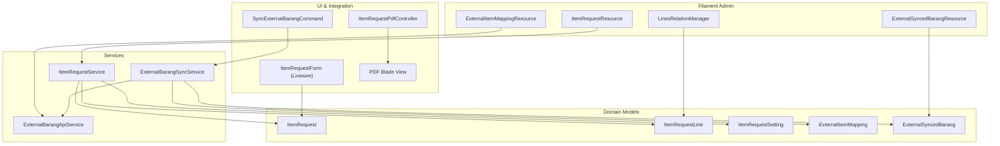
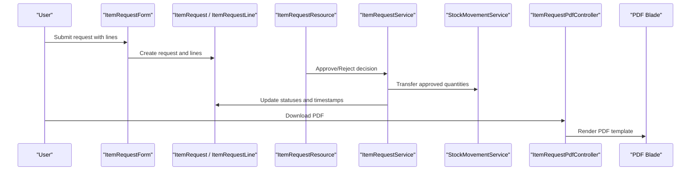
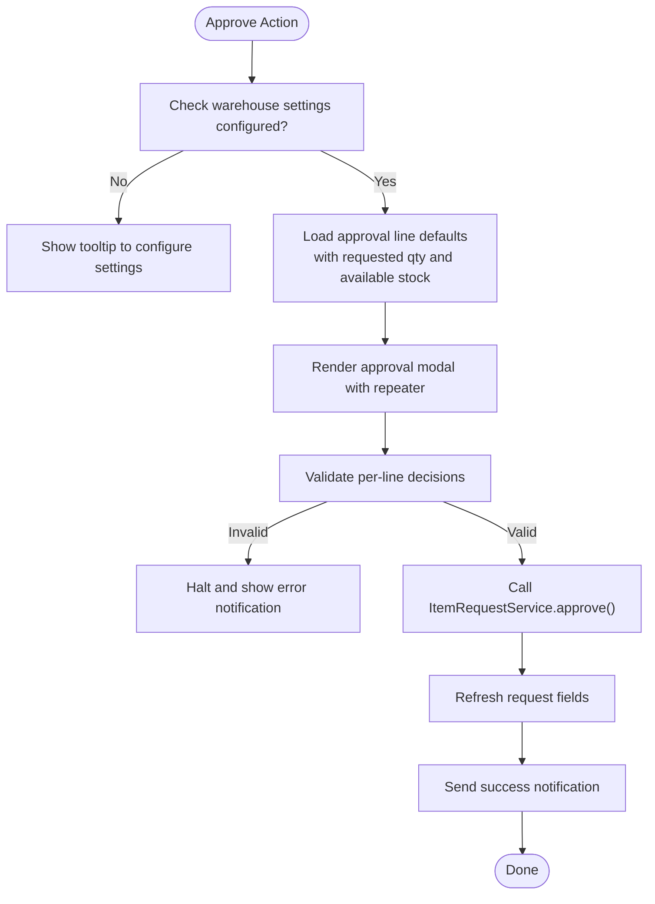
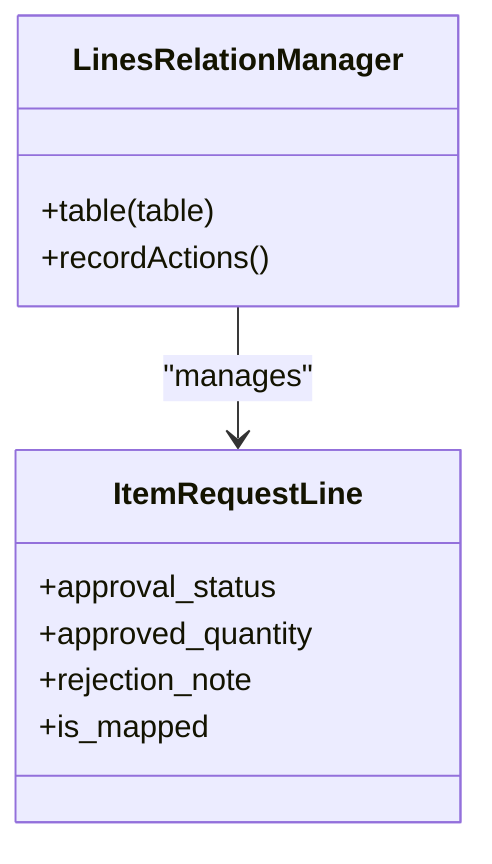
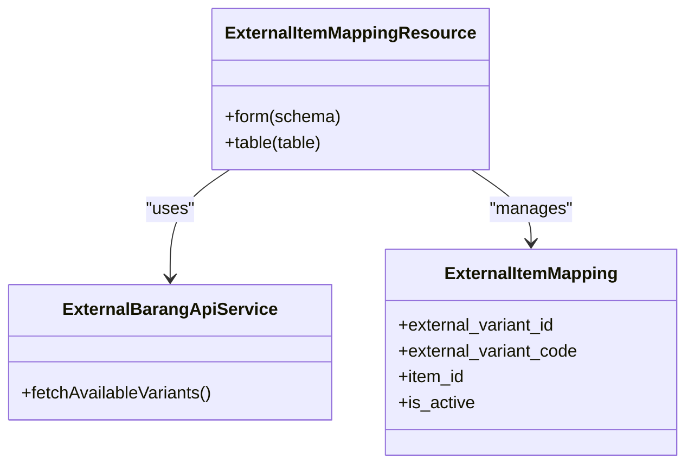
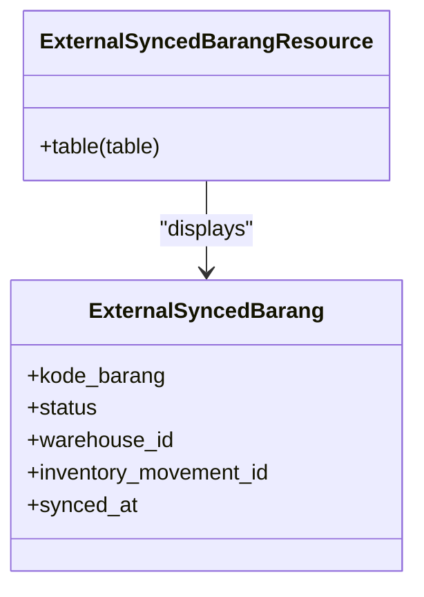
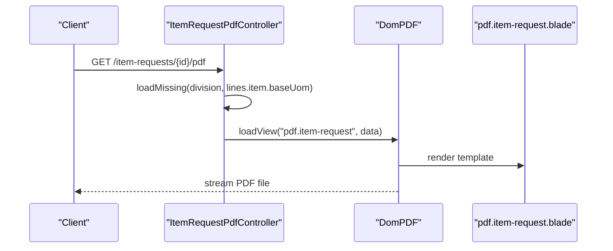
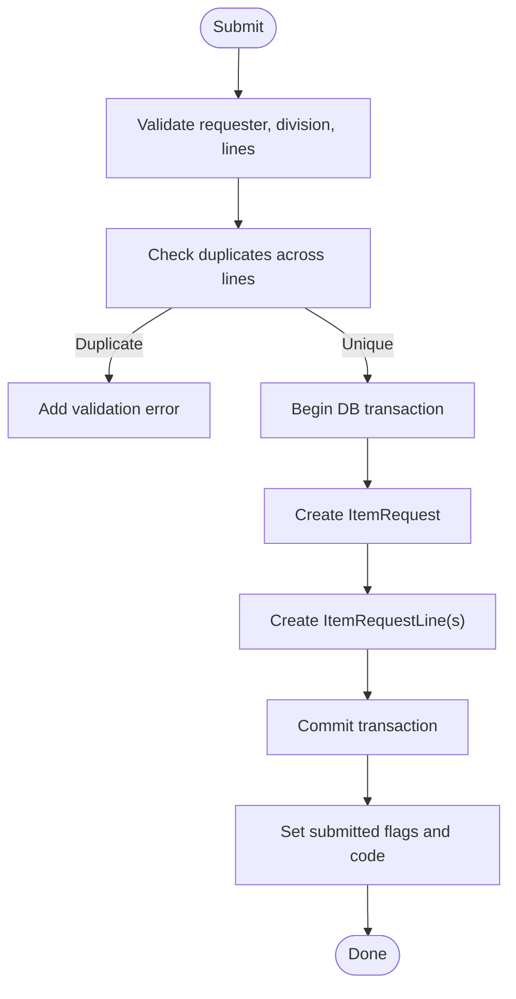
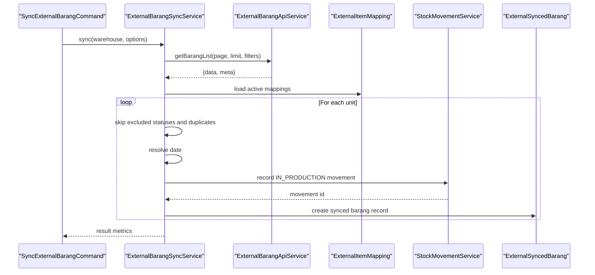
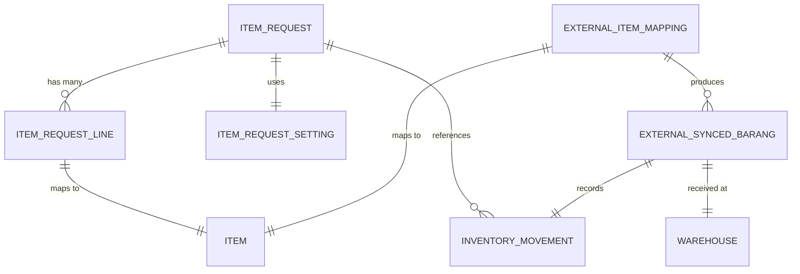

# Request Management Resources

<cite>
**Referenced Files in This Document**
- [ItemRequestResource.php](file://app/Filament/Resources/ItemRequests/ItemRequestResource.php)
- [LinesRelationManager.php](file://app/Filament/Resources/ItemRequests/RelationManagers/LinesRelationManager.php)
- [ExternalItemMappingResource.php](file://app/Filament/Resources/ExternalItemMappings/ExternalItemMappingResource.php)
- [ExternalSyncedBarangResource.php](file://app/Filament/Resources/ExternalSyncedBarangs/ExternalSyncedBarangResource.php)
- [ItemRequest.php](file://app/Models/ItemRequest.php)
- [ItemRequestLine.php](file://app/Models/ItemRequestLine.php)
- [ItemRequestSetting.php](file://app/Models/ItemRequestSetting.php)
- [ExternalItemMapping.php](file://app/Models/ExternalItemMapping.php)
- [ExternalSyncedBarang.php](file://app/Models/ExternalSyncedBarang.php)
- [ItemRequestService.php](file://app/Services/ItemRequestService.php)
- [ItemRequestPdfController.php](file://app/Http/Controllers/ItemRequestPdfController.php)
- [ItemRequestForm.php](file://app/Livewire/ItemRequestForm.php)
- [ExternalBarangApiService.php](file://app/Services/ExternalBarangApiService.php)
- [ExternalBarangSyncService.php](file://app/Services/ExternalBarangSyncService.php)
- [SyncExternalBarangCommand.php](file://app/Console/Commands/SyncExternalBarangCommand.php)
- [item-request.blade.php](file://resources/views/pdf/item-request.blade.php)
</cite>

## Table of Contents
1. [Introduction](#introduction)
2. [Project Structure](#project-structure)
3. [Core Components](#core-components)
4. [Architecture Overview](#architecture-overview)
5. [Detailed Component Analysis](#detailed-component-analysis)
6. [Dependency Analysis](#dependency-analysis)
7. [Performance Considerations](#performance-considerations)
8. [Troubleshooting Guide](#troubleshooting-guide)
9. [Conclusion](#conclusion)

## Introduction
This document explains the request management resources and related services that handle item requests, approval workflows, PDF generation, external system integration, and data synchronization. It covers:
- ItemRequestResource for managing item requests with approval workflows
- LinesRelationManager for request line items and mapping
- ExternalItemMappingResource for external-to-internal item mapping configuration
- ExternalSyncedBarangResource for monitoring synced external units
- Approval process orchestration via ItemRequestService
- PDF generation integration for printable request documents
- Livewire form for request submission
- External API service and sync service for inventory synchronization

## Project Structure
The request management feature spans Filament resources, Eloquent models, services, a Livewire form, a PDF controller, and console commands. The diagram below maps the main components to their source files.



**Diagram sources**
- [ItemRequestResource.php:39-479](file://app/Filament/Resources/ItemRequests/ItemRequestResource.php#L39-L479)
- [LinesRelationManager.php:17-113](file://app/Filament/Resources/ItemRequests/RelationManagers/LinesRelationManager.php#L17-L113)
- [ExternalItemMappingResource.php:30-229](file://app/Filament/Resources/ExternalItemMappings/ExternalItemMappingResource.php#L30-L229)
- [ExternalSyncedBarangResource.php:16-111](file://app/Filament/Resources/ExternalSyncedBarangs/ExternalSyncedBarangResource.php#L16-L111)
- [ItemRequest.php:26-135](file://app/Models/ItemRequest.php#L26-L135)
- [ItemRequestLine.php:21-80](file://app/Models/ItemRequestLine.php#L21-L80)
- [ItemRequestSetting.php:13-38](file://app/Models/ItemRequestSetting.php#L13-L38)
- [ExternalItemMapping.php:23-49](file://app/Models/ExternalItemMapping.php#L23-L49)
- [ExternalSyncedBarang.php:23-62](file://app/Models/ExternalSyncedBarang.php#L23-L62)
- [ItemRequestService.php:14-258](file://app/Services/ItemRequestService.php#L14-L258)
- [ExternalBarangApiService.php:10-188](file://app/Services/ExternalBarangApiService.php#L10-L188)
- [ExternalBarangSyncService.php:14-242](file://app/Services/ExternalBarangSyncService.php#L14-L242)
- [SyncExternalBarangCommand.php:9-90](file://app/Console/Commands/SyncExternalBarangCommand.php#L9-L90)
- [ItemRequestPdfController.php:9-20](file://app/Http/Controllers/ItemRequestPdfController.php#L9-L20)
- [item-request.blade.php:1-21](file://resources/views/pdf/item-request.blade.php#L1-L21)

**Section sources**
- [ItemRequestResource.php:39-479](file://app/Filament/Resources/ItemRequests/ItemRequestResource.php#L39-L479)
- [ExternalItemMappingResource.php:30-229](file://app/Filament/Resources/ExternalItemMappings/ExternalItemMappingResource.php#L30-L229)
- [ExternalSyncedBarangResource.php:16-111](file://app/Filament/Resources/ExternalSyncedBarangs/ExternalSyncedBarangResource.php#L16-L111)

## Core Components
- ItemRequestResource: Admin UI for viewing and approving/rejecting item requests; integrates approval modal, warehouse settings checks, and status badges.
- LinesRelationManager: Manages request lines, supports manual item name entry, mapping to internal items, and per-line approval status display.
- ExternalItemMappingResource: Configures mappings between external product variants and internal items; includes quick selection from external API variants.
- ExternalSyncedBarangResource: Read-only view of synchronized external units, including status, warehouse, and movement references.
- ItemRequestService: Orchestrates approval logic, validation, stock transfers, and status resolution.
- ExternalBarangApiService: Communicates with external production API for variant lists and details.
- ExternalBarangSyncService: Syncs external finished goods into internal inventory based on mappings and filters.
- ItemRequestPdfController + Blade view: Generates downloadable PDFs for approved or submitted requests.
- ItemRequestForm (Livewire): Public-facing form for creating item requests with dynamic item search and duplicate prevention.

**Section sources**
- [ItemRequestResource.php:81-219](file://app/Filament/Resources/ItemRequests/ItemRequestResource.php#L81-L219)
- [LinesRelationManager.php:23-111](file://app/Filament/Resources/ItemRequests/RelationManagers/LinesRelationManager.php#L23-L111)
- [ExternalItemMappingResource.php:48-213](file://app/Filament/Resources/ExternalItemMappings/ExternalItemMappingResource.php#L48-L213)
- [ExternalSyncedBarangResource.php:39-97](file://app/Filament/Resources/ExternalSyncedBarangs/ExternalSyncedBarangResource.php#L39-L97)
- [ItemRequestService.php:22-258](file://app/Services/ItemRequestService.php#L22-L258)
- [ExternalBarangApiService.php:33-188](file://app/Services/ExternalBarangApiService.php#L33-L188)
- [ExternalBarangSyncService.php:40-242](file://app/Services/ExternalBarangSyncService.php#L40-L242)
- [ItemRequestPdfController.php:11-18](file://app/Http/Controllers/ItemRequestPdfController.php#L11-L18)
- [item-request.blade.php:1-21](file://resources/views/pdf/item-request.blade.php#L1-L21)
- [ItemRequestForm.php:95-152](file://app/Livewire/ItemRequestForm.php#L95-L152)

## Architecture Overview
The system combines admin workflows, public forms, services, and external integrations:
- Users submit requests via Livewire form; requests are stored as ItemRequest with multiple ItemRequestLine entries.
- Admins approve or reject requests through ItemRequestResource; approvals trigger stock transfers via StockMovementService and update statuses.
- External systems provide product variants; admins map them to internal items using ExternalItemMappingResource.
- A scheduled or manual command triggers ExternalBarangSyncService to pull finished goods from the external API, apply mappings, and record inventory movements.
- PDF generation provides printable documentation for requests.



**Diagram sources**
- [ItemRequestForm.php:95-152](file://app/Livewire/ItemRequestForm.php#L95-L152)
- [ItemRequestResource.php:222-389](file://app/Filament/Resources/ItemRequests/ItemRequestResource.php#L222-L389)
- [ItemRequestService.php:22-258](file://app/Services/ItemRequestService.php#L22-L258)
- [ItemRequestPdfController.php:11-18](file://app/Http/Controllers/ItemRequestPdfController.php#L11-L18)
- [item-request.blade.php:1-21](file://resources/views/pdf/item-request.blade.php#L1-L21)

## Detailed Component Analysis

### ItemRequestResource
Responsibilities:
- Displays requests with status badges and counts
- Provides approve and reject actions with modals
- Validates warehouse settings before enabling approval
- Populates approval defaults with available stock and mapped items
- Updates request and line statuses after decisions

Key behaviors:
- Navigation badge shows pending count
- Approve action validates settings, loads balances, and presents per-line approval toggles
- Reject action requires rejection note and marks all lines rejected
- Refreshes form state after actions



**Diagram sources**
- [ItemRequestResource.php:222-344](file://app/Filament/Resources/ItemRequests/ItemRequestResource.php#L222-L344)
- [ItemRequestResource.php:409-450](file://app/Filament/Resources/ItemRequests/ItemRequestResource.php#L409-L450)

**Section sources**
- [ItemRequestResource.php:57-79](file://app/Filament/Resources/ItemRequests/ItemRequestResource.php#L57-L79)
- [ItemRequestResource.php:146-219](file://app/Filament/Resources/ItemRequests/ItemRequestResource.php#L146-L219)
- [ItemRequestResource.php:222-389](file://app/Filament/Resources/ItemRequests/ItemRequestResource.php#L222-L389)
- [ItemRequestResource.php:391-404](file://app/Filament/Resources/ItemRequests/ItemRequestResource.php#L391-L404)
- [ItemRequestResource.php:409-450](file://app/Filament/Resources/ItemRequests/ItemRequestResource.php#L409-L450)

### LinesRelationManager
Responsibilities:
- Shows request line items with mapped item names, manual names, quantities, and approval status
- Allows mapping an unmapped line to an internal item via InfiniteSelect
- Filters by mapping status

Key behaviors:
- Loads base unit of measure for display
- Edit action opens modal to select internal item
- Approval status columns reflect per-line decisions



**Diagram sources**
- [LinesRelationManager.php:23-111](file://app/Filament/Resources/ItemRequests/RelationManagers/LinesRelationManager.php#L23-L111)
- [ItemRequestLine.php:21-80](file://app/Models/ItemRequestLine.php#L21-L80)

**Section sources**
- [LinesRelationManager.php:23-111](file://app/Filament/Resources/ItemRequests/RelationManagers/LinesRelationManager.php#L23-L111)

### ExternalItemMappingResource
Responsibilities:
- Configure mappings between external variants and internal items
- Provide quick selection of variants from external API
- Track active/inactive mappings and synced unit counts

Key behaviors:
- Uses ExternalBarangApiService to fetch available variants
- Auto-fills external variant fields when a variant is selected
- Links to internal Item via InfiniteSelect
- Table shows counts of synced barang records



**Diagram sources**
- [ExternalItemMappingResource.php:48-213](file://app/Filament/Resources/ExternalItemMappings/ExternalItemMappingResource.php#L48-L213)
- [ExternalBarangApiService.php:124-165](file://app/Services/ExternalBarangApiService.php#L124-L165)
- [ExternalItemMapping.php:23-49](file://app/Models/ExternalItemMapping.php#L23-L49)

**Section sources**
- [ExternalItemMappingResource.php:48-213](file://app/Filament/Resources/ExternalItemMappings/ExternalItemMappingResource.php#L48-L213)

### ExternalSyncedBarangResource
Responsibilities:
- Display synchronized external units with status, warehouse, and movement ID
- Filter by warehouse and external status

Key behaviors:
- Read-only resource with sortable columns
- Status badges map external statuses to colors



**Diagram sources**
- [ExternalSyncedBarangResource.php:39-97](file://app/Filament/Resources/ExternalSyncedBarangs/ExternalSyncedBarangResource.php#L39-L97)
- [ExternalSyncedBarang.php:23-62](file://app/Models/ExternalSyncedBarang.php#L23-L62)

**Section sources**
- [ExternalSyncedBarangResource.php:39-97](file://app/Filament/Resources/ExternalSyncedBarangs/ExternalSyncedBarangResource.php#L39-L97)

### Approval Process Orchestration (ItemRequestService)
Responsibilities:
- Approve or reject requests with strict validation
- Transfer stock for approved lines
- Resolve overall request status based on line decisions

Approval flow:
- Locks request and lines for concurrency safety
- Validates warehouse settings and active warehouses
- Ensures all lines have decisions
- Validates per-line approval quantity constraints
- Transfers stock via StockMovementService when applicable
- Updates line statuses and request status

```mermaid
flowchart TD
S([approve(entry)]) --> Lock["Lock request and lines"]
Lock --> EnsurePending["Ensure request is pending"]
EnsurePending --> Settings["Load ItemRequestSetting"]
Settings --> ValidateWarehouses["Validate origin/destination warehouses"]
ValidateWarehouses --> LoadLines["Load lines with items"]
LoadLines --> BuildDecisions["Build decisions map"]
BuildDecisions --> ValidateDecisions["Validate decisions present"]
ValidateDecisions --> ForEachLine{"For each line"}
ForEachLine --> |Rejected| ValidateRejectionNote["Validate rejection note"]
ForEachLine --> |Approved| ValidateQuantity["Validate approved quantity > 0 and <= requested"]
ValidateQuantity --> CollectApproved["Collect approved items"]
CollectApproved --> TransferStock["Transfer stock if any approved"]
TransferStock --> UpdateLines["Update line statuses and notes"]
UpdateLines --> ResolveStatus["Resolve request status"]
ResolveStatus --> SaveRequest["Save request updates"]
SaveRequest --> E([return updated request])
```

**Diagram sources**
- [ItemRequestService.php:22-186](file://app/Services/ItemRequestService.php#L22-L186)
- [ItemRequestService.php:227-239](file://app/Services/ItemRequestService.php#L227-L239)

**Section sources**
- [ItemRequestService.php:22-258](file://app/Services/ItemRequestService.php#L22-L258)

### PDF Generation Integration
Responsibilities:
- Generate downloadable PDF for a given request
- Use DomPDF to render Blade template

Flow:
- Controller loads request with relationships
- Renders PDF view and streams file download



**Diagram sources**
- [ItemRequestPdfController.php:11-18](file://app/Http/Controllers/ItemRequestPdfController.php#L11-L18)
- [item-request.blade.php:1-21](file://resources/views/pdf/item-request.blade.php#L1-L21)

**Section sources**
- [ItemRequestPdfController.php:11-18](file://app/Http/Controllers/ItemRequestPdfController.php#L11-L18)
- [item-request.blade.php:1-21](file://resources/views/pdf/item-request.blade.php#L1-L21)

### Request Submission Form (Livewire)
Responsibilities:
- Allow users to create item requests with multiple lines
- Support selecting internal items or entering manual names
- Prevent duplicate items within a single request
- Persist request and lines in a transaction

Key behaviors:
- Dynamic line add/remove
- Validation rules ensure required fields and valid quantities
- After submission, displays confirmation and optional PDF link



**Diagram sources**
- [ItemRequestForm.php:95-152](file://app/Livewire/ItemRequestForm.php#L95-L152)
- [ItemRequestForm.php:174-208](file://app/Livewire/ItemRequestForm.php#L174-L208)

**Section sources**
- [ItemRequestForm.php:95-152](file://app/Livewire/ItemRequestForm.php#L95-L152)
- [ItemRequestForm.php:174-208](file://app/Livewire/ItemRequestForm.php#L174-L208)

### External System Integration and Data Synchronization
Responsibilities:
- Fetch external variants and details via ExternalBarangApiService
- Map external variants to internal items using ExternalItemMapping
- Sync finished goods into inventory via ExternalBarangSyncService
- Expose sync metrics and unmapped variants via console command

Key flows:
- API service calls external endpoints with configurable base URL and timeout
- Sync service paginates results, applies filters, skips excluded statuses and duplicates
- Records inventory movements and creates ExternalSyncedBarang records
- Command prints summary and unmapped variant list



**Diagram sources**
- [ExternalBarangApiService.php:33-188](file://app/Services/ExternalBarangApiService.php#L33-L188)
- [ExternalBarangSyncService.php:40-242](file://app/Services/ExternalBarangSyncService.php#L40-L242)
- [SyncExternalBarangCommand.php:33-88](file://app/Console/Commands/SyncExternalBarangCommand.php#L33-L88)

**Section sources**
- [ExternalBarangApiService.php:33-188](file://app/Services/ExternalBarangApiService.php#L33-L188)
- [ExternalBarangSyncService.php:40-242](file://app/Services/ExternalBarangSyncService.php#L40-L242)
- [SyncExternalBarangCommand.php:33-88](file://app/Console/Commands/SyncExternalBarangCommand.php#L33-L88)

## Dependency Analysis
Relationships among core entities and resources:



**Diagram sources**
- [ItemRequest.php:75-108](file://app/Models/ItemRequest.php#L75-L108)
- [ItemRequestLine.php:55-68](file://app/Models/ItemRequestLine.php#L55-L68)
- [ExternalItemMapping.php:39-47](file://app/Models/ExternalItemMapping.php#L39-L47)
- [ExternalSyncedBarang.php:42-60](file://app/Models/ExternalSyncedBarang.php#L42-L60)

**Section sources**
- [ItemRequest.php:75-108](file://app/Models/ItemRequest.php#L75-L108)
- [ItemRequestLine.php:55-68](file://app/Models/ItemRequestLine.php#L55-L68)
- [ExternalItemMapping.php:39-47](file://app/Models/ExternalItemMapping.php#L39-L47)
- [ExternalSyncedBarang.php:42-60](file://app/Models/ExternalSyncedBarang.php#L42-L60)

## Performance Considerations
- Concurrency control: Approval uses row-level locking to prevent race conditions during stock transfer and status updates.
- Pagination and limits: External sync respects page size and can iterate all pages; default limit capped to avoid large payloads.
- Query optimization: Relations are preloaded where needed (e.g., lines with item base unit) to reduce N+1 queries.
- Validation early exit: Invalid inputs halt processing early to minimize unnecessary work.

[No sources needed since this section provides general guidance]

## Troubleshooting Guide
Common issues and resolutions:
- Approval disabled due to missing warehouse settings:
  - Ensure ItemRequestSetting has both origin and destination warehouses configured.
  - Resource disables approve action and shows tooltip guidance.
- Rejection note required:
  - When rejecting lines or entire requests, provide a reason; otherwise validation fails.
- Unmapped items cannot be approved:
  - Map request lines to internal items via LinesRelationManager before approval.
- External sync reports unmapped variants:
  - Configure ExternalItemMapping for the reported external variant IDs.
- External API connectivity errors:
  - Verify base URL and timeout configuration; check logs for connection errors.

**Section sources**
- [ItemRequestResource.php:222-233](file://app/Filament/Resources/ItemRequests/ItemRequestResource.php#L222-L233)
- [ItemRequestService.php:92-105](file://app/Services/ItemRequestService.php#L92-L105)
- [ItemRequestService.php:112-116](file://app/Services/ItemRequestService.php#L112-L116)
- [ExternalBarangSyncService.php:121-140](file://app/Services/ExternalBarangSyncService.php#L121-L140)
- [ExternalBarangApiService.php:42-54](file://app/Services/ExternalBarangApiService.php#L42-L54)

## Conclusion
The request management resources provide a robust workflow for submitting, approving, and documenting item requests, while integrating seamlessly with external production systems. Approval logic ensures data integrity and accurate stock transfers, and external synchronization keeps inventory aligned with production output. Administrators can manage mappings and monitor sync outcomes through dedicated Filament resources and console tools.

[No sources needed since this section summarizes without analyzing specific files]