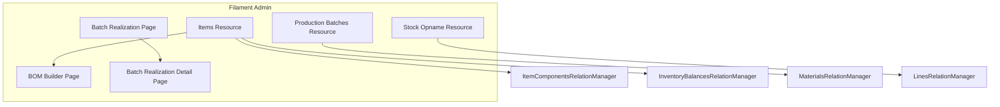
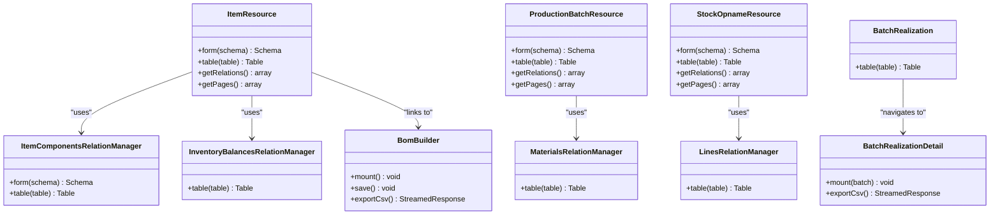
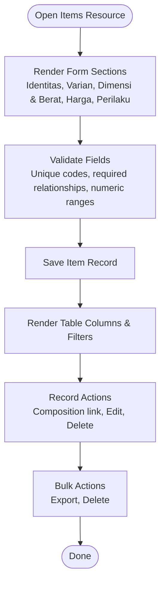
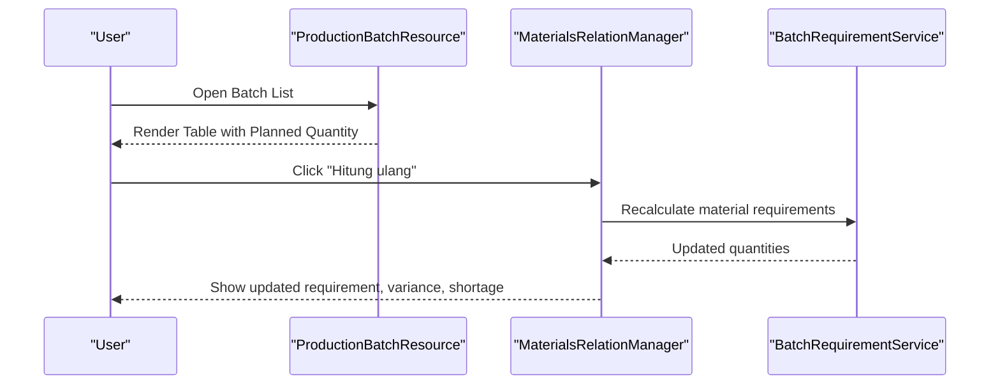
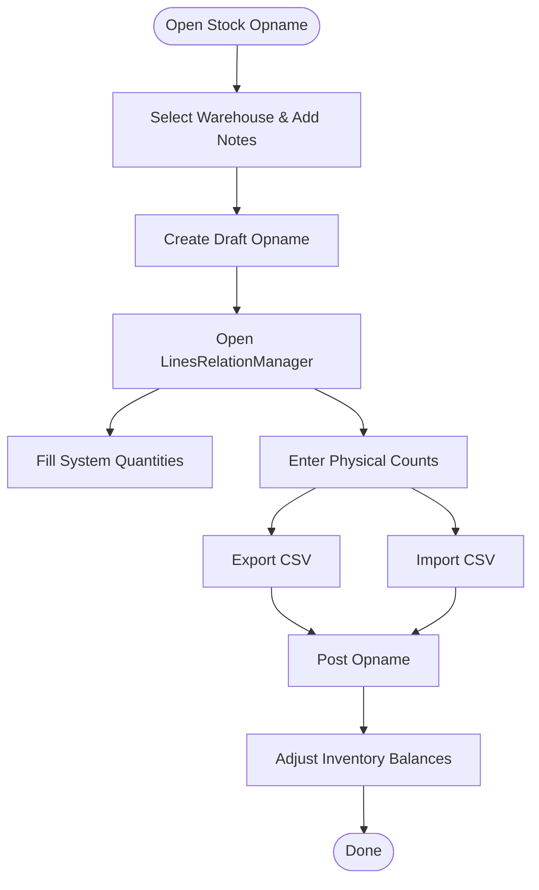
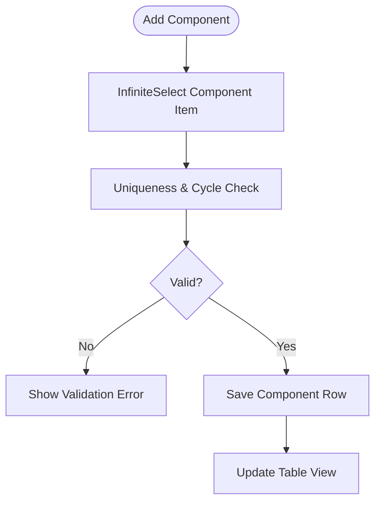
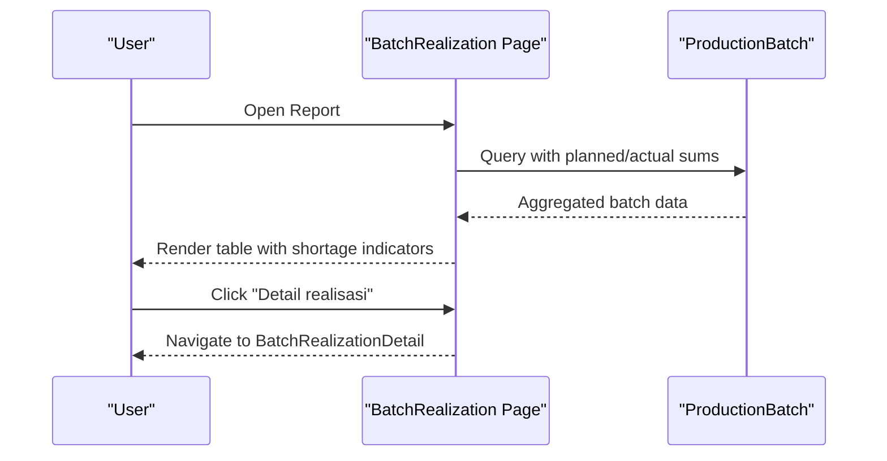
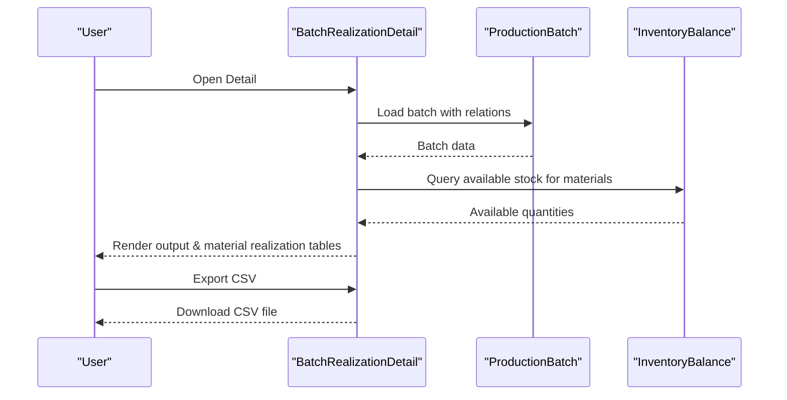
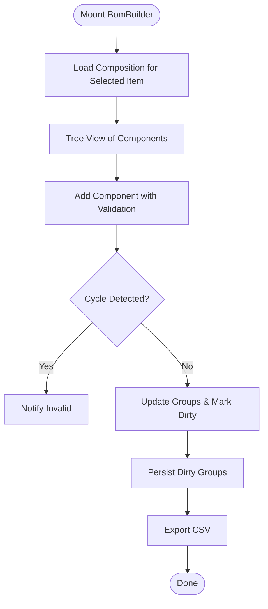
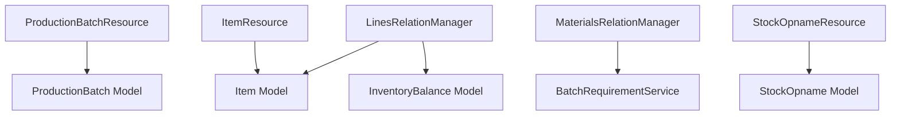

# Resources Management

<cite>
**Referenced Files in This Document**   
- [ItemResource.php](file://app/Filament/Resources/Items/ItemResource.php)
- [ProductionBatchResource.php](file://app/Filament/Resources/ProductionBatches/ProductionBatchResource.php)
- [StockOpnameResource.php](file://app/Filament/Resources/StockOpnames/StockOpnameResource.php)
- [ListItems.php](file://app/Filament/Resources/Items/Pages/ListItems.php)
- [ItemComponentsRelationManager.php](file://app/Filament/Resources/Items/RelationManagers/ItemComponentsRelationManager.php)
- [InventoryBalancesRelationManager.php](file://app/Filament/Resources/Items/RelationManagers/InventoryBalancesRelationManager.php)
- [MaterialsRelationManager.php](file://app/Filament/Resources/ProductionBatches/RelationManagers/MaterialsRelationManager.php)
- [LinesRelationManager.php](file://app/Filament/Resources/StockOpnames/RelationManagers/LinesRelationManager.php)
- [BatchRealization.php](file://app/Filament/Pages/BatchRealization.php)
- [BatchRealizationDetail.php](file://app/Filament/Pages/BatchRealizationDetail.php)
- [BomBuilder.php](file://app/Filament/Pages/BomBuilder.php)
</cite>

## Table of Contents
1. [Introduction](#introduction)
2. [Project Structure](#project-structure)
3. [Core Components](#core-components)
4. [Architecture Overview](#architecture-overview)
5. [Detailed Component Analysis](#detailed-component-analysis)
6. [Dependency Analysis](#dependency-analysis)
7. [Performance Considerations](#performance-considerations)
8. [Troubleshooting Guide](#troubleshooting-guide)
9. [Conclusion](#conclusion)
10. [Appendices](#appendices)

## Introduction
This document explains how business entities are managed through Filament resources in the project. It covers the resource structure pattern, form definitions, table configurations, filters, relationship managers, and custom pages used for specialized workflows such as Bill of Materials composition, production batch realization, and stock counting. It also provides practical guidelines for creating new resources, customizing existing ones, and implementing advanced features like bulk actions, exports, imports, and complex relationship management.

## Project Structure
The Filament administration layer is organized under `app/Filament`. Each business entity typically has:
- A Resource class that defines navigation, forms, tables, relations, and pages.
- Optional Pages for list, create, edit, view, or custom workflows.
- RelationManagers for managing child records directly from a parent record page.
- Imports and Exports for bulk data operations.
- Custom Pages for domain-specific dashboards and tools.

**Diagram sources**
- [ItemResource.php:37-299](file://app/Filament/Resources/Items/ItemResource.php#L37-L299)
- [ProductionBatchResource.php:33-197](file://app/Filament/Resources/ProductionBatches/ProductionBatchResource.php#L33-L197)
- [StockOpnameResource.php:27-206](file://app/Filament/Resources/StockOpnames/StockOpnameResource.php#L27-L206)
- [ItemComponentsRelationManager.php:23-125](file://app/Filament/Resources/Items/RelationManagers/ItemComponentsRelationManager.php#L23-L125)
- [InventoryBalancesRelationManager.php:9-51](file://app/Filament/Resources/Items/RelationManagers/InventoryBalancesRelationManager.php#L9-L51)
- [MaterialsRelationManager.php:15-103](file://app/Filament/Resources/ProductionBatches/RelationManagers/MaterialsRelationManager.php#L15-L103)
- [LinesRelationManager.php:27-229](file://app/Filament/Resources/StockOpnames/RelationManagers/LinesRelationManager.php#L27-L229)
- [BatchRealization.php:19-112](file://app/Filament/Pages/BatchRealization.php#L19-L112)
- [BatchRealizationDetail.php:18-215](file://app/Filament/Pages/BatchRealizationDetail.php#L18-L215)
- [BomBuilder.php:26-800](file://app/Filament/Pages/BomBuilder.php#L26-L800)

**Section sources**
- [ItemResource.php:37-299](file://app/Filament/Resources/Items/ItemResource.php#L37-L299)
- [ProductionBatchResource.php:33-197](file://app/Filament/Resources/ProductionBatches/ProductionBatchResource.php#L33-L197)
- [StockOpnameResource.php:27-206](file://app/Filament/Resources/StockOpnames/StockOpnameResource.php#L27-L206)

## Core Components
The core resources define the primary CRUD interfaces for business entities:
- Items: master data for products, semi-finished goods, and raw materials.
- Production Batches: manufacturing orders with planned outputs and material requirements.
- Stock Opname: physical inventory counting documents with draft-to-posted lifecycle.

Key responsibilities per resource:
- Navigation metadata (group, label, icon, sort).
- Form schema defining fields, validation, relationships, and helper text.
- Table configuration including columns, filters, actions, sorting, pagination/infinite scrolling.
- Relationship managers exposing child records and related operations.
- Custom pages for extended workflows.

**Section sources**
- [ItemResource.php:37-299](file://app/Filament/Resources/Items/ItemResource.php#L37-L299)
- [ProductionBatchResource.php:33-197](file://app/Filament/Resources/ProductionBatches/ProductionBatchResource.php#L33-L197)
- [StockOpnameResource.php:27-206](file://app/Filament/Resources/StockOpnames/StockOpnameResource.php#L27-L206)

## Architecture Overview
The system uses Filament’s Resource abstraction to encapsulate UI logic for each entity. Relationships between entities are exposed via RelationManagers, while specialized workflows are implemented as custom Pages. Data import/export is handled by dedicated Importer/Exporter classes attached to list pages or relation managers.

**Diagram sources**
- [ItemResource.php:37-299](file://app/Filament/Resources/Items/ItemResource.php#L37-L299)
- [ProductionBatchResource.php:33-197](file://app/Filament/Resources/ProductionBatches/ProductionBatchResource.php#L33-L197)
- [StockOpnameResource.php:27-206](file://app/Filament/Resources/StockOpnames/StockOpnameResource.php#L27-L206)
- [ItemComponentsRelationManager.php:23-125](file://app/Filament/Resources/Items/RelationManagers/ItemComponentsRelationManager.php#L23-L125)
- [InventoryBalancesRelationManager.php:9-51](file://app/Filament/Resources/Items/RelationManagers/InventoryBalancesRelationManager.php#L9-L51)
- [MaterialsRelationManager.php:15-103](file://app/Filament/Resources/ProductionBatches/RelationManagers/MaterialsRelationManager.php#L15-L103)
- [LinesRelationManager.php:27-229](file://app/Filament/Resources/StockOpnames/RelationManagers/LinesRelationManager.php#L27-L229)
- [BomBuilder.php:26-800](file://app/Filament/Pages/BomBuilder.php#L26-L800)
- [BatchRealization.php:19-112](file://app/Filament/Pages/BatchRealization.php#L19-L112)
- [BatchRealizationDetail.php:18-215](file://app/Filament/Pages/BatchRealizationDetail.php#L18-L215)

## Detailed Component Analysis

### Items Resource
The Items resource manages master item data and exposes several relationship managers for components, inventory balances, and variant mappings.

Form definition highlights:
- Identification section with code, barcode, name, description, type, base unit of measure, category, brand, and division.
- Variant section toggling whether the item has variants and selecting a parent item using an infinite select component.
- Dimensions and weight sections with numeric inputs and unit-of-measure selectors.
- Pricing section for base price and standard cost.
- Behavior toggles for stockable, sellable, purchasable, and active flags.

Table configuration highlights:
- Columns for code, name, type, category, brand, division, base unit, base price, variant flag, active flag, and parent item.
- Filters for type, category, brand, division, variant flag, and active flag.
- Record actions include a custom “composition” action linking to the BOM builder when applicable.
- Toolbar actions include bulk export and bulk delete.
- Infinite scrolling enabled with a default sort on item name.

Relationship managers:
- ItemComponentsRelationManager: manage bill of materials entries with cycle detection and uniqueness constraints.
- InventoryBalancesRelationManager: display per-warehouse stock levels and status badges.
- VariantMappingsRelationManager: manage variant mappings (defined in the resource but not analyzed here).

Custom list page:
- ListItems extends a shared infinite-scroll list page and adds import/export header actions.

**Diagram sources**
- [ItemResource.php:55-195](file://app/Filament/Resources/Items/ItemResource.php#L55-L195)
- [ItemResource.php:197-279](file://app/Filament/Resources/Items/ItemResource.php#L197-L279)
- [ListItems.php:13-29](file://app/Filament/Resources/Items/Pages/ListItems.php#L13-L29)

**Section sources**
- [ItemResource.php:55-195](file://app/Filament/Resources/Items/ItemResource.php#L55-L195)
- [ItemResource.php:197-279](file://app/Filament/Resources/Items/ItemResource.php#L197-L279)
- [ListItems.php:13-29](file://app/Filament/Resources/Items/Pages/ListItems.php#L13-L29)

### Production Batches Resource
The Production Batches resource manages manufacturing batches with planning and execution tracking.

Form definition highlights:
- Batch code generation with uniqueness.
- Status selection with options provided by the model; status is disabled in the form and changed via workflow buttons.
- Material warehouse and output warehouse selectors with helper text.
- Start and finish dates and notes.

Table configuration highlights:
- Columns for batch code, status badge with color mapping, planned quantity, warehouses, start/finish dates.
- Filters for status and material warehouse.
- Record actions include view, edit, and delete.
- Toolbar includes bulk delete.
- Default sort by creation date descending.
- Infinite scrolling enabled.

Relationship managers:
- ItemsRelationManager: manage produced items for the batch.
- MaterialsRelationManager: show material requirements, actual usage, variance, shortage, and status; includes recalculation action.
- RawMaterialsRelationManager: manage raw material breakdown for semi-finished materials.
- MovementsRelationManager: track inventory movements associated with the batch.

**Diagram sources**
- [ProductionBatchResource.php:70-113](file://app/Filament/Resources/ProductionBatches/ProductionBatchResource.php#L70-L113)
- [ProductionBatchResource.php:115-175](file://app/Filament/Resources/ProductionBatches/ProductionBatchResource.php#L115-L175)
- [MaterialsRelationManager.php:85-101](file://app/Filament/Resources/ProductionBatches/RelationManagers/MaterialsRelationManager.php#L85-L101)

**Section sources**
- [ProductionBatchResource.php:70-113](file://app/Filament/Resources/ProductionBatches/ProductionBatchResource.php#L70-L113)
- [ProductionBatchResource.php:115-175](file://app/Filament/Resources/ProductionBatches/ProductionBatchResource.php#L115-L175)
- [MaterialsRelationManager.php:21-103](file://app/Filament/Resources/ProductionBatches/RelationManagers/MaterialsRelationManager.php#L21-L103)

### Stock Opname Resource
The Stock Opname resource manages physical inventory counting documents.

Form definition highlights:
- Warehouse selector restricted to active warehouses.
- Notes field for additional context.

Table configuration highlights:
- Columns for code, warehouse, status badge, progress count, difference count, creator, created/completed timestamps.
- Filters for status, warehouse, and date range.
- Record actions include view and conditional delete (only for drafts).
- Empty state messaging guides users to create an opname.
- Infinite scrolling enabled.

Relationship managers:
- LinesRelationManager: manage physical counting lines with inline editing, bulk actions, import/export, and filtering by count status.
- MovementsRelationManager: track inventory adjustments resulting from posted opname lines.

**Diagram sources**
- [StockOpnameResource.php:64-88](file://app/Filament/Resources/StockOpnames/StockOpnameResource.php#L64-L88)
- [StockOpnameResource.php:90-178](file://app/Filament/Resources/StockOpnames/StockOpnameResource.php#L90-L178)
- [LinesRelationManager.php:33-229](file://app/Filament/Resources/StockOpnames/RelationManagers/LinesRelationManager.php#L33-L229)

**Section sources**
- [StockOpnameResource.php:64-88](file://app/Filament/Resources/StockOpnames/StockOpnameResource.php#L64-L88)
- [StockOpnameResource.php:90-178](file://app/Filament/Resources/StockOpnames/StockOpnameResource.php#L90-L178)
- [LinesRelationManager.php:33-229](file://app/Filament/Resources/StockOpnames/RelationManagers/LinesRelationManager.php#L33-L229)

### Relationship Managers

#### ItemComponentsRelationManager
Manages the bill of materials for an item. Key behaviors:
- Uses an infinite select for component items filtered to stockable, non-variant items.
- Enforces uniqueness per parent item and prevents circular dependencies.
- Provides fields for quantity per unit, note, and active toggle.
- Table shows component code/name, quantity, note, and active status.

**Diagram sources**
- [ItemComponentsRelationManager.php:29-92](file://app/Filament/Resources/Items/RelationManagers/ItemComponentsRelationManager.php#L29-L92)
- [ItemComponentsRelationManager.php:94-125](file://app/Filament/Resources/Items/RelationManagers/ItemComponentsRelationManager.php#L94-L125)

**Section sources**
- [ItemComponentsRelationManager.php:29-92](file://app/Filament/Resources/Items/RelationManagers/ItemComponentsRelationManager.php#L29-L92)
- [ItemComponentsRelationManager.php:94-125](file://app/Filament/Resources/Items/RelationManagers/ItemComponentsRelationManager.php#L94-L125)

#### InventoryBalancesRelationManager
Displays per-warehouse inventory balances for an item. Key behaviors:
- Shows warehouse code/name, quantity on hand, minimum quantity, and computed stock status badge with color mapping.

**Section sources**
- [InventoryBalancesRelationManager.php:15-51](file://app/Filament/Resources/Items/RelationManagers/InventoryBalancesRelationManager.php#L15-L51)

#### MaterialsRelationManager
Shows material requirements for a production batch. Key behaviors:
- Loads item components to indicate if a material is semi-finished.
- Displays required vs actual quantities, variance, shortage, and status badges.
- Includes a “recalculate” action invoking a service to update requirements.

**Section sources**
- [MaterialsRelationManager.php:21-103](file://app/Filament/Resources/ProductionBatches/RelationManagers/MaterialsRelationManager.php#L21-L103)

#### LinesRelationManager
Manages physical counting lines for a stock opname. Key behaviors:
- Inline editable counted quantity column with validation rules.
- Bulk actions: fill system quantities, clear counts, add items, import CSV, export CSV.
- Filtering by count status.
- Visibility controlled by opname draft state.

**Section sources**
- [LinesRelationManager.php:33-229](file://app/Filament/Resources/StockOpnames/RelationManagers/LinesRelationManager.php#L33-L229)

### Custom Pages

#### BatchRealization
A report page summarizing planned vs realized production output per batch, including material shortages.

Key behaviors:
- Queries batches with planned quantity sums, actual output from production movements, and material counts.
- Columns for batch code, status badge, planned/actual output, material types, shortage badge, start/finish dates.
- Filters by status.
- Record actions navigate to detail page and to the batch view.

**Diagram sources**
- [BatchRealization.php:40-110](file://app/Filament/Pages/BatchRealization.php#L40-L110)

**Section sources**
- [BatchRealization.php:40-110](file://app/Filament/Pages/BatchRealization.php#L40-L110)

#### BatchRealizationDetail
A detailed view for a specific batch showing output and material realization.

Key behaviors:
- Mount loads batch with related items, materials, movements, warehouses, and creator.
- Computes output realizations comparing planned vs actual production.
- Computes material realizations comparing required vs used and available stock.
- Provides CSV export and print actions.

**Diagram sources**
- [BatchRealizationDetail.php:30-41](file://app/Filament/Pages/BatchRealizationDetail.php#L30-L41)
- [BatchRealizationDetail.php:84-147](file://app/Filament/Pages/BatchRealizationDetail.php#L84-L147)
- [BatchRealizationDetail.php:158-213](file://app/Filament/Pages/BatchRealizationDetail.php#L158-L213)

**Section sources**
- [BatchRealizationDetail.php:30-41](file://app/Filament/Pages/BatchRealizationDetail.php#L30-L41)
- [BatchRealizationDetail.php:84-147](file://app/Filament/Pages/BatchRealizationDetail.php#L84-L147)
- [BatchRealizationDetail.php:158-213](file://app/Filament/Pages/BatchRealizationDetail.php#L158-L213)

#### BomBuilder
A comprehensive page for composing bills of materials with tree/shopping views, template reuse, and CSV export.

Key behaviors:
- Mount initializes form with optional source item and loads composition.
- Header actions include clearing composition and exporting CSV.
- Save validates groups, persists dirty groups within a transaction, and resets caches.
- Component addition enforces uniqueness, prevents self-references, and detects cycles.
- Move row supports reordering and nesting across parents with cycle checks.
- Export CSV generates structured output including hierarchy, shopping list, and cost summary.

**Diagram sources**
- [BomBuilder.php:107-118](file://app/Filament/Pages/BomBuilder.php#L107-L118)
- [BomBuilder.php:291-332](file://app/Filament/Pages/BomBuilder.php#L291-L332)
- [BomBuilder.php:455-503](file://app/Filament/Pages/BomBuilder.php#L455-L503)
- [BomBuilder.php:553-612](file://app/Filament/Pages/BomBuilder.php#L553-L612)
- [BomBuilder.php:614-670](file://app/Filament/Pages/BomBuilder.php#L614-L670)

**Section sources**
- [BomBuilder.php:107-118](file://app/Filament/Pages/BomBuilder.php#L107-L118)
- [BomBuilder.php:291-332](file://app/Filament/Pages/BomBuilder.php#L291-L332)
- [BomBuilder.php:455-503](file://app/Filament/Pages/BomBuilder.php#L455-L503)
- [BomBuilder.php:553-612](file://app/Filament/Pages/BomBuilder.php#L553-L612)
- [BomBuilder.php:614-670](file://app/Filament/Pages/BomBuilder.php#L614-L670)

## Dependency Analysis
The resources depend on models and services to compute derived data and enforce business rules:
- ItemResource depends on Item model relationships for type, category, brand, division, baseUom, dimensionUom, weightUom, parent, and components.
- ProductionBatchResource depends on ProductionBatch model methods for status options and aggregates planned quantities.
- MaterialsRelationManager depends on BatchRequirementService for recalculating material needs.
- StockOpnameResource depends on StockOpname model methods for status options and draft checks.
- LinesRelationManager depends on InventoryBalance and Item models to populate system quantities and filter eligible items.

**Diagram sources**
- [ItemResource.php:37-299](file://app/Filament/Resources/Items/ItemResource.php#L37-L299)
- [ProductionBatchResource.php:33-197](file://app/Filament/Resources/ProductionBatches/ProductionBatchResource.php#L33-L197)
- [MaterialsRelationManager.php:85-101](file://app/Filament/Resources/ProductionBatches/RelationManagers/MaterialsRelationManager.php#L85-L101)
- [StockOpnameResource.php:27-206](file://app/Filament/Resources/StockOpnames/StockOpnameResource.php#L27-L206)
- [LinesRelationManager.php:149-193](file://app/Filament/Resources/StockOpnames/RelationManagers/LinesRelationManager.php#L149-L193)

**Section sources**
- [ItemResource.php:37-299](file://app/Filament/Resources/Items/ItemResource.php#L37-L299)
- [ProductionBatchResource.php:33-197](file://app/Filament/Resources/ProductionBatches/ProductionBatchResource.php#L33-L197)
- [MaterialsRelationManager.php:85-101](file://app/Filament/Resources/ProductionBatches/RelationManagers/MaterialsRelationManager.php#L85-L101)
- [StockOpnameResource.php:27-206](file://app/Filament/Resources/StockOpnames/StockOpnameResource.php#L27-L206)
- [LinesRelationManager.php:149-193](file://app/Filament/Resources/StockOpnames/RelationManagers/LinesRelationManager.php#L149-L193)

## Performance Considerations
- Use infinite scrolling for large lists to improve responsiveness (Items, Production Batches, Stock Opname).
- Prefer eager loading where possible to reduce N+1 queries (e.g., withSum, withCount, with relationships).
- Leverage filters and search to limit dataset size before rendering.
- Avoid heavy computations in table state callbacks; precompute values in modifyQueryUsing or service layers.
- Cache expensive lookups in page components when appropriate (e.g., BomBuilder caches).

[No sources needed since this section provides general guidance]

## Troubleshooting Guide
Common issues and resolutions:
- Circular dependency in BOM: The system prevents adding components that would create cycles. If you encounter validation errors, review the component hierarchy and remove recursive references.
- Duplicate components: Uniqueness constraints prevent duplicate component rows per parent item. Remove duplicates or adjust the component selection.
- Draft-only operations: Many destructive actions (delete, fill system, clear counts) are only visible for draft records. Ensure the document is in draft state before attempting these actions.
- Status changes: Some statuses are controlled via workflow actions rather than direct form edits. Use the provided buttons to transition states.

**Section sources**
- [ItemComponentsRelationManager.php:63-77](file://app/Filament/Resources/Items/RelationManagers/ItemComponentsRelationManager.php#L63-L77)
- [LinesRelationManager.php:100-145](file://app/Filament/Resources/StockOpnames/RelationManagers/LinesRelationManager.php#L100-L145)
- [ProductionBatchResource.php:83-90](file://app/Filament/Resources/ProductionBatches/ProductionBatchResource.php#L83-L90)

## Conclusion
The Filament resources in this project provide robust CRUD interfaces for key business entities, with well-structured forms, tables, filters, and relationship managers. Custom pages extend functionality for specialized workflows such as BOM composition and production realization reporting. Following the patterns demonstrated here will help you create consistent, maintainable, and user-friendly admin interfaces.

[No sources needed since this section summarizes without analyzing specific files]

## Appendices

### Guidelines for Creating New Resources
- Define navigation metadata: group, label, icon, sort order, and model labels.
- Implement form schema with sections, validation, and helper text.
- Configure table columns, filters, record actions, toolbar actions, and sorting/pagination.
- Register relationship managers for child entities.
- Add custom pages for list/create/edit/view or specialized workflows.
- Attach import/export actions to list pages or relation managers.

**Section sources**
- [ItemResource.php:37-299](file://app/Filament/Resources/Items/ItemResource.php#L37-L299)
- [ProductionBatchResource.php:33-197](file://app/Filament/Resources/ProductionBatches/ProductionBatchResource.php#L33-L197)
- [StockOpnameResource.php:27-206](file://app/Filament/Resources/StockOpnames/StockOpnameResource.php#L27-L206)
- [ListItems.php:13-29](file://app/Filament/Resources/Items/Pages/ListItems.php#L13-L29)

### Guidelines for Customizing Existing Resources
- Extend form sections to add or hide fields based on business rules.
- Customize table columns and filters to highlight important metrics.
- Add record actions for domain-specific workflows (e.g., linking to custom pages).
- Integrate bulk actions for export/import/delete operations.
- Use relationship managers to expose child records and their operations.

**Section sources**
- [ItemResource.php:55-195](file://app/Filament/Resources/Items/ItemResource.php#L55-L195)
- [ItemResource.php:197-279](file://app/Filament/Resources/Items/ItemResource.php#L197-L279)
- [ProductionBatchResource.php:70-113](file://app/Filament/Resources/ProductionBatches/ProductionBatchResource.php#L70-L113)
- [ProductionBatchResource.php:115-175](file://app/Filament/Resources/ProductionBatches/ProductionBatchResource.php#L115-L175)
- [StockOpnameResource.php:64-88](file://app/Filament/Resources/StockOpnames/StockOpnameResource.php#L64-L88)
- [StockOpnameResource.php:90-178](file://app/Filament/Resources/StockOpnames/StockOpnameResource.php#L90-L178)

### Advanced Features: Bulk Actions, Exports, Imports
- Bulk actions: Group multiple actions (export, delete) in toolbar actions.
- Exports: Attach exporter classes to list pages or relation managers; configure formats and query modifications.
- Imports: Attach importer classes to list pages or relation managers; pass contextual options (e.g., owner IDs).

**Section sources**
- [ItemResource.php:270-276](file://app/Filament/Resources/Items/ItemResource.php#L270-L276)
- [ListItems.php:17-27](file://app/Filament/Resources/Items/Pages/ListItems.php#L17-L27)
- [LinesRelationManager.php:194-212](file://app/Filament/Resources/StockOpnames/RelationManagers/LinesRelationManager.php#L194-L212)