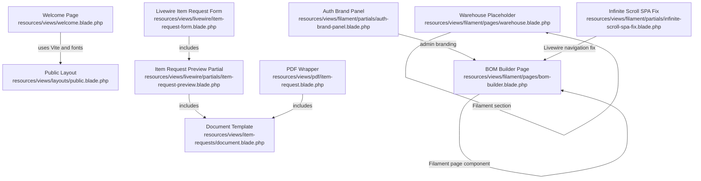
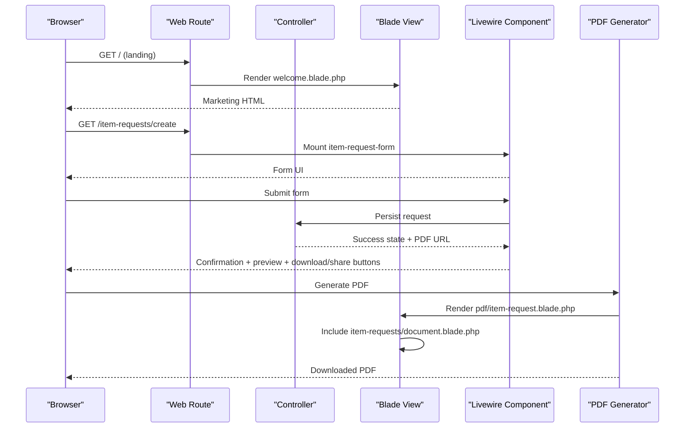
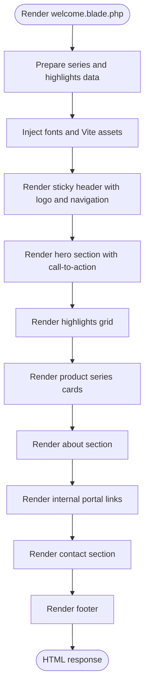
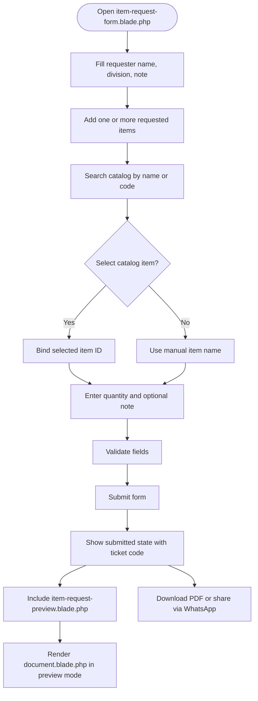
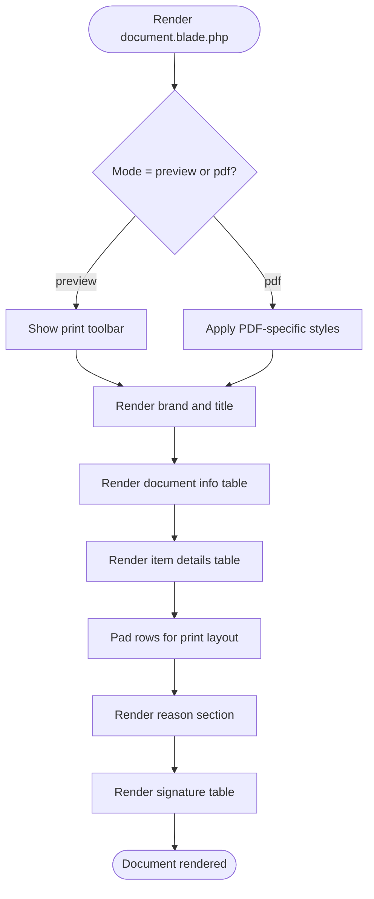
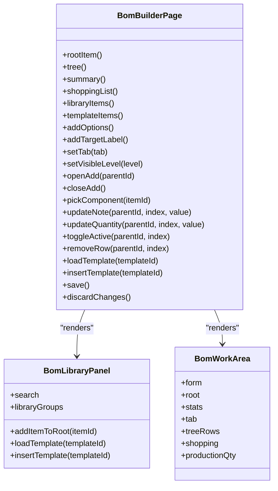
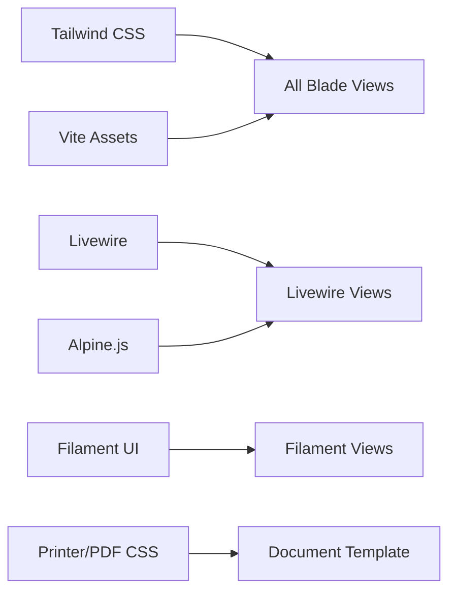

# Blade Templates

<cite>
**Referenced Files in This Document**   
- [welcome.blade.php](file://resources/views/welcome.blade.php)
- [public.blade.php](file://resources/views/layouts/public.blade.php)
- [item-request-form.blade.php](file://resources/views/livewire/item-request-form.blade.php)
- [item-request-preview.blade.php](file://resources/views/livewire/partials/item-request-preview.blade.php)
- [document.blade.php](file://resources/views/item-requests/document.blade.php)
- [item-request.blade.php](file://resources/views/pdf/item-request.blade.php)
- [bom-builder.blade.php](file://resources/views/filament/pages/bom-builder.blade.php)
- [warehouse.blade.php](file://resources/views/filament/pages/warehouse.blade.php)
- [auth-brand-panel.blade.php](file://resources/views/filament/partials/auth-brand-panel.blade.php)
- [infinite-scroll-spa-fix.blade.php](file://resources/views/filament/partials/infinite-scroll-spa-fix.blade.php)
</cite>

## Table of Contents
1. [Introduction](#introduction)
2. [Project Structure](#project-structure)
3. [Core Components](#core-components)
4. [Architecture Overview](#architecture-overview)
5. [Detailed Component Analysis](#detailed-component-analysis)
6. [Dependency Analysis](#dependency-analysis)
7. [Performance Considerations](#performance-considerations)
8. [Troubleshooting Guide](#troubleshooting-guide)
9. [Conclusion](#conclusion)

## Introduction
This document explains the Blade template layer used by the RSV Helmet application. It covers the public marketing page, the shared layout for internal pages, Livewire-driven item request forms, reusable document rendering for previews and PDFs, and Filament-based admin views such as the Bill of Materials builder. The goal is to help developers understand how templates are organized, how data flows into them, and how they integrate with Livewire, Filament, and PDF generation.

## Project Structure
Blade templates live under `resources/views`. They are grouped by purpose:

- Public marketing landing page: `welcome.blade.php`
- Shared layout for internal pages: `layouts/public.blade.php`
- Livewire components and partials: `livewire/*`
- Reusable document template for item requests: `item-requests/document.blade.php`
- PDF wrapper for item requests: `pdf/item-request.blade.php`
- Filament admin pages and partials: `filament/pages/*`, `filament/partials/*`

**Diagram sources**
- [welcome.blade.php:55-70](file://resources/views/welcome.blade.php#L55-L70)
- [public.blade.php:1-17](file://resources/views/layouts/public.blade.php#L1-L17)
- [item-request-form.blade.php:77-77](file://resources/views/livewire/item-request-form.blade.php#L77-L77)
- [item-request-preview.blade.php:1-4](file://resources/views/livewire/partials/item-request-preview.blade.php#L1-L4)
- [document.blade.php:282-398](file://resources/views/item-requests/document.blade.php#L282-L398)
- [item-request.blade.php:1-21](file://resources/views/pdf/item-request.blade.php#L1-L21)
- [bom-builder.blade.php:1-28](file://resources/views/filament/pages/bom-builder.blade.php#L1-L28)
- [warehouse.blade.php:1-14](file://resources/views/filament/pages/warehouse.blade.php#L1-L14)
- [auth-brand-panel.blade.php:1-29](file://resources/views/filament/partials/auth-brand-panel.blade.php#L1-L29)
- [infinite-scroll-spa-fix.blade.php:1-20](file://resources/views/filament/partials/infinite-scroll-spa-fix.blade.php#L1-L20)

**Section sources**
- [welcome.blade.php:55-70](file://resources/views/welcome.blade.php#L55-L70)
- [public.blade.php:1-17](file://resources/views/layouts/public.blade.php#L1-L17)
- [bom-builder.blade.php:1-28](file://resources/views/filament/pages/bom-builder.blade.php#L1-L28)

## Core Components
The Blade layer has several core responsibilities:

- **Public marketing page**: Renders a full landing page with product series, highlights, about section, internal portal links, and contact information. It uses Tailwind CSS classes and Vite asset injection.
- **Shared layout**: Provides a minimal header, main content slot, footer, and Livewire script/style integration for internal pages.
- **Livewire item request form**: A dynamic form that lets users select items, add multiple lines, search catalog items, submit requests, preview generated documents, download PDFs, and share via WhatsApp.
- **Document template**: A reusable A4-oriented HTML/CSS template for printing or generating PDFs. It supports two modes: preview and PDF.
- **PDF wrapper**: Wraps the document template for server-side PDF generation.
- **Filament BOM builder**: A complex interactive page for building and editing bill-of-materials trees, including drag-and-drop, cost summaries, shopping lists, and component libraries.
- **Filament placeholders and partials**: Simple placeholder pages and reusable branding/navigation helpers for the admin panel.

**Section sources**
- [welcome.blade.php:1-489](file://resources/views/welcome.blade.php#L1-L489)
- [public.blade.php:1-52](file://resources/views/layouts/public.blade.php#L1-L52)
- [item-request-form.blade.php:1-419](file://resources/views/livewire/item-request-form.blade.php#L1-L419)
- [document.blade.php:1-398](file://resources/views/item-requests/document.blade.php#L1-L398)
- [item-request.blade.php:1-21](file://resources/views/pdf/item-request.blade.php#L1-L21)
- [bom-builder.blade.php:1-800](file://resources/views/filament/pages/bom-builder.blade.php#L1-L800)

## Architecture Overview
At runtime, Blade templates render different user-facing experiences:

- Visitors see the marketing landing page built from `welcome.blade.php`.
- Internal users use Livewire-powered forms and Filament admin pages.
- Generated documents reuse the same document template for both on-screen preview and PDF output.

**Diagram sources**
- [welcome.blade.php:55-70](file://resources/views/welcome.blade.php#L55-L70)
- [item-request-form.blade.php:134-416](file://resources/views/livewire/item-request-form.blade.php#L134-L416)
- [item-request.blade.php:1-21](file://resources/views/pdf/item-request.blade.php#L1-L21)
- [document.blade.php:282-398](file://resources/views/item-requests/document.blade.php#L282-L398)

## Detailed Component Analysis

### Public Landing Page
The landing page defines local data arrays for product series and highlights, then renders sections for hero, highlights, product series, about, internal portal access, and contact details. It injects fonts and Vite assets and uses Tailwind utility classes for responsive design.

Key behaviors:
- Local PHP blocks prepare presentation data.
- Links route to internal item request creation and admin panel.
- External links open in new tabs with security attributes.
- Images use lazy loading where appropriate.

**Diagram sources**
- [welcome.blade.php:1-53](file://resources/views/welcome.blade.php#L1-L53)
- [welcome.blade.php:55-70](file://resources/views/welcome.blade.php#L55-L70)
- [welcome.blade.php:72-118](file://resources/views/welcome.blade.php#L72-L118)
- [welcome.blade.php:120-180](file://resources/views/welcome.blade.php#L120-L180)
- [welcome.blade.php:182-241](file://resources/views/welcome.blade.php#L182-L241)
- [welcome.blade.php:243-314](file://resources/views/welcome.blade.php#L243-L314)
- [welcome.blade.php:316-373](file://resources/views/welcome.blade.php#L316-L373)
- [welcome.blade.php:375-464](file://resources/views/welcome.blade.php#L375-L464)
- [welcome.blade.php:467-489](file://resources/views/welcome.blade.php#L467-L489)

**Section sources**
- [welcome.blade.php:1-489](file://resources/views/welcome.blade.php#L1-L489)

### Shared Public Layout
The shared layout provides a consistent shell for internal pages. It sets language, title, favicon, fonts, Vite assets, and Livewire styles/scripts. It also includes a simple header and footer, leaving the main content area for child views through `$slot`.

Key characteristics:
- Title can be overridden via `$title`.
- Uses Tailwind classes for styling.
- Integrates Livewire for interactive components.

**Section sources**
- [public.blade.php:1-52](file://resources/views/layouts/public.blade.php#L1-L52)

### Livewire Item Request Form
The Livewire form handles requester identity, division selection, optional notes, and dynamic line items. Each line supports:
- Catalog search with debounced input.
- Selection of existing items or manual entry fallback.
- Quantity and per-line notes.
- Validation feedback.
- Submission confirmation with ticket code, preview, PDF download, and WhatsApp sharing.

**Diagram sources**
- [item-request-form.blade.php:134-416](file://resources/views/livewire/item-request-form.blade.php#L134-L416)
- [item-request-form.blade.php:77-77](file://resources/views/livewire/item-request-form.blade.php#L77-L77)
- [item-request-preview.blade.php:1-4](file://resources/views/livewire/partials/item-request-preview.blade.php#L1-L4)
- [document.blade.php:282-398](file://resources/views/item-requests/document.blade.php#L282-L398)

**Section sources**
- [item-request-form.blade.php:1-419](file://resources/views/livewire/item-request-form.blade.php#L1-L419)
- [item-request-preview.blade.php:1-4](file://resources/views/livewire/partials/item-request-preview.blade.php#L1-L4)

### Document Template
The document template renders an A4-formatted item request document. It supports two modes:
- `preview`: Shows a toolbar with a print button and scales appropriately on small screens.
- `pdf`: Removes shadows and adjusts spacing for PDF rendering.

It displays:
- Branding and document title with request code.
- Document information table.
- Item details table with padded blank rows for printable space.
- Signature block for requester, production head, and inventory controller.

**Diagram sources**
- [document.blade.php:1-4](file://resources/views/item-requests/document.blade.php#L1-L4)
- [document.blade.php:221-280](file://resources/views/item-requests/document.blade.php#L221-L280)
- [document.blade.php:282-398](file://resources/views/item-requests/document.blade.php#L282-L398)

**Section sources**
- [document.blade.php:1-398](file://resources/views/item-requests/document.blade.php#L1-L398)

### PDF Wrapper
The PDF wrapper is a minimal HTML document that sets A4 page size and includes the document template in PDF mode. It delegates all formatting to the document template.

**Section sources**
- [item-request.blade.php:1-21](file://resources/views/pdf/item-request.blade.php#L1-L21)
- [document.blade.php:282-398](file://resources/views/item-requests/document.blade.php#L282-L398)

### Filament BOM Builder Page
The BOM builder page is a rich interactive interface for constructing and editing bill-of-materials structures. It integrates:
- A component table and form provided by the parent Filament page.
- A side panel for library items and templates.
- A work area showing root item, statistics, tabs for structure and shopping list, and a draggable tree.
- Live updates via Livewire wire directives and Alpine.js for drag interactions.

Key features:
- Library grouping by item type.
- Drag-and-drop reordering and nesting.
- Collapsible sub-assemblies.
- Cost calculations and shopping list totals.
- Dirty state tracking and save/discard actions.

**Diagram sources**
- [bom-builder.blade.php:1-28](file://resources/views/filament/pages/bom-builder.blade.php#L1-L28)
- [bom-builder.blade.php:30-94](file://resources/views/filament/pages/bom-builder.blade.php#L30-L94)
- [bom-builder.blade.php:96-137](file://resources/views/filament/pages/bom-builder.blade.php#L96-L137)
- [bom-builder.blade.php:138-435](file://resources/views/filament/pages/bom-builder.blade.php#L138-L435)

**Section sources**
- [bom-builder.blade.php:1-800](file://resources/views/filament/pages/bom-builder.blade.php#L1-L800)

### Filament Warehouse Placeholder
The warehouse page is currently a placeholder using a Filament section component. It informs users that inventory menus are available under dedicated groups.

**Section sources**
- [warehouse.blade.php:1-14](file://resources/views/filament/pages/warehouse.blade.php#L1-L14)

### Filament Auth Brand Panel
The auth brand panel provides branding copy for authentication-related pages within the admin panel. It describes system capabilities like real-time stock, BOM, batch production, and inter-department item requests.

**Section sources**
- [auth-brand-panel.blade.php:1-29](file://resources/views/filament/partials/auth-brand-panel.blade.php#L1-L29)

### Filament Infinite Scroll SPA Fix
This partial adds JavaScript to handle Livewire navigation events and dynamically adjust table container height for infinite scrolling behavior. It removes any previous dynamic style on navigation start and recalculates max-height after navigation completes.

**Section sources**
- [infinite-scroll-spa-fix.blade.php:1-20](file://resources/views/filament/partials/infinite-scroll-spa-fix.blade.php#L1-L20)

## Dependency Analysis
Blade templates depend on:
- **Tailwind CSS**: Used extensively across all views for styling.
- **Vite**: Injects compiled CSS and JS assets.
- **Livewire**: Powers interactive forms and components.
- **Alpine.js**: Used for lightweight client-side interactions such as clipboard copying and drag state.
- **Filament**: Provides page shells, sections, icons, and UI primitives for admin views.
- **PDF generation**: Relies on the document template being printer/PDF-friendly.

**Diagram sources**
- [welcome.blade.php:55-70](file://resources/views/welcome.blade.php#L55-L70)
- [public.blade.php:12-17](file://resources/views/layouts/public.blade.php#L12-L17)
- [item-request-form.blade.php:34-48](file://resources/views/livewire/item-request-form.blade.php#L34-L48)
- [bom-builder.blade.php:1-28](file://resources/views/filament/pages/bom-builder.blade.php#L1-L28)
- [document.blade.php:221-280](file://resources/views/item-requests/document.blade.php#L221-L280)

**Section sources**
- [welcome.blade.php:55-70](file://resources/views/welcome.blade.php#L55-L70)
- [public.blade.php:12-17](file://resources/views/layouts/public.blade.php#L12-L17)
- [item-request-form.blade.php:34-48](file://resources/views/livewire/item-request-form.blade.php#L34-L48)
- [bom-builder.blade.php:1-28](file://resources/views/filament/pages/bom-builder.blade.php#L1-L28)
- [document.blade.php:221-280](file://resources/views/item-requests/document.blade.php#L221-L280)

## Performance Considerations
- **Asset loading**: Both the landing page and shared layout inject Vite assets; ensure production builds are optimized.
- **Image optimization**: The landing page uses external images; consider lazy loading and CDN caching strategies.
- **Livewire interactions**: Debounced inputs reduce server round-trips during catalog searches.
- **Print/PDF rendering**: The document template uses fixed dimensions and avoids heavy DOM elements to improve print performance.
- **Filament tables**: Infinite scroll fixes adjust container heights to avoid layout thrashing during navigation.

[No sources needed since this section provides general guidance]

## Troubleshooting Guide
Common issues and remedies:

- **Missing assets or fonts**: Verify that Vite is configured and that `@fonts` and `@vite` directives resolve correctly in layouts and the landing page.
- **Livewire not updating**: Ensure Livewire scripts/styles are included via `@livewireStyles` and `@livewireScripts` in the layout.
- **Preview not showing**: Confirm that the item request preview partial includes the document template with the correct mode variable.
- **PDF not rendering properly**: Check that the PDF wrapper includes the document template in PDF mode and that printer styles are applied.
- **Drag-and-drop not working in BOM builder**: Verify Alpine.js bindings and Livewire wire directives are present for drag events and row updates.
- **Infinite scroll broken after navigation**: Ensure the infinite scroll SPA fix partial is loaded so Livewire navigation events reset and recalculate table heights.

**Section sources**
- [public.blade.php:12-17](file://resources/views/layouts/public.blade.php#L12-L17)
- [item-request-form.blade.php:77-77](file://resources/views/livewire/item-request-form.blade.php#L77-L77)
- [item-request-preview.blade.php:1-4](file://resources/views/livewire/partials/item-request-preview.blade.php#L1-L4)
- [item-request.blade.php:1-21](file://resources/views/pdf/item-request.blade.php#L1-L21)
- [bom-builder.blade.php:223-367](file://resources/views/filament/pages/bom-builder.blade.php#L223-L367)
- [infinite-scroll-spa-fix.blade.php:1-20](file://resources/views/filament/partials/infinite-scroll-spa-fix.blade.php#L1-L20)

## Conclusion
The Blade template layer in this project cleanly separates concerns between public marketing content, internal Livewire-driven workflows, reusable document rendering, and Filament admin interfaces. By leveraging shared layouts, partials, and printer-friendly styles, the application maintains consistency across web and PDF outputs while supporting interactive features through Livewire and Alpine.js. Developers should extend templates following these patterns: keep presentation logic in Blade, delegate business logic to controllers and services, and reuse document templates for both preview and PDF generation.

[No sources needed since this section summarizes without analyzing specific files]