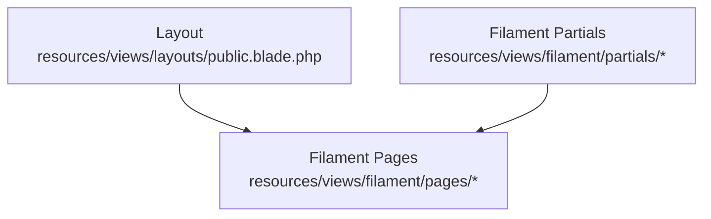
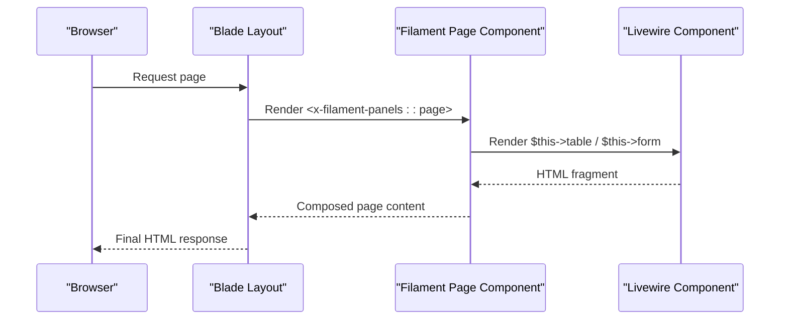
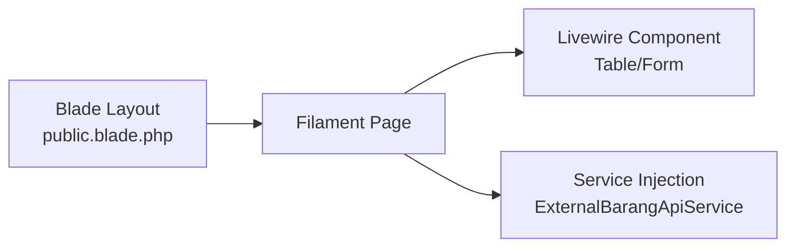

# Blade Templates

<cite>
**Referenced Files in This Document**
- [public.blade.php](file://resources/views/layouts/public.blade.php)
- [batch-realization.blade.php](file://resources/views/filament/pages/batch-realization.blade.php)
- [batch-realization-detail.blade.php](file://resources/views/filament/pages/batch-realization-detail.blade.php)
- [bom-builder.blade.php](file://resources/views/filament/pages/bom-builder.blade.php)
- [stock-card.blade.php](file://resources/views/filament/pages/stock-card.blade.php)
- [warehouse.blade.php](file://resources/views/filament/pages/warehouse.blade.php)
- [daftar-barang-eksternal.blade.php](file://resources/views/filament/pages/daftar-barang-eksternal.blade.php)
- [inventory-balance-summary.blade.php](file://resources/views/filament/pages/inventory-balance-summary.blade.php)
- [item-request-settings.blade.php](file://resources/views/filament/pages/item-request-settings.blade.php)
- [auth-brand-panel.blade.php](file://resources/views/filament/partials/auth-brand-panel.blade.php)
- [auth-lockup.blade.php](file://resources/views/filament/partials/auth-lockup.blade.php)
- [infinite-scroll-spa-fix.blade.php](file://resources/views/filament/partials/infinite-scroll-spa-fix.blade.php)
</cite>

## Table of Contents
1. [Introduction](#introduction)
2. [Project Structure](#project-structure)
3. [Core Components](#core-components)
4. [Architecture Overview](#architecture-overview)
5. [Detailed Component Analysis](#detailed-component-analysis)
6. [Dependency Analysis](#dependency-analysis)
7. [Performance Considerations](#performance-considerations)
8. [Troubleshooting Guide](#troubleshooting-guide)
9. [Conclusion](#conclusion)

## Introduction
This document explains the Blade template structure and organization for the application, focusing on:
- The main layout system with `resources/views/layouts/public.blade.php` as the public layout template.
- Filament-specific page views under `resources/views/filament/pages/`.
- Partial organization under `resources/views/filament/partials/`.
- Template inheritance, component inclusion, data passing patterns, custom directives, Tailwind CSS styling, responsive design, and accessibility considerations.

The goal is to help developers understand how pages are composed, how Livewire and Filament integrate into Blade templates, and how to extend or maintain these templates consistently.

## Project Structure
The Blade templates are organized by feature area:
- Public layout: `resources/views/layouts/public.blade.php`
- Filament pages: `resources/views/filament/pages/*.blade.php`
- Filament partials: `resources/views/filament/partials/*.blade.php`

**Diagram sources**
- [public.blade.php:1-77](file://resources/views/layouts/public.blade.php#L1-L77)
- [batch-realization.blade.php:1-4](file://resources/views/filament/pages/batch-realization.blade.php#L1-L4)
- [bom-builder.blade.php:1-800](file://resources/views/filament/pages/bom-builder.blade.php#L1-L800)
- [auth-brand-panel.blade.php:1-29](file://resources/views/filament/partials/auth-brand-panel.blade.php#L1-L29)
- [auth-lockup.blade.php:1-6](file://resources/views/filament/partials/auth-lockup.blade.php#L1-L6)

**Section sources**
- [public.blade.php:1-77](file://resources/views/layouts/public.blade.php#L1-L77)

## Core Components
Key components and responsibilities:
- Public layout (`public.blade.php`) provides the HTML shell, header, main content slot, footer, and integrates Vite, Livewire styles/scripts, and fonts.
- Filament pages wrap their content inside `<x-filament-panels::page>` and render either a Livewire table via `$this->table`, a form via `$this->form`, or custom UI sections.
- Partials provide reusable UI fragments such as auth branding and SPA navigation fixes for Livewire tables.

Responsibilities breakdown:
- Layout: global assets, meta tags, title, header, footer, and Livewire integration.
- Pages: presentation layer for Filament features (tables, forms, dashboards).
- Partials: small reusable pieces used across authentication screens and Livewire interactions.

**Section sources**
- [public.blade.php:1-77](file://resources/views/layouts/public.blade.php#L1-L77)
- [batch-realization.blade.php:1-4](file://resources/views/filament/pages/batch-realization.blade.php#L1-L4)
- [stock-card.blade.php:1-4](file://resources/views/filament/pages/stock-card.blade.php#L1-L4)
- [inventory-balance-summary.blade.php:1-4](file://resources/views/filament/pages/inventory-balance-summary.blade.php#L1-L4)
- [auth-brand-panel.blade.php:1-29](file://resources/views/filament/partials/auth-brand-panel.blade.php#L1-L29)
- [infinite-scroll-spa-fix.blade.php:1-20](file://resources/views/filament/partials/infinite-scroll-spa-fix.blade.php#L1-L20)

## Architecture Overview
The rendering architecture combines Blade layouts, Filament panel components, and Livewire components:
- Blade renders the layout and includes page content.
- Filament’s `<x-filament-panels::page>` component provides consistent admin UI scaffolding.
- Livewire components supply dynamic tables and forms through properties like `$this->table` and `$this->form`.

**Diagram sources**
- [public.blade.php:1-77](file://resources/views/layouts/public.blade.php#L1-L77)
- [batch-realization.blade.php:1-4](file://resources/views/filament/pages/batch-realization.blade.php#L1-L4)
- [item-request-settings.blade.php:1-12](file://resources/views/filament/pages/item-request-settings.blade.php#L1-L12)

## Detailed Component Analysis

### Public Layout System
The public layout defines the site-wide structure:
- HTML head includes charset, viewport, theme color, dynamic title, favicon, fonts, Vite assets, and Livewire styles.
- Body uses Tailwind utility classes for layout, colors, typography, and selection styling.
- Header contains branding, status indicator, and an admin panel link.
- Main content area uses a slot for page content.
- Footer includes copyright and operational notes.
- Scripts include Livewire scripts at the end of the body.

Template inheritance and composition:
- Child pages extend this layout using Blade’s layout mechanism and inject content into the layout’s slot.
- Data passed from controllers or Livewire components is available within the layout and child views.

Styling and responsiveness:
- Uses Tailwind CSS classes for spacing, grid, flexbox, and responsive breakpoints (sm:, lg:).
- Backdrop blur, sticky positioning, and layered z-indexing create a modern header.

Accessibility:
- Semantic elements (`header`, `main`, `footer`).
- Descriptive titles and labels where applicable.
- Focus ring utilities for interactive elements.

Custom directives:
- `@fonts`: loads fonts.
- `@vite`: compiles and includes Vite assets.
- `@livewireStyles` / `@livewireScripts`: integrates Livewire assets.

**Section sources**
- [public.blade.php:1-77](file://resources/views/layouts/public.blade.php#L1-L77)

### Filament Page Views

#### Batch Realization List
- Wraps content in `<x-filament-panels::page>`.
- Renders a Livewire table via `{{ $this->table }}`.
- Minimal view; logic resides in the Livewire component.

Data passing pattern:
- Livewire component exposes `$this->table` which Blade renders directly.

**Section sources**
- [batch-realization.blade.php:1-4](file://resources/views/filament/pages/batch-realization.blade.php#L1-L4)

#### Batch Realization Detail
- Uses `@use` to import PHP classes and helpers (`App\Models\ProductionBatch`, `Illuminate\Support\Number`).
- Computes summary metrics and formats numbers using locale-aware formatting.
- Presents sections for batch overview, production outputs, and material realizations.
- Includes print-friendly styles to hide sidebar/header when printing.

Data processing:
- Aggregates planned vs actual quantities and calculates percentages.
- Formats signed differences and displays badges for statuses.

Accessibility and responsiveness:
- Grid layouts adapt across screen sizes.
- Tables use semantic headings and structured rows.

**Section sources**
- [batch-realization-detail.blade.php:1-264](file://resources/views/filament/pages/batch-realization-detail.blade.php#L1-L264)

#### BOM Builder
- Complex interactive page built with Blade + Livewire + Alpine.js attributes.
- Prepares data in Blade using `@php` blocks: root item, tree rows, summary, shopping list, library items, templates, add options, and target label.
- Provides a side panel for library search and template loading.
- Work area includes form, stats, tabs for BOM structure and shopping list, drag-and-drop row reordering, and actions for adding/removing components.
- Extensive inline CSS variables define theming and dark mode support.

Interactivity:
- `wire:model.live.debounce` for live search and quantity updates.
- `x-on:dragstart`, `x-on:drop`, and other Alpine directives for drag-and-drop behavior.
- Tab switching via `wire:click="setTab(...)"`.

Accessibility:
- ARIA roles and labels for tabs and inputs.
- Descriptive titles and aria-labels for buttons and inputs.

Responsive design:
- Grid-based layout with sticky sidebar.
- Scrollable areas for large trees and tables.

**Section sources**
- [bom-builder.blade.php:1-800](file://resources/views/filament/pages/bom-builder.blade.php#L1-L800)

#### Stock Card
- Simple wrapper around a Livewire table.
- No additional markup beyond the Filament page component.

**Section sources**
- [stock-card.blade.php:1-4](file://resources/views/filament/pages/stock-card.blade.php#L1-L4)

#### Warehouse Interface
- Placeholder section using Filament’s section component.
- Provides descriptive text indicating menu grouping and future expansion.

**Section sources**
- [warehouse.blade.php:1-14](file://resources/views/filament/pages/warehouse.blade.php#L1-L14)

#### External Items List (Daftar Barang Eksternal)
- Injects an external API service via `@inject('apiService', 'App\Services\ExternalBarangApiService')`.
- Groups data by date and displays compact statistics and grouped tables.
- Uses Filament buttons for filter application and reset.

Data flow:
- Calls `$this->getGroupedData($apiService)` to prepare grouped data.
- Iterates over groups and variants to render summaries and detail rows.

Accessibility and responsiveness:
- Responsive grid for statistics.
- Tables wrapped in overflow containers for horizontal scrolling.

**Section sources**
- [daftar-barang-eksternal.blade.php:1-151](file://resources/views/filament/pages/daftar-barang-eksternal.blade.php#L1-L151)

#### Inventory Balance Summary
- Simple wrapper around a Livewire table.

**Section sources**
- [inventory-balance-summary.blade.php:1-4](file://resources/views/filament/pages/inventory-balance-summary.blade.php#L1-L4)

#### Item Request Settings
- Contains a form bound to a Livewire component via `wire:submit="save"`.
- Renders the form fields using `$this->form`.
- Includes a submit button with an icon.

**Section sources**
- [item-request-settings.blade.php:1-12](file://resources/views/filament/pages/item-request-settings.blade.php#L1-L12)

### Partials Organization

#### Auth Brand Panel
- Provides branding content for authentication pages.
- Uses semantic headings and lists to describe features.
- Hidden visually via `aria-hidden="true"` for decorative purposes.

**Section sources**
- [auth-brand-panel.blade.php:1-29](file://resources/views/filament/partials/auth-brand-panel.blade.php#L1-L29)

#### Auth Lockup
- Small logo lockup used above auth card titles.
- Decorative element marked `aria-hidden="true"`.

**Section sources**
- [auth-lockup.blade.php:1-6](file://resources/views/filament/partials/auth-lockup.blade.php#L1-L6)

#### Infinite Scroll SPA Fix
- Adds JavaScript to handle Livewire navigation events.
- Removes and recalculates dynamic table height after navigation.
- Targets Filament table container class `.fi-ta-content-ctn`.

**Section sources**
- [infinite-scroll-spa-fix.blade.php:1-20](file://resources/views/filament/partials/infinite-scroll-spa-fix.blade.php#L1-L20)

## Dependency Analysis
Relationships between templates and components:
- All Filament pages depend on `<x-filament-panels::page>` for consistent admin UI.
- Livewire components supply dynamic content via properties (`$this->table`, `$this->form`).
- Some pages inject services or compute data locally in Blade.

**Diagram sources**
- [public.blade.php:1-77](file://resources/views/layouts/public.blade.php#L1-L77)
- [batch-realization.blade.php:1-4](file://resources/views/filament/pages/batch-realization.blade.php#L1-L4)
- [daftar-barang-eksternal.blade.php:1-151](file://resources/views/filament/pages/daftar-barang-eksternal.blade.php#L1-L151)

**Section sources**
- [public.blade.php:1-77](file://resources/views/layouts/public.blade.php#L1-L77)
- [batch-realization.blade.php:1-4](file://resources/views/filament/pages/batch-realization.blade.php#L1-L4)
- [daftar-barang-eksternal.blade.php:1-151](file://resources/views/filament/pages/daftar-barang-eksternal.blade.php#L1-L151)

## Performance Considerations
- Avoid heavy computations inside Blade loops; precompute in Livewire components or services where possible.
- Use Livewire’s `wire:model.live.debounce` to reduce server round-trips during user input.
- Keep tables lightweight; consider pagination or virtualized lists for large datasets.
- Minimize inline styles; prefer Tailwind utilities and scoped CSS variables for theming.
- Leverage Filament’s built-in components to avoid reinventing common UI patterns.

[No sources needed since this section provides general guidance]

## Troubleshooting Guide
Common issues and resolutions:
- Livewire table height not adapting after navigation: ensure the infinite scroll SPA fix script is included and targets the correct container class.
- Missing assets or fonts: verify that `@fonts` and `@vite` directives are present in the layout and that Vite build is running.
- Form submissions not triggering save: confirm `wire:submit="save"` is bound and the Livewire component implements the `save` method.
- Print output includes unwanted UI: check print media queries in detailed pages to hide sidebar and headers.

**Section sources**
- [infinite-scroll-spa-fix.blade.php:1-20](file://resources/views/filament/partials/infinite-scroll-spa-fix.blade.php#L1-L20)
- [public.blade.php:1-77](file://resources/views/layouts/public.blade.php#L1-L77)
- [item-request-settings.blade.php:1-12](file://resources/views/filament/pages/item-request-settings.blade.php#L1-L12)
- [batch-realization-detail.blade.php:25-50](file://resources/views/filament/pages/batch-realization-detail.blade.php#L25-L50)

## Conclusion
The Blade template system in this project centers around a clean public layout and Filament-powered admin pages. Pages primarily delegate logic to Livewire components while keeping presentation simple and consistent. Partials offer reusable UI fragments, and Tailwind CSS ensures responsive, accessible interfaces. Custom directives streamline asset management, and careful attention to accessibility and performance improves the user experience across devices and workflows.

[No sources needed since this section summarizes without analyzing specific files]