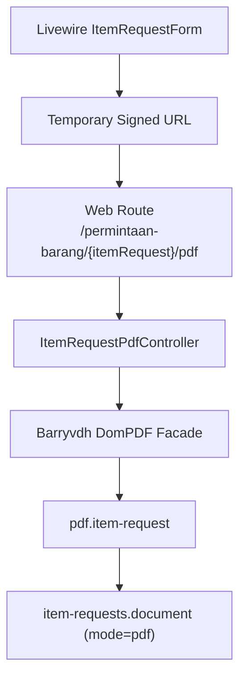
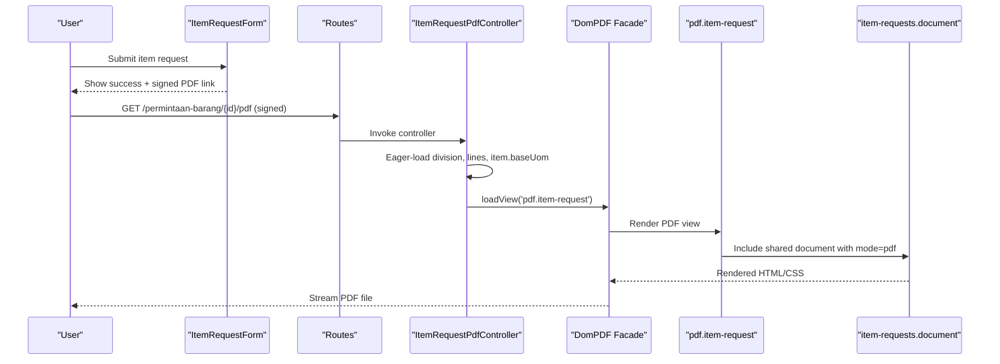
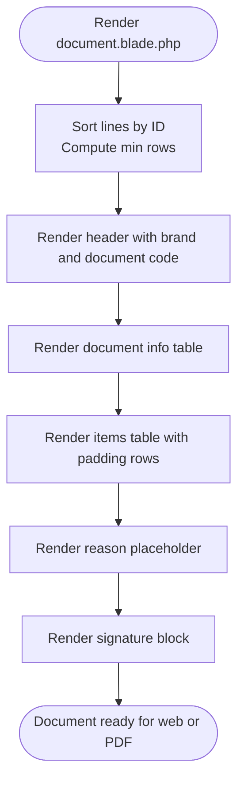
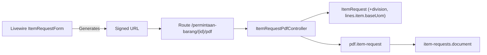

# Document Templates

<cite>
**Referenced Files in This Document**
- [document.blade.php](file://resources/views/item-requests/document.blade.php)
- [item-request.blade.php](file://resources/views/pdf/item-request.blade.php)
- [ItemRequestPdfController.php](file://app/Http/Controllers/ItemRequestPdfController.php)
- [web.php](file://routes/web.php)
- [ItemRequestForm.php](file://app/Livewire/ItemRequestForm.php)
- [ItemRequestPdfTest.php](file://tests/Feature/ItemRequestPdfTest.php)
</cite>

## Table of Contents
1. [Introduction](#introduction)
2. [Project Structure](#project-structure)
3. [Core Components](#core-components)
4. [Architecture Overview](#architecture-overview)
5. [Detailed Component Analysis](#detailed-component-analysis)
6. [Dependency Analysis](#dependency-analysis)
7. [Performance Considerations](#performance-considerations)
8. [Troubleshooting Guide](#troubleshooting-guide)
9. [Conclusion](#conclusion)

## Introduction
This document explains the item request document templates used for both web display and PDF generation. It covers:
- The shared document template structure for rendering an item request form as a printable page.
- The PDF wrapper template that prepares the environment for PDF rendering.
- Styling differences between web preview/print and PDF output.
- Data formatting rules for print-friendly output.
- Integration with the PDF generation service via the controller and routes.
- Practical guidance for creating new document templates and customizing existing ones.

## Project Structure
The document system is composed of:
- A shared Blade view for the document layout and styling.
- A PDF-specific Blade view that includes the shared document with a PDF mode flag.
- A controller that loads the PDF view, configures paper size, and streams the generated PDF.
- Routes that expose a signed URL for downloading the PDF.
- A Livewire component that generates a temporary signed PDF link after submission.

**Diagram sources**
- [web.php:15-17](file://routes/web.php#L15-L17)
- [ItemRequestPdfController.php:11-18](file://app/Http/Controllers/ItemRequestPdfController.php#L11-L18)
- [item-request.blade.php:17-18](file://resources/views/pdf/item-request.blade.php#L17-L18)
- [ItemRequestForm.php:234-240](file://app/Livewire/ItemRequestForm.php#L234-L240)

**Section sources**
- [web.php:1-18](file://routes/web.php#L1-L18)
- [ItemRequestPdfController.php:1-20](file://app/Http/Controllers/ItemRequestPdfController.php#L1-L20)
- [item-request.blade.php:1-21](file://resources/views/pdf/item-request.blade.php#L1-L21)
- [document.blade.php:1-398](file://resources/views/item-requests/document.blade.php#L1-L398)
- [ItemRequestForm.php:210-262](file://app/Livewire/ItemRequestForm.php#L210-L262)

## Core Components
- Shared document template: defines the visual structure, sections, tables, signatures, and print/PDF styles.
- PDF wrapper template: sets up the HTML head, page size, and includes the shared document in PDF mode.
- PDF controller: resolves the model, eager-loads relationships, renders the PDF view, and streams the file.
- Routes: define the signed endpoint for PDF download.
- Livewire form: creates the request, then provides a temporary signed link to download the PDF.

Key responsibilities:
- Rendering data consistently across web and PDF outputs.
- Ensuring print-friendly layouts using fixed widths, table-based structures, and explicit page settings.
- Securing PDF access through signed URLs.

**Section sources**
- [document.blade.php:1-398](file://resources/views/item-requests/document.blade.php#L1-L398)
- [item-request.blade.php:1-21](file://resources/views/pdf/item-request.blade.php#L1-L21)
- [ItemRequestPdfController.php:11-18](file://app/Http/Controllers/ItemRequestPdfController.php#L11-L18)
- [web.php:15-17](file://routes/web.php#L15-L17)
- [ItemRequestForm.php:234-240](file://app/Livewire/ItemRequestForm.php#L234-L240)

## Architecture Overview
The end-to-end flow for generating an item request PDF:

**Diagram sources**
- [ItemRequestForm.php:234-240](file://app/Livewire/ItemRequestForm.php#L234-L240)
- [web.php:15-17](file://routes/web.php#L15-L17)
- [ItemRequestPdfController.php:11-18](file://app/Http/Controllers/ItemRequestPdfController.php#L11-L18)
- [item-request.blade.php:17-18](file://resources/views/pdf/item-request.blade.php#L17-L18)
- [document.blade.php:282-398](file://resources/views/item-requests/document.blade.php#L282-L398)

## Detailed Component Analysis

### Shared Document Template: resources/views/item-requests/document.blade.php
Purpose:
- Renders the complete item request document for both web preview and PDF output.
- Uses a single source of truth for layout, content, and styling.

Structure:
- Preprocessing: sorts item lines by ID and computes minimum row count to ensure consistent spacing.
- Styles:
  - Base typography and color scheme.
  - Page container sized to A4 dimensions.
  - Header section with brand, tagline, description, and document title/code.
  - Document information table with fields like request number, date, department, requester, and need reason.
  - Items table with columns for sequence number, item name/specification, quantity, and unit.
  - Reason section placeholder for manual notes.
  - Signature block for creator, production head, and inventory control.
  - Print media queries to hide UI chrome and show only the document when printing from the browser.
  - PDF-specific overrides for tighter spacing and reduced margins.

Data binding:
- Expects an `itemRequest` object with:
  - `code`, `created_at`, `division`, `requester_name`, `note`.
  - `lines` collection where each line has:
    - `item` (nullable), `requested_item_name` (nullable), `quantity`, `note`.
    - `item.baseUom.code` for unit code.

Styling highlights:
- Fixed-width tables and cell heights for predictable pagination.
- Alternating row backgrounds for readability.
- Explicit column widths for alignment.
- Red accent lines and headers for branding.
- PDF mode class adjusts box sizing, width, and spacing.

Print behavior:
- Browser print hides everything except the document container.
- Toolbar is hidden during print.
- Paper container resets margins and shadows.

**Diagram sources**
- [document.blade.php:1-4](file://resources/views/item-requests/document.blade.php#L1-L4)
- [document.blade.php:289-398](file://resources/views/item-requests/document.blade.php#L289-L398)

**Section sources**
- [document.blade.php:1-398](file://resources/views/item-requests/document.blade.php#L1-L398)

### PDF Wrapper Template: resources/views/pdf/item-request.blade.php
Purpose:
- Provides minimal HTML shell for PDF rendering.
- Sets page size to A4 and zero body margin.
- Includes the shared document with `mode = 'pdf'`.

Behavior:
- Title uses the request code.
- Delegates all layout and styling to the shared document.

**Section sources**
- [item-request.blade.php:1-21](file://resources/views/pdf/item-request.blade.php#L1-L21)

### PDF Controller: app/Http/Controllers/ItemRequestPdfController.php
Responsibilities:
- Resolves the `ItemRequest` model via route binding.
- Eager-loads related data to avoid N+1 queries: `division`, `lines.item.baseUom`.
- Renders the PDF view using the DomPDF facade.
- Configures paper size to A4.
- Streams the PDF with a filename based on the request code.

Error handling:
- If the model is not found, standard Laravel model not found behavior applies.
- Access is protected by signed route middleware; unsigned requests are forbidden.

**Section sources**
- [ItemRequestPdfController.php:11-18](file://app/Http/Controllers/ItemRequestPdfController.php#L11-L18)

### Routes: routes/web.php
Endpoints:
- `/permintaan-barang`: Livewire form entry point.
- `/permintaan-barang/{itemRequest}/pdf`: Signed route to download the PDF.

Security:
- PDF route requires a signed URL to prevent unauthorized access.

**Section sources**
- [web.php:11-17](file://routes/web.php#L11-L17)

### Livewire Form Integration: app/Livewire/ItemRequestForm.php
After successful submission:
- Loads the submitted request with relationships.
- Generates a temporary signed URL valid for seven days.
- Passes the signed URL to the view for download.

This integration ensures users can securely download the PDF without exposing direct unauthenticated endpoints.

**Section sources**
- [ItemRequestForm.php:228-240](file://app/Livewire/ItemRequestForm.php#L228-L240)

## Dependency Analysis
Relationships among components:

Coupling and cohesion:
- The shared document template centralizes presentation logic, improving cohesion.
- The PDF wrapper isolates PDF-specific concerns while reusing the shared template.
- The controller depends on the DomPDF facade and model relationships but remains thin.

External dependencies:
- Barryvdh DomPDF facade for PDF generation.
- Laravel routing and signed URL utilities.

Potential circular dependencies:
- None observed; views are included by controllers/routes, not vice versa.

**Diagram sources**
- [ItemRequestForm.php:234-240](file://app/Livewire/ItemRequestForm.php#L234-L240)
- [web.php:15-17](file://routes/web.php#L15-L17)
- [ItemRequestPdfController.php:11-18](file://app/Http/Controllers/ItemRequestPdfController.php#L11-L18)
- [item-request.blade.php:17-18](file://resources/views/pdf/item-request.blade.php#L17-L18)
- [document.blade.php:282-398](file://resources/views/item-requests/document.blade.php#L282-L398)

**Section sources**
- [ItemRequestPdfController.php:11-18](file://app/Http/Controllers/ItemRequestPdfController.php#L11-L18)
- [web.php:15-17](file://routes/web.php#L15-L17)
- [item-request.blade.php:17-18](file://resources/views/pdf/item-request.blade.php#L17-L18)
- [document.blade.php:282-398](file://resources/views/item-requests/document.blade.php#L282-L398)

## Performance Considerations
- Eager loading: The controller preloads `division`, `lines.item.baseUom` to minimize database queries during PDF rendering.
- Table layout: Fixed table widths and explicit cell heights reduce layout recalculations in the PDF engine.
- Minimal DOM: The PDF wrapper keeps the HTML shell minimal to reduce parsing overhead.
- Print optimization: Browser print hides non-essential elements, reducing render cost when printing from the web interface.

Recommendations:
- Keep additional sections or images lightweight.
- Avoid heavy CSS animations or JavaScript in templates.
- Use conditional rendering to skip unnecessary blank rows when possible.

[No sources needed since this section provides general guidance]

## Troubleshooting Guide
Common issues and resolutions:

- Unsigned PDF URL returns forbidden:
  - Ensure the link is generated via the signed route helper and accessed within its validity period.
  - Verify the route is accessed with the correct signed parameters.

- Missing relationships in PDF:
  - Confirm the controller eager-loads `division`, `lines.item.baseUom`.
  - Check that the model relationships exist and return expected data.

- Blank or misaligned pages in PDF:
  - Validate that the shared document’s PDF mode classes are applied.
  - Inspect CSS overrides for `.item-request-document--pdf` and ensure they are present.

- Browser print shows extra UI:
  - Confirm the print media query hides non-document elements and only displays the document container.

- Unit codes missing:
  - Ensure each line’s item has a base unit of measure with a code.
  - Provide fallback values if units are optional.

Validation references:
- Feature tests assert that signed URLs return PDF content and unsigned requests are forbidden.

**Section sources**
- [ItemRequestPdfTest.php:17-43](file://tests/Feature/ItemRequestPdfTest.php#L17-L43)
- [ItemRequestPdfController.php:11-18](file://app/Http/Controllers/ItemRequestPdfController.php#L11-L18)
- [document.blade.php:221-279](file://resources/views/item-requests/document.blade.php#L221-L279)

## Conclusion
The item request document system uses a shared Blade template for consistent presentation across web and PDF outputs. The PDF wrapper template delegates layout to the shared document while configuring the PDF environment. The controller integrates with DomPDF to stream secure, signed PDF downloads. By following the established patterns—eager-loading relationships, using fixed table layouts, and applying PDF-specific style overrides—you can create new document templates and customize existing ones reliably.

[No sources needed since this section summarizes without analyzing specific files]