# BOM Builder View

<cite>
**Referenced Files in This Document**
- [BomBuilder.php](file://app/Filament/Pages/BomBuilder.php)
- [bom-builder.blade.php](file://resources/views/filament/pages/bom-builder.blade.php)
- [BomExplosionService.php](file://app/Services/BomExplosionService.php)
</cite>

## Table of Contents
1. [Introduction](#introduction)
2. [Project Structure](#project-structure)
3. [Core Components](#core-components)
4. [Architecture Overview](#architecture-overview)
5. [Detailed Component Analysis](#detailed-component-analysis)
6. [Dependency Analysis](#dependency-analysis)
7. [Performance Considerations](#performance-considerations)
8. [Troubleshooting Guide](#troubleshooting-guide)
9. [Conclusion](#conclusion)

## Introduction
This document explains the Bill of Materials builder interface used to create, visualize, and validate nested product structures. It covers the interactive workflow for adding components, organizing sub-assemblies, calculating real-time costs and quantities, exporting results, and validating structural integrity. It also documents how the view integrates with the application’s data model and service layer, including the role of `BomExplosionService` for raw material explosion logic.

The interface is implemented as a Filament page backed by a Livewire component and rendered through a Blade view. Users select a parent item, build its composition tree, adjust quantities and notes, toggle component activity, reorder or nest components via drag-and-drop, preview aggregated purchasing needs, and persist changes.

## Project Structure
The BOM builder spans three primary files:

| File | Responsibility |
|---|---|
| `app/Filament/Pages/BomBuilder.php` | Livewire page controller managing state, validation, persistence, calculations, export, and UI actions. |
| `resources/views/filament/pages/bom-builder.blade.php` | Blade template rendering the two-column layout, component library, templates, tree table, shopping list, and Alpine.js drag-and-drop behavior. |
| `app/Services/BomExplosionService.php` | Service that explodes production batch requirements into leaf materials and compares them against inventory balances. |

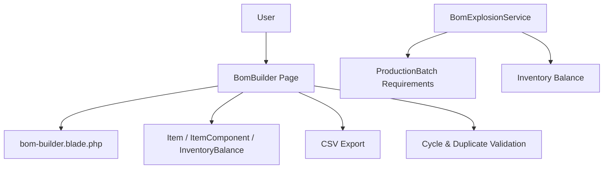

**Diagram sources**
- [BomBuilder.php:26-42](file://app/Filament/Pages/BomBuilder.php#L26-L42)
- [bom-builder.blade.php:30-10](file://resources/views/filament/pages/bom-builder.blade.php#L30-L10)
- [BomExplosionService.php:11-22](file://app/Services/BomExplosionService.php#L11-L22)

**Section sources**
- [BomBuilder.php:26-42](file://app/Filament/Pages/BomBuilder.php#L26-L42)
- [bom-builder.blade.php:1-28](file://resources/views/filament/pages/bom-builder.blade.php#L1-L28)
- [BomExplosionService.php:1-22](file://app/Services/BomExplosionService.php#L1-L22)

## Core Components
The BOM builder is centered around these core responsibilities:

| Area | Behavior |
|---|---|
| Parent selection | A paginated selector loads only stockable, non-variant items. Changing the parent resets unsaved work and warns the user. |
| Composition state | In-memory grouped rows per parent item track component ID, quantity, note, active flag, and sort order. |
| Tree visualization | Rows are computed recursively with level, numbering, cost, subtotal, collapse state, and child presence. |
| Real-time calculations | Per-unit cost, total cost for production quantity, row count, direct component count, unique leaf types, and maximum nesting depth are calculated live. |
| Shopping list | Leaf-level requirements are aggregated for the selected production quantity, merged with current stock, and sorted by item code. |
| Drag-and-drop | Alpine.js handles dragging from the component library and within the tree, calling backend methods to add, move, or nest components. |
| Template reuse | Existing compositions can be loaded as a new root or inserted as a sub-assembly. |
| Persistence | Changes are validated, wrapped in a transaction, and persisted as upserts with deletion of removed rows. |
| Export | A CSV stream includes header metadata, full tree rows, and the aggregated shopping list. |

**Section sources**
- [BomBuilder.php:44-105](file://app/Filament/Pages/BomBuilder.php#L44-L105)
- [BomBuilder.php:107-118](file://app/Filament/Pages/BomBuilder.php#L107-L118)
- [BomBuilder.php:214-264](file://app/Filament/Pages/BomBuilder.php#L214-L264)
- [BomBuilder.php:455-503](file://app/Filament/Pages/BomBuilder.php#L455-L503)
- [BomBuilder.php:553-612](file://app/Filament/Pages/BomBuilder.php#L553-L612)
- [BomBuilder.php:614-670](file://app/Filament/Pages/BomBuilder.php#L614-L670)
- [BomBuilder.php:721-761](file://app/Filament/Pages/BomBuilder.php#L721-L761)
- [BomBuilder.php:810-851](file://app/Filament/Pages/BomBuilder.php#L810-L851)
- [BomBuilder.php:856-903](file://app/Filament/Pages/BomBuilder.php#L856-L903)
- [BomBuilder.php:910-991](file://app/Filament/Pages/BomBuilder.php#L910-L991)
- [BomBuilder.php:1070-1129](file://app/Filament/Pages/BomBuilder.php#L1070-L1129)
- [BomBuilder.php:1136-1162](file://app/Filament/Pages/BomBuilder.php#L1136-L1162)
- [BomBuilder.php:1412-1455](file://app/Filament/Pages/BomBuilder.php#L1412-L1455)

## Architecture Overview
The BOM builder follows a layered interaction pattern:

1. The Blade view renders the UI and binds user interactions to Livewire properties and methods.
2. Livewire updates in-memory composition groups and recalculates derived views such as tree rows, summary, and shopping list.
3. Validation prevents invalid structures like self-references, duplicate components, and cycles.
4. On save, dirty groups are persisted atomically using database transactions.
5. Export streams a structured CSV combining composition details and aggregated purchasing needs.
6. `BomExplosionService` provides a separate but related capability: exploding planned production batches into raw material requirements and comparing them with inventory balances.

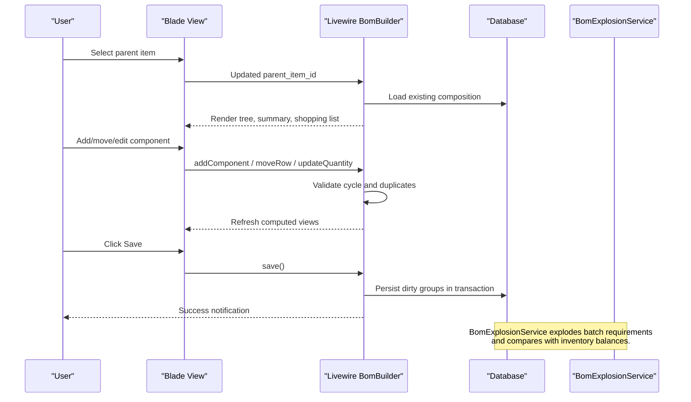

**Diagram sources**
- [bom-builder.blade.php:30-10](file://resources/views/filament/pages/bom-builder.blade.php#L30-L10)
- [BomBuilder.php:250-263](file://app/Filament/Pages/BomBuilder.php#L250-L263)
- [BomBuilder.php:455-503](file://app/Filament/Pages/BomBuilder.php#L455-L503)
- [BomBuilder.php:553-612](file://app/Filament/Pages/BomBuilder.php#L553-L612)
- [BomBuilder.php:291-332](file://app/Filament/Pages/BomBuilder.php#L291-L332)
- [BomExplosionService.php:22-107](file://app/Services/BomExplosionService.php#L22-L107)

## Detailed Component Analysis

### Livewire Page Controller: `BomBuilder`
The page controller owns all interactive state and business logic for building a BOM.

#### Key State Properties
| Property | Purpose |
|---|---|
| `data` | Form state bound to the parent item selector. |
| `productionQty` | Production quantity multiplier for totals and shopping list. |
| `tab` | Active tab between tree structure and shopping list. |
| `groups` | Nested composition rows grouped by parent item ID. |
| `dirtyGroups` | Tracks which parent groups have unsaved changes. |
| `collapsed` | IDs of collapsed sub-assemblies in the tree. |
| `visibleLevel` | Maximum visible nesting level in the tree. |
| `addParentId`, `addSearch` | Controls the inline component picker panel. |
| Caches | `allRowsCache`, `itemCache`, `summaryCache`, `shoppingCache` avoid repeated computation. |

#### Main Workflows

##### Parent Selection and Composition Loading
When the parent item changes, the controller fills the form, resets state, and loads the composition for that parent. If there were unsaved changes on a previous parent, it warns the user before switching.

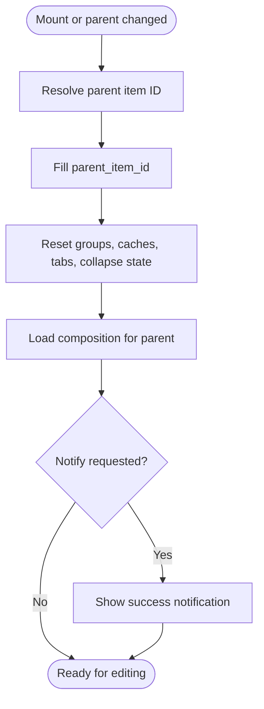

**Diagram sources**
- [BomBuilder.php:107-118](file://app/Filament/Pages/BomBuilder.php#L107-L118)
- [BomBuilder.php:250-263](file://app/Filament/Pages/BomBuilder.php#L250-L263)
- [BomBuilder.php:672-714](file://app/Filament/Pages/BomBuilder.php#L672-L714)

##### Adding Components
Adding a component validates several constraints:
- The parent must exist.
- A component cannot reference itself.
- Duplicate components under the same parent are rejected.
- Adding the component must not create a cycle.
- Only buildable items are accepted.

On success, the row is inserted at the requested index, indices are reindexed, descendant groups are preloaded, and the group is marked dirty.

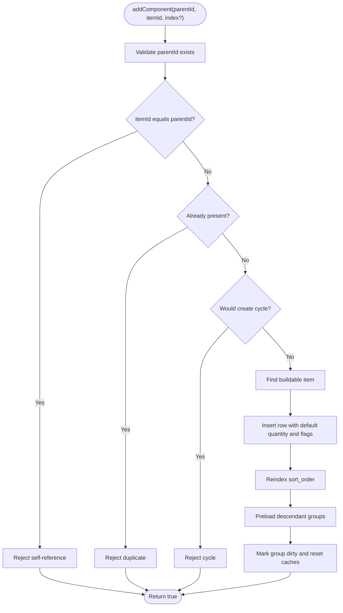

**Diagram sources**
- [BomBuilder.php:455-503](file://app/Filament/Pages/BomBuilder.php#L455-L503)

##### Moving and Nesting Components
Drag-and-drop triggers `moveRow`, which supports:
- Reordering within the same parent.
- Moving between parents.
- Nesting a component under another component by dropping “in”.
- Preventing self-nesting and cycles.
- Preventing duplicate components under the target parent.

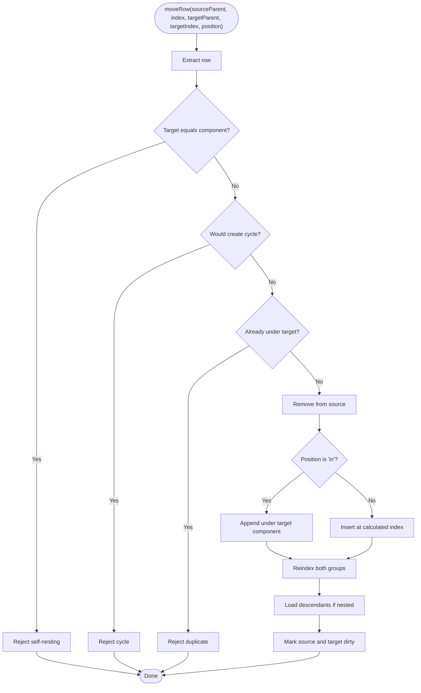

**Diagram sources**
- [BomBuilder.php:553-612](file://app/Filament/Pages/BomBuilder.php#L553-L612)

##### Quantity, Notes, and Activity
- Quantity updates normalize values below zero to a small positive threshold and mark the group dirty.
- Notes trim empty strings to null.
- Toggling activity marks the group dirty so summaries and shopping lists refresh.

**Section sources**
- [BomBuilder.php:516-551](file://app/Filament/Pages/BomBuilder.php#L516-L551)

##### Tree Computation and Visualization
The tree method computes all rows recursively, then applies:
- Visible level filtering.
- Collapsed subtree filtering based on numbered prefixes.

Each row includes:
- Unique key for drag-and-drop.
- Depth and level.
- Numbering path.
- Item object with base unit of measure and type.
- Quantity, unit cost, subtotal.
- Note, active flag, parent ID, index.
- Child presence and collapse state.

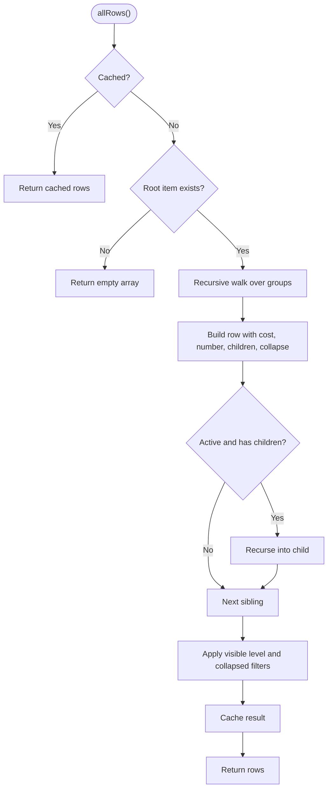

**Diagram sources**
- [BomBuilder.php:1070-1129](file://app/Filament/Pages/BomBuilder.php#L1070-L1129)
- [BomBuilder.php:810-851](file://app/Filament/Pages/BomBuilder.php#L810-L851)

**Section sources**
- [BomBuilder.php:810-851](file://app/Filament/Pages/BomBuilder.php#L810-L851)
- [BomBuilder.php:1070-1129](file://app/Filament/Pages/BomBuilder.php#L1070-L1129)

##### Real-Time Cost Calculation
Per-unit cost is computed recursively:
- If an item has no active components or would create a cycle, its standard cost is used.
- Otherwise, the sum of active component quantities multiplied by their resolved unit costs is memoized.

Summary aggregates:
- Per-unit cost across active root components.
- Total cost multiplied by production quantity.
- Row count, direct component count, unique leaf types, and maximum level.

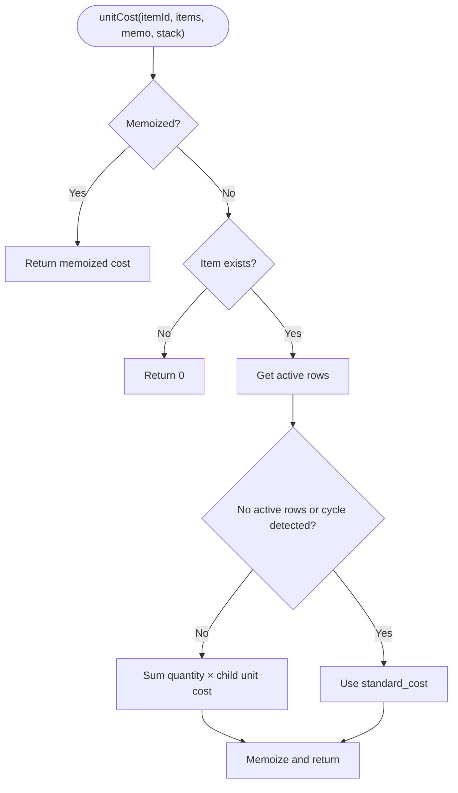

**Diagram sources**
- [BomBuilder.php:1136-1162](file://app/Filament/Pages/BomBuilder.php#L1136-L1162)
- [BomBuilder.php:856-903](file://app/Filament/Pages/BomBuilder.php#L856-L903)

**Section sources**
- [BomBuilder.php:856-903](file://app/Filament/Pages/BomBuilder.php#L856-L903)
- [BomBuilder.php:1136-1162](file://app/Filament/Pages/BomBuilder.php#L1136-L1162)

##### Shopping List and Stock Comparison
The shopping list walks the active composition tree and aggregates leaf-level requirements:
- It stops recursion when encountering cycles or excessive depth.
- It multiplies child requirements by parent quantities.
- It merges current inventory balances.
- It calculates required quantity, unit cost, subtotal, and stock availability.

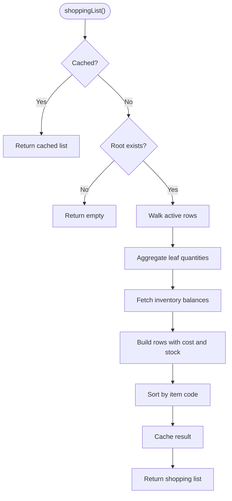

**Diagram sources**
- [BomBuilder.php:910-991](file://app/Filament/Pages/BomBuilder.php#L910-L991)

**Section sources**
- [BomBuilder.php:910-991](file://app/Filament/Pages/BomBuilder.php#L910-L991)

##### Template Handling
Templates allow:
- Loading an existing composition as the current root.
- Inserting an existing composition as a sub-assembly.
- Applying a template to a target item without saving immediately.

Validation ensures the source and target are different and that the source has components.

**Section sources**
- [BomBuilder.php:721-761](file://app/Filament/Pages/BomBuilder.php#L721-L761)
- [BomBuilder.php:763-789](file://app/Filament/Pages/BomBuilder.php#L763-L789)
- [BomBuilder.php:1468-1552](file://app/Filament/Pages/BomBuilder.php#L1468-L1552)

##### Validation and Persistence
Save performs:
- Root item validation.
- Structural validation including self-reference, duplicate components, and cycle detection.
- Transactional persistence of dirty groups.
- Dirty state reset and cache clearing.
- Success notification.

Persistence uses upsert semantics:
- Existing components are updated if changed.
- New components are created.
- Removed components are deleted.

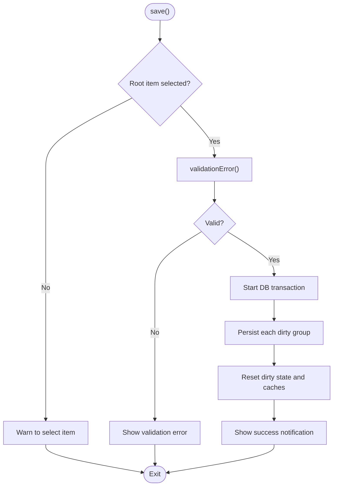

**Diagram sources**
- [BomBuilder.php:291-332](file://app/Filament/Pages/BomBuilder.php#L291-L332)
- [BomBuilder.php:1321-1348](file://app/Filament/Pages/BomBuilder.php#L1321-L1348)
- [BomBuilder.php:1412-1455](file://app/Filament/Pages/BomBuilder.php#L1412-L1455)

**Section sources**
- [BomBuilder.php:291-332](file://app/Filament/Pages/BomBuilder.php#L291-L332)
- [BomBuilder.php:1321-1348](file://app/Filament/Pages/BomBuilder.php#L1321-L1348)
- [BomBuilder.php:1412-1455](file://app/Filament/Pages/BomBuilder.php#L1412-L1455)

##### CSV Export
Export generates a streamed CSV containing:
- Header metadata: root code, name, production quantity, per-unit cost, total cost.
- Full tree rows with level, number, item details, quantity, unit, price, subtotal, and active status.
- Aggregated shopping list for the selected production quantity.

**Section sources**
- [BomBuilder.php:614-670](file://app/Filament/Pages/BomBuilder.php#L614-L670)

### Blade View: `bom-builder.blade.php`
The Blade view renders the interactive workspace:

| Section | Functionality |
|---|---|
| Left sidebar | Component library grouped by type, search input, and template list with load/insert actions. |
| Top area | Parent item selector, root info, and live statistics. |
| Tabs | Switch between BOM structure tree and shopping list. |
| Tree table | Displays hierarchical rows with grip handles, collapse toggles, quantity inputs, notes, active checkboxes, and action buttons. |
| Drag-and-drop | Alpine.js tracks drag state, hover zones, and calls Livewire methods to add, nest, or reorder components. |
| Actions | Cancel and save buttons reflect dirty state. |

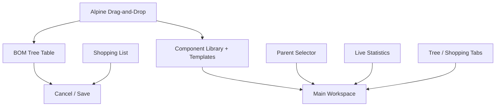

**Diagram sources**
- [bom-builder.blade.php:30-10](file://resources/views/filament/pages/bom-builder.blade.php#L30-L10)
- [bom-builder.blade.php:100-136](file://resources/views/filament/pages/bom-builder.blade.php#L100-L136)
- [bom-builder.blade.php:138-178](file://resources/views/filament/pages/bom-builder.blade.php#L138-L178)
- [bom-builder.blade.php:223-374](file://resources/views/filament/pages/bom-builder.blade.php#L223-L374)
- [bom-builder.blade.php:375-433](file://resources/views/filament/pages/bom-builder.blade.php#L375-L433)
- [bom-builder.blade.php:1253-1344](file://resources/views/filament/pages/bom-builder.blade.php#L1253-L1344)

**Section sources**
- [bom-builder.blade.php:30-10](file://resources/views/filament/pages/bom-builder.blade.php#L30-L10)
- [bom-builder.blade.php:100-136](file://resources/views/filament/pages/bom-builder.blade.php#L100-L136)
- [bom-builder.blade.php:138-178](file://resources/views/filament/pages/bom-builder.blade.php#L138-L178)
- [bom-builder.blade.php:223-374](file://resources/views/filament/pages/bom-builder.blade.php#L223-L374)
- [bom-builder.blade.php:375-433](file://resources/views/filament/pages/bom-builder.blade.php#L375-L433)
- [bom-builder.blade.php:1253-1344](file://resources/views/filament/pages/bom-builder.blade.php#L1253-L1344)

### Service Integration: `BomExplosionService`
`BomExplosionService` is responsible for exploding production batch requirements into raw materials. While the BOM builder focuses on composing and validating item structures, this service provides a related analytical capability:

- It loads batch items and their planned quantities.
- It groups active components by parent.
- It recursively explodes components while preventing cycles.
- It aggregates leaf requirements.
- It joins inventory balances to compute shortages.

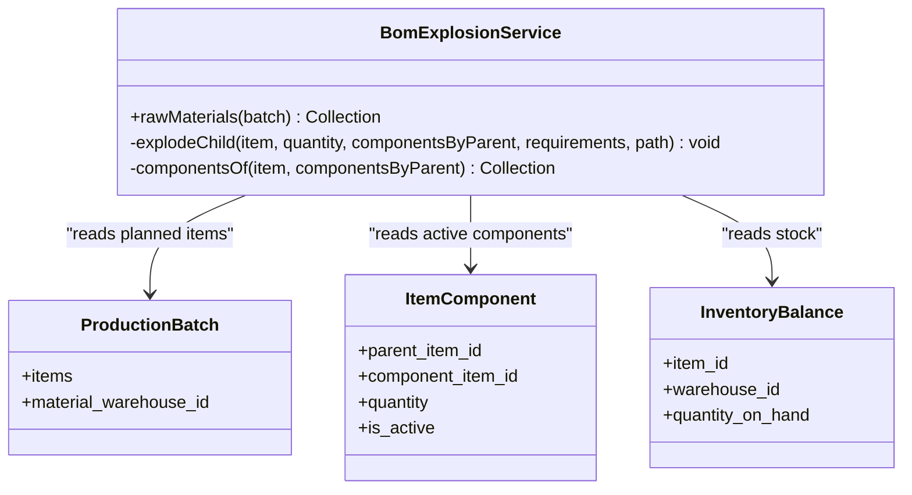

**Diagram sources**
- [BomExplosionService.php:11-22](file://app/Services/BomExplosionService.php#L11-L22)
- [BomExplosionService.php:22-107](file://app/Services/BomExplosionService.php#L22-L107)
- [BomExplosionService.php:114-156](file://app/Services/BomExplosionService.php#L114-L156)

**Section sources**
- [BomExplosionService.php:11-156](file://app/Services/BomExplosionService.php#L11-L156)

## Dependency Analysis
The BOM builder depends on:

| Dependency | Role |
|---|---|
| `Item` | Represents products and semi-finished goods used as roots and components. |
| `ItemComponent` | Stores the relationship between parent items and their components, including quantity, note, active flag, and sort order. |
| `InventoryBalance` | Provides current stock levels used in the shopping list view. |
| `InfiniteSelect` | Provides paginated, searchable selectors for parent items and templates. |
| `Filament Notifications` | Shows warnings, errors, and success messages during user interactions. |
| `BomExplosionService` | Provides raw material explosion logic for production batches; conceptually related but not directly invoked by the BOM builder view. |

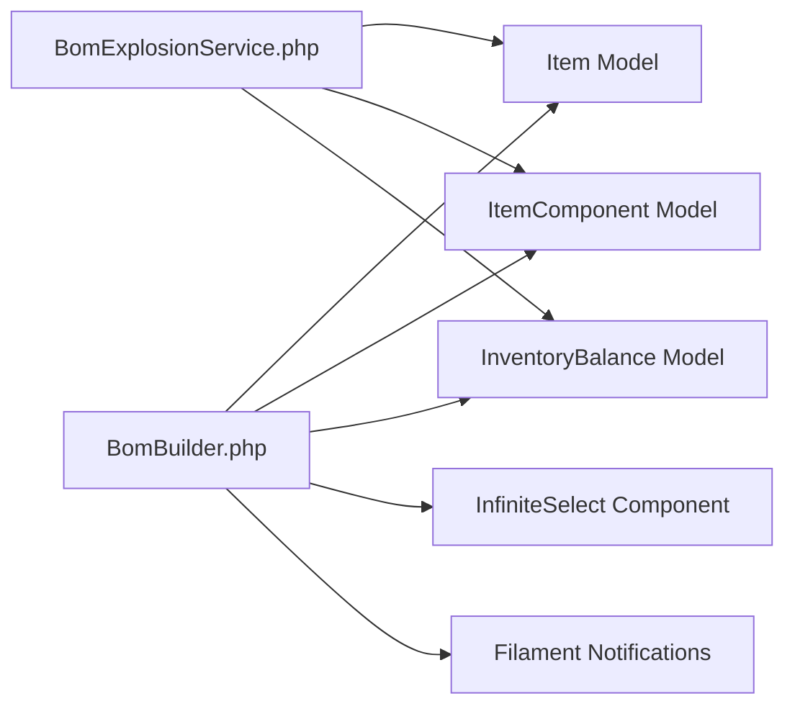

**Diagram sources**
- [BomBuilder.php:5-24](file://app/Filament/Pages/BomBuilder.php#L5-L24)
- [BomBuilder.php:1070-1129](file://app/Filament/Pages/BomBuilder.php#L1070-L1129)
- [BomBuilder.php:1213-1252](file://app/Filament/Pages/BomBuilder.php#L1213-L1252)
- [BomBuilder.php:1412-1455](file://app/Filament/Pages/BomBuilder.php#L1412-L1455)
- [BomExplosionService.php:5-9](file://app/Services/BomExplosionService.php#L5-L9)

**Section sources**
- [BomBuilder.php:5-24](file://app/Filament/Pages/BomBuilder.php#L5-L24)
- [BomBuilder.php:1070-1129](file://app/Filament/Pages/BomBuilder.php#L1070-L1129)
- [BomBuilder.php:1213-1252](file://app/Filament/Pages/BomBuilder.php#L1213-L1252)
- [BomBuilder.php:1412-1455](file://app/Filament/Pages/BomBuilder.php#L1412-L1455)
- [BomExplosionService.php:5-9](file://app/Services/BomExplosionService.php#L5-L9)

## Performance Considerations
- **Caching**: The controller caches computed rows, item maps, summaries, and shopping lists to avoid recomputation after every interaction.
- **Depth Limits**: Both tree traversal and shopping list aggregation limit recursion depth to prevent performance issues with deeply nested or cyclic structures.
- **Active Filtering**: Only active components with positive quantities participate in cost and requirement calculations.
- **Batched Queries**: Item and inventory queries use `whereIn` and grouping to reduce round trips.
- **Transaction Safety**: Persistence wraps multiple upserts and deletions in a single transaction to maintain consistency.
- **Streaming Export**: CSV export streams content instead of loading everything into memory.

[No sources needed since this section provides general guidance]

## Troubleshooting Guide

### Common Validation Errors
| Error | Cause | Resolution |
|---|---|---|
| Self-reference | A component references its own parent. | Remove the self-reference or choose a different component. |
| Duplicate component | The same component appears more than once under one parent. | Consolidate quantities or remove the duplicate row. |
| Cycle detected | Adding or moving a component creates a loop in the hierarchy. | Reorder or reassign the component so it does not become an ancestor of itself. |
| No root selected | Save was attempted without selecting a parent item. | Select a parent item first. |

**Section sources**
- [BomBuilder.php:455-503](file://app/Filament/Pages/BomBuilder.php#L455-L503)
- [BomBuilder.php:553-612](file://app/Filament/Pages/BomBuilder.php#L553-L612)
- [BomBuilder.php:291-332](file://app/Filament/Pages/BomBuilder.php#L291-L332)
- [BomBuilder.php:1321-1348](file://app/Filament/Pages/BomBuilder.php#L1321-L1348)

### Unexpected Costs or Quantities
- Verify that inactive components are intentionally disabled; they do not contribute to per-unit cost or shopping list totals.
- Check that quantities are positive; very small values may appear rounded differently.
- Confirm that the production quantity multiplier is set correctly for total cost and shopping list aggregation.

**Section sources**
- [BomBuilder.php:856-903](file://app/Filament/Pages/BomBuilder.php#L856-L903)
- [BomBuilder.php:910-991](file://app/Filament/Pages/BomBuilder.php#L910-L991)
- [BomBuilder.php:1167-1173](file://app/Filament/Pages/BomBuilder.php#L1167-L1173)

### Drag-and-Drop Issues
- Ensure the browser supports HTML5 drag-and-drop.
- Verify that the drop zone is not blocked by overlapping elements.
- Check that the dragged item is not being dropped onto itself or creating a cycle.

**Section sources**
- [bom-builder.blade.php:1253-1344](file://resources/views/filament/pages/bom-builder.blade.php#L1253-L1344)
- [BomBuilder.php:553-612](file://app/Filament/Pages/BomBuilder.php#L553-L612)

### Template Problems
- Templates require an existing composition; items without components cannot be used as templates.
- Source and target items must differ when applying a template.

**Section sources**
- [BomBuilder.php:721-761](file://app/Filament/Pages/BomBuilder.php#L721-L761)
- [BomBuilder.php:1468-1552](file://app/Filament/Pages/BomBuilder.php#L1468-L1552)

## Conclusion
The BOM builder provides a comprehensive, interactive environment for constructing nested bill-of-materials structures. It combines real-time cost and quantity calculations, robust validation against cycles and duplicates, flexible template reuse, and clear visual feedback through a tree-based interface. The integration with inventory balances enables practical purchasing insights, while the streaming CSV export supports offline analysis. Although `BomExplosionService` serves a related but distinct purpose focused on production batch requirements, it complements the BOM builder by offering a standardized approach to raw material explosion and shortage calculation.

[No sources needed since this section summarizes without analyzing specific files]