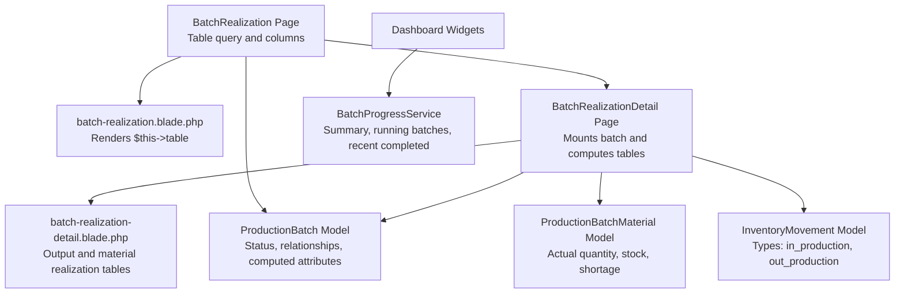
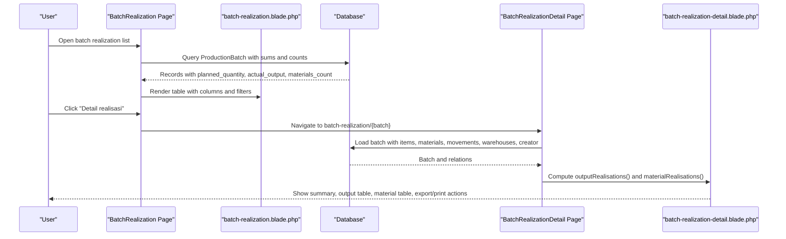
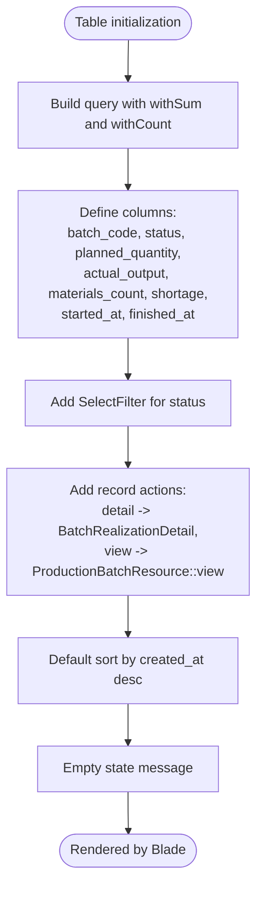
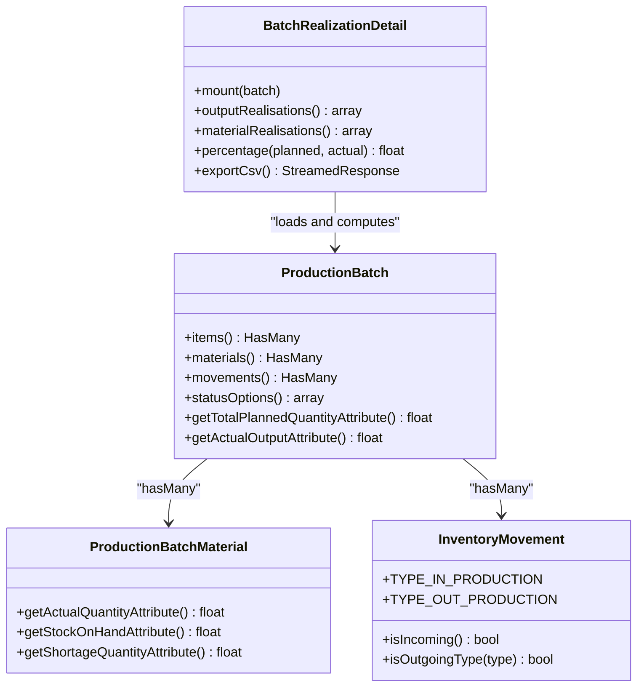
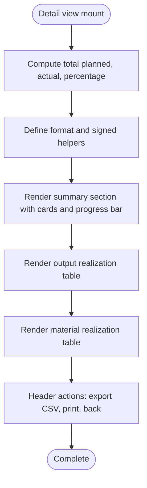
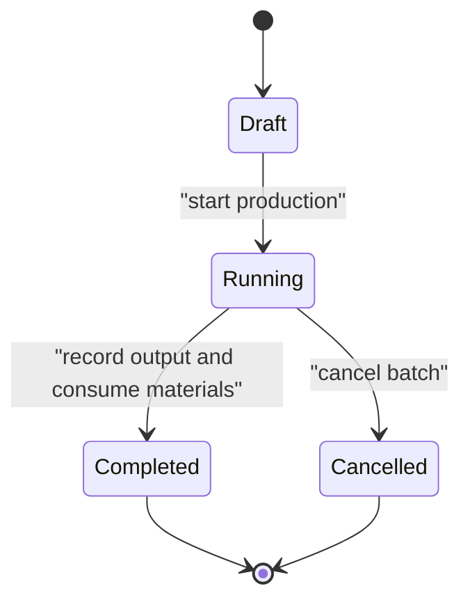
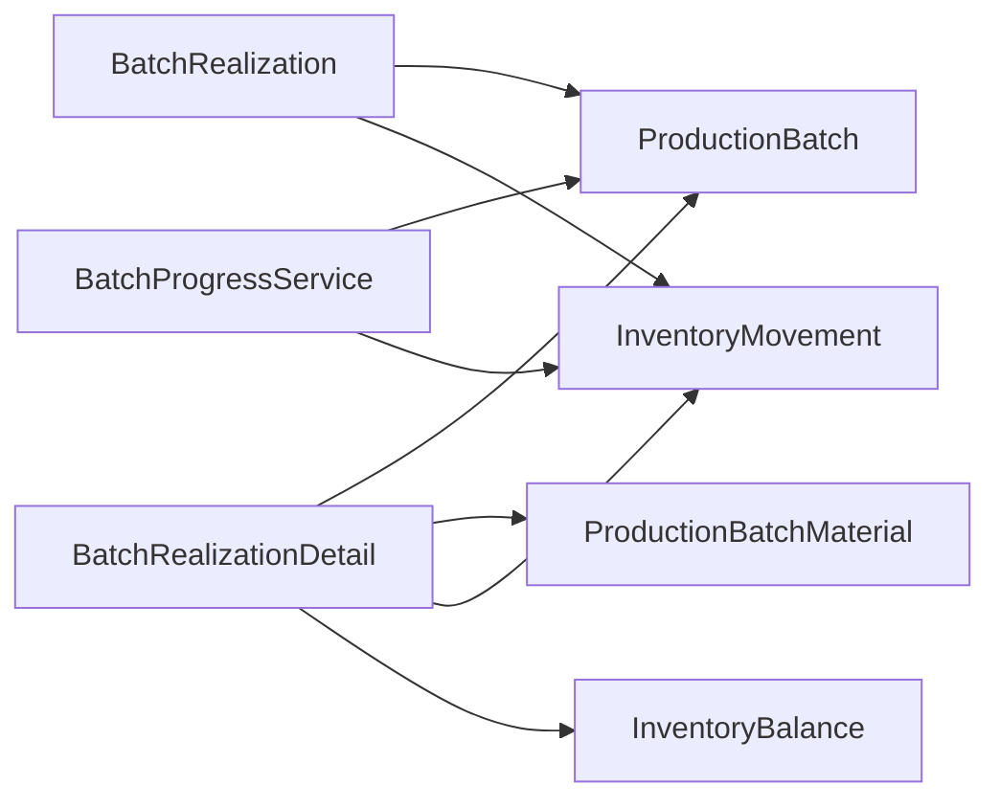
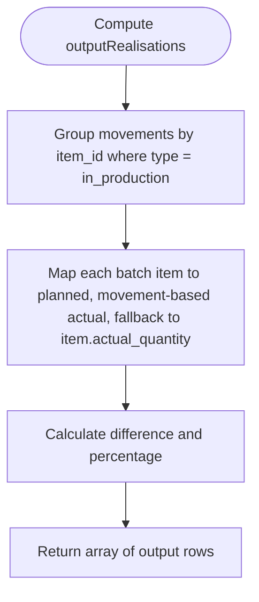
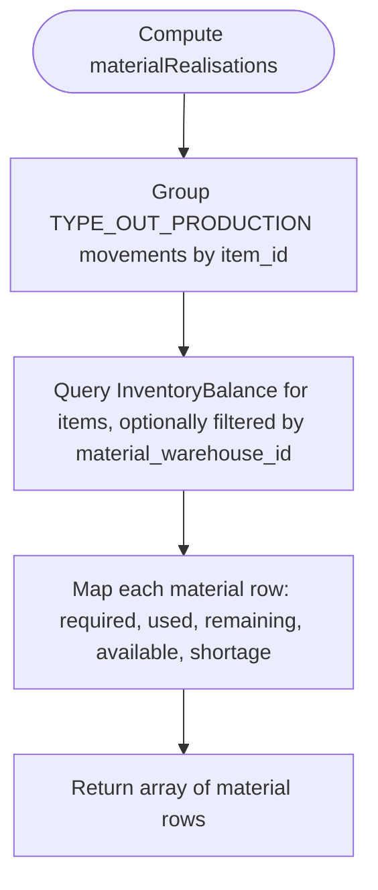

# Batch Realization View

<cite>
**Referenced Files in This Document**
- [BatchRealization.php](file://app/Filament/Pages/BatchRealization.php)
- [batch-realization.blade.php](file://resources/views/filament/pages/batch-realization.blade.php)
- [BatchRealizationDetail.php](file://app/Filament/Pages/BatchRealizationDetail.php)
- [batch-realization-detail.blade.php](file://resources/views/filament/pages/batch-realization-detail.blade.php)
- [ProductionBatch.php](file://app/Models/ProductionBatch.php)
- [ProductionBatchMaterial.php](file://app/Models/ProductionBatchMaterial.php)
- [InventoryMovement.php](file://app/Models/InventoryMovement.php)
- [BatchProgressService.php](file://app/Services/BatchProgressService.php)
</cite>

## Table of Contents
1. [Introduction](#introduction)
2. [Project Structure](#project-structure)
3. [Core Components](#core-components)
4. [Architecture Overview](#architecture-overview)
5. [Detailed Component Analysis](#detailed-component-analysis)
6. [Dependency Analysis](#dependency-analysis)
7. [Performance Considerations](#performance-considerations)
8. [Troubleshooting Guide](#troubleshooting-guide)
9. [Conclusion](#conclusion)
10. [Appendices](#appendices)

## Introduction
This document explains the batch realization view and its integration with the Filament page class. It focuses on how the Blade template renders the table, how data is bound from the page controller, and how the production realization workflow tracks batch status, material consumption, and production completion. It also provides practical guidance for customizing the table display, adding filters, and extending functionality.

The batch realization feature consists of:
- A list page that shows all production batches with planned versus realized output and material shortage indicators.
- A detail page that breaks down per-item output realization and per-material consumption, including stock availability and shortages.
- Supporting models and services that compute actual output, progress percentages, and summary metrics.

## Project Structure
The batch realization feature spans Filament pages, Blade views, Eloquent models, and a service used by dashboard widgets. The key files are:

- Filament page for the list view: `app/Filament/Pages/BatchRealization.php`
- Blade template for the list view: `resources/views/filament/pages/batch-realization.blade.php`
- Filament page for the detail view: `app/Filament/Pages/BatchRealizationDetail.php`
- Blade template for the detail view: `resources/views/filament/pages/batch-realization-detail.blade.php`
- Production batch model: `app/Models/ProductionBatch.php`
- Production batch material model: `app/Models/ProductionBatchMaterial.php`
- Inventory movement model: `app/Models/InventoryMovement.php`
- Batch progress service: `app/Services/BatchProgressService.php`

**Diagram sources**
- [BatchRealization.php:40-110](file://app/Filament/Pages/BatchRealization.php#L40-L110)
- [batch-realization.blade.php:1-4](file://resources/views/filament/pages/batch-realization.blade.php#L1-L4)
- [BatchRealizationDetail.php:30-41](file://app/Filament/Pages/BatchRealizationDetail.php#L30-L41)
- [batch-realization-detail.blade.php:5-23](file://resources/views/filament/pages/batch-realization-detail.blade.php#L5-L23)
- [ProductionBatch.php:27-57](file://app/Models/ProductionBatch.php#L27-L57)
- [ProductionBatchMaterial.php:41-72](file://app/Models/ProductionBatchMaterial.php#L41-L72)
- [InventoryMovement.php:33-49](file://app/Models/InventoryMovement.php#L33-L49)
- [BatchProgressService.php:20-44](file://app/Services/BatchProgressService.php#L20-L44)

**Section sources**
- [BatchRealization.php:19-33](file://app/Filament/Pages/BatchRealization.php#L19-L33)
- [batch-realization.blade.php:1-4](file://resources/views/filament/pages/batch-realization.blade.php#L1-L4)
- [BatchRealizationDetail.php:18-27](file://app/Filament/Pages/BatchRealizationDetail.php#L18-L27)
- [batch-realization-detail.blade.php:1-50](file://resources/views/filament/pages/batch-realization-detail.blade.php#L1-L50)

## Core Components
- BatchRealization page: Implements a Filament table over ProductionBatch records, computing planned and actual quantities and material shortage counts. It exposes record actions to navigate to the detail page or the standard batch view.
- batch-realization.blade.php: Minimal Blade wrapper that renders the table provided by the page.
- BatchRealizationDetail page: Loads a single batch with related items, materials, movements, warehouses, and creator. It computes per-item output realization and per-material consumption, including available stock and shortages. It also supports CSV export and print.
- batch-realization-detail.blade.php: Renders summary cards, an overall progress bar, and two tables: output realization and material realization. It formats numbers and applies status badges based on comparisons between planned and actual values.
- ProductionBatch model: Defines status constants and options, relationships to items, materials, and movements, and computed attributes for total planned quantity and actual output.
- ProductionBatchMaterial model: Computes actual consumed quantity per item within a batch, stock on hand across warehouses (optionally filtered by the batch’s material warehouse), and shortage quantity.
- InventoryMovement model: Defines movement types used to track production outputs and material consumption, including incoming and outgoing scopes and helpers.
- BatchProgressService: Provides summary metrics, running batches, status counts, and recent completed batches using similar queries to those in the list and detail pages.

**Section sources**
- [BatchRealization.php:40-110](file://app/Filament/Pages/BatchRealization.php#L40-L110)
- [batch-realization.blade.php:1-4](file://resources/views/filament/pages/batch-realization.blade.php#L1-L4)
- [BatchRealizationDetail.php:30-41](file://app/Filament/Pages/BatchRealizationDetail.php#L30-L41)
- [batch-realization-detail.blade.php:52-125](file://resources/views/filament/pages/batch-realization-detail.blade.php#L52-L125)
- [ProductionBatch.php:27-57](file://app/Models/ProductionBatch.php#L27-L57)
- [ProductionBatchMaterial.php:41-72](file://app/Models/ProductionBatchMaterial.php#L41-L72)
- [InventoryMovement.php:33-49](file://app/Models/InventoryMovement.php#L33-L49)
- [BatchProgressService.php:20-44](file://app/Services/BatchProgressService.php#L20-L44)

## Architecture Overview
The batch realization feature follows a clear separation of concerns:
- Pages provide data preparation and UI actions.
- Views render structured sections and tables.
- Models encapsulate business logic for computed attributes and relationships.
- Services aggregate metrics for dashboards and other features.

**Diagram sources**
- [BatchRealization.php:40-110](file://app/Filament/Pages/BatchRealization.php#L40-L110)
- [batch-realization.blade.php:1-4](file://resources/views/filament/pages/batch-realization.blade.php#L1-L4)
- [BatchRealizationDetail.php:30-41](file://app/Filament/Pages/BatchRealizationDetail.php#L30-L41)
- [batch-realization-detail.blade.php:5-23](file://resources/views/filament/pages/batch-realization-detail.blade.php#L5-L23)

## Detailed Component Analysis

### BatchRealization Page and Table Rendering
The list page defines a Filament table bound to ProductionBatch with:
- Planned quantity via summing item planned quantities.
- Actual output via summing inventory movements marked as production input.
- Material count and shortage indicator computed from related materials.
- Status column formatted with labels and colors.
- Filters for status.
- Record actions linking to the detail page and the standard batch view.

**Diagram sources**
- [BatchRealization.php:40-110](file://app/Filament/Pages/BatchRealization.php#L40-L110)

**Section sources**
- [BatchRealization.php:40-110](file://app/Filament/Pages/BatchRealization.php#L40-L110)

### BatchRealization Detail Page and Data Binding
The detail page mounts a specific batch and eagerly loads related entities:
- Items and their associated Item model.
- Materials and their associated Item model.
- Movements and their Warehouse.
- Material and output warehouses.
- Creator user.

It then computes:
- Output realization per item: planned vs actual, difference, percentage.
- Material realization per item: required vs used, remaining need, available stock, shortage.

**Diagram sources**
- [BatchRealizationDetail.php:30-41](file://app/Filament/Pages/BatchRealizationDetail.php#L30-L41)
- [BatchRealizationDetail.php:84-147](file://app/Filament/Pages/BatchRealizationDetail.php#L84-L147)
- [ProductionBatch.php:59-72](file://app/Models/ProductionBatch.php#L59-L72)
- [ProductionBatchMaterial.php:41-72](file://app/Models/ProductionBatchMaterial.php#L41-L72)
- [InventoryMovement.php:33-49](file://app/Models/InventoryMovement.php#L33-L49)

**Section sources**
- [BatchRealizationDetail.php:30-41](file://app/Filament/Pages/BatchRealizationDetail.php#L30-L41)
- [BatchRealizationDetail.php:84-147](file://app/Filament/Pages/BatchRealizationDetail.php#L84-L147)

### Blade Template Rendering Patterns
The list view is minimal: it wraps the page-provided table inside a Filament panel page component.

The detail view performs:
- Computation of totals and overall percentage.
- Number formatting using locale-aware utilities.
- Conditional rendering of empty states.
- Tables for output and material realization with status badges and color coding.
- Print-friendly CSS rules to hide sidebar and topbar when printing.

**Diagram sources**
- [batch-realization.blade.php:1-4](file://resources/views/filament/pages/batch-realization.blade.php#L1-L4)
- [batch-realization-detail.blade.php:5-23](file://resources/views/filament/pages/batch-realization-detail.blade.php#L5-L23)
- [batch-realization-detail.blade.php:52-125](file://resources/views/filament/pages/batch-realization-detail.blade.php#L52-L125)
- [batch-realization-detail.blade.php:127-189](file://resources/views/filament/pages/batch-realization-detail.blade.php#L127-L189)
- [batch-realization-detail.blade.php:191-262](file://resources/views/filament/pages/batch-realization-detail.blade.php#L191-L262)

**Section sources**
- [batch-realization.blade.php:1-4](file://resources/views/filament/pages/batch-realization.blade.php#L1-L4)
- [batch-realization-detail.blade.php:5-23](file://resources/views/filament/pages/batch-realization-detail.blade.php#L5-L23)
- [batch-realization-detail.blade.php:52-125](file://resources/views/filament/pages/batch-realization-detail.blade.php#L52-L125)
- [batch-realization-detail.blade.php:127-189](file://resources/views/filament/pages/batch-realization-detail.blade.php#L127-L189)
- [batch-realization-detail.blade.php:191-262](file://resources/views/filament/pages/batch-realization-detail.blade.php#L191-L262)

### Realization Workflow: Status Tracking, Material Consumption, Completion
The workflow relies on inventory movement types:
- TYPE_IN_PRODUCTION records produced output into the output warehouse.
- TYPE_OUT_PRODUCTION records material consumption from the material warehouse.

The models and pages use these types to:
- Compute actual output for a batch.
- Track per-item consumption.
- Calculate stock availability and shortages.
- Determine batch-level shortage counts for the list view.

**Diagram sources**
- [ProductionBatch.php:27-57](file://app/Models/ProductionBatch.php#L27-L57)
- [InventoryMovement.php:33-49](file://app/Models/InventoryMovement.php#L33-L49)

**Section sources**
- [ProductionBatch.php:27-57](file://app/Models/ProductionBatch.php#L27-L57)
- [InventoryMovement.php:33-49](file://app/Models/InventoryMovement.php#L33-L49)
- [BatchRealization.php:74-81](file://app/Filament/Pages/BatchRealization.php#L74-L81)
- [BatchRealizationDetail.php:113-147](file://app/Filament/Pages/BatchRealizationDetail.php#L113-L147)

### Customizing the Table Display
To customize the list table:
- Add or remove columns by editing the columns definition in the page’s table method.
- Change label text, sorting, searchability, and numeric formatting.
- Adjust badge colors and labels for status and shortage indicators.
- Modify default sort order and empty state messages.

Examples:
- To add a new column, define a TextColumn with a label and state callback.
- To change status colors, update the match expression mapping statuses to colors.
- To adjust number precision, set maxDecimalPlaces on numeric columns.

**Section sources**
- [BatchRealization.php:50-90](file://app/Filament/Pages/BatchRealization.php#L50-L90)
- [BatchRealization.php:107-110](file://app/Filament/Pages/BatchRealization.php#L107-L110)

### Adding Filters
The list page includes a SelectFilter for status. To extend filtering:
- Add additional SelectFilter instances for fields like started_at or finished_at ranges.
- Use Filter classes for more complex conditions.
- Ensure filter callbacks modify the underlying query builder appropriately.

Example pattern:
- Define a new SelectFilter with options derived from model methods or static arrays.
- Bind the filter to a query scope or where clause.

**Section sources**
- [BatchRealization.php:91-95](file://app/Filament/Pages/BatchRealization.php#L91-L95)

### Extending Functionality
Common extensions:
- Add export capabilities to the list page similar to the detail page’s CSV export.
- Integrate charts or widgets using BatchProgressService for aggregated metrics.
- Add validation or permission checks around record actions.
- Enhance the detail view with additional sections, such as movement history or notes.

For CSV export:
- Follow the pattern in BatchRealizationDetail’s exportCsv method: stream response, write headers, iterate rows, and close handle.

**Section sources**
- [BatchRealizationDetail.php:158-213](file://app/Filament/Pages/BatchRealizationDetail.php#L158-L213)
- [BatchProgressService.php:20-44](file://app/Services/BatchProgressService.php#L20-L44)

## Dependency Analysis
The components have clear dependencies:
- BatchRealization depends on ProductionBatch and InventoryMovement for query aggregation.
- BatchRealizationDetail depends on ProductionBatch, ProductionBatchMaterial, InventoryMovement, and InventoryBalance for detailed computations.
- Views depend on page methods and model attributes for rendering.
- BatchProgressService reuses similar query patterns for dashboard widgets.

**Diagram sources**
- [BatchRealization.php:40-110](file://app/Filament/Pages/BatchRealization.php#L40-L110)
- [BatchRealizationDetail.php:30-41](file://app/Filament/Pages/BatchRealizationDetail.php#L30-L41)
- [BatchProgressService.php:122-131](file://app/Services/BatchProgressService.php#L122-L131)

**Section sources**
- [BatchRealization.php:40-110](file://app/Filament/Pages/BatchRealization.php#L40-L110)
- [BatchRealizationDetail.php:30-41](file://app/Filament/Pages/BatchRealizationDetail.php#L30-L41)
- [BatchProgressService.php:122-131](file://app/Services/BatchProgressService.php#L122-L131)

## Performance Considerations
- Prefer eager loading in detail pages to avoid N+1 queries; the detail page already loads items, materials, movements, warehouses, and creator.
- Use withSum and withCount in list queries to minimize database round trips.
- Keep filters selective to reduce query complexity.
- For large datasets, consider pagination and server-side sorting/filtering provided by Filament tables.
- Avoid heavy computation in Blade; precompute values in page methods or services.

[No sources needed since this section provides general guidance]

## Troubleshooting Guide
Common issues and resolutions:
- Missing actual output: Ensure TYPE_IN_PRODUCTION movements exist for the batch; otherwise, actual output falls back to item-level actual_quantity.
- Incorrect shortage counts: Verify TYPE_OUT_PRODUCTION movements and inventory balances for the relevant warehouse.
- Status not displaying correctly: Confirm status constants and options in ProductionBatch and ensure the view uses the correct mapping.
- Export CSV encoding: The detail page writes a UTF-8 BOM to ensure proper character display in Excel.

**Section sources**
- [ProductionBatch.php:99-115](file://app/Models/ProductionBatch.php#L99-L115)
- [ProductionBatchMaterial.php:41-72](file://app/Models/ProductionBatchMaterial.php#L41-L72)
- [BatchRealizationDetail.php:158-213](file://app/Filament/Pages/BatchRealizationDetail.php#L158-L213)

## Conclusion
The batch realization view integrates a Filament table with robust data binding and clear separation between page logic, view rendering, and model computations. The workflow tracks production status through inventory movements, enabling accurate calculation of planned versus realized output and material consumption. Customization points include table columns, filters, and export functionality, while performance best practices emphasize eager loading and efficient queries.

[No sources needed since this section summarizes without analyzing specific files]

## Appendices

### Data Flow for Output Realization

**Diagram sources**
- [BatchRealizationDetail.php:84-106](file://app/Filament/Pages/BatchRealizationDetail.php#L84-L106)

### Data Flow for Material Realization

**Diagram sources**
- [BatchRealizationDetail.php:113-147](file://app/Filament/Pages/BatchRealizationDetail.php#L113-L147)