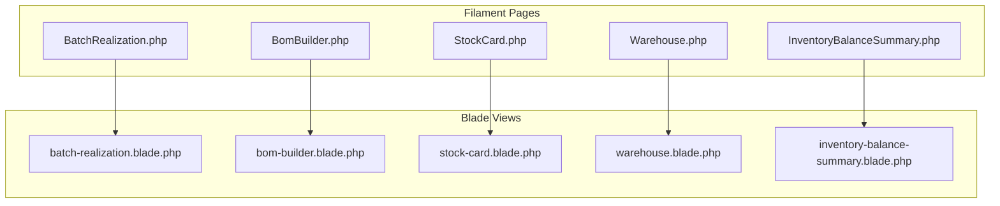
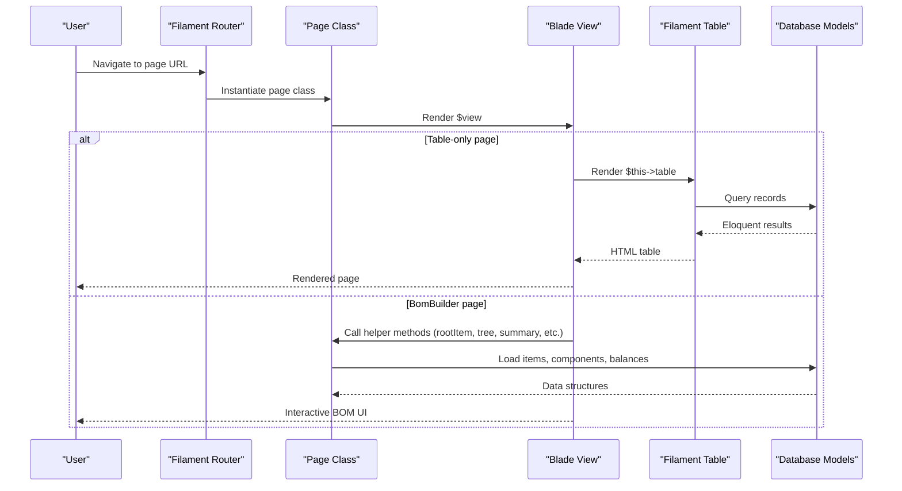
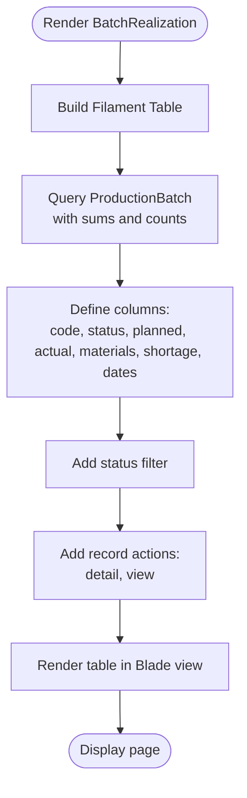
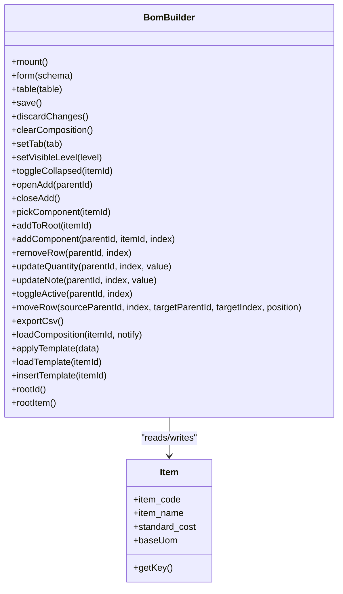
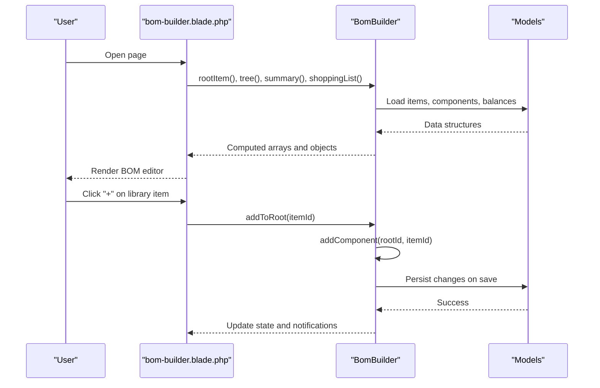
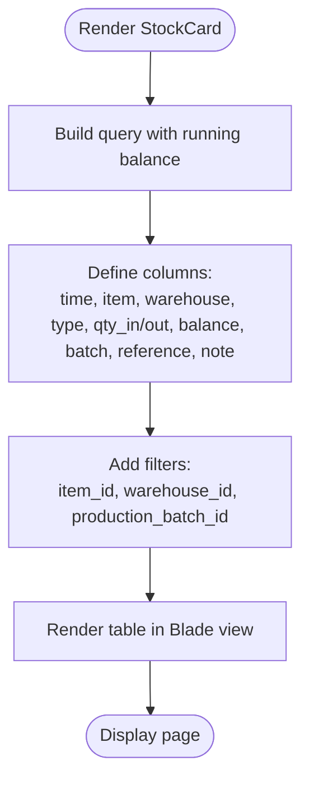
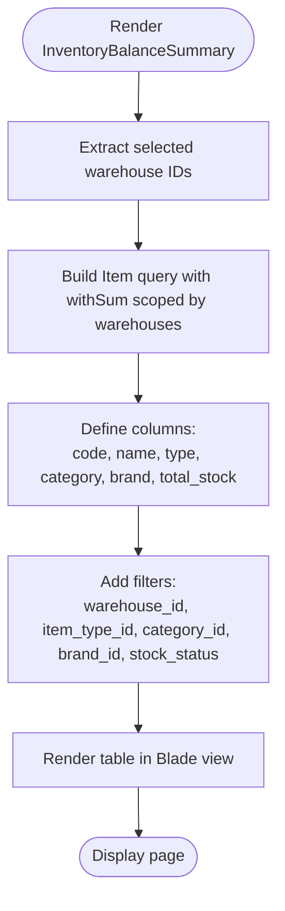
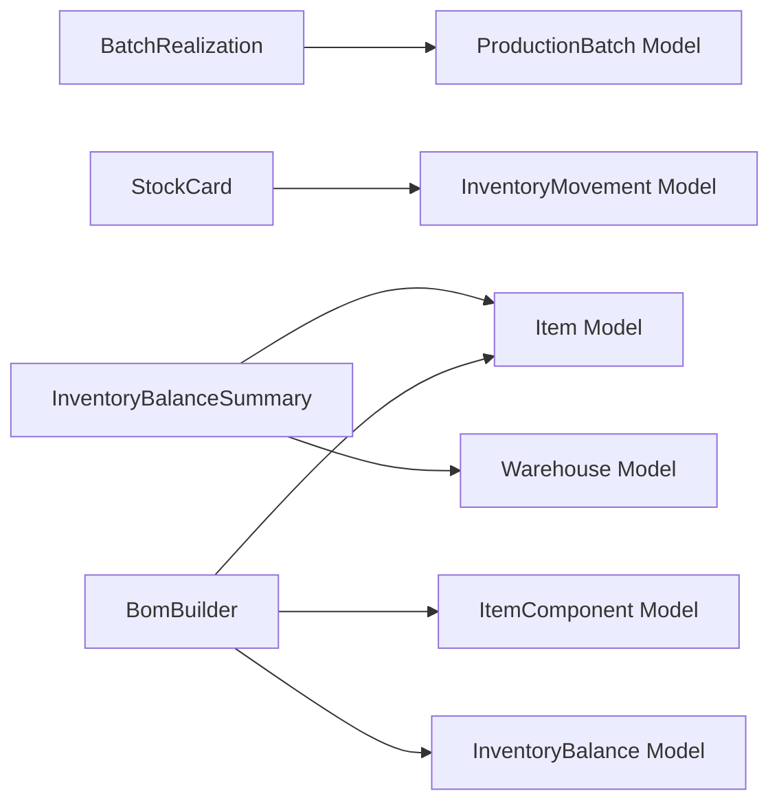

# Filament Page Views

<cite>
**Referenced Files in This Document**
- [BatchRealization.php](file://app/Filament/Pages/BatchRealization.php)
- [bom-builder.blade.php](file://resources/views/filament/pages/bom-builder.blade.php)
- [BomBuilder.php](file://app/Filament/Pages/BomBuilder.php)
- [StockCard.php](file://app/Filament/Pages/StockCard.php)
- [stock-card.blade.php](file://resources/views/filament/pages/stock-card.blade.php)
- [Warehouse.php](file://app/Filament/Pages/Warehouse.php)
- [warehouse.blade.php](file://resources/views/filament/pages/warehouse.blade.php)
- [InventoryBalanceSummary.php](file://app/Filament/Pages/InventoryBalanceSummary.php)
- [inventory-balance-summary.blade.php](file://resources/views/filament/pages/inventory-balance-summary.blade.php)
</cite>

## Table of Contents
1. [Introduction](#introduction)
2. [Project Structure](#project-structure)
3. [Core Components](#core-components)
4. [Architecture Overview](#architecture-overview)
5. [Detailed Component Analysis](#detailed-component-analysis)
6. [Dependency Analysis](#dependency-analysis)
7. [Performance Considerations](#performance-considerations)
8. [Troubleshooting Guide](#troubleshooting-guide)
9. [Conclusion](#conclusion)
10. [Appendices](#appendices)

## Introduction
This document explains the Filament-specific page templates used by the application: batch-realization, bom-builder, stock-card, warehouse, and inventory-balance-summary. It covers how each page integrates with Filament’s page architecture, how data is bound through Livewire state and Blade views, which interactive elements are used, and how styling and responsive behavior are implemented. It also provides guidance for creating new Filament pages and customizing existing ones.

## Project Structure
The pages live under `app/Filament/Pages` as Filament `Page` classes. Each page declares a Blade view under `resources/views/filament/pages`. Simple table-only pages render only `$this->table`, while more complex pages like BomBuilder embed additional UI sections, forms, tables, and custom CSS.

**Diagram sources**
- [BatchRealization.php:33](file://app/Filament/Pages/BatchRealization.php#L33)
- [BomBuilder.php:42](file://app/Filament/Pages/BomBuilder.php#L42)
- [StockCard.php:31](file://app/Filament/Pages/StockCard.php#L31)
- [Warehouse.php:20](file://app/Filament/Pages/Warehouse.php#L20)
- [InventoryBalanceSummary.php:32](file://app/Filament/Pages/InventoryBalanceSummary.php#L32)

**Section sources**
- [BatchRealization.php:19-33](file://app/Filament/Pages/BatchRealization.php#L19-L33)
- [BomBuilder.php:26-42](file://app/Filament/Pages/BomBuilder.php#L26-L42)
- [StockCard.php:17-31](file://app/Filament/Pages/StockCard.php#L17-L31)
- [Warehouse.php:8-20](file://app/Filament/Pages/Warehouse.php#L8-L20)
- [InventoryBalanceSummary.php:18-32](file://app/Filament/Pages/InventoryBalanceSummary.php#L18-L32)

## Core Components
Each page follows a consistent pattern:
- Extend `Filament\Pages\Page`.
- Optionally implement `HasTable` and use `InteractsWithTable` to define a Filament table.
- Set navigation metadata such as group, label, title, icon, and sort order.
- Bind a Blade view via `$view`.
- Provide a subheading through `getSubheading()` where helpful.

Simple pages (BatchRealization, StockCard, InventoryBalanceSummary) primarily render a table inside the default Filament panel layout. The Warehouse page is a placeholder that renders a Filament section. BomBuilder is a rich interactive page combining a table, a form, a tree editor, tabs, statistics, and custom CSS.

**Section sources**
- [BatchRealization.php:19-38](file://app/Filament/Pages/BatchRealization.php#L19-L38)
- [StockCard.php:17-36](file://app/Filament/Pages/StockCard.php#L17-L36)
- [InventoryBalanceSummary.php:18-37](file://app/Filament/Pages/InventoryBalanceSummary.php#L18-L37)
- [Warehouse.php:8-20](file://app/Filament/Pages/Warehouse.php#L8-L20)
- [BomBuilder.php:26-42](file://app/Filament/Pages/BomBuilder.php#L26-L42)

## Architecture Overview
At runtime, Filament resolves the page class, instantiates it, and renders its Blade view. For table-based pages, the view outputs `$this->table`, which is built in the page class using Filament’s table builder. For BomBuilder, the view additionally renders a Livewire-powered interactive BOM editor with Alpine.js drag-and-drop interactions.

**Diagram sources**
- [BatchRealization.php:40-110](file://app/Filament/Pages/BatchRealization.php#L40-L110)
- [StockCard.php:38-127](file://app/Filament/Pages/StockCard.php#L38-L127)
- [InventoryBalanceSummary.php:39-105](file://app/Filament/Pages/InventoryBalanceSummary.php#L39-L105)
- [bom-builder.blade.php:1-28](file://resources/views/filament/pages/bom-builder.blade.php#L1-L28)

## Detailed Component Analysis

### Batch Realization Page
Purpose:
- Show production batches with planned vs actual output and material shortage indicators.
- Provide quick actions to open batch details or view the batch resource.

Key behaviors:
- Navigation metadata places the page under the “Produksi” group.
- A Filament table queries `ProductionBatch` with aggregated columns for planned quantity, actual output, materials count, and shortage.
- Status column uses enum options and color mapping.
- Filters allow filtering by status.
- Record actions link to detail and view pages.

Data binding:
- Table columns bind directly to Eloquent attributes and computed states.
- Actions generate URLs using Filament’s page/resource URL helpers.

Styling and responsiveness:
- Uses Filament table badges, colors, and sortable/searchable columns.
- Empty state messaging guides users when no batches exist.

**Diagram sources**
- [BatchRealization.php:40-110](file://app/Filament/Pages/BatchRealization.php#L40-L110)
- [batch-realization.blade.php:1-4](file://resources/views/filament/pages/batch-realization.blade.php#L1-L4)

**Section sources**
- [BatchRealization.php:19-38](file://app/Filament/Pages/BatchRealization.php#L19-L38)
- [BatchRealization.php:40-110](file://app/Filament/Pages/BatchRealization.php#L40-L110)
- [batch-realization.blade.php:1-4](file://resources/views/filament/pages/batch-realization.blade.php#L1-L4)

### Bom Builder Page
Purpose:
- Allow users to compose bill-of-materials (BOM) trees for finished goods or semi-finished items.
- Provide a library of components, template reuse, drag-and-drop reordering, active/inactive toggles, notes, quantities, cost summaries, and CSV export.

Key behaviors:
- Navigation metadata places the page under “Produksi”.
- A top-level table lists items that already have compositions, with actions to manage or use as template.
- A form binds the selected parent item via an infinite select component.
- State properties track groups, dirty flags, collapsed nodes, visible depth, search terms, and add-panel context.
- Methods handle adding/removing/moving rows, updating quantities and notes, toggling active state, clearing composition, applying templates, and exporting CSV.
- The Blade view renders a two-column layout: left sidebar for library and templates; right work area for root info, stats, tabs, tree editor, shopping list, and save/discard actions.
- Custom CSS defines variables for light/dark themes, grid layout, cards, chips, tree rows, and responsive scrolling.

Data binding:
- Livewire properties (`groups`, `dirtyGroups`, `collapsed`, `visibleLevel`, `search`, `addParentId`, `productionQty`) are bound to inputs and actions.
- Blade computes derived data via page methods (`rootItem`, `tree`, `summary`, `shoppingList`, `libraryItems`, `templateItems`, `addOptions`).
- Filament table and form integrate with Livewire updates.

Interactive elements:
- Drag-and-drop using Alpine.js event handlers on library items and tree rows.
- Tabs switch between BOM structure and shopping list.
- Inline inputs update quantities and notes with debounced Livewire bindings.
- Buttons trigger server-side mutations via `wire:click`.

Styling and responsiveness:
- CSS variables adapt to dark mode.
- Grid layout stacks on small screens due to flex/grid defaults.
- Sticky sidebar and scrollable tree improve usability on large BOMs.

**Diagram sources**
- [BomBuilder.php:107-118](file://app/Filament/Pages/BomBuilder.php#L107-L118)
- [BomBuilder.php:214-265](file://app/Filament/Pages/BomBuilder.php#L214-L265)
- [BomBuilder.php:291-332](file://app/Filament/Pages/BomBuilder.php#L291-L332)
- [BomBuilder.php:374-400](file://app/Filament/Pages/BomBuilder.php#L374-L400)
- [BomBuilder.php:455-503](file://app/Filament/Pages/BomBuilder.php#L455-L503)
- [BomBuilder.php:516-551](file://app/Filament/Pages/BomBuilder.php#L516-L551)
- [BomBuilder.php:553-612](file://app/Filament/Pages/BomBuilder.php#L553-L612)
- [BomBuilder.php:614-670](file://app/Filament/Pages/BomBuilder.php#L614-L670)
- [BomBuilder.php:672-714](file://app/Filament/Pages/BomBuilder.php#L672-L714)
- [BomBuilder.php:721-761](file://app/Filament/Pages/BomBuilder.php#L721-L761)
- [BomBuilder.php:791-800](file://app/Filament/Pages/BomBuilder.php#L791-L800)

**Diagram sources**
- [bom-builder.blade.php:30-94](file://resources/views/filament/pages/bom-builder.blade.php#L30-L94)
- [BomBuilder.php:439-503](file://app/Filament/Pages/BomBuilder.php#L439-L503)
- [BomBuilder.php:291-332](file://app/Filament/Pages/BomBuilder.php#L291-L332)

**Section sources**
- [BomBuilder.php:26-42](file://app/Filament/Pages/BomBuilder.php#L26-L42)
- [BomBuilder.php:107-118](file://app/Filament/Pages/BomBuilder.php#L107-L118)
- [BomBuilder.php:214-265](file://app/Filament/Pages/BomBuilder.php#L214-L265)
- [BomBuilder.php:291-332](file://app/Filament/Pages/BomBuilder.php#L291-L332)
- [BomBuilder.php:374-400](file://app/Filament/Pages/BomBuilder.php#L374-L400)
- [BomBuilder.php:455-503](file://app/Filament/Pages/BomBuilder.php#L455-L503)
- [BomBuilder.php:516-551](file://app/Filament/Pages/BomBuilder.php#L516-L551)
- [BomBuilder.php:553-612](file://app/Filament/Pages/BomBuilder.php#L553-L612)
- [BomBuilder.php:614-670](file://app/Filament/Pages/BomBuilder.php#L614-L670)
- [BomBuilder.php:672-714](file://app/Filament/Pages/BomBuilder.php#L672-L714)
- [BomBuilder.php:721-761](file://app/Filament/Pages/BomBuilder.php#L721-L761)
- [bom-builder.blade.php:1-28](file://resources/views/filament/pages/bom-builder.blade.php#L1-L28)
- [bom-builder.blade.php:30-94](file://resources/views/filament/pages/bom-builder.blade.php#L30-L94)
- [bom-builder.blade.php:96-137](file://resources/views/filament/pages/bom-builder.blade.php#L96-L137)
- [bom-builder.blade.php:138-437](file://resources/views/filament/pages/bom-builder.blade.php#L138-L437)

### Stock Card Page
Purpose:
- Display inventory movement history with running balance per item and warehouse.
- Support filtering by item, warehouse, and production batch.

Key behaviors:
- Navigation metadata places the page under “Gudang”.
- Table query selects raw movement rows and calculates a running balance using a window function partitioned by item and warehouse.
- Columns show time, item code/name, warehouse, type (incoming/outgoing), quantities, running balance, batch reference, and optional fields.
- Filters include searchable item dropdown, warehouse relationship filter, and production batch filter.

Data binding:
- Column state functions format incoming/outgoing values and apply colors based on movement type.
- Number formatting uses locale-aware utilities.

Styling and responsiveness:
- Filament table badges and toggleable columns keep the interface clean.
- Pagination supports larger datasets.

**Diagram sources**
- [StockCard.php:38-127](file://app/Filament/Pages/StockCard.php#L38-L127)
- [stock-card.blade.php:1-4](file://resources/views/filament/pages/stock-card.blade.php#L1-L4)

**Section sources**
- [StockCard.php:17-36](file://app/Filament/Pages/StockCard.php#L17-L36)
- [StockCard.php:38-127](file://app/Filament/Pages/StockCard.php#L38-L127)
- [stock-card.blade.php:1-4](file://resources/views/filament/pages/stock-card.blade.php#L1-L4)

### Warehouse Page
Purpose:
- Placeholder page introducing the warehouse hub and pointing users to related menus.

Key behaviors:
- Navigation metadata sets label and sort order but disables automatic registration.
- Blade view renders a Filament section with heading, description, and icon.

Styling and responsiveness:
- Uses Filament section component and Tailwind utility classes for text color in light/dark modes.

**Section sources**
- [Warehouse.php:8-20](file://app/Filament/Pages/Warehouse.php#L8-L20)
- [warehouse.blade.php:1-14](file://resources/views/filament/pages/warehouse.blade.php#L1-L14)

### Inventory Balance Summary Page
Purpose:
- Summarize total stock across warehouses per item.
- Allow filtering by multiple warehouses, item type, category, brand, and stock status.

Key behaviors:
- Navigation metadata places the page under “Gudang”.
- Table query aggregates `total_stock_all_warehouses` using `withSum`, scoped by selected warehouses.
- Filters include multiple-select warehouse filter, relationship filters for type/category/brand, and a stock status filter that scopes items with or without stock.

Data binding:
- Helper methods extract selected warehouse IDs from table filters and apply them to both the summary query and filter scoping callbacks.

Styling and responsiveness:
- Filament table badges and toggleable columns provide clarity.
- Pagination and sorting support large inventories.

**Diagram sources**
- [InventoryBalanceSummary.php:39-105](file://app/Filament/Pages/InventoryBalanceSummary.php#L39-L105)
- [InventoryBalanceSummary.php:107-165](file://app/Filament/Pages/InventoryBalanceSummary.php#L107-L165)
- [inventory-balance-summary.blade.php:1-4](file://resources/views/filament/pages/inventory-balance-summary.blade.php#L1-L4)

**Section sources**
- [InventoryBalanceSummary.php:18-37](file://app/Filament/Pages/InventoryBalanceSummary.php#L18-L37)
- [InventoryBalanceSummary.php:39-105](file://app/Filament/Pages/InventoryBalanceSummary.php#L39-L105)
- [InventoryBalanceSummary.php:107-165](file://app/Filament/Pages/InventoryBalanceSummary.php#L107-L165)
- [inventory-balance-summary.blade.php:1-4](file://resources/views/filament/pages/inventory-balance-summary.blade.php#L1-L4)

## Dependency Analysis
Common dependencies across these pages:
- Filament Page base class and optional HasTable contract.
- Eloquent models for domain data (e.g., ProductionBatch, InventoryMovement, Item, Warehouse).
- Filament Tables for listing, filtering, sorting, and actions.
- Blade views for rendering content within the Filament panel layout.

Coupling patterns:
- Table-only pages are loosely coupled: they depend mainly on models and Filament table builders.
- BomBuilder is more tightly coupled: it depends on custom form components, services for calculations, and extensive client-side interactivity.

Potential circular dependencies:
- No direct circular imports observed among these page classes.
- Heavy reliance on model relationships requires careful eager loading to avoid N+1 queries.

External integrations:
- Filament panels, tables, forms, notifications, and Blade components.
- Database layer via Eloquent.

**Diagram sources**
- [BatchRealization.php:5-7](file://app/Filament/Pages/BatchRealization.php#L5-L7)
- [StockCard.php:5-6](file://app/Filament/Pages/StockCard.php#L5-L6)
- [InventoryBalanceSummary.php:5-6](file://app/Filament/Pages/InventoryBalanceSummary.php#L5-L6)
- [BomBuilder.php:6-8](file://app/Filament/Pages/BomBuilder.php#L6-L8)

**Section sources**
- [BatchRealization.php:5-7](file://app/Filament/Pages/BatchRealization.php#L5-L7)
- [StockCard.php:5-6](file://app/Filament/Pages/StockCard.php#L5-L6)
- [InventoryBalanceSummary.php:5-6](file://app/Filament/Pages/InventoryBalanceSummary.php#L5-L6)
- [BomBuilder.php:6-8](file://app/Filament/Pages/BomBuilder.php#L6-L8)

## Performance Considerations
- Use eager loading for relationships displayed in tables to prevent N+1 queries.
- Prefer database-side aggregations (e.g., `withSum`, window functions) over PHP loops for totals and running balances.
- Paginate large tables and limit initial dataset size.
- Debounce user inputs (as done in BomBuilder) to reduce Livewire request frequency.
- Cache expensive computations if repeated across requests, invalidating caches on mutations.

[No sources needed since this section provides general guidance]

## Troubleshooting Guide
Common issues and remedies:
- Missing navigation entry: Ensure `$shouldRegisterNavigation` is not set to false unless intentional.
- Blank table: Verify query conditions and filters; check empty state messages for guidance.
- Incorrect running balance: Validate window function partitioning and ordering.
- BomBuilder validation errors: Check cycle detection and self-reference checks before saving.
- Export issues: Confirm CSV encoding and headers; ensure BOM prefix is written for Excel compatibility.

**Section sources**
- [Warehouse.php:12](file://app/Filament/Pages/Warehouse.php#L12)
- [StockCard.php:45-52](file://app/Filament/Pages/StockCard.php#L45-L52)
- [BomBuilder.php:455-503](file://app/Filament/Pages/BomBuilder.php#L455-L503)
- [BomBuilder.php:614-670](file://app/Filament/Pages/BomBuilder.php#L614-L670)

## Conclusion
These Filament pages demonstrate a range of integration patterns:
- Simple table-driven dashboards (BatchRealization, StockCard, InventoryBalanceSummary).
- A rich interactive editor (BomBuilder) combining Livewire state, Blade templating, Alpine.js interactions, and custom CSS.
- A placeholder page (Warehouse) illustrating how to introduce new areas of the admin panel.

By following the established patterns—declarative navigation metadata, Filament table builders, Blade views, and clear separation of concerns—you can extend the system with new pages that fit seamlessly into the Filament ecosystem.

[No sources needed since this section summarizes without analyzing specific files]

## Appendices

### Creating a New Filament Page
Steps:
1. Create a new class extending `Filament\Pages\Page` under `app/Filament/Pages`.
2. Add navigation metadata (`$navigationGroup`, `$navigationLabel`, `$title`, `$navigationIcon`, `$navigationSort`).
3. If the page needs a table, implement `HasTable` and use `InteractsWithTable`; define the table in a `table(Table $table)` method.
4. Bind a Blade view via `$view = 'filament.pages.your-page';`.
5. Create the corresponding Blade file under `resources/views/filament/pages/your-page.blade.php`.
6. For simple tables, render `$this->table` inside the default panel layout.
7. For complex UI, embed forms, sections, and custom CSS as shown in BomBuilder.

Example references:
- Simple table page: [StockCard.php:17-31](file://app/Filament/Pages/StockCard.php#L17-L31), [stock-card.blade.php:1-4](file://resources/views/filament/pages/stock-card.blade.php#L1-L4)
- Complex interactive page: [BomBuilder.php:26-42](file://app/Filament/Pages/BomBuilder.php#L26-L42), [bom-builder.blade.php:1-28](file://resources/views/filament/pages/bom-builder.blade.php#L1-L28)

**Section sources**
- [StockCard.php:17-31](file://app/Filament/Pages/StockCard.php#L17-L31)
- [stock-card.blade.php:1-4](file://resources/views/filament/pages/stock-card.blade.php#L1-L4)
- [BomBuilder.php:26-42](file://app/Filament/Pages/BomBuilder.php#L26-L42)
- [bom-builder.blade.php:1-28](file://resources/views/filament/pages/bom-builder.blade.php#L1-L28)

### Customizing Existing Pages
Guidance:
- Adjust navigation metadata to change grouping, labels, icons, and sort order.
- Modify table columns, filters, and actions to refine data presentation and workflows.
- Enhance Blade views with additional sections, charts, or layouts while keeping Filament components intact.
- For BomBuilder-like complexity, introduce Livewire state properties and Alpine.js interactions carefully, ensuring debounce and validation strategies are in place.

Example references:
- Navigation customization: [BatchRealization.php:23-31](file://app/Filament/Pages/BatchRealization.php#L23-L31)
- Table customization: [InventoryBalanceSummary.php:39-105](file://app/Filament/Pages/InventoryBalanceSummary.php#L39-L105)
- Blade customization: [warehouse.blade.php:1-14](file://resources/views/filament/pages/warehouse.blade.php#L1-L14)

**Section sources**
- [BatchRealization.php:23-31](file://app/Filament/Pages/BatchRealization.php#L23-L31)
- [InventoryBalanceSummary.php:39-105](file://app/Filament/Pages/InventoryBalanceSummary.php#L39-L105)
- [warehouse.blade.php:1-14](file://resources/views/filament/pages/warehouse.blade.php#L1-L14)