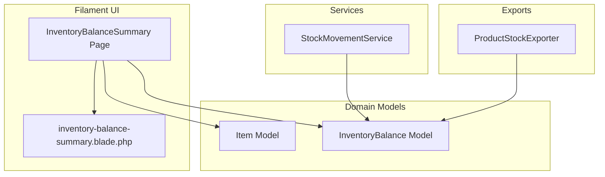
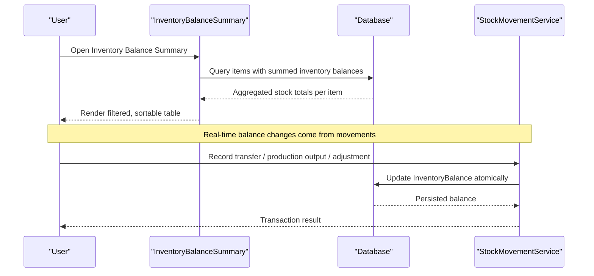
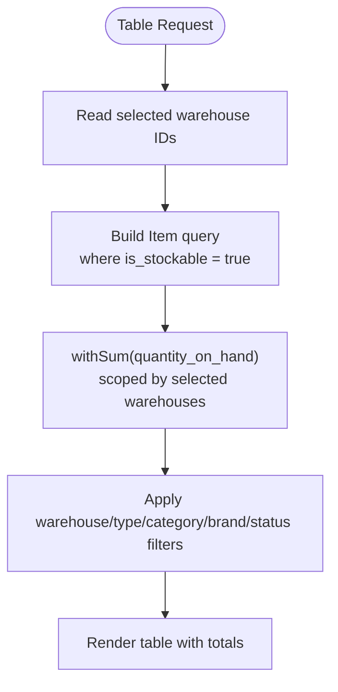
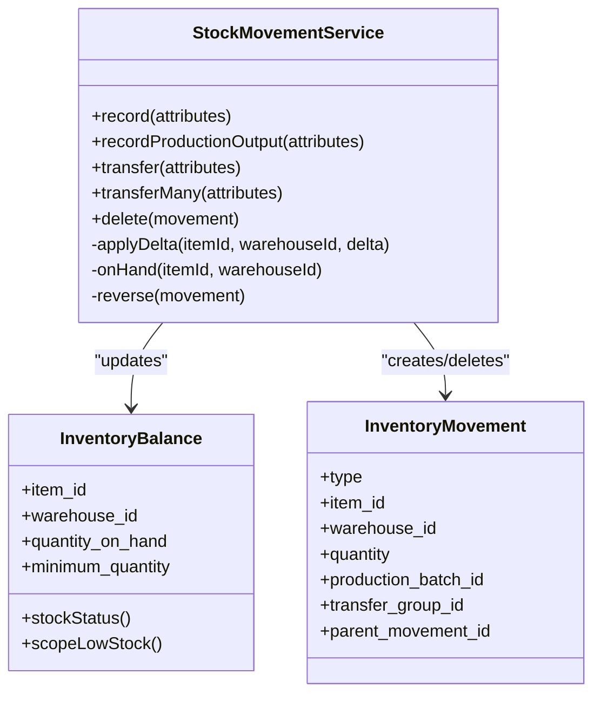
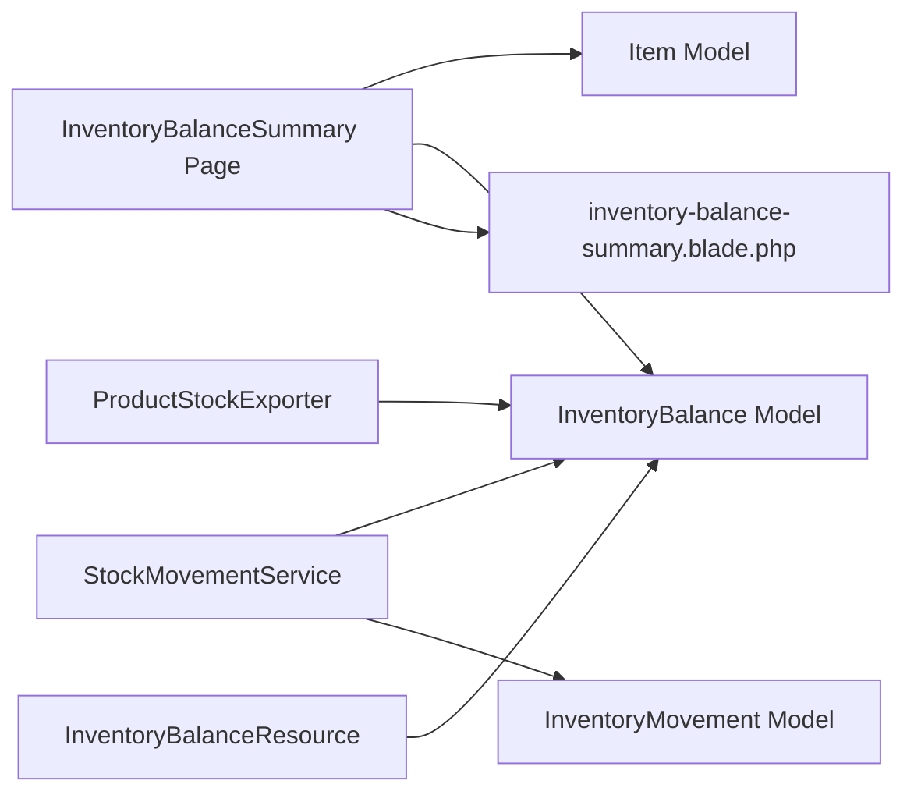

# Inventory Balance Summary View

<cite>
**Referenced Files in This Document**
- [InventoryBalanceSummary.php](file://app/Filament/Pages/InventoryBalanceSummary.php)
- [inventory-balance-summary.blade.php](file://resources/views/filament/pages/inventory-balance-summary.blade.php)
- [StockMovementService.php](file://app/Services/StockMovementService.php)
- [InventoryBalance.php](file://app/Models/InventoryBalance.php)
- [Item.php](file://app/Models/Item.php)
- [ProductStockExporter.php](file://app/Filament/Exports/ProductStockExporter.php)
- [InventoryBalanceResource.php](file://app/Filament/Resources/InventoryBalances/InventoryBalanceResource.php)
- [InventoryBalanceTest.php](file://tests/Feature/InventoryBalanceTest.php)
</cite>

## Table of Contents
1. [Introduction](#introduction)
2. [Project Structure](#project-structure)
3. [Core Components](#core-components)
4. [Architecture Overview](#architecture-overview)
5. [Detailed Component Analysis](#detailed-component-analysis)
6. [Dependency Analysis](#dependency-analysis)
7. [Performance Considerations](#performance-considerations)
8. [Troubleshooting Guide](#troubleshooting-guide)
9. [Conclusion](#conclusion)

## Introduction
The Inventory Balance Summary view is a Filament admin page that aggregates stock levels across warehouses and presents them as a sortable, filterable table. It focuses on:
- Aggregated stock level reporting per item
- Low-stock awareness through related resources and model helpers
- Integration with the inventory movement system for real-time balance accuracy
- Filtering by warehouse, item type, category, brand, and stock status
- Exporting inventory data via Filament exporters

This documentation explains how the dashboard computes totals, how filters scope results, how low-stock alerts are surfaced, and how performance is optimized for large datasets.

## Project Structure
The inventory balance summary feature spans a Filament page, a Blade view, Eloquent models, a stock movement service, and an exporter used elsewhere in the application.

**Diagram sources**
- [InventoryBalanceSummary.php:18-32](file://app/Filament/Pages/InventoryBalanceSummary.php#L18-L32)
- [inventory-balance-summary.blade.php:1-4](file://resources/views/filament/pages/inventory-balance-summary.blade.php#L1-L4)
- [Item.php:126-134](file://app/Models/Item.php#L126-L134)
- [InventoryBalance.php:20-45](file://app/Models/InventoryBalance.php#L20-L45)
- [StockMovementService.php:16-59](file://app/Services/StockMovementService.php#L16-L59)
- [ProductStockExporter.php:13-31](file://app/Filament/Exports/ProductStockExporter.php#L13-L31)

**Section sources**
- [InventoryBalanceSummary.php:18-32](file://app/Filament/Pages/InventoryBalanceSummary.php#L18-L32)
- [inventory-balance-summary.blade.php:1-4](file://resources/views/filament/pages/inventory-balance-summary.blade.php#L1-L4)

## Core Components
- InventoryBalanceSummary page: defines navigation metadata, table columns, filters, and the aggregated query.
- Blade view: renders the Filament table component inside a panel page.
- Item model: provides relationships to inventory balances and attributes such as code, name, type, category, and brand.
- InventoryBalance model: stores per-item, per-warehouse quantities and exposes low-stock logic.
- StockMovementService: updates inventory balances atomically when movements occur.
- ProductStockExporter: demonstrates exporting inventory-related data using Filament’s exporter framework.

Key responsibilities:
- Compute total stock per item across selected or all warehouses.
- Filter items by warehouse, type, category, brand, and stock availability.
- Surface low-stock indicators through related resources and model scopes.
- Keep balances consistent with movement transactions.

**Section sources**
- [InventoryBalanceSummary.php:39-120](file://app/Filament/Pages/InventoryBalanceSummary.php#L39-L120)
- [Item.php:16-64](file://app/Models/Item.php#L16-L64)
- [InventoryBalance.php:20-69](file://app/Models/InventoryBalance.php#L20-L69)
- [StockMovementService.php:23-59](file://app/Services/StockMovementService.php#L23-L59)
- [ProductStockExporter.php:13-42](file://app/Filament/Exports/ProductStockExporter.php#L13-L42)

## Architecture Overview
The dashboard uses a server-side aggregation approach:
- The page builds an Eloquent query over items.
- It joins inventory balances and sums quantities per item.
- Filters constrain both the rows shown and the sum calculation.
- StockMovementService ensures balances remain accurate after any transaction.

**Diagram sources**
- [InventoryBalanceSummary.php:107-120](file://app/Filament/Pages/InventoryBalanceSummary.php#L107-L120)
- [StockMovementService.php:23-59](file://app/Services/StockMovementService.php#L23-L59)
- [StockMovementService.php:358-387](file://app/Services/StockMovementService.php#L358-L387)

## Detailed Component Analysis

### InventoryBalanceSummary Page
Responsibilities:
- Define navigation group, label, title, icon, and sort order.
- Provide a descriptive subheading explaining the purpose.
- Configure a Filament table with searchable and sortable columns.
- Implement multiple filters:
  - Warehouse (multi-select, scoped to selected warehouses)
  - Item type
  - Category
  - Brand
  - Stock status (in stock vs out of stock)
- Aggregate stock totals per item using `withSum` over inventory balances.

Filter behavior:
- Warehouse filter affects both row visibility and the aggregated total column.
- Stock status filter uses existence checks against inventory balances with positive quantity within selected warehouses.

Aggregation logic:
- Only stockable items are included.
- If no warehouse is selected, the total sums across all warehouses.
- If one or more warehouses are selected, the total sums only those warehouses.

**Diagram sources**
- [InventoryBalanceSummary.php:68-104](file://app/Filament/Pages/InventoryBalanceSummary.php#L68-L104)
- [InventoryBalanceSummary.php:107-120](file://app/Filament/Pages/InventoryBalanceSummary.php#L107-L120)
- [InventoryBalanceSummary.php:138-164](file://app/Filament/Pages/InventoryBalanceSummary.php#L138-L164)

**Section sources**
- [InventoryBalanceSummary.php:22-37](file://app/Filament/Pages/InventoryBalanceSummary.php#L22-L37)
- [InventoryBalanceSummary.php:39-104](file://app/Filament/Pages/InventoryBalanceSummary.php#L39-L104)
- [InventoryBalanceSummary.php:107-164](file://app/Filament/Pages/InventoryBalanceSummary.php#L107-L164)

### Blade View
The Blade view is minimal and delegates rendering to the Filament table component provided by the page.

- Renders the page shell.
- Outputs `$this->table`, which includes columns, filters, pagination, and search.

**Section sources**
- [inventory-balance-summary.blade.php:1-4](file://resources/views/filament/pages/inventory-balance-summary.blade.php#L1-L4)

### Data Models

#### Item Model
- Provides relationships to inventory balances and movements.
- Holds attributes like item code, name, type, category, brand, and flags including `is_stockable`.
- Used by the summary query to aggregate stock totals.

Relevant relationships:
- `inventoryBalances`: HasMany
- `inventoryMovements`: HasMany

**Section sources**
- [Item.php:126-134](file://app/Models/Item.php#L126-L134)
- [Item.php:16-64](file://app/Models/Item.php#L16-L64)

#### InventoryBalance Model
- Stores per-item, per-warehouse stock levels.
- Casts numeric fields to decimal precision.
- Exposes a computed stock status attribute based on quantity on hand versus minimum quantity.
- Provides a `lowStock` scope for filtering records at or below minimum stock.

Computed stock status:
- Out: quantity on hand less than or equal to zero
- Low: quantity on hand greater than zero but less than or equal to minimum quantity
- Ok: above minimum quantity

Low-stock scope:
- Filters where quantity on hand is less than or equal to minimum quantity.

**Section sources**
- [InventoryBalance.php:20-45](file://app/Models/InventoryBalance.php#L20-L45)
- [InventoryBalance.php:47-69](file://app/Models/InventoryBalance.php#L47-L69)

### Stock Movement Integration
StockMovementService is responsible for updating inventory balances whenever stock moves occur.

Key behaviors:
- Records single movements and applies deltas to inventory balances.
- Validates positive quantities.
- Handles production output with automatic material consumption.
- Supports transfers between warehouses with paired outgoing and incoming movements.
- Supports bulk transfers with shortage validation.
- Deletes movements and reverses their effects, including child movements.
- Uses database locks to ensure atomic balance updates.

Real-time balance calculations:
- The summary view reads current balances from InventoryBalance.
- Any change to balances goes through StockMovementService, ensuring consistency.

**Diagram sources**
- [StockMovementService.php:23-59](file://app/Services/StockMovementService.php#L23-L59)
- [StockMovementService.php:68-139](file://app/Services/StockMovementService.php#L68-L139)
- [StockMovementService.php:147-201](file://app/Services/StockMovementService.php#L147-L201)
- [StockMovementService.php:209-290](file://app/Services/StockMovementService.php#L209-L290)
- [StockMovementService.php:296-387](file://app/Services/StockMovementService.php#L296-L387)
- [InventoryBalance.php:20-69](file://app/Models/InventoryBalance.php#L20-L69)

**Section sources**
- [StockMovementService.php:23-59](file://app/Services/StockMovementService.php#L23-L59)
- [StockMovementService.php:68-139](file://app/Services/StockMovementService.php#L68-L139)
- [StockMovementService.php:147-201](file://app/Services/StockMovementService.php#L147-L201)
- [StockMovementService.php:209-290](file://app/Services/StockMovementService.php#L209-L290)
- [StockMovementService.php:296-387](file://app/Services/StockMovementService.php#L296-L387)

### Low-Stock Alerts
Low-stock alerts are surfaced primarily through the InventoryBalance resource and model:
- Navigation badge counts low-stock inventory balance rows.
- Resource table shows stock status with color-coded states: out, low, ok.
- Model provides a computed stock status attribute and a low-stock scope.

Usage patterns:
- Admin users can quickly see how many items are at or below minimum stock.
- The resource’s filter supports selecting “low” to focus on replenishment needs.

Note: The Inventory Balance Summary page itself does not expose a dedicated low-stock column; it focuses on aggregated totals and stock availability filters. For detailed low-stock analysis, use the Inventory Balance resource.

**Section sources**
- [InventoryBalanceResource.php:59-74](file://app/Filament/Resources/InventoryBalances/InventoryBalanceResource.php#L59-L74)
- [InventoryBalanceResource.php:182-211](file://app/Filament/Resources/InventoryBalances/InventoryBalanceResource.php#L182-L211)
- [InventoryBalance.php:47-69](file://app/Models/InventoryBalance.php#L47-L69)

### Filtering and Sorting Capabilities
Available filters:
- Warehouse: multi-select, searchable, scopes both rows and totals.
- Item type: relationship-based select with search and preload.
- Category: relationship-based select with search and preload.
- Brand: relationship-based select with search and preload.
- Stock status: in stock vs out of stock, scoped by selected warehouses.

Sorting:
- Columns such as item code, item name, and total stock are sortable.
- Relationship columns like type, category, and brand are toggleable and sortable where supported by the underlying query.

Search:
- Text search is enabled for item code and item name.

**Section sources**
- [InventoryBalanceSummary.php:43-67](file://app/Filament/Pages/InventoryBalanceSummary.php#L43-L67)
- [InventoryBalanceSummary.php:68-104](file://app/Filament/Pages/InventoryBalanceSummary.php#L68-L104)

### Chart Visualizations
The Inventory Balance Summary page currently does not include chart visualizations. It presents data as a table with filters and sorting. If charts are needed, they can be added as Filament widgets or custom components integrated into the page layout.

[No sources needed since this section describes absence of charts rather than analyzing specific files]

### Export Options
While the Inventory Balance Summary page does not define its own export action, the application includes a Filament exporter for product stock data. This exporter demonstrates how to export inventory-related information using Filament’s exporter framework.

Export characteristics:
- Targets inventory balance data.
- Demonstrates mapping fields and formatting values.
- Can be adapted to export summarized stock totals if integrated with the summary query.

**Section sources**
- [ProductStockExporter.php:13-42](file://app/Filament/Exports/ProductStockExporter.php#L13-L42)

### Validation and Error Handling
StockMovementService enforces several validations:
- Positive quantity requirement for all operations.
- Transfer requires distinct origin and destination warehouses.
- Bulk transfer requires at least one valid item with positive quantity.
- Shortage checks prevent negative balances during transfers and production outputs.
- Deletion safety prevents reversing movements that would cause negative balances.

These validations protect data integrity and provide clear error messages to users.

**Section sources**
- [StockMovementService.php:23-59](file://app/Services/StockMovementService.php#L23-L59)
- [StockMovementService.php:147-201](file://app/Services/StockMovementService.php#L147-L201)
- [StockMovementService.php:209-290](file://app/Services/StockMovementService.php#L209-L290)
- [StockMovementService.php:296-387](file://app/Services/StockMovementService.php#L296-L387)

## Dependency Analysis
The following diagram maps key dependencies among the core components involved in the inventory balance summary and related functionality.

**Diagram sources**
- [InventoryBalanceSummary.php:18-32](file://app/Filament/Pages/InventoryBalanceSummary.php#L18-L32)
- [inventory-balance-summary.blade.php:1-4](file://resources/views/filament/pages/inventory-balance-summary.blade.php#L1-L4)
- [StockMovementService.php:16-59](file://app/Services/StockMovementService.php#L16-L59)
- [ProductStockExporter.php:13-31](file://app/Filament/Exports/ProductStockExporter.php#L13-L31)
- [InventoryBalanceResource.php:43-64](file://app/Filament/Resources/InventoryBalances/InventoryBalanceResource.php#L43-L64)

**Section sources**
- [InventoryBalanceSummary.php:18-32](file://app/Filament/Pages/InventoryBalanceSummary.php#L18-L32)
- [StockMovementService.php:16-59](file://app/Services/StockMovementService.php#L16-L59)
- [ProductStockExporter.php:13-31](file://app/Filament/Exports/ProductStockExporter.php#L13-L31)
- [InventoryBalanceResource.php:43-64](file://app/Filament/Resources/InventoryBalances/InventoryBalanceResource.php#L43-L64)

## Performance Considerations
Optimization strategies implemented or available:
- Server-side aggregation: The summary uses `withSum` to compute totals in SQL, reducing PHP memory usage and avoiding N+1 queries.
- Scoped warehouse filtering: When warehouses are selected, the sum is restricted to those warehouses, improving relevance and potentially reducing dataset size.
- Preload for relationship filters: Type, category, and brand filters use preload to minimize additional queries when loading options.
- Toggleable columns: Hiding nonessential columns reduces payload size and improves rendering performance.
- Atomic balance updates: StockMovementService uses database locks (`lockForUpdate`) to prevent race conditions during concurrent updates.

Recommendations for large datasets:
- Add pagination to the table if not already configured by Filament defaults.
- Index frequently filtered columns such as `warehouse_id`, `item_id`, `category_id`, `brand_id`, and `item_type_id`.
- Consider caching static lookup data (warehouses, types, categories, brands) if option lists become large.
- Use database-level aggregations and avoid loading full model collections into memory.
- Monitor slow queries and add composite indexes where appropriate.

[No sources needed since this section provides general guidance]

## Troubleshooting Guide
Common issues and resolutions:
- Totals do not match expected values:
  - Verify selected warehouses; the total column is scoped to selected warehouses.
  - Ensure items are marked as stockable.
  - Confirm inventory balances exist for the relevant warehouses.
- Filters return unexpected results:
  - Check that relationship filters (type, category, brand) are preloaded and correctly linked.
  - Validate stock status filter logic: in stock means positive quantity in selected warehouses; out of stock means no positive balance in selected warehouses.
- Low-stock alerts not appearing:
  - Ensure minimum quantity is set on inventory balances.
  - Use the Inventory Balance resource to inspect low-stock counts and statuses.
- Errors during stock movements:
  - Positive quantity validation errors indicate invalid input.
  - Transfer errors indicate missing or identical warehouses.
  - Shortage errors indicate insufficient stock for transfers or production outputs.
  - Deletion errors indicate that reversing a movement would cause negative balances.

**Section sources**
- [InventoryBalanceSummary.php:68-104](file://app/Filament/Pages/InventoryBalanceSummary.php#L68-L104)
- [InventoryBalanceSummary.php:107-164](file://app/Filament/Pages/InventoryBalanceSummary.php#L107-L164)
- [InventoryBalanceResource.php:59-74](file://app/Filament/Resources/InventoryBalances/InventoryBalanceResource.php#L59-L74)
- [InventoryBalanceResource.php:182-211](file://app/Filament/Resources/InventoryBalances/InventoryBalanceResource.php#L182-L211)
- [StockMovementService.php:23-59](file://app/Services/StockMovementService.php#L23-L59)
- [StockMovementService.php:147-201](file://app/Services/StockMovementService.php#L147-L201)
- [StockMovementService.php:209-290](file://app/Services/StockMovementService.php#L209-L290)
- [StockMovementService.php:296-387](file://app/Services/StockMovementService.php#L296-L387)

## Conclusion
The Inventory Balance Summary view provides a focused, efficient way to monitor aggregated stock levels across warehouses. It leverages server-side aggregation, robust filtering, and integration with the stock movement system to maintain accurate, real-time balances. While it does not include charts or built-in exports, it integrates cleanly with existing exporters and low-stock alerting mechanisms. For large-scale operations, the current design emphasizes database-level computations and atomic updates, with room for further indexing and caching optimizations.

[No sources needed since this section summarizes without analyzing specific files]