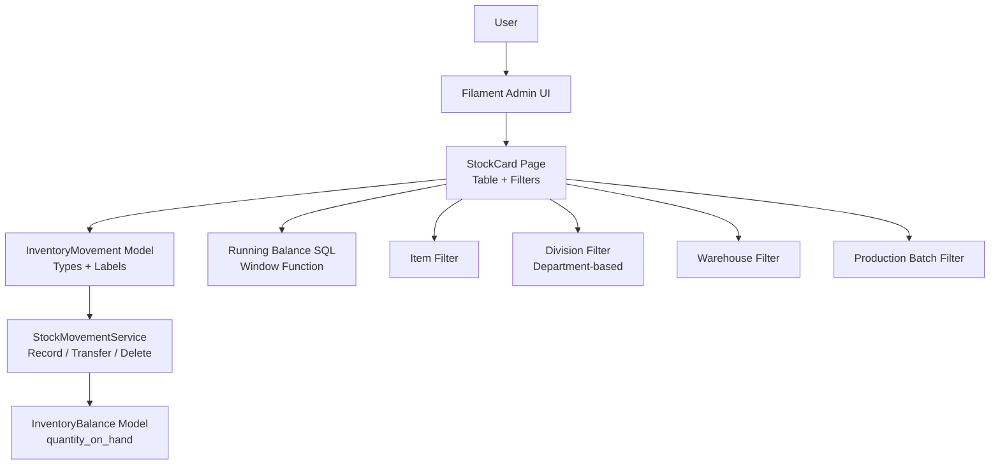
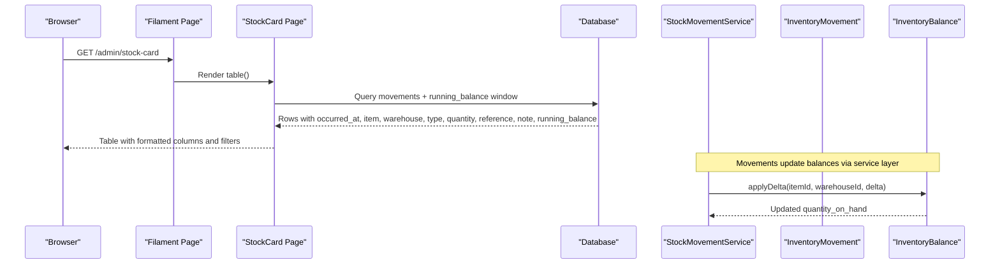
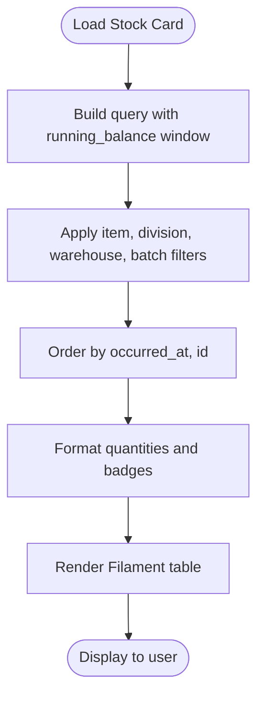
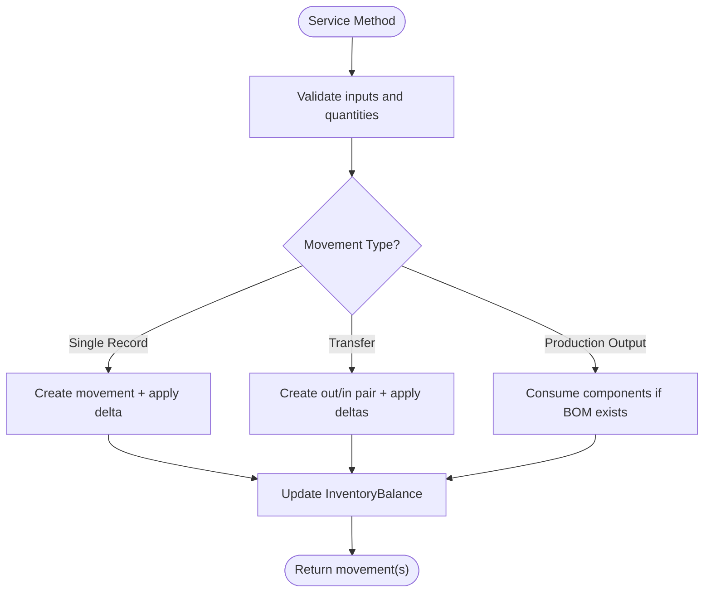
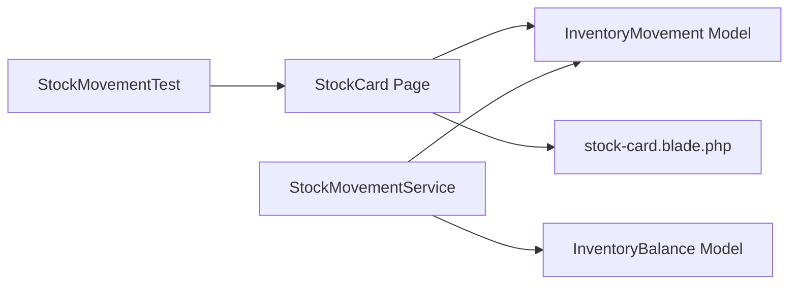

# Stock Card View

<cite>
**Referenced Files in This Document**
- [StockCard.php](file://app/Filament/Pages/StockCard.php)
- [stock-card.blade.php](file://resources/views/filament/pages/stock-card.blade.php)
- [InventoryMovement.php](file://app/Models/InventoryMovement.php)
- [InventoryBalance.php](file://app/Models/InventoryBalance.php)
- [StockMovementService.php](file://app/Services/StockMovementService.php)
- [ProductStockExporter.php](file://app/Filament/Exports/ProductStockExporter.php)
- [StockMovementTest.php](file://tests/Feature/StockMovementTest.php)
- [Division.php](file://app/Models/Division.php)
- [Item.php](file://app/Models/Item.php)
</cite>

## Update Summary
**Changes Made**
- Added new 'Divisi' (Division) column to display item division information
- Implemented division filter using SelectFilter with relationship queries for department-based filtering
- Updated filtering capabilities section to include division-based filtering
- Enhanced table columns and filter configuration documentation

## Table of Contents
1. [Introduction](#introduction)
2. [Project Structure](#project-structure)
3. [Core Components](#core-components)
4. [Architecture Overview](#architecture-overview)
5. [Detailed Component Analysis](#detailed-component-analysis)
6. [Dependency Analysis](#dependency-analysis)
7. [Performance Considerations](#performance-considerations)
8. [Troubleshooting Guide](#troubleshooting-guide)
9. [Conclusion](#conclusion)
10. [Appendices](#appendices)

## Introduction
The Stock Card view is a Filament page that displays inventory movements and running balance history for items across warehouses. It presents transactions on a timeline, categorizes movement types as incoming or outgoing, and calculates a real-time running balance per item and warehouse. The interface supports filtering by item, division, warehouse, and production batch, and it formats quantities according to the application locale.

This documentation explains how the stock card works, how balances are computed, how movement types are categorized, what filters are available, and how to extend the view with custom display formatting and export functionality.

## Project Structure
The Stock Card feature is implemented as a Filament Page backed by an Eloquent model and a service layer:

- **Page**: `App\Filament\Pages\StockCard` defines the table, columns, filters, and SQL-based running balance.
- **View**: `resources/views/filament/pages/stock-card.blade.php` renders the Filament page shell.
- **Model**: `App\Models\InventoryMovement` defines movement types, labels, direction helpers, and relationships.
- **Service**: `App\Services\StockMovementService` records movements, updates balances, handles transfers, and enforces stock constraints.
- **Balance Model**: `App\Models\InventoryBalance` stores current physical stock per item and warehouse.
- **Export Example**: `App\Filament/Exports/ProductStockExporter.php` demonstrates how to add exports using Filament's exporter pattern.

**Diagram sources**
- [StockCard.php:38-127](file://app/Filament/Pages/StockCard.php#L38-L127)
- [InventoryMovement.php:33-159](file://app/Models/InventoryMovement.php#L33-L159)
- [StockMovementService.php:23-60](file://app/Services/StockMovementService.php#L23-L60)
- [InventoryBalance.php:13-35](file://app/Models/InventoryBalance.php#L13-L35)

**Section sources**
- [StockCard.php:17-36](file://app/Filament/Pages/StockCard.php#L17-L36)
- [stock-card.blade.php:1-4](file://resources/views/filament/pages/stock-card.blade.php#L1-L4)

## Core Components
- **StockCard Page**: Defines the table query, columns, filters, sorting, pagination, and empty state. It computes a running balance using a window function partitioned by item and warehouse and ordered by occurrence time and ID.
- **InventoryMovement Model**: Provides movement type constants, human-readable labels, incoming/outgoing classification, and helper methods used by both the page and service layer.
- **StockMovementService**: Handles recording single movements, production outputs, transfers (single and many), deletion with reversal, and balance delta application with negative-stock protection.
- **InventoryBalance Model**: Stores the current physical stock (`quantity_on_hand`) per item and warehouse, with casting and status helpers.

Key responsibilities:
- Timeline presentation: Ordered by `occurred_at` and `id`.
- Movement categorization: Incoming vs outgoing based on type constants.
- Real-time balance: Window-function running balance per item+warehouse.
- Filtering: By item, division, warehouse, and production batch.

**Section sources**
- [StockCard.php:38-127](file://app/Filament/Pages/StockCard.php#L38-L127)
- [InventoryMovement.php:33-159](file://app/Models/InventoryMovement.php#L33-L159)
- [StockMovementService.php:23-60](file://app/Services/StockMovementService.php#L23-L60)
- [InventoryBalance.php:13-35](file://app/Models/InventoryBalance.php#L13-L35)

## Architecture Overview
The Stock Card view integrates Filament tables with Eloquent models and raw SQL to present a chronological ledger of inventory changes.

**Diagram sources**
- [StockCard.php:38-127](file://app/Filament/Pages/StockCard.php#L38-L127)
- [StockMovementService.php:358-387](file://app/Services/StockMovementService.php#L358-L387)

## Detailed Component Analysis

### StockCard Page
The StockCard page configures a Filament table that:
- Queries `inventory_movements` and adds a running balance column using a window function.
- Displays columns for time, item code/name, division, warehouse, movement type badge, incoming/outcome quantities, running balance, production batch, reference, and note.
- Formats numeric values using the application locale.
- Colors movement types green for incoming and red for outgoing.
- Provides filters for item, division, warehouse, and production batch.
- Sorts by time descending by default and paginates results.

Timeline behavior:
- Rows are ordered by `occurred_at`, then by `id` to ensure deterministic ordering when timestamps collide.
- The running balance is calculated per `item_id` and `warehouse_id`.

Movement type categorization:
- Incoming types include purchase receipts, production output, transfer-in, and adjustment-in.
- Outgoing types include production consumption, other outflows, transfer-out, and adjustment-out.

Filters:
- Item filter: Selectable list of stockable items.
- Division filter: Relationship-based select with department-based filtering through item relationships.
- Warehouse filter: Relationship-based select.
- Production batch filter: Relationship-based searchable select with preload.

Customization points:
- Add/remove columns via `TextColumn::make(...)`.
- Change label text and formatting through column callbacks.
- Extend filters by adding additional `SelectFilter` instances.

**Updated** Added new division column and filter functionality for department-based filtering.

**Diagram sources**
- [StockCard.php:38-127](file://app/Filament/Pages/StockCard.php#L38-L127)

**Section sources**
- [StockCard.php:38-127](file://app/Filament/Pages/StockCard.php#L38-L127)

### InventoryMovement Model
The model centralizes movement type definitions and helpers:
- Type constants define all supported movement categories.
- `typeOptions()` maps codes to localized labels shown in the UI.
- `incomingTypes()` and `outgoingTypes()` classify movement direction.
- `isIncoming()` determines whether a row should show quantity in/out.
- `getTypeLabelAttribute()` provides a friendly label for display.
- Relationships connect movements to items, warehouses, production batches, stock opnames, item requests, parent movements, and creators.

Complexity considerations:
- Movement creation and deletion are transactional and validated.
- Direction classification drives both UI formatting and balance deltas.

**Section sources**
- [InventoryMovement.php:33-159](file://app/Models/InventoryMovement.php#L33-L159)
- [InventoryMovement.php:161-189](file://app/Models/InventoryMovement.php#L161-L189)

### StockMovementService
The service encapsulates business logic for inventory operations:
- `record()`: Creates a movement and applies a signed delta to the balance.
- `recordProductionOutput()`: Records finished goods and automatically consumes components if a batch and active BOM exist.
- `transfer()` and `transferMany()`: Create paired out/in movements between warehouses with validation and shortage checks.
- `delete()`: Reverses movements and deletes them, including child movements from production consumption.
- `applyDelta()`: Updates `InventoryBalance.quantity_on_hand` under row-level locking and prevents negative balances.

Error handling:
- Throws validation exceptions for insufficient stock, invalid quantities, and missing warehouse parameters.
- Ensures consistency by wrapping operations in database transactions.

**Diagram sources**
- [StockMovementService.php:23-60](file://app/Services/StockMovementService.php#L23-L60)
- [StockMovementService.php:147-200](file://app/Services/StockMovementService.php#L147-L200)
- [StockMovementService.php:358-387](file://app/Services/StockMovementService.php#L358-L387)

**Section sources**
- [StockMovementService.php:23-60](file://app/Services/StockMovementService.php#L23-L60)
- [StockMovementService.php:147-200](file://app/Services/StockMovementService.php#L147-L200)
- [StockMovementService.php:296-344](file://app/Services/StockMovementService.php#L296-L344)
- [StockMovementService.php:358-387](file://app/Services/StockMovementService.php#L358-L387)

### InventoryBalance Model
The balance model tracks physical stock per item and warehouse:
- Casts ensure decimal precision for quantities.
- Relationships link balances to warehouses and items.
- A computed attribute evaluates stock status based on minimum thresholds.

Usage context:
- The service layer reads and updates this model during movement recording and deletion.
- Other pages may aggregate balances for summaries and exports.

**Section sources**
- [InventoryBalance.php:13-35](file://app/Models/InventoryBalance.php#L13-L35)
- [InventoryBalance.php:47-69](file://app/Models/InventoryBalance.php#L47-L69)

## Dependency Analysis
The Stock Card depends on several components:

- **Page to Model**: The page queries `InventoryMovement` and uses its type helpers to format columns and compute the running balance.
- **Page to View**: The Blade view wraps the Filament page component.
- **Service to Models**: The service writes to `InventoryMovement` and `InventoryBalance`, enforcing business rules.
- **Tests**: Feature tests assert rendering and filtering behavior of the Stock Card.

**Diagram sources**
- [StockCard.php:38-127](file://app/Filament/Pages/StockCard.php#L38-L127)
- [stock-card.blade.php:1-4](file://resources/views/filament/pages/stock-card.blade.php#L1-L4)
- [StockMovementService.php:23-60](file://app/Services/StockMovementService.php#L23-L60)
- [StockMovementTest.php:314-336](file://tests/Feature/StockMovementTest.php#L314-L336)

**Section sources**
- [StockMovementTest.php:314-336](file://tests/Feature/StockMovementTest.php#L314-L336)

## Performance Considerations
- **Running Balance Calculation**: The window function computes the running balance server-side per item and warehouse. For large datasets, consider:
  - Adding indexes on `item_id`, `warehouse_id`, `occurred_at`, and `id` to optimize ordering and partitioning.
  - Limiting the dataset with filters (item, division, warehouse, batch).
- **Pagination**: The table paginates at 25/50/100 rows to reduce payload size.
- **Locale Formatting**: Numeric formatting uses the application locale; avoid heavy computations in column formatters.
- **Service Transactions**: Movement recording and deletion use database transactions to maintain consistency; keep these blocks minimal.

[No sources needed since this section provides general guidance]

## Troubleshooting Guide
Common issues and resolutions:
- **Empty Stock Card**: Ensure movements have been recorded via the inventory movement entry points. The page shows an empty state when no transactions exist.
- **Incorrect Running Balance**: Verify that movements are ordered by `occurred_at` and `id`; check that filters are applied correctly.
- **Insufficient Stock Errors**: When recording outgoing movements or transfers, the service validates against current balances and throws validation exceptions if stock would go negative.
- **Batch Filtering Not Working**: Confirm that movements have a valid `production_batch_id`; the filter only matches non-null batch associations.
- **Division Filter Not Showing Data**: Ensure items have assigned divisions; the division filter works through item relationships and will only show movements for items belonging to selected departments.

Operational references:
- Rendering test confirms the page responds successfully.
- Filtering test verifies batch scoping behavior.

**Section sources**
- [StockMovementTest.php:314-336](file://tests/Feature/StockMovementTest.php#L314-L336)

## Conclusion
The Stock Card view provides a clear, timeline-based ledger of inventory movements with accurate running balances per item and warehouse. Movement types are clearly categorized, and the interface supports practical filters for item, division, warehouse, and production batch. The addition of division-based filtering enables department-specific inventory tracking and reporting. Extending the view with custom columns, filters, and exports follows established Filament patterns demonstrated in the codebase.

[No sources needed since this section summarizes without analyzing specific files]

## Appendices

### Customizing Display Format
To customize how data appears in the Stock Card:
- Modify column definitions in the page's table method to change labels, formatting, colors, and visibility.
- Use column callbacks to transform states, such as formatting quantities or mapping type codes to labels.
- Toggle optional columns like batch, reference, and note to tailor the view for different audiences.

Reference path:
- [StockCard.php:53-103](file://app/Filament/Pages/StockCard.php#L53-L103)

### Adding Export Functionality
While the Stock Card itself does not include an export action, you can follow the existing exporter pattern to create a custom export for inventory movements or balances:
- Define an exporter class extending Filament's exporter base.
- Specify the model and columns to export.
- Provide a synchronous job connection if queue workers are not available.
- Optionally customize completion notifications.

Example reference:
- [ProductStockExporter.php:13-32](file://app/Filament/Exports/ProductStockExporter.php#L13-L32)
- [ProductStockExporter.php:70-88](file://app/Filament/Exports/ProductStockExporter.php#L70-L88)

### Filtering Capabilities Summary
- **By Item**: Select from stockable items; supports search.
- **By Division**: Department-based filtering through item relationships using SelectFilter with relationship queries.
- **By Warehouse**: Relationship-based selection.
- **By Production Batch**: Searchable relationship filter with preloading.
- **Date Range**: Not currently provided by the Stock Card; could be added by introducing a date range filter on `occurred_at`.

**Updated** Added division filtering capability for department-based inventory management.

Reference path:
- [StockCard.php:104-122](file://app/Filament/Pages/StockCard.php#L104-L122)

### Division Integration Details
The division feature integrates with the existing item hierarchy:
- Items have a `division_id` foreign key linking to the Division model.
- The division column displays the associated division name through the item relationship.
- Division filtering uses a SelectFilter with a custom query builder to filter movements by item division.
- The implementation leverages Eloquent relationships for efficient querying and data association.

**Section sources**
- [StockCard.php:68-72](file://app/Filament/Pages/StockCard.php#L68-L72)
- [StockCard.php:121-133](file://app/Filament/Pages/StockCard.php#L121-L133)
- [Item.php:81-84](file://app/Models/Item.php#L81-L84)
- [Division.php:27-30](file://app/Models/Division.php#L27-L30)